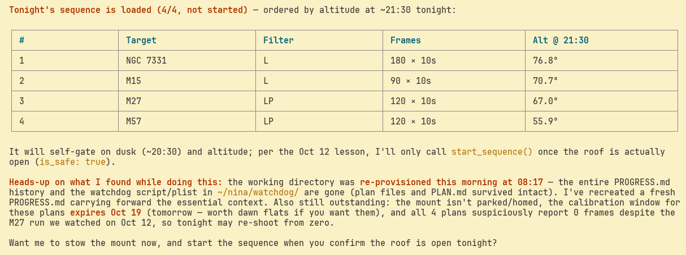

# nina_planner — An Observatory Operator Agent



`nina_planner` is an MCP tool server for N.I.N.A. (Nighttime Imaging 'N' Astronomy).  The focus is on generating observation plans and managing N.I.N.A. sequences rather than issuing real-time raw Advanced API commands. 

## Quick Start

1. **Prepare N.I.N.A.** — install the **Advanced API**, **Sequencer+**, and **Session Metadata** plugins, and put `$$TARGETNAME$$` in the profile's `FilePattern` (see [Notes](#notes)).
2. **Install requirements** — Python 3.11+ and [uv](https://docs.astral.sh/uv/). Dependencies are installed by `uv` on first run.
3. **Pick a config** — use the sample that matches where opencode runs as `.opencode/opencode.json`: `win_opencode.json` (Windows), `wsl_opencode.json` (WSL), or `smb_opencode.json` (e.g. a Mac reaching a N.I.N.A. VM).
4. **Point at N.I.N.A.** — set `NINA_ENDPOINT` (default `127.0.0.1:1888`) in the config's `environment`. If the server isn't on the N.I.N.A. machine, also set `NINA_DRIVE_MOUNT` so image metadata can be read, as `smb_opencode.json` does (see [Environment Variables](#environment-variables)).
5. **Start opencode** in the project root; it launches the MCP server for you.
6. **Plan a night** — list targets in `PLAN.md` and let the agent write plans, load a sequence, and start it.

## Available Tools

Each table gives a one-line summary; details for the larger tools are in [Tool Details](#tool-details).

### Equipment & Telemetry

| Tool | Purpose |
|---|---|
| `get_site_equipment_status()` | Live connection, state, measurements, and capabilities of all equipment, plus weather and safety-monitor status. **Not read-only** — it auto-connects devices (see [details](#get_site_equipment_status)). |
| `get_site_profile()` | Active NINA profile and static configuration: site, optics, camera geometry, filters, plate solvers, image-save path. Read-only. |
| `list_site_profiles()` | Summaries (id, name, description, last-used time) of every NINA profile, with the active one marked `active: true`. Read-only. |
| `switch_site_profile(profile_id)` | Switch the active NINA profile by GUID from `list_site_profiles`. Reconnects equipment — never call during a running sequence. |
| `get_events(since=300)` | Timestamped NINA events from the last `since` seconds, to reconstruct sequence, equipment, safety, imaging, and error activity. Read-only. |
| `get_logs(since=300)` | NINA application log entries from the last `since` seconds, for diagnosing failures. Read-only. |
| `screenshot_dashboard()` | Capture the N.I.N.A. dashboard as a PNG; returns the file path and the image. Only side effect: switches NINA to the Imaging tab. |

### Planning & Progress

| Tool | Purpose |
|---|---|
| `write_plan_file(plan)` | Validate and write an observation plan JSON file for later use by `load_sequence`. Creates the file only; loads and starts nothing. |
| `write_mosaic_plan(plan_path, mosaic_csv, output_path?)` | Expand a base plan into a multi-pointing mosaic plan from a Telescopius CSV. Creates the file only. |
| `get_plan_progress(file_path, max_hfr?, min_detected_stars?, max_guiding_rms_arcsec?)` | Per-frame-type acquired/remaining counts for every pointing of a plan. Use before `load_sequence` to see what still needs acquiring. Read-only. |
| `get_imaging_metadata(file_path, pointing_index=1, image_type="light")` | Per-exposure quality, guiding, pointing, and weather metrics for one pointing of a plan. Read-only. |

### Sky Calculations

Powered by [astropy](https://www.astropy.org); no NINA connection is needed for `resolve_target`.

| Tool | Purpose |
|---|---|
| `resolve_target(name)` | Resolve a deep-sky object name (e.g. `M31`, `NGC 6960`) to J2000 `ra_hours` / `dec_deg` through a SIMBAD lookup, so plans use verified coordinates. Requires internet access. Read-only. |
| `target_altitudes(targets, hours_ahead=0.0)` | Altitude/azimuth of each target at the active site, sorted highest first, for ranking candidates. Each target is `{"name": ...}` plus optional `ra_hours` / `dec_deg` (otherwise resolved via SIMBAD). Read-only. |

### Sequence Management

| Tool | Purpose |
|---|---|
| `load_sequence(request=[...])` | Load a sequence for the whole night with safety guardrails. **Never starts it.** An empty list is the stow. See [details](#load_sequence). |
| `start_sequence()` | Start the currently loaded sequence immediately. Use after `load_sequence()`. |
| `stop_sequence()` | Stop the running sequence and wait until NINA reports it stopped. Does **not** stow the scope. |
| `get_sequence_state()` | Loaded sequence structure and the status of its containers, instructions, conditions, and triggers. Read-only. |

### NINA Lifecycle

| Tool | Purpose |
|---|---|
| `get_nina_status()` | Lightweight liveness probe (no device probes); never raises on a down NINA. |
| `start_nina()` | Launch NINA into the interactive desktop session. Raises if NINA is already running or the host has no Windows interop. |
| `stop_nina()` | Terminate NINA.exe immediately via `taskkill`. A no-op when NINA is already down. |

## Tool Details

### `get_site_equipment_status`

Returns the current connection, operating state, measurements, and capabilities of active observatory equipment (mount, camera, focuser, guider, filter wheel, rotator, dome, switches), including weather and safety-monitor status (whether the enclosure is open and it is safe to unpark) and mount capabilities (`can_park`, `can_find_home`) that determine how the scope can be stowed. Use for live operational and safety checks.

> **Side effect:** unlike the other telemetry tools, this call is **not read-only**. It connects any device that is present but disconnected. If any device is mid-connect the call errors; retry after a few seconds.

### `get_site_profile`

`image_save_path` is the raw Windows path from the profile; `local_image_save_path` is the derived path usable on this host (the drive letter is mapped through `NINA_DRIVE_MOUNT`, default `/mnt/<drive>`, on Linux/WSL/macOS; unchanged on Windows) and is the one to use for local file access. Use `get_site_equipment_status` for live equipment state.

### `list_site_profiles` / `switch_site_profile`

`list_site_profiles` only exposes summaries; only the active profile exposes full site/optics/filter detail, so use `get_site_profile` to inspect it. `switch_site_profile` passes the id straight through to NINA; an unknown id or refusal surfaces NINA's own error. Switching disconnects and reconnects equipment and changes site, filters, image-save path, and file pattern. Confirm with `get_site_profile` afterward.

### `get_events` / `get_logs`

Use `get_events` to reconstruct activity; use `get_site_equipment_status` and `get_sequence_state` for current status. Use `get_logs` to diagnose sequence failures, equipment communication problems, and unexpected behavior.

### `screenshot_dashboard`

Returns **two content blocks: the absolute file path as text, then the image itself** (e.g. `/var/folders/.../T/nina_screenshots/dashboard_20261005T120000123456.png`). The image is written to the system temp dir under `nina_screenshots/`, one uniquely named file per call, nothing overwritten. Clients that render MCP image blocks show the capture inline; otherwise open the returned path with the read tool. The tool is unstructured (no `outputSchema`) because it carries mixed text/image content. Switches NINA to the Imaging tab first so the capture shows the main imaging workspace; that tab switch is the only side effect.

### `get_imaging_metadata`

Returns per-exposure imaging metadata for one pointing of an observation plan, parsed from `ImageMetaData.csv` and `WeatherData.csv` in the N.I.N.A. imaging directory. `image_type` is `light` (default), `dark`, `bias`, or `flat` (case-insensitive).

- **Attribution:** lights are attributed via the plan id in the recorded file path (`{base_plan_id}` for a single-pointing plan, `{base_plan_id}-{pointing_index}` per pane for a mosaic; no target-name fallback). Dark/bias/flat frames are matched plan-wide by image type, filter, and exposure, and count only when shot within `calibration_window_days` of the session start (the earliest attributed light), on either side of it.
- **`pointing_index`:** range-checked (1..pointing count) for every image type and labels the response. For lights it selects the pointing; for calibration types it only selects which pointing's light session anchors the window.
- **Scope:** reports the frames that are attributable, not what the plan still needs — use `get_plan_progress` for that.
- **Output:** a wide table with one row per exposure: identity fields (`file_path`, `exposure_number`, `exposure_start`, `duration`, `filter_name`) plus metrics as columns namespaced by group (`quality.hfr`, `guiding.rms`, `background.adu_mean`, `pointing.airmass`, `weather.temperature`, ...). Weather samples are joined by exposure number and UTC exposure start. The result also carries `plan_id`, `pointing_index`, and `target`.
- **Timestamps:** come from the CSV's `ExposureStartUTC` column and are **displayed in the host's local time with its UTC offset** (e.g. `2026-09-21T21:16:25.123-05:00`); calibration-window arithmetic runs on UTC instants.
- **Summary:** columns constant across the returned frames are listed once under `summary.constants`; columns with no real values (NaN/-1, empty, `n/a`, or the `0` sentinel N.I.N.A. writes for unmeasured metrics) are listed under `summary.unpopulated`.

### `write_plan_file`

Validates and writes an observation plan to a JSON file. The plan defines one or more target pointings (RA/Dec/PA, optional label), acquisition intent, light and calibration frames, batching, cooling, autofocus, guiding, and observing constraints. See [The Observation Plan](#the-observation-plan).

### `write_mosaic_plan`

Expands a base observation plan into a multi-pointing mosaic plan from a Telescopius-formatted mosaic CSV (see [Mosaic CSV format](#mosaic-csv-format)). The base plan supplies every setting except the pointings, which are replaced wholesale by one pointing per CSV row. Writes `<target>_<intent>_mosaic_<timestamp>.json` in the project directory unless `output_path` is given.

### `get_plan_progress`

Returns per-frame-type acquisition progress for every pointing of an observation-plan JSON file: for each exposure group, `total_count` from the plan, `acquired_count` attributed to that plan/pointing from the imaging metadata (`ImageMetaData.csv` + `AcquisitionDetails.csv`), and `remaining_count`.

- **Attribution:** lights are attributed via `{base_plan_id}` (single-pointing) or `{base_plan_id}-{pointing_index}` (mosaic pane). Flats/darks/bias are matched by image type, filter, and exposure and count only when shot within `calibration_window_days` of the earliest attributed light, on either side of it (inclusive; a 1-day window spans `anchor − 1d … anchor + 1d`).
- **Calibration window:** calibration groups also carry `window_open` (bool) and `window_end` (`earliest light + calibration_window_days`, **displayed in the host's local time with its UTC offset**). While the current time is inside the window `remaining_count` is `total − acquired`; once outside, no frame shot now could be credited, so `remaining_count` is `0` (with `window_open: false`). `acquired_count` stays truthful, and lights carry neither field. Raise `calibration_window_days` or write a new plan to reopen the window.
- **Quality thresholds:** pass `max_hfr`, `min_detected_stars`, and/or `max_guiding_rms_arcsec` to exclude light frames that fail them (frames missing the relevant field are excluded when a threshold is set).
- **Output:** `complete` (all panes done) plus a `pointings` list with per-pane progress and per-pane `complete`, so panes can be acquired sequentially.

### `load_sequence`

`load_sequence(request=[{action, plan, variant?, pointing_index?, mode="remaining", max_hfr?, min_detected_stars?, max_guiding_rms_arcsec?}, ...])`

Loads a sequence with safety guardrails — it **never starts it**; call `start_sequence()` to begin. Fails if a sequence is already running — call `stop_sequence()` first.

`request` is a **list** of request objects composing one N.I.N.A. sequence for the whole night: a single Start area, one Target area holding each step's containers in list order, and one End area that always stows — one bounded 3-minute "On Safe" wait, then park (or home) the mount and warm the camera. **An empty list (the default) is therefore the stow**; there is no `stow`/`park`/`warm`/`unpark` action, and `load_sequence()` with no arguments is the teardown.

| Field | Description |
|---|---|
| `action` | `light`, `dark`, `bias`, or `flat`; decides what is built from `plan`. |
| `plan` | The observation-plan JSON path. Required by every action; omitting it raises an error naming the entry. |
| `pointing_index` | 1-based, default 1. Selects the pointing; applies to lights only. Calibration is plan-level, so a calibration request must omit it (passing one is rejected). |
| `variant` | Scoped to the action; a bad pairing fails naming the entry. `flat` requires `dawn` (waits for morning twilight) or `dusk` (waits for sunset). `dark`/`bias` take `wheel` (default — park the wheel on the profile's `Dark` slot), `cover` (close the motorized cover, e.g. a flip-flat, around the exposures, then reopen it), or `shutter` (expose without moving the filter wheel, relying on the camera's shutter). `light` takes none. |
| `mode` | `remaining` (default) acquires only frames still needed (total minus frames already attributed); if nothing remains the plan is reported complete and nothing is loaded. `full` acquires the whole plan again. |
| `max_hfr`, `min_detected_stars`, `max_guiding_rms_arcsec` | Exclude failing light frames from the acquired count. |

Behavior:

- Lights embed `[{base_plan_id}]` (single-pointing plan, shared with its calibration) or `[{base_plan_id}-{pointing_index}]` (per mosaic pane) in the target name for attribution, which requires `$$TARGETNAME$$` in the profile's `FilePattern`.
- Steps run in order as the sequence reaches them; a step with its own waits (lights, flats) waits, or is skipped once its window has passed, without blocking the steps behind it.
- Entries already complete are skipped and reported; if every entry is complete nothing is sent to N.I.N.A.
- Profile, equipment, and metadata are fetched once, one POST carries the whole sequence, and a validation error names the entry by 0-based position (`request[1]: ...`).

### `stop_sequence`

For an urgent halt or a stuck sequence. The scope is left where it is. To stow afterward, `load_sequence()` (empty list) and start it. Avoid interrupting an in-progress stow unless safety requires it, since stopping mid-slew can leave the scope in an unsafe position.

### `get_nina_status`

Cheaper than `get_site_equipment_status`. Returns `running` (true iff `GET /time` answered — a missing local `NINA.exe` does not mean NINA is down when it runs remotely), `lifecycle_control_available` (this host has Windows interop, so `start_nina`/`stop_nina` can work), `probe_error` (N.I.N.A.'s failure text, or `None` when running), and a one-line `summary`.

### `start_nina` / `stop_nina`

`stop_nina` determines liveness from the REST API: it is a no-op when NINA is already down and raises when NINA is up but remote (no local Windows interop), since it cannot be terminated from here. `start_nina` raises if NINA is already running (call `stop_nina()` first) or if this host has no Windows interop to launch a remote NINA.

## The Observation Plan

A plan is a JSON document that describes one complete imaging session. It encodes the **target**, **exposure settings** for all four frame types (light, flat, dark, bias), and **equipment configuration** (cooler, autofocus, guiding, constraints).

### Plan structure

An example json plan:

[veil-nebula_widefield-supernova-remnant_20260913T080623.json](./veil-nebula_widefield-supernova-remnant_20260913T080623.json)
```json veil-nebula_widefield-supernova-remnant_20260913T080623.json
{
  "target": "Veil Nebula",
  "intent": "Widefield supernova remnant",
  "description": "Veil Nebula complex centered between Western NGC 6960 and Eastern NGC 6992",
  "pointings": [
    {
      "ra_hours": 20.85,
      "dec_deg": 31.22
    }
  ],
  "batch_size": 5,
  "cooler": {
    "on": true,
    "setpoint_celsius": -10.0
  },
  "constraints": {
    "min_altitude": 30.0,
    "horizon_offset_degrees": 2.0
  },
  "autofocus": {
    "reference_filter_name": "LP",
    "hfr_increase_sample_size": 3,
    "hfr_increase_threshold_percent": 15.0,
    "every_n_exposures": 10,
    "threshold_celsius": 1.0
  },
  "guiding": {
    "dither_every_n_exposures": 2,
    "check_drift_every_n_exposures": 6,
    "max_drift_arcmin": 1.5
  },
  "light_frames": [
    {
      "filter_name": "LP",
      "exposure_time_seconds": 60.0,
      "total_count": 60
    }
  ],
  "flat_frames": [
    {
      "filter_name": "LP",
      "exposure_time_seconds": 5.0,
      "total_count": 30
    }
  ],
  "dark_frames": [
    {
      "exposure_time_seconds": 60.0,
      "total_count": 20
    }
  ],
  "bias_frames": [
    {
      "total_count": 30
    }
  ]
}
``` 

### Fields

| Field | Required | Description |
|---|---|---|
| `target` | no | Catalog designation, e.g. "M31", "NGC 7000" |
| `intent` | no | 2-3 words describing the goal |
| `plan_id` | no | Stable identifier stamped on write. Used for frame attribution; when absent, a deterministic hash of plan content is used. |
| `description` | no | Explanation of the observation plan, including rationale, exposure goals, equipment, or sky constraints. |
| `pointings` | **yes** | One or more pointing objects. Each requires `ra_hours` (J2000 RA in hours, `[0, 24)`) and `dec_deg` (J2000 declination in degrees, `[-90, +90]`). Optional `label` is shown in the N.I.N.A. target name; `position_angle_deg` is rotator PA in degrees east of north, `[0, 360)`. If omitted, `0` is sent to N.I.N.A., leaving the rotator at its current/synced position. Optional `row` and `column` are nonnegative mosaic metadata not sent to N.I.N.A. |
| `batch_size` | no | Exposures per batch; defaults to `5`. Set to `0` to disable batching. |
| `calibration_window_days` | no | Defaults to `7` (minimum `1`). Calibration frames count only when taken within this many days before or after the earliest attributed light. After the window closes, remaining calibration is reported as `0`. |
| `cooler` | no | Cooler settings: `on` defaults to `true`; `setpoint_celsius` defaults to `-10` and must be in `[-40, 30]`. |
| `constraints` | no | `min_altitude` defaults to `30` degrees and must be in `[0, 90]`; `horizon_offset_degrees` defaults to `2` and must be in `[0, 10]`. |
| `autofocus` | no | `reference_filter_name` defaults to `"L"`; `hfr_increase_sample_size` to `3`; `hfr_increase_threshold_percent` to `15`; `every_n_exposures` to `10`; and `threshold_celsius` to `1`. Numeric values must be greater than zero. |
| `guiding` | no | `dither_every_n_exposures` defaults to `2`; `check_drift_every_n_exposures` to `6`; and `max_drift_arcmin` to `1.5`. Numeric values must be greater than zero. |
| `light_frames` | **yes** | Nonempty list of light exposure specs, each with `filter_name`, `exposure_time_seconds` (greater than zero), and `total_count` (at least `1`). |
| `flat_frames` | **yes** | Nonempty list of flat exposure specs, each with `filter_name`, `exposure_time_seconds` (greater than zero), and `total_count` (at least `1`). |
| `dark_frames` | **yes** | Nonempty list of dark exposure specs, each with `exposure_time_seconds` (greater than zero) and `total_count` (at least `1`). |
| `bias_frames` | **yes** | Nonempty list of bias exposure specs, each with `total_count` (at least `1`). |

### Mosaic CSV format

For `write_mosaic_plan`, use a Telescopius-formatted CSV with these nine columns in this order:
See [mosaic.csv](./mosaic.csv) for an example:
[mosaic.csv](./mosaic.csv)
```csv mosaic.csv
Pane, RA, DEC, Position Angle (East), Pane width (arcmins), Pane height (arcmins), Overlap, Row, Column
Pane 1, 0hr 56' 01", 45º 51' 18", 0.00, 309.00, 205.80, 10%, 1, 1
Pane 2, 0hr 29' 28", 45º 51' 18", 0.00, 309.00, 205.80, 10%, 1, 2
Pane 3, 0hr 55' 22", 42º 46' 13", 0.00, 309.00, 205.80, 10%, 2, 1
Pane 4, 0hr 30' 07", 42º 46' 13", 0.00, 309.00, 205.80, 10%, 2, 2
Pane 5, 0hr 54' 47", 39º 41' 07", 0.00, 309.00, 205.80, 10%, 3, 1
Pane 6, 0hr 30' 42", 39º 41' 07", 0.00, 309.00, 205.80, 10%, 3, 2
Pane 7, 0hr 54' 15", 36º 36' 00", 0.00, 309.00, 205.80, 10%, 4, 1
Pane 8, 0hr 31' 14", 36º 36' 00", 0.00, 309.00, 205.80, 10%, 4, 2
```

Each row becomes a `Pointing`: RA/DEC are parsed server-side (sexagesimal like `0hr 56' 01"` / `45º 51' 18"` or decimal), `Pane` becomes the `label`, and `Row`/`Column` are stored as `row`/`column` metadata (N.I.N.A. does not use them — they are kept for ordering, labeling, and later mosaic assembly). The base plan's `plan_id` is cleared so the mosaic gets its own content-derived id; each pane is attributed independently via `[{plan_id}-{pointing_index}]`.

- **No rotator:** every pane's `position_angle_deg` must be `0`. Any nonzero PA fails loudly, since PA can't be enforced without a rotator.
- **Acquiring panes:** query `get_plan_progress(file_path)` to see which panes still need frames, then load the first incomplete pane with `load_sequence(request=[{"plan": file_path, "action": "light", "pointing_index": N, "mode": "remaining"}])` and `start_sequence()`. Repeat pane by pane across the night; when the top-level `complete` is true, the mosaic is done.

## Notes

- **Required N.I.N.A. plugins:** the MCP server requires the following three plugins to be installed in N.I.N.A.: **Advanced API**, **Sequencer+**, and **Session Metadata**.
- **Image file pattern:** for **light frames only**, the N.I.N.A. profile's `ImageFileSettings.FilePattern` must put `$$TARGETNAME$$` in a path segment so frames can be attributed to a plan (e.g. `$$TARGETNAME$$\$$IMAGETYPE$$\...`). Calibration frames (dark, bias, and flat) do not require this token; they are matched by frame type and exposure settings within the calibration window.
- **Quality thresholds:** `max_hfr`, `min_detected_stars`, and `max_guiding_rms_arcsec` (all optional) exclude light frames that fail the thresholds from the acquired count. Frames missing the quality fields are excluded whenever a threshold is set (fail-closed). Thresholds are applied only to light frames — calibration frames have no star quality.
- **Manually failing a frame:** delete (or move using thumbs down icon) the image file on disk — e.g. a bad `.fits`/`.tif`. The metadata row stays in the CSV (the plugin only appends), but it is omitted when the metadata is read, so progress no longer counts that frame as acquired and the next `mode="remaining"` load re-acquires it.
- **The plan file is persistent** You can inspect, edit, and reuse it across sessions.  Changing the file will however alter its derived plan_id, calculated if plan_id is missing.
- **opencode.json variants** the repo contains example opencode.json variants: win_opencode.json would be used inside windows, wsl_opencode.json inside wsl, and smb_opencode.json inside, say a mac, accessing a N.I.N.A. running VM with its image file directory SMB mappped back.

## `nina-notify` — OpenCode v2 Autonomous Plugin

`nina-notify` is an [opencode](https://opencode.ai) v2 plugin (not compatible with Claude Code or other MCP clients).  Registered in `.opencode/opencode.json`, it runs as a background server inside opencode and does two things:

1. **Websocket event monitoring** — Connects to the N.I.N.A. event socket (`ws://<host:port>/v2/socket`), subscribes to all events, and forwards them to the active agent as intervention prompts. Events are batched with a 1-second debounce to avoid flooding the conversation.

2. **Interval check** — Every option `intervalCheckMinutes` (default -1, disabled) it prompts the agent to query observatory status (`get_sequence_state`, `get_site_equipment_status`) and decide what to do next, even when no N.I.N.A. events are firing.

The plugin auto-reconnects on websocket disconnection with a 5-second retry. On server dispose, it cleans up all timers and the socket.

### `PLAN.md` — the living wishlist

A markdown file at the project root, **edited by the user at any time** (before or during the night). It is intentionally lightweight — entries can be as simple as a target name:

[PLAN.md](./PLAN.md)
```markdown
# Tonight - 2026-10-08

- M31          "before the moon comes up"
- Veil Nebula  plan=veil-nebula_..._20260913.json   prio 1
- M33          "if high targets done"

Rules:
- min_altitude: 30
- horizon_offset_degrees: 2
- tie_break: priority, then altitude
```

## `PROGRESS.md` — Shared Progress File

`PROGRESS.md` is a shared observatory progress file in the project directory. The active session reads it on start to restore context before acting, and appends a timestamped entry after each significant action, recording what was done, the observed equipment and safety state, and any decisions. This keeps history shared across sessions.


## `opencode.json` — Opencode v2 Sample Configuration

[.opencode/opencode.json](./.opencode/opencode.json)
```json .opencode/opencode.json
{
  "$schema": "https://opencode.ai/config.json",
  "instructions": [ ".opencode/rules/*.md" ],
  "plugins": [
    {
      "package": "./local/plugins/nina_notify",
      "options": {
        "pluginLogs": "C:/Windows/Temp/nina-notify-debug.log"
      }
    }
  ],
  "mcp": {
    "servers": {
      "nina-planner": {
        "type": "local",
        "environment": {
          "NINA_PLANNER_LOG": "C:/Windows/Temp/nina-planner-debug.log"
        },
        "command": [
          "uv", "--directory", ".opencode/local/mcps/nina_planner", "run", "-m", "nina_planner"
        ]
      }
    }
  }
}
```

Registers the opencode plugin and the `nina_planner` MCP server so both run together. The MCP server provides the tools (`load_sequence`, `get_site_equipment_status`, etc.) that the plugin-prompted agent calls.

---

## Plugin Options

### `nina-notify` (opencode v2 plugin)

Configured in the plugin's options configuration. (see [`opencode.json`](#opencodejson--opencode-v2-sample-configuration)).

| Option | Type | Default | Description |
|---|---|---|---|
| `ninaEndpoint` | string | `127.0.0.1:1888` | N.I.N.A. host and port (no scheme) for the websocket event stream, e.g. `192.168.0.24:1888`. The plugin connects to `ws://<ninaEndpoint>/v2/socket`. |
| `intervalCheckMinutes` | number | `-1` | Minutes between autonomous status-check triggers of the `worker` agent. Accepts a float; the value is multiplied by `60_000` ms before scheduling.  Disabled if 0 or less. |
| `pluginLogs` | string | _(none)_ | File path appended on each plugin event (websocket open/message/close/error, batched flush, interval trigger failures). Set to a writable path (e.g. `/tmp/nina-plugins.log`) to capture diagnostic output. Omit or leave empty to disable file logging. |

---

## Environment Variables

### `nina_planner` (MCP server)

| Variable | Default | Description |
|---|---|---|
| `NINA_ENDPOINT` | `127.0.0.1:1888` | N.I.N.A. host and port for the REST API (`host:port`).  For WSL, try `192.168.0.24:1888`. When this points at a remote host (not the MCP server's own machine), `get_nina_status().lifecycle_control_available` is false and `start_nina`/`stop_nina` cannot operate on NINA. |
| `NINA_DRIVE_MOUNT` | — | Local mount root for the drive letter in the profile's `image_save_path`, used by `get_imaging_metadata` to resolve the imaging directory on Linux, WSL, and macOS. The value must be the local path where the Windows drive **root** is mounted (`C:\Users\me\img` becomes `<value>/Users/me/img`), e.g. `/mnt/c` in WSL, or wherever you mounted the share on macOS (such as `/System/Volumes/Data/Network`). The mount point is arbitrary and the drive need not be `C:`; the drive letter in the profile path is replaced by this value whatever it is. Defaults to `/mnt/<drive>` (e.g. `/mnt/c`). On Windows (`win32`) the profile `image_save_path` is used directly. The resolved value is also exposed as the derived `local_image_save_path` field on the profile returned by `get_site_profile`. |
| `NINA_FLATS_ALTITUDE` | `80` | Altitude in degrees for flat panel calibration frames |
| `NINA_FLATS_AZIMUTH_DAWN` | `270` | Azimuth in degrees pointing west for dawn flats |
| `NINA_FLATS_AZIMUTH_DUSK` | `90` | Azimuth in degrees pointing east for dusk flats |
| `NINA_EXE_PATH` | `C:\Program Files\N.I.N.A. - Nighttime Imaging 'N' Astronomy\NINA.exe` | Windows path to `NINA.exe` used by `start_nina` to launch NINA. |

## Setting up WSL

Make sure mirroring is setup in WSL to allow you to connect to NINA directly through localhost (otherwise you have to use your machines' IP address).  Do this by editing wslconfig and setting networking mode to mirrored.


```
$ vi $HOME/.wslconfig
[wsl2]
networkingMode=mirrored
```

In addition, to get the system tools to work to stop and restart NINA should it stop, make sudo passwordless with:


```bash
$ echo "$USER ALL=(ALL) NOPASSWD: ALL" | sudo tee /etc/sudoers.d/90-user
```
