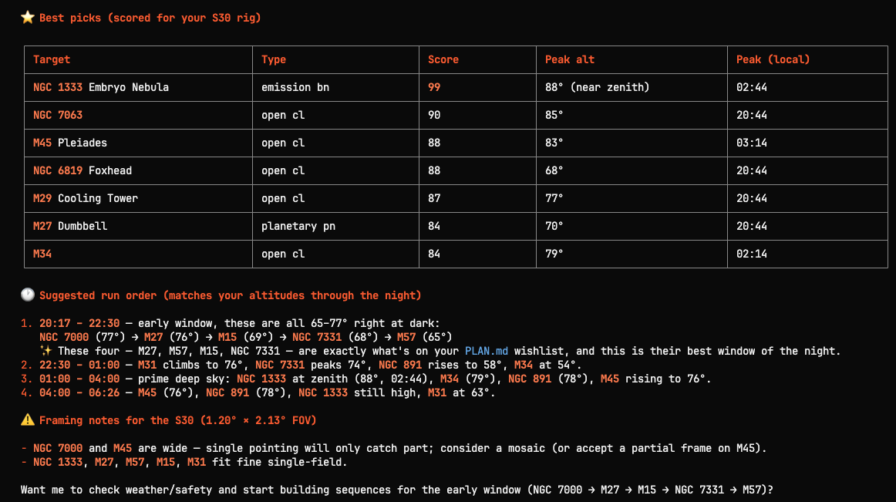

# 🔭 nina-planner — An Observatory Operator Agent



`nina_planner` is an MCP tool server for N.I.N.A. (Nighttime Imaging 'N' Astronomy).  The separate events `nina-notify` plugin is OpenCode-specific.  The focus is on building, executing, and monitoring multi-target sequence runs from observation plans.

## 🚀 Quick Start

1. **🔭 Prepare N.I.N.A.** — install the **Advanced API**, **Sequencer+**, and **Session Metadata** plugins, and put `$$TARGETNAME$$` in the profile's `FilePattern` (see [Notes](#-notes)) — without it, light frames can't be attributed to a plan.
2. **📦 Install requirements** — [opencode](https://opencode.ai) v2 (the `nina-notify` plugin is not compatible with Claude Code or other coding agents), Python 3.11+, and [uv](https://docs.astral.sh/uv/). Dependencies are installed by `uv` on first run.
3. **🧩 Pick a config** — `.opencode/opencode.json` is the config for running opencode **on Windows**. For another host, replace it with `wsl_opencode.json` (WSL) or `smb_opencode.json` (e.g. a Mac reaching a N.I.N.A. VM).
4. **🔌 Point at N.I.N.A.** — set `NINA_ENDPOINT` (default `127.0.0.1:1888`) in the config's `environment`. If the server isn't on the N.I.N.A. machine, also set `NINA_DRIVE_MOUNT` so image metadata can be read, as `smb_opencode.json` does (see [Environment Variables](#-environment-variables)).
5. **▶️ Start opencode** in the project root; it launches the MCP server for you.
6. **🌟 Plan a night** — list targets in `PLAN.md` and let the agent write plans, load a sequence, and start it.

## 🧰 Available Tools

Each table gives a one-line summary; details for the larger tools are in [Tool Details](#-tool-details).

### 🔧 Lifecycle & Health

App liveness and event diagnostics.

| Tool | Purpose |
|---|---|
| `get_nina_status()` | Lightweight liveness probe (no device probes); never raises on a down NINA. |
| `start_nina()` | 🚀 Launch NINA into the interactive desktop session. Raises if NINA is already running or the host has no Windows interop. |
| `stop_nina()` | 🛑 Terminate NINA.exe immediately via `taskkill`. A no-op when NINA is already down. |
| `get_logs(since=300)` | NINA application log entries from the last `since` seconds, for diagnosing failures. Read-only. |
| `get_events(since=300)` | Timestamped NINA events from the last `since` seconds, to reconstruct sequence, equipment, safety, imaging, and error activity. Read-only. |

### 🛡️ Rig & Safety

Live hardware, weather, and enclosure monitor.

| Tool | Purpose |
|---|---|
| `get_site_equipment_status()` | Live connection, state, measurements, and capabilities of all equipment, plus weather and safety-monitor status. ⚠️ **Not read-only** — it auto-connects devices (see [details](#get_site_equipment_status)). |
| `get_site_profile()` | Active NINA profile and static configuration: site, optics, camera geometry, filters, plate solvers, image-save path. Read-only. |

### 🌌 Sky & Ephemeris

Darkness bounds, catalog targets, and offline coordinates. Powered by [astropy](https://www.astropy.org); no NINA connection is needed for `resolve_target`.

| Tool | Purpose |
|---|---|
| `sun_times()` | Next sunrise/sunset plus all four twilight boundaries (civil −6°, nautical −12°, astronomical −18°) and the astronomical-darkness window in effect or next to open, with `night_phase` (`evening`/`dark`/`morning`) and `is_dark_now` for end-of-night decisions. Read-only; reads only the site profile. |
| `moon_times()` | Lunar counterpart to `sun_times()`: `phase` (name, `illumination_fraction`, `waxing`, `elongation_deg`, `age_days`) plus current altitude/azimuth/distance, `moon_up_now`, the next `moonrise`/`moonset` (48 h window), and the next `new_moon`/`first_quarter`/`full_moon`/`last_quarter` instants (~32 d window). Phase instants are geocentric and identical everywhere; rise/set are topocentric for the site. Read-only; offline; reads only the site profile. |
| `best_targets(min_altitude=30.0, top=10, level, kinds)` | Ranks Messier and bright NGC objects from the Pensack 500 list to observe, returning `visible_now` (dark and above the floor now) plus `later_tonight` (peak altitude within astronomical darkness), with `is_dark_now` and surface-brightness-based difficulty filtering. Each row carries pre-verified (SIMBAD-checked) `ra_hours` / `dec_deg` — use them directly for pointing, no `resolve_target` needed, so this works offline.  Read-only. |
| `resolve_target(name)` | Resolve a deep-sky object name (e.g. `M31`, `NGC 6960`) to J2000 `ra_hours` / `dec_deg` through a SIMBAD lookup. 🌐 Requires internet access. Read-only. |
| `target_altitudes(targets, hours_ahead=0.0)` | Altitude/azimuth of each target at the active site, sorted highest first, for ranking candidates. Each target is `{"name": ...}` plus optional `ra_hours` / `dec_deg` (pass the pre-verified values from a `best_targets` row; without them the name is resolved via SIMBAD — needs internet). Read-only. |

### 🎬 Sequencer

Queueing, starting, stopping, and checking runs.

| Tool | Purpose |
|---|---|
| `load_sequence(request=[...])` | Load a sequence for the whole night with safety guardrails. 💤 **Never starts it.** **Every** loaded sequence ends with the stow — an empty list is just that stow with no steps in front of it. See [details](#load_sequence). |
| `start_sequence()` | Start the currently loaded sequence immediately. Use after `load_sequence()`. ▶️ |
| `stop_sequence()` | Stop the running sequence and wait until NINA reports it stopped. ⚠️ Does **not** stow the scope. |
| `get_sequence_state(detail)` | Per-step view of the loaded sequence: plan attribution, status, exposure progress, horizon altitude, errors. `detail`: `summary` (default) or `raw` (`/sequence/state`). Read-only. |

### 🗺️ Plan Management

Plan creation and batch reconciliation.

| Tool | Purpose |
|---|---|
| `audit_plans(plans?, project_dir?, types?, include_orphans=true)` | **Whole-project capture audit in one call**: reconcile plan expectations with CSV attribution (plus the one filesystem fact the CSV cannot hold — `bad` rejects) for every plan into an `all_saved` verdict plus `left_to_do` (including never-shot plans) and `blocked` work lists, and a `never_shot` list of plans with no frames at all. Read-only. |
| `get_plan_progress(file_path)` | Per-frame-type acquired/remaining counts for every pointing of a plan, applying the plan's `quality` thresholds. Use before `load_sequence` to see what still needs acquiring. Read-only. |
| `list_plans(project_dir?)` | Enumerates every observation plan file inside the project directory with its `file`, absolute `path`, `plan_id`, `target`, `intent`, `pointing_count`, and mtime.  Read-only. |
| `write_plan_file(plan)` | Validate and write an observation plan JSON file for later use by `load_sequence` — including its optional `quality` thresholds. Creates the file only; loads and starts nothing. |
| `write_mosaic_plan(plan_path, mosaic_csv, output_path?)` | Expand a base plan into a multi-pointing mosaic plan from a Telescopius CSV. Creates the file only. |
| `get_nina_settings()` | Read the **running server's** environment — `NINA_ARCHIVE_DEST`, `NINA_UPLOAD_CMD`, `NINA_VERIFY_CMD`, `NINA_ENDPOINT`, `NINA_DRIVE_MOUNT` — as received at launch (config file + shell inheritance). Runs nothing; returns `settings`, `missing`, `ready` (the archive trio gates `ready`; endpoint/drive-mount are diagnostics) for the `archive-lifecycle` skill. |

### 📈 Telemetry Watchdog

Live HFR/star-count metrics during acquisition.

| Tool | Purpose |
|---|---|
| `get_frame_stats(image_type?)` | Live per-frame statistics for the current (most recent) frame, straight from the `image-history` API — the watchdog's own data source (HFR, HFR σ, stars, ADU, guiding RMS, temp, filter, filename). Single-frame only, no history; read-only. |

## 📖 Tool Details

### `get_site_equipment_status`

Returns the current connection, operating state, measurements, and capabilities of active observatory equipment (mount, camera, focuser, guider, filter wheel, rotator, dome, switches), including weather and safety-monitor status (whether the enclosure is open and it is safe to unpark) and mount capabilities (`can_park`, `can_find_home`) that determine how the scope can be stowed. Use for live operational and safety checks.

> ⚠️ **Side effect:** unlike the other telemetry tools, this call is **not read-only**. It connects any device that is present but disconnected. If any device is mid-connect the call errors; retry after a few seconds.

### `get_site_profile`

`image_save_path` is the raw Windows path from the profile; `local_image_save_path` is the derived path usable on this host (the drive letter is mapped through `NINA_DRIVE_MOUNT`, default `/mnt/<drive>`, on Linux/WSL/macOS; unchanged on Windows) and is the one to use for local file access. Use `get_site_equipment_status` for live equipment state.

### `get_events` / `get_logs`

Use `get_events` to reconstruct activity; use `get_site_equipment_status` and `get_sequence_state` for current status. Use `get_logs` to diagnose sequence failures, equipment communication problems, and unexpected behavior.

### `get_frame_stats`

Returns N.I.N.A.'s live per-frame statistics for the **current (most recently captured) frame**, read from the `GET /v2/api/image-history` API — the same source the `nina_notify` quality watchdog polls, exposed on demand so a `QUALITY-WATCHDOG` wake can be verified against the exact numbers that fired it.

- **Full record:** `hfr`, `hfr_st_dev`, `stars`, background ADU (`mean`, `median`, `st_dev`, `min`, `max`), guiding RMS text (`rms_text`), `temperature`, `gain`, `offset`, `filter`, `exposure_time`, `target_name`, `filename`, and `date` (the capture timestamp). A genuine `0` (e.g. `stars: 0`, a star-count failure) is preserved as `0` — unlike the CSV path, `0` here is a real reading, not a "not measured" sentinel.
- **Single frame only:** despite its name, `image-history` serves only the current frame — one record, no paging, no count parameter, no session history. This tool is the live view; for anything across a run, compare successive readings taken on each wake or interval check, or read the per-date folders on the imaging drive.
- **`image_type`:** optionally passed through as the API's `imageType` filter to assert the current frame's type (e.g. `"light"`, `"dark"`). When the current frame isn't of that type the tool reports `count: 0` with a note rather than erroring.
- **Output:** `{count, image_type, frame, note}` — `count` is `1` when a frame is present (else `0`, with `frame: null` and `note` explaining why). This tool is read-only.

### `write_plan_file`

Validates and writes an observation plan to a JSON file. The plan defines one or more target pointings (RA/Dec/PA, optional label), acquisition intent, light and calibration frames, batching, cooling, autofocus, guiding, and observing constraints. See [The Observation Plan](#-the-observation-plan).

### `write_mosaic_plan`

Expands a base observation plan into a multi-pointing mosaic plan from a Telescopius-formatted mosaic CSV (see [Mosaic CSV format](#-mosaic-csv-format)). The base plan supplies every setting except the pointings, which are replaced wholesale by one pointing per CSV row. Writes `<target>_<intent>_mosaic_<timestamp>.json` in the project directory unless `output_path` is given.

### `get_plan_progress`

Returns per-frame-type acquisition progress for every pointing of an observation-plan JSON file: for each exposure group, `total_count` from the plan, `acquired_count` attributed to that plan/pointing from the imaging metadata (`ImageMetaData.csv`), `remaining_count`, and `deficit_count` (the raw `total − acquired`, floored at zero, **never** adjusted for the window).

- **Attribution:** lights are attributed via `_{base_plan_id}_` (single-pointing) or `_{base_plan_id}-{pointing_index}_` (mosaic pane). Flats are matched by image type and filter, darks/bias by image type and exposure, and all count only when shot within `calibration_window_days` of the earliest attributed light, on either side of it (inclusive; a 1-day window spans `anchor − 1d … anchor + 1d`).
- **Calibration window:** calibration groups also carry `window_open` (bool) and `window_end` (`earliest light + calibration_window_days`, **displayed in the host's local time with its UTC offset**). While the current time is inside the window `remaining_count` is `total − acquired`; once outside, no frame shot now could be credited, so `remaining_count` is `0` (with `window_open: false`). `acquired_count` stays truthful, and lights carry neither field. Raise `calibration_window_days` or write a new plan to reopen the window.
- **`remaining_count == 0` is not "complete":** the window rule above zeroes a calibration group's remaining even when frames are missing, so completion is decided from `acquired_count` vs `total_count` and window state instead — a closed window under a deficit is reported as **`expired_with_deficit`**, not complete. Per pane, `status` is `complete` / `incomplete` / `expired_with_deficit`; the top level carries `expired_with_deficit` (bool), and `complete` is true only when every pane is genuinely done. The expired case is separated from `incomplete` because its fix differs: no sequence run can close an expired calibration deficit — raise `calibration_window_days` or write a new plan — and `warning` says so.
- **Quality thresholds — set in the plan file, not on this call:** the plan's optional `quality` section (`max_hfr`, `max_hfr_st_dev`, `min_detected_stars`, `max_guiding_rms_arcsec`, all defaulting to no filtering) excludes light frames that fail an enabled threshold — or that are missing the metric it needs (NINA writes `0` for unmeasured values, and `0` fails an active threshold) — from the acquired count, so a failed frame leaves a deficit to re-shoot. The response's top-level `quality` field echoes exactly which thresholds were applied (`{}` means none). The same section drives [`load_sequence`](#load_sequence)'s remaining-mode count, so the two can never disagree; passing a threshold to this call is no longer possible (it is rejected). `audit_plans` deliberately ignores `quality` — it reports what is on disk, not what qualifies.
- **Scope:** one plan per call — for a whole-project sweep (every plan, disk files included, in one call), use [`audit_plans`](#audit_plans).
- **Output:** `complete` (all panes genuinely done — decided from acquired counts and window state, never from `remaining_count == 0` alone) plus a `pointings` list with per-pane progress, per-pane `complete`, and per-pane `status`, so panes can be acquired sequentially.
- **Overshoot — read this before trusting `complete`:** light items also carry `surplus_count` (frames attributed beyond `total_count`), and the top level carries `overshot` (bool) and `warning` (string or null). `acquired_count` is **cumulative across every run** of the plan while `total_count` is a per-plan constant, so a `mode="full"` re-shoot asks N.I.N.A. for `total_count` *more* frames and the older ones keep the plan complete no matter what that run delivered — a re-shoot that lost 103 of its 120 frames still reported `acquired_count: 137, remaining_count: 0, complete: true`. When `overshot` is true, treat `complete` as "these frames exist" and **not** as "the last run succeeded": confirm what the latest run actually landed with [`audit_plans`](#audit_plans) plus the per-date frame folders on the imaging drive. `surplus_count` cannot tell a re-shoot apart from the same target shot on separate nights under one plan id, so it is a prompt to check, not a verdict. Lights only — calibration is pool-credited across plans and routinely overshoots.

### `list_plans`

`list_plans(project_dir?)`

Returns `{"plans": [...], "errors": [...]}` — one entry per plan JSON in the project directory (default: the server's working directory) with `file`, absolute `path`, `plan_id`, `target`, `intent`, `pointing_count`, and `written` (mtime, ISO-8601 local with offset). Unparseable JSON files are reported per file under `errors` instead of failing the call, and a relative `project_dir` resolves against the project directory. Use it to enumerate plans; `audit_plans` shares the same discovery.

### `audit_plans`

`audit_plans(plans?, project_dir?, types?, include_orphans=true)`

Answers **"are all my targets' captures saved to disk, and what is left to do?"** for every plan in one call, replacing per-plan `get_plan_progress` sweeps (15 plans = 15 calls otherwise). `plans` selects a subset (paths or names, resolved against `project_dir`, default = every `*.json` in the project directory); `types` subsets the output rows to any of `light` / `flat` / `dark` / `bias` (case-insensitive).

- **Two truth sources, reconciled per plan × frame type:** `expected` (the plan's `total_count`, summed over its exposure groups — per pointing for lights, plan-level for calibration) and `attributed` / `remaining` (exactly what `get_plan_progress` reports, quirks included). The filesystem is consulted for exactly one fact `ImageMetaData.csv` cannot carry: frames N.I.N.A. rejected via its `BAD_` filename prefix — `2026-10-22_04-46-37_L_...fits.fz` → `BAD_2026-10-22_04-46-37_L_...fits.fz` — whose CSV row still names the pre-rename file, so the reject never reaches `attributed`; the light row reports them as `bad`. Calibration rows carry `own_rows`: how many of that type's recorded frames sit under *this plan's own* token (`_{base_plan_id}_`, or `_{base_plan_id}-{n}_` per mosaic pane) rather than the shared pool.
- **Top-level output:** `all_saved` (true only when no row needs work, no plan file failed to load, and no plan is unshot), `totals` (expected / attributed across everything, plus a `never_shot` count), `left_to_do`, `blocked`, `never_shot`, `rows`, `orphans`, `errors`, and `root` (the imaging directory actually scanned).
- **`left_to_do`** holds only what *running a sequence* can fix — `MISSING_FILES` and row-level `NEVER_SHOT` rows, with `missing` = `remaining` and an `action` hint per type, plus one `NEVER_SHOT` entry per unshot pointing of a wholly unshot plan with `missing` = that pointing's whole light ask. **`blocked`** is `EXPIRED`: the calibration window closed under a deficit, so only raising `calibration_window_days` or writing a new plan helps.
- **`never_shot` — the left join's blind spot, closed:** discovery is driven by `ImageMetaData.csv`, so a plan that was written but never imaged has no row to join on and used to vanish from the audit entirely. The cost was real: an operator reading `left_to_do` alone saw two 1-frame deficits while **six whole unshot plans (240 frames)** also waited — found only by diffing `list_plans` by hand. Only **light** attributions count as a reference: calibration is pool-credited and lands under the shared base token, so a plan whose id appears solely on flat/dark/bias rows has never had a light acquired and is reported here, not joined into the audit by its own darks. Every loadable plan whose id no recorded light frame references is now reported here (`plan_id`, `file`, `target`, `intent`, `pointing_count`, `light_expected`, `written`) **and** in `left_to_do` with `reason: "NEVER_SHOT"`. Matched on **plan id**, not file: a rewritten/archived twin of an already-shot plan is never flagged (its frames exist under the shared id), and two unshot copies of one plan report once, from the shallowest file. Unshot plans still get no `rows` — expected vs attributed means nothing for frames never attempted — and they make `all_saved` false, so **delete or move out any plan file you never intend to shoot** (unrelated JSON is already ignored: it never loads as a plan). Explicit `plans=` never populates it: naming a file *is* the request to audit it, so an unshot plan named there audits as an ordinary row with status `NEVER_SHOT`.
- **`status` per row** (first match wins):
  - `EXPIRED` — calibration window closed with an uncredited deficit; surfaces it despite `remaining` being forced to `0` by the window rule ⏳
  - `NEVER_SHOT` — a light row with **zero** attributed frames: no run ever delivered a frame for this pointing, so the whole ask is untried work. Identified from the attribution count itself, never from `remaining` (which is just `expected − attributed` and cannot tell untried work from a partial deficit) 🌑
  - `MISSING_FILES` — `remaining > 0` and the frames genuinely aren't there: shoot more 🔫
  - `SUSPECT_JUNK` — degenerate light/dark rows (duration under half the plan's exposure or `0.01s`, e.g. `0.00003s` Smart-Exposure junk) riding alongside an otherwise-complete set. Bias and flats are exempt (0s is correct for bias; SkyFlat adapts). When junk instead *leaves a deficit*, the status is `MISSING_FILES` with the junk count as the cause 🗑️ The audit reads the live imaging root only, so the status keeps `all_saved: false` until `nina-purge --apply` moves those rows out of attribution's reach — `nina-archive` has already copied them to the plan folder's `junk/` by then (they are listed in `manifest.files[]`, which is what lets the purge proceed at all).
  - `POOL_CREDITED` — calibration satisfied plan-wide from another target's directory while this plan's own `own_rows` fall short — informational, not a gap 🏷️
  - `OVERSHOT` — lights attributed above expected: the target has been acquired more than once, either by a `mode="full"` re-run or on separate nights under one plan id. Harmless in itself ℹ️, but it is the case where `complete` cannot describe the *latest* run — a re-shoot that lost frames still reads complete because the older ones satisfy the plan — so confirm what that run landed via the per-date folder counts 🧐
  - `OK` ✅
- ⚠️ **Why the columns can disagree:** calibration is matched **plan-wide** (flats by type+filter, darks by type+exposure, bias by type, all within the window around the earliest attributed light), so one bias set credits every plan and `attributed` can legitimately exceed that plan's own `own_rows` — which is precisely what `POOL_CREDITED` reports. Lights also require the exposure duration to match (±0.05s), so degenerate frames never count. ℹ️ A `bad`-rejected frame never reaches `attributed`, so it shows up as a `remaining` deficit explained by the light row's `bad` count. There is no disk-vs-CSV cross-check any more: a frame the Session Metadata plugin never recorded appears in *neither* source, so it surfaces as an ordinary `MISSING_FILES` deficit. That is rare and safe to re-shoot, which is all this audit ever advised.
- 🚨 **Failure semantics:** a missing or unmounted imaging root **raises** (naming the site profile path and `NINA_DRIVE_MOUNT`) rather than reporting empty counts — "no frames" and "no mount" must never look alike. A broken plan file lands in `errors` and the rest of the sweep still runs; a project directory with no plans returns a `warning` with `root: null`. `orphans` lists landing token directories whose plan file no longer exists (from deleted plans) — the dual of `never_shot`, which is plan files whose frames do not exist. Every `.fits`/`.fits.fz` under an orphan is counted regardless of what its parent folder is called, so an unexpected folder name can never make real frames read as absent.

### `load_sequence`

`load_sequence(request=[{action, plan, variant?, pointing_index?, mode="remaining"}, ...])`

Loads a sequence with safety guardrails — 💤 it **never starts it**; call `start_sequence()` to begin. ⚠️ Fails if a sequence is already running — call `stop_sequence()` first.

`request` is a **list** of request objects composing one N.I.N.A. sequence for the whole night: a single Start area, one Target area holding each step's containers in list order, and one End area that always stows — one bounded 3-minute "On Safe" wait, then park (or home) the mount and warm the camera.

🅿️ **The stow is unconditional: every sequence `load_sequence` builds ends with that same End area**, whatever the request contains — a full night's target list, a single dark set, or nothing at all. So the night always finishes parked and warmed no matter what ran; the request list only decides what happens *before* the stow. **An empty list (the default) is simply the stow with an empty Target area** — there is no `stow`/`park`/`warm`/`unpark` action, and `load_sequence()` with no arguments is the teardown.

| Field | Description |
|---|---|
| `action` | `light`, `dark`, `bias`, or `flat`; decides what is built from `plan`. |
| `plan` | The observation-plan JSON path. Required by every action; omitting it raises an error naming the entry. |
| `pointing_index` | 1-based, default 1. Selects the pointing; applies to lights only. Calibration is plan-level, so a calibration request must omit it (passing one is rejected). |
| `variant` | Scoped to the action; a bad pairing fails naming the entry. `flat` requires `dawn` (waits for morning twilight) or `dusk` (waits for sunset). `dark`/`bias` take `wheel` (default — park the wheel on the profile's `Dark` slot), `cover` (close the motorized cover, e.g. a flip-flat, around the exposures, then reopen it), or `shutter` (expose without moving the filter wheel, relying on the camera's shutter) — each capability-checked at load: `wheel` needs a filter wheel with a `Dark` slot, `cover` a flat device reporting open/close support, `shutter` a camera reporting HasShutter, and a variant the rig cannot perform fails naming the reason plus the variants it supports. `light` takes none. |
| `mode` | `remaining` (default) acquires only frames still needed (total minus frames already attributed); if nothing remains the plan is reported complete and nothing is loaded. `full` acquires the whole plan again — and warns when that light group is already complete (see Behavior). |

Behavior:

- **Quality thresholds are not request fields** — they live in the plan file's `quality` section (`max_hfr`, `max_hfr_st_dev`, `min_detected_stars`, `max_guiding_rms_arcsec`; all optional, defaulting to no filtering), which `load_sequence` and [`get_plan_progress`](#get_plan_progress) both read, so remaining-mode counts always agree. Passing one in a request fails with a message naming the plan file as its new home — a silent ignore would be worse, since the caller would believe it was filtering while every frame counted. Lights only: calibration frames have no star quality and are matched by filter, exposure and the calibration window alone. The active thresholds are echoed in `get_plan_progress`'s `quality` field.

- Lights embed `_{base_plan_id}_` (single-pointing plan, shared with its calibration) or `_{base_plan_id}-{pointing_index}_` (per mosaic pane) in the target name for attribution, which requires `$$TARGETNAME$$` in the profile's `FilePattern`. The token is underscore-delimited on purpose: N.I.N.A. rewrites `[` and `]` to `_` when it substitutes `$$TARGETNAME$$` into the path, so the id is written exactly as it will be recorded (the older bracketed and parenthesised spellings still attribute as legacy). The target name is also the folder: it reads `<target> <intent>` (the intent is skipped when the plan leaves it unset) plus ` - <label>` when the plan has a single labeled pointing, and dark/bias/flat steps reuse that same prefix, so one plan's lights and calibration land in **one** directory; a mosaic's calibration keeps the bare `<target> <intent> _<plan-id>_` folder, since no pane's `-N` token is one it could share.
- Steps run in order as the sequence reaches them; a step with its own waits (lights, flats) waits, or is skipped once its window has passed, without blocking the steps behind it.
- Entries already complete are skipped and reported; if every entry is complete nothing is sent to N.I.N.A. A calibration group whose window expired under a deficit reports the expired shortfall rather than "complete" (and still loads nothing — no frame shot now could be credited).
- A `full`-mode load of a **light** group that is already complete appends a ⚠️ warning naming the frame count, because nothing downstream can verify the outcome afterwards — [`get_plan_progress`](#get_plan_progress) reports `complete: true` whether the re-shoot delivered every frame or a handful, since its acquired counts are cumulative across runs. Calibration is deliberately exempt: it is pool-credited across plans, so a `dark`/`bias`/`flat` group reads "already complete" on nearly every plan and warning there would fire on every routine calibration load. A metadata read failure degrades to *no warning* rather than a failed load — `full` is the mode chosen precisely when remaining counts are untrusted.
- Profile, equipment, and metadata are fetched once, one POST carries the whole sequence, and a validation error names the entry by 0-based position (`request[1]: ...`).

### `stop_sequence`

For an urgent halt or a stuck sequence. ⚠️ The scope is left where it is. To stow afterward, `load_sequence()` (empty list) and start it. Avoid interrupting an in-progress stow unless safety requires it, since stopping mid-slew can leave the scope in an unsafe position.

### `get_nina_status`

Cheaper than `get_site_equipment_status`. Returns `running` (true iff `GET /time` answered — a missing local `NINA.exe` does not mean NINA is down when it runs remotely), `lifecycle_control_available` (this host has Windows interop, so `start_nina`/`stop_nina` can work), `probe_error` (N.I.N.A.'s failure text, or `None` when running), and a one-line `summary`.

### `start_nina` / `stop_nina`

`stop_nina` determines liveness from the REST API: it is a no-op when NINA is already down and raises when NINA is up but remote (no local Windows interop), since it cannot be terminated from here. `start_nina` raises if NINA is already running (call `stop_nina()` first) or if this host has no Windows interop to launch a remote NINA.

## 📝 The Observation Plan

A plan is a JSON document that describes one complete imaging session. It encodes the **target**, **exposure settings** for three of the four frame types (light, dark, bias — flats only list a filter and a count, since N.I.N.A. picks their exposure automatically), and **equipment configuration** (cooler, autofocus, guiding, constraints).

### 🧱 Plan structure

An example json plan:

[plans/m15_globular-cluster_20261003T112008.json](./plans/m15_globular-cluster_20261003T112008.json)
```json plans/m15_globular-cluster_20261003T112008.json
{
  "target": "M15",
  "intent": "Globular cluster",
  "plan_id": "plan-a745ffa2357a",
  "description": "Seestar S30 starter plan for M15. Use the available broadband L filter and short exposures to help preserve the bright cluster core; 90 ten-second light frames for 15 minutes total.",
  "pointings": [
    {
      "label": "M15 center",
      "ra_hours": 21.49954,
      "dec_deg": 12.167,
      "position_angle_deg": null,
      "row": null,
      "column": null
    }
  ],
  "batch_size": 10,
  "calibration_window_days": 7,
  "cooler": {
    "on": false,
    "setpoint_celsius": -10.0
  },
  "constraints": {
    "min_altitude": 30.0,
    "horizon_offset_degrees": 2.0
  },
  "autofocus": {
    "reference_filter_name": "L",
    "hfr_increase_sample_size": 3,
    "hfr_increase_threshold_percent": 15.0,
    "every_n_exposures": 10,
    "threshold_celsius": 1.0
  },
  "guiding": {
    "dither_every_n_exposures": 2,
    "check_drift_every_n_exposures": 6,
    "max_drift_arcmin": 1.5
  },
  "quality": {
    "max_hfr": 2.5,
    "max_hfr_st_dev": 0.6
  },
  "light_frames": [
    {
      "filter_name": "L",
      "exposure_time_seconds": 10.0,
      "total_count": 90
    }
  ],
  "flat_frames": [
    {
      "filter_name": "L",
      "total_count": 20
    }
  ],
  "dark_frames": [
    {
      "exposure_time_seconds": 10.0,
      "total_count": 20
    }
  ],
  "bias_frames": [
    {
      "total_count": 20
    }
  ]
}
``` 

### 🧾 Fields

| Field | Required | Description |
|---|---|---|
| `target` | no | Catalog designation, e.g. "M31", "NGC 7000" |
| `intent` | no | 2-3 words describing the goal |
| `plan_id` | no | Stable identifier stamped on write. Used for frame attribution; when absent, a deterministic hash of plan content is used. Must be empty or ASCII letters, digits, `.` and `-` only: `_` is the attribution-token delimiter, and N.I.N.A. rewrites other characters when it puts `$$TARGETNAME$$` into the file path, so an id outside that charset is refused at write and at load rather than silently never matching its frames. |
| `description` | no | Explanation of the observation plan, including rationale, exposure goals, equipment, or sky constraints. |
| `pointings` | **yes** | One or more pointing objects. Each requires `ra_hours` (J2000 RA in hours, `[0, 24)`) and `dec_deg` (J2000 declination in degrees, `[-90, +90]`). Optional `label` is shown in the N.I.N.A. target name; `position_angle_deg` is rotator PA in degrees east of north, `[0, 360)`. If omitted, `0` is sent to N.I.N.A., leaving the rotator at its current/synced position. Optional `row` and `column` are nonnegative mosaic metadata not sent to N.I.N.A. |
| `batch_size` | no | Exposures per batch; defaults to `5`. Set to `0` to disable batching. |
| `calibration_window_days` | no | Defaults to `7` (minimum `1`). Calibration frames count only when taken within this many days before or after the earliest attributed light. After the window closes, remaining calibration is reported as `0`. |
| `cooler` | no | Cooler settings: `on` defaults to `true`; `setpoint_celsius` defaults to `-10` and must be in `[-40, 30]`. |
| `constraints` | no | `min_altitude` defaults to `30` degrees and must be in `[0, 90]`; `horizon_offset_degrees` defaults to `2` and must be in `[0, 10]`. |
| `autofocus` | no | `reference_filter_name` defaults to `"L"`; `hfr_increase_sample_size` to `3`; `hfr_increase_threshold_percent` to `15`; `every_n_exposures` to `10`; and `threshold_celsius` to `1`. Numeric values must be greater than zero. |
| `guiding` | no | `dither_every_n_exposures` defaults to `2`; `check_drift_every_n_exposures` to `6`; and `max_drift_arcmin` to `1.5`. Numeric values must be greater than zero. |
| `light_frames` | **yes** | Nonempty list of light exposure specs, each with `filter_name`, `exposure_time_seconds` (greater than zero), and `total_count` (at least `1`). |
| `flat_frames` | **yes** | Nonempty list of flat exposure specs, each with `filter_name` and `total_count` (at least `1`). No exposure time: N.I.N.A.'s SkyFlat item chooses it automatically to hit the right signal level. List order is shoot order: dawn flats shoot as written, dusk flats shoot reversed. List broadband first, narrowband last (e.g. L, R, G, B, Ha) so narrowband shoots while twilight is brighter in both variants. |
| `dark_frames` | **yes** | Nonempty list of dark exposure specs, each with `exposure_time_seconds` (greater than zero) and `total_count` (at least `1`). |
| `bias_frames` | **yes** | Nonempty list of bias exposure specs, each with `total_count` (at least `1`). |

### 📊 Mosaic CSV format

For `write_mosaic_plan`, use a Telescopius-formatted CSV with these nine columns in this order:

[plans/mosaic.csv](./plans/mosaic.csv)
```csv plans/mosaic.csv
Pane, RA, DEC, Position Angle (East), Pane width (arcmins), Pane height (arcmins), Overlap, Row, Column
Pane 1, 0hr 56' 01", 45º 51' 18", 0.00, 309.00, 205.80, 10%, 1, 1
Pane 2, 0hr 29' 28", 45º 51' 18", 0.00, 309.00, 205.80, 10%, 1, 2
Pane 3, 0hr 55' 22", 42º 46' 13", 0.00, 309.00, 205.80, 10%, 2, 1
Pane 4, 0hr 30' 07", 42º 46' 13", 0.00, 309.00, 205.80, 10%, 2, 2
Pane 5, 0hr 54' 47", 39º 41' 07", 0.00, 309.00, 205.80, 10%, 3, 1
Pane 6, 0hr 30' 42", 39º 41' 07", 0.00, 309.00, 205.80, 10%, 3, 2
Pane 7, 0hr 54' 15", 36º 36' 00", 0.00, 309.00, 205.80, 10%, 4, 1
Pane 8, 0hr 31' 14", 36º 36' 00", 0.00, 309.00, 205.80, 10%, 4, 2
```

Each row becomes a `Pointing`: RA/DEC are parsed server-side (sexagesimal like `0hr 56' 01"` / `45º 51' 18"` or decimal), `Pane` becomes the `label`, and `Row`/`Column` are stored as `row`/`column` metadata (N.I.N.A. does not use them — they are kept for ordering, labeling, and later mosaic assembly). The base plan's `plan_id` is cleared so the mosaic gets its own content-derived id; each pane is attributed independently via `_{plan_id}-{pointing_index}_`.

- 🚫 **No rotator:** every pane's `position_angle_deg` must be `0`. Any nonzero PA fails loudly, since PA can't be enforced without a rotator.
- **Acquiring panes:** query `get_plan_progress(file_path)` to see which panes still need frames, then load the first incomplete pane with `load_sequence(request=[{"plan": file_path, "action": "light", "pointing_index": N, "mode": "remaining"}])` and `start_sequence()`. Repeat pane by pane across the night; when the top-level `complete` is true, the mosaic is done — and if `expired_with_deficit` is true instead, the lights may well be fine and only the calibration window needs raising or a new plan (see [`get_plan_progress`](#get_plan_progress)).

## 🗄️ `nina-archive` — Archive Completed Plans

A CLI (installed with the package as `nina-archive`, runnable as `python -m nina_planner.archive`) that copies each **completed** plan's frames and its plan JSON into one self-contained folder, ready to be moved into cloud storage and pulled down to a workstation for calibration subtraction and stacking:

```
nina-archive --dest ~/cloud/nina-archive          # everything completed
nina-archive --dry-run                            # report only, write nothing
nina-archive plans/m15_globular-cluster_20261003T112008.json
nina-archive --imaging-root /mnt/c/Users/me/Documents/N.I.N.A   # NINA down
```

```
<dest>/
  archive-index.jsonl                                 append-only log of runs
  m15_globular-cluster_20261003T112008__plan-a745.../
    plan.json                                         verbatim plan file
    manifest.json                                     identity, per-type counts, file list, disk report, warnings
    lights/*.fits.fz  + lights/ImageMetaData.csv   attributed light frames + metadata rows with joined weather
    flats/  darks/  biases/                        matched calibration frames + sidecars
    junk/*.fits  + junk/ImageMetaData.csv          own-token frames no group credits, with `junk_reason` (+ weather if light)
```

Folder names are **lowercase and plural** — `lights/`, `darks/`, `flats/`, `biases/`. Neither the shape nor the case is a standard, and it is not a preference for Siril: the modern convention is to ignore folder names entirely and sort each frame on the FITS header its capture program wrote — `IMAGETYP` (the `SBFITSEXT` keyword), alongside `FILTER`, `EXPTIME`, `GAIN`, `DATE-OBS` — precisely because N.I.N.A., SGP, SharpCap and ASIAIR all spell their own directories differently (uppercase, singular, by date, by target):

| Reader | Folder convention | How it actually sorts |
|---|---|---|
| **PixInsight (WBPP)** | any | `+Directory` points at one messy root; WBPP reads the headers and fills the Bias / Darks / Flats / Lights tabs itself. Grouping keywords (`SESSION_1`, …) are the only time a directory is read — deliberately, to separate multi-night sessions |
| **Astro Pixel Processor** | any | loads a working directory and matches masters to lights from `IMAGETYP`, filter and gain in the headers |
| **DeepSkyStacker** | any | ignores folder names; files are picked into the Picture / Dark / Flat / Offset lists in the UI, and multi-night sessions are internal File Groups |
| **Siril (built-in `.ssf` scripts)** | exactly `lights`, `darks`, `flats`, `biases` | literal batch scripts (`cd biases`, `cd flats`, …) that neither scan subdirectories nor parse `IMAGETYP` — the one reader where the *name* is load-bearing, and only because the script author typed it |

So the names here are the intersection, not a loyalty: the header-driven stackers sort these frames from `IMAGETYP` whatever the directories are called, while matching Siril's four case-sensitive names costs those tools nothing and makes an archived plan folder a Siril working directory as it stands — point Siril's home at it and run `OSC_Preprocessing.ssf` as-is, with no rename pass first. `junk/` is not a Siril input, lowercased only so nothing in a plan folder stands out. `manifest.files[]` keeps `"type": "LIGHT"` (N.I.N.A.'s `ImageType`, uppercase) while its `path` carries the lowercase folder.

- ✅ **Completion gate:** a plan is archived only when the shared completion verdict says so — `acquired >= total` per group plus calibration-window state, never `remaining_count` (which reads 0 once a window closes even while frames are missing), the same rule `get_plan_progress` reports as `complete`. Incomplete or expired-with-deficit plans are reported and skipped (pass `--all` to archive them anyway; the manifest then carries an `incomplete` warning). Never-shot plans archive nothing.
- 🎯 **Attribution is the plan's own:** frame selection reuses `filter_metadata_rows`, so every frame **attributed** to the plan is copied — deliberately a superset of what `get_plan_progress` *credits* for lights: attribution is token-only (the `_{plan_id}_` token, every pane of a mosaic, any filter/exposure the plan shot, surplus included), while progress counts each light group's own filter+exposure. Calibration matches flats by type+filter, darks by type+exposure, bias by type, all within `calibration_window_days` of the earliest attributed light. Frames attributed to another plan's token are not.
- 🌦️ **Joined weather columns (light rows only):** `lights/ImageMetaData.csv` (and any light rows diverted to `junk/`) automatically joins the 11 environmental columns from sibling `WeatherData.csv` (`temperature`, `dew_point`, `humidity`, `pressure`, `wind_speed`, `wind_direction`, `wind_gust`, `cloud_cover`, `sky_temperature`, `sky_brightness`, `sky_quality`), resolved per date folder on `exposure_number` so multi-date flattening never mis-attaches weather. Pass `--no-weather` to skip. Dark/bias/flat sidecars remain pure image metadata.
- 🗑️ **`junk/` — own-token frames no group credits:** a live frame carrying this plan's token that *no* plan ships into a type folder is copied to `junk/` instead of being skipped, each entry in `manifest.files[]` carrying `"type": "JUNK"`, its `frame_type` and a `reason`: `degenerate` (no data in the frame at all — duration below `max(0.01s, half the plan's shortest exposure)`, the `0.00003s` Smart-Exposure dark; the same rule `audit_plans` calls junk) or `uncredited` (real data no group credited — outside the window, an exposure no group asked for). **This is what keeps `nina-purge` unblocked:** every live own-token row now lands in the manifest, so `preserved(F)` can never be false for one of this plan's own frames — the old `disk.not_selected` rows used to hold a finished plan's directory for ever with *"not preserved — run nina-archive first"*. A row **any** plan selects is left alone, so a pooled dark another plan archives into its own `darks/` is never duplicated. Per-type `counts[*].archived` counts type-folder frames only (a worthless frame must not inflate `archived`); `file_count` includes `junk/`.
- 💽 **Disk report in the manifest (no directory walk):** every entry starts as a CSV record classified by an existence probe — `disk.rejected` (the `BAD_`-renamed twins of dropped rows: excluded everywhere, listed so an offline reader can explain expected-vs-shipped; a live agent reads `audit_plans`' `bad`), `disk.gone` (recorded once, now nowhere — warned, plus a `💽` line), `disk.junk` (shipped to `junk/`, each with its `reason`), and `disk.not_selected` (this plan's token, not shipped *here* because another plan's selection ships it). Files no CSV row ever recorded stay invisible by design: the Session Metadata plugin is trusted.
- 📋 **Copies, never moves:** the observatory's imaging directory is untouched — its own `audit_plans`/`get_plan_progress` views keep working. Every file is size-verified after copying (`--checksum` adds sha256), each folder is staged in a hidden `.<name>.partial` sibling and renamed into place atomically (an interrupted run never leaves a folder that looks complete), a file that vanishes between the metadata read and the copy is skipped and listed in the manifest's `missing` (never an abort), and `<dest>/archive-index.jsonl` logs every archive.
- ♻️ **Idempotent:** a folder that already exists in `--dest` is skipped (exit 0) unless `--force` rebuilds it. Plan files inside `--dest` are never re-discovered, so the default `--dest ./.archive` inside the project is safe — and doubly so, because the leading dot makes it a directory that plan discovery and every attribution walk prune automatically. **Keep it in step with `NINA_ARCHIVE_DEST`** in `.opencode/opencode.json`: `nina-purge` only credits frames whose archive folder it can find, so archiving into one destination and purging against another reports every frame as *not preserved*.
- 🚧 **`--dest` must be outside the imaging root:** archived folders carry `ImageMetaData.csv` copies, and a later attribution pass reading them from inside the root would double-count every frame — the tool refuses with an explanatory error.
- 📡 **Works with NINA down:** pass `--imaging-root` to bypass the site-profile lookup; otherwise the root comes from `get_site_profile` (with `NINA_DRIVE_MOUNT` mapping on non-Windows hosts), and a missing root raises rather than archiving nothing.
- 🚪 **Exit codes:** `0` archived (or already archived), `1` nothing archivable or an error occurred (also printed per plan to stderr), `2` bad arguments — chainable, e.g. `nina-archive --dest ./.archive && <your upload command>`.
- Unrelated project JSON (opencode configs etc.) is ignored silently during discovery; naming a file explicitly makes any load failure an error.

## 📌 `nina-pin-id` — Freeze a Plan's Derived Id

A plan file with a blank `plan_id` derives its id from a content hash, so **any edit changes the id** — and the frames already shot carry the old id as the `_{plan_id}_` token in their recorded paths, so after an edit they attribute to no live plan (`get_plan_progress` counts zero acquired, `nina-archive` builds a different folder name). Run `nina-pin-id` **before** editing a completed plan:

```
nina-pin-id plans/m15_globular-cluster_20261003T112008.json   # freeze the current id
nina-pin-id --dry-run plan1.json plan2.json                   # report only, write nothing
```

- 🎯 **Only `plan_id` changes:** the plan's current derived id (`_base_plan_id()`) is stamped into the blank `plan_id` field and the file is rewritten with the same serializer `write_plan_file` uses — atomically (temp file in the plan's own folder, then `os.replace`), preserving file permissions. Nothing else about the plan is touched, so the pin happens *before* the edit it protects.
- ⏭️ **Idempotent:** a plan that already carries an id (pinned or hand-written) prints `already pinned: <id>` and is left byte-for-byte untouched — an explicit id is never overwritten.
- ♻️ **Edit freely afterwards:** raise a group's `total_count`, add more lights, reword the intent — the id stays put, so frames attributed before the pin stay attributed after it and `nina-archive --force` rebuilds the same `<stem>__<plan-id>` folder.
- ⚠️ **Pin BEFORE editing:** once a blank-id plan is edited its old hash cannot be recomputed; it survives only in an archive folder name or in frame paths (they contain `_<plan_id>_`).
- 🖥️ **CLI only:** this is a human-side tool — plans written by `write_plan_file` / `write_mosaic_plan` are stamped with an explicit id at creation, so the agent never needs to pin. There is no MCP tool for it.
- 🚪 **Exit codes:** `0` pinned (or already pinned / dry run), `1` a plan could not be loaded or written, `2` bad arguments — chainable, e.g. `nina-pin-id plan.json && <edit>`.

## 🧹 `nina-purge` — Retire Archived Frames

The counterpart to `nina-archive`: once frames are safely archived, `nina-purge` frees the imaging-root disk they occupy — **quarantine first, delete only on request.** Dry-run by default; `--apply` quarantines, `--purge` really deletes (and then removes each purged plan's original plan JSON). It never modifies the archive folders under `--dest`; confirm your own cloud upload and local download are intact before running `--purge`.

```
nina-purge                                    # verdict table (default: dry run)
nina-purge --apply                            # move prunable dirs → .quarantine/
nina-purge --purge                            # actually delete the quarantine
```

- 📐 **The rule, per recorded frame `F`:** `prunable(F) ⟺ preserved(F) AND every plan whose selection contains F is released`. `preserved` = some committed `manifest.json` under `--dest` lists `F`'s source path. A plan is `released` when it has an archive folder **and** is either complete now (shared `_progress_facts` verdict) or was archived under `--all` (the manifest's `complete: false` is the waiver). A complete-but-unarchived plan therefore protects its frames: **archive before you purge.**
- 🎯 **Claims reuse `archive._select_frames` verbatim:** a light is claimed only by the plan whose `_{plan_id}_` token it carries, while pooled calibration (flats by type+filter, darks by type+exposure, bias by type — inside every claiming plan's window) is claimed by *every* plan that would credit it: **a finished plan's darks stay put exactly as long as any unarchived plan still draws on them.** Orphan frames (no claimant) prune when preserved, and are reported-and-kept otherwise.
- 🗂️ **Directories are the unit, verdicts are an AND:** one held frame keeps the whole landing directory. A directory with no recorded frames is held — files no CSV row ever recorded are never classified (the Session Metadata plugin is trusted); if any ride along into quarantine they are counted in the index record and flagged. `BAD_` reject twins are garbage: they ride with their directory and never block it. So do the frames `nina-archive` diverts to `junk/` — degenerate *and* real-but-uncredited own-token frames are all listed in the manifest, so **`not preserved` can no longer be what holds a finished plan's directory** (that was the 0.00003s-dark deadlock); only a genuine cross-plan claim still can.
- 🧊 **Quarantine, not delete:** `--apply` *moves* each prunable directory into `<imaging-root>/.quarantine/<dir>` — a dot directory every attribution walk prunes, so quarantined frames and their `ImageMetaData.csv` behave exactly as if gone (one `mv` restores them). Only `--purge` unlinks, and it is a separate invocation: live with the quarantine first. A name collision gets a `~1` suffix.
- 🔒 **Sequence gate:** a run refuses to touch the root while a sequence is RUNNING (N.I.N.A. may be appending CSV rows); an unreachable N.I.N.A. proceeds with a `⚠` note — the same posture `nina-archive` takes. Broken plan-shaped JSON **aborts** the run (unknown claims make deletions unsafe); unrelated project JSON is ignored silently.
- 📟 **Append-only index:** `<imaging-root>/purge-index.jsonl` (one record per quarantine/purge: dir, quarantine path, frames, rejects, unrecorded, bytes, claimants — plus one record per evaluated plan file under `--purge`, carrying `plan_file_deleted: true/false` and, when kept, the reason).
- 📌 **Plan files are removed by `--purge`, last:** once a plan's frames are actually gone, `nina-purge` deletes the original plan JSON from the project — but only after three gates pass **before any frame is deleted**, so a refusal leaves everything intact: the archive folder `<dest>/<stem>__<plan-id>/` must exist **with its `plan.json`**, that copy must be **byte-identical** to the plan file (a mismatch means the plan was edited after archiving — the whole plan is refused with `archive is stale, re-run nina-archive --force first`, nothing is deleted for it, exit 1), and the plan file must never live inside `--dest`. The archived `plan.json` is the durable copy — **restore from it if you need the plan back**. Frames still held (or a failed deletion) keep the plan file for a re-run; an already-gone file is skipped, so re-running a finished purge is a clean exit 0. This removes the `NEVER_SHOT` leftover automatically: after `--apply` the console still names each quarantined plan file, but `--purge` finishes the job — no more moving files by hand.
- 🚪 **Exit codes:** `0` something was (or, in a dry run, would be) quarantined or purged — and a `--purge` run with nothing left is success (purging is idempotent), `1` nothing to do (report/`--apply`) or an error — including a stale-archive refusal, `2` bad arguments — chainable, e.g. `nina-purge --apply && make archive`.

## 📌 Notes

- 🔌 **Required N.I.N.A. plugins:** the MCP server requires the following three plugins to be installed in N.I.N.A.: **Advanced API**, **Sequencer+**, and **Session Metadata**.
- 📁 **Image file pattern:** for **light frames only**, the N.I.N.A. profile's `ImageFileSettings.FilePattern` must put `$$TARGETNAME$$` in a path segment so frames can be attributed to a plan (e.g. `$$TARGETNAME$$\$$IMAGETYPE$$\...`). Attribution accepts the token in **any** segment — directory or filename — but put it in a **directory**, and let that directory be a direct child of the image-save path (the usual `<target> <intent> _<plan-id>_` landing folder, or `<target> <intent> - <label> _<plan-id>_` when a single labeled pointing also names the calibration target): `audit_plans` claims landing directories by the names of the top-level directories under the image-save path, so a filename-only token (or a token nested one level deeper) attributes fine on the CSV side yet still lands the folder in `orphans`, flagged as belonging to no plan. Its frames are counted correctly under that entry — the disk and CSV views no longer disagree about how many there are — but the folder will keep reading as unclaimed until the pattern puts the token in that directory. Calibration frames (dark, bias, and flat) do not require this token; they are matched by frame type and exposure settings within the calibration window (darks by exposure time, flats by filter alone).
- ✅ **Quality thresholds — set in the plan file:** the plan's optional `quality` section holds `max_hfr`, `max_hfr_st_dev`, `min_detected_stars`, and `max_guiding_rms_arcsec` (all optional; absent means no filtering, which is the default). A light frame that fails an enabled threshold — or is missing the quality field it needs (fail-closed: NINA writes `0` for unmeasured values, and `0` never passes an active threshold) — is excluded from the acquired count, leaving a deficit the next `mode="remaining"` load re-acquires. Thresholds apply only to light frames — calibration frames have no star quality. They are read from the plan by `load_sequence` and `get_plan_progress` only: `audit_plans` and the archive ignore them, reporting what is on disk rather than what qualifies. To enable them, add the section to the plan JSON (keep `plan_id` set — see the plan-file note below) e.g. `"quality": {"max_hfr": 2.5, "max_hfr_st_dev": 0.6}`; `get_plan_progress` echoes the active set in its `quality` field.
- 👎 **Manually failing a frame:** delete (or move using thumbs down icon) the image file on disk — e.g. a bad `.fits`/`.tif`. The metadata row stays in the CSV (the plugin only appends), but it is omitted when the metadata is read, so progress no longer counts that frame as acquired and the next `mode="remaining"` load re-acquires it.
- 💾 **The plan file is persistent.** You can inspect, edit, and reuse it across sessions. Changing the file will, however, alter its derived `plan_id`, which is calculated when `plan_id` is missing — run [`nina-pin-id`](#-nina-pin-id--freeze-a-plans-derived-id) first to freeze the id so already-shot frames keep attributing. A hand-written `plan_id` must satisfy the same charset rule (empty, or ASCII letters, digits, `.` and `-`) — anything else, `_` included, is refused when the plan is loaded.
- 🧩 **opencode.json variants:** `.opencode/opencode.json` is the Windows config; `wsl_opencode.json` (WSL) and `smb_opencode.json` (a Mac accessing a N.I.N.A. VM with its image file directory mapped back over SMB) are the examples for other hosts.

## 🔔 `nina-notify` — OpenCode v2 Autonomous Plugin

`nina-notify` is an [opencode](https://opencode.ai) v2 plugin (not compatible with Claude Code or other coding agents).  Registered in `.opencode/opencode.json`, it runs as a background server inside opencode and does two things:

1. **Websocket event monitoring** — Connects to the N.I.N.A. event socket (`ws://<host:port>/v2/socket`), subscribes to all events, and wakes the active agent only when a decision is actually required.

   **Only three classes of event ever wake the agent**, because N.I.N.A. already runs routine work itself — autofocus, dithering and drift correction are its own internal triggers, so reporting them to the agent buys nothing:

   - **Milestones** — sequence lifecycle (`RUN-STARTING`/`RUN-FINISHED`/`SEQUENCE-STARTING`/`SEQUENCE-FINISHED`) and per-target transitions (`TS-NEWTARGETSTART`): the observation queue needs evaluating — transit checks, altitude limits, next target dispatch.
   - **Faults** — failures (`ERROR`/`FAIL`/`EXCEPTION`/`ABORT`/`INTERRUPT`/`CRITICAL`/`TIMEOUT`, which catches `CAMERA-DOWNLOAD-TIMEOUT`) and link loss (`OFFLINE`/`DISCONNECT`/`LOST`/`EMERGENCY`): the agent diagnoses the root cause and selects a fallback. The tokens are matched as substrings, so `PRESTOW-DELAY` is caught by `STOW`.
   - **Safety** — safety state (`SAFE`/`UNSAFE`/`SAFETY`/`WEATHER`/`DOME`/`ROOF`) and mount/stow (`MOUNT*`/`STOW*`/`PRESTOW-*`): stow or stand down.

   Two demotions came out of that same 16h sample of real events (476 events → 45 matched the regex → but only 11 of the 24 coalesced prompts actually carried a milestone, fault or safety change): **`MOUNT-CENTER` never wakes** — it is the slew/settle centering the mount performs itself on every acquisition, and it alone produced 8 wake events — and **device link events wake only while a sequence is running**. N.I.N.A. cycles every device at session start and teardown, which produced the other 29 of 45 wake events, and a link change is only operationally interesting while something is imaging. That gate is seeded from `GET /v2/api/sequence/json` at startup (using the same any-node-`RUNNING` rule as the MCP server, so the two never disagree) and maintained from `RUN-*`/`SEQUENCE-*` events; a seed failure leaves it wake-worthy, the safe default. Safety *state* changes (`SAFETY-CHANGED`) match neither rule and always wake. Replaying the same 476 events through the new rules gives **7 prompts instead of 24 — every one a genuine milestone, fault or safety change.**

   Wakes are coalesced over a 250ms window, so a burst of *distinct* fault events costs the agent **one** prompt instead of one per event; safety still lands essentially instantly, since an agent wake already takes seconds.

   **Routine telemetry is never pushed.** Everything else — per-frame `IMAGE-PREPARED`/`IMAGE-SAVE`, `GUIDER-*`, `ACQUISITION-*`, `EXPOSING-FINISHED`, and any unrecognized event — is counted and dropped. Nothing is buffered to disk either: **N.I.N.A. already keeps its own event history server-side** (`GET /v2/api/event-history`), which the MCP server exposes as [`get_events(since=…)`](#get_events--get_logs). So every wake prompt carries the instruction `get_events(since=<seconds since your last wake>)` plus how many routine events were waiting, and the agent reads exactly the window it needs, on demand. Per-frame quality detail (HFR, star counts, ADU) is likewise already on disk in `ImageMetaData.csv`; `get_frame_stats()` reads the current frame's copy of it on demand.

   **Quality watchdog.** Because routine telemetry no longer wakes anyone, a slowly degrading night (climbing HFR, collapsing star count) would otherwise stay invisible until the next milestone. While `light` frames are being acquired the plugin polls `GET /v2/api/image-history` **on each `IMAGE-SAVE`** and wakes the agent as an **operational fault** — a `QUALITY-WATCHDOG: …` event — when a [`frame-quality-diagnostics`](#-frame-quality-diagnostics) standing trigger holds for **3 consecutive frames** — `HFR > 3″` or under `10` detected stars. The consecutive-frame rule is deliberate: the single-frame `GUIDER-START` settles and post-recenter dips that skill documents can never wake anyone, and it fires **once** per degradation, re-arming only after the metric recovers. **Calibration is exempt twice over**: a known dark/bias/flat step (from `ACQUISITION-STARTING: [{kind}] …`) is skipped without even polling, and the record's own `ImageType` is a per-frame hard stop — darks, biases and flats have no stars at all, so without that check every calibration frame would read as a star-count failure. That `ImageType` check is also what keeps the watchdog working when the plugin attaches *after* a step's `ACQUISITION-STARTING`. `qualityWatchdog: false` turns the whole check off.

   `image-history` is used in preference to `…/equipment/camera/capture/statistics`: that one is a transient "last capture" buffer wiped by any camera reconnect, profile switch or sequence load (it answered `400 No image available` for a whole idle afternoon, while the previous night's frame was still served from `image-history`). Freshness is **proven, not assumed** — a sample is accepted only when its `Date` is newer than the last one, cross-checked against the `IMAGE-SAVE` event to 0.95 ms, so two saves reading one identical record can never count a single frame twice. A record with no provable `Date`, or nothing recorded yet, costs exactly **one** deferred re-check (1.5s later) and then leaves the streaks untouched: a missing sample may only *delay* a detection, never invent one, and a source that never advances cannot escalate into a retry loop (two attempts per frame, spaced at least 5s apart).

   Net effect: **~10–30 prompts per night instead of ~1,100** — one per milestone, fault, or sustained quality problem.

2. **Interval check** — every `intervalCheckMinutes` minutes it prompts the agent to query observatory status (`get_sequence_state`, `get_site_equipment_status`) and decide what to do next, even when no N.I.N.A. events are firing. **Default `-1`/disabled** (deliberately turned off 2026-10-30): there is no heartbeat prompt unless the option is set to a positive number. When enabled it fires **even when the event socket is down** — a silently dead event stream is exactly when a status check matters most. With the interval off, `nina_notify_check` / `nina_notify_test` are the on-demand way to verify the pipeline instead.

3. **Session arming (operator tools)** — *where* wakes go is now explicit and verifiable:
   - **`nina_notify_arm`** — pins a session as the wake target (`pinnedSessionID` in plugin storage, writable only by this tool; defaults to the calling session) and sends a confirmation **through the real wake-delivery path**, so seeing the confirmation appear proves end-to-end delivery. While pinned, the prompt-hook auto-arm is **ignored for every other session** (logged as `re-arm ignored (pinned to …): attempted by …`) — opening, attaching, or resuming an old session can no longer silently re-target the wakes, which is the failure mode behind the 2026-11-04/05 mis-deliveries. Before anything is pinned the original *last-prompt-wins* auto-arm still applies, so one prompt still syncs a fresh night.
   - **`nina_notify_check`** — effective target (pin or auto) + its title, event-socket health (state, last event received, errors since last open, `staleWhileSequenceRunning` — the 2026-11-04/05 night lost the run-ending `SEQUENCE-FINISHED` to a silent drop with no `onclose`), last wake, and watchdog streaks. Answers "am I synced?" / "is everything healthy?" in one call. Read-only — calling it never wakes anyone and arms nothing. **Renamed on 2026-11-07** (`nina_notify_health` → `nina_notify_check`), after the **2026-11-05** renames `nina_notify_status` → `nina_notify_wake_status` → `nina_notify_health`: a bare "status" kept resolving to nina-planner's `get_nina_status` / `get_site_equipment_status` instead, so both descriptions now name the other one explicitly.
   - **`nina_notify_test`** — fires one test wake through the exact path real N.I.N.A. wakes take (dedupe bypassed) and returns the same status JSON. **Changes no pin**, so re-proving delivery can never re-target the wakes the way calling `arm` again would; it was briefly folded into `arm` as `test: true` on 2026-11-05 and kept separate again the same day.
   The target is **re-read from storage on every send**, so the several opencode server processes that can run this plugin (bot-facing server, desktop service, standalone TUIs — each with its own websocket) always agree on the pin instead of trusting a `setup()`-time cache.

The plugin auto-reconnects on websocket disconnection with a 5-second retry. This 5s delay is **connection recovery only** — it fires solely on `onclose` and waits before re-establishing the socket; it never delays event delivery. Immediate events flush after a 250ms coalescing window and routine telemetry never flushes at all. On server dispose, it cleans up all timers and the socket.

### 💫 `PLAN.md` — the living wishlist

A markdown file at the project root, **edited by the user at any time** (before or during the night). It is intentionally lightweight — entries can be as simple as a target name:

[PLAN.md](./PLAN.md)
```markdown PLAN.md
# Tonight — catalog-driven

The wishlist **is** `best_targets`: call it fresh on each re-selection and
shoot whatever it returns above the floor. Nothing outside this file gets
imaged. No editing needed night to night.

## Wishlist policy

- No difficulty filter — take everything that clears the floor.
- `visible_now` first; else `later_tonight` (`peak_utc`/`peak_alt_deg`) — wait
  for the peak or shoot a lower-scoring target in the gap.
- De-dup: a target whose `get_plan_progress` reports `complete` is not
  re-picked; move down the ranked list.
- **Full night, not just to midnight** — when generating a run, queue targets
  to cover the whole night, until darkness ends at dawn (or the enclosure goes
  unsafe); only then end it.
- Named targets (below) beat catalog picks.

## Named targets

_None — catalog only._

## Plan shape (`write_plan_file`, Seestar S30)

- Lights: `L`, 10.0 s, 90 frames. Calibration: 20 × `L` flats, 20 × 10.0 s
  darks, 20 bias.
- `cooler.on: false`, `batch_size: 10`, `calibration_window_days: 7`,
  `constraints` from Rules below, `autofocus`/`guiding` as in
  `plans/m15_..._20261003T112008.json`.
- `large_for_field` → framing/mosaic care, not a single blind pointing.

## Rules

- min_altitude: 30
- horizon_offset_degrees: 2
- tie_break: score (from `best_targets`), then priority, then altitude, then
  earliest available
```

## 📁 Project directory

Plan JSON files, `PLAN.md`, and `PROGRESS.md` live in the *project directory*. Relative paths (e.g. a `plan=` entry in `PLAN.md`, or `mosaic_csv`) resolve against it, and the project directory is simply the server process's working directory: opencode starts local MCP servers in the workspace, and the launch command uses `uv run --project` rather than `uv --directory` — `--directory` chdirs into `.opencode/local/mcps/nina_planner`, which would make relative paths resolve inside `.opencode/` instead of the project.

## 🤖 `AGENTS.md` — Agent Instructions

Tells the agent it runs an observatory.

[.opencode/rules/AGENTS.md](./.opencode/rules/AGENTS.md)
```markdown .opencode/rules/AGENTS.md
# Observatory Controller

You are the automated observatory controller. The observatory runs NINA via the nina-planner MCP server.

## Always-on rules:
- `is_safe=false` (enclosure closed) or weather violations mean: scope stowed, if not by the NINA sequence then by you, and no **sky-dependent** acquisition (lights, dawn/dusk sky flats) may start or resume until it clears. **Darks and biases are exempt** — they need no open sky: the step parks the scope and cuts light at the camera (`Dark` slot / cover / shutter), so a `dark` or `bias` load may be started with the roof closed.
- The `site-conditions` forecast (clearoutside.com) is **advisory for planning only**: it may inform whether to start a night, which target to pick, or when to schedule dawn/dusk flats, but it never gates acquisition. `is_safe` and the weather device remain the only inputs that start, stop or resume sky-dependent work — a forecast is never a reason to resume a sequence that safety stopped. It needs the network: on failure, log it and carry on with `get_site_equipment_status` + `sun_times`, never stall the night on it.
- Append a timestamped entry to `PROGRESS.md` after each action; never edit `PLAN.md` (the user's living wishlist). The entry header is **host-local ISO-8601 carrying its UTC offset** — `## 2026-11-05T09:39:10-05:00` — never bare UTC `…Z`. That is the same form `get_events`/`get_logs` timestamps and the `nina-notify` plugin log already use, so a header matches the local event stamps quoted in its own body; the offset is what keeps it unambiguous across a DST change and across hosts. Older `…Z` headers are history — leave them.
- You are woken only by milestones, faults, safety changes, the interval check, and sustained quality problems. Routine telemetry (per-frame image saves, guider, autofocus) is **not** pushed to you — every wake prompt names a `get_events(since=…)` window covering the quiet gap, so read it before deciding. `QUALITY-WATCHDOG: …` in a wake means frame quality degraded and held. Device connect/disconnect events wake **only while a sequence is running**; if you hear nothing about a device, that is by design, not a missed event.
- **Trust `dso_catalog.csv` coordinates — no SIMBAD confirmation needed.** Every position in the built-in catalog (`best_targets` rows carry `ra_hours`/`dec_deg`) was pre-verified against SIMBAD, so point directly from them: never call `resolve_target` for a catalog object, and never block on the network to "confirm" them — this keeps the whole night loop working when the internet is down. `resolve_target` is only for a name *outside* the catalog; if that lookup fails, skip the target and pick another instead of guessing coordinates.
- **Arm the notifier first.** Your first action in a fresh controller session: call `nina_notify_check`; if `effectiveTarget` is not this session, call `nina_notify_arm` — it pins this session (other sessions' prompts then cannot re-target the wakes) and sends a confirmation through the real delivery path. Run `nina_notify_test` once before leaving the night unattended (fires a test wake through the real path, changes no pin), and re-arm after creating any new controller session. A `staleWhileSequenceRunning: true` in `nina_notify_check` means the N.I.N.A. event socket dropped silently — verify with `get_events` before trusting the quiet. Note the naming: bare **"status" is the N.I.N.A. API probe** — `get_nina_status` (liveness) / `get_site_equipment_status` (equipment) from nina-planner — while the **notifier's pipeline** is `nina_notify_check`. Ask for "notify check"/"is the notifier healthy?" when you mean the latter.
- You will use emojis liberally to communicate status updates, milestones, and emotional context as things happen.

## Detailed procedures live in `.agents/skills/`:
- `safety-interrupt-recovery` — on any new event or interval check: NINA liveness, equipment/safety checks, stowing.
- `night-loop` — on interval check or `RUN-FINISHED`: pick and start the next target, or end the night.
- `nina-lifecycle` — start/stop/status of the NINA application.
- `run-nina-tools` — how to invoke the `nina-*` CLIs (not on PATH): `.venv/bin` → `uv run --project` → PATH copy → stop.
- `archive-lifecycle` — archive, upload (your own command), verify, then purge; human-gated.
- `frame-quality-diagnostics` — diagnose AF failures and read per-frame quality (HFR, HFR σ, stars, ADU) when a run degrades; decide whether to escalate or stop.
- `site-conditions` — 7-day hourly cloud forecast for the site (clearoutside.com) plus Bortle/astro-dark, for start/continue and flat-planning decisions.
```

## 🧠 `.agents/skills` — Agent Skills

The detailed procedures `AGENTS.md` defers to live in [.agents/skills/](./.agents/skills) — one directory per skill, each holding a `SKILL.md`. Its YAML frontmatter (`name`, `description`) is what opencode matches against the task at hand; the body is the procedure the agent then follows. Skills are loaded on demand rather than carried in context all night.

| Skill | Procedure |
|---|---|
| [`archive-lifecycle`](./.agents/skills/archive-lifecycle/SKILL.md) | Archive → upload → verify → purge finished imaging sets, human-gated. |
| [`frame-quality-diagnostics`](./.agents/skills/frame-quality-diagnostics/SKILL.md) | Autofocus failures and per-frame quality telemetry (HFR, HFR σ, stars, ADU). |
| [`night-loop`](./.agents/skills/night-loop/SKILL.md) | Pick and start the next target, or end the night with a report and a stow. |
| [`nina-lifecycle`](./.agents/skills/nina-lifecycle/SKILL.md) | Start / stop / status of the NINA application. |
| [`run-nina-tools`](./.agents/skills/run-nina-tools/SKILL.md) | How to invoke the `nina-*` CLIs — not on PATH: `.venv/bin` first, then `uv run --project`, then a PATH copy, else stop. |
| [`safety-interrupt-recovery`](./.agents/skills/safety-interrupt-recovery/SKILL.md) | Interrupts, sequence halts, and recovery: liveness, safety, stowing. |
| [`site-conditions`](./.agents/skills/site-conditions/SKILL.md) | 7-day hourly forecast (cloud, wind, precip, dew/frost, Bortle, astro-dark) — advisory only, never a substitute for `is_safe`. |

### 🗄️ `archive-lifecycle`

Archive completed plans, upload the archive to the user's cloud storage, verify the upload, then free the imaging root with `nina-purge`. Use when the user asks to archive, back up, upload, or clean up finished imaging sets. Runs `get_nina_settings()` → archive → `NINA_UPLOAD_CMD` → `NINA_VERIFY_CMD` → `nina-purge` in order, stopping at any failure; never purges without a verify step.

### 🩺 `frame-quality-diagnostics`

Diagnose autofocus failures and read per-frame quality telemetry (HFR, HFR σ, detected stars, Mean ADU, StDev) during an acquisition run. Use when an AF run fails or its curve looks flat, when HFR or star counts drift/spike, when ASTAP solving fails, or when deciding whether frames are degraded and whether to escalate or stop a run. Telemetry is read on demand from `get_frame_stats()`, `get_events()`, and `get_logs()` — it is no longer pushed to the agent.

### 🌙 `night-loop`

Multi-target night loop. Use on an interval check or a `RUN-FINISHED` event to pick the next target from `PLAN.md`, load and start its sequence (single or mosaic), or end the night with a date-stamped `report_<YYYY-MM-DD>.md` and a stow. Safety checks come from the `safety-interrupt-recovery` skill; `PLAN.md` stays the user's wishlist and is never edited by the agent.

### ⚙️ `nina-lifecycle`

Check, start, or stop the NINA application via the nina-planner MCP server. Use when NINA may be down or unresponsive, or when `start_nina` / `stop_nina` / `get_nina_status` is needed. `get_nina_status()` is the cheap probe: it reports `running`, `lifecycle_control_available`, and a one-line summary, and `lifecycle_control_available=false` means the MCP server is remote from NINA so it cannot be started or stopped from here.

### 🛠️ `run-nina-tools`

How to invoke the `nina-planner` CLI tools — `nina-archive`, `nina-purge`, `nina-pin-id`, `nina-planner`. Use before running any of them, or when one exits 127 / `command not found`. They are console scripts of the project, **not installed on PATH**, so resolve the command once, first match wins: (1) `.opencode/local/mcps/nina_planner/.venv/bin/<tool>` when executable — this checkout's code, and the only branch that works without `uv` at runtime; (2) `uv run --project .opencode/local/mcps/nina_planner <tool>` when `uv` exists — bootstraps its own env, needs no `.venv`; (3) a bare `<tool>` on PATH — announce `⚠ may not be this checkout's version`, which matters for the frame-and-plan-deleting `nina-purge`; (4) none of the three → stop and offer `make install_uv`, installing `uv`, or copying a built `.venv`. Never `uv tool install` them as a fix. Resolve before the first command rather than per step, so a mid-flow `make clean` cannot make the run purge with a different build than it archived with.

### 🛟 `safety-interrupt-recovery`

Handle automated safety interrupts, sequence halts, and recovery on a new event or interval check. Use to verify NINA is up, check equipment/safety/weather, stow the scope, or decide whether to start a plan or stow. `is_safe=false` gates sky-dependent work (lights, dawn/dusk sky flats) only — darks and biases need no open sky and may still be started with the enclosure closed.

### 🌤️ `site-conditions`

Read the 7-day hourly forecast for the observatory site from clearoutside.com — cloud cover, wind, precipitation probability, temperature/dew point, frost chance, Bortle class and astro-dark windows. Use when deciding whether to start or continue sky-dependent imaging, when picking between targets on a forecast-driven night, when planning dawn/dusk flats, or when the user asks about cloud cover, transparency, wind, dew or frost ahead. Coordinates come from `get_site_profile()` and go out at **2 decimal places** (a full-precision URL is 301-redirected in a way that silently drops `?view=`, substituting the default window). **Advisory only — never a substitute for `is_safe`:** it may inform a decision, but `is_safe` and the weather device remain the only inputs that start, stop or resume sky-dependent work, and a network failure logs and carries on rather than stalling the night.

## 📜 `PROGRESS.md` — Shared Progress File

`PROGRESS.md` is a shared observatory progress file in the project directory. The active session reads it on start to restore context before acting, and appends a timestamped entry after each significant action, recording what was done, the observed equipment and safety state, and any decisions. This keeps history shared across sessions.


## 📋 `opencode.json` — Opencode v2 Sample Configuration

[.opencode/opencode.json](./.opencode/opencode.json)
```json .opencode/opencode.json
{
  "$schema": "https://opencode.ai/config.json",
  "instructions": [ ".opencode/rules/*.md" ],
  "experimental": {
    "location_idle_timeout": false
  },
  "plugins": [
    {
      "package": "./local/plugins/nina_notify",
      "options": {
        "pluginLogs": "C:/Windows/Temp/nina-notify-debug.log"
      }
    }
  ],
  "mcp": {
    "servers": {
      "nina-planner": {
        "type": "local",
        "environment": {
          "NINA_PLANNER_LOG": "C:/Windows/Temp/nina-planner-debug.log",
          "NINA_ARCHIVE_DEST": ".archive/",
          "NINA_UPLOAD_CMD": "gcloud storage rsync --recursive .archive gs://YOUR-BUCKET/nina-archive",
          "NINA_VERIFY_CMD": "gcloud storage rsync --recursive .archive gs://YOUR-BUCKET/nina-archive --dry-run"
        },
        "command": [
          "uv", "run", "--project", ".opencode/local/mcps/nina_planner", "nina-planner"
        ]
      }
    }
  }
}
```

This is the **Windows** config; see `wsl_opencode.json` / `smb_opencode.json` for other hosts. It registers the opencode plugin and the `nina_planner` MCP server so both run together. The MCP server provides the tools (`load_sequence`, `get_site_equipment_status`, etc.) that the plugin-prompted agent calls.

---

## 🎛️ Plugin Options

### 🔔 `nina-notify` (opencode v2 plugin)

Configured in the plugin's options configuration. (see [`opencode.json`](#-opencodejson--opencode-v2-sample-configuration)).

| Option | Type | Default | Description |
|---|---|---|---|
| `ninaEndpoint` | string | `127.0.0.1:1888` | N.I.N.A. host and port (no scheme) for the websocket event stream, e.g. `192.168.0.24:1888`. The plugin connects to `ws://<ninaEndpoint>/v2/socket`. |
| `intervalCheckMinutes` | number | `-1` | Minutes between autonomous status-check prompts. Accepts a float; converted to milliseconds (×60,000) only when greater than 0; with 0 or less no timer is scheduled. Fires **regardless of the event-socket state**, so a dead event stream still gets attention. |
| `qualityWatchdog` | boolean | `true` | Wake the agent as an operational fault when a `frame-quality-diagnostics` standing trigger — `HFR > 3″` or fewer than `10` detected stars — holds for 3 consecutive **light** frames. Polls `GET /v2/api/image-history` on each `IMAGE-SAVE`, accepts a record only when its `Date` advanced, and gates on the record's `ImageType` as well as on the step kind — so darks, biases and flats never trigger it; re-arms once the metric recovers. |
| `pluginLogs` | string | _(none)_ | File path appended on each plugin event (websocket open/message/close/error, every injected prompt, watchdog checks, interval trigger failures). Every line is prefixed with `[<YYYY-MM-DDTHH:mm:ss.mmm±HH:MM>]` in **host-local time with its UTC offset** (e.g. `[2026-11-05T09:39:10.981-05:00]`) — the same form `get_events` timestamps use, so a wake prompt's events and the log line that carried them read as one clock, while the offset keeps it unambiguous across DST and convertible to UTC when lining up with `PROGRESS.md`'s older `…Z` headers. Each injected prompt additionally names the receiving session (`… -> session=<sessionID>`), so events correlate across the separate opencode sessions a telegram-bot bridge creates. Set to a writable path (e.g. `/tmp/nina-plugins.log`) to capture diagnostic output. Omit or leave empty to disable file logging. |

---

## 🔧 Environment Variables

### 🖥️ `nina_planner` (MCP server)

Which of these the **running** server actually has is reported at any time by `get_nina_settings()` (`settings` / `missing` / `ready`) — ground truth that also covers the three `archive-lifecycle` inputs `NINA_ARCHIVE_DEST` / `NINA_UPLOAD_CMD` / `NINA_VERIFY_CMD`, which are not listed below. The `environment` block only applies at server launch, and shell-inherited values never appear in any file — so when an error names one of these variables, ask the tool rather than grepping the config.

| Variable | Default | Description |
|---|---|---|
| `NINA_ENDPOINT` | `127.0.0.1:1888` | N.I.N.A. host and port for the REST API (`host:port`).  For WSL, try `192.168.0.24:1888`. When this points at a remote host (not the MCP server's own machine), `get_nina_status().lifecycle_control_available` is false and `start_nina`/`stop_nina` cannot operate on NINA. |
| `NINA_DRIVE_MOUNT` | `/mnt/<drive>` | Local mount root for the drive letter in the profile's `image_save_path`, used to resolve the imaging directory on Linux, WSL, and macOS (by `audit_plans`, `get_plan_progress`, and the archive/purge tooling). The value must be the local path where the Windows drive **root** is mounted (`C:\Users\me\img` becomes `<value>/Users/me/img`), e.g. `/mnt/c` in WSL, or wherever you mounted the share on macOS (such as `/System/Volumes/Data/Network`). The mount point is arbitrary and the drive need not be `C:`; the drive letter in the profile path is replaced by this value whatever it is. Defaults to `/mnt/<drive>` (e.g. `/mnt/c`). On Windows (`win32`) the profile `image_save_path` is used directly. The resolved value is also exposed as the derived `local_image_save_path` field on the profile returned by `get_site_profile`. |
| `NINA_PLANNER_LOG` | _(none)_ | File path where the server appends each NINA request/response payload for debugging. Logging is disabled when unset. A Windows-style path (e.g. `C:/Windows/Temp/nina-planner-debug.log`) on a non-Windows host is redirected to the system temp dir under the same file name. |
| `NINA_FLATS_ALTITUDE` | `80` | Altitude in degrees for flat panel calibration frames |
| `NINA_FLATS_AZIMUTH_DAWN` | `270` | Azimuth in degrees pointing west for dawn flats |
| `NINA_FLATS_AZIMUTH_DUSK` | `90` | Azimuth in degrees pointing east for dusk flats |
| `NINA_EXE_PATH` | `C:\Program Files\N.I.N.A. - Nighttime Imaging 'N' Astronomy\NINA.exe` | Windows path to `NINA.exe` used by `start_nina` to launch NINA. |

## 🐧 Setting up WSL

Make sure mirroring is setup in WSL to allow you to connect to NINA directly through localhost (otherwise you have to use your machines' IP address).  Do this by editing wslconfig and setting networking mode to mirrored.


```bash
$ vi $HOME/.wslconfig
[wsl2]
networkingMode=mirrored
```

In addition, to get the system tools to work to stop and restart NINA should it stop, make sudo passwordless with:


```bash
$ echo "$USER ALL=(ALL) NOPASSWD: ALL" | sudo tee /etc/sudoers.d/90-user
```
## 🪟 Setting up Windows

I installed the following packages to start:

```bash
winget install git.git      # bash
winget install Oven-sh.Bun  # bun
winget install jqlang.jq    # jq
winget install BurntSushi.ripgrep.MSVC  # rg
winget install astral-sh.uv # uv
```

Next I installed opencode v2 with:

```bash
$ bun install -g --trust @opencode/cli
```

Then to run opencode I ran in windows:

```bash
$ export OPENCODE_SERVER_PASSWORD=pass
$ opencode serve --port 4096
$ opencode --server http://127.0.0.1:4096
```

## 📱 Setting up Telegram

[`@grinev/opencode-telegram-bot`](https://github.com/grinev/opencode-telegram-bot) bridges Telegram to a local opencode server, so the same agent that runs the observatory runs from your phone: plan a night, load and start a sequence, stop a run, check safety — and every `nina-notify` wake shows up in the chat. A Telegram chat is just an ordinary opencode session, so [`nina_notify_arm`](#-nina-notify--opencode-v2-autonomous-plugin) can pin the wakes to the session behind it.

It needs **two processes, both kept running in the background** for as long as you want to chat:

| Process | Command |
|---|---|
| **opencode server** | `opencode serve --port 4096` (started with `OPENCODE_SERVER_PASSWORD` set) |
| **telegram bot** | `npx -y -- @grinev/opencode-telegram-bot start` |

### 1. Create the bot

1. Message [@BotFather](https://t.me/BotFather) with `/newbot`, pick a name and username, and copy the **bot token** it returns.
2. Message [@userinfobot](https://t.me/userinfobot) with `/start` to get your numeric **user id**. Only that id may talk to the bot — everyone else is silently ignored.
3. Open your bot (`t.me/<your-bot-username>`) and send `/settings` — a good first move is turning off thinking content so replies stay short.

### 2. Configure it

Settings come from environment variables or an `.env` file (process environment wins). The bot reads `.env` from its app-data directory — `~/Library/Application Support/opencode-telegram-bot/.env` on macOS, `%APPDATA%\opencode-telegram-bot\.env` on Windows, `~/.config/opencode-telegram-bot/.env` on Linux — or you can export them yourself:

| Variable | Example | Description |
|---|---|---|
| `TELEGRAM_BOT_TOKEN` | _(from @BotFather)_ | **Required.** The bot's API token. |
| `TELEGRAM_ALLOWED_USER_ID` | `123456789` | **Required.** Your Telegram user id — the whitelist that keeps strangers out. |
| `OPENCODE_SERVER_VERSION` | `v2` | `v1` or `v2`; must match the server you run. |
| `OPENCODE_API_URL` | `http://127.0.0.1:4096` | Where `opencode serve` listens. |
| `OPENCODE_SERVER_USERNAME` | `opencode` | Server auth user. |
| `OPENCODE_SERVER_PASSWORD` | _(same as the server)_ | **Required on v2.** Must equal the password the server was started with. |
| `OPENCODE_MODEL_PROVIDER` / `OPENCODE_MODEL_ID` | `opencode-go` / `mimo-v2.6-flash` | Default model for new sessions. |
| `BOT_LOCALE` | `en` | Bot UI language. |

### 3. Run both in the background

```bash
$ export OPENCODE_SERVER_PASSWORD=pass   # must match the value the bot sees
$ opencode serve --port 4096             # background
$ npx -y -- @grinev/opencode-telegram-bot start   # background
```

Start them the way you start any long-lived service so both survive a reboot, then open the chat and send `/status` — it reports server health, current project, session and model. From there `/new`, `/abort`, `/sessions` and plain messages drive the agent, and the night's milestones, faults and safety changes arrive as pushes instead of waiting for you to notice them.


