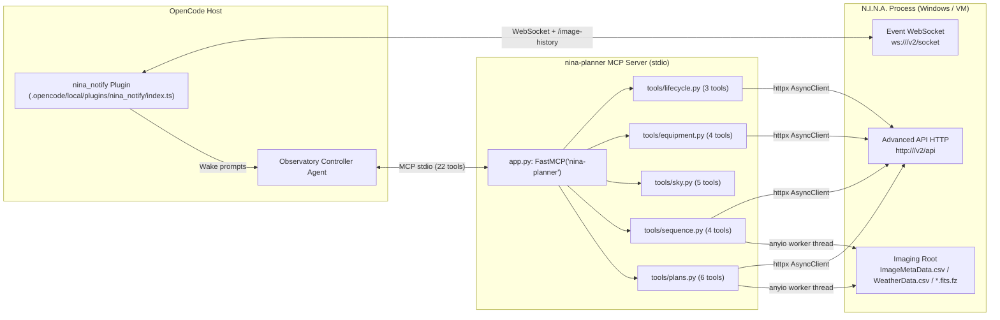

# MCP Surface Catalog

[⬆️ Up to Atlas Index](../README.md) · [⬅️ File & Symbol Manifest](./file-and-symbol-manifest.md) · [➡️ Coverage Ledger](./coverage-ledger.md)

---

## 1. FastMCP Server Registration & Transport Topology

- **Application Instance:** `mcp = FastMCP(name="nina-planner", instructions=...)` defined in `.opencode/local/mcps/nina_planner/nina_planner/app.py:10-21`.
- **Registration Mechanism:** Importing `nina_planner.server` (`nina_planner/server.py:1-61`) imports all five tool modules (`tools/equipment.py`, `tools/lifecycle.py`, `tools/plans.py`, `tools/sequence.py`, `tools/sky.py`), executing their `@mcp.tool()` decorators on the shared `mcp` object and re-exporting all 22 tools plus `mcp` in `__all__` (`nina_planner/server.py:33-57`).
- **Stdio Transport Entrypoint:** `nina_planner/__main__.py:6-8` (`def main() -> None: mcp.run()`) and `nina_planner/server.py:60-61` (`if __name__ == "__main__": mcp.run()`).
- **MCP Resources (`@mcp.resource`):** **0** registered.
- **MCP Prompts (`@mcp.prompt`):** **0** registered.
- **Server Instructions Contract (`nina_planner/app.py:12-21`):**
  1. **High-level sequence orchestration:** Plans are compiled into N.I.N.A. sequences; leaf commands execute inside N.I.N.A.
  2. **Safety (`is_safe`):** `safety_monitor.is_safe` reflects whether the observatory enclosure (roof/dome) is open. When `is_safe=False`, the mount must stay parked and sky-dependent acquisition (`light`, `dawn`/`dusk` sky `flat`) is gated. `dark` and `bias` steps are exempt because they park the mount first, never unpark, and cut light at the camera (`wheel`, `cover`, or `shutter`).
  3. **Park vs. Find Home:** `Park Scope` (`can_park=True`) is the only closing maneuver; mounts with `can_park=False` are rejected at load time (`plan_utils.require_parkable`). `Find Home` (`can_find_home=True`) is a ~30s sensor calibration emitted once per `light` step ahead of `set_tracking`, never a park fallback.
  4. **Lifecycle:** `get_nina_status()` probes REST API liveness (`GET /time`) and `lifecycle_control_available` (local Windows/WSL interop). `start_nina()` and `stop_nina()` require local Windows interop.
  5. **Progress Tracking (`PROGRESS.md`):** Controllers read `PROGRESS.md` on session start and append ISO-8601 timestamped entries after significant actions.



---

## 2. Master Summary Table of All 22 `@mcp.tool()` Endpoints

| # | Tool Name | Domain Module | Lines | Parameters & Defaults | Return Annotation | Mutating vs. Read-Only | External I/O |
|---:|---|---|---|---|---|---|---|
| 1 | `get_nina_status` | `tools/lifecycle.py` | `191-231` | `()` | `dict[str, Any]` | Read-Only | `GET /time`, `shutil.which` |
| 2 | `start_nina` | `tools/lifecycle.py` | `158-188` | `()` | `dict[str, Any]` | **Mutating (Process)** | `GET /time`, writes `launch_nina.cmd`, `schtasks.exe` |
| 3 | `stop_nina` | `tools/lifecycle.py` | `93-155` | `()` | `dict[str, Any]` | **Mutating (Process)** | `GET /time`, `taskkill.exe /F /IM NINA.exe` |
| 4 | `get_site_equipment_status` | `tools/equipment.py` | `170-176` | `()` | `ObservatoryEquipment` | **Mutating (Auto-connect)** | `GET /profile/show`, `GET /equipment/info`, `GET /equipment/<dev>/connect` |
| 5 | `get_site_profile` | `tools/equipment.py` | `179-289` | `()` | `ObservatoryProfile` | Read-Only | `GET /profile/show?active=true`, `GET /profile/horizon` |
| 6 | `get_events` | `tools/equipment.py` | `292-298` | `(since: int = 300)` | `Any` (`list[dict]`) | Read-Only | `GET /event-history` |
| 7 | `get_logs` | `tools/equipment.py` | `301-310` | `(since: int = 300)` | `Any` (`list[dict]`) | Read-Only | `GET /application/logs?lineCount=1000` |
| 8 | `resolve_target` | `tools/sky.py` | `107-118` | `(name: str)` | `dict[str, Any]` | Read-Only | External HTTPS (`simbad.cfa.harvard.edu`, `simbad.idia.ac.za`, SESAME) |
| 9 | `target_altitudes` | `tools/sky.py` | `172-200` | `(targets: list[dict[str, Any]], hours_ahead: float = 0.0, min_altitude: float = 0.0, horizon_offset_degrees: float = 2.0)` | `dict[str, Any]` | Read-Only | `get_site_profile()`, Astropy alt/az math, optional SIMBAD lookup |
| 10 | `best_targets` | `tools/sky.py` | `777-823` | `(min_altitude: float = 30.0, top: int = 10, level: str \| None = None, kinds: list[str] \| None = None, horizon_offset_degrees: float = 2.0)` | `dict[str, Any]` | Read-Only | `get_site_profile()`, offline `dso_catalog.CATALOG` + Astropy |
| 11 | `sun_times` | `tools/sky.py` | `837-846` | `()` | `dict[str, Any]` | Read-Only | `get_site_profile()`, offline Astropy solar ephemeris |
| 12 | `moon_times` | `tools/sky.py` | `849-862` | `()` | `dict[str, Any]` | Read-Only | `get_site_profile()`, offline Astropy lunar ephemeris |
| 13 | `load_sequence` | `tools/sequence.py` | `24-63` | `(request: list[SequenceRequest] = [])` | `str` | **Mutating (Sequencer & Devices)** | `get_site_profile()`, `_get_site_equipment_status()`, `GET /application/plugins`, `ImageMetaData.csv`, `POST /sequence/load` |
| 14 | `start_sequence` | `tools/sequence.py` | `426-434` | `()` | `str` | **Mutating (Sequencer)** | `GET /sequence/start`, polls `GET /sequence/json` |
| 15 | `stop_sequence` | `tools/sequence.py` | `419-423` | `()` | `str` | **Mutating (Sequencer)** | `GET /sequence/json`, `GET /sequence/stop`, polls `GET /sequence/json` |
| 16 | `get_sequence_state` | `tools/sequence.py` | `437-454` | `(detail: str = "summary")` | `Any` (`dict`) | Read-Only | `GET /sequence/state`, `GET /sequence/json` (when `detail="summary"`) |
| 17 | `get_frame_stats` | `tools/plans.py` | `34-97` | `(image_type: str \| None = None)` | `dict[str, Any]` | Read-Only | `GET /image-history[?imageType=...]` |
| 18 | `write_plan_file` | `tools/plans.py` | `164-199` | `(plan: ObservationPlan)` | `str` | **Mutating (Filesystem)** | `get_site_profile()`, atomic write to `<PROJECT_DIR>/<target>_<intent>_<ts>.json` |
| 19 | `get_plan_progress` | `tools/plans.py` | `202-311` | `(file_path: str)` *(strict: extra args forbidden)* | `dict[str, Any]` | Read-Only | Reads plan JSON, `get_site_profile()`, reads `ImageMetaData.csv` |
| 20 | `audit_plans` | `tools/plans.py` | `759-1165` | `(plans: list[str] \| None = None, project_dir: str \| None = None, types: list[str] \| None = None, include_orphans: bool = True)` | `dict[str, Any]` | Read-Only | Reads plan JSONs, `get_site_profile()`, reads `ImageMetaData.csv`, walks imaging root for `BAD_` & orphans |
| 21 | `list_plans` | `tools/plans.py` | `1168-1199` | `(project_dir: str \| None = None)` | `dict[str, Any]` | Read-Only | Walks `project_dir` and loads `*.json` plan files |
| 22 | `get_nina_settings` | `tools/plans.py` | `1215-1238` | `()` | `dict[str, Any]` | Read-Only | Reads `os.environ` in-process |

---

## 3. Detailed Tool Contracts by Domain

### 3.1 Lifecycle & Health (`nina_planner/tools/lifecycle.py` & `equipment.py`)

#### `get_nina_status()` (`nina_planner/tools/lifecycle.py:191-231`)
- **Signature:** `async def get_nina_status() -> dict[str, Any]`
- **Return Payload:**
  ```json
  {
    "running": true,
    "lifecycle_control_available": false,
    "probe_error": null,
    "summary": "NINA is running (REST API responsive; remote from this host, start/stop unavailable here)."
  }
  ```
- **Contract:** Probes `client.api_probe()` (`GET /time`) and `windows_interop_available()`. Never raises when N.I.N.A. is down; records the exception text in `probe_error`.

#### `start_nina()` (`nina_planner/tools/lifecycle.py:158-188`)
- **Signature:** `async def start_nina() -> dict[str, Any]`
- **Return Payload:** `{"summary": "NINA launched via scheduled task (C:\\Program Files\\...\\NINA.exe). Poll get_site_equipment_status to confirm readiness."}`
- **Error Conditions:**
  - Raises `RuntimeError` if `nina_api_responsive()` is `True` ("NINA is already running ... Call stop_nina first").
  - Raises `RuntimeError` if `windows_interop_available()` is `False`.
  - Raises `RuntimeError` if `schtasks.exe` fails or times out (`30s`).

#### `stop_nina()` (`nina_planner/tools/lifecycle.py:93-155`)
- **Signature:** `async def stop_nina() -> dict[str, Any]`
- **Return Payload:** `{"stopped": bool, "summary": str}`
- **Contract:** If `nina_api_responsive()` is `False`, returns `{"stopped": False, "summary": "NINA is already stopped (REST API did not respond)."}` without running `taskkill.exe`. If running and `windows_interop_available()` is `True`, runs `taskkill.exe /F /IM NINA.exe` (treating exit code `128` as benign race) and polls `nina_api_responsive()` every `0.5s` for `10.0s` until the API stops answering.

#### `get_events(since=300)` (`nina_planner/tools/equipment.py:292-298`)
- **Signature:** `async def get_events(since: int = 300) -> Any`
- **Contract:** Calls `GET /event-history`, converts keys to `snake_case`, filters to records within `[now - since, now]`, sorts ascending by timestamp, and formats `timestamp` via `to_local_display()` (`YYYY-MM-DDTHH:MM:SS±HH:MM`).

#### `get_logs(since=300)` (`nina_planner/tools/equipment.py:301-310`)
- **Signature:** `async def get_logs(since: int = 300) -> Any`
- **Contract:** Calls `GET /application/logs?lineCount=1000`, filters and formats timestamps identically to `get_events`, and strips verbose internal keys (`line`, `member`, `source`).

---

### 3.2 Rig & Safety (`nina_planner/tools/equipment.py`)

#### `get_site_equipment_status()` (`nina_planner/tools/equipment.py:170-176`)
- **Signature:** `async def get_site_equipment_status() -> ObservatoryEquipment`
- **Side Effects:** **Not read-only.** Calls `get_site_profile()` then `_get_site_equipment_status(profile)` (`82-167`), which checks every device where `profile.equipment.has_<device>` is `True`. If `Connected` is `False`, it issues `GET /equipment/<api_path>/connect` for each disconnected device and raises `RuntimeError("Equipment connecting: <list>. Please try again in a few seconds.")`.
- **Return Model:** `ObservatoryEquipment` (`models/observatory.py:20-38`) containing `mount`, `camera`, `focuser`, `guider`, `filter_wheel`, `flat_device`, `rotator`, `dome`, `weather`, `safety_monitor`, `switch`.

#### `get_site_profile()` (`nina_planner/tools/equipment.py:179-289`)
- **Signature:** `async def get_site_profile() -> ObservatoryProfile`
- **Contract:** Reads `GET /profile/show?active=true` and `fetch_horizon(astrometry.get("HorizonFilePath"))` (`GET /profile/horizon`). Populates `ObservatoryProfile` (`models/profile.py:94-143`) with computed `optics.field_of_view_deg`, computed `local_image_save_path` (mapped via `windows_to_local`), and `horizon` (`Horizon` with `is_custom` and sorted `[az, alt]` points).

---

### 3.3 Sky & Ephemeris (`nina_planner/tools/sky.py`)

#### `sun_times()` (`nina_planner/tools/sky.py:837-846`)
- **Signature:** `async def sun_times() -> dict[str, Any]`
- **Contract:** Computes next `sunset`, `sunrise`, `civil_dusk`/`dawn` (`-6°`), `nautical_dusk`/`dawn` (`-12°`), and `astronomical_dusk`/`dawn` (`-18°`), plus `is_dark_now` (`sun_alt <= -18.0°`), `night_phase` (`"dark"`, `"morning"`, `"evening"`), and paired `darkness: {"start_utc", "end_utc"}`.

#### `moon_times()` (`nina_planner/tools/sky.py:849-862`)
- **Signature:** `async def moon_times() -> dict[str, Any]`
- **Contract:** Computes topocentric lunar `altitude_deg`, `azimuth_deg`, `distance_km`, `moon_up_now` (`alt > -0.833°`), next `moonrise`/`moonset` (48h window), geocentric `phase` (`name`, `illumination_fraction`, `waxing`, `elongation_deg`, `age_days`), and next `new_moon`, `first_quarter`, `full_moon`, `last_quarter` (~32d window).

#### `best_targets(...)` (`nina_planner/tools/sky.py:777-823`)
- **Signature:** `async def best_targets(min_altitude: float = 30.0, top: int = 10, level: str | None = None, kinds: list[str] | None = None, horizon_offset_degrees: float = 2.0) -> dict[str, Any]`
- **Contract:** Ranks the 497-object built-in `dso_catalog.CATALOG` over the next 12 hours (13 hourly samples) using `alt >= max(min_altitude, horizon.altitude_at(az) + horizon_offset_degrees)` and `sun_alt <= -18.0°`. Returns `visible_now` and `later_tonight` with SIMBAD-verified `ra_hours`/`dec_deg`, `horizon_deg`, `clearance_deg`, `large_for_field`, and composite `score = round(0.6 * alt_norm + 0.4 * easy, 3)`.

#### `target_altitudes(...)` (`nina_planner/tools/sky.py:172-200`)
- **Signature:** `async def target_altitudes(targets: list[dict[str, Any]], hours_ahead: float = 0.0, min_altitude: float = 0.0, horizon_offset_degrees: float = 2.0) -> dict[str, Any]`
- **Contract:** Evaluates each target at `now + hours_ahead`. Uses pre-supplied `ra_hours`/`dec_deg` directly (offline) or resolves via `_resolve_name(name)` when coordinates are omitted. Returns targets sorted by `alt_deg` descending with `horizon_deg`, `clearance_deg`, and `above_floor`.

#### `resolve_target(name)` (`nina_planner/tools/sky.py:107-118`)
- **Signature:** `async def resolve_target(name: str) -> dict[str, Any]`
- **Contract:** Offloads `_resolve_name(name)` to a worker thread (`anyio.to_thread.run_sync`), querying Harvard and IDIA SIMBAD mirrors (`10s` timeout each) before falling back to `SkyCoord.from_name(name)`.

---

### 3.4 Sequencer (`nina_planner/tools/sequence.py`)

#### `load_sequence(request=[...])` (`nina_planner/tools/sequence.py:24-63`)
- **Signature:** `async def load_sequence(request: list[SequenceRequest] = []) -> str`
- **Contract:** Delegates to `_load_many(request)` (`176-416`). Validates every request item (prefixing errors with `request[i]: `), checks `require_parkable(equipment)` unconditionally, checks `require_light_capabilities(profile)` and `$$TARGETNAME$$` in `profile.file_pattern` for `light` steps, checks `_require_sequencer_plus()` for `light`/`flat` steps, checks `validate_dark_variant()` for `dark`/`bias` steps, computes remaining frames from `ImageMetaData.csv` when `mode="remaining"`, and posts the composed sequence (always ending with `sequence_end` park + warm) to `POST /sequence/load`.

#### `start_sequence()` (`nina_planner/tools/sequence.py:426-434`)
- **Signature:** `async def start_sequence() -> str`
- **Contract:** Calls `GET /sequence/start` and `wait_until_sequence_started()` (`10.0s` timeout), verifying at least one node leaves `CREATED`.

#### `stop_sequence()` (`nina_planner/tools/sequence.py:419-423`)
- **Signature:** `async def stop_sequence() -> str`
- **Contract:** Calls `stop_running_sequence_and_wait()` (`15.0s` timeout). Does **not** park the mount.

#### `get_sequence_state(detail="summary")` (`nina_planner/tools/sequence.py:437-454`)
- **Signature:** `async def get_sequence_state(detail: str = "summary") -> Any`
- **Contract:** When `detail="summary"`, fetches `/sequence/state` and (best-effort) `/sequence/json` and projects them via `project_sequence_state(raw, json_raw)` (`sequence_state.py:164-241`). When `detail="raw"`, returns raw `/sequence/state`.

---

### 3.5 Plan Management & Watchdog (`nina_planner/tools/plans.py`)

#### `write_plan_file(plan)` (`nina_planner/tools/plans.py:164-199`)
- **Signature:** `async def write_plan_file(plan: ObservationPlan) -> str`
- **Contract:** Fetches `get_site_profile()`, expands `plan.mosaic` via `_expand_mosaic(plan, profile)` when `pointings` is empty, validates filters (`validate_filters`) and rotator PA (`validate_position_angle`), stamps `plan.plan_id = plan._base_plan_id()`, and writes `<target>_<intent>_<timestamp>.json` atomically via `plan_utils.write_text_atomic`.

#### `get_plan_progress(file_path)` (`nina_planner/tools/plans.py:202-311`)
- **Signature:** `async def get_plan_progress(file_path: str) -> dict[str, Any]`
- **Argument Schema Override:** `_forbid_unknown_arguments()` (`314-341`) subclasses FastMCP's generated `arg_model` with `ConfigDict(extra="forbid")` so passing deprecated threshold arguments (e.g., `max_hfr`) fails validation loudly.
- **Contract:** Loads the plan, reads `ImageMetaData.csv`, applies `plan.quality` thresholds via `plan_utils.quality_kwargs(plan)`, evaluates `plan_progress` and `progress_verdict` per pointing, and surfaces `complete`, `expired_with_deficit`, `overshot`, and `warning`.

#### `audit_plans(...)` (`nina_planner/tools/plans.py:759-1165`)
- **Signature:** `async def audit_plans(plans: list[str] | None = None, project_dir: str | None = None, types: list[str] | None = None, include_orphans: bool = True) -> dict[str, Any]`
- **Contract:** Reconciles all project plans against `ImageMetaData.csv` (without quality filtering) and on-disk `BAD_` rejects / orphan token directories. Produces `all_saved`, `totals`, `left_to_do`, `blocked`, `never_shot`, `rows`, `orphans`, `errors`, and `root`.

#### `list_plans(project_dir=None)` (`nina_planner/tools/plans.py:1168-1199`)
- **Signature:** `async def list_plans(project_dir: str | None = None) -> dict[str, Any]`
- **Contract:** Discovers `*.json` plan files under `project_dir` (pruning dot-directories, `node_modules`, `__pycache__`) and returns `{"plans": [...], "errors": [...]}`.

#### `get_nina_settings()` (`nina_planner/tools/plans.py:1215-1238`)
- **Signature:** `async def get_nina_settings() -> dict[str, Any]`
- **Contract:** Reads `NINA_ARCHIVE_DEST`, `NINA_UPLOAD_CMD`, `NINA_VERIFY_CMD`, `NINA_ENDPOINT`, and `NINA_DRIVE_MOUNT` from `os.environ` and reports `{"settings": ..., "missing": ..., "ready": bool}`.

#### `get_frame_stats(image_type=None)` (`nina_planner/tools/plans.py:34-97`)
- **Signature:** `async def get_frame_stats(image_type: str | None = None) -> dict[str, Any]`
- **Contract:** Queries `GET /image-history` (or `?imageType=<UPPER>`), takes the newest entry (`raw[-1]`), validates via `FrameStats`, formats `date` via `to_local_display`, and returns `{"count": 1, "image_type": ..., "frame": ..., "note": None}` (or `count: 0` with `note` when empty or mismatched).

---

## 4. Sibling OpenCode Plugin Boundary (`nina_notify`)

While `nina-planner` is the Python MCP server, `.opencode/local/plugins/nina_notify/index.ts` runs inside the OpenCode host process and shares the same N.I.N.A. endpoint (`NINA_ENDPOINT`) and timestamp convention (`YYYY-MM-DDTHH:MM:SS±HH:MM`):
- Connects to `ws://<NINA_ENDPOINT>/v2/socket` to listen for sequence milestones (`RUN-STARTING`, `RUN-FINISHED`, `PARK-STARTING`, `PARK-FINISHED`, `ACQUISITION-STARTING`, `ACQUISITION-FINISHED` emitted by `nina_planner/sequence/builders.py` and `instructions.py`), safety state changes, and device faults.
- Polls `GET /v2/api/image-history` during light acquisition to trigger `QUALITY-WATCHDOG` wakes, which the agent then inspects via `nina-planner`'s `get_frame_stats()` tool.
- Appends `[get_events(since=N) · M routine events waiting]` to every wake prompt so the agent calls `nina-planner`'s `get_events(since=N)` tool.
