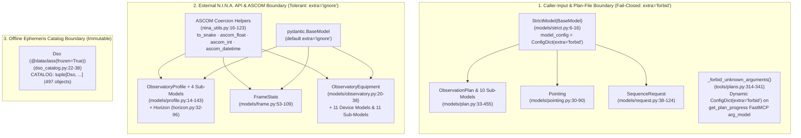
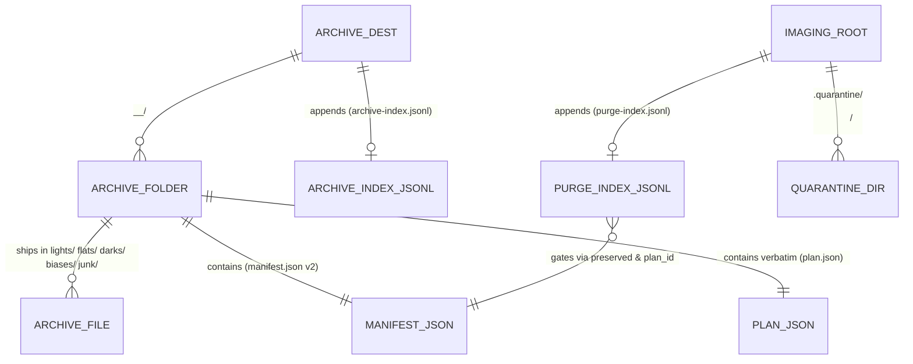

# Data Models, Validation Boundaries & On-Disk Schemas

[⬆️ Up to Atlas Index](../README.md) · [⬅️ System Overview](./system-overview.md) · [➡️ External Integrations & I/O](./external-integrations-and-io.md) · [🔗 Models Module Specs](../03-modules/models/README.md) · [🔗 Sequence Compiler Specs](../03-modules/sequence/README.md) · [🔗 CLI Specs (`nina-archive` / `nina-purge`)](../03-modules/cli/README.md)

---

## 1. Validation Boundary Architecture

The `nina_planner` data layer (`.opencode/local/mcps/nina_planner/nina_planner/models/`, `dso_catalog.py`, `horizon.py`, `nina_utils.py`, and `tools/plans.py`) enforces three distinct validation boundaries depending on the trust model and mutability of the data source:

1. **Strict Caller-Input & Plan-File Boundary (`StrictModel`, `extra="forbid"`):** Fails closed on any unrecognized key, out-of-range coordinate, or invalid action/variant pairing so user-authored or LLM-authored observation plans and MCP tool requests never silently ignore a misspelled setting.
2. **Tolerant External API & ASCOM Telemetry Boundary (`BaseModel`, default `extra="ignore"` + `mode="before"` normalizers):** Coerces heterogeneous ASCOM driver sentinels (`None`, `NaN`, `"NaN"`, `"N/A"`, `.NET DateTime.MinValue`, `24.0` meridian-flip hours) into clean typed values or `None` while ignoring unknown upstream keys added by N.I.N.A. or device drivers.
3. **Immutable Offline Catalog Boundary (`@dataclass(frozen=True)`):** Freezes the 497 SIMBAD-verified deep-sky catalog rows in memory at import time (`dso_catalog.CATALOG`).



---

### 1.1 Caller-Input Boundary (`StrictModel` with `ConfigDict(extra="forbid")`)

Defined in `.opencode/local/mcps/nina_planner/nina_planner/models/strict.py:6-16`:

```python
class StrictModel(BaseModel):
    """Base for plan-file models: unknown fields are a validation error."""

    model_config = ConfigDict(extra="forbid")
```

Every schema that parses caller-supplied MCP tool inputs or on-disk observation plan JSON files inherits from `StrictModel` (13 classes total) or receives an equivalent `ConfigDict(extra="forbid")` override:

| Model / Mechanism | Source Location | Parent Class | Architectural Role & Enforced Invariants |
|---|---|---|---|
| `StrictModel` | `models/strict.py:6-16` | `pydantic.BaseModel` | Sets `model_config = ConfigDict(extra="forbid")` (`strict.py:16`). Rejects any undeclared key with `ValidationError` (`extra_forbidden`). |
| `ObservationPlan` | `models/plan.py:238-455` | `StrictModel` | Root on-disk observation plan schema. Requires non-empty `light_frames`, `flat_frames`, `dark_frames`, and `bias_frames` (`min_length=1`, `plan.py:312-341`), enforces `_pointings_or_mosaic` (`plan.py:343-357`), and validates `plan_id` against `_PLAN_ID_ALLOWED` (`plan.py:359-375`). |
| `LightExposurePlan` | `models/plan.py:33-38` | `StrictModel` | Per-filter light budget: `filter_name: str`, `exposure_time_seconds: float` (`gt=0`), `total_count: int` (`ge=1`). |
| `FlatExposurePlan` | `models/plan.py:41-48` | `StrictModel` | Per-filter twilight sky-flat budget: `filter_name: str`, `total_count: int` (`ge=1`). Deliberately omits `exposure_time_seconds` (`plan.py:44-46`); supplying it fails `extra="forbid"`. |
| `DarkExposurePlan` | `models/plan.py:51-55` | `StrictModel` | Per-duration dark budget: `exposure_time_seconds: float` (`gt=0`), `total_count: int` (`ge=1`). |
| `BiasExposurePlan` | `models/plan.py:58-61` | `StrictModel` | Bias count budget: `total_count: int` (`ge=1`). Emitted at `0.0s` exposure time (`sequence/targets.py:151-155`). |
| `AutofocusConfig` | `models/plan.py:64-71` | `StrictModel` | Autofocus reference filter (`reference_filter_name="L"`), HFR sample window (`hfr_increase_sample_size=3`, `ge=1`), HFR percentage threshold (`hfr_increase_threshold_percent=15.0`, `gt=0`), exposure cadence (`every_n_exposures=10`, `ge=1`), and temperature delta (`threshold_celsius=1.0`, `gt=0`). |
| `GuidingConfig` | `models/plan.py:74-86` | `StrictModel` | Dither cadence (`dither_every_n_exposures=2`, `ge=0` where `0` is the sentinel for "never dither"), drift-check cadence (`check_drift_every_n_exposures=6`, `ge=1`), and drift limit (`max_drift_arcmin=1.5`, `gt=0`). |
| `CoolerConfig` | `models/plan.py:89-98` | `StrictModel` | Camera TEC target: `on: bool = True`, `setpoint_celsius: float = -10.0` (`ge=-40.0, le=30.0`). |
| `ConstraintsConfig` | `models/plan.py:101-115` | `StrictModel` | Altitude floor: `min_altitude: float = 30.0` (`ge=0.0, le=90.0`), `horizon_offset_degrees: float = 2.0` (`ge=0.0, le=10.0`). |
| `QualityConfig` | `models/plan.py:118-149` | `StrictModel` | Sole location for light-frame quality gates: `max_hfr: float \| None = None`, `max_hfr_st_dev: float \| None = None`, `min_detected_stars: int \| None = None`, `max_guiding_rms_arcsec: float \| None = None`. |
| `MosaicConfig` | `models/plan.py:155-235` | `StrictModel` | Mosaic intent-in (`center_ra_hours` in `[0.0, 24.0)`, `center_dec_deg` in `[-90.0, 90.0]`, `coverage_width_arcmins > 0`, `coverage_height_arcmins > 0`, `overlap_pct = 20.0` in `(0.0, 100.0)`, `pa_deg = 0.0` in `[0.0, 360.0)`) and provenance-out (`cols`, `rows`, `pane_fov_arcmins`, stamped by `tools/plans.py:_expand_mosaic` at `plans.py:103-161`). |
| `Pointing` | `models/pointing.py:30-90` | `StrictModel` | Target pane coordinates and grid metadata: `label: str \| None = None`, `ra_hours: float` (`ge=0.0, lt=24.0`), `dec_deg: float` (`ge=-90.0, le=90.0`), `position_angle_deg: float \| None = None` (`ge=0.0, lt=360.0`), `row: int \| None = None` (`ge=0`), `column: int \| None = None` (`ge=0`). Exposes `requests_rotation() -> bool` (`pointing.py:78-90`), returning `True` iff `position_angle_deg is not None and position_angle_deg != 0`. |
| `SequenceRequest` | `models/request.py:38-124` | `StrictModel` | Single step in `load_sequence(request=[...])`: `plan: str \| None = None`, `action: Action = "light"` (`Literal["light", "dark", "bias", "flat"]`, `request.py:13-18`), `variant: str \| None = None`, `pointing_index: int \| None = None` (`ge=1`), `mode: str = "remaining"`. Post-validated by `_check_variant` (`request.py:100-124`) against `VARIANTS` (`request.py:30-35`) and `DARK_VARIANTS = ("wheel", "cover", "shutter")` (`request.py:23`). |
| `_forbid_unknown_arguments()` | `tools/plans.py:314-341` | Dynamic subclass of FastMCP `arg_model` | Invoked at module import time (`plans.py:341`). Looks up `mcp._tool_manager.get_tool("get_plan_progress")`, subclasses `tool.fn_metadata.arg_model` with `model_config = ConfigDict(extra="forbid")` (`plans.py:333-338`), and replaces `tool.fn_metadata`. Ensures callers passing deprecated per-call quality arguments (e.g. `max_hfr=2.5`) to `get_plan_progress(file_path)` fail loudly instead of having them silently ignored by FastMCP's default argument model. |

---

### 1.2 External API Boundary (`BaseModel` with `extra="ignore"` + `mode="before"` Normalizers)

All models that deserialize N.I.N.A.'s HTTP responses (`GET /profile/show?active=true`, `GET /profile/horizon`, `GET /equipment/info`, `GET /image-history`) inherit directly from `pydantic.BaseModel` (default `extra="ignore"`, 29 classes across `models/` plus `Horizon` in `horizon.py`).

#### ASCOM & N.I.N.A. Coercion Primitives (`nina_utils.py:16-123`)

| Helper Function | Location | Signature | Normalization Contract |
|---|---|---|---|
| `to_snake` | `nina_utils.py:16-23` | `(name: str) -> str` | Two-pass regex (`r"(.)([A-Z][a-z]+)"` then `r"([a-z0-9])([A-Z])"`) converting `PascalCase`/`camelCase` keys into `snake_case`. Used by `tools/equipment.py:_convert_keys` (`equipment.py:22-27`) and `imaging.py:_read_csv` (`imaging.py:106-108`). |
| `_missing_string` | `nina_utils.py:26-30` | `(value: str) -> bool` | Checks `value.strip().lower() in _MISSING_STRINGS` where `_MISSING_STRINGS = {"nan", "n/a", "na", ""}` (`nina_utils.py:26`). |
| `ascom_float` | `nina_utils.py:33-55` | `(value: object) -> float \| None` | Maps `None`, `float("nan")` (`math.isnan`), and `_missing_string` strings (`"NaN"`, `"N/A"`, `"na"`, `""`) to `None`. Preserves genuine `0.0` readings. Converts `int`, `bool`, numeric `str`, and `str(value)` to `float` (raising `ValueError` on non-numeric strings). |
| `ascom_int` | `nina_utils.py:58-71` | `(value: object) -> int \| None` | Fast-paths non-bool `int` values (`isinstance(value, int) and not isinstance(value, bool)`) without float precision loss; otherwise delegates to `ascom_float(value)` and truncates toward zero via `int(parsed)` (or returns `None`). |
| `ascom_datetime` | `nina_utils.py:74-104` | `(value: object) -> datetime \| None` | Parses ISO-8601 strings via `datetime.fromisoformat(stripped)`. Maps `None`, non-`str` values, blank/`"nan"` strings, unparseable strings, and all timezone/tick representations of `.NET DateTime.MinValue` (`parsed.replace(tzinfo=None) == datetime.min`, i.e., `0001-01-01T00:00:00`) to `None`. Never raises. |
| `to_local_display` | `nina_utils.py:107-123` | `(dt: datetime) -> str` | Renders aware datetimes in the host's local timezone with UTC offset (`dt.astimezone().isoformat(timespec="seconds")`, e.g., `2026-11-05T09:39:10-05:00`), or naive datetimes as `dt.isoformat(timespec="seconds")`. |

#### Profile, Horizon, Frame & Equipment Models

| Model Class | Source Location | Sub-Models / Helpers | `mode="before"` / `mode="after"` Normalizers & Special Semantics |
|---|---|---|---|
| `ObservatoryProfile` | `models/profile.py:94-143` | `FilterInfo` (`14-19`), `SiteLocationInfo` (`22-27`), `EquipmentConfig` (`30-43`), `OpticalTrainInfo` (`46-91`), `Horizon` (`horizon.py:32-96`) | Built fresh per call in `tools/equipment.py:get_site_profile` (`equipment.py:179-289`). `OpticalTrainInfo._compute_fov` (`profile.py:86-91`, `mode="after"`) populates `field_of_view_deg` from unrounded `fov_deg()` (`profile.py:58-84`, returning `None` if any optical dimension is `None` or `<= 0`). `ObservatoryProfile.horizon` defaults to `Horizon()` (`profile.py:117`). `ObservatoryProfile.local_image_save_path` (`profile.py:119-128`) is a `@computed_field` delegating to `windows_to_local(self.image_save_path)`. `filter_position(name)` (`profile.py:130-143`) resolves 1-based filter slot IDs. |
| `Horizon` | `horizon.py:32-96` | `parse_horizon` (`103-120`), `fetch_horizon` (`123-136`), `_clamp` (`99-100`) | `@field_validator("points", mode="before") _sort_and_wrap` (`horizon.py:38-60`) filters non-finite pairs, wraps azimuths modulo `360.0°` into `[0.0, 360.0)`, deduplicates colliding azimuths (last entry wins, collapsing closing `360°` knots onto `0°`), and sorts ascending. `@computed_field is_custom` (`horizon.py:62-71`) is `True` iff `len(points) >= 2`. `altitude_at(az_deg)` (`horizon.py:73-96`) linearly interpolates across interior segments and the `360° -> 0°` north seam, clamped to `[-90.0, 90.0]`. |
| `FrameStats` | `models/frame.py:53-109` | `_FIELD_MAP` (`15-38`), `_FLOAT_FIELDS` (`40-49`), `_INT_FIELDS` (`50`) | `@model_validator(mode="before") _normalize` (`frame.py:92-109`) maps all 22 PascalCase keys from `GET /image-history` (including compound acronyms like `"HFRStDev" -> "hfr_st_dev"`) and coerces 8 float fields via `ascom_float`, 5 int fields via `ascom_int`, and `"date"` via `ascom_datetime`. Preserves genuine `0` readings (`stars=0`, `hfr=0.0`) while mapping `NaN` to `None`. |
| `ObservatoryEquipment` | `models/observatory.py:20-38` | Aggregates all 11 hardware device models (each nullable, defaulting to `None`) | Constructed by `tools/equipment.py:_get_site_equipment_status` (`equipment.py:82-167`). Unconfigured devices or devices that are both disconnected and unnamed become `None` (`equipment.py:143-153`). |
| `CameraDevice` | `models/camera.py:100-220` | `SensorInfo` (`36-43`), `GainInfo` (`46-53`), `ExposureInfo` (`56-62`), `OffsetInfo` (`65-71`), `BinningInfo` (`74-78`), `ThermalInfo` (`81-90`), `ReadoutInfo` (`93-97`), `_binning_axis` (`12-16`), `_parse_binning_mode` (`19-33`) | `@model_validator(mode="before") _derive_fields` (`camera.py:125-220`) short-circuits when `not data.get("connected", False)`. When connected, lifts `camera_state -> state` and populates all 7 sub-models using `ascom_float`, `ascom_int`, and `ascom_datetime`. Preserves top-level `has_shutter: bool \| None` (`camera.py:116`) for `"shutter"` dark/bias variant validation. |
| `MountDevice` | `models/mount.py:12-77` | `MeridianInfo` (`models/meridian.py:8-12`), `PointingInfo` (`models/pointing.py:10-27`) | `@model_validator(mode="before") _derive_fields` (`mount.py:33-77`) short-circuits when disconnected. Maps `at_park -> is_parked`, `at_home -> is_homed`, derives priority `mount_status` (`"SLEWING"` > `"TRACKING"` > `"IDLE"`, `mount.py:43-50`), builds `PointingInfo` from nested `coordinates` (falling back to top-level `right_ascension`/`declination` only when both `ra` and `dec` are `None`, `mount.py:52-65`), and normalizes N.I.N.A.'s `24.0` hours-to-flip sentinel to `None` (`mount.py:67-75`). |
| `FocuserDevice` | `models/focuser.py:10-40` | *(none)* | `@model_validator(mode="before") _derive_fields` (`focuser.py:28-40`) short-circuits when disconnected; coerces `temperature -> temperature_c` (`ascom_float`) and `step_size -> step_size_microns` (`ascom_int`). |
| `FilterWheelDevice` | `models/filter_wheel.py:8-29` | *(none)* | `@model_validator(mode="before") _derive_fields` (`filter_wheel.py:22-29`) lifts nested `selected_filter["id"]` into top-level `position: int \| None`. |
| `GuiderDevice` | `models/guider.py:17-69` | `GuiderMetric(BaseModel)` (`guider.py:10-14`: `arcseconds`, `pixel`) | `@model_validator(mode="before") _derive_fields` (`guider.py:36-69`) short-circuits when disconnected. Coerces `pixel_scale` via `ascom_float` and extracts `ra_rms_error`, `dec_rms_error`, `total_rms_error`, `peak_ra_excursion`, and `peak_dec_excursion` from nested `rms_error` dicts via inner `_build_metric` (`guider.py:53-61`). |
| `RotatorDevice` | `models/rotator.py:10-51` | *(none)* | `@model_validator(mode="before") _derive_fields` (`rotator.py:25-51`) coerces `position -> position_deg` and `mechanical_position -> mechanical_position_deg` via `ascom_float`, and resolves `is_synced` across three driver conventions: explicit `is_synced`, boolean `synced`, or `sync_state in ("Synced", "Synchronized", True)` (`rotator.py:36-49`). |
| `DomeDevice` | `models/dome.py:10-49` | `compute_dome_status` (`dome.py:52-67`) | `@model_validator(mode="before") _derive_fields` (`dome.py:28-49`) short-circuits when disconnected. Maps `at_park -> is_parked`, `at_home -> is_homed`, `azimuth -> azimuth_deg` (`ascom_float`), and derives `dome_status` (`"SLEWING"` > `"IDLE"` > `"SYNCING"` > `"READY"`) via `compute_dome_status(slewing, is_following, is_synchronized)`. |
| `Switch` | `models/switch.py:43-55` | `ReadonlySwitchInfo` (`8-14`), `WritableSwitchInfo` (`17-40`) | `WritableSwitchInfo.is_on` (`switch.py:29-40`) is a `@computed_field` property returning `None` when `value is None`, `True` iff `value == 1`, and `False` otherwise. |
| `FlatDevice` | `models/flat_device.py:8-27` | *(none)* | Uniquely defaults every field (`connected: bool = False`, `name: str = ""`) so partial/empty payloads construct a safe capability-free `FlatDevice()` rejected by `sequence/variants.py:dark_variant_reasons("cover")`. |
| `Weather` | `models/weather.py:10-48` | *(none)* | `@model_validator(mode="before") _derive_fields` (`weather.py:33-48`) maps all 11 unitless ASCOM `ObservingConditions` keys onto explicit unit-suffixed fields (`temperature_c`, `dew_point_c`, `humidity_pct`, `pressure_hpa`, `wind_speed_mps`, `wind_gust_mps`, `wind_direction_deg`, `sky_temperature_c`, `sky_quality_mpsas`, `rain_rate_mm_per_hr`, `cloud_cover_pct`) via `ascom_float`. |
| `SafetyMonitorDevice` | `models/safety_monitor.py:8-19` | *(none)* | Carries `connected: bool`, `name: str`, `description: str \| None = None`, and `is_safe: bool \| None = None` (`safety_monitor.py:19`) — the authoritative enclosure safety gate. |

---

### 1.3 Immutable Catalog Boundary (`Dso` in `dso_catalog.py:22-38`)

Defined in `.opencode/local/mcps/nina_planner/nina_planner/dso_catalog.py:22-59`:
- **`Dso` (`dso_catalog.py:22-38`):** `@dataclass(frozen=True)` with 8 fields:
  - `name: str` (`line 31`) — Catalog designation (e.g. `"M31"`, `"NGC 7000"`).
  - `common: str` (`line 32`) — Common name or cross-ID.
  - `kind: str` (`line 33`) — Morphological tag: `"galaxy"`, `"globular"`, `"open"`, `"pn"`, `"bn"`, `"snr"`, or `"cloud"`.
  - `ra_hours: float` (`line 34`) — SIMBAD-verified J2000 Right Ascension in decimal hours `[0.0, 24.0)`.
  - `dec_deg: float` (`line 35`) — SIMBAD-verified J2000 Declination in decimal degrees `[-90.0, +90.0]`.
  - `mag: float` (`line 36`) — Integrated visual magnitude.
  - `major_arcmin: float` (`line 37`) — Major axis in arcminutes.
  - `minor_arcmin: float` (`line 38`) — Minor axis in arcminutes.
- **`CATALOG: tuple[Dso, ...]` (`dso_catalog.py:59`):** Populated once at import time by `_load_catalog()` (`dso_catalog.py:41-56`) from the bundled package resource `nina_planner/dso_catalog.csv` (497 objects). Because both the outer `tuple` and each `Dso` instance are immutable, `tools/sky.py:best_targets` can filter and rank `CATALOG` across worker threads with zero risk of state mutation and zero network dependency.

---

## 2. Schema & Telemetry Class Diagrams

### 2.1 `ObservationPlan` & `SequenceRequest` Schema Hierarchy (`StrictModel`)

```mermaid
classDiagram
    direction TB

    class StrictModel {
        <<models/strict.py:6-16>>
        +ConfigDict model_config = ConfigDict(extra="forbid")
    }

    class SequenceRequest {
        <<models/request.py:38-124>>
        +str | None plan = None
        +Literal["light","dark","bias","flat"] action = "light"
        +str | None variant = None
        +int | None pointing_index = None [ge=1]
        +str mode = "remaining"
        +_check_variant() SequenceRequest
    }

    class ObservationPlan {
        <<models/plan.py:238-455>>
        +str target = ""
        +str intent = ""
        +str plan_id = ""
        +str description = ""
        +list~Pointing~ pointings = []
        +MosaicConfig | None mosaic = None
        +int batch_size = 5 [ge=0]
        +int calibration_window_days = 7 [ge=1]
        +CoolerConfig cooler
        +ConstraintsConfig constraints
        +AutofocusConfig autofocus
        +GuidingConfig guiding
        +QualityConfig quality
        +list~LightExposurePlan~ light_frames [min_length=1]
        +list~FlatExposurePlan~ flat_frames [min_length=1]
        +list~DarkExposurePlan~ dark_frames [min_length=1]
        +list~BiasExposurePlan~ bias_frames [min_length=1]
        +_pointings_or_mosaic() ObservationPlan
        +_plan_id_charset(v: str) str
        +_base_plan_id() str
        +per_pointing_plan_id(pointing_index: int) str
        +effective_plan_id(pointing_index: int) str
        +attribution_token(pointing_index: int) str
        +plan_token() str
        +target_prefix(label: str | None) str
        +calibration_prefix() str
    }

    class Pointing {
        <<models/pointing.py:30-90>>
        +str | None label = None
        +float ra_hours [ge=0.0, lt=24.0]
        +float dec_deg [ge=-90.0, le=90.0]
        +float | None position_angle_deg = None [ge=0.0, lt=360.0]
        +int | None row = None [ge=0]
        +int | None column = None [ge=0]
        +requests_rotation() bool
    }

    class MosaicConfig {
        <<models/plan.py:155-235>>
        +float center_ra_hours [ge=0.0, lt=24.0]
        +float center_dec_deg [ge=-90.0, le=90.0]
        +float coverage_width_arcmins [gt=0.0]
        +float coverage_height_arcmins [gt=0.0]
        +float overlap_pct = 20.0 [gt=0.0, lt=100.0]
        +float pa_deg = 0.0 [ge=0.0, lt=360.0]
        +int | None cols = None [ge=1]
        +int | None rows = None [ge=1]
        +tuple~float, float~ | None pane_fov_arcmins = None
    }

    class LightExposurePlan {
        <<models/plan.py:33-38>>
        +str filter_name
        +float exposure_time_seconds [gt=0]
        +int total_count [ge=1]
    }
    class FlatExposurePlan {
        <<models/plan.py:41-48>>
        +str filter_name
        +int total_count [ge=1]
    }
    class DarkExposurePlan {
        <<models/plan.py:51-55>>
        +float exposure_time_seconds [gt=0]
        +int total_count [ge=1]
    }
    class BiasExposurePlan {
        <<models/plan.py:58-61>>
        +int total_count [ge=1]
    }
    class AutofocusConfig {
        <<models/plan.py:64-71>>
        +str reference_filter_name = "L"
        +int hfr_increase_sample_size = 3 [ge=1]
        +float hfr_increase_threshold_percent = 15.0 [gt=0]
        +int every_n_exposures = 10 [ge=1]
        +float threshold_celsius = 1.0 [gt=0]
    }
    class GuidingConfig {
        <<models/plan.py:74-86>>
        +int dither_every_n_exposures = 2 [ge=0]
        +int check_drift_every_n_exposures = 6 [ge=1]
        +float max_drift_arcmin = 1.5 [gt=0]
    }
    class CoolerConfig {
        <<models/plan.py:89-98>>
        +bool on = True
        +float setpoint_celsius = -10.0 [ge=-40.0, le=30.0]
    }
    class ConstraintsConfig {
        <<models/plan.py:101-115>>
        +float min_altitude = 30.0 [ge=0.0, le=90.0]
        +float horizon_offset_degrees = 2.0 [ge=0.0, le=10.0]
    }
    class QualityConfig {
        <<models/plan.py:118-149>>
        +float | None max_hfr = None
        +float | None max_hfr_st_dev = None
        +int | None min_detected_stars = None
        +float | None max_guiding_rms_arcsec = None
    }

    StrictModel <|-- SequenceRequest
    StrictModel <|-- ObservationPlan
    StrictModel <|-- Pointing
    StrictModel <|-- MosaicConfig
    StrictModel <|-- LightExposurePlan
    StrictModel <|-- FlatExposurePlan
    StrictModel <|-- DarkExposurePlan
    StrictModel <|-- BiasExposurePlan
    StrictModel <|-- AutofocusConfig
    StrictModel <|-- GuidingConfig
    StrictModel <|-- CoolerConfig
    StrictModel <|-- ConstraintsConfig
    StrictModel <|-- QualityConfig

    ObservationPlan *-- "0..*" Pointing : pointings
    ObservationPlan *-- "0..1" MosaicConfig : mosaic
    ObservationPlan *-- "1" CoolerConfig : cooler
    ObservationPlan *-- "1" ConstraintsConfig : constraints
    ObservationPlan *-- "1" AutofocusConfig : autofocus
    ObservationPlan *-- "1" GuidingConfig : guiding
    ObservationPlan *-- "1" QualityConfig : quality
    ObservationPlan *-- "1..*" LightExposurePlan : light_frames
    ObservationPlan *-- "1..*" FlatExposurePlan : flat_frames
    ObservationPlan *-- "1..*" DarkExposurePlan : dark_frames
    ObservationPlan *-- "1..*" BiasExposurePlan : bias_frames
    SequenceRequest ..> ObservationPlan : references via plan path
```



---

### 2.2 `ObservatoryProfile`, `Horizon`, & `ObservatoryEquipment` Telemetry Hierarchy (`BaseModel`)

```mermaid
classDiagram
    direction TB

    class ObservatoryProfile {
        <<models/profile.py:94-143>>
        +str profile_name
        +str profile_id
        +str | None description = None
        +SiteLocationInfo site
        +OpticalTrainInfo optics
        +list~FilterInfo~ filters
        +str | None plate_solver = None
        +str | None blind_plate_solver = None
        +str | None guider_name = None
        +str image_save_path
        +str | None file_pattern = None
        +EquipmentConfig equipment
        +Horizon horizon
        +local_image_save_path() str <<computed_field>>
        +filter_position(name: str) int
    }

    class SiteLocationInfo {
        <<models/profile.py:22-27>>
        +float | None latitude_deg
        +float | None longitude_deg
        +float | None elevation_m
    }
    class OpticalTrainInfo {
        <<models/profile.py:46-91>>
        +str | None telescope_name
        +float | None focal_length_mm
        +float | None focal_ratio
        +float | None pixel_size_microns
        +int | None default_gain
        +int | None camera_xsize_px
        +int | None camera_ysize_px
        +tuple~float,float~ | None field_of_view_deg
        +fov_deg() tuple~float,float~ | None
    }
    class FilterInfo {
        <<models/profile.py:14-19>>
        +str name
        +int position
        +int | None focus_offset
    }
    class EquipmentConfig {
        <<models/profile.py:30-43>>
        +bool has_mount
        +bool has_camera
        +bool has_focuser
        +bool has_guider
        +bool has_filter_wheel
        +bool has_flat_device
        +bool has_rotator
        +bool has_dome
        +bool has_weather
        +bool has_safety_monitor
        +bool has_switch
    }
    class Horizon {
        <<horizon.py:32-96>>
        +str file_path = ""
        +list~tuple~float,float~~ points = []
        +is_custom() bool <<computed_field>>
        +altitude_at(az_deg: float) float
    }

    ObservatoryProfile *-- "1" SiteLocationInfo : site
    ObservatoryProfile *-- "1" OpticalTrainInfo : optics
    ObservatoryProfile *-- "0..*" FilterInfo : filters
    ObservatoryProfile *-- "1" EquipmentConfig : equipment
    ObservatoryProfile *-- "1" Horizon : horizon

    class ObservatoryEquipment {
        <<models/observatory.py:20-38>>
        +MountDevice | None mount = None
        +CameraDevice | None camera = None
        +FocuserDevice | None focuser = None
        +GuiderDevice | None guider = None
        +FilterWheelDevice | None filter_wheel = None
        +FlatDevice | None flat_device = None
        +RotatorDevice | None rotator = None
        +DomeDevice | None dome = None
        +Weather | None weather = None
        +SafetyMonitorDevice | None safety_monitor = None
        +Switch | None switch = None
    }

    class CameraDevice {
        <<models/camera.py:100-220>>
        +bool connected
        +str name
        +str | None state
        +bool | None has_shutter
        +SensorInfo sensor
        +ExposureInfo exposure
        +GainInfo gain
        +OffsetInfo offset
        +BinningInfo binning
        +ThermalInfo thermal
        +ReadoutInfo readout
    }
    class MountDevice {
        <<models/mount.py:12-77>>
        +bool connected
        +str name
        +bool | None can_park
        +bool | None can_find_home
        +bool | None is_parked
        +bool | None is_homed
        +str | None mount_status
        +MeridianInfo meridian
        +PointingInfo pointing
    }
    class FocuserDevice {
        <<models/focuser.py:10-40>>
        +bool connected
        +int | None position
        +float | None temperature_c
        +int | None step_size_microns
    }
    class FilterWheelDevice {
        <<models/filter_wheel.py:8-29>>
        +bool connected
        +bool | None is_moving
        +int | None position
    }
    class GuiderDevice {
        <<models/guider.py:17-69>>
        +bool connected
        +str | None state
        +float | None pixel_scale
        +GuiderMetric ra_rms_error
        +GuiderMetric dec_rms_error
        +GuiderMetric total_rms_error
        +GuiderMetric peak_ra_excursion
        +GuiderMetric peak_dec_excursion
    }
    class RotatorDevice {
        <<models/rotator.py:10-51>>
        +bool connected
        +bool | None is_moving
        +bool | None is_synced
        +float | None position_deg
        +float | None mechanical_position_deg
    }
    class DomeDevice {
        <<models/dome.py:10-49>>
        +bool connected
        +bool | None is_homed
        +bool | None is_parked
        +float | None azimuth_deg
        +str | None shutter_status
        +str | None dome_status
    }
    class Switch {
        <<models/switch.py:43-55>>
        +bool connected
        +list~WritableSwitchInfo~ writable_switches
        +list~ReadonlySwitchInfo~ readonly_switches
    }
    class FlatDevice {
        <<models/flat_device.py:8-27>>
        +bool connected = False
        +str | None cover_state
        +bool | None supports_open_close
        +bool | None supports_on_off
    }
    class Weather {
        <<models/weather.py:10-48>>
        +bool connected
        +float | None temperature_c
        +float | None dew_point_c
        +float | None humidity_pct
        +float | None pressure_hpa
        +float | None wind_speed_mps
        +float | None wind_gust_mps
        +float | None wind_direction_deg
        +float | None sky_temperature_c
        +float | None sky_quality_mpsas
        +float | None rain_rate_mm_per_hr
        +float | None cloud_cover_pct
    }
    class SafetyMonitorDevice {
        <<models/safety_monitor.py:8-19>>
        +bool connected
        +bool | None is_safe
    }

    ObservatoryEquipment *-- "0..1" CameraDevice : camera
    ObservatoryEquipment *-- "0..1" MountDevice : mount
    ObservatoryEquipment *-- "0..1" FocuserDevice : focuser
    ObservatoryEquipment *-- "0..1" FilterWheelDevice : filter_wheel
    ObservatoryEquipment *-- "0..1" GuiderDevice : guider
    ObservatoryEquipment *-- "0..1" RotatorDevice : rotator
    ObservatoryEquipment *-- "0..1" DomeDevice : dome
    ObservatoryEquipment *-- "0..1" Switch : switch
    ObservatoryEquipment *-- "0..1" FlatDevice : flat_device
    ObservatoryEquipment *-- "0..1" Weather : weather
    ObservatoryEquipment *-- "0..1" SafetyMonitorDevice : safety_monitor
```



---

## 3. On-Disk File, JSON & CSV Schemas

### 3.1 Observation Plan JSON (`<target>_<intent>_<YYYYMMDDTHHMMSS>.json`) & Attribution Token Grammar

#### Filename & Atomic Persistence Contract (`tools/plans.py:190-198`, `plan_utils.py:30-53`)
- **Naming Convention (`tools/plans.py:192-195`):**
  ```python
  timestamp = datetime.now().strftime("%Y%m%dT%H%M%S")
  filename = (
      f"{plan_utils.sanitize_filename(plan.target.lower())}_"
      f"{plan_utils.sanitize_filename(plan.intent.lower())}_{timestamp}.json"
  ).replace(" ", "-")
  path = config.PROJECT_DIR / filename
  ```
- **Atomic Write (`plan_utils.py:30-53`):** `write_text_atomic(path, content)` writes to a `NamedTemporaryFile` in `path.parent`, calls `os.fchmod(fd, 0o644)` (`_NEW_PLAN_MODE = 0o644`, `plan_utils.py:25`), flushes, and commits via `os.replace(tmp_name, path)` (cleaning up `tmp_name` on any exception).
- **Load-Time Invariant (`plan_utils.py:258-287`):** `load_plan(file_path)` validates the JSON through `ObservationPlan.model_validate` and additionally enforces `if not plan.pointings: raise ValueError(...)` (`plan_utils.py:276-286`) so an unexpanded mosaic file edited by hand on disk is refused.

#### `plan_id` & `ATTRIBUTION_RE` Token Grammar (`models/plan.py:22-30, 359-455`)

N.I.N.A. substitutes `$$TARGETNAME$$` into saved FITS directory/file paths and rewrites characters such as `[` and `]` into `_` (`models/plan.py:16-21`). To ensure frame attribution survives N.I.N.A.'s path sanitizer verbatim:

| Symbol / Method | Location | Pattern / Formula | Exact Contract |
|---|---|---|---|
| `_PLAN_ID_ALLOWED` | `models/plan.py:22` | `re.compile(r"[A-Za-z0-9.-]+")` | Enforced by `_plan_id_charset` (`plan.py:359-375`). Allows only ASCII letters, digits, `.`, and `-`. Forbids `_` (reserved as the token delimiter) and all characters N.I.N.A. sanitizes. |
| `ATTRIBUTION_RE` | `models/plan.py:30` | `re.compile(r"_([A-Za-z0-9.-]+?)(?:-(\d+))?_")` | Parses stamped target names in `sequence_state.py:189`. Group 1 (`[A-Za-z0-9.-]+?`, non-greedy) captures the base `plan_id`; optional Group 2 (`\d+`) captures the 1-based `pointing_index`. |
| `_base_plan_id()` | `models/plan.py:377-382` | `self.plan_id` or `"plan-" + sha1(canonical_json)[:12]` | If `self.plan_id` is non-empty, returns it directly; otherwise hashes `json.dumps(self.model_dump(exclude={"plan_id"}), sort_keys=True, separators=(",", ":"))` with SHA-1 (`plan.py:380-382`). Stamped onto `plan.plan_id` by `write_plan_file` (`tools/plans.py:190-191`) and `nina-pin-id` (`pin_id.py:74`). |
| `per_pointing_plan_id(i)` | `models/plan.py:384-391` | `f"{self._base_plan_id()}-{pointing_index}"` | Always appends `-{pointing_index}`. Used by multi-pointing `effective_plan_id` and accepted by `progress._light_target_matches` (`progress.py:150`) for backward compatibility with legacy single-pointing `-1` frames. |
| `effective_plan_id(i)` | `models/plan.py:393-404` | `self._base_plan_id()` if `len(pointings) == 1` else `per_pointing_plan_id(i)` | Single-pointing plans omit `-1`; multi-pointing plans append `-{i}`. |
| `attribution_token(i)` | `models/plan.py:406-417` | `f"_{self.effective_plan_id(pointing_index)}_"` | Underscore-delimited token stamped onto `DeepSkyObjectContainer.Target.TargetName` by `sequence_deepsky` (`sequence/builders.py:135`). |
| `plan_token()` | `models/plan.py:419-425` | `f"_{self._base_plan_id()}_"` | Plan-level underscore token without pointing suffix, stamped onto calibration containers by `sequence_calibration` (`sequence/builders.py:171`). |
| `target_prefix(label)` | `models/plan.py:427-440` | `" ".join(target, intent)` + optional `" - {label}"` | Human-readable prefix before the token in `sequence_deepsky` (`builders.py:134`). |
| `calibration_prefix()` | `models/plan.py:442-455` | `target_prefix(pointings[0].label)` if `len(pointings) == 1` else `target_prefix()` | For 1-pointing plans, includes `pointings[0].label` so lights and calibration emit the **exact same** `$$TARGETNAME$$` string and land in a single shared directory on disk. For multi-pointing mosaics, omits pane labels (`r1_c1`). |

---

### 3.2 N.I.N.A. Sequence AST JSON (`sequence/nodes.py:17-94`)

N.I.N.A.'s Advanced Sequencer deserializes sequences using Newtonsoft Json.NET with `PreserveReferencesHandling` and `$type` polymorphism. The AST compiler (`nina_planner/sequence/nodes.py`) produces plain Python dicts finalized by two root passes in `container_root` (`nodes.py:200-214`):

```python
return _fix_provider(
    _add_refs(
        _container_base(
            ctype="NINA.Sequencer.Container.SequenceRootContainer, NINA.Sequencer",
            name="Root Sequence",
            instructions=instructions,
        ),
    ),
)
```

#### JSON.NET Structural & Ordering Invariants (`sequence/nodes.py:17-94`)

| Helper | Lines | JSON.NET Contract & Deserialization Invariant |
|---|---|---|
| `_child(ctype)` | `nodes.py:87-88` | Emits `{"$id": None, "$type": ctype, "Parent": None}` for every object that participates in the `Parent` hierarchy (containers, instructions, conditions, triggers, strategies, `InputTarget`, `Expr`). |
| `_values(ctype, values)` | `nodes.py:91-94` | Emits `{"$id": None, "$type": ctype, "$values": values or []}` for `ObservableCollection<T>` and `AsyncObservableCollection<T>` wrappers (which carry `"$id"` and `"$type"`, never `"Parent"`). |
| `_add_refs(data)` | `nodes.py:39-84` | Walks the AST in pre-order (`ident = 1, 2, ...`), setting `data["$id"] = str(ident)` (`lines 64-66`) and `data["Parent"] = parent` (`None` at root, `{"$ref": "<enclosing_container_id>"}` on descendants, `lines 67-70`). Enforces two critical key-order rules required by N.I.N.A.'s C# property setters:<br>1. **Containers (`"Items" in data or "Conditions" in data`):** Keeps `"Parent"` **before** `"Items"` and `"Conditions"` so Json.NET attaches the container to its parent before deserializing its children (`lines 42-48, 71`).<br>2. **Leaves (`"Items" not in data and "Conditions" not in data`):** Executes `data["Parent"] = data.pop("Parent")` (`line 75`) to move `"Parent"` to the **last** key so leaf properties (such as `Sequencer+` `SetVariable.Identifier`) are populated before `Parent`'s setter runs (`lines 50-58`). |
| `_fix_provider(data)` | `nodes.py:17-36` | Runs after `_add_refs`. Walks the numbered tree, records the first `"$id"` seen for each `"SelectedProvider"`'s `"$type"` (`DuskProvider`, `DawnProvider`, `SunsetProvider`, `SunriseProvider`, `MeridianProvider`), and replaces all subsequent `"SelectedProvider"` dicts of the same `"$type"` with `{"$ref": store[ptype]}` (`lines 23-28`). |

#### Sequence Root Container Layout

```json
{
  "$id": "1",
  "$type": "NINA.Sequencer.Container.SequenceRootContainer, NINA.Sequencer",
  "Parent": null,
  "Strategy": {
    "$id": "2",
    "$type": "NINA.Sequencer.Container.ExecutionStrategy.SequentialStrategy, NINA.Sequencer",
    "Parent": { "$ref": "1" }
  },
  "Name": "Root Sequence",
  "Conditions": {
    "$id": "3",
    "$type": "System.Collections.ObjectModel.ObservableCollection`1[[NINA.Sequencer.Conditions.ISequenceCondition, NINA.Sequencer]], System.ObjectModel",
    "$values": []
  },
  "Items": {
    "$id": "4",
    "$type": "System.Collections.ObjectModel.ObservableCollection`1[[NINA.Sequencer.SequenceItem.ISequenceItem, NINA.Sequencer]], System.ObjectModel",
    "$values": [
      { "$type": "NINA.Sequencer.Container.StartAreaContainer, NINA.Sequencer", "Name": "Start Sequence", "...": "..." },
      { "$type": "NINA.Sequencer.Container.TargetAreaContainer, NINA.Sequencer", "Name": "Target Sequence", "...": "..." },
      { "$type": "NINA.Sequencer.Container.EndAreaContainer, NINA.Sequencer", "Name": "End Sequence", "...": "..." }
    ]
  },
  "Triggers": {
    "$id": "...",
    "$type": "System.Collections.ObjectModel.ObservableCollection`1[[NINA.Sequencer.Trigger.ISequenceTrigger, NINA.Sequencer]], System.ObjectModel",
    "$values": []
  }
}
```

---

### 3.3 Session Metadata CSVs (`ImageMetaData.csv`, `WeatherData.csv`, & `BAD_` Convention)

Written into the imaging root by N.I.N.A.'s **Session Metadata** plugin and ingested by `nina_planner/imaging.py:84-222` (consumed by `progress.py`, `tools/plans.py`, `archive.py`, and `purge.py`).

#### CSV Parsing & Normalization (`imaging.py:106-108`)
`_read_csv(path)` opens CSV files with `encoding="utf-8-sig"` (stripping any UTF-8 BOM) and normalizes every column header via `nina_utils.to_snake`:

| File | Reader Function (`imaging.py`) | Key Columns (Raw Header → `to_snake` Key) | Synthetic / Enriched Keys & Filtering Contract |
|---|---|---|---|
| `ImageMetaData.csv` | `read_imaging_csv` (`imaging.py:155-222`) | • `ExposureNumber` → `exposure_number`<br>• `FilePath` → `file_path`<br>• `ImageType` → `image_type`<br>• `FilterName` → `filter_name` (or `Filter` → `filter`)<br>• `ExposureStart` → `exposure_start`<br>• `ExposureStartUTC` → `exposure_start_utc`<br>• `Duration` → `duration` (or `ExposureTime` → `exposure_time`)<br>• `ADUStDev` → `adu_st_dev`, `ADUMean` → `adu_mean`, `ADUMedian` → `adu_median`<br>• `HFR` → `hfr`<br>• `HFRStDev` → `hfrst_dev` *(also checked as `hfr_st_dev` in `progress.py:196`)*<br>• `DetectedStars` → `detected_stars`<br>• `GuidingRMSArcSec` → `guiding_rms_arc_sec`<br>• `CameraTemp` → `camera_temp` | 1. **Pruned Discovery (`imaging.py:197`):** Located via `visible_rglob(root, "ImageMetaData.csv")`, which skips any directory starting with `"."` (`.quarantine`, `.snapshot`, `.Trashes`, `.git`) or in `{"node_modules", "__pycache__"}` (`_prunable_dir`, `imaging.py:26, 34-36`).<br>2. **Type Filter (`imaging.py:202-207`):** Filters `row["image_type"].upper()` to `("LIGHT", "DARK", "BIAS", "FLAT")` (`_FRAME_TYPES_UPPER`, `imaging.py:31`) or a caller-specified `image_type`.<br>3. **Path Resolution (`imaging.py:111-136, 208-216`):** Translates `file_path` via `windows_to_local`, resolves relative paths against `bases = (csv_dir, parent_dir, root)`, and verifies `Path(resolved).is_file()`.<br>4. **Synthetic Keys (`imaging.py:217-218`):** Surviving rows are stamped with `"frame_type": row_image_type` and `"source": "image_metadata"`.<br>5. **Archive Sidecar Column (`archive.py:293, 299`):** When `nina-archive` writes per-type `ImageMetaData.csv` sidecars (`_write_image_metadata_csv`, `archive.py:275-300`), it appends `"archive_path"` (`"<type_dir>/<filename>"`) and, in `junk/ImageMetaData.csv`, `"junk_reason"` (`"degenerate"` or `"uncredited"`, `archive.py:687`). |
| `WeatherData.csv` | `read_weather_rows` (`imaging.py:84-103`) | • `ExposureNumber` → `exposure_number` *(join key)*<br>• `ExposureStart` → `exposure_start`<br>• `ExposureStartUTC` → `exposure_start_utc`<br>• `Temperature` → `temperature`<br>• `DewPoint` → `dew_point`<br>• `Humidity` → `humidity`<br>• `Pressure` → `pressure`<br>• `WindSpeed` → `wind_speed`<br>• `WindGust` → `wind_gust`<br>• `WindDirection` → `wind_direction`<br>• `CloudCover` → `cloud_cover`<br>• `SkyTemperature` → `sky_temperature`<br>• `SkyQuality` → `sky_quality`<br>• `RainRate` → `rain_rate` | Indexed by `str(r.get("exposure_number", "")).strip()` (`imaging.py:100-102`). Degrades to `{}` if absent or unreadable (`imaging.py:92-97`). Joined onto `LIGHT` rows in `archive.py:_merge_weather` (`archive.py:241-272`) scoped per `Path(file_path).parent` directory using `if k not in out` so image-metadata keys (`exposure_number`, `exposure_start`, `exposure_start_utc`) are never overwritten. |

#### The `BAD_` Rejected File Convention (`imaging.py:208-214`, `archive.py:485-496`, `purge.py:930-942`)
When a frame is marked bad in N.I.N.A. (or rejected during a session), N.I.N.A. renames the file on disk from `<name>.fits` to `BAD_<name>.fits` **without** updating `ImageMetaData.csv`:
1. **`read_imaging_csv` (`imaging.py:208-214`):** `_resolve_existing_file(raw_path, bases)` returns `None` because the pre-rename path no longer exists on disk. The row is automatically excluded from active `rows` (so `get_plan_progress` and `load_sequence` never credit a rejected frame).
2. **`report_dropped=True` (`imaging.py:211-213`):** When `report_dropped=True` is passed by `nina-archive` (`archive.py:984`) or `nina-purge` (`purge.py:797`), the dropped row's `file_path` is rewritten to `_resolve_image_path(raw_path, bases)` and returned in `dropped`.
3. **Twin Probe (`archive.py:488-496`, `purge.py:932-941`):** Both CLIs probe `twin = Path(path).with_name(f"BAD_{Path(path).name}")`. If `twin.is_file()` is `True`, the frame is classified as a `BAD_` reject (`disk.rejected` in `manifest.json`; `rejects` in `nina-purge`); if `twin.is_file()` is `False`, the frame vanished completely and is classified as `gone` (`disk.gone`).

---

### 3.4 Archive Manifest v2 (`manifest.json`), `archive-index.jsonl`, & `purge-index.jsonl`



#### 1. Archive Manifest v2 (`<dest>/<stem>__<plan-id>/manifest.json`, `archive.py:765-793`)

Written inside `staging / "manifest.json"` before the atomic rename of `.<folder>.partial` to `<folder>` (`archive.py:790-810`):

| Field | Line | Type | Exact Value & Semantics |
|---|---:|---|---|
| `"tool"` | `766` | `str` | Literal `"nina-archive"`. |
| `"version"` | `773` | `int` | Literal `2` (v2 adds `junk/` diversion: `disk.junk` + `files[].type == "JUNK"` with `frame_type` and `reason`). |
| `"archived_at"` | `774` | `str` | UTC ISO-8601 timestamp (`datetime.now(UTC).isoformat(timespec="seconds")`). |
| `"plan_file"` | `775` | `str` | Original path to the source plan file (`str(plan_file)`). |
| `"plan_id"` | `776` | `str` | Base plan ID (`plan._base_plan_id()`). Read by `purge._read_manifests` (`purge.py:283`). |
| `"target"` | `777` | `str` | `plan.target`. |
| `"intent"` | `778` | `str` | `plan.intent`. |
| `"pointing_count"` | `779` | `int` | `len(plan.pointings)`. |
| `"imaging_root"` | `780` | `str` | Resolved imaging root path (`str(imaging_root)`). |
| `"complete"` | `781` | `bool` | Completeness verdict from `_progress_facts` (`True` when complete; `False` when archived under `--all`, which acts as the explicit completeness waiver in `purge.py:915`). |
| `"counts"` | `782` | `dict[str, dict[str, int]]` | Keyed by `"light"`, `"flat"`, `"dark"`, `"bias"`. Each value is `{"expected": int, "acquired": int, "archived": int}` (`archive.py:335-343, 722-723`), where `"archived"` counts only frames shipped into the four type folders (excluding `junk/`). |
| `"files"` | `783` | `list[dict[str, Any]]` | Every file copied into the archive folder:<br>• **Type-folder entries (`archive.py:648-655`):** `{"type": "LIGHT" \| "FLAT" \| "DARK" \| "BIAS", "path": "lights/<name>", "source": "<abs_src_path>", "bytes": <int>}`.<br>• **Diverted junk entries (`archive.py:690-701`):** `{"type": "JUNK", "path": "junk/<name>", "source": "<abs_src_path>", "bytes": <int>, "frame_type": "<UPPER>", "reason": "degenerate" \| "uncredited"}`. |
| `"file_count"` | `784` | `int` | `copied + junk_copied` (total files in `"files"`, including `junk/`). |
| `"total_bytes"` | `785` | `int` | Sum of `"bytes"` across all entries in `"files"`. |
| `"missing"` | `786` | `list[dict[str, str]]` | Files that existed during `read_imaging_csv` but vanished before `copy_one` (`[{"type": "<TYPE_OR_JUNK>", "source": "<path>"}]`, `archive.py:610-612`). |
| `"disk"` | `787` | `dict[str, list[dict[str, Any]]]` | Output of `disk_report` (`archive.py:444-525`):<br>• `"rejected"`: `[{"type": "<UPPER>", "source": "<path>", "found": "BAD_<name>"}]`<br>• `"gone"`: `[{"type": "<UPPER>", "source": "<path>"}]`<br>• `"not_selected"`: `[{"type": "<UPPER>", "source": "<path>"}]` (own-token rows shipped by another plan)<br>• `"junk"`: `[{"type": "<UPPER>", "source": "<path>", "reason": "degenerate" \| "uncredited"}]` |
| `"warnings"` | `788` | `list[str]` | Human-readable warnings assembled at `archive.py:727-764` (incomplete `--all` run, `archived < expected`, `missing`, `junk_kept`, `disk["gone"]`). |

#### 2. Archive Index Log (`<dest>/archive-index.jsonl`, `archive.py:113, 820-836`)

Append-only JSON Lines log written after each archive folder is atomically committed (`archive.py:834-835`):

| Field | Line | Type | Exact Value & Semantics |
|---|---:|---|---|
| `"archived_at"` | `821` | `str` | `datetime.now(UTC).isoformat(timespec="seconds")`. |
| `"plan_id"` | `822` | `str` | `plan._base_plan_id()`. |
| `"plan_file"` | `823` | `str` | `str(plan_file)`. |
| `"folder"` | `824` | `str` | Archive folder basename (`_folder_name(plan_file, plan)`). |
| `"target"` | `825` | `str` | `plan.target`. |
| `"complete"` | `826` | `bool` | `complete` boolean from `_progress_facts`. |
| `"counts"` | `827` | `dict[str, dict[str, int]]` | Same per-type `{"expected", "acquired", "archived"}` map as `manifest.json`. |
| `"file_count"` | `828` | `int` | `copied + junk_copied`. |
| `"junk"` | `829` | `int` | `junk_copied` count. |
| `"total_bytes"` | `830` | `int` | `total_bytes` copied. |
| `"missing"` | `831` | `int` | `len(missing)` integer count. |
| `"disk"` | `832` | `dict[str, int]` | Summary counts `{k: len(v) for k, v in disk.items()}` (`{"rejected": int, "gone": int, "not_selected": int, "junk": int}`). |

#### 3. Purge Index Log (`<imaging-root>/purge-index.jsonl`, `purge.py:111, 137-139, 449-460, 513-522, 635-652`)

Append-only JSON Lines audit log written inside the N.I.N.A. imaging root via `_append_index(base, record)` (`purge.py:137-139`). Emits three distinct record shapes discriminated by `"action"`:

| `"action"` Discriminator | Emitter Function & Lines | JSON Record Schema & Field Semantics |
|---|---|---|
| `"quarantine"` | `_quarantine` (`purge.py:449-460`) | Emitted once per top-level directory moved into `<root>/.quarantine/` under `--apply`. Read back by `_quarantine_gates` (`purge.py:558-568`) to recover `claimants` before `--purge`:<br>• `"at": str` — `_now().isoformat(timespec="seconds")` (UTC)<br>• `"action": "quarantine"`<br>• `"dir": str` — Original top-level directory name under `<root>`<br>• `"quarantine": str` — Relative path under `<root>` (e.g. `".quarantine/2026-10-02"` or `".quarantine/2026-10-02~1"`)<br>• `"frames": int` — Recorded live frame count in the directory<br>• `"rejects": int` — `BAD_` reject twin count in the directory<br>• `"unrecorded": int` — Non-sidecar unrecorded file count (`_unrecorded_count`, `purge.py:153-164`)<br>• `"bytes": int` — Total bytes across all files in the directory (`_tree_size`, `purge.py:142-150`)<br>• `"claimants": list[str]` — Sorted list of claiming `plan_id`s (`entry["plan_ids"]`) |
| `"purge"` | `_purge_quarantine` (`purge.py:513-522`) | Emitted once per `--purge` run when `removed > 0`:<br>• `"at": str` — `_now().isoformat(timespec="seconds")` (UTC)<br>• `"action": "purge"`<br>• `"removed": int` — Number of top-level items inside `.quarantine/` deleted<br>• `"files": int` — Total regular files unlinked<br>• `"bytes": int` — Total bytes freed |
| `"plan-file"` | `_sweep_plan_files.<locals>.index_plan_file` (`purge.py:635-652`) | Emitted under `--purge` for every evaluated project `plan.json` file (whether unlinked or kept):<br>• `"at": str` — `_now().isoformat(timespec="seconds")` (UTC)<br>• `"action": "plan-file"`<br>• `"plan_id": str` — `record["plan_id"]`<br>• `"plan_file": str` — `str(plan_file)`<br>• `"folder": str` — `record["folder"]` (`str(dest / _folder_name(...))`)<br>• `"plan_file_deleted": bool` — `True` if unlinked (`purge.py:697`), `False` if kept or if `unlink()` raised `OSError` (`purge.py:683, 693`)<br>• `"reason": str` *(optional, omitted when `plan_file_deleted=True`)* — Hold reason or `OSError` message (`purge.py:650-651`) |
