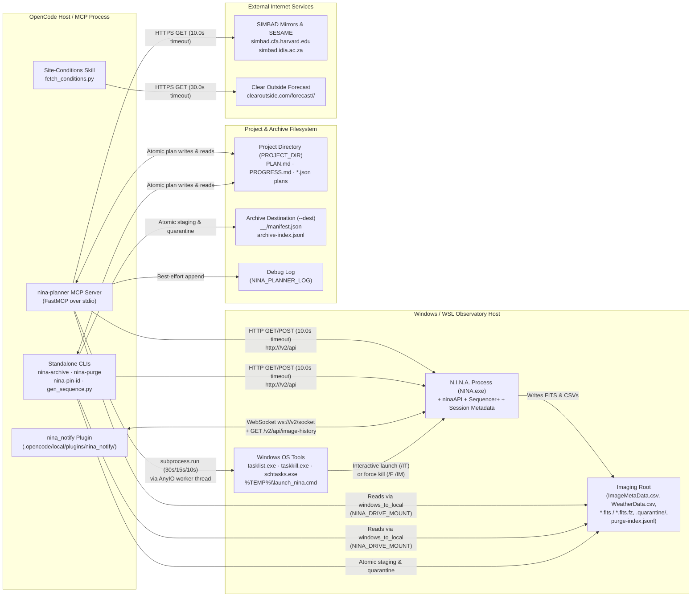
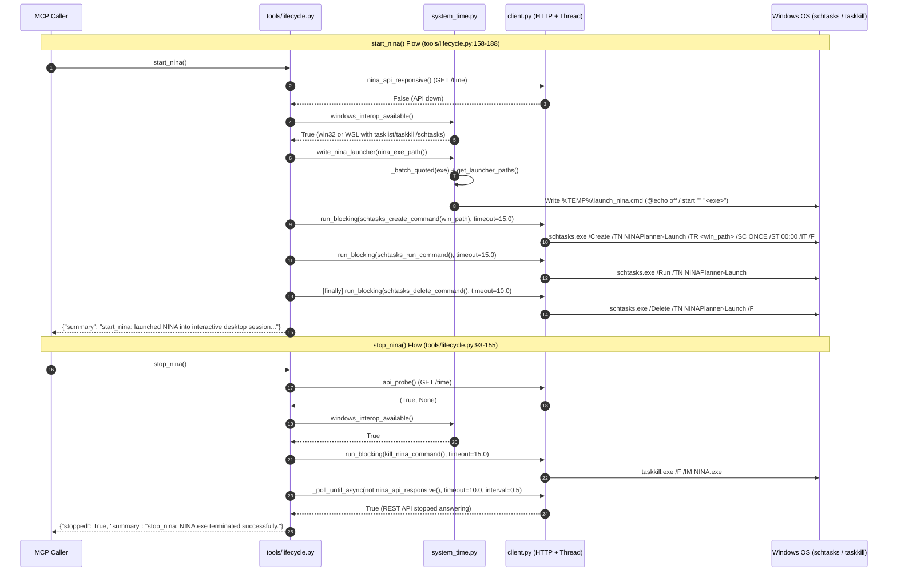
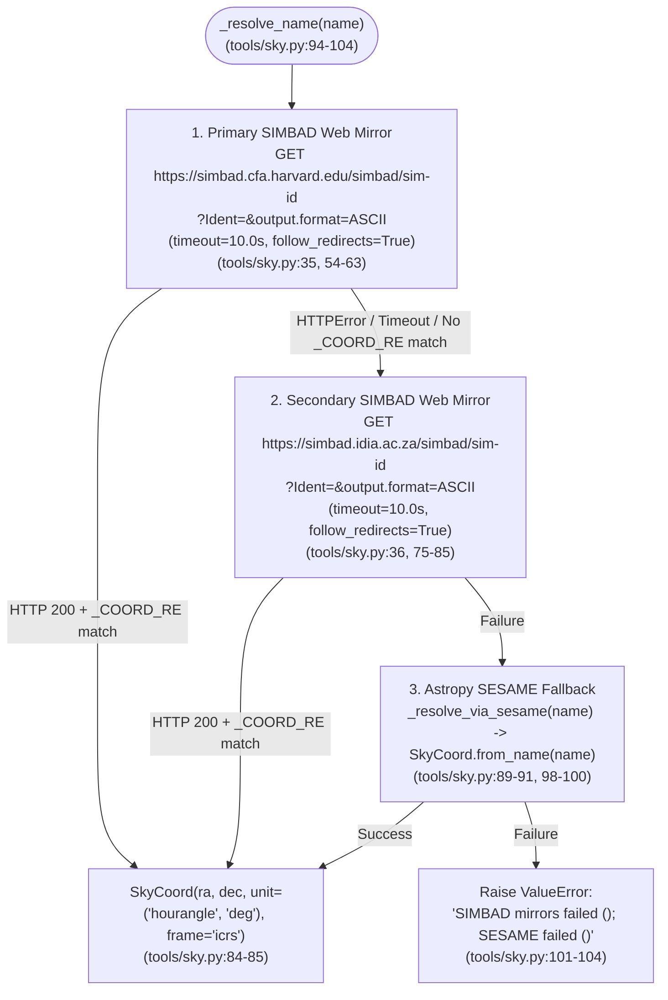
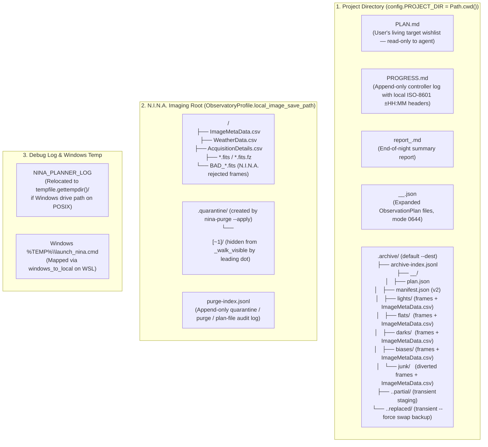

# External Integrations, OS Interop, Filesystem Layout & Environment Reference

[⬆️ Up to Atlas Index](../README.md) · [⬅️ Data Models & Schemas](./data-models-and-schemas.md) · [➡️ Runtime Flows & Lifecycles](../02-flows/README.md) · [🔗 HTTP Client Spec (`client.py`)](../03-modules/core/client.md) · [🔗 Windows Interop Spec (`system_time.py`)](../03-modules/core/system_time.md) · [🔗 Imaging & CSV Spec (`imaging.py`)](../03-modules/core/imaging.md)

---

## 1. End-to-End Integration Topology



---

## 2. N.I.N.A. Advanced API HTTP Contract (`http://<NINA_ENDPOINT>/v2/api`)

### 2.1 Transport & Envelope Contract (`nina_planner/client.py:62-154`, `config.py:10-14`)

- **Base URL (`config.py:10-11`):** `NINA_API_URL = f"http://{NINA_ENDPOINT}/v2/api"`, where `NINA_ENDPOINT` defaults to `"127.0.0.1:1888"`.
- **Client Lifecycle & Timeout (`client.py:130, 150`):** Every `api_get(path)` (`client.py:118-134`) and `api_post(path, body)` (`client.py:137-154`) opens a scoped `httpx.AsyncClient(base_url=config.NINA_API_URL, timeout=10.0)` context manager.
- **Standard N.I.N.A. v2 JSON Envelope (`client.py:81-115`):**
  ```json
  {
    "Response": {},
    "Error": "",
    "StatusCode": 200,
    "Success": true,
    "Type": "NINA.Plugin.inaAPI..."
  }
  ```
- **Envelope Unwrapping & Error Translation (`unwrap_response`, `client.py:81-115`, `_error_detail`, `client.py:62-78`):**
  1. **Non-2xx HTTP Status (`client.py:92-95`):** If `not resp.is_success`, raises `RuntimeError(f"{method} {url} failed with HTTP {resp.status_code}: {_error_detail(resp)}")`. `_error_detail` extracts `payload["Error"]` if the body is a JSON object with a truthy `"Error"`, or falls back to `resp.text.strip()[:500]` (or `"an empty response body"`).
  2. **Non-JSON 2xx Body (`client.py:96-101`):** If `resp.json()` raises `ValueError`, raises `RuntimeError(f"{method} {url} returned a non-JSON body: {_error_detail(resp)}")`.
  3. **Non-Object JSON 2xx Body (`client.py:102-106`):** If `not isinstance(data, dict)`, raises `RuntimeError(f"{method} {url} returned HTTP {resp.status_code} with a non-object JSON body: {_error_detail(resp)}")`.
  4. **Application-Level Refusal (`Success=False` on 2xx, `client.py:107-114`):**
     - If `data.get("Error")` is truthy (`lines 108-109`), raises `RuntimeError(str(data["Error"]))` **verbatim** (without prefixing `method`/`url`) so callers such as `get_frame_stats` (`tools/plans.py:57`) can match N.I.N.A.'s exact domain error string (e.g. `"Index out of range"`).
     - If `data.get("Error")` is empty or missing (`lines 110-114`), raises `RuntimeError(f"{method} {url} returned HTTP {resp.status_code} with Success=false and no Error field: {_error_detail(resp)}")`.
  5. **Success (`client.py:115, 133-134, 153-154`):** `unwrap_response` returns `data`; `api_get` and `api_post` log the full envelope via `log_payload` and return `data.get("Response", {})`.

### 2.2 Complete N.I.N.A. REST Endpoint Table

| HTTP Method & Path | Constant (if any) | Caller Function(s) & Exact File:Line | Timeout | `Response` Payload Shape & Consumer Semantics |
|---|---|---|---|---|
| `GET /time` | *(literal)* | • `client.api_probe` (`client.py:264`)<br>• `client.nina_api_responsive` (`client.py:270-272`)<br>• `tools.lifecycle.stop_nina` (`tools/lifecycle.py:103, 138`)<br>• `tools.lifecycle.start_nina` (`tools/lifecycle.py:165`)<br>• `tools.lifecycle.get_nina_status` (`tools/lifecycle.py:209`) | `10.0s` | ISO-8601 server time string. Used as the lightweight, side-effect-free REST API liveness oracle (`api_probe` catches all `Exception`s and returns `(bool, str \| None)`). |
| `GET /profile/show?active=true` | *(literal)* | • `tools.equipment.get_site_profile` (`tools/equipment.py:182`) | `10.0s` | Active N.I.N.A. profile dict containing 15 `*Settings` sub-dicts (`AstrometrySettings`, `TelescopeSettings`, `CameraSettings`, `FilterWheelSettings`, `ImageFileSettings`, `PlateSolveSettings`, `FramingAssistantSettings`, `GuiderSettings`, etc.). Parsed into `ObservatoryProfile`. |
| `GET /profile/horizon` | *(literal)* | • `horizon.fetch_horizon` (`horizon.py:132`), called by `get_site_profile` (`tools/equipment.py:286`) | `10.0s` | `{"Azimuths": list[float], "Altitudes": list[float]}`. Best-effort: `fetch_horizon` catches any `Exception`, logs to `NINA_PLANNER_LOG`, and degrades to a flat `0.0°` `Horizon()`. |
| `GET /equipment/info` | *(literal)* | • `tools.equipment._get_site_equipment_status` (`tools/equipment.py:97`) | `10.0s` | Dict with 11 device sections (`Mount`, `Camera`, `Focuser`, `Guider`, `SafetyMonitor`, `WeatherData`, `Dome`, `FilterWheel`, `FlatDevice`, `Rotator`, `Switch`). Parsed into `ObservatoryEquipment`. |
| `GET /equipment/<device>/connect` | `DEVICE_MAP` (`tools/equipment.py:99-111`) | • `tools.equipment._get_site_equipment_status` (`tools/equipment.py:134`) | `10.0s` | Called for each of the 11 device paths (`/equipment/mount/connect`, `/equipment/camera/connect`, `/equipment/focuser/connect`, `/equipment/guider/connect`, `/equipment/safetymonitor/connect`, `/equipment/weather/connect`, `/equipment/dome/connect`, `/equipment/filterwheel/connect`, `/equipment/flatdevice/connect`, `/equipment/rotator/connect`, `/equipment/switch/connect`) when `profile.equipment.has_<device>` is `True` and `Connected` is `False`, after which `_get_site_equipment_status` raises `RuntimeError("Equipment connecting: ...")` (`tools/equipment.py:137-141`). |
| `GET /event-history` | *(literal)* | • `tools.equipment.get_events` (`tools/equipment.py:295`) | `10.0s` | `list[dict]` of timestamped N.I.N.A. events (`"Time"`, `"Event"`, optional `"Attachment"`). Normalized and filtered to `since` seconds by `_convert_to_met(..., name="Time")` (`tools/equipment.py:296`). |
| `GET /application/logs?lineCount=1000` | *(literal)* | • `tools.equipment.get_logs` (`tools/equipment.py:304`) | `10.0s` | `list[dict]` of up to 1,000 log lines (`"Timestamp"`, `"Level"`, `"Message"`, `"Line"`, `"Member"`, `"Source"`). Normalized by `_convert_to_met(..., name="Timestamp")` and stripped of `"line"`, `"member"`, `"source"` (`tools/equipment.py:305-308`). |
| `GET /image-history` *(and `?imageType=<UPPER>`)* | *(literal)* | • `tools.plans.get_frame_stats` (`tools/plans.py:46-50`) | `10.0s` | Single-element `list[dict]` (or `dict`) carrying the most recent captured frame's statistics. Validated into `FrameStats` (`tools/plans.py:89`). `"Index out of range"` error envelopes are caught and returned as `{"count": 0, ...}` (`tools/plans.py:55-68`). |
| `GET /application/plugins` | *(literal)* | • `tools.sequence._require_sequencer_plus` (`tools/sequence.py:145`) | `10.0s` | `list[str]` of installed N.I.N.A. plugin display names. Checked case-insensitively for `"Sequencer+"` or `"Sequencer Plus"` (`SEQUENCER_PLUS_PLUGIN_NAMES`, `tools/sequence.py:123, 158-162`). |
| `POST /sequence/load` | *(literal)* | • `client.load_sequence_payload` (`client.py:252`), called by `tools/sequence.py:_load_many` (`sequence.py:400`) and `scripts/gen_sequence.py:_run` (`gen_sequence.py:375`) | `10.0s` | Accepts the compiled `SequenceRootContainer` JSON AST body (`api_post("/sequence/load", seq)`). Never auto-stops a running sequence (`client.py:248-250`). |
| `GET /sequence/start` | `config.SEQUENCE_START_PATH` (`config.py:12`) | • `tools.sequence.start_sequence` (`tools/sequence.py:432`) | `10.0s` | Triggers execution of the currently loaded sequence, immediately followed by `client.wait_until_sequence_started()` (`tools/sequence.py:433`). |
| `GET /sequence/stop` | *(literal)* | • `client.stop_running_sequence_and_wait` (`client.py:176`), called by `tools/sequence.py:stop_sequence` (`sequence.py:422`) | `10.0s` | Requests sequence cancellation, followed by polling `GET /sequence/json` every `0.2s` up to `15.0s` until no node reports `"Status": "RUNNING"` (`client.py:177-182`). |
| `GET /sequence/state` | `config.SEQUENCE_STATE_PATH` (`config.py:13`) | • `tools.sequence.get_sequence_state` (`tools/sequence.py:447`)<br>• `scripts/refresh_fixtures.py:main` (`refresh_fixtures.py:23, 65`) | `10.0s` | Returns N.I.N.A.'s hierarchical sequence state tree. Returned directly when `detail="raw"` (`tools/sequence.py:448-449`) or passed into `project_sequence_state(state, json_state)` when `detail="summary"` (`tools/sequence.py:454`). |
| `GET /sequence/json` | `config.SEQUENCE_JSON_PATH` (`config.py:14`) | • `client._sequence_is_running` (`client.py:163`), called by `stop_running_sequence_and_wait` (`client.py:174, 179`) and `purge._idle_state` (`purge.py:236`)<br>• `client.wait_until_sequence_started` (`client.py:230`, `SEQUENCE_START_TIMEOUT = 10.0s` at `client.py:188`)<br>• `tools.sequence.get_sequence_state` (`tools/sequence.py:451`)<br>• `scripts/refresh_fixtures.py:main` (`refresh_fixtures.py:23, 65`) | `10.0s` | Returns the full serialized sequence AST with live `"Status"` fields on every node. Used by `_node_statuses` (`client.py:191-206`) to detect `"RUNNING"` or non-`"CREATED"` nodes, and by `project_sequence_state` (`sequence_state.py:164-241`) to enrich step summaries with `$type` metadata. |

---

## 3. N.I.N.A. Plugins Required at Runtime

Running `nina-planner` against N.I.N.A. requires three N.I.N.A. plugins to be installed and enabled:

### 3.1 Advanced API (`ninaAPI`)
- **HTTP REST Server (`/v2/api/*`):** Hosts all 14 REST endpoints listed in §2.2 on `http://<NINA_ENDPOINT>/v2/api`.
- **Event WebSocket (`ws://<NINA_ENDPOINT>/v2/socket`):** Consumed by the sibling OpenCode plugin `.opencode/local/plugins/nina_notify/index.ts` to receive real-time sequence milestones, safety monitor state changes, and device faults.
- **`SendEventInstruction` Sequence Item (`nina_planner/sequence/instructions.py:456-490`, `builders.py:85-97, 446-468, 489`):**
  - Emits `"$type": "ninaAPI.SequenceItems.SendEventInstruction, ninaAPI"` with `"Message": text` (`instructions.py:458-460`).
  - Used to broadcast structured milestone events over `/v2/socket` and `/v2/api/event-history`:
    - `RUN-STARTING: <N> step(s)` (`instructions.py:467-473`, emitted in `StartAreaContainer` when `step_count > 0` at `builders.py:489`).
    - `RUN-FINISHED: <N> step(s) complete` (`instructions.py:476-490`, emitted at the head of `EndAreaContainer` when `step_count > 0` at `builders.py:446`).
    - `ACQUISITION-STARTING: [<tag>] <target>` / `ACQUISITION-FINISHED: [<tag>] <target>` (`builders.py:85, 93, 96`, bracketing every `acquisition_container`).
    - `PREPARK-DELAY: 3 min`, `PARK-STARTING`, and `PARK-FINISHED` (`builders.py:458, 462, 467`, emitted inside `sequence_end`).

### 3.2 Sequencer+ (`NINA.Plugin.SequencerPlus`)
- **AST Nodes Emitted (`nina_planner/sequence/instructions.py:496-582`):**
  - `NINA.Plugin.SequencerPlus.EndInstructionSet, NINA.Plugin.SequencerPlus` (`end_instruction`, `instructions.py:496-500`) — breaks out of `"Wait For Object"` (`Break If in View` in `sequence/targets.py:319`) and outer `sequence_safetynet` containers (`sequence/builders.py:416`).
  - `NINA.Plugin.SequencerPlus.SetVariable, NINA.Plugin.SequencerPlus` (`declare_variable`, `instructions.py:503-518`) — declares loop counter variable `n` (`COUNT_VARIABLE = "n"`, `builders.py:281`).
  - `NINA.Plugin.SequencerPlus.LoopWhile, NINA.Plugin.SequencerPlus` (`loop_while_expression`, `instructions.py:521-533`) — loops `"Exposure Group"` while `"n > 0"` (`builders.py:322`), persisting remaining counts across safety-monitor interrupts where standard `LoopCondition.CompletedIterations` would reset to `0`.
  - `NINA.Plugin.SequencerPlus.InitializeArray, NINA.Plugin.SequencerPlus` (`initialize_array`, `instructions.py:536-548`), `GetArray` (`get_array`, `instructions.py:551-566`), and `PutArray` (`put_array`, `instructions.py:569-582`) — manage the per-batch remaining exposure counter array `'count'` (`COUNT_ARRAY = "'count'"`, `builders.py:280`) via nested `NINA.Plugin.SequencerPlus.Expr, NINA.Plugin.SequencerPlus` nodes.
- **Load-Time Preflight Guard (`_require_sequencer_plus`, `nina_planner/tools/sequence.py:123-173`):**
  - Called in `_load_many` (`tools/sequence.py:394-398`) whenever a sequence contains at least one non-empty `light` or `flat` payload (`dark` and `bias` steps use `SmartExposure` without `Sequencer+` nodes and are exempt).
  - Queries `GET /application/plugins` (`sequence.py:145`) and checks whether any installed plugin name matches `SEQUENCER_PLUS_PLUGIN_NAMES = ("Sequencer+", "Sequencer Plus")` case-insensitively (`sequence.py:123, 158-162`).
  - If the endpoint returns a valid `list[str]` that lacks both names, raises `ValueError` (`sequence.py:164-173`) before `POST /sequence/load` so N.I.N.A. never silently drops unknown `$type` nodes and finishes with zero exposures.

### 3.3 Session Metadata
- Writes `ImageMetaData.csv`, `WeatherData.csv`, and `AcquisitionDetails.csv` (`_SIDECAR_NAMES` in `purge.py:116-118`) into the imaging root during sequence execution.
- Required by `get_plan_progress`, `load_sequence` (in `mode="remaining"`), `audit_plans`, `nina-archive`, and `nina-purge`.

---

## 4. Windows / WSL OS Process Interop (`system_time.py` & `tools/lifecycle.py`)

Because the MCP server may run on native Windows (`sys.platform == "win32"`), WSL2 on Linux (`sys.platform == "linux"`), or macOS/remote Linux (where N.I.N.A. runs on a separate Windows host), `nina_planner/system_time.py` (`1-174`) and `nina_planner/tools/lifecycle.py` (`1-231`) isolate all Windows process management behind explicit interop gates.



### 4.1 WSL & Interop Detection (`system_time.py:40-74`)
- **`_WINDOWS_INTEROP_EXES` (`system_time.py:40-44`):** `("tasklist.exe", "taskkill.exe", "schtasks.exe")`.
- **`_is_wsl()` (`system_time.py:47-57`):** Returns `False` if `sys.platform != "linux"`. On Linux, returns `True` if `os.environ.get("WSL_INTEROP")` or `os.environ.get("WSL_DISTRO_NAME")` is non-empty (`line 51`), or if `/proc/sys/kernel/osrelease` contains `"microsoft"` or `"wsl"` case-insensitively (`lines 53-57`).
- **`windows_interop_available()` (`system_time.py:60-74`):** Returns `True` on `sys.platform == "win32"`, or on WSL (`_is_wsl()`) when all three executables in `_WINDOWS_INTEROP_EXES` resolve via `shutil.which(exe)` (`line 74`).

### 4.2 Batch Sanitization & `%TEMP%\launch_nina.cmd` (`system_time.py:77-144`)
- **`_batch_quoted(value, var)` (`system_time.py:115-130`):** Security boundary before writing `NINA_EXE_PATH` into `launch_nina.cmd`:
  1. Rejects any `"` character or ASCII control character (`ord(c) < 32`, including `\r`, `\n`, `\t`, `\x00`) by raising `ValueError` (`lines 125-129`) before any file is written.
  2. Doubles every `"%"` to `"%%"` (`value.replace("%", "%%")`, `line 130`) so `cmd.exe` never expands `%VAR%` inside the quoted executable path.
- **`get_launcher_paths()` (`system_time.py:77-112`):**
  - On native Windows (`sys.platform == "win32"`): uses `Path(tempfile.gettempdir()) / "launch_nina.cmd"` for both local and Windows paths (`lines 84-86`).
  - On WSL: runs `subprocess.run(["cmd.exe", "/d", "/c", "echo", "%TEMP%"], capture_output=True, text=True, check=False, timeout=10)` (`lines 88-95`), validates that the output is an absolute drive path via `PureWindowsPath` (`lines 103-107`), and returns `(windows_to_local(windows_temp) / "launch_nina.cmd", str(windows_temp_path / "launch_nina.cmd"))` (`lines 109-112`).
- **`write_nina_launcher(nina_exe=None)` (`system_time.py:133-144`):** Writes the two-line UTF-8 CRLF batch file:
  ```bat
  @echo off
  start "" "<sanitized_nina_exe>"
  ```

### 4.3 Task Scheduler & `taskkill.exe` Commands (`system_time.py:24, 35-37, 147-174`, `tools/lifecycle.py:22-188`)
- **`NINA_TASK_NAME = "NINAPlanner-Launch"` (`system_time.py:24`):**
  - **Create (`schtasks_create_command`, `system_time.py:147-164`):**
    `["schtasks.exe", "/Create", "/TN", "NINAPlanner-Launch", "/TR", launcher_win_path, "/SC", "ONCE", "/ST", "00:00", "/IT", "/F"]` (`15.0s` timeout in `tools/lifecycle.py:44`). The `/IT` flag launches `NINA.exe` into the active logged-on user's interactive desktop session.
  - **Run (`schtasks_run_command`, `system_time.py:167-169`):**
    `["schtasks.exe", "/Run", "/TN", "NINAPlanner-Launch"]` (`15.0s` timeout in `tools/lifecycle.py:52`).
  - **Delete (`schtasks_delete_command`, `system_time.py:172-174`):**
    `["schtasks.exe", "/Delete", "/TN", "NINAPlanner-Launch", "/F"]` (`10.0s` timeout inside the `finally:` block in `tools/lifecycle.py:55-60`; deletion errors are logged via `client.log_payload` without masking the launch result).
- **Force Termination (`kill_nina_command`, `system_time.py:35-37`):**
  - `["taskkill.exe", "/F", "/IM", "NINA.exe"]` (`15.0s` timeout in `tools/lifecycle.py:123`).
  - `stop_nina` (`tools/lifecycle.py:129-155`) does not fail immediately on a non-zero `taskkill.exe` exit code (such as exit code `128` when `NINA.exe` exited between `api_probe()` and `taskkill`); instead it polls `_nina_down()` (`not await client.nina_api_responsive()`) every `0.5s` for up to `10.0s` (`tools/lifecycle.py:137-140`) and succeeds if the REST API is confirmed down.

---

## 5. External Network Services

### 5.1 SIMBAD Mirrors & Astropy SESAME Fallback (`nina_planner/tools/sky.py:34-104`)
Used **only** when resolving an out-of-catalog target name via `resolve_target(name)` (`tools/sky.py:107-118`) or when a target entry passed to `target_altitudes` omits `ra_hours`/`dec_deg` (`tools/sky.py:139-151`). All catalog operations (`best_targets`, `sun_times`, `moon_times`, and `target_altitudes` with coordinates) run 100% offline.



- **Constants (`tools/sky.py:34-51`):**
  - `_SIMBAD_MIRRORS = ("https://simbad.cfa.harvard.edu", "https://simbad.idia.ac.za")` (`lines 34-37`).
  - `_SIMBAD_TIMEOUT_S = 10.0` (`line 38`).
  - `_COORD_RE` (`lines 45-51`): `r"^Coordinates\(ICRS,ep=J2000[^)]*\):\s*(\d{1,2}(?:\s+\d{1,2})+(?:\.\d+)?)\s+([+-]\d{1,2}(?:\s+\d{1,2})+(?:\.\d+)?)"` (`re.MULTILINE`).
- **Execution Threading (`tools/sky.py:111, 183`):** Executed synchronously via `httpx.get` inside `anyio.to_thread.run_sync` so network lookups never block the async MCP event loop.

### 5.2 Clear Outside 7-Day Hourly Forecast (`.agents/skills/site-conditions/fetch_conditions.py:30-167`)
- **Endpoint & Query Format (`fetch_conditions.py:30-31, 115-167`):**
  - `BASE_URL = "https://clearoutside.com/forecast"` (`line 30`).
  - `USER_AGENT = "Mozilla/5.0 (observatory-controller; site-conditions skill)"` (`line 31`).
  - `_fmt_coord(value)` (`lines 115-131`) rounds `<lat>` and `<lon>` to 2 decimal places (`f"{v:.2f}"`, normalizing `-0.00` to `0.00`) before constructing `https://clearoutside.com/forecast/<lat>/<lon>?view=<current|midnight|midday>` (`lines 143-146`). This avoids Clear Outside's 301 coordinate-precision redirect, which strips the `?view=` query string.
  - Fetched via stdlib `urllib.request.urlopen(req, timeout=30)` (`line 149`).
- **Advisory-Only Policy:** Provides forward-looking cloud cover %, wind speed, precipitation probability %, temperature/dew point/spread °C, frost flags, SQM/Bortle class, and astro-dark windows. Never substitutes for `safety_monitor.is_safe` or the local weather device.

---

## 6. Filesystem Layout & Cross-Platform Drive Mapping



### 6.1 Project Directory (`config.PROJECT_DIR` in `config.py:19`)
- Anchored to `Path.cwd()` at module import time (`config.py:19`) and resolved via `plan_utils.resolve_plan_dir` (`plan_utils.py:223-232`).
- Discovered by `plan_utils.plan_files(plan_dir)` (`plan_utils.py:235-255`), which walks visible directories via `imaging._walk_visible` (`imaging.py:39-52`), pruning hidden dot-directories (`.archive`, `.git`, `.opencode`, `.venv`) and `{"node_modules", "__pycache__"}` (`_PRUNED_DIR_NAMES`, `imaging.py:26`).
- Archive destination (`--dest`, defaulting to `.archive`) must resolve **outside** the imaging root (`not _inside(dest, imaging_root)` enforced in `archive.py:972-979` and `purge.py:785-792`).

### 6.2 Imaging Root & `windows_to_local` Drive Mapping (`imaging.py:65-81`, `metadata.py:12-47`)
- **`windows_to_local(windows_path, drive_mount=None)` (`imaging.py:65-81`):**
  1. On native Windows (`sys.platform == "win32"`, `lines 73-74`): returns `Path(windows_path)` unchanged.
  2. On non-Windows hosts (`darwin`, `linux`, WSL, `lines 75-81`): parses `win = PureWindowsPath(windows_path)`. If `not win.drive`, returns `Path(windows_path)` unchanged. Otherwise resolves `mount = drive_mount or os.environ.get("NINA_DRIVE_MOUNT") or f"/mnt/{win.drive[0].lower()}"` and joins `Path(mount).joinpath(*win.parts[1:])`.
- **Root Resolution & Existence Gate (`metadata.py:12-47`, `imaging.py:139-152`):**
  - MCP tools resolve the imaging root from `ObservatoryProfile.local_image_save_path` (`metadata.resolve_imaging_root`, `metadata.py:12-19`).
  - CLI tools (`nina-archive`, `nina-purge`) accept `--imaging-root <path>` so they can run while N.I.N.A. is offline, falling back to `resolve_imaging_root()` via `metadata.resolve_cli_root` (`metadata.py:22-47`).
  - `imaging._require_root(root)` (`imaging.py:139-152`) raises `FileNotFoundError` if `not root.is_dir()`, preventing an unmounted network share or misconfigured `NINA_DRIVE_MOUNT` from silently reading as zero captured frames.
- **Quarantine Isolation (`purge.py:110, 415-472`, `imaging.py:34-36`):**
  - `nina-purge --apply` moves released top-level directories into `<imaging-root>/.quarantine/<dir>`. Because `".quarantine"` starts with `"."`, `imaging._prunable_dir` (`imaging.py:34-36`) automatically excludes it from every `visible_rglob` and `_walk_visible` scan.

### 6.3 Debug Log Relocation (`client.py:24, 27-59`)
- `client._log_file()` (`client.py:27-39`) reads `config.NINA_PLANNER_LOG`.
- If `os.name != "nt"` and `config.NINA_PLANNER_LOG` matches `_WINDOWS_ABSOLUTE_PATH = re.compile(r"^[A-Za-z]:[\\/]")` (`client.py:24, 37`), `_log_file()` redirects the log path to `Path(tempfile.gettempdir()) / Path(config.NINA_PLANNER_LOG).name` (`client.py:38`) so sample Windows paths (such as `C:/Windows/Temp/nina-planner-debug.log`) never create a literal `C:` folder in the POSIX working directory.
- `client.log_payload(label, payload)` (`client.py:42-59`) creates parent directories and appends `f"{timestamp} {label} {payload}\n"` in UTF-8, catching and swallowing any `OSError` (`lines 58-59`).

---

## 7. Complete Environment Variable Reference

Every environment variable read across the repository, its exact file and line citations, default value, and evaluation timing (import-time vs. call-time):

| Environment Variable | Where Read (`file:line`) | Default Value | Evaluation Timing | Purpose & Behavioral Notes |
|---|---|---|---|---|
| `NINA_ENDPOINT` | • `nina_planner/config.py:10`<br>• `nina_planner/tools/plans.py:1206, 1228-1230` | `"127.0.0.1:1888"` | **Import-time** in `config.py:10-11` (to build `NINA_API_URL = f"http://{NINA_ENDPOINT}/v2/api"`).<br>**Call-time** in `get_nina_settings()` (`tools/plans.py:1227-1231`). | Host and port (`<host>:<port>`) of N.I.N.A.'s Advanced API server. Also read by `.opencode/local/plugins/nina_notify/index.ts`. |
| `NINA_PLANNER_LOG` | • `nina_planner/config.py:15`<br>*(referenced via `config.NINA_PLANNER_LOG` at call time in `client.py:35-39`)* | `None` *(logging disabled)* | **Import-time** into `config.NINA_PLANNER_LOG` (`config.py:15`); attribute `config.NINA_PLANNER_LOG` is read at **call-time** by `client._log_file()` (`client.py:35`). | Path to the diagnostic payload log file. Relocated to `tempfile.gettempdir()/<name>` when set to a Windows drive path on a non-Windows OS (`client.py:37-38`). |
| `NINA_DRIVE_MOUNT` | • `nina_planner/imaging.py:79`<br>• `nina_planner/tools/plans.py:1207, 1228-1230` | `f"/mnt/{win.drive[0].lower()}"` *(e.g. `/mnt/c`, `/mnt/z`)* on non-Windows hosts; ignored on `win32` (`imaging.py:73-80`) | **Call-time** inside `windows_to_local()` (`imaging.py:79`) and `get_nina_settings()` (`tools/plans.py:1227-1231`). | Local mount point replacing the Windows drive letter of `ObservatoryProfile.image_save_path`, CSV `FilePath` entries, and Windows `%TEMP%` on POSIX/WSL/macOS hosts. |
| `NINA_EXE_PATH` | • `nina_planner/system_time.py:32` | `NINA_EXE_DEFAULT` = `r"C:\Program Files\N.I.N.A. - Nighttime Imaging 'N' Astronomy\NINA.exe"` (`system_time.py:20-22`) | **Call-time** inside `nina_exe_path()` (`system_time.py:27-32`), called by `start_nina` (`tools/lifecycle.py:181`) and `write_nina_launcher` (`system_time.py:140`). | Windows path to `NINA.exe` written into `%TEMP%\launch_nina.cmd` after `_batch_quoted` sanitization (`system_time.py:115-130`). Empty string `""` falls back to `NINA_EXE_DEFAULT`. |
| `NINA_ARCHIVE_DEST` | • `nina_planner/tools/plans.py:1203, 1228-1235` | Unset *(reported in `missing`; gates `ready`)* | **Call-time** inside `get_nina_settings()` (`tools/plans.py:1227-1238`). | Local archive folder path passed to `nina-archive --dest` and `nina-purge --dest`. `~` is expanded via `Path(...).expanduser()` (`tools/plans.py:1232-1235`). Part of `_ARCHIVE_GATE_NAMES` (`tools/plans.py:1212`). |
| `NINA_UPLOAD_CMD` | • `nina_planner/tools/plans.py:1204, 1228-1230` | Unset *(reported in `missing`; gates `ready`)* | **Call-time** inside `get_nina_settings()` (`tools/plans.py:1227-1238`). | User-configured shell command to upload `NINA_ARCHIVE_DEST` to cloud storage during the `archive-lifecycle` skill workflow. Never executed by `get_nina_settings()` itself. Part of `_ARCHIVE_GATE_NAMES` (`tools/plans.py:1212`). |
| `NINA_VERIFY_CMD` | • `nina_planner/tools/plans.py:1205, 1228-1230` | Unset *(reported in `missing`; gates `ready`)* | **Call-time** inside `get_nina_settings()` (`tools/plans.py:1227-1238`). | User-configured shell command to verify cloud upload completion before `nina-purge` is allowed to run. Part of `_ARCHIVE_GATE_NAMES` (`tools/plans.py:1212`). |
| `NINA_FLATS_ALTITUDE` | • `nina_planner/sequence/nodes.py:12` | `"80"` → `80.0` (`float`) | **Import-time** (`sequence/nodes.py:12`, imported into `sequence/targets.py:60, 244`). | Mount target altitude in degrees for `slew_to_azalt` in twilight sky-flat sequences (`target_payload_flats`, `sequence/targets.py:240-245`). |
| `NINA_FLATS_AZIMUTH_DAWN` | • `nina_planner/sequence/nodes.py:13` | `"270"` → `270.0` (`float`) | **Import-time** (`sequence/nodes.py:13`, imported into `sequence/targets.py:61, 243`). | Mount target azimuth in degrees (West, opposite the rising sun) for dawn sky flats (`dusk=False` in `target_payload_flats`, `sequence/targets.py:240-243`). |
| `NINA_FLATS_AZIMUTH_DUSK` | • `nina_planner/sequence/nodes.py:14` | `"90"` → `90.0` (`float`) | **Import-time** (`sequence/nodes.py:14`, imported into `sequence/targets.py:62, 241`). | Mount target azimuth in degrees (East, opposite the setting sun) for dusk sky flats (`dusk=True` in `target_payload_flats`, `sequence/targets.py:240-242`). |
| `WSL_INTEROP` | • `nina_planner/system_time.py:51` | Unset (`None`) | **Call-time** inside `_is_wsl()` (`system_time.py:47-57`). | Standard WSL2 runtime socket variable; when non-empty on `sys.platform == "linux"`, immediately identifies the host as WSL without reading `/proc/sys/kernel/osrelease`. |
| `WSL_DISTRO_NAME` | • `nina_planner/system_time.py:51` | Unset (`None`) | **Call-time** inside `_is_wsl()` (`system_time.py:47-57`). | Standard WSL distribution name variable; when non-empty on `sys.platform == "linux"`, immediately identifies the host as WSL. |
