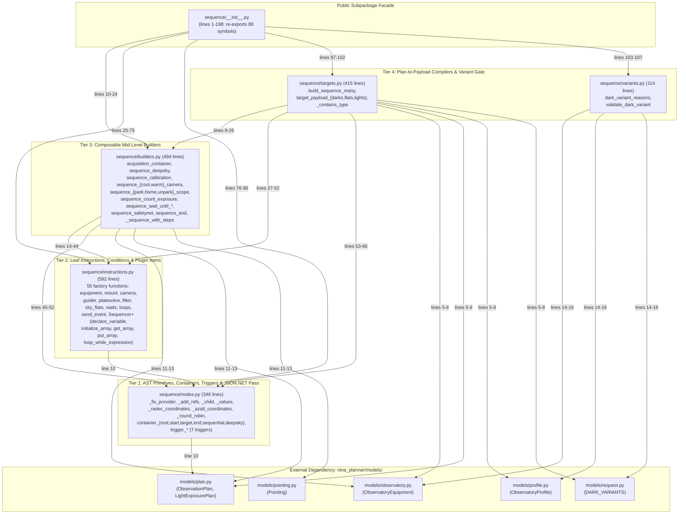
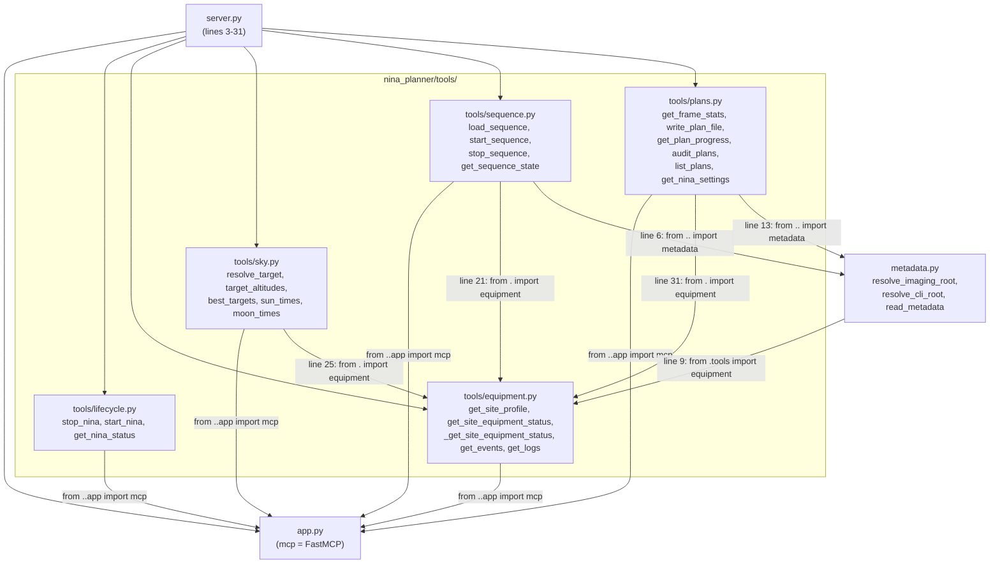
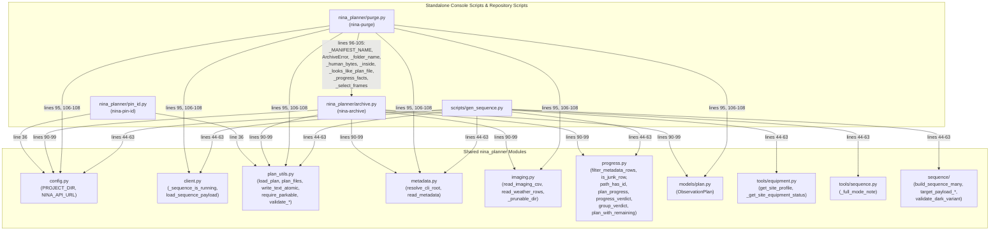
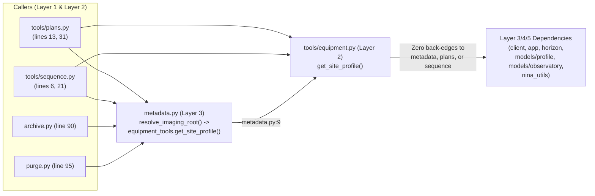

# Module Dependency Graph & Layering Architecture

[⬆️ Up to Atlas Index](../README.md) · [⬅️ System Overview](./system-overview.md) · [➡️ Data Models & Schemas](./data-models-and-schemas.md) · [➡️ External Integrations & I/O](./external-integrations-and-io.md)

---

## 1. Package Layering Architecture

The `nina_planner` codebase (`.opencode/local/mcps/nina_planner/nina_planner/`, **51 Python modules** totaling **12,114 lines**, plus `scripts/gen_sequence.py` at **409 lines**) is structured into a **5-layer architectural hierarchy**. Dependencies flow overwhelmingly downward from Layer 1 (Entrypoints) to Layer 5 (Foundation / Leaf Utilities), with a small set of deliberate cross-layer seams analyzed in [Section 5](#5-coupling-cross-layer--deferred-import-analysis).

| Layer | Architectural Role | Modules Included | Module Count | Total Lines |
|---|---|---|---|---:|
| **Layer 1: Entrypoints, Registries & CLI Engines** | Process startup, FastMCP singleton & tool registration facade, standalone CLI workflows (`nina-archive`, `nina-purge`, `nina-pin-id`), and offline sequence generation (`scripts/gen_sequence.py`). | `__init__.py`, `__main__.py`, `app.py`, `server.py`, `archive.py`, `purge.py`, `pin_id.py`, `scripts/gen_sequence.py` | 8 | 2,965 |
| **Layer 2: MCP Tool Controllers (`nina_planner/tools/`)** | The 22 `@mcp.tool()` endpoints and their domain-specific orchestration helpers (`lifecycle`, `equipment`, `sky`, `sequence`, `plans`). | `tools/__init__.py`, `tools/lifecycle.py`, `tools/equipment.py`, `tools/sky.py`, `tools/sequence.py`, `tools/plans.py` | 6 | 3,096 |
| **Layer 3: Domain Services & Sequence Compiler** | Plan validation & discovery (`plan_utils.py`), frame attribution & remaining-count math (`progress.py`), imaging root & CSV readers (`metadata.py`, `imaging.py`), spherical mosaic math (`mosaic.py`), custom skyline interpolation (`horizon.py`), offline DSO catalog (`dso_catalog.py`), sequence state projection (`sequence_state.py`), and the 4-layer JSON.NET sequence compiler (`sequence/*.py`). | `plan_utils.py`, `progress.py`, `metadata.py`, `imaging.py`, `mosaic.py`, `horizon.py`, `dso_catalog.py`, `sequence_state.py`, `sequence/__init__.py`, `sequence/targets.py`, `sequence/variants.py`, `sequence/builders.py`, `sequence/instructions.py`, `sequence/nodes.py` | 14 | 4,110 |
| **Layer 4: Schemas & Data Models (`nina_planner/models/`)** | Strict caller/plan-file Pydantic schemas (`StrictModel`, `ObservationPlan`, `SequenceRequest`, `Pointing`) and tolerant N.I.N.A. REST API normalizers (`ObservatoryProfile`, `ObservatoryEquipment`, `FrameStats`, and 11 device models). | `models/__init__.py`, `models/strict.py`, `models/plan.py`, `models/pointing.py`, `models/frame.py`, `models/request.py`, `models/profile.py`, `models/observatory.py`, `models/camera.py`, `models/mount.py`, `models/meridian.py`, `models/focuser.py`, `models/filter_wheel.py`, `models/guider.py`, `models/rotator.py`, `models/dome.py`, `models/switch.py`, `models/flat_device.py`, `models/weather.py`, `models/safety_monitor.py` | 20 | 1,750 |
| **Layer 5: Foundation / Leaf Utilities** | Import-time environment configuration (`config.py`), async HTTP client & sequence start/stop barriers (`client.py`), ASCOM sentinel & timestamp coercions (`nina_utils.py`), and Windows/WSL process interop (`system_time.py`). | `config.py`, `client.py`, `nina_utils.py`, `system_time.py` | 4 | 597 |

### 1.1 Architectural Layering Rules

1. **Acyclic Tool Registration (`server.py` -> `tools/*` -> `app.py`):**
   `app.py` (`lines 10-21`) defines the `mcp = FastMCP(name="nina-planner", ...)` singleton with **zero internal imports**. All five `tools/*.py` modules import `from ..app import mcp` to register their `@mcp.tool()` functions, while `server.py` imports `mcp` and the 22 tool functions to trigger registration and re-export `__all__`. No module in `tools/` ever imports `server.py`.
2. **CLI Independence from MCP Server Startup (`__init__.py`):**
   `nina_planner/__init__.py` (`line 1`) contains only a package docstring and performs no imports. Consequently, invoking `nina-archive` (`nina_planner.archive:main`), `nina-purge` (`nina_planner.purge:main`), or `nina-pin-id` (`nina_planner.pin_id:main`) imports only the modules required by that CLI without importing `server.py`, `tools/sky.py` (Astropy/NumPy), or `sequence/*`.
3. **Pure In-Memory Sequence Compiler (`sequence/*`):**
   The entire `nina_planner/sequence/` subpackage (`nodes.py`, `instructions.py`, `builders.py`, `targets.py`, `variants.py`) depends **only** on `nina_planner/models/` (`ObservatoryEquipment`, `ObservationPlan`, `LightExposurePlan`, `Pointing`, `ObservatoryProfile`, `DARK_VARIANTS`) and Python stdlib (`os`, `typing`). It has zero dependencies on `client.py`, `config.py`, `tools/*`, or filesystem I/O.
4. **Pure Leaf Modules (Zero Internal Imports):**
   Twelve modules across `nina_planner/` have **zero internal package imports** (relying solely on stdlib or third-party `mcp`/`pydantic`):
   - `nina_planner/__init__.py` and `nina_planner/tools/__init__.py`
   - `nina_planner/app.py` (`mcp.server.fastmcp.FastMCP`)
   - `nina_planner/config.py` (`os`, `pathlib.Path`)
   - `nina_planner/nina_utils.py` (`__future__`, `math`, `re`, `datetime`)
   - `nina_planner/dso_catalog.py` (`__future__`, `csv`, `dataclasses`, `importlib.resources`)
   - Six leaf models in `nina_planner/models/`: `strict.py`, `filter_wheel.py`, `flat_device.py`, `meridian.py`, `safety_monitor.py`, `switch.py`.

---

## 2. Complete Module Import Matrix

Every `.py` module in `nina_planner/` (plus `scripts/gen_sequence.py`) is cataloged below with its exact line count, outbound internal imports (with line numbers), outbound stdlib and third-party imports (with line numbers), and inbound internal dependents (with line numbers).

### 2.1 Layer 1: Entrypoints, Registries & CLI Engines

| Module Path | Lines | Outbound Internal Imports (`line`) | Outbound Stdlib & Third-Party Imports (`line`) | Inbound Internal Dependents (`line`) |
|---|---:|---|---|---|
| `nina_planner/__init__.py` | 1 | *(none)* | *(none)* | Implicit package parent for all `nina_planner.*` imports |
| `nina_planner/__main__.py` | 12 | `.server` (`mcp` at `3`) | *(none)* | Console script `nina-planner = "nina_planner.__main__:main"` (`pyproject.toml:59`) |
| `nina_planner/app.py` | 21 | *(none)* | **3rd-party:** `mcp.server.fastmcp.FastMCP` (`8`) | `server.py` (`3`), `tools/equipment.py` (`9`), `tools/lifecycle.py` (`10`), `tools/plans.py` (`14`), `tools/sequence.py` (`7`), `tools/sky.py` (`23`) |
| `nina_planner/server.py` | 61 | `.app` (`mcp` at `3`), `.tools.equipment` (`get_events`, `get_logs`, `get_site_equipment_status`, `get_site_profile` at `4-9`), `.tools.lifecycle` (`get_nina_status`, `start_nina`, `stop_nina` at `10`), `.tools.plans` (`audit_plans`, `get_frame_stats`, `get_nina_settings`, `get_plan_progress`, `list_plans`, `write_plan_file` at `11-18`), `.tools.sequence` (`get_sequence_state`, `load_sequence`, `start_sequence`, `stop_sequence` at `19-24`), `.tools.sky` (`best_targets`, `moon_times`, `resolve_target`, `sun_times`, `target_altitudes` at `25-31`) | *(none)* | `__main__.py` (`3`) |
| `nina_planner/archive.py` | 1,204 | `.config` (`90`), `.metadata` (`90`), `.plan_utils` (`90`), `.imaging` (`read_imaging_csv`, `read_weather_rows` at `91`), `.models.plan` (`ObservationPlan` at `92`), `.progress` (`filter_metadata_rows`, `is_junk_row`, `path_has_id`, `plan_progress`, `progress_verdict` at `93-99`) | **Stdlib:** `__future__.annotations` (`77`), `argparse` (`79`), `asyncio` (`80`), `csv` (`81`), `hashlib` (`82`), `json` (`83`), `shutil` (`84`), `sys` (`85`), `datetime` (`UTC`, `datetime` at `86`), `pathlib.Path` (`87`), `typing.Any` (`88`) | `purge.py` (`96-105`), console script `nina-archive = "nina_planner.archive:main"` (`pyproject.toml:60`) |
| `nina_planner/purge.py` | 1,091 | `.config` (`95`), `.metadata` (`95`), `.plan_utils` (`95`), `.archive` (`_MANIFEST_NAME`, `ArchiveError`, `_folder_name`, `_human_bytes`, `_inside`, `_looks_like_plan_file`, `_progress_facts`, `_select_frames` at `96-105`), `.client` (`_sequence_is_running` at `106`), `.imaging` (`_prunable_dir`, `read_imaging_csv` at `107`), `.models.plan` (`ObservationPlan` at `108`) | **Stdlib:** `__future__.annotations` (`84`), `argparse` (`86`), `asyncio` (`87`), `json` (`88`), `shutil` (`89`), `sys` (`90`), `datetime` (`UTC`, `datetime` at `91`), `pathlib.Path` (`92`), `typing.Any` (`93`) | Console script `nina-purge = "nina_planner.purge:main"` (`pyproject.toml:62`) |
| `nina_planner/pin_id.py` | 166 | `.config` (`36`), `.plan_utils` (`36`) | **Stdlib:** `__future__.annotations` (`27`), `argparse` (`29`), `asyncio` (`30`), `sys` (`31`), `pathlib.Path` (`32`)<br>**3rd-party:** `anyio` (`34`) | Console script `nina-pin-id = "nina_planner.pin_id:main"` (`pyproject.toml:61`) |
| `scripts/gen_sequence.py` | 409 | `nina_planner` (`client`, `config`, `metadata`, `plan_utils` at `44`), `nina_planner.models.observatory` (`ObservatoryEquipment` at `45`), `nina_planner.models.profile` (`ObservatoryProfile` at `46`), `nina_planner.progress` (`group_verdict`, `plan_progress`, `plan_with_remaining` at `47-51`), `nina_planner.sequence` (`build_sequence_many`, `target_payload_darks`, `target_payload_flats`, `target_payload_lights`, `validate_dark_variant` at `52-58`), `nina_planner.tools.equipment` (`_get_site_equipment_status`, `get_site_profile` at `59-62`), `nina_planner.tools.sequence` (`_full_mode_note` at `63`) | **Stdlib:** `__future__.annotations` (`34`), `argparse` (`36`), `asyncio` (`37`), `json` (`38`), `sys` (`39`), `datetime` (`UTC`, `datetime` at `40`), `typing.Any` (`41`) | Standalone CLI script |

### 2.2 Layer 2: MCP Tool Controllers (`nina_planner/tools/`)

| Module Path | Lines | Outbound Internal Imports (`line`) | Outbound Stdlib & Third-Party Imports (`line`) | Inbound Internal Dependents (`line`) |
|---|---:|---|---|---|
| `nina_planner/tools/__init__.py` | 1 | *(none)* | *(none)* | Implicit subpackage parent for `nina_planner.tools.*` |
| `nina_planner/tools/lifecycle.py` | 231 | `..client` (`9`), `..app` (`mcp` at `10`), `..system_time` (`kill_nina_command`, `nina_exe_path`, `schtasks_create_command`, `schtasks_delete_command`, `schtasks_run_command`, `windows_interop_available`, `write_nina_launcher` at `11-19`) | **Stdlib:** `subprocess` (`3`), `collections.abc` (`Awaitable`, `Callable` at `4`), `typing.Any` (`5`)<br>**3rd-party:** `anyio` (`7`) | `server.py` (`10`) |
| `nina_planner/tools/equipment.py` | 310 | **Top-level:** `..client` (`8`), `..app` (`mcp` at `9`), `..horizon` (`fetch_horizon` at `10`), `..models.observatory` (`ObservatoryEquipment` at `11`), `..models.profile` (`EquipmentConfig`, `FilterInfo`, `ObservatoryProfile`, `OpticalTrainInfo`, `SiteLocationInfo` at `12-18`), `..nina_utils` (`ascom_float`, `ascom_int`, `to_local_display`, `to_snake` at `19`)<br>**Function-scoped (`_get_site_equipment_status` at `85-95`):** `..models.camera` (`CameraDevice` at `85`), `..models.dome` (`DomeDevice` at `86`), `..models.filter_wheel` (`FilterWheelDevice` at `87`), `..models.flat_device` (`FlatDevice` at `88`), `..models.focuser` (`FocuserDevice` at `89`), `..models.guider` (`GuiderDevice` at `90`), `..models.mount` (`MountDevice` at `91`), `..models.rotator` (`RotatorDevice` at `92`), `..models.safety_monitor` (`SafetyMonitorDevice` at `93`), `..models.switch` (`Switch` at `94`), `..models.weather` (`Weather` at `95`) | **Stdlib:** `json` (`3`), `collections.abc` (`Set as AbstractSet` at `4`), `datetime.datetime` (`5`), `typing` (`Any`, `cast` at `6`) | `server.py` (`4-9`), `metadata.py` (`9`), `tools/plans.py` (`31`), `tools/sequence.py` (`21`), `tools/sky.py` (`25`), `scripts/gen_sequence.py` (`59-62`) |
| `nina_planner/tools/sky.py` | 862 | `..dso_catalog` (`22`), `..app` (`mcp` at `23`), `..horizon` (`Horizon` at `24`), `.equipment` (`as equipment_tools` at `25`) | **Stdlib:** `math` (`3`), `re` (`4`), `datetime` (`datetime`, `timezone` at `5`), `typing.Any` (`6`)<br>**3rd-party:** `anyio` (`8`), `httpx` (`9`), `numpy as np` (`10`), `astropy.units as u` (`11`), `astropy.coordinates` (`AltAz`, `EarthLocation`, `GeocentricTrueEcliptic`, `SkyCoord`, `get_body`, `get_sun` at `12-19`), `astropy.time.Time` (`20`) | `server.py` (`25-31`) |
| `nina_planner/tools/sequence.py` | 454 | `..client` (`6`), `..config` (`6`), `..metadata` (`6`), `..plan_utils` (`6`), `..app` (`mcp` at `7`), `..models.observatory` (`ObservatoryEquipment` at `8`), `..models.plan` (`ObservationPlan` at `9`), `..models.profile` (`ObservatoryProfile` at `10`), `..models.request` (`SequenceRequest` at `11`), `..progress` (`group_verdict`, `plan_progress`, `plan_with_remaining` at `12`), `..sequence` (`build_sequence_many`, `target_payload_darks`, `target_payload_flats`, `target_payload_lights`, `validate_dark_variant` at `13-19`), `..sequence_state` (`project_sequence_state` at `20`), `.equipment` (`as equipment_tools` at `21`) | **Stdlib:** `datetime` (`UTC`, `datetime` at `3`), `typing` (`Any`, `cast` at `4`) | `server.py` (`19-24`), `scripts/gen_sequence.py` (`63`) |
| `nina_planner/tools/plans.py` | 1,238 | `..client` (`13`), `..config` (`13`), `..metadata` (`13`), `..plan_utils` (`13`), `..app` (`mcp` at `14`), `..imaging` (`_prunable_dir`, `_walk_visible` at `15-18`), `..models.frame` (`FrameStats` at `19`), `..models.plan` (`ObservationPlan` at `20`), `..models.profile` (`ObservatoryProfile` at `21`), `..mosaic` (`grid_size`, `pane_fov_arcmins`, `plan_mosaic` at `22`), `..progress` (`_light_target_matches`, `group_verdict`, `is_junk_row`, `path_has_id`, `plan_progress`, `progress_verdict` at `23-30`), `.equipment` (`as equipment_tools` at `31`) | **Stdlib:** `json` (`3`), `os` (`4`), `re` (`5`), `datetime` (`UTC`, `datetime` at `6`), `pathlib.Path` (`7`), `typing.Any` (`8`)<br>**3rd-party:** `anyio` (`10`), `pydantic.ConfigDict` (`11`) | `server.py` (`11-18`) |

### 2.3 Layer 3: Domain Services & Sequence Compiler

| Module Path | Lines | Outbound Internal Imports (`line`) | Outbound Stdlib & Third-Party Imports (`line`) | Inbound Internal Dependents (`line`) |
|---|---:|---|---|---|
| `nina_planner/plan_utils.py` | 309 | `.config` (`19`), `.imaging` (`_walk_visible` at `20`), `.models.observatory` (`ObservatoryEquipment` at `21`), `.models.plan` (`ObservationPlan` at `22`), `.models.profile` (`ObservatoryProfile` at `23`) | **Stdlib:** `json` (`10`), `os` (`11`), `re` (`12`), `tempfile` (`13`), `pathlib.Path` (`14`), `typing.Any` (`15`)<br>**3rd-party:** `anyio` (`17`) | `tools/plans.py` (`13`), `tools/sequence.py` (`6`), `archive.py` (`90`), `purge.py` (`95`), `pin_id.py` (`36`), `scripts/gen_sequence.py` (`44`) |
| `nina_planner/progress.py` | 728 | `.models.plan` (`ObservationPlan` at `16`), `.nina_utils` (`to_local_display` at `17`) | **Stdlib:** `__future__.annotations` (`10`), `math` (`12`), `datetime` (`UTC`, `datetime`, `timedelta` at `13`), `typing` (`Any`, `Literal` at `14`) | `tools/plans.py` (`23-30`), `tools/sequence.py` (`12`), `archive.py` (`93-99`), `scripts/gen_sequence.py` (`47-51`) |
| `nina_planner/metadata.py` | 66 | `.imaging` (`read_imaging_csv` at `8`), `.tools` (`equipment as equipment_tools` at `9`) | **Stdlib:** `pathlib.Path` (`3`), `typing.Any` (`4`)<br>**3rd-party:** `anyio` (`6`) | `tools/plans.py` (`13`), `tools/sequence.py` (`6`), `archive.py` (`90`), `purge.py` (`95`), `scripts/gen_sequence.py` (`44`) |
| `nina_planner/imaging.py` | 222 | `.nina_utils` (`to_snake` at `19`) | **Stdlib:** `__future__.annotations` (`10`), `csv` (`12`), `os` (`13`), `sys` (`14`), `collections.abc.Iterator` (`15`), `pathlib` (`Path`, `PureWindowsPath` at `16`), `typing` (`Any`, `Literal`, `overload` at `17`) | `system_time.py` (`18`), `plan_utils.py` (`20`), `metadata.py` (`8`), `models/profile.py` (`11`), `tools/plans.py` (`15-18`), `archive.py` (`91`), `purge.py` (`107`) |
| `nina_planner/mosaic.py` | 200 | `.models.pointing` (`Pointing` at `23`), `.models.profile` (`OpticalTrainInfo` at `24`) | **Stdlib:** `__future__.annotations` (`19`), `math` (`21`) | `tools/plans.py` (`22`) |
| `nina_planner/horizon.py` | 136 | `.client` (`25`) | **Stdlib:** `__future__.annotations` (`18`), `math` (`20`), `typing.Any` (`21`)<br>**3rd-party:** `pydantic` (`BaseModel`, `Field`, `computed_field`, `field_validator` at `23`) | `models/profile.py` (`10`), `tools/equipment.py` (`10`), `tools/sky.py` (`24`) |
| `nina_planner/dso_catalog.py` | 59 | *(none)* | **Stdlib:** `__future__.annotations` (`15`), `csv` (`17`), `dataclasses.dataclass` (`18`), `importlib.resources` (`as_file`, `files` at `19`) | `tools/sky.py` (`22`) |
| `nina_planner/sequence_state.py` | 241 | `.models.plan` (`ATTRIBUTION_RE` at `9`) | **Stdlib:** `collections.abc.Iterator` (`6`), `typing.Any` (`7`) | `tools/sequence.py` (`20`) |
| `nina_planner/sequence/__init__.py` | 198 | `.builders` (`10-24`), `.instructions` (`25-75`), `.nodes` (`76-96`), `.targets` (`97-102`), `.variants` (`103-107`) | *(none)* | `tools/sequence.py` (`13-19`), `scripts/gen_sequence.py` (`52-58`) |
| `nina_planner/sequence/nodes.py` | 346 | `..models.plan` (`LightExposurePlan` at `10`) | **Stdlib:** `os` (`7`), `typing.Any` (`8`) | `sequence/instructions.py` (`10`), `sequence/builders.py` (`45-52`), `sequence/targets.py` (`53-66`), `sequence/__init__.py` (`76-96`) |
| `nina_planner/sequence/instructions.py` | 582 | `.nodes` (`_azalt_coordinates`, `_child`, `_container_base` at `10`) | **Stdlib:** `typing.Any` (`8`) | `sequence/builders.py` (`14-44`), `sequence/targets.py` (`27-52`), `sequence/__init__.py` (`25-75`) |
| `nina_planner/sequence/builders.py` | 494 | `..models.observatory` (`ObservatoryEquipment` at `11`), `..models.plan` (`ObservationPlan` at `12`), `..models.pointing` (`Pointing` at `13`), `.instructions` (`30 symbols` at `14-44`), `.nodes` (`container_deepsky`, `container_end`, `container_root`, `container_sequential`, `container_start`, `container_target` at `45-52`) | **Stdlib:** `typing.Any` (`9`) | `sequence/targets.py` (`9-26`), `sequence/__init__.py` (`10-24`) |
| `nina_planner/sequence/targets.py` | 415 | `..models.observatory` (`ObservatoryEquipment` at `5`), `..models.plan` (`ObservationPlan` at `6`), `..models.profile` (`ObservatoryProfile` at `7`), `..models.request` (`DARK_VARIANTS` at `8`), `.builders` (`16 symbols` at `9-26`), `.instructions` (`24 symbols` at `27-52`), `.nodes` (`12 symbols` at `53-66`) | **Stdlib:** `typing.Any` (`3`) | `sequence/__init__.py` (`97-102`) |
| `nina_planner/sequence/variants.py` | 114 | `..models.observatory` (`ObservatoryEquipment` at `14`), `..models.profile` (`ObservatoryProfile` at `15`), `..models.request` (`DARK_VARIANTS` at `16`) | *(none)* | `sequence/__init__.py` (`103-107`) |

### 2.4 Layer 4: Schemas & Data Models (`nina_planner/models/`)

| Module Path | Lines | Outbound Internal Imports (`line`) | Outbound Stdlib & Third-Party Imports (`line`) | Inbound Internal Dependents (`line`) |
|---|---:|---|---|---|
| `nina_planner/models/__init__.py` | 66 | `.camera` (`3-12`), `.dome` (`13`), `.filter_wheel` (`14`), `.flat_device` (`15`), `.focuser` (`16`), `.frame` (`17`), `.guider` (`18`), `.meridian` (`19`), `.mount` (`20`), `.observatory` (`21`), `.pointing` (`22`), `.profile` (`23-28`), `.rotator` (`29`), `.safety_monitor` (`30`), `.switch` (`31`), `.weather` (`32`) | *(none)* | Package-level re-export facade (`__all__` at `34-66`) |
| `nina_planner/models/strict.py` | 16 | *(none)* | **3rd-party:** `pydantic` (`BaseModel`, `ConfigDict` at `3`) | `models/plan.py` (`14`), `models/pointing.py` (`7`), `models/request.py` (`7`) |
| `nina_planner/models/plan.py` | 455 | `.pointing` (`Pointing` at `13`), `.strict` (`StrictModel` at `14`) | **Stdlib:** `hashlib` (`7`), `json` (`8`), `re` (`9`)<br>**3rd-party:** `pydantic` (`Field`, `field_validator`, `model_validator` at `11`) | `plan_utils.py` (`22`), `progress.py` (`16`), `sequence_state.py` (`9`), `sequence/nodes.py` (`10`), `sequence/builders.py` (`12`), `sequence/targets.py` (`6`), `tools/plans.py` (`20`), `tools/sequence.py` (`9`), `archive.py` (`92`), `purge.py` (`108`) |
| `nina_planner/models/pointing.py` | 90 | `.strict` (`StrictModel` at `7`) | **Stdlib:** `__future__.annotations` (`3`)<br>**3rd-party:** `pydantic` (`BaseModel`, `Field` at `5`) | `models/__init__.py` (`22`), `models/plan.py` (`13`), `models/mount.py` (`9`), `mosaic.py` (`23`), `sequence/builders.py` (`13`) |
| `nina_planner/models/frame.py` | 109 | `..nina_utils` (`ascom_datetime`, `ascom_float`, `ascom_int` at `9`) | **Stdlib:** `__future__.annotations` (`3`), `datetime.datetime` (`5`)<br>**3rd-party:** `pydantic` (`BaseModel`, `model_validator` at `7`) | `models/__init__.py` (`17`), `tools/plans.py` (`19`) |
| `nina_planner/models/request.py` | 124 | `.strict` (`StrictModel` at `7`) | **Stdlib:** `typing.Literal` (`3`)<br>**3rd-party:** `pydantic` (`Field`, `model_validator` at `5`) | `sequence/targets.py` (`8`), `sequence/variants.py` (`16`), `tools/sequence.py` (`11`) |
| `nina_planner/models/profile.py` | 143 | `..horizon` (`Horizon` at `10`), `..imaging` (`windows_to_local` at `11`) | **Stdlib:** `__future__.annotations` (`3`), `math` (`5`), `typing.Self` (`6`)<br>**3rd-party:** `pydantic` (`BaseModel`, `computed_field`, `model_validator` at `8`) | `models/__init__.py` (`23-28`), `plan_utils.py` (`23`), `mosaic.py` (`24`), `sequence/targets.py` (`7`), `sequence/variants.py` (`15`), `tools/equipment.py` (`12-18`), `tools/plans.py` (`21`), `tools/sequence.py` (`10`), `scripts/gen_sequence.py` (`46`) |
| `nina_planner/models/observatory.py` | 38 | `.camera` (`CameraDevice` at `7`), `.dome` (`DomeDevice` at `8`), `.filter_wheel` (`FilterWheelDevice` at `9`), `.flat_device` (`FlatDevice` at `10`), `.focuser` (`FocuserDevice` at `11`), `.guider` (`GuiderDevice` at `12`), `.mount` (`MountDevice` at `13`), `.rotator` (`RotatorDevice` at `14`), `.safety_monitor` (`SafetyMonitorDevice` at `15`), `.switch` (`Switch` at `16`), `.weather` (`Weather` at `17`) | **Stdlib:** `__future__.annotations` (`3`)<br>**3rd-party:** `pydantic.BaseModel` (`5`) | `models/__init__.py` (`21`), `plan_utils.py` (`21`), `sequence/builders.py` (`11`), `sequence/targets.py` (`5`), `sequence/variants.py` (`14`), `tools/equipment.py` (`11`), `tools/sequence.py` (`8`), `scripts/gen_sequence.py` (`45`) |
| `nina_planner/models/camera.py` | 220 | `..nina_utils` (`ascom_datetime`, `ascom_float`, `ascom_int` at `9`) | **Stdlib:** `__future__.annotations` (`3`), `datetime.datetime` (`5`)<br>**3rd-party:** `pydantic` (`BaseModel`, `Field`, `model_validator` at `7`) | `models/__init__.py` (`3-12`), `models/observatory.py` (`7`), `tools/equipment.py` (`85`) |
| `nina_planner/models/mount.py` | 77 | `..nina_utils` (`ascom_float` at `7`), `.meridian` (`MeridianInfo` at `8`), `.pointing` (`PointingInfo` at `9`) | **Stdlib:** `__future__.annotations` (`3`)<br>**3rd-party:** `pydantic` (`BaseModel`, `Field`, `model_validator` at `5`) | `models/__init__.py` (`20`), `models/observatory.py` (`13`), `tools/equipment.py` (`91`) |
| `nina_planner/models/meridian.py` | 12 | *(none)* | **Stdlib:** `__future__.annotations` (`3`)<br>**3rd-party:** `pydantic.BaseModel` (`5`) | `models/__init__.py` (`19`), `models/mount.py` (`8`) |
| `nina_planner/models/focuser.py` | 40 | `..nina_utils` (`ascom_float`, `ascom_int` at `7`) | **Stdlib:** `__future__.annotations` (`3`)<br>**3rd-party:** `pydantic` (`BaseModel`, `model_validator` at `5`) | `models/__init__.py` (`16`), `models/observatory.py` (`11`), `tools/equipment.py` (`89`) |
| `nina_planner/models/filter_wheel.py` | 29 | *(none)* | **Stdlib:** `__future__.annotations` (`3`)<br>**3rd-party:** `pydantic` (`BaseModel`, `model_validator` at `5`) | `models/__init__.py` (`14`), `models/observatory.py` (`9`), `tools/equipment.py` (`87`) |
| `nina_planner/models/guider.py` | 69 | `..nina_utils` (`ascom_float` at `7`) | **Stdlib:** `__future__.annotations` (`3`)<br>**3rd-party:** `pydantic` (`BaseModel`, `Field`, `model_validator` at `5`) | `models/__init__.py` (`18`), `models/observatory.py` (`12`), `tools/equipment.py` (`90`) |
| `nina_planner/models/rotator.py` | 51 | `..nina_utils` (`ascom_float` at `7`) | **Stdlib:** `__future__.annotations` (`3`)<br>**3rd-party:** `pydantic` (`BaseModel`, `model_validator` at `5`) | `models/__init__.py` (`29`), `models/observatory.py` (`14`), `tools/equipment.py` (`92`) |
| `nina_planner/models/dome.py` | 67 | `..nina_utils` (`ascom_float` at `7`) | **Stdlib:** `__future__.annotations` (`3`)<br>**3rd-party:** `pydantic` (`BaseModel`, `model_validator` at `5`) | `models/__init__.py` (`13`), `models/observatory.py` (`8`), `tools/equipment.py` (`86`) |
| `nina_planner/models/switch.py` | 55 | *(none)* | **Stdlib:** `__future__.annotations` (`3`)<br>**3rd-party:** `pydantic` (`BaseModel`, `Field`, `computed_field` at `5`) | `models/__init__.py` (`31`), `models/observatory.py` (`16`), `tools/equipment.py` (`94`) |
| `nina_planner/models/flat_device.py` | 27 | *(none)* | **Stdlib:** `__future__.annotations` (`3`)<br>**3rd-party:** `pydantic.BaseModel` (`5`) | `models/__init__.py` (`15`), `models/observatory.py` (`10`), `tools/equipment.py` (`88`) |
| `nina_planner/models/weather.py` | 48 | `..nina_utils` (`ascom_float` at `7`) | **Stdlib:** `__future__.annotations` (`3`)<br>**3rd-party:** `pydantic` (`BaseModel`, `model_validator` at `5`) | `models/__init__.py` (`32`), `models/observatory.py` (`17`), `tools/equipment.py` (`95`) |
| `nina_planner/models/safety_monitor.py` | 19 | *(none)* | **Stdlib:** `__future__.annotations` (`3`)<br>**3rd-party:** `pydantic.BaseModel` (`5`) | `models/__init__.py` (`30`), `models/observatory.py` (`15`), `tools/equipment.py` (`93`) |

### 2.5 Layer 5: Foundation / Leaf Utilities

| Module Path | Lines | Outbound Internal Imports (`line`) | Outbound Stdlib & Third-Party Imports (`line`) | Inbound Internal Dependents (`line`) |
|---|---:|---|---|---|
| `nina_planner/config.py` | 19 | *(none)* | **Stdlib:** `os` (`7`), `pathlib.Path` (`8`) | `client.py` (`22`), `plan_utils.py` (`19`), `tools/plans.py` (`13`), `tools/sequence.py` (`6`), `archive.py` (`90`), `purge.py` (`95`), `pin_id.py` (`36`), `scripts/gen_sequence.py` (`44`) |
| `nina_planner/client.py` | 281 | `.config` (`22`) | **Stdlib:** `json` (`9`), `os` (`10`), `re` (`11`), `subprocess` (`12`), `tempfile` (`13`), `time` (`14`), `datetime` (`UTC`, `datetime` at `15`), `pathlib.Path` (`16`), `typing` (`Any`, `cast` at `17`)<br>**3rd-party:** `anyio` (`19`), `httpx` (`20`) | `horizon.py` (`25`), `tools/equipment.py` (`8`), `tools/lifecycle.py` (`9`), `tools/plans.py` (`13`), `tools/sequence.py` (`6`), `purge.py` (`106`), `scripts/gen_sequence.py` (`44`) |
| `nina_planner/nina_utils.py` | 123 | *(none)* | **Stdlib:** `__future__.annotations` (`9`), `math` (`11`), `re` (`12`), `datetime.datetime` (`13`) | `imaging.py` (`19`), `progress.py` (`17`), `models/camera.py` (`9`), `models/dome.py` (`7`), `models/focuser.py` (`7`), `models/frame.py` (`9`), `models/guider.py` (`7`), `models/mount.py` (`7`), `models/rotator.py` (`7`), `models/weather.py` (`7`), `tools/equipment.py` (`19`) |
| `nina_planner/system_time.py` | 174 | `.imaging` (`windows_to_local` at `18`) | **Stdlib:** `__future__.annotations` (`9`), `os` (`11`), `shutil` (`12`), `subprocess` (`13`), `sys` (`14`), `tempfile` (`15`), `pathlib` (`Path`, `PureWindowsPath` at `16`) | `tools/lifecycle.py` (`11-19`) |

---

## 3. Third-Party Dependency Footprint Across `nina_planner`

As declared in `.opencode/local/mcps/nina_planner/pyproject.toml:34-43`, `nina_planner` has a compact 5-package runtime dependency footprint (`astropy`, `httpx`, `mcp`, `numpy`, `pydantic`, plus `anyio` brought in transitively by `mcp`/`httpx`):

| Third-Party Package | Version Constraint (`pyproject.toml`) | Importing Modules (`line`) | Architectural Purpose |
|---|---|---|---|
| `mcp` (`FastMCP`) | `>=1.27,<2` | `app.py` (`8`) | Instantiates `mcp = FastMCP(name="nina-planner", instructions=...)` and provides the `@mcp.tool()` registration decorator and stdio JSON-RPC server loop. |
| `pydantic` | `>=2.10,<3` | `horizon.py` (`23`), `tools/plans.py` (`11`), `models/strict.py` (`3`), `models/plan.py` (`11`), `models/pointing.py` (`5`), `models/frame.py` (`7`), `models/request.py` (`5`), `models/profile.py` (`8`), `models/observatory.py` (`5`), and all 11 device models in `models/*.py` | Enforces strict input validation (`StrictModel`) and tolerant N.I.N.A. API normalization (`BaseModel`). |
| `httpx` | `>=0.28,<1` | `client.py` (`20`), `tools/sky.py` (`9`) | Async HTTP client (`httpx.AsyncClient`) for N.I.N.A.'s `/v2/api` in `client.py` and synchronous `httpx.get` (inside a worker thread) for SIMBAD mirror queries in `tools/sky.py:55`. |
| `anyio` | Transitive via `mcp` / `httpx` | `client.py` (`19`), `plan_utils.py` (`17`), `metadata.py` (`6`), `pin_id.py` (`34`), `tools/lifecycle.py` (`7`), `tools/plans.py` (`10`), `tools/sky.py` (`8`) | Async sleeps (`anyio.sleep`) during sequence start/stop polling and thread offloading (`anyio.to_thread.run_sync`) for blocking filesystem walks, CSV reads, subprocesses, and SIMBAD lookups. |
| `astropy` | `>=6.1,<8` | `tools/sky.py` (`11-20`) | Offline solar/lunar ephemerides (`get_sun`, `get_body`), topocentric `AltAz` coordinate transforms, and fallback `SkyCoord.from_name` SESAME resolution. Isolated exclusively to `tools/sky.py`. |
| `numpy` | `>=2.0,<3` | `tools/sky.py` (`10`) | Vectorized time grids (`np.linspace`) and altitude/elongation array math in `tools/sky.py`. Isolated exclusively to `tools/sky.py`. |

---

## 4. Visual Dependency Graphs

### 4.1 Full Package-Level Dependency DAG

The diagram below shows the complete module-level import graph of `nina_planner` (grouped by architectural layer, with the 11 device models in `models/` grouped for visual clarity and expanded in §4.3). Every directed edge `A --> B` represents an explicit Python `import` from `A` to `B`, and **zero cycles** exist anywhere in the graph.

```mermaid
flowchart TB
    subgraph L1["Layer 1: Entrypoints, Registries & CLI Engines"]
        MAIN["__main__.py"]
        SRV["server.py"]
        APP["app.py"]
        PIN["pin_id.py"]
        ARCH["archive.py"]
        PURGE["purge.py"]
        GENSEQ["scripts/gen_sequence.py"]
    end

    subgraph L2["Layer 2: MCP Tool Controllers (tools/)"]
        TLIFE["tools/lifecycle.py"]
        TEQ["tools/equipment.py"]
        TSKY["tools/sky.py"]
        TSEQ["tools/sequence.py"]
        TPLANS["tools/plans.py"]
    end

    subgraph L3["Layer 3: Domain Services & Sequence Compiler"]
        PUTILS["plan_utils.py"]
        PROG["progress.py"]
        META["metadata.py"]
        IMG["imaging.py"]
        MOS["mosaic.py"]
        HOR["horizon.py"]
        DSO["dso_catalog.py"]
        SSTATE["sequence_state.py"]
        SEQPKG["sequence/*\n(__init__, targets, variants,\nbuilders, instructions, nodes)"]
    end

    subgraph L4["Layer 4: Schemas & Data Models (models/)"]
        MPLAN["models/plan.py"]
        MREQ["models/request.py"]
        MPT["models/pointing.py"]
        MSTRICT["models/strict.py"]
        MPROF["models/profile.py"]
        MOBS["models/observatory.py"]
        MFRAME["models/frame.py"]
        MDEVS["models/{camera,mount,meridian,\nfocuser,filter_wheel,guider,rotator,\ndome,switch,flat_device,weather,safety_monitor}.py"]
    end

    subgraph L5["Layer 5: Foundation / Leaf Utilities"]
        CFG["config.py"]
        CLI["client.py"]
        NUTILS["nina_utils.py"]
        STIME["system_time.py"]
    end

    %% Layer 1 outbound
    MAIN --> SRV
    SRV --> APP & TLIFE & TEQ & TSKY & TSEQ & TPLANS
    PIN --> CFG & PUTILS
    ARCH --> CFG & META & PUTILS & IMG & MPLAN & PROG
    PURGE --> ARCH & CFG & META & PUTILS & CLI & IMG & MPLAN
    GENSEQ --> CLI & CFG & META & PUTILS & MOBS & MPROF & PROG & SEQPKG & TEQ & TSEQ

    %% Layer 2 outbound
    TLIFE --> APP & CLI & STIME
    TEQ --> APP & CLI & HOR & MOBS & MPROF & MDEVS & NUTILS
    TSKY --> APP & DSO & HOR & TEQ
    TSEQ --> APP & CLI & CFG & META & PUTILS & MOBS & MPLAN & MPROF & MREQ & PROG & SEQPKG & SSTATE & TEQ
    TPLANS --> APP & CLI & CFG & META & PUTILS & IMG & MFRAME & MPLAN & MPROF & MOS & PROG & TEQ

    %% Layer 3 outbound
    PUTILS --> CFG & IMG & MOBS & MPLAN & MPROF
    PROG --> MPLAN & NUTILS
    META --> IMG & TEQ
    IMG --> NUTILS
    MOS --> MPT & MPROF
    HOR --> CLI
    SSTATE --> MPLAN
    SEQPKG --> MOBS & MPLAN & MPT & MPROF & MREQ

    %% Layer 4 outbound
    MPLAN --> MPT & MSTRICT
    MREQ --> MSTRICT
    MPT --> MSTRICT
    MPROF --> HOR & IMG
    MOBS --> MDEVS
    MFRAME --> NUTILS
    MDEVS --> MPT & NUTILS

    %% Layer 5 outbound
    CLI --> CFG
    STIME --> IMG
```



### 4.2 Subpackage Graph 1: `nina_planner/sequence/` (4-Layer AST Compiler)

Inside `nina_planner/sequence/`, imports form a strict 4-tier internal DAG (`__init__.py` -> `targets.py` / `variants.py` -> `builders.py` -> `instructions.py` -> `nodes.py` -> `models/`).



### 4.3 Subpackage Graph 2: `nina_planner/models/` (20 Pydantic Modules)

Inside `nina_planner/models/`, all 20 modules form a flat, cycle-free tree rooted in `strict.py` (for plan/request schemas) and `nina_utils.py` / `horizon.py` / `imaging.py` (for live N.I.N.A. API schemas). Note that `models/__init__.py` re-exports 31 classes/functions across 16 submodules, while `strict.py`, `request.py`, and `plan.py` are imported directly by their consumers.

```mermaid
flowchart TB
    subgraph ReExport["Package Facade"]
        MINIT["models/__init__.py\n(Re-exports 31 symbols from 16 modules)"]
    end

    subgraph StrictTree["Strict Plan & Request Branch (extra='forbid')"]
        MSTRICT["models/strict.py\n(StrictModel)"]
        MPLAN["models/plan.py\n(ObservationPlan + 10 sub-models,\nATTRIBUTION_RE)"]
        MREQ["models/request.py\n(SequenceRequest, Action,\nDARK_VARIANTS, VARIANTS)"]
        MPT["models/pointing.py\nPointing(StrictModel) &\nPointingInfo(BaseModel)"]
    end

    subgraph ProfileAndFrame["Profile & Frame Telemetry Branch"]
        MPROF["models/profile.py\n(ObservatoryProfile, OpticalTrainInfo,\nFilterInfo, SiteLocationInfo, EquipmentConfig)"]
        MFRAME["models/frame.py\n(FrameStats)"]
    end

    subgraph EquipmentTree["Observatory Equipment Aggregate & 11 Device Models"]
        MOBS["models/observatory.py\n(ObservatoryEquipment)"]
        MMOUNT["models/mount.py\n(MountDevice)"]
        MMER["models/meridian.py\n(MeridianInfo)"]
        MCAM["models/camera.py\n(CameraDevice + 7 sub-models)"]
        MFOC["models/focuser.py\n(FocuserDevice)"]
        MGUID["models/guider.py\n(GuiderDevice, GuiderMetric)"]
        MROT["models/rotator.py\n(RotatorDevice)"]
        MDOME["models/dome.py\n(DomeDevice, compute_dome_status)"]
        MWX["models/weather.py\n(Weather)"]
        MFW["models/filter_wheel.py\n(FilterWheelDevice)"]
        MFLAT["models/flat_device.py\n(FlatDevice)"]
        MSW["models/switch.py\n(Switch, WritableSwitchInfo, ReadonlySwitchInfo)"]
        MSAFE["models/safety_monitor.py\n(SafetyMonitorDevice)"]
    end

    subgraph ExternalHelpers["Core Helpers Used by Models"]
        NUTILS["nina_utils.py\n(ascom_float, ascom_int, ascom_datetime)"]
        HOR["horizon.py\n(Horizon)"]
        IMG["imaging.py\n(windows_to_local)"]
    end

    MINIT --> MOBS & MPROF & MFRAME & MPT & MMOUNT & MMER & MCAM & MFOC & MGUID & MROT & MDOME & MWX & MFW & MFLAT & MSW & MSAFE

    MPLAN -->|"lines 13-14"| MPT & MSTRICT
    MREQ -->|"line 7"| MSTRICT
    MPT -->|"line 7"| MSTRICT

    MPROF -->|"lines 10-11"| HOR & IMG
    MFRAME -->|"line 9"| NUTILS

    MOBS -->|"lines 7-17"| MCAM & MDOME & MFW & MFLAT & MFOC & MGUID & MMOUNT & MROT & MSAFE & MSW & MWX
    MMOUNT -->|"lines 7-9"| NUTILS & MMER & MPT
    MCAM & MFOC & MGUID & MROT & MDOME & MWX -->|"line 7 / 9"| NUTILS
```



### 4.4 Subpackage Graph 3: `nina_planner/tools/` & `metadata.py`

Inside `nina_planner/tools/`, `equipment.py` acts as the foundational equipment/profile service used by `sky.py`, `sequence.py`, `plans.py`, and `metadata.py`.



### 4.5 Subpackage Graph 4: CLI Lifecycle Tools (`archive.py`, `purge.py`, `pin_id.py`, `scripts/gen_sequence.py`)

The four CLI entrypoints reuse `nina_planner`'s domain and foundation modules directly, with `purge.py` importing shared selection, completeness, and path-containment helpers from `archive.py`.



---

## 5. Coupling, Cross-Layer & Deferred Import Analysis

While the dependency graph is 100% acyclic, four specific import patterns warrant detailed architectural documentation for maintainers and reviewers:

### 5.1 Function-Scoped Device Model Imports in `tools/equipment.py:85-95`

Inside `nina_planner/tools/equipment.py`, the private helper `async def _get_site_equipment_status(profile: ObservatoryProfile) -> ObservatoryEquipment` (`lines 82-167`) contains the **only function-scoped `import` statements in the entire codebase** (`lines 85-95`):

```python
async def _get_site_equipment_status(
    profile: ObservatoryProfile,
) -> ObservatoryEquipment:
    from ..models.camera import CameraDevice
    from ..models.dome import DomeDevice
    from ..models.filter_wheel import FilterWheelDevice
    from ..models.flat_device import FlatDevice
    from ..models.focuser import FocuserDevice
    from ..models.guider import GuiderDevice
    from ..models.mount import MountDevice
    from ..models.rotator import RotatorDevice
    from ..models.safety_monitor import SafetyMonitorDevice
    from ..models.switch import Switch
    from ..models.weather import Weather
```

- **Why they are function-scoped:**
  1. **Namespace Locality:** Those 11 device model classes are referenced exclusively to construct the local `DEVICE_MAP` dictionary (`equipment.py:99-111`) inside `_get_site_equipment_status`. Keeping them inside `_get_site_equipment_status` keeps `tools/equipment.py`'s module-level imports (`lines 11-18`) restricted to the types that appear in public `@mcp.tool()` signatures (`ObservatoryEquipment` and `ObservatoryProfile` + its sub-models).
  2. **Note on Runtime Import Timing:** These function-scoped imports are **not** needed to break a circular import (none of the 11 device models import `tools/*`), nor do they defer loading those 11 modules at startup: `tools/equipment.py:11` already executes `from ..models.observatory import ObservatoryEquipment` at module import time, and `models/observatory.py:7-17` imports all 11 device classes at the top level. Thus, when `_get_site_equipment_status` runs, lines `85-95` are fast $O(1)$ `sys.modules` attribute bindings.

### 5.2 Upward Cross-Layer Import: `metadata.py:9` -> `tools/equipment.py`

In the 5-layer model, `nina_planner/metadata.py` (Layer 3 Domain Service) imports `nina_planner/tools/equipment.py` (Layer 2 MCP Tool Controller) at `metadata.py:9`:

```python
from .imaging import read_imaging_csv
from .tools import equipment as equipment_tools
```

- **Why this cross-layer edge exists:**
  - `metadata.resolve_imaging_root()` (`metadata.py:12-19`) resolves the observatory's live imaging root by calling `profile = await equipment_tools.get_site_profile()` (`line 18`) and returning `Path(profile.local_image_save_path)` (`line 19`).
  - `get_site_profile()` (`tools/equipment.py:179-289`) is both an `@mcp.tool()` endpoint and the single canonical parser for `GET /profile/show?active=true` + `GET /profile/horizon`.
- **How `tools/plans.py` and `tools/sequence.py` import both without a cycle:**
  - Both `tools/sequence.py` (`lines 6, 21`) and `tools/plans.py` (`lines 13, 31`) import `..metadata` **and** `.equipment as equipment_tools`.
  - Crucially, `tools/equipment.py` (`lines 1-20`) **does not import `metadata.py`, `tools/plans.py`, or `tools/sequence.py`**. Its only internal imports are `..client`, `..app.mcp`, `..horizon.fetch_horizon`, `..models.observatory`, `..models.profile`, and `..nina_utils`.
  - Therefore, whether Python imports `metadata` first (`archive.py`, `purge.py`) or `tools.equipment` first (`server.py:4`), the import chain `tools/{plans,sequence} -> metadata -> tools/equipment -> {client, app, horizon, models, nina_utils}` terminates cleanly with **zero circularity**.



### 5.3 Peer CLI & Private Helper Coupling: `purge.py:96-106` -> `archive.py` & `client.py`

`nina_planner/purge.py` (`lines 96-106`) imports 7 private underscore-prefixed symbols (plus `ArchiveError`) from sibling CLI module `nina_planner/archive.py`, and 1 private helper from `nina_planner/client.py`:

```python
from .archive import (
    _MANIFEST_NAME,
    ArchiveError,
    _folder_name,
    _human_bytes,
    _inside,
    _looks_like_plan_file,
    _progress_facts,
    _select_frames,
)
from .client import _sequence_is_running
```

- **Why `purge.py` imports private helpers from `archive.py`:**
  - `nina-archive` and `nina-purge` are two halves of a single transactional state machine (`archive -> upload/verify -> quarantine -> purge`).
  - For `nina-purge` to safely decide whether a frame `F` is claimed by plan `P` (`_select_frames`) and whether plan `P` is complete on disk (`_progress_facts`), it **must** execute the exact same selection and completeness code that `nina-archive` used when writing `<dest>/<folder>/manifest.json`. Any divergence between `archive.py` and `purge.py` in how `_folder_name`, `_inside`, `_looks_like_plan_file`, `_select_frames`, or `_progress_facts` behave could cause `nina-purge` to misidentify an archive folder or prematurely release shared calibration frames.
  - Because `archive.py` never imports `purge.py`, this dependency is strictly one-way (`purge.py -> archive.py`).
- **Why `purge.py` imports `client._sequence_is_running` (`line 106`):**
  - Before `--apply` moves directories into `.quarantine/` or `--purge` unlinks files, `purge._idle_state()` (`purge.py:226-244`) checks whether N.I.N.A. is currently executing a sequence (which could be actively appending rows to `ImageMetaData.csv`). Reusing `client._sequence_is_running()` (`client.py:162-163`) guarantees `nina-purge` uses the exact same `GET /sequence/json` `Status == "RUNNING"` tree walk (`client._sequence_running`) as `stop_sequence()` and `nina_notify`.
- **Cross-Module Private Imports in `tools/` and `scripts/`:**
  - Similarly, `plan_utils.py:20` and `tools/plans.py:15-18` import `_walk_visible` and `_prunable_dir` from `imaging.py`; `tools/plans.py:24` imports `_light_target_matches` from `progress.py`; `tools/sequence.py:21` and `scripts/gen_sequence.py:60` import `_get_site_equipment_status` from `tools/equipment.py`; and `scripts/gen_sequence.py:63` imports `_full_mode_note` from `tools/sequence.py`.

### 5.4 Other Notable Cross-Layer Edges (`models/profile.py` & `system_time.py`)

Two additional internal imports cross nominal layer boundaries while preserving a strict DAG:
1. **`models/profile.py:10-11` -> `horizon.Horizon` and `imaging.windows_to_local`:**
   - `ObservatoryProfile` (Layer 4) embeds `horizon: Horizon = Horizon()` (`models/profile.py:117`) and computes `@computed_field def local_image_save_path(self) -> str` (`models/profile.py:119-128`) by calling `windows_to_local(self.image_save_path)`.
   - Neither `horizon.py` nor `imaging.py` imports `models/profile.py` (`horizon.py` imports only `.client`; `imaging.py` imports only `.nina_utils.to_snake`), so no cycle is possible.
2. **`system_time.py:18` -> `imaging.windows_to_local`:**
   - `system_time.get_launcher_paths()` (`system_time.py:110`) calls `windows_to_local(windows_temp)` to map the Windows `%TEMP%` drive path into WSL's `/mnt/<drive>/...` filesystem.
   - `imaging.py` depends only on `nina_utils.py`, so `system_time.py -> imaging.py -> nina_utils.py` is a 3-node linear chain.

### 5.5 Topological Sort & Zero-Cycle Verification

Every internal import across all 51 modules of `nina_planner` (plus `scripts/gen_sequence.py`) has a topological rank $\text{rank}(A) > \text{rank}(B)$ for every import `A -> B`:

| Topological Depth | Modules at This Depth (Depend Only on Lower Depths) |
|---:|---|
| **Depth 0 (Pure Leaves)** | `__init__.py`, `tools/__init__.py`, `app.py`, `config.py`, `nina_utils.py`, `dso_catalog.py`, `models/strict.py`, `models/filter_wheel.py`, `models/flat_device.py`, `models/meridian.py`, `models/safety_monitor.py`, `models/switch.py` |
| **Depth 1** | `client.py` ($\to$ `config`), `imaging.py` ($\to$ `nina_utils`), `models/pointing.py` ($\to$ `strict`), `models/request.py` ($\to$ `strict`), `models/frame.py` ($\to$ `nina_utils`), `models/camera.py` ($\to$ `nina_utils`), `models/dome.py` ($\to$ `nina_utils`), `models/focuser.py` ($\to$ `nina_utils`), `models/guider.py` ($\to$ `nina_utils`), `models/rotator.py` ($\to$ `nina_utils`), `models/weather.py` ($\to$ `nina_utils`) |
| **Depth 2** | `system_time.py` ($\to$ `imaging`), `horizon.py` ($\to$ `client`), `models/plan.py` ($\to$ `pointing`, `strict`), `models/mount.py` ($\to$ `nina_utils`, `meridian`, `pointing`) |
| **Depth 3** | `progress.py` ($\to$ `plan`, `nina_utils`), `sequence_state.py` ($\to$ `plan`), `sequence/nodes.py` ($\to$ `plan`), `models/profile.py` ($\to$ `horizon`, `imaging`), `models/observatory.py` ($\to$ 11 device models) |
| **Depth 4** | `plan_utils.py` ($\to$ `config`, `imaging`, `observatory`, `plan`, `profile`), `mosaic.py` ($\to$ `pointing`, `profile`), `sequence/instructions.py` ($\to$ `nodes`), `sequence/variants.py` ($\to$ `observatory`, `profile`, `request`), `tools/equipment.py` ($\to$ `client`, `app`, `horizon`, `observatory`, `profile`, 11 device models, `nina_utils`), `models/__init__.py` ($\to$ 16 model submodules) |
| **Depth 5** | `metadata.py` ($\to$ `imaging`, `tools/equipment`), `pin_id.py` ($\to$ `config`, `plan_utils`), `tools/lifecycle.py` ($\to$ `client`, `app`, `system_time`), `tools/sky.py` ($\to$ `dso_catalog`, `app`, `horizon`, `tools/equipment`), `sequence/builders.py` ($\to$ `observatory`, `plan`, `pointing`, `instructions`, `nodes`) |
| **Depth 6** | `archive.py` ($\to$ `config`, `metadata`, `plan_utils`, `imaging`, `plan`, `progress`), `tools/plans.py` ($\to$ `client`, `config`, `metadata`, `plan_utils`, `app`, `imaging`, `frame`, `plan`, `profile`, `mosaic`, `progress`, `tools/equipment`), `sequence/targets.py` ($\to$ `observatory`, `plan`, `profile`, `request`, `builders`, `instructions`, `nodes`) |
| **Depth 7** | `purge.py` ($\to$ `config`, `metadata`, `plan_utils`, `archive`, `client`, `imaging`, `plan`), `sequence/__init__.py` ($\to$ `builders`, `instructions`, `nodes`, `targets`, `variants`) |
| **Depth 8** | `tools/sequence.py` ($\to$ `client`, `config`, `metadata`, `plan_utils`, `app`, `observatory`, `plan`, `profile`, `request`, `progress`, `sequence`, `sequence_state`, `tools/equipment`) |
| **Depth 9** | `server.py` ($\to$ `app`, `tools/equipment`, `tools/lifecycle`, `tools/plans`, `tools/sequence`, `tools/sky`), `scripts/gen_sequence.py` ($\to$ `client`, `config`, `metadata`, `plan_utils`, `observatory`, `profile`, `progress`, `sequence`, `tools/equipment`, `tools/sequence`) |
| **Depth 10** | `__main__.py` ($\to$ `server`) |

Because every module resides at a strictly finite topological depth ($0 \le d \le 10$) and only imports modules at depth $< d$, **zero circular imports exist at import time or runtime** regardless of which module is imported first.

---

[⬆️ Up to Atlas Index](../README.md) · [⬅️ System Overview](./system-overview.md) · [➡️ Data Models & Schemas](./data-models-and-schemas.md) · [➡️ External Integrations & I/O](./external-integrations-and-io.md)
