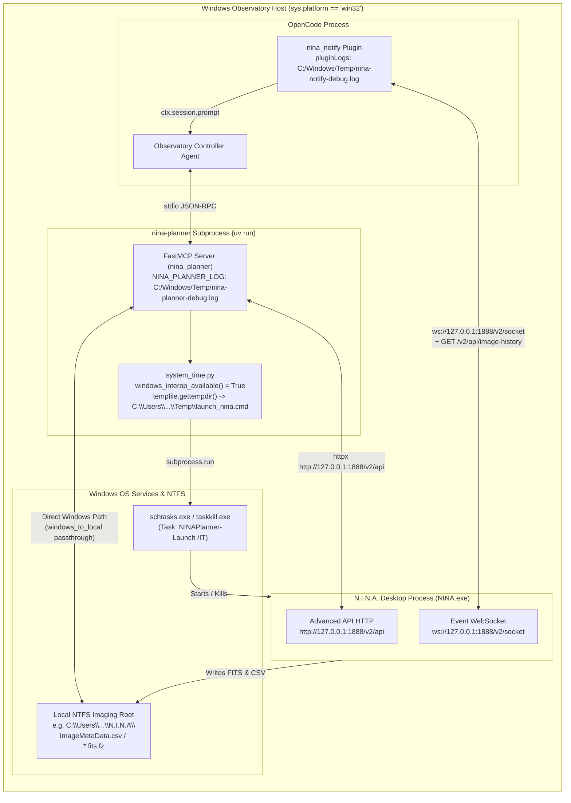
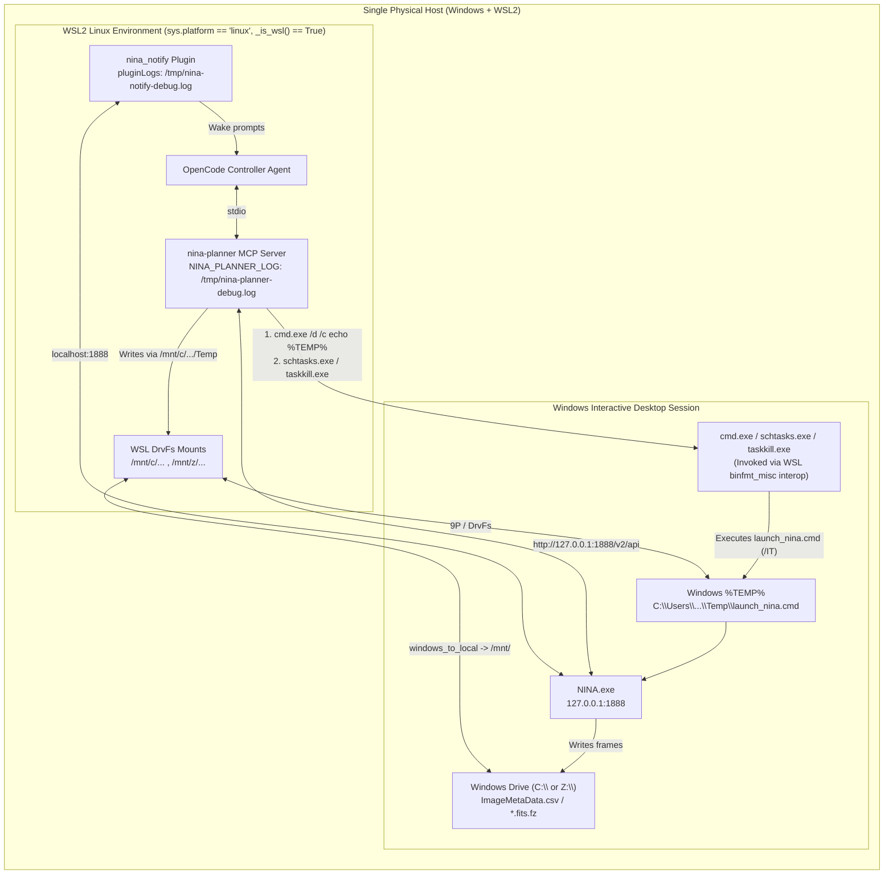
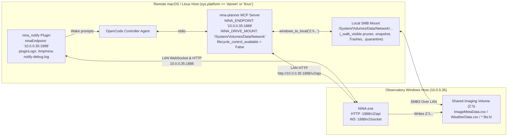
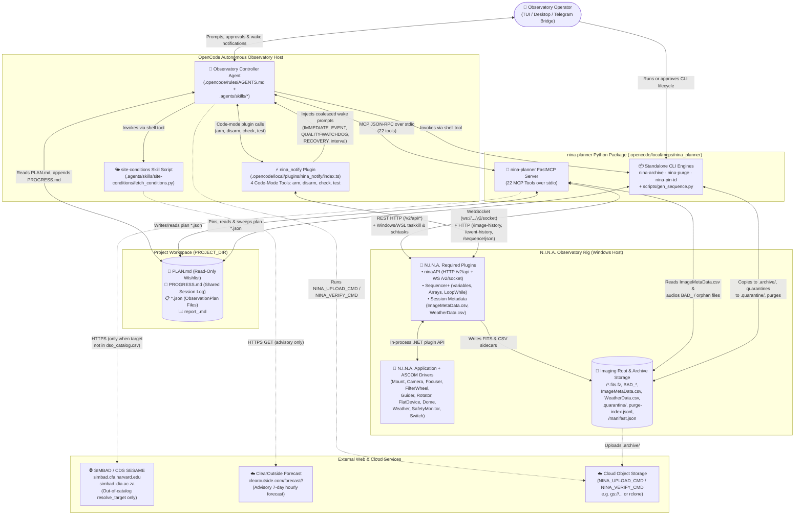

# System Overview & Runtime Topologies

[⬆️ Up to Atlas Index](../README.md) · [➡️ Module Dependency Graph](./module-dependency-graph.md) · [➡️ Data Models & Schemas](./data-models-and-schemas.md) · [➡️ External Integrations & I/O](./external-integrations-and-io.md)

---

## 1. High-Level Purpose & Design Philosophy

The **N.I.N.A. Observatory Control Plane** automates unattended astronomical imaging nights by pairing an OpenCode autonomous agent with two tightly coordinated local extensions:
1. **`nina-planner` (`.opencode/local/mcps/nina_planner/`):** A Python `FastMCP` server (`nina_planner/app.py:10-21`) exposing **22 MCP tools** (`nina_planner/server.py:33-57`) and **3 standalone CLI lifecycle engines** (`nina-archive`, `nina-purge`, `nina-pin-id` in `pyproject.toml:58-63`).
2. **`nina_notify` (`.opencode/local/plugins/nina_notify/index.ts`):** A TypeScript OpenCode host plugin that subscribes to N.I.N.A.'s WebSocket event stream (`ws://<NINA_ENDPOINT>/v2/socket`), monitors live per-frame image statistics (`GET /v2/api/image-history`), reconciles plugin-eviction gaps (`GET /v2/api/event-history`), and injects targeted wake prompts into the pinned controller session.

The architecture is governed by three core design pillars codified in `nina_planner/app.py:12-20`, `nina_planner/sequence/builders.py:210-241`, and `.opencode/rules/AGENTS.md`:

### 1.1 High-Level Plan-to-Sequence Orchestration vs. Leaf Command Management

Rather than issuing imperative, fragile, step-by-step hardware commands (`slew`, `focus`, `expose`, `dither`) over HTTP from an LLM loop—where a single dropped prompt or network hiccup at 3:00 AM could leave the telescope tracking into the pier or the camera exposing through dawn—`nina-planner` elevates the control boundary to **declarative observation plans (`ObservationPlan`) compiled into self-contained N.I.N.A. Advanced Sequencer ASTs**:

- **Declarative Intent (`models/plan.py:238-455`):** The agent writes an `ObservationPlan` JSON file specifying *what* to capture (`target`, `intent`, `pointings` or `mosaic`, `light_frames`, `flat_frames`, `dark_frames`, `bias_frames`, `cooler`, `autofocus`, `guiding`, `constraints`, `quality`, `batch_size`, `calibration_window_days`).
- **Deterministic Sequence Compilation (`sequence/*.py`):** When `load_sequence(request=[...])` (`tools/sequence.py:24-63`) is called, `nina-planner` reads the active N.I.N.A. profile (`get_site_profile`), verifies and auto-connects required hardware (`_get_site_equipment_status`), subtracts already-acquired frames from `ImageMetaData.csv` (`progress.plan_with_remaining`), and compiles the entire multi-step night into a single JSON.NET sequence graph (`sequence/targets.py:85-102`).
- **Autonomous Real-Time Execution Inside N.I.N.A.:** Once started via `start_sequence()` (`tools/sequence.py:426-434`), N.I.N.A.'s own internal sequencer executes leaf instructions and real-time triggers—meridian flips (`trigger_meridian_flip`), autofocus on filter/temperature/HFR/exposure cadence (`trigger_autofocus_*`), PHD2 dithering (`dither_after_exposures`), plate-solve drift recentering (`trigger_center_after_drift`), and safety-monitor loop conditions (`loop_while_safe`, `wait_until_safe`)—without requiring agent intervention on every frame.

| Control Concern | Owner | Mechanism & Source Location |
|---|---|---|
| Target selection, mosaic planning & multi-target scheduling | OpenCode Controller Agent + `nina-planner` | `best_targets`, `target_altitudes`, `sun_times`, `moon_times` (`tools/sky.py`), `write_plan_file` (`tools/plans.py:164-199`) |
| Pre-flight hardware & capability validation | `nina-planner` (`load_sequence`) | `require_parkable`, `require_light_capabilities` (`plan_utils.py:152-220`), `validate_dark_variant` (`sequence/variants.py:89-114`), `_require_sequencer_plus` (`tools/sequence.py:126-173`) |
| Frame-level exposure loops, dithering, autofocus & meridian flips | N.I.N.A. Advanced Sequencer + `Sequencer+` | Compiled JSON.NET AST (`sequence/nodes.py`, `instructions.py`, `builders.py`, `targets.py`) loaded via `POST /v2/api/sequence/load` |
| Persistent exposure countdown across safety interrupts | `Sequencer+` plugin inside N.I.N.A. | `COUNT_ARRAY = "'count'"` & `COUNT_VARIABLE = "n"` (`sequence/builders.py:280-338`, `sequence/targets.py:334-339`) |
| Milestone wakes, safety alerts & sustained HFR/star degradation | `nina_notify` plugin -> Agent | WebSocket `ws://<NINA_ENDPOINT>/v2/socket` + `GET /v2/api/image-history` (`nina_notify/index.ts:89-153, 690-983`) |
| Frame attribution, progress accounting & archive/purge lifecycle | `nina-planner` + CLI tools | `progress.py`, `tools/plans.py`, `archive.py`, `purge.py`, `pin_id.py` |

### 1.2 Offline Resilience

Observatories frequently operate at remote dark-sky sites with intermittent or zero internet connectivity. The architecture ensures the entire night loop can plan, point, image, audit, and park with **no external internet access**:

1. **Bundled Pre-Verified Deep-Sky Catalog (`nina_planner/dso_catalog.py:1-59` & `dso_catalog.csv`):**
   - Ships **497 deep-sky objects** (every Messier object except the double star M40 and asterism M73, plus bright northern and southern NGC/Caldwell showpieces) in a package-bundled CSV (`dso_catalog.csv`, 498 lines including header) loaded once at import time into `dso_catalog.CATALOG` (`dso_catalog.py:41-59`).
   - Every row's J2000 `ra_hours` and `dec_deg` were pre-verified against SIMBAD (`dso_catalog.py:9-12`). `best_targets` (`tools/sky.py:777-823`) returns these coordinates directly, and `.opencode/rules/AGENTS.md` mandates pointing directly from catalog coordinates without calling `resolve_target`.
2. **Offline Astropy Ephemerides & Tangent-Plane Geometry (`tools/sky.py`, `mosaic.py`, `horizon.py`):**
   - `sun_times` (`tools/sky.py:837-846`), `moon_times` (`tools/sky.py:849-862`), `best_targets` (`tools/sky.py:777-823`), and `target_altitudes` (when `ra_hours`/`dec_deg` are provided, `tools/sky.py:132-135`) compute all solar/lunar ephemerides and topocentric `AltAz` transformations locally using Astropy and NumPy against the site's latitude, longitude, elevation, and custom `.hrz` skyline (`horizon.py:32-96`).
   - `mosaic.plan_mosaic` (`mosaic.py:147-200`) computes spherical tangent-plane (`SkyOffsetFrame`) pane offsets using pure Python `math` trigonometry (`mosaic.py:104-144`), requiring neither network access nor runtime Astropy overhead.
3. **Graceful Degradation of Online-Only Helpers:**
   - `resolve_target(name)` (`tools/sky.py:107-118`) is restricted to out-of-catalog objects; it queries two SIMBAD HTTPS mirrors (`https://simbad.cfa.harvard.edu`, `https://simbad.idia.ac.za`, `10.0s` timeout each) before falling back to Astropy's `SkyCoord.from_name` (SESAME). If offline, the agent skips the unknown target and selects from `best_targets`.
   - The `site-conditions` skill (`.agents/skills/site-conditions/fetch_conditions.py`) fetches advisory 7-day cloud/wind forecasts from `clearoutside.com`, but `.opencode/rules/AGENTS.md` explicitly designates it as advisory: if the network is down, the controller logs the failure and proceeds using `get_site_equipment_status` and `sun_times`.

### 1.3 Safety-First Hardware & Sequence Design

All safety semantics derive from the canonical policy in `nina_planner/sequence/builders.py:210-241` and are enforced at both **load time** (`plan_utils.py`, `sequence/variants.py`, `tools/sequence.py`) and **execution time** (inside the compiled N.I.N.A. sequence):

1. **Enclosure Gate (`safety_monitor.is_safe`):**
   - `equipment.safety_monitor.is_safe` (`models/safety_monitor.py:8-19`) indicates whether the observatory enclosure (roof or dome shutter) is open and safe to unpark and expose (`is_safe=True`), or closed (`is_safe=False` or `None`, fail-closed). Weather metrics are reported separately by `equipment.weather` (`models/weather.py:10-48`).
   - Every sky-dependent step (`light` and `dawn`/`dusk` sky `flat`) is wrapped in `sequence_safetynet` (`sequence/builders.py:389-423`), which nests an inner `"On Safe"` container (`loop_while_safe()`) inside an outer loop bounded by `loop_until_dawn()` (for lights, `sequence/targets.py:345`) or twilight bounds (`loop_until_sun_altitude_below(-8)` for dusk flats / `loop_until_sun_altitude_above(0)` for dawn flats, `sequence/targets.py:233-235`). If `is_safe` turns `False` mid-exposure, `"On Safe"` exits immediately, the outer loop runs `sequence_park_scope(equipment)` and blocks at `wait_until_safe()`, and when `is_safe` returns to `True` before dawn, `"On Safe"` re-enters from the top, unparks, re-centers, and resumes from the remaining count stored in the `Sequencer+` `'count'` array (`builders.py:290-338`).
2. **Park is the ONLY Closing Maneuver (`can_park`):**
   - `plan_utils.require_parkable(equipment)` (`plan_utils.py:152-175`) rejects `load_sequence` (and `scripts/gen_sequence.py`) at load time if `equipment.mount is None` or `equipment.mount.can_park is not True`.
   - Every generated sequence ends with `sequence_end` (`sequence/builders.py:426-471`), which emits `RUN-FINISHED` (when `step_count > 0`), waits up to 3 minutes inside a 1-iteration `"On Safe"` pre-park delay (`PREPARK-DELAY: 3 min` — skipped immediately if already unsafe), emits `PARK-STARTING`, reconnects equipment (`connect_all_equipment()`), parks the mount (`sequence_park_scope`), warms the camera (`sequence_warm_camera`), and emits `PARK-FINISHED` (`sequence/builders.py:458-467`). Calling `load_sequence([])` with an empty list compiles an empty Target area followed by `sequence_end`, serving as the dedicated park/teardown sequence.
3. **`FindHome` is a Sensor Calibration, NEVER a Park Fallback (`can_find_home`):**
   - `sequence_home_scope(equipment)` (`sequence/builders.py:250-258`) emits `FindHome` (`NINA.Sequencer.SequenceItem.Telescope.FindHome`) **only** once per `light` step, immediately after `sequence_unpark_scope(equipment)` and ahead of `set_tracking(0)` (`sequence/targets.py:372-377`), when `equipment.mount.can_find_home` is `True`.
   - Homing drives the mount axes for ~30 seconds to their physical home switches to restore sensor sync after a power outage, mechanical bump, or driver restart; it never closes the session and is never emitted in calibration steps or after `ParkScope` (because N.I.N.A. refuses `/equipment/mount/home` with HTTP 409 `"Mount parked"` while parked).
4. **The Dark & Bias Closed-Roof Exemption:**
   - `dark` and `bias` steps are **not** sky-dependent and may be loaded and started while `is_safe=False` (roof closed).
   - `target_payload_darks` (`sequence/targets.py:108-190`) parks the mount first (`sequence_park_scope`), cools the camera (`sequence_cool_camera`), cuts light at the camera via the validated `variant` (`"wheel"` switching to the profile's `"Dark"` filter slot, `"cover"` closing the motorized `FlatDevice` cover, or `"shutter"` relying on the camera's internal mechanical dark shutter), exposes via `take_exposure`, and restores the cover if opened.
   - To guarantee a dark/bias step can never move the mount or require open sky, `target_payload_darks` runs an AST structural assertion (`targets.py:175-180`) verifying that none of `("UnparkScope", "Platesolving", "StartGuiding")` appear anywhere in the generated node tree.

---

## 2. Deployment & Runtime Topologies

While N.I.N.A. always runs inside an interactive Windows desktop session (required by ASCOM drivers and N.I.N.A.'s WPF GUI), the OpenCode host, `nina-planner` MCP server, and `nina_notify` plugin support **three runtime topologies** configured via `.opencode/opencode.json`, `wsl_opencode.json`, and `smb_opencode.json`:

| Topology Dimension | 1. Windows Native (`.opencode/opencode.json`) | 2. WSL Interop (`wsl_opencode.json`) | 3. Remote macOS / Linux over SMB (`smb_opencode.json`) |
|---|---|---|---|
| **OpenCode & MCP Host OS** | Windows (`sys.platform == "win32"`, `os.name == "nt"`) | Linux on WSL2 (`sys.platform == "linux"`, `system_time._is_wsl() == True`) | macOS (`darwin`) or remote Linux (`_is_wsl() == False`) |
| **`NINA_ENDPOINT`** | Default `"127.0.0.1:1888"` (`config.py:10`) | Default `"127.0.0.1:1888"` (WSL2 localhost forwarding) | Explicit LAN IP, e.g. `"10.0.0.35:1888"` (`smb_opencode.json:11, 21`) |
| **`NINA_DRIVE_MOUNT`** | Unset (`windows_to_local` returns `Path(windows_path)` unchanged on `win32`, `imaging.py:73-74`) | Unset (defaults to `f"/mnt/{drive}"`, e.g. `C:\...` -> `/mnt/c/...`, `imaging.py:80`) | Explicit SMB mount root, e.g. `"/System/Volumes/Data/Network"` (`smb_opencode.json:22`, `imaging.py:79-81`) |
| **`NINA_PLANNER_LOG`** | `"C:/Windows/Temp/nina-planner-debug.log"` (`.opencode/opencode.json:20`) | `"/tmp/nina-planner-debug.log"` (`wsl_opencode.json:20`; note `client._log_file` at `client.py:37-38` also auto-relocates `C:/...` paths to `tempfile.gettempdir()`) | `"/tmp/nina-planner-debug.log"` (`smb_opencode.json:23`) |
| **`pluginLogs` (`nina_notify`)** | `"C:/Windows/Temp/nina-notify-debug.log"` (`.opencode/opencode.json:11`) | `"/tmp/nina-notify-debug.log"` (`wsl_opencode.json:11`; `index.ts:48-54` also falls back to `/tmp/nina-notify-debug.log` on non-`win32`) | `"/tmp/nina-notify-debug.log"` (`smb_opencode.json:12`) |
| **`windows_interop_available()`** | `True` (`system_time.py:70-71`) | `True` when `tasklist.exe`, `taskkill.exe`, and `schtasks.exe` are on `PATH` (`system_time.py:72-74`) | `False` (`start_nina` and `stop_nina` refuse; `get_nina_status` reports `lifecycle_control_available: False`) |
| **Launcher Path Resolution (`get_launcher_paths`)** | `Path(tempfile.gettempdir()) / "launch_nina.cmd"` (`system_time.py:84-86`) | Runs `cmd.exe /d /c echo %TEMP%` (`system_time.py:88-94`), maps via `windows_to_local` to `/mnt/c/.../Temp/launch_nina.cmd`, passes Windows path to `schtasks.exe` (`system_time.py:109-112`) | N/A (`windows_interop_available()` is `False`) |

### 2.1 Topology 1: Windows Native (`.opencode/opencode.json`)

In the Windows Native topology, OpenCode, `nina-planner`, `nina_notify`, and `NINA.exe` all execute on the same Windows machine inside the interactive desktop session. Filesystem paths reported by N.I.N.A. (`ImageSavePath` in `/profile/show` and `FilePath` in `ImageMetaData.csv`) are accessed directly as native Windows drive paths without path rebasing.



### 2.2 Topology 2: WSL Interop (`wsl_opencode.json`)

In the WSL Interop topology, OpenCode and `nina-planner` run inside a WSL2 Linux distribution on the same physical machine as Windows.
- **WSL Detection (`system_time.py:47-57`):** `_is_wsl()` checks `sys.platform == "linux"` and verifies either `os.environ.get("WSL_INTEROP")`, `os.environ.get("WSL_DISTRO_NAME")`, or `"microsoft"` / `"wsl"` in `/proc/sys/kernel/osrelease`.
- **Cross-OS Process Lifecycle (`system_time.py:60-112`):** `windows_interop_available()` confirms `tasklist.exe`, `taskkill.exe`, and `schtasks.exe` are reachable on `PATH`. Because Windows Task Scheduler cannot execute a script inside WSL's Linux `/tmp`, `get_launcher_paths()` queries `cmd.exe /d /c echo %TEMP%` to obtain the Windows user's `%TEMP%` directory (e.g. `C:\Users\obs\AppData\Local\Temp`), converts it via `windows_to_local` into `/mnt/c/Users/obs/AppData/Local/Temp/launch_nina.cmd` so WSL Python can write the batch file, and hands the original Windows path `C:\Users\obs\AppData\Local\Temp\launch_nina.cmd` to `schtasks.exe /Create /TN NINAPlanner-Launch /TR ... /SC ONCE /ST 00:00 /IT /F`.
- **Drive Rebasing (`imaging.py:65-81`):** With `NINA_DRIVE_MOUNT` unset, `windows_to_local("C:\\Users\\obs\\Documents\\N.I.N.A\\...")` extracts `win.drive[0].lower()` (`"c"`) and rebases the path onto `/mnt/c/Users/obs/Documents/N.I.N.A/...`.



### 2.3 Topology 3: Remote macOS / Linux over SMB (`smb_opencode.json`)

In the Remote SMB topology, OpenCode and `nina-planner` run on a separate macOS or Linux workstation/server on the local network while N.I.N.A. runs on the observatory Windows PC (e.g. `10.0.0.35:1888`).
- **Network Endpoint (`smb_opencode.json:11, 21`):** Both `nina_notify` (`options.ninaEndpoint: "10.0.0.35:1888"`) and `nina-planner` (`NINA_ENDPOINT: "10.0.0.35:1888"`) connect over the LAN to N.I.N.A.'s HTTP and WebSocket endpoints.
- **SMB Path Rebasing (`smb_opencode.json:22`, `imaging.py:65-81`):** `NINA_DRIVE_MOUNT` is set to the local SMB mount point (e.g. `"/System/Volumes/Data/Network"` or `"/Volumes/Observatory"`). When N.I.N.A.'s profile reports `ImageSavePath = "Z:\\sky\\landing"` (or `ImageMetaData.csv` records `"Z:\\sky\\landing\\2026-10-02\\LIGHT\\frame.fits.fz"`), `windows_to_local()` strips the Windows drive root `Z:\` (`win.parts[1:]`) and joins the relative path onto `Path(NINA_DRIVE_MOUNT)`, yielding `/System/Volumes/Data/Network/sky/landing/...`.
- **Hidden Share Directory Pruning (`imaging.py:26, 34-53`):** Network shares on macOS and NAS appliances create hidden metadata directories such as `.Trashes`, `.DS_Store`, and `.snapshot`. `imaging._walk_visible()` prunes every directory whose name starts with `"."` (including `.quarantine`, `.snapshot`, `.Trashes`) or matches `{"node_modules", "__pycache__"}`, preventing snapshot copies from double-counting frames in `read_imaging_csv`, `get_plan_progress`, or `audit_plans`.
- **Remote Lifecycle Boundary (`system_time.py:60-74`, `tools/lifecycle.py:191-231`):** Because `windows_interop_available()` returns `False` on macOS/remote Linux, `get_nina_status()` reports `"lifecycle_control_available": False`, and calling `start_nina()` or `stop_nina()` fails closed with an operator-facing `RuntimeError` explaining that N.I.N.A. is remote from this host.



---

## 3. C4-Style Architecture Diagrams

### 3.1 Level 1: System Context Diagram

The System Context diagram below shows how the human operator, the OpenCode host, the `nina-planner` MCP server, the `nina_notify` plugin, the N.I.N.A. observatory software stack, and external astronomy/weather/cloud services interact across process and network boundaries.



### 3.2 Level 2 & 3: Container & Component Diagram of `nina_planner`

Inside `.opencode/local/mcps/nina_planner/`, the Python package is organized into a clean 5-layer architecture where both the `FastMCP` server (`__main__.py` -> `server.py`) and the CLI tools (`archive.py`, `purge.py`, `pin_id.py`, `scripts/gen_sequence.py`) share the same domain services, Pydantic schemas, and HTTP/filesystem adapters.

```mermaid
flowchart TB
    subgraph Entrypoints["Layer 1: Entrypoints & Registries"]
        Main["__main__.py\nmain() -> mcp.run()"]
        Server["server.py\nRegisters & re-exports 22 tools"]
        App["app.py\nmcp = FastMCP('nina-planner', instructions=...)"]
        CLI_Arch["archive.py\n(nina-archive CLI)"]
        CLI_Purge["purge.py\n(nina-purge CLI)"]
        CLI_Pin["pin_id.py\n(nina-pin-id CLI)"]
        Script_Gen["scripts/gen_sequence.py\n(Offline/CLI sequence compiler)"]
    end

    subgraph ToolsLayer["Layer 2: MCP Tool Controllers (nina_planner/tools/)"]
        T_Life["tools/lifecycle.py\nget_nina_status, start_nina, stop_nina"]
        T_Equip["tools/equipment.py\nget_site_profile, get_site_equipment_status,\nget_events, get_logs"]
        T_Sky["tools/sky.py\nbest_targets, target_altitudes,\nsun_times, moon_times, resolve_target"]
        T_Seq["tools/sequence.py\nload_sequence, start_sequence,\nstop_sequence, get_sequence_state"]
        T_Plans["tools/plans.py\nwrite_plan_file, list_plans, get_plan_progress,\naudit_plans, get_frame_stats, get_nina_settings"]
    end

    subgraph DomainLayer["Layer 3: Domain Services & Sequence Compiler"]
        subgraph DomainServices["Core Domain Services (nina_planner/)"]
            PlanUtils["plan_utils.py\nwrite_text_atomic, load_plan, plan_files,\nvalidate_*, require_parkable, require_light_capabilities"]
            Progress["progress.py\nfilter_metadata_rows, plan_progress,\ngroup_verdict, progress_verdict, plan_with_remaining"]
            Metadata["metadata.py\nresolve_imaging_root, resolve_cli_root, read_metadata"]
            Imaging["imaging.py\nwindows_to_local, _walk_visible,\nread_imaging_csv, read_weather_rows"]
            Mosaic["mosaic.py\npane_fov_arcmins, grid_size, plan_mosaic"]
            Horizon["horizon.py\nHorizon, parse_horizon, fetch_horizon"]
            DSO["dso_catalog.py\nDso, CATALOG (497 objects from dso_catalog.csv)"]
            SeqState["sequence_state.py\nproject_sequence_state"]
        end

        subgraph SeqCompiler["4-Layer Sequence AST Compiler (nina_planner/sequence/)"]
            SeqInit["sequence/__init__.py\n(88 re-exported symbols)"]
            SeqTargets["sequence/targets.py\nbuild_sequence_many,\ntarget_payload_{lights,darks,flats}"]
            SeqVariants["sequence/variants.py\ndark_variant_reasons, validate_dark_variant"]
            SeqBuilders["sequence/builders.py\nacquisition_container, sequence_deepsky,\nsequence_calibration, sequence_safetynet,\nsequence_count_exposure, sequence_end"]
            SeqInstr["sequence/instructions.py\n55 leaf instruction, wait, loop, event\n& Sequencer+ factories"]
            SeqNodes["sequence/nodes.py\nContainers, 7 triggers, _round_robin,\n_add_refs & _fix_provider (JSON.NET)"]
        end
    end

    subgraph ModelsLayer["Layer 4: Pydantic Schemas (nina_planner/models/)"]
        StrictModels["Strict Plan & Request Models (extra='forbid')\nstrict.py, plan.py (ObservationPlan + 10 sub-models),\npointing.py (Pointing), request.py (SequenceRequest)"]
        APIModels["Tolerant N.I.N.A. API Models (extra='ignore')\nprofile.py (ObservatoryProfile), observatory.py (ObservatoryEquipment),\nframe.py (FrameStats), pointing.py (PointingInfo),\ncamera, mount, meridian, focuser, filter_wheel, guider,\nrotator, dome, switch, flat_device, weather, safety_monitor"]
    end

    subgraph FoundationLayer["Layer 5: Foundation & Leaf Utilities (nina_planner/)"]
        Config["config.py\nNINA_ENDPOINT, NINA_API_URL,\nSEQUENCE_*_PATH, NINA_PLANNER_LOG, PROJECT_DIR"]
        Client["client.py\napi_get, api_post, unwrap_response, log_payload,\nstop_running_sequence_and_wait, wait_until_sequence_started,\napi_probe, nina_api_responsive, run_blocking"]
        NinaUtils["nina_utils.py\nto_snake, ascom_float, ascom_int,\nascom_datetime, to_local_display"]
        SysTime["system_time.py\nnina_exe_path, kill_nina_command, _is_wsl,\nwindows_interop_available, get_launcher_paths,\nwrite_nina_launcher, schtasks_*_command"]
    end

    Main --> Server
    Server --> App & T_Life & T_Equip & T_Sky & T_Seq & T_Plans
    T_Life & T_Equip & T_Sky & T_Seq & T_Plans --> App

    T_Life --> Client & SysTime
    T_Equip --> Client & Horizon & APIModels & NinaUtils
    T_Sky --> T_Equip & DSO & Horizon
    T_Seq --> T_Equip & Client & Config & Metadata & PlanUtils & Progress & SeqInit & SeqState & StrictModels & APIModels
    T_Plans --> T_Equip & Client & Config & Metadata & PlanUtils & Imaging & Mosaic & Progress & StrictModels & APIModels

    CLI_Arch --> Config & Metadata & PlanUtils & Imaging & Progress & StrictModels
    CLI_Purge --> CLI_Arch & Config & Client & Metadata & PlanUtils & Imaging & StrictModels
    CLI_Pin --> Config & PlanUtils
    Script_Gen --> T_Equip & T_Seq & Client & Config & Metadata & PlanUtils & Progress & SeqInit & APIModels

    SeqInit --> SeqTargets & SeqVariants & SeqBuilders & SeqInstr & SeqNodes
    SeqTargets --> SeqBuilders & SeqInstr & SeqNodes & StrictModels & APIModels
    SeqVariants --> StrictModels & APIModels
    SeqBuilders --> SeqInstr & SeqNodes & StrictModels & APIModels
    SeqInstr --> SeqNodes
    SeqNodes --> StrictModels

    Metadata --> Imaging & T_Equip
    PlanUtils --> Config & Imaging & StrictModels & APIModels
    Progress --> StrictModels & NinaUtils
    SeqState --> StrictModels
    Mosaic --> StrictModels & APIModels
    Horizon --> Client
    APIModels --> NinaUtils & Horizon & Imaging
    SysTime --> Imaging
    Imaging --> NinaUtils
    Client --> Config
```



---

## 4. Coordinated Dual-Channel Control Loop (`nina-planner` + `nina_notify`)

A defining architectural feature of this repository is its **coordinated dual-channel control loop**. Rather than forcing the LLM agent to poll N.I.N.A. in a busy-wait loop (which wastes tokens and introduces latency) or streaming raw per-frame WebSocket chatter directly into the LLM context (which would flood the session with hundreds of `IMAGE-SAVE`, guider, and autofocus events per night), responsibilities are partitioned across two complementary channels that share an exact vocabulary of event tokens, timestamps, and endpoints.

### 4.1 The Two Channels Compared

| Architectural Aspect | Channel 1: `nina-planner` (Synchronous Command & Query) | Channel 2: `nina_notify` (Asynchronous Event & Watchdog Wakes) |
|---|---|---|
| **Runtime Host & Language** | Python 3.12+ subprocess (`FastMCP` over stdio) | TypeScript plugin inside the OpenCode host process (`@opencode/plugin`) |
| **Direction of Initiation** | **Agent -> N.I.N.A. / Disk** (Agent calls MCP tools on demand) | **N.I.N.A. -> Agent** (Plugin listens to WebSocket and injects prompts via `ctx.session.prompt`) |
| **N.I.N.A. Endpoints Used** | `http://<NINA_ENDPOINT>/v2/api/*` (`httpx.AsyncClient`, `10.0s` timeout in `client.py:130, 150`) | `ws://<NINA_ENDPOINT>/v2/socket` (`SUB /socket` at `index.ts:1024-1034`) plus HTTP `GET /v2/api/sequence/json`, `/v2/api/image-history`, `/v2/api/event-history` |
| **Session Targeting & Silence Gate** | Stateless per tool call | Pinned to controller session via `nina_notify_arm` (`pinnedSessionID` in storage, `index.ts:207-212, 309-325`); silenceable via `nina_notify_disarm` (`armed` flag in storage, `index.ts:227-238, 334-350`) |
| **Deduplication & Coalescing** | Deterministic start/stop polling barriers (`wait_until_sequence_started`, `stop_running_sequence_and_wait` in `client.py:166-242`) | **250 ms burst coalescing** (`queueImmediate` / `flushImmediate` at `index.ts:929-948`) + **30 s in-memory and storage-backed deduplication** (`deliverPrompt` at `index.ts:393-421`) |
| **Timestamp Format Contract** | `nina_utils.to_local_display()` (`nina_utils.py:107-123`): host-local ISO-8601 carrying UTC offset (`YYYY-MM-DDTHH:MM:SS±HH:MM`) | `localTime()` (`index.ts:28-39`): host-local ISO-8601 carrying UTC offset (`YYYY-MM-DDTHH:MM:SS.mmm±HH:MM`), matching `get_events`, `get_logs`, and `PROGRESS.md` headers |

### 4.2 Shared Event Token Vocabulary (`SendEventInstruction` <-> `nina_notify`)

When `nina-planner` compiles a sequence (`sequence/instructions.py:456-490`, `sequence/builders.py:57-98, 426-494`), it embeds `NINA.Core.Utility.Notification.SendEventInstruction, ninaAPI` instructions at every structural boundary. When N.I.N.A. executes these instructions, the `ninaAPI` plugin broadcasts `{ "Response": { "Event": "<MESSAGE>" } }` over `ws://<NINA_ENDPOINT>/v2/socket` and records the timestamped event in `/v2/api/event-history`.

| Event Token String | Emitted By (`nina_planner/sequence/`) | Sequence Location | How `nina_notify` Handles It (`index.ts`) | Agent Action Triggered |
|---|---|---|---|---|
| `RUN-STARTING: <N> step(s)` | `instructions.run_starting_event(step_count)` (`instructions.py:467-473`) via `_sequence_with_steps` (`builders.py:487-490`) | Tail of `StartAreaContainer` (emitted only when `step_count > 0`) | Sets `sequenceRunning = true` (`line 733`), resets quality watchdog streaks (`line 742`), matches `IMMEDIATE_EVENT` (`line 90`) -> wakes agent | Log run start to `PROGRESS.md` |
| `ACQUISITION-STARTING: [<tag>] <target>` | `instructions.send_event(...)` inside `acquisition_container` (`builders.py:85, 93`) | First instruction of every `DeepSkyObjectContainer` (`tag` is `light`, `dark`, `bias`, `dawn flats`, or `dusk flats`) | `trackContext` (`lines 736-740`) extracts `<tag>` into `currentKind` to arm/gate the quality watchdog (`currentKind === "light"`). Not in `IMMEDIATE_EVENT` -> counted in `routineSinceWake` (`line 974`) | Read retrospectively via `get_events(since=N)` |
| `ACQUISITION-FINISHED: [<tag>] <target>` | `instructions.send_event(...)` inside `acquisition_container` (`builders.py:85, 96`) | Last instruction of every `DeepSkyObjectContainer` | Counted in `routineSinceWake` (`line 974`) | Read retrospectively via `get_events(since=N)` |
| `RUN-FINISHED: <N> step(s) complete` | `instructions.run_finished_event(step_count)` (`instructions.py:476-490`) via `sequence_end` (`builders.py:446-453`) | **First instruction** of `EndAreaContainer` (before the 3-minute pre-park delay; emitted only when `step_count > 0`) | Sets `sequenceRunning = false` (`line 734`), matches `IMMEDIATE_EVENT` (`line 90`, priority rank `0` in `reconcileGap` at `line 649`) -> **wakes agent immediately** | Run `night-loop` skill: check `get_plan_progress`, load next target before the 3-min pre-park delay expires, or let park finish and write `report_<YYYY-MM-DD>.md` |
| `PREPARK-DELAY: 3 min` | `instructions.send_event("PREPARK-DELAY: 3 min")` via `sequence_end` (`builders.py:458`) | Inside `EndAreaContainer`'s 1-iteration `"On Safe"` container ahead of `WaitForTimeSpan(180)` (`builders.py:459`) | Matches `PARK` in `IMMEDIATE_EVENT` (`line 90`, coalesced with `RUN-FINISHED` if inside 250 ms) | Informs agent the 3-minute re-planning window before `PARK-STARTING` has begun |
| `PARK-STARTING` | `instructions.send_event("PARK-STARTING")` via `sequence_end` (`builders.py:462`) | `EndAreaContainer` after pre-park delay | Matches `PARK` in `IMMEDIATE_EVENT` (`line 90`) -> wakes agent | Agent sees teardown has begun (`connect_all_equipment`, `park_scope`, `warm_camera`) |
| `PARK-FINISHED` | `instructions.send_event("PARK-FINISHED")` via `sequence_end` (`builders.py:467`) | Final instruction of `EndAreaContainer` | Matches `PARK` in `IMMEDIATE_EVENT` (`line 90`) -> wakes agent | Verify mount `is_parked=True` via `get_site_equipment_status`, log to `PROGRESS.md` |
| Native N.I.N.A. Events (`SAFETY-CHANGED`, `ERROR-*`, `MOUNT-*`, `IMAGE-SAVE`, etc.) | Emitted natively by N.I.N.A. & `ninaAPI` | Throughout session | `IMMEDIATE_EVENT` wakes on safety/fault/milestone; `ROUTINE_OVERRIDE` (`MOUNT-CENTER`, `MOUNT-HOMED`, `line 113`) and idle `LINK_EVENT` (`*CONNECTED*` when `!sequenceRunning`, `line 114, 963`) are demoted to `routineSinceWake`; `IMAGE-SAVE` triggers `watchdogCheck()` (`line 978`) | On safety/fault wake: run `safety-interrupt-recovery` skill. On `QUALITY-WATCHDOG`: run `frame-quality-diagnostics` skill |

### 4.3 End-to-End Dual-Channel Interaction Sequence

The sequence diagram below illustrates how `nina-planner`, `nina_notify`, N.I.N.A., and `PROGRESS.md` collaborate across a complete imaging lifecycle—from session arming and sequence loading through quality watchdog monitoring, milestone completion, and quiet-gap event retrieval.

```mermaid
sequenceDiagram
    autonumber
    participant Agent as Observatory Controller Agent
    participant Notify as nina_notify Plugin (TS)
    participant Planner as nina-planner MCP (Python)
    participant NINA as N.I.N.A. (/v2/api & /v2/socket)
    participant Disk as Imaging Root & PROGRESS.md

    Note over Agent,Notify: Phase 1: Session Initialization & Pinning
    Agent->>Notify: nina_notify.check()
    Notify-->>Agent: {effectiveTarget, armed: true, eventSocket: {state: "OPEN"}}
    Agent->>Notify: nina_notify.arm()
    Notify->>Notify: Persist pinnedSessionID & armed=true
    Notify->>Agent: Inject confirmation prompt via deliverPrompt()

    Note over Agent,Disk: Phase 2: Plan Compilation & Sequence Start
    Agent->>Planner: load_sequence(request=[{plan: "m15.json", action: "light"}])
    Planner->>NINA: GET /profile/show, /profile/horizon, /equipment/info, /application/plugins
    Planner->>Disk: Read ImageMetaData.csv (compute remaining frames)
    Planner->>NINA: POST /sequence/load (JSON.NET AST with SendEventInstruction nodes)
    Planner-->>Agent: "Loaded 1 step(s)..."
    Agent->>Planner: start_sequence()
    Planner->>NINA: GET /sequence/start + poll GET /sequence/json until node != CREATED
    Planner-->>Agent: "Sequence started."
    Agent->>Disk: Append ISO-8601 entry to PROGRESS.md

    Note over Notify,NINA: Phase 3: Autonomous Execution & Routine Telemetry Filtering
    NINA-->>Notify: WS: {"Response": {"Event": "RUN-STARTING: 1 step(s)"}}
    Notify->>Notify: sequenceRunning = true; queueImmediate() (250ms coalesce)
    Notify->>Agent: Wake prompt: RUN-STARTING + [get_events(since=60) · 0 routine events waiting]
    NINA-->>Notify: WS: {"Response": {"Event": "ACQUISITION-STARTING: [light] M 15_plan-abc_"}}
    Notify->>Notify: currentKind = "light"; routineSinceWake++ (no wake)
    NINA-->>Notify: WS: {"Response": {"Event": "MOUNT-CENTER"}}
    Notify->>Notify: Demoted by ROUTINE_OVERRIDE; routineSinceWake++ (no wake)

    Note over Agent,NINA: Phase 4: Quality Watchdog Loop (3-Frame Streak Gate)
    loop Each Light Frame Capture (~14s - 300s)
        NINA->>Disk: Save FITS + append row to ImageMetaData.csv & WeatherData.csv
        NINA-->>Notify: WS: {"Response": {"Event": "IMAGE-SAVE"}}
        Notify->>Notify: routineSinceWake++; watchdogCheck()
        Notify->>NINA: GET /v2/api/image-history
        NINA-->>Notify: {Response: [{Date, ImageType: "LIGHT", HFR, Stars, ...}]}
        alt HFR > 3.0" or Stars < 10 for 3 consecutive LIGHT frames
            Notify->>Agent: Wake: QUALITY-WATCHDOG: HFR ... over 3 consecutive light frames\n[get_events(since=N) · M routine events waiting]
            Agent->>Planner: get_frame_stats(image_type="LIGHT")
            Planner->>NINA: GET /v2/api/image-history
            Planner-->>Agent: Validated FrameStats (hfr, hfr_st_dev, stars, mean, st_dev, rms_text)
            Agent->>Planner: get_events(since=N)
            Planner->>NINA: GET /v2/api/event-history
            Planner-->>Agent: Timestamped snake_case event list
        end
    end

    Note over Agent,Disk: Phase 5: Milestone Wake & Pre-Park Re-Planning Window
    NINA-->>Notify: WS: {"Response": {"Event": "ACQUISITION-FINISHED: [light] M 15_plan-abc_"}}
    Notify->>Notify: routineSinceWake++
    NINA-->>Notify: WS: {"Response": {"Event": "RUN-FINISHED: 1 step(s) complete"}}
    NINA-->>Notify: WS: {"Response": {"Event": "PREPARK-DELAY: 3 min"}}
    Notify->>Notify: sequenceRunning = false; coalesce 250ms batch
    Notify->>Agent: Wake: RUN-FINISHED + PREPARK-DELAY\n[get_events(since=N) · M routine events waiting]
    Agent->>Planner: get_events(since=N)
    Agent->>Planner: get_plan_progress(file_path="m15.json")
    Planner->>Disk: Read ImageMetaData.csv & evaluate progress_verdict
    Planner-->>Agent: {complete: true, ...}
    Agent->>Disk: Append completion entry to PROGRESS.md
```

### 4.4 Shared Operational State & Fault Recovery Mechanisms

1. **Quiet-Gap Event Window (`[get_events(since=N) · M routine events waiting]`):**
   - `nina_notify` never buffers routine events in memory. Instead, it tracks `lastWakeAt` and increments `routineSinceWake` on every non-waking WebSocket message (`index.ts:260-284, 974`).
   - Every wake prompt ends with `\n\n[get_events(since=<seconds>) · <M> routine events waiting]`, where `since = max(60, round((Date.now() - lastWakeAt) / 1000))` (`index.ts:353`).
   - If `M > 0`, the agent calls `nina-planner`'s `get_events(since=N)` (`tools/equipment.py:292-298`), which fetches `GET /v2/api/event-history` from N.I.N.A. and returns all events in `[now - since, now]` formatted with `to_local_display()`. If `M == 0`, the agent skips the round trip.
2. **On-Demand Frame Quality Mirror (`QUALITY-WATCHDOG` <-> `get_frame_stats`):**
   - When `nina_notify` sees `IMAGE-SAVE` during a `light` step, `watchdogCheck()` (`index.ts:831-922`) fetches `GET /v2/api/image-history`, verifies sample freshness via `record.Date !== lastSampleDate` (retrying once after `1,500 ms` if N.I.N.A. has not yet committed the new frame's statistics), and tracks consecutive light-frame streaks where `HFR > 3.0"` (`HFR_LIMIT_ARCSEC`) or `Stars < 10` (`STARS_LIMIT`).
   - Upon `3` consecutive degraded light frames (`STREAK_REQUIRED = 3`), `nina_notify` queues `QUALITY-WATCHDOG: ...` and disarms that metric's wake until a good frame resets the streak to `0`.
   - When woken by `QUALITY-WATCHDOG`, the agent calls `nina-planner`'s `get_frame_stats(image_type="LIGHT")` (`tools/plans.py:34-97`), which reads the exact same `GET /v2/api/image-history` endpoint and normalizes the full record through `FrameStats` (`models/frame.py:53-109`).
3. **Plugin Eviction & Downtime Reconciliation (`reconcileGap`):**
   - If OpenCode's host process restarts or evicts an idle workspace plugin while N.I.N.A. continues running a sequence, `nina_notify` persists a throttled high-water timestamp (`lastEventAt` in `ctx.storage`, written at most every `30s` on live traffic and unconditionally on `cleanup()`, `index.ts:477-508, 1453`).
   - On the next plugin initialization, if `Date.now() - markMs >= 60_000` (`GAP_MIN_MS`), `reconcileGap()` (`index.ts:560-688`) fetches `GET /v2/api/event-history`, replays the missed events against `IMMEDIATE_EVENT` (with `ROUTINE_OVERRIDE` and `LINK_EVENT` demotions), sorts `RUN-FINISHED`/`SEQUENCE-FINISHED` and safety events to the front, and injects a single consolidated `RECOVERY: nina_notify was down ...` wake prompt.
4. **Silent WebSocket Drop Detection (`staleWhileSequenceRunning`):**
   - Because a TCP/WebSocket connection across a LAN or virtual switch can drop silently without firing `onclose`, `nina_notify_check` (`index.ts:1148, 1170-1180`) flags `staleWhileSequenceRunning: true` whenever `sequenceRunning` is `true` and no WebSocket event has arrived for more than `10 minutes` (`SOCKET_STALE_MS = 600_000`), instructing the agent to verify live state via `get_events` and `get_sequence_state`.
5. **Cross-Session Shared Memory (`PROGRESS.md`):**
   - Both interactive user sessions and automated background wake turns read and append to `<PROJECT_DIR>/PROGRESS.md` using host-local ISO-8601 headers (`## YYYY-MM-DDTHH:MM:SS±HH:MM`), matching the timestamps produced by `nina_utils.to_local_display()` and `nina_notify`'s `localTime()`.

---

[⬆️ Up to Atlas Index](../README.md) · [➡️ Module Dependency Graph](./module-dependency-graph.md) · [➡️ Data Models & Schemas](./data-models-and-schemas.md) · [➡️ External Integrations & I/O](./external-integrations-and-io.md)
