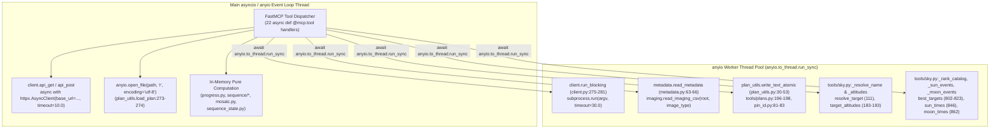
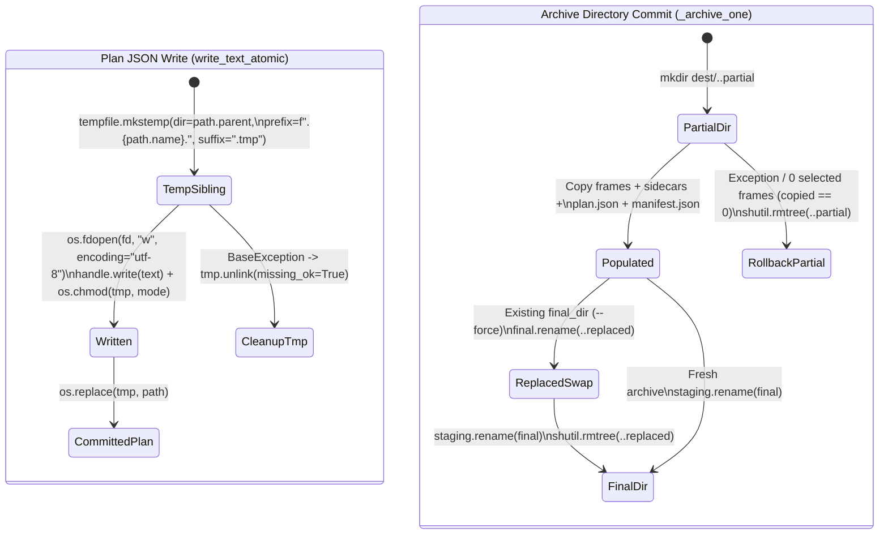

# Async Execution, State Persistence & Error Propagation Model

[⬆️ Up to Atlas Index](../README.md) · [⬅️ Entrypoints & Lifecycle](./entrypoints-and-lifecycle.md) · [➡️ Equipment, Safety & Lifecycle Flow](./flow-equipment-safety-and-lifecycle.md) · [➡️ Sky & Target Planning Flow](./flow-sky-and-target-planning.md) · [➡️ Sequence Compilation & Execution Flow](./flow-sequence-compilation-and-execution.md) · [➡️ Progress, Audit & Frame Telemetry Flow](./flow-progress-audit-and-frame-telemetry.md) · [➡️ Archive, Purge & Pin-ID CLI Flow](./flow-archive-purge-and-pin-cli.md)

---

## 1. Async & Thread-Offloaded Execution Architecture

`nina-planner` runs inside an `asyncio` / `anyio` event loop hosted by `FastMCP` (`nina_planner/__main__.py:8`, `nina_planner/server.py:61`) or `asyncio.run(...)` in the CLI entrypoints (`archive.py:1200`, `purge.py:1087`, `pin_id.py:162`, `scripts/gen_sequence.py:399`).

All 22 `@mcp.tool()` functions are `async def` coroutines. To keep the event loop responsive while reading large `ImageMetaData.csv` files, walking SMB network mounts, invoking Windows `schtasks.exe`/`taskkill.exe` subprocesses, or performing synchronous SIMBAD/SESAME lookups and Astropy grid evaluations, blocking operations are bridged across `anyio.to_thread.run_sync`.

### 1.1 Async HTTP Transport (`nina_planner/client.py:118-154`)
- Every call to `client.api_get(path)` (`lines 118-134`) and `client.api_post(path, body)` (`lines 137-154`) creates a short-lived `httpx.AsyncClient(base_url=config.NINA_API_URL, timeout=10.0)` context manager (`lines 130, 150`).
- No persistent connection pool or module-level `AsyncClient` singleton is retained across calls, avoiding cross-event-loop binding errors in `unittest.IsolatedAsyncioTestCase` and ensuring deterministic mocking via `FakeNina.installed()` (`tests/fake_nina.py:75-84`).

### 1.2 Worker-Thread Offload Boundaries (`anyio.to_thread.run_sync`)

| Caller Function (`file:line`) | Offloaded Synchronous Function (`file:line`) | Blocking Resource |
|---|---|---|
| `client.run_blocking` (`client.py:275-281`) | `subprocess.run(argv, capture_output=True, text=True, timeout=timeout)` | Windows `taskkill.exe` / `schtasks.exe` subprocesses (`tools/lifecycle.py:29, 58, 123`). |
| `metadata.read_metadata` (`metadata.py:63-66`) | `imaging.read_imaging_csv(root=root, image_type=image_type)` (`imaging.py:167-222`) | Recursive `os.walk`, CSV parsing (`ImageMetaData.csv`), and per-row `Path.is_file()` probes across local/SMB drives. |
| `tools.plans.write_plan_file` (`tools/plans.py:196-198`) | `plan_utils.write_text_atomic(path, plan.model_dump_json(indent=2))` (`plan_utils.py:30-53`) | `tempfile.mkstemp`, `os.fdopen`, `handle.write`, `os.chmod`, `os.replace`. |
| `pin_id.pin_plan_file` (`pin_id.py:81-83`) | `plan_utils.write_text_atomic(path, pinned.model_dump_json(indent=2))` (`plan_utils.py:30-53`) | Atomic plan JSON rewrite on disk. |
| `tools.sky.resolve_target` (`tools/sky.py:111`) | `tools.sky._resolve_name(name)` (`tools/sky.py:94-104`) | Synchronous `httpx.get(..., timeout=10.0)` to SIMBAD mirrors and `SkyCoord.from_name` (SESAME). |
| `tools.sky.target_altitudes` (`tools/sky.py:183-193`) | `tools.sky._altitudes(...)` (`tools/sky.py:121-169`) | Astropy coordinate frame transformations + optional `_resolve_name` network lookups. |
| `tools.sky.best_targets` (`tools/sky.py:802-823`) | `tools.sky._rank_catalog(...)` (`tools/sky.py:635-774`) | Vectorized Astropy `SkyCoord` / `AltAz` evaluation across 497 catalog objects and 25 time steps. |
| `tools.sky.sun_times` (`tools/sky.py:846`) | `tools.sky._sun_events(when, location)` (`tools/sky.py:314-421`) | 865-point solar altitude grid (`get_sun` + `AltAz`) and twilight crossing interpolation. |
| `tools.sky.moon_times` (`tools/sky.py:862`) | `tools.sky._moon_events(when, location)` (`tools/sky.py:568-632`) | 1,537-point geocentric ecliptic elongation series + 577-point topocentric lunar altitude grid. |

### 1.3 Synchronous I/O Executed Directly on the Event Loop Thread
Several lightweight or CLI-only filesystem operations execute synchronously without `anyio.to_thread.run_sync`:
1. **`client.log_payload` (`client.py:42-59`):** Appends a single debug line to `NINA_PLANNER_LOG` via `path.open("a", encoding="utf-8")`, swallowing `OSError`.
2. **`plan_utils.plan_files` (`plan_utils.py:235-255`), `_probe_plan_id` (`tools/plans.py:362-376`), & `_count_fits` (`tools/plans.py:444-472`):** Walks `project_dir` via `_walk_visible` during `list_plans` (`tools/plans.py:1183`) and `_load_project_plans` (`tools/plans.py:413`), and scans `root.iterdir()` / `_count_fits` during `audit_plans` (`tools/plans.py:993-1018, 1125-1126`) after `await metadata.read_metadata()` (`tools/plans.py:822, 837`).
3. **`system_time.write_nina_launcher` (`system_time.py:133-144`):** Called inside `_launch_nina_interactive` (`tools/lifecycle.py:38`); note that `get_launcher_paths()` (`system_time.py:88-94`) invokes `subprocess.run(["cmd.exe", "/d", "/c", "echo", "%TEMP%"], ..., timeout=10)` synchronously on non-Windows (`sys.platform != "win32"`) hosts.
4. **CLI Engines (`archive.py:924-1188` and `purge.py:761-1077`):** Run inside dedicated single-task `asyncio.run(...)` CLI processes where synchronous `shutil.copy2`, `shutil.move`, and `shutil.rmtree` do not contend with concurrent MCP requests.

---

## 2. State, Caching & Atomic Persistence Model

### 2.1 Process-Level Singletons & Import-Time Constants
`nina-planner` is intentionally **stateless across MCP tool calls**—it maintains no mutable in-memory session state, equipment cache, or sequence cache between requests. The only module-level objects created at import time are:
- **`app.mcp` (`nina_planner/app.py:10-21`):** The `FastMCP("nina-planner")` server registry.
- **`dso_catalog.CATALOG` (`nina_planner/dso_catalog.py:59`):** Immutable `tuple[Dso, ...]` of 497 deep-sky objects loaded once from `dso_catalog.csv`.
- **`config.*` (`nina_planner/config.py:10-19`):** `NINA_ENDPOINT`, `NINA_API_URL`, `SEQUENCE_*_PATH`, `NINA_PLANNER_LOG`, and `PROJECT_DIR = Path.cwd()`.
- **`sequence.nodes.NINA_FLATS_*` (`nina_planner/sequence/nodes.py:12-14`):** `NINA_FLATS_ALTITUDE` (`80.0`), `NINA_FLATS_AZIMUTH_DAWN` (`270.0`), `NINA_FLATS_AZIMUTH_DUSK` (`90.0`).

### 2.2 Per-Request Memoization Closures in `_load_many` (`tools/sequence.py:189-218`)
Within a single `load_sequence(request=[...])` invocation, `_load_many` avoids redundant HTTP and disk I/O across multi-step requests using a request-scoped dictionary `state: dict[str, Any] = {}` (`line 189`) and four lazy `async def` closures:
- `state["profile"]` / `async def profile() -> ObservatoryProfile` (`lines 191-194`)
- `state["equipment"]` / `async def equipment() -> ObservatoryEquipment` (`lines 196-200`)
- `state["rows"]` / `async def rows() -> list[dict[str, Any]]` (`lines 203-212`)
- `state["now"]` / `async def now() -> datetime` (`lines 214-218`)

### 2.3 Atomic Filesystem State Transitions
All persistent state lives on disk and is mutated through crash-safe atomic patterns:

1. **Plan JSON Files (`plan_utils.py:30-53`):** `write_text_atomic(path, text)` writes to a hidden sibling `.{name}.<rand>.tmp` in the same directory via `os.fdopen(fd, "w", encoding="utf-8")`, preserves file mode (`st_mode & 0o7777` or `_NEW_PLAN_MODE = 0o644`), and commits via `os.replace(tmp, path)` (unlinking `tmp` on `BaseException`).
2. **Archive Folders (`archive.py:218-238, 542-836`):** `_archive_one` stages into `dest/.<folder>.partial` (`lines 577-581`). Because leading-dot directories are pruned by `_prunable_dir` (`imaging.py:34-36`) and ignored by `purge._read_manifests` (`purge.py:274`), an interrupted staging directory is invisible to both plan discovery and `nina-purge`. On `--force`, the existing archive is moved aside to `dest/.<folder>.replaced` before renaming `.partial` into place (`lines 798-810`), and `_recover_replaced` (`archive.py:218-238`) heals any mid-swap crash on the next run.
3. **Quarantine & Purge (`purge.py:415-698`):** `--apply` moves directories into `<imaging_root>/.quarantine/<name>[~N]` (`_quarantine` at `415-472`), which is immediately invisible to `read_imaging_csv` because `.quarantine` starts with `"."`. `--purge` permanently deletes quarantined directories only after re-verifying all three archive gates (`_quarantine_gates` at `534-609`).

---

## 3. Error Propagation & Exception Taxonomy

### 3.1 Exception Hierarchy & Translation Matrix

| Exception Type | Raised By (`file:line`) | Trigger Condition | MCP / CLI Handling Semantics |
|---|---|---|---|
| `pydantic.ValidationError` | `StrictModel` subclasses (`models/plan.py`, `models/request.py`, `models/pointing.py`), `get_plan_progress` arg model (`tools/plans.py:314-338`) | Unknown/extra JSON keys, invalid `plan_id` charset, out-of-range coordinates/temperatures, missing `flat` variant, or neither `pointings` nor `mosaic` provided. | Returned as an MCP tool validation error (or caught and formatted as a load error in `list_plans` / `audit_plans` / CLI tools). |
| `ValueError` | `plan_utils.py` (`validate_filters`, `validate_position_angle`, `check_pointing_index`, `require_parkable`, `require_light_capabilities`), `sequence/variants.py:89-114`, `tools/sequence.py` (`_require_sequencer_plus`, `_load_many`), `tools/sky.py`, `tools/plans.py`, `mosaic.py` | Rig lacks park capability, plate solver, guider, focuser, `Sequencer+`, or `$$TARGETNAME$$`; filter missing from wheel; unsupported dark variant; unexpanded mosaic; invalid `level`/`kinds`/`types`; SIMBAD lookup failure. | Propagates out of the `@mcp.tool()` coroutine (prefixed with `request[i]: ` in `load_sequence` at `tools/sequence.py:62, 372`) so FastMCP returns an `isError=True` tool result with the actionable message. |
| `RuntimeError` | `client.unwrap_response` (`client.py:81-115`), `client.stop_running_sequence_and_wait` (`166-182`), `client.wait_until_sequence_started` (`209-242`), `tools/equipment.py:_get_site_equipment_status` (`137-141`), `tools/lifecycle.py` (`22-188`) | Non-2xx HTTP status, invalid JSON, `Success=False` envelope from N.I.N.A., sequence start/stop timeout, devices mid-auto-connect (`"Equipment connecting: ..."`), or `start_nina`/`stop_nina` precondition/subprocess failure. | Propagates out of the `@mcp.tool()` coroutine as an MCP tool error. |
| `FileNotFoundError` | `imaging._require_root` (`imaging.py:139-152`), `plan_utils.load_plan` (`plan_utils.py:273`) | Missing plan JSON path, or missing/unmounted local imaging root (`local_image_save_path` / `NINA_DRIVE_MOUNT`). | Propagates from `get_plan_progress`, `load_sequence` (wrapped as `ValueError` in `rows()` at `tools/sequence.py:207-211`), and `audit_plans` (`tools/plans.py:821-822, 836-837`). |
| `ArchiveError` | `nina_planner/archive.py:118-119` (`_folder_name`, `_dest_child`, `_copy_file`, `_archive_one`, `_resolve_root`) | Unsafe archive folder name, `--dest` inside `--imaging-root`, size/SHA-256 mismatch during copy, or zero selected frames copied (`copied == 0`, `lines 709-718`). | Caught in `archive.run` (`lines 968, 1063, 1138`), printed to `stderr`, recorded in `errors`, and exits with code `1`. |
| `PurgeError` | `nina_planner/purge.py:121-122` (`_resolve_root`) | Imaging root cannot be resolved from `--imaging-root` or N.I.N.A. profile. | Caught in `purge.run` (`line 779`), printed to `stderr`, and exits with code `1`. |
| `PinError` | `nina_planner/pin_id.py:39-40` (`pin_plan_file` at `57-86`) | Named plan file cannot be loaded (`load_plan` failure) or atomic write raises `OSError`. | Caught in `pin_id.run` (`line 141`), printed to `stderr`, and exits with code `1`. |
| `ScriptError` | `scripts/gen_sequence.py:73-74` | Profile/equipment fetch failure, plan validation error, or `/sequence/load` failure in `gen_sequence.py`. | Caught in `gen_sequence.main` (`lines 400-402`), printed to `stderr`, and exits with code `1`. |

### 3.2 Deliberate Graceful Degradation Boundaries
While safety and capability checks fail closed, five read paths deliberately degrade rather than raising so a transient glitch never stalls an observing night:

1. **`get_nina_status()` (`tools/lifecycle.py:191-231`):** Catches all exceptions inside `client.api_probe()` (`client.py:255-267`) and returns `{"running": False, "probe_error": str(e), ...}`.
2. **`fetch_horizon()` (`horizon.py:123-136`):** Catches any `Exception` from `client.api_get("/profile/horizon")`, logs it via `client.log_payload`, and returns a flat `Horizon(file_path=file_path)` (`0.0°` everywhere).
3. **`get_frame_stats()` (`tools/plans.py:49-70`):** Catches `RuntimeError("...Index out of range...")` from `/image-history` when N.I.N.A. has captured zero frames of that type and returns `{"count": 0, "frame": None, "note": ...}`.
4. **`_full_mode_note()` (`tools/sequence.py:88-95`):** Swallows `Exception` if reading `ImageMetaData.csv` fails during a `mode="full"` sequence load so an unreadable CSV never blocks a forced re-shoot.
5. **`get_sequence_state(detail="summary")` (`tools/sequence.py:450-453`):** Wraps the secondary `client.api_get(config.SEQUENCE_JSON_PATH)` call (used only to enrich `WaitForAltitude` horizon numbers) in `try ... except Exception: json_state = None`.
