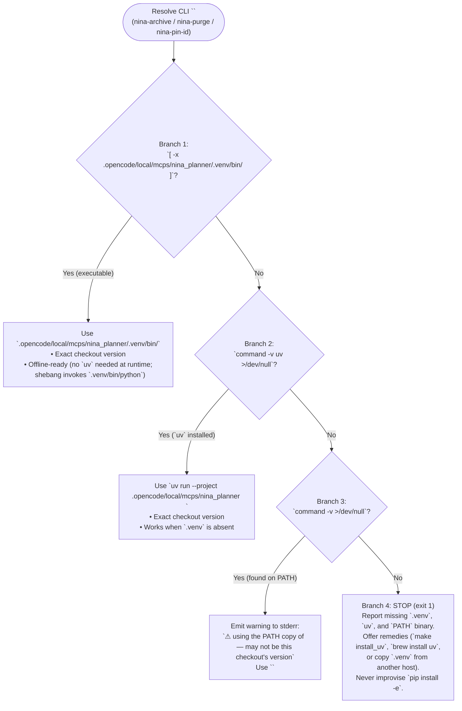

# Entrypoints, MCP Server Boot Sequence & CLI Resolution Lifecycle

[⬆️ Up to Atlas Index](../README.md) · [➡️ Async, State & Error Model](./async-state-and-error-model.md) · **Domain Execution Flows:** [Equipment, Safety & Lifecycle](./flow-equipment-safety-and-lifecycle.md) · [Sky & Target Planning](./flow-sky-and-target-planning.md) · [Sequence Compilation & Execution](./flow-sequence-compilation-and-execution.md) · [Progress, Audit & Frame Telemetry](./flow-progress-audit-and-frame-telemetry.md) · [Archive, Purge & Pin-ID CLI](./flow-archive-purge-and-pin-cli.md)

---

## 1. All Entrypoints Matrix

The repository exposes **8 executable Python entrypoints** spanning three distinct operational roles:
1. **Long-Lived MCP Server Process (`nina-planner`):** Runs over standard input/output (`stdio`) under the OpenCode host, serving 22 `@mcp.tool()` functions.
2. **Packaged Console Script CLIs (`nina-archive`, `nina-purge`, `nina-pin-id`):** Installed into `.opencode/local/mcps/nina_planner/.venv/bin/` via `pyproject.toml:58-63` (`[project.scripts]`) to manage offline plan identity pinning, frame archival, and two-stage imaging-root cleanup.
3. **Standalone Repository & Skill Scripts (`scripts/*.py` and `.agents/skills/site-conditions/fetch_conditions.py`):** Invoked directly via a Python interpreter for sequence inspection/loading, `README.md` code-fence synchronization, test fixture capture, and advisory 7-day astronomical weather forecasting.

| # | CLI / Script Name | Invocation Forms | Entrypoint Location (`file:lines`) | `pyproject.toml` Script Binding | Event Loop / Runtime Model | Exit Codes | Primary Responsibility |
|---:|---|---|---|---|---|---|---|
| **1a** | **`nina-planner`** (Package Main) | `nina-planner`<br/>`python -m nina_planner` | `.opencode/local/mcps/nina_planner/nina_planner/__main__.py:6-8` (`main`), `11-12` (`__main__` guard) | `nina-planner = "nina_planner.__main__:main"` (`pyproject.toml:59`) | `FastMCP.run()` (`stdio` JSON-RPC 2.0 over AnyIO/asyncio loop) | `0` on clean `stdin` EOF; non-zero on unhandled startup/transport exception | Boots the `nina-planner` MCP server after importing `nina_planner.server` to register all 22 tools on `mcp`. |
| **1b** | **`nina_planner.server`** (Direct Server Module) | `python -m nina_planner.server` | `.opencode/local/mcps/nina_planner/nina_planner/server.py:60-61` (`if __name__ == "__main__": mcp.run()`) | *(module execution)* | `FastMCP.run()` (`stdio` transport) | `0` on clean `stdin` EOF | Imports `.app.mcp` and all 5 tool modules, exports `__all__` (22 tools + `mcp`, `lines 33-57`), and runs `mcp.run()` when executed directly. |
| **2** | **`nina-archive`** | `nina-archive [FLAGS] [PLAN.json ...]`<br/>`python -m nina_planner.archive` | `.opencode/local/mcps/nina_planner/nina_planner/archive.py:1191-1204` (`main` at `1191-1200`, `__main__` at `1203-1204`, `run` at `924-1188`) | `nina-archive = "nina_planner.archive:main"` (`pyproject.toml:60`) | `asyncio.run(run(args))` (`line 1200`) | `0` = $\ge 1$ plan archived or already archived (`1188`)<br/>`1` = any error (`1184`) or 0 archivable plans (`1185-1187`)<br/>`2` = `argparse` CLI usage error | Copies completed plans, attributed lights, pooled calibration frames, joined `WeatherData.csv` + `ImageMetaData.csv` sidecars, diverted own-token `junk/` frames, and `manifest.json` (v2) into `<dest>/<stem>__<plan_id>/`. |
| **3** | **`nina-purge`** | `nina-purge [FLAGS]`<br/>`python -m nina_planner.purge` | `.opencode/local/mcps/nina_planner/nina_planner/purge.py:1080-1091` (`main` at `1080-1087`, `__main__` at `1090-1091`, `run` at `761-1077`) | `nina-purge = "nina_planner.purge:main"` (`pyproject.toml:62`) | `asyncio.run(run(args))` (`line 1087`) | `0` = actionable work completed/found (or idempotent `--purge` with nothing left, `1076-1077`)<br/>`1` = errors/refusals (`1068-1069`) or nothing to act on in dry-run/`--apply` (`1070-1076`)<br/>`2` = `argparse` CLI usage error | Retires archived frames from the imaging root in two human-gated stages: `--apply` moves released folders into `<root>/.quarantine/` (gated on N.I.N.A. sequence idle), and `--purge` deletes `.quarantine/` children and unlinks original project `plan.json` files after re-verifying 3 plan-file gates. |
| **4** | **`nina-pin-id`** | `nina-pin-id [--dry-run] PLAN.json [...]`<br/>`python -m nina_planner.pin_id` | `.opencode/local/mcps/nina_planner/nina_planner/pin_id.py:154-166` (`main` at `154-162`, `__main__` at `165-166`, `run` at `126-151`) | `nina-pin-id = "nina_planner.pin_id:main"` (`pyproject.toml:61`) | `asyncio.run(run(args))` (`line 162`) | `0` = all named plans pinned, already pinned, or dry-run (`151`)<br/>`1` = any plan missing, unloadable, or unwritable (`151`)<br/>`2` = `argparse` CLI usage error | Freezes a plan's content-derived hash ID (`plan._base_plan_id()`, `plan-<hex12>`) into its explicit `plan_id` JSON field via `write_text_atomic` before the user edits the plan. |
| **5a** | **`scripts/gen_sequence.py`** | `uv run --project .opencode/local/mcps/nina_planner python scripts/gen_sequence.py PLAN.json [FLAGS]` | `scripts/gen_sequence.py:386-409` (`main` at `386-405`, `__main__` at `408-409`, `_run` at `358-383`, `_generate` at `102-249`) | *(standalone repo script; imports `nina_planner`)* | `asyncio.run(_run(args))` (`line 399`) | `0` = sequence JSON emitted (and accepted if `--load`) or 0 remaining frames (`364, 383`)<br/>`1` = `ScriptError` or `ValueError` (`400-402`), or `ImportError` (`64-70`)<br/>`2` = `argparse` / `_validate` error (`336-356`)<br/>`130` = `KeyboardInterrupt` (`403-405`) | Compiles a single-request N.I.N.A. sequence AST from `PLAN.json` using the live N.I.N.A. profile/equipment, prints the JSON to `stdout` (notes/errors to `stderr`), and optionally `POST`s it to `/v2/api/sequence/load` (`--load`). |
| **5b** | **`scripts/update_readme.py`** | `python3 scripts/update_readme.py`<br/>`make readme` / `.githooks/pre-commit` | `scripts/update_readme.py:92-105` (`main` at `92-101`, `__main__` at `104-105`) | *(standalone stdlib script)* | Synchronous (`pathlib.Path` + `re.sub`) | `0` = `README.md` updated (`101`)<br/>Non-zero = unhandled `OSError` | Synchronizes named fenced code blocks (` ```<lang> <filename> `) in `README.md` with the live contents of `<filename>` on disk and injects `[<filename>](./<filename>)` links above each block. |
| **5c** | **`scripts/refresh_fixtures.py`** | `python3 scripts/refresh_fixtures.py HOST[:PORT] [--label L] [--out DIR]` | `scripts/refresh_fixtures.py:46-72` (`main` at `46-68`, `__main__` at `71-72`, `fetch` at `26-43`) | *(standalone stdlib script)* | Synchronous (`urllib.request.urlopen`, `10s` timeout) | `0` = both fixtures written<br/>`1` = `sys.exit(...)` if API `Success` is falsy (`41-42`)<br/>`2` = `argparse` error | Queries a live N.I.N.A. host's `/v2/api/sequence/state` and `/v2/api/sequence/json` endpoints and saves `sequence_state_<label>.json` and `sequence_json_<label>.json` into `.opencode/local/mcps/nina_planner/tests/fixtures/`. |
| **5d** | **`fetch_conditions.py`** (`site-conditions` skill) | `python3 .agents/skills/site-conditions/fetch_conditions.py LAT LON [FLAGS]` | `.agents/skills/site-conditions/fetch_conditions.py:701-817` (`main` at `701-813`, `__main__` at `816-817`) | *(standalone stdlib skill script)* | Synchronous (`urllib.request.urlopen`, `30s` timeout) | `0` = forecast parsed & printed (`813`)<br/>`1` = `FetchError`, `ParseError`, or `--html` `OSError` (`772-782`)<br/>`2` = `argparse` / `--hours < 1` (`768-770`) | Scrapes and parses the 7-day hourly Clear Outside forecast (`https://clearoutside.com/forecast/<lat>/<lon>`) for cloud cover, astro-dark windows, wind speed, precipitation probability, temperature, dew-point spread, frost, SQM magnitude, and Bortle class. |

---

## 2. MCP Server Boot & Import-Time Execution Trace

When OpenCode (or any MCP client) spawns `nina-planner` (`python -m nina_planner` or `python -m nina_planner.server`), all module-level initialization, environment variable binding, static catalog loading, and tool schema registration occur synchronously **at import time** before `mcp.run()` starts the `stdio` event loop.

### 2.1 Import-Time Sequence Diagram

```mermaid
sequenceDiagram
    autonumber
    participant Host as OpenCode / MCP Client
    participant Main as nina_planner/__main__.py
    participant Server as nina_planner/server.py
    participant App as nina_planner/app.py
    participant Config as nina_planner/config.py
    participant SeqNodes as nina_planner/sequence/nodes.py
    participant Catalog as nina_planner/dso_catalog.py
    participant Tools as nina_planner/tools/*.py

    Host->>Main: Spawn `nina-planner` / `python -m nina_planner`
    Note over Main: Implicitly executes `nina_planner/__init__.py:1`<br/>(docstring only; 0 imports)
    Main->>Server: `from .server import mcp` (__main__.py:3)
    Server->>App: `from .app import mcp` (server.py:3)
    App->>App: `mcp = FastMCP(name="nina-planner", instructions=...)`<br/>(app.py:10-21)
    App-->>Server: Return `mcp` singleton (0 tools registered yet)

    rect rgb(235, 245, 255)
        Note over Server,Tools: Step 1: Import `tools/equipment.py` (server.py:4-9)
        Server->>Tools: `from .tools.equipment import get_events, get_logs, get_site_equipment_status, get_site_profile`
        Tools->>Config: `from .. import client` -> `from . import config` (client.py:22)
        Config->>Config: Evaluate `NINA_ENDPOINT`, `NINA_API_URL`,<br/>`SEQUENCE_START_PATH`, `SEQUENCE_STATE_PATH`, `SEQUENCE_JSON_PATH`,<br/>`NINA_PLANNER_LOG`, `PROJECT_DIR = Path.cwd()` (config.py:10-19)
        Tools->>App: Register 4 tools via `@mcp.tool()` (equipment.py:170, 179, 292, 301)
    end

    rect rgb(240, 255, 240)
        Note over Server,Tools: Step 2: Import `tools/lifecycle.py` (server.py:10)
        Server->>Tools: `from .tools.lifecycle import get_nina_status, start_nina, stop_nina`
        Tools->>App: Register 3 tools via `@mcp.tool()` (lifecycle.py:93, 158, 191)
    end

    rect rgb(255, 248, 235)
        Note over Server,Tools: Step 3: Import `tools/plans.py` (server.py:11-18)
        Server->>Tools: `from .tools.plans import audit_plans, get_frame_stats, get_nina_settings, get_plan_progress, list_plans, write_plan_file`
        Tools->>App: Register `get_frame_stats` (34), `write_plan_file` (164), `get_plan_progress` (202)
        Tools->>App: `_forbid_unknown_arguments()` (plans.py:314-341)<br/>Subclass `get_plan_progress` arg_model with `ConfigDict(extra="forbid")`
        Tools->>App: Register `audit_plans` (759), `list_plans` (1168), `get_nina_settings` (1215)
    end

    rect rgb(248, 240, 255)
        Note over Server,SeqNodes: Step 4: Import `tools/sequence.py` (server.py:19-24)
        Server->>Tools: `from .tools.sequence import get_sequence_state, load_sequence, start_sequence, stop_sequence`
        Tools->>SeqNodes: `from ..sequence import ...` -> `sequence/__init__.py` -> `sequence/nodes.py`
        SeqNodes->>SeqNodes: Evaluate `NINA_FLATS_ALTITUDE` (80.0),<br/>`NINA_FLATS_AZIMUTH_DAWN` (270.0),<br/>`NINA_FLATS_AZIMUTH_DUSK` (90.0) (nodes.py:12-14)
        Tools->>App: Register 4 tools via `@mcp.tool()` (sequence.py:24, 419, 426, 437)
    end

    rect rgb(255, 240, 245)
        Note over Server,Catalog: Step 5: Import `tools/sky.py` (server.py:25-31)
        Server->>Tools: `from .tools.sky import best_targets, moon_times, resolve_target, sun_times, target_altitudes`
        Tools->>Catalog: `from .. import dso_catalog` (sky.py:22)
        Catalog->>Catalog: `CATALOG = _load_catalog()` (dso_catalog.py:41-59)<br/>Read `dso_catalog.csv` via `importlib.resources` -> 497 frozen `Dso` rows
        Tools->>App: Register 5 tools via `@mcp.tool()` (sky.py:107, 172, 777, 837, 849)
    end

    Server->>Server: Bind `__all__` (22 tools + `"mcp"`, server.py:33-57)
    Server-->>Main: Return `mcp` with all 22 tools registered
    Main->>Main: `main()` -> `mcp.run()` (__main__.py:6-8)
    Main<<->>Host: Serve MCP JSON-RPC 2.0 over stdio until EOF
```

### 2.2 Step-by-Step Import-Time Execution Breakdown

1. **Package Root Isolation (`nina_planner/__init__.py:1`):**
   - `nina_planner/__init__.py` contains only a module docstring (`"""MCP server package for planning and running N.I.N.A. observatory sessions."""`) and zero imports.
   - This ensures that standalone CLI invocations (`python -m nina_planner.archive`, `python -m nina_planner.purge`, `python -m nina_planner.pin_id`) do **not** trigger `server.py` tool registration, `dso_catalog.csv` parsing, or Astropy/NumPy imports in `tools/sky.py`.
2. **`FastMCP` Application Singleton Creation (`nina_planner/app.py:10-21`):**
   - Imported first by `nina_planner/server.py:3` (`from .app import mcp`).
   - Instantiates `mcp = FastMCP(name="nina-planner", instructions=...)` with the 5-paragraph server instructions contract (high-level sequence orchestration, `safety_monitor.is_safe` enclosure gate and dark/bias exemption, `Park Scope` vs. `Find Home` calibration semantics, `start_nina`/`stop_nina`/`get_nina_status` lifecycle rules, and shared `PROGRESS.md` logging).
   - **Import-Order Invariant:** Importing `mcp` directly from `nina_planner.app` without importing `nina_planner.server` yields a `FastMCP` instance with **0 registered tools**. Both `nina_planner/__main__.py:3` and test suites (`tests/test_mcp_entrypoint.py`) import through `nina_planner.server`.
3. **Environment & Workspace Root Snapshot (`nina_planner/config.py:10-19`):**
   - Triggered when `tools/equipment.py:8` imports `client.py`, which imports `config.py` (`client.py:22`).
   - Evaluates seven module-level constants once at import time:
     - `NINA_ENDPOINT = os.environ.get("NINA_ENDPOINT", "127.0.0.1:1888")` (`line 10`)
     - `NINA_API_URL = f"http://{NINA_ENDPOINT}/v2/api"` (`line 11`)
     - `SEQUENCE_START_PATH = "/sequence/start"` (`line 12`)
     - `SEQUENCE_STATE_PATH = "/sequence/state"` (`line 13`)
     - `SEQUENCE_JSON_PATH = "/sequence/json"` (`line 14`)
     - `NINA_PLANNER_LOG = os.environ.get("NINA_PLANNER_LOG")` (`line 15`)
     - `PROJECT_DIR = Path.cwd()` (`line 19`)
4. **Tool Module Registration Across 5 Domain Modules (`nina_planner/server.py:4-31`):**
   - `server.py` imports all 22 `@mcp.tool()` functions in deterministic module order:
     1. **`tools/equipment.py` (`server.py:4-9`):** Registers `get_site_equipment_status` (`170`), `get_site_profile` (`179`), `get_events` (`292`), and `get_logs` (`301`).
     2. **`tools/lifecycle.py` (`server.py:10`):** Registers `stop_nina` (`93`), `start_nina` (`158`), and `get_nina_status` (`191`).
     3. **`tools/plans.py` (`server.py:11-18`):** Registers `get_frame_stats` (`34`), `write_plan_file` (`164`), `get_plan_progress` (`202`), `audit_plans` (`759`), `list_plans` (`1168`), and `get_nina_settings` (`1215`).
     4. **`tools/sequence.py` (`server.py:19-24`):** Registers `load_sequence` (`24`), `stop_sequence` (`419`), `start_sequence` (`426`), and `get_sequence_state` (`437`).
     5. **`tools/sky.py` (`server.py:25-31`):** Registers `resolve_target` (`107`), `target_altitudes` (`172`), `best_targets` (`777`), `sun_times` (`837`), and `moon_times` (`849`).
5. **Import-Time Schema Hardening on `get_plan_progress` (`nina_planner/tools/plans.py:314-341`):**
   - Immediately after `@mcp.tool() async def get_plan_progress(file_path: str)` is defined (`lines 202-311`), module-level execution reaches `_forbid_unknown_arguments()` at `line 341`.
   - `_forbid_unknown_arguments()` (`lines 314-338`) looks up `tool = mcp._tool_manager.get_tool("get_plan_progress")` (`line 326`). If `tool is None`, it fails fast at import time with `RuntimeError("get_plan_progress is not registered on the MCP server — the unknown-argument refusal cannot be installed")` (`lines 327-331`).
   - Otherwise, it dynamically subclasses `tool.fn_metadata.arg_model` with `{"model_config": ConfigDict(extra="forbid")}` (`lines 332-337`) and replaces `tool.fn_metadata` via `tool.fn_metadata.model_copy(update={"arg_model": strict_model})` (`line 338`).
   - **Why:** Quality thresholds (`max_hfr`, `min_detected_stars`, etc.) live in the plan JSON's `quality` section rather than as tool arguments on `get_plan_progress`. Without `extra="forbid"`, FastMCP's default argument model would silently drop an extra keyword like `max_hfr=2.5` and return unfiltered frame counts.
6. **Import-Time Sky-Flat Pointing Constants (`nina_planner/sequence/nodes.py:12-14`):**
   - When `tools/sequence.py:13` imports `from ..sequence import ...`, `nina_planner/sequence/__init__.py` imports `nina_planner/sequence/nodes.py`.
   - `nodes.py:12-14` parses three `float` constants from `os.environ` at import time:
     - `NINA_FLATS_ALTITUDE = float(os.environ.get("NINA_FLATS_ALTITUDE", "80"))` (`line 12`)
     - `NINA_FLATS_AZIMUTH_DAWN = float(os.environ.get("NINA_FLATS_AZIMUTH_DAWN", "270"))` (`line 13`)
     - `NINA_FLATS_AZIMUTH_DUSK = float(os.environ.get("NINA_FLATS_AZIMUTH_DUSK", "90"))` (`line 14`)
   - Note: An invalid non-numeric value in any of those three environment variables raises `ValueError` at module import time when `nina_planner.sequence` is loaded.
7. **Import-Time Deep-Sky Catalog Loading (`nina_planner/dso_catalog.py:41-59`):**
   - When `tools/sky.py:22` executes `from .. import dso_catalog`, `dso_catalog.py:59` runs `CATALOG = _load_catalog()`.
   - `_load_catalog()` (`lines 41-56`) resolves the bundled package data file `dso_catalog.csv` (`pyproject.toml:71-72`) via `with as_file(files(__package__).joinpath("dso_catalog.csv")) as catalog_path:` (`line 42`), parses all **497 rows** with `csv.DictReader` (`lines 43-55`), and materializes an immutable `tuple[Dso, ...]` of 497 frozen `@dataclass(frozen=True)` `Dso` objects in memory.
8. **Stdio Loop Startup (`nina_planner/__main__.py:6-8` / `nina_planner/server.py:60-61`):**
   - `mcp.run()` starts FastMCP's `stdio` JSON-RPC 2.0 server loop over `sys.stdin` and `sys.stdout`.
   - **Stdout Purity Invariant:** Nothing in `nina_planner` ever prints to `sys.stdout` during import or MCP tool execution; all diagnostic tracing goes through `client.log_payload()` (`client.py:42-59`) to the file named by `NINA_PLANNER_LOG` (`tests/test_mcp_entrypoint.py:48-73`).

---

## 3. CLI Resolution Order & Invocation Architecture (`run-nina-tools` Convention)

### 3.1 Why the `nina-*` Binaries Are Not Assumed on `PATH`

The four console scripts declared in `.opencode/local/mcps/nina_planner/pyproject.toml:58-63` (`nina-planner`, `nina-archive`, `nina-pin-id`, `nina-purge`) are installed into the local MCP virtual environment (`.opencode/local/mcps/nina_planner/.venv/bin/` on POSIX/WSL/macOS, or `.venv/Scripts/` on native Windows) when `make install_uv` runs (`makefile:116-119`), rather than into a global system or user `PATH`. Calling a bare `nina-archive` in a subshell typically exits `127` (`command not found`).

### 3.2 Four-Branch Resolution Chain (`.agents/skills/run-nina-tools/SKILL.md:19-55`)

Every agent workflow that invokes `nina-archive`, `nina-purge`, or `nina-pin-id` resolves the executable **once, before the first command in the flow**, using a strict first-match-wins branch chain:



- **Why resolve once up-front (`SKILL.md:54`):** Resolving all required binaries (`RUN_ARCHIVE`, `RUN_PURGE`, `RUN_PIN`) before running the first step prevents a flow from switching execution branches mid-flight (for example, if `make clean` removes `.venv` between `nina-archive` and `nina-purge`, which could otherwise cause `nina-purge` to run against a different code version than `nina-archive`).

### 3.3 Process Environment Forwarding (`NINA_ENDPOINT` & `NINA_DRIVE_MOUNT`)

Unlike the running `nina-planner` MCP server—which receives its `environment` block from `.opencode/opencode.json` at launch—standalone CLI processes spawned from a shell inherit only the shell's environment and read **no config file of their own** (`.agents/skills/run-nina-tools/SKILL.md:56-72`):

| Environment Variable | Read By | Default When Unset | Operational Impact on CLIs (`nina-archive`, `nina-purge`, `scripts/gen_sequence.py`) |
|---|---|---|---|
| `NINA_ENDPOINT` | `nina_planner/config.py:10` (import time) | `"127.0.0.1:1888"` | Used by `metadata.resolve_cli_root()` (`metadata.py:22-47`) -> `resolve_imaging_root()` -> `get_site_profile()` to query `http://<NINA_ENDPOINT>/v2/api/profile/show?active=true` when `--imaging-root` is not explicitly passed. |
| `NINA_DRIVE_MOUNT` | `nina_planner/imaging.py:79` (`windows_to_local` at `65-81`) | `"/mnt/<drive>"` on non-Windows hosts | Translates the Windows drive letter in `profile.image_save_path` (e.g., `Z:\landing`) into the host mount path (e.g., `/System/Volumes/Data/Network/landing` on macOS). |

To guarantee that CLI runs see the exact same N.I.N.A. endpoint and drive mount as the live MCP server, the agent first calls the `get_nina_settings()` MCP tool (`tools/plans.py:1215-1238`) to inspect the MCP server's own `os.environ` and prefixes every CLI invocation with any set variables:

```bash
NINA_ENDPOINT=… NINA_DRIVE_MOUNT=… $RUN_ARCHIVE --dest "$DEST" --dry-run
```

### 3.4 Why `makefile:156-175` Passes `--project-dir $(abspath .)`

In `makefile:2, 156-175`, the `make archive` and `make purge` targets change the shell working directory into the MCP package directory (`DIRNAME := $(abspath .opencode/local/mcps/nina_planner)`) before invoking `$(PYTHON) -m nina_planner.archive` or `$(PYTHON) -m nina_planner.purge`:

```makefile
ARCHIVE_DEST ?= .archive
archive: install_uv
	cd $(DIRNAME) && $(PYTHON) -m nina_planner.archive \
		--project-dir $(abspath .) \
		--dest $(abspath $(ARCHIVE_DEST)) \
		$(ARCHIVE_ARGS)

PURGE_ARGS ?=
purge: install_uv
	cd $(DIRNAME) && $(PYTHON) -m nina_planner.purge \
		--project-dir $(abspath .) \
		--dest $(abspath $(ARCHIVE_DEST)) \
		$(PURGE_ARGS)
```

**Why `--project-dir $(abspath .)` and `--dest $(abspath $(ARCHIVE_DEST))` are mandatory here:**
1. **`cd $(DIRNAME)` shifts `Path.cwd()`:** In `nina_planner/config.py:19`, `PROJECT_DIR = Path.cwd()` is evaluated at import time from the child process's current working directory.
2. **Default discovery root:** Both `archive.run()` (`archive.py:931-936`) and `purge.run()` (`purge.py:768-773`) resolve their plan discovery directory as `Path(args.project_dir).expanduser() if args.project_dir else config.PROJECT_DIR`.
3. **Preventing wrong-directory discovery:** When `make archive` or `make purge` executes `cd .opencode/local/mcps/nina_planner`, `Path.cwd()` inside Python is `.opencode/local/mcps/nina_planner/`—where `nina_planner/` and `pyproject.toml` live, **not** the repository root (`/Users/george/share/nina/main`) where the user's observation plans (`plans/*.json` or `*.json`) and `.archive/` reside.
4. **`$(abspath .)` and `$(abspath $(ARCHIVE_DEST))` evaluated by `make` before `cd`:** GNU Make expands `$(abspath .)` and `$(abspath $(ARCHIVE_DEST))` against the repository root *before* spawning the recipe shell that runs `cd $(DIRNAME)`. Passing `--project-dir /Users/george/share/nina/main` and `--dest /Users/george/share/nina/main/.archive` anchors both plan discovery and archive/manifest storage to the workspace root while letting `.opencode/local/mcps/nina_planner` supply the Python package and `.venv` interpreter.
5. **Contrast with `run-nina-tools` direct execution:** When the agent invokes `.opencode/local/mcps/nina_planner/.venv/bin/nina-archive` or `uv run --project .opencode/local/mcps/nina_planner nina-archive` directly from the workspace root without `cd`, `Path.cwd()` is already `/Users/george/share/nina/main`, so `config.PROJECT_DIR` automatically points to the workspace root even when `--project-dir` is omitted.
