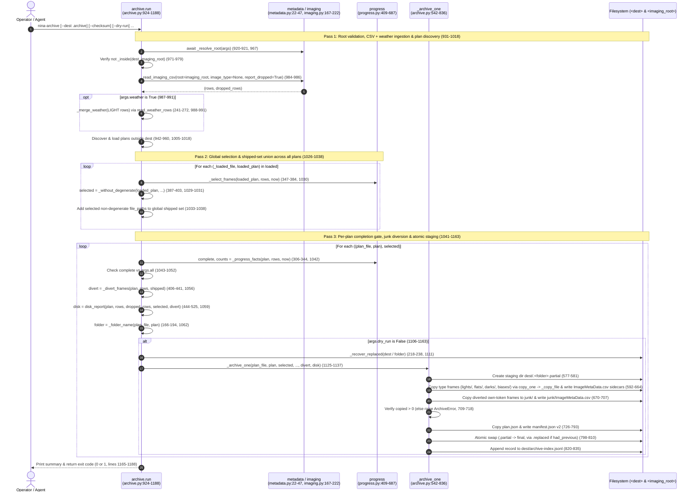
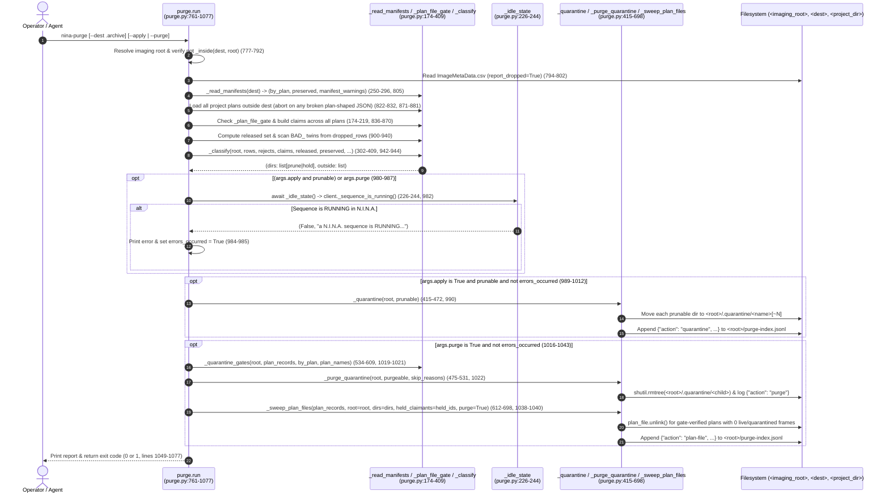

# Execution Flow: Archive, Purge & Pin-ID CLI Lifecycle

[⬆️ Up to Atlas Index](../README.md) · [⬅️ Entrypoints & Lifecycle](./entrypoints-and-lifecycle.md) · [⬅️ Async, State & Error Model](./async-state-and-error-model.md) · [⬅️ Progress, Audit & Telemetry Flow](./flow-progress-audit-and-frame-telemetry.md) · **Related Module Specs:** [CLI Package (`cli/`)](../03-modules/cli/README.md) · [`cli/archive.py`](../03-modules/cli/archive.md) · [`cli/purge.py`](../03-modules/cli/purge.md) · [`cli/pin_id.py`](../03-modules/cli/pin_id.md) · [`tools/plans.py`](../03-modules/tools/plans.md)

---

## 1. End-to-End Archive-Verify-Purge Lifecycle Overview

The observatory's capture-to-cloud lifecycle is orchestrated across one MCP diagnostic tool (`get_nina_settings` in `nina_planner/tools/plans.py:1215-1238`) and three console script CLIs (`nina-pin-id`, `nina-archive`, `nina-purge` defined in `.opencode/local/mcps/nina_planner/pyproject.toml:60-62`). Together they ensure that:
1. Content-derived plan IDs are pinned before any plan JSON edit so existing frames on disk never lose attribution (`nina-pin-id`).
2. Completed plans (and their attributed lights, pooled calibration frames, joined weather CSVs, and own-token `junk/` frames) are atomically staged and committed into `<dest>/<stem>__<plan_id>/` (`nina-archive`).
3. Every live own-token frame is recorded in `manifest.json` (either under its type folder or under `junk/`), guaranteeing `preserved(F)` can be satisfied for `nina-purge`.
4. Imaging-root cleanup proceeds in two human-gated stages (`nina-purge --apply` to `.quarantine/`, followed by `nina-purge --purge` for permanent deletion and original plan JSON removal), holding shared calibration folders until every claiming plan completes.

```mermaid
stateDiagram-v2
    [*] --> UnpinnedPlan: write_plan_file()\n(stamps plan_id on creation;\nmanual JSON may omit plan_id)
    UnpinnedPlan --> PinnedPlan: nina-pin-id PLAN.json\n(pin_id.py:57-86 stamps _base_plan_id)
    PinnedPlan --> Acquiring: load_sequence() + start_sequence()\nFrames written to <imaging_root> + ImageMetaData.csv
    Acquiring --> CompleteOnDisk: progress_verdict().complete == True\n(all pointings & groups satisfied within window)
    CompleteOnDisk --> StagedArchive: nina-archive\n(archive.py:542-836 stages dest/.<folder>.partial)
    StagedArchive --> CommittedArchive: staging.rename(final) -> dest/<folder>\nmanifest.json v2 + archive-index.jsonl
    CommittedArchive --> CloudVerified: Operator runs NINA_UPLOAD_CMD\nthen NINA_VERIFY_CMD (exit 0)
    CloudVerified --> Quarantined: nina-purge --apply\n(purge.py:415-472 moves dir to <root>/.quarantine/<dir>)
    Quarantined --> Purged: nina-purge --purge\n(purge.py:475-698 3-gate check, deletes quarantine + unlinks plan.json)
    Purged --> [*]
```



---

## 2. Flow 0: Environment Readiness Check (`get_nina_settings`)

Before running the archive-upload-verify-purge pipeline (`.agents/skills/archive-lifecycle/SKILL.md`), the controller calls `get_nina_settings()` (`nina_planner/tools/plans.py:1215-1238`):

- Reads `_SETTING_NAMES` (`lines 1202-1208`, `1227-1231`): `NINA_ARCHIVE_DEST`, `NINA_UPLOAD_CMD`, `NINA_VERIFY_CMD`, `NINA_ENDPOINT`, `NINA_DRIVE_MOUNT` from `os.environ`.
- Expands `~` on `NINA_ARCHIVE_DEST` when non-empty (`lines 1232-1235`).
- Computes `missing = [name for name in _SETTING_NAMES if name not in settings]` across all 5 setting names (`line 1236`), while gating `ready = all(name in settings for name in _ARCHIVE_GATE_NAMES)` exclusively on the archive trio `_ARCHIVE_GATE_NAMES = _SETTING_NAMES[:3]` (`line 1212`, `line 1237`).

---

## 3. Flow 1: Pinning Content-Derived Plan IDs (`nina-pin-id`)

Implemented in `nina_planner/pin_id.py:1-166`. When an observation plan JSON has `plan_id: ""`, `ObservationPlan._base_plan_id()` (`nina_planner/models/plan.py:377-382`) derives `"plan-" + sha1(canonical_json)[:12]` from the plan's content. Editing any field of an unpinned plan would change its hash and orphan already-captured frames. `nina-pin-id` stamps that derived ID into `plan_id` before the edit.

```mermaid
sequenceDiagram
    autonumber
    actor CLI as Operator / Agent
    participant Main as pin_id.main / run<br/>(pin_id.py:126-162)
    participant Pin as pin_plan_file<br/>(pin_id.py:57-86)
    participant PU as plan_utils<br/>(plan_utils.py:30-53, 258-287)
    participant Model as ObservationPlan<br/>(models/plan.py:377-382)

    CLI->>Main: nina-pin-id [--dry-run] PLAN.json ...
    Main->>Main: _build_parser().parse_args(argv) (92-123, 161)
    loop For each entry in args.plans (133-150)
        Main->>Main: path = _resolve(entry) (46-51, 134)
        alt not path.is_file() (135-138)
            Main-->>CLI: print("✗ plan file not found: ...", stderr); errors += 1; continue
        end
        Main->>Pin: await pin_plan_file(path, dry_run=args.dry_run) (140)
        Pin->>Pin: path = _resolve(str(plan_file)) (67)
        Pin->>PU: await load_plan(str(path)) (69)
        alt load_plan raises Exception (70-71)
            Pin-->>Main: raise PinError(f"{path.name}: {str(exc).splitlines()[0]}")
        end
        PU-->>Pin: ObservationPlan
        alt plan.plan_id is already non-empty (72-73)
            Pin-->>Main: return f"already pinned: {plan.plan_id}"
        else plan.plan_id == "" (74-86)
            Pin->>Model: plan_id = plan._base_plan_id() (74)
            alt dry_run is True (75-76)
                Pin-->>Main: return f"would pin {path}: {plan_id}"
            else dry_run is False (77-86)
                Pin->>Pin: pinned = plan.model_copy(update={"plan_id": plan_id}) (77)
                Pin->>PU: anyio.to_thread.run_sync(write_text_atomic, path, pinned.model_dump_json(indent=2)) (81-83)
                Pin-->>Main: return f"pinned {path}: {plan_id}" (86)
            end
        end
    end
    Main-->>CLI: return 1 if errors else 0 (151)
```

---

## 4. Flow 2: Three-Pass Atomic Plan Archiving (`nina-archive`)

Implemented in `nina_planner/archive.py:1-1204`. `archive.run(args)` (`lines 924-1188`) executes a three-pass pipeline so that shared calibration frames and own-token uncredited/degenerate frames are reconciled across **all** project plans before any archive folder is staged.



### Key Invariants in `nina-archive`
1. **Global `shipped` Set (`archive.py:1026-1038`) & `junk/` Diversion (`_divert_frames`, `lines 406-441`):**
   - Any live CSV row carrying `plan`'s token (`path_has_id(path, base_id)`) that is **not** selected into any plan's type folders (`path not in shipped`) is diverted into `junk/` with `reason="degenerate"` (when `is_junk_row` is `True`, e.g., `0.00003s` Smart-Exposure darks) or `reason="uncredited"` (outside calibration window or unrequested exposure/filter).
   - Because `junk/` files are recorded in `manifest.json` (`files[]` with `"type": "JUNK"`), `nina-purge` sees them in `preserved` and never blocks directory cleanup on uncredited own-token frames.
2. **Weather Sidecar Join (`_merge_weather`, `lines 241-272`, called at `lines 987-991`):**
   - Joins the meteorological columns from sibling `WeatherData.csv` keyed by `(Path(file_path_str).parent, str(exposure_number))` so multi-night captures never cross-contaminate exposure numbers. Applied only to `LIGHT` rows (including light rows later diverted to `junk/`).
3. **Crash-Safe Atomic Directory Swap (`_archive_one`, `lines 542-836`, & `_recover_replaced`, `lines 218-238`):**
   - Staging occurs inside `dest/.<folder>.partial` (`lines 577-581`). If zero selected frames were copied (`copied == 0`), `_archive_one` deletes `.partial` (`line 814`) and raises `ArchiveError` (`lines 709-718`).
   - When `final` already exists (`--force`), the existing `dest/<folder>` is renamed to `dest/.<folder>.replaced`, `dest/.<folder>.partial` is renamed to `dest/<folder>`, and `dest/.<folder>.replaced` is removed (`lines 798-810`). If a crash interrupts the swap, `_recover_replaced` (`lines 218-238`) restores `.replaced` on the next run.

---

## 5. Flow 3: Manifest-Verified Quarantine & Permanent Purge (`nina-purge`)

Implemented in `nina_planner/purge.py:1-1091`. `nina-purge` frees space in the N.I.N.A. imaging root only when every frame in a top-level directory is both **released** (claimed only by completed plans, or unclaimed by any live plan) and **preserved** (listed by source `file_path` in a committed `<dest>/*/manifest.json`).



### Key Safety Gates in `nina-purge`
1. **Fail-Closed Plan Discovery (`purge.py:822-832, 871-881`):** Unlike `audit_plans` (which tolerates corrupt unreferenced JSON), `nina-purge` aborts immediately (`exit 1`) if any plan-shaped JSON file (`_looks_like_plan_file`) fails to load, because an unreadable plan's calibration claims are unknown.
2. **Three-Gate Plan & Quarantine Verification (`_plan_file_gate` at `174-219` & `_quarantine_gates` at `534-609`):**
   - **Gate 1 (`lines 182-184, 200-207`):** The plan's committed archive directory `<dest>/<folder>/` and `<dest>/<folder>/plan.json` must exist on disk (`archive_ok=True`).
   - **Gate 2 (`lines 185-188, 208-218`):** `<dest>/<folder>/plan.json` must be **byte-identical** (`read_bytes()`) to the live project plan JSON. Any post-archive edit marks the archive `stale=True`, refuses to release or delete that plan's frames/file (`lines 883-904`), and exits `1` (`line 1068`) until `nina-archive --force` refreshes it.
   - **Gate 3 (`lines 189-191, 198-199`):** The plan file must not reside inside `--dest` (checked first in `_plan_file_gate` and excluded during discovery at `line 823`).
3. **Shared Calibration Pool Hold (`_classify` at `302-409`):** A frame `F` is only prunable when `path in preserved` and `claimants - released` is empty (`lines 366-379`). Thus, a shared dark/bias/flat directory claimed by both a finished plan and an incomplete/unarchived plan remains `hold` until the second plan also finishes and is archived.
4. **Unrecorded Files & Empty-CSV Directory Hold (`_classify` at `386-398`, `_unrecorded_count` at `153-164`, `_quarantine` at `448-470`):** A directory with zero recorded CSV frames and zero `BAD_` rejects is held (`"no recorded frames (unrecorded files are never classified)"`, `lines 396-397`). When a directory *does* contain prunable recorded frames (and zero held frames), any non-sidecar files not in `ImageMetaData.csv` ride along into `.quarantine/`, where `_unrecorded_count` tallies them into the `purge-index.jsonl` record (`"unrecorded"`) and prints `"⚠ <dir>: <N> unrecorded file(s) rode along — inspect before --purge"`.
