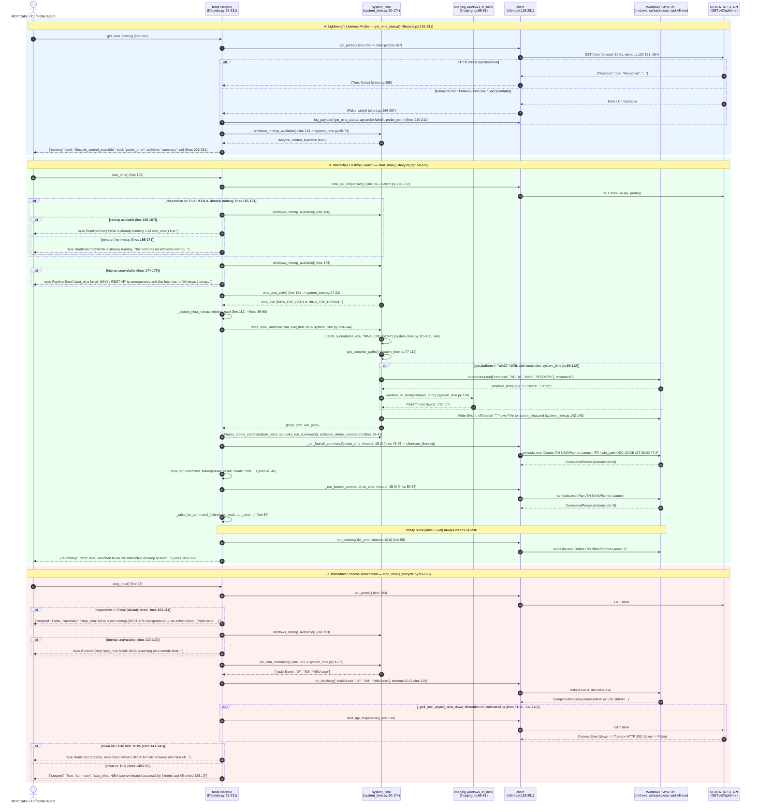
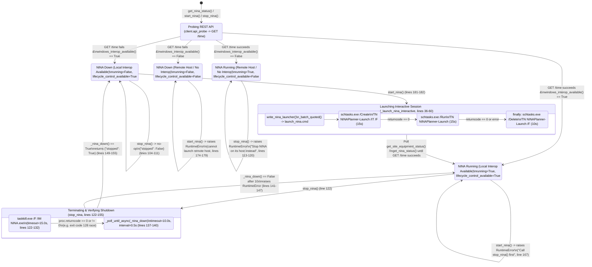
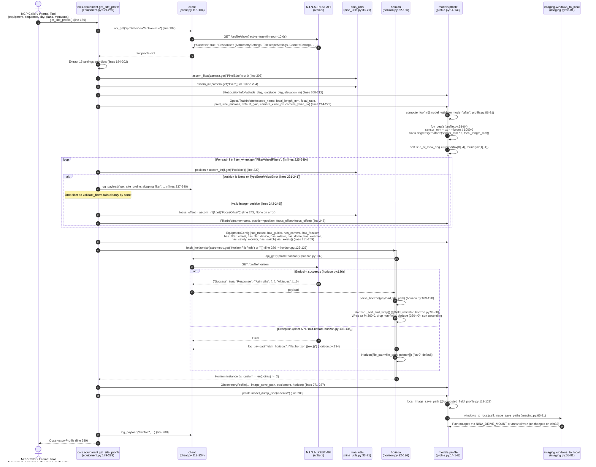
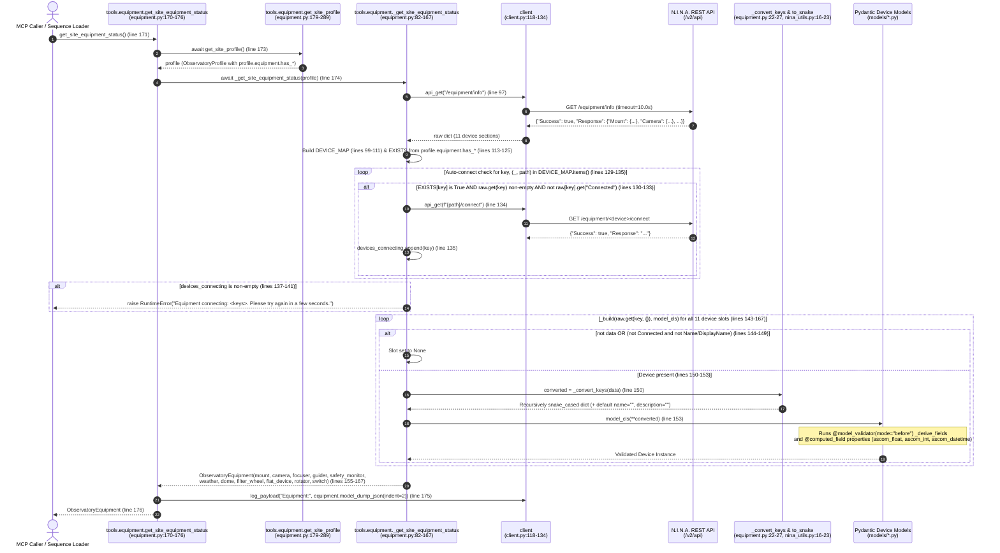

# Execution Flow: Equipment Discovery, Safety Gates, Application Lifecycle & Telemetry Reconstruction

[⬆️ Up to Atlas Index](../README.md) · [⬅️ Entrypoints & Lifecycle](./entrypoints-and-lifecycle.md) · [⬅️ Async, State & Error Model](./async-state-and-error-model.md) · **Related Module Specs:** [`tools/lifecycle.py`](../03-modules/tools/lifecycle.md) · [`tools/equipment.py`](../03-modules/tools/equipment.md) · [`core/system_time.py`](../03-modules/core/system_time.md) · [`core/client.py`](../03-modules/core/client.md) · [`core/horizon.py`](../03-modules/core/horizon.md) · [`core/imaging.py`](../03-modules/core/imaging.md) · [`core/nina_utils.py`](../03-modules/core/nina_utils.md) · [`models/profile.py`](../03-modules/models/profile.md) · [`models/core-rig-devices.md`](../03-modules/models/core-rig-devices.md) · [`models/auxiliary-and-safety-devices.md`](../03-modules/models/auxiliary-and-safety-devices.md)

---

## Overview

The equipment, safety, and lifecycle subsystem forms the operational bridge between the `nina-planner` MCP server and the live N.I.N.A. observatory host. It enforces four core responsibilities across local Windows/WSL and remote observatory deployments:

1. **Workflow 1: N.I.N.A. Application Lifecycle (`get_nina_status`, `start_nina`, `stop_nina`)** — Probes N.I.N.A.'s REST API (`GET /time`) as the authoritative liveness oracle, checks host Windows process interop (`windows_interop_available`), launches `NINA.exe` into the interactive Windows desktop session via a sanitized `.cmd` launcher and one-shot Task Scheduler task (`schtasks.exe /Create ... /IT`), and terminates `NINA.exe` via `taskkill.exe /F /IM NINA.exe` with post-kill REST API shutdown verification.
2. **Workflow 2: Profile & Custom Horizon Discovery (`get_site_profile`)** — Reads N.I.N.A.'s active profile (`GET /profile/show?active=true`) and custom horizon (`GET /profile/horizon`), validates filter-wheel slot indices, computes optical train field of view (`OpticalTrainInfo._compute_fov`), and maps Windows save paths onto the local host filesystem (`ObservatoryProfile.local_image_save_path` via `imaging.windows_to_local`).
3. **Workflow 3: Equipment Auto-Connect & Safety Gate (`get_site_equipment_status`)** — Cross-references live `/equipment/info` telemetry against `profile.equipment` (`has_*` flags), triggers `GET /equipment/<device>/connect` for any configured-but-disconnected device (raising a retryable `RuntimeError("Equipment connecting: ...")`), normalizes ASCOM sentinels (`"NaN"`, `"N/A"`, `.NET DateTime.MinValue`, `24.0h` flip countdown) into typed Pydantic device models, and exposes the canonical safety/park/home invariants (`safety_monitor.is_safe`, `mount.can_park`, `mount.can_find_home`, `mount.is_parked`).
4. **Workflow 4: Event History & Application Log Reconstruction (`get_events` & `get_logs`)** — Retrieves N.I.N.A.'s `/event-history` and `/application/logs?lineCount=1000`, normalizes timestamps and keys via `_convert_to_met`, filters records to a `since`-second lookback window against host-local time, formats surviving timestamps via `nina_utils.to_local_display`, and bridges quiet-gap wake windows (`[get_events(since=N) · M routine events waiting]`) from the `nina_notify` plugin.

---

## Workflow 1: N.I.N.A. Application Lifecycle (`get_nina_status`, `start_nina`, `stop_nina`)

### 1.1 End-to-End Sequence Diagram (`tools/lifecycle.py:22-231`)



---

### 1.2 Application Lifecycle State Machine (`stateDiagram-v2`)



---

### 1.3 Deep-Dive: Host Liveness Probing, Windows Interop & Process Control

#### 1. Authoritative Liveness via `client.api_probe()` (`client.py:255-272`)
- **Why REST API instead of `tasklist.exe`:** `NINA.exe` may run on the same Windows/WSL machine as the MCP server or on a dedicated mini-PC at the pier reachable via `NINA_ENDPOINT`. Checking local OS processes would falsely report a remote N.I.N.A. as down (or report a hung/zombie local `NINA.exe` whose HTTP server crashed as up).
- **`api_probe()` (`client.py:255-267`):** Calls `await api_get("/time")` with a `10.0s` timeout inside `try ... except Exception as e:`.
  - When `GET /time` returns HTTP 200 with `{"Success": true, ...}`, `api_probe()` returns `(True, None)`.
  - When `httpx` raises `ConnectError`/`TimeoutException` or `unwrap_response` (`client.py:81-115`) raises `RuntimeError` (carrying N.I.N.A.'s `"Error"` text or HTTP status), `api_probe()` catches it and returns `(False, str(e))`.
- **`nina_api_responsive()` (`client.py:270-272`):** Returns `(await api_probe())[0]` (`bool`).
- **`get_nina_status()` (`tools/lifecycle.py:191-231`):** Calls `running, probe_error = await client.api_probe()` (`line 209`) and `lifecycle_control_available = windows_interop_available()` (`line 213`). It **never raises** when N.I.N.A. is down, making it the mandatory first check in `safety-interrupt-recovery` and `nina-lifecycle`.

#### 2. Windows Interop Detection (`system_time.windows_interop_available`, `system_time.py:40-74`)
- `_WINDOWS_INTEROP_EXES` (`system_time.py:40-44`) declares `("tasklist.exe", "taskkill.exe", "schtasks.exe")`.
- `windows_interop_available()` (`system_time.py:60-74`):
  1. If `sys.platform == "win32"` (`line 70`), returns `True` immediately.
  2. Otherwise calls `_is_wsl()` (`system_time.py:47-57`), which checks `sys.platform == "linux"` (`line 49`), then checks `os.environ.get("WSL_INTEROP") or os.environ.get("WSL_DISTRO_NAME")` (`line 51`), and falls back to checking whether `/proc/sys/kernel/osrelease` contains `"microsoft"` or `"wsl"` (`lines 53-57`). If `_is_wsl()` is `False` (e.g., macOS or standard Linux), returns `False` (`line 73`).
  3. On WSL, verifies that all three Windows binaries are reachable on `PATH`: `return all(shutil.which(exe) for exe in _WINDOWS_INTEROP_EXES)` (`line 74`).

#### 3. Interactive Desktop Launch via `write_nina_launcher` & `schtasks.exe` (`system_time.py:77-174`, `tools/lifecycle.py:36-60`)
- **Why Task Scheduler (`/IT`) is required:** When the MCP server runs inside WSL or an SSH/background session, spawning `NINA.exe` directly would either fail to attach to the interactive Windows GUI desktop or block/terminate when the parent shell closes. Registering a Task Scheduler task with `/IT` (interactive only) runs `launch_nina.cmd` inside the logged-on user's active desktop session.
- **Batch Injection Sanitization (`_batch_quoted`, `system_time.py:115-130`):**
  - Before any filesystem access (`system_time.py:140`), `_batch_quoted(nina_exe or nina_exe_path(), "NINA_EXE_PATH")` rejects any path containing `"` or ASCII control characters (`ord(c) < 32`, including `\r`, `\n`, `\x00`) with a `ValueError` (`lines 125-129`).
  - Doubles every `%` to `%%` (`line 130`) so `cmd.exe` cannot expand `%VAR%` inside `"..."`.
- **Cross-Platform Temp Path Resolution (`get_launcher_paths`, `system_time.py:77-112`):**
  - On native Windows (`sys.platform == "win32"`, `lines 84-86`), uses `Path(tempfile.gettempdir()) / "launch_nina.cmd"` for both local and Windows paths.
  - On WSL (`lines 88-112`), Python's `/tmp` is invisible to Windows Task Scheduler as a drive path. `get_launcher_paths()` runs `subprocess.run(["cmd.exe", "/d", "/c", "echo", "%TEMP%"], capture_output=True, text=True, check=False, timeout=10)`, validates that the output is an absolute Windows drive path (`PureWindowsPath(windows_temp).drive` and `.is_absolute()`, `lines 103-107`), maps the local write path via `windows_to_local(windows_temp) / "launch_nina.cmd"` (`line 110`), and keeps `str(windows_temp_path / "launch_nina.cmd")` as `win_path` (`line 111`).
- **Writing `launch_nina.cmd` (`write_nina_launcher`, `system_time.py:133-144`):**
  - Writes `@echo off\r\nstart "" "{exe}"\r\n` (`line 143`). The empty `""` title argument is required by `cmd.exe`'s `start` builtin whenever the command path is quoted.
- **Three-Step `schtasks.exe` Execution (`_launch_nina_interactive`, `tools/lifecycle.py:36-60`):**
  1. **Create (`lines 43-48`):** Runs `["schtasks.exe", "/Create", "/TN", "NINAPlanner-Launch", "/TR", win_path, "/SC", "ONCE", "/ST", "00:00", "/IT", "/F"]` via `_run_launch_command(..., timeout=15.0)` and checks `returncode == 0` via `_raise_for_command_failure`.
  2. **Run (`lines 50-54`):** Inside a `try` block, runs `["schtasks.exe", "/Run", "/TN", "NINAPlanner-Launch"]` with a `15.0s` timeout and verifies `returncode == 0`.
  3. **Delete (`lines 55-60`):** In the `finally` block (guaranteed to run even if `/Run` fails or times out), runs `["schtasks.exe", "/Delete", "/TN", "NINAPlanner-Launch", "/F"]` with a `10.0s` timeout, logging any cleanup exception as `"_launch_nina_interactive: delete task warning"` (`line 60`).

#### 4. `stop_nina` Exit-Code `128` Race Handling & Shutdown Verification (`tools/lifecycle.py:93-155`)
- **Initial Liveness Gate (`lines 103-111`):** Calls `responsive, probe_error = await client.api_probe()`. If `not responsive`, returns `{"stopped": False, "summary": "stop_nina: NINA is not running (REST API unresponsive) — no action taken." + ...}` without invoking `taskkill.exe`.
- **Executing `taskkill.exe` (`lines 122-132`):** Runs `["taskkill.exe", "/F", "/IM", "NINA.exe"]` via `client.run_blocking(..., timeout=15.0)` (`line 123`) and captures `taskkill_detail = f"taskkill exited {proc.returncode}"` (plus `: {stderr}` if present).
- **Why `proc.returncode != 0` (including Exit Code `128`) Is Not an Immediate Failure (`lines 134-153`):**
  - On Windows, `taskkill.exe` exits with code `128` (`ERROR: The process "NINA.exe" not found.`) if `NINA.exe` finished shutting down on its own in the milliseconds between `api_probe()` (`line 103`) and `taskkill.exe` (`line 123`). Conversely, `taskkill.exe` also exits nonzero if access is denied or if `NINA_ENDPOINT` points to a different machine than the local host.
  - Therefore, `stop_nina` treats N.I.N.A.'s REST API as the sole authority for the end state: it polls `async def _nina_down() -> bool: return not await client.nina_api_responsive()` via `_poll_until_async(_nina_down, timeout=10.0, interval=0.5)` (`lines 81-90, 137-140`).
  - **Case 1 — API still answers after `10.0s` (`not down`, `lines 141-147`):** Raises `RuntimeError(f"stop_nina failed: NINA's REST API still answers after taskkill ({taskkill_detail}); NINA may not have terminated")`.
  - **Case 2 — API stops answering (`down == True`, `lines 149-155`):** Succeeds and returns `{"stopped": True, "summary": summary}`. If `proc.returncode != 0` (such as exit code `128`), it appends `f" (note: {taskkill_detail})"` to `summary` (`lines 150-152`) so the benign race is recorded transparently.

---

## Workflow 2: Profile & Custom Horizon Discovery (`get_site_profile`)

### 2.1 End-to-End Sequence Diagram (`tools/equipment.py:179-289`)



---

### 2.2 Step-by-Step Trace & Key Model Derivations

1. **Active Profile Fetch & Sub-Section Extraction (`tools/equipment.py:182-206`):**
   - Calls `raw = await client.api_get("/profile/show?active=true")` (`line 182`) and extracts 15 settings dictionaries (`AstrometrySettings`, `TelescopeSettings`, `CameraSettings`, `FilterWheelSettings`, `ImageFileSettings`, `PlateSolveSettings`, `FramingAssistantSettings`, `GuiderSettings`, `RotatorSettings`, `DomeSettings`, `WeatherDataSettings`, `SafetyMonitorSettings`, `FocuserSettings`, `SwitchSettings`, `FlatDeviceSettings`).
   - Coerces `pixel_size = ascom_float(camera.get("PixelSize")) or 0` (`line 203`) and `gain = ascom_int(camera.get("Gain")) or 0` (`line 204`) so ASCOM `"NaN"` sentinels normalize cleanly to `0` rather than raising `ValueError`.
2. **Optical Train & Exact FOV Trigonometry (`models/profile.py:46-91`):**
   - `OpticalTrainInfo` runs `_compute_fov()` (`@model_validator(mode="after")` at `models/profile.py:86-91`) upon construction (`tools/equipment.py:214-222`).
   - `_compute_fov()` delegates to `fov_deg()` (`models/profile.py:58-84`), the single source of truth for FOV trigonometry shared with `mosaic.pane_fov_arcmins` (`mosaic.py:29-55`):
     - If any of `focal_length_mm`, `pixel_size_microns`, `camera_xsize_px`, or `camera_ysize_px` is `None` or `<= 0`, `fov_deg()` returns `None` (`lines 69-79`), preventing division by zero or a bogus `180.0°` FOV when `focal_length_mm == 0`.
     - Otherwise computes physical sensor dimensions in millimetres (`sensor_width_mm = xsize * pixel_size / 1000.0`, `sensor_height_mm = ysize * pixel_size / 1000.0`) and gnomonic angular FOV:
       $$\text{fov\_x} = \operatorname{degrees}\!\left(2.0 \cdot \operatorname{atan2}\!\left(\frac{\text{sensor\_width\_mm}}{2.0},\; \text{focal\_length}\right)\right)$$
       $$\text{fov\_y} = \operatorname{degrees}\!\left(2.0 \cdot \operatorname{atan2}\!\left(\frac{\text{sensor\_height\_mm}}{2.0},\; \text{focal\_length}\right)\right)$$
     - `_compute_fov()` stores `(round(fov[0], 4), round(fov[1], 4))` on `self.field_of_view_deg` (`lines 89-90`).
3. **Filter Slot Validation (`tools/equipment.py:224-249`) & `ObservatoryProfile.filter_position` (`models/profile.py:130-143`):**
   - Iterates over `filter_wheel.get("FilterWheelFilters", [])`.
   - Each filter's `"Position"` is parsed via `ascom_int(f.get("Position"))` (`line 230`). If `position is None` or raises `(TypeError, ValueError)`, the filter is **dropped** and logged via `client.log_payload("get_site_profile: skipping filter", ...)` (`lines 233-241`). Dropping a filter with a corrupt slot ensures `plan_utils.validate_filters` rejects any plan naming that filter at validation time instead of driving the physical filter wheel to slot `0` mid-sequence.
   - By contrast, `"FocusOffset"` is metadata: if `ascom_int(f.get("FocusOffset"))` fails, `focus_offset` defaults to `None` and the filter is kept (`lines 242-246`).
4. **Profile Equipment Capability Flags (`_exists`, `tools/equipment.py:251-269`):**
   - `_exists(section, field, skip=frozenset({"No_Device"}))` returns `True` iff `section.get(field)` is not `None`, not in `skip`, and `!= ""`.
   - Builds `EquipmentConfig` (`models/profile.py:30-43`):
     - `has_mount`: `_exists(telescope, "MountName") or _exists(telescope, "Name")` (`line 258`)
     - `has_guider`: `_exists(guider, "GuiderName", {"No_Guider", "No_Device"})` (`line 259`)
     - `has_camera`, `has_focuser`, `has_filter_wheel`, `has_flat_device`, `has_rotator`, `has_dome`, `has_weather`, `has_safety_monitor`, `has_switch`: `_exists(<section>, "Id")` (`lines 260-268`).
5. **Best-Effort Custom Horizon Discovery & Interpolation (`horizon.py:32-136`):**
   - `get_site_profile` awaits `fetch_horizon(str(astrometry.get("HorizonFilePath") or ""))` (`tools/equipment.py:286`).
   - `fetch_horizon` (`horizon.py:123-136`) calls `await client.api_get("/profile/horizon")` (`line 132`). If the call raises any `Exception`, it logs `"fetch_horizon: flat horizon (...)"` and returns a flat `Horizon(file_path=file_path)` (`lines 133-135`).
   - `parse_horizon` (`horizon.py:103-120`) zips `"Azimuths"` and `"Altitudes"` (`zip(azs, alts, strict=False)`) into `Horizon(file_path=file_path, points=...)`.
   - `Horizon._sort_and_wrap` (`@field_validator("points", mode="before")` at `horizon.py:38-60`) drops non-numeric or non-finite (`math.isfinite`) pairs, wraps azimuths via `az_f % 360.0` into $[0.0, 360.0)$ (so a closing `360°` knot merges onto `0°` with the later entry winning), and returns `sorted(merged.items())`.
   - `Horizon.is_custom` (`@computed_field` at `horizon.py:62-71`) is `True` when `len(self.points) >= 2`. `Horizon.altitude_at(az_deg)` (`horizon.py:73-96`) linearly interpolates between adjacent knots, wrapping across the $360^\circ \rightarrow 0^\circ$ north seam (`lines 93-96`) and clamping to $[-90.0^\circ, 90.0^\circ]$ (`_clamp`, `lines 99-100`).
6. **Cross-OS Save Path Translation (`ObservatoryProfile.local_image_save_path`, `models/profile.py:119-128` -> `imaging.py:65-81`):**
   - `ObservatoryProfile.image_save_path` stores the raw Windows path from `ImageFileSettings.FilePath` (`tools/equipment.py:281`).
   - `ObservatoryProfile.local_image_save_path` (`@computed_field` at `models/profile.py:119-128`) calls `str(windows_to_local(self.image_save_path))`.
   - `windows_to_local(windows_path, drive_mount=None)` (`imaging.py:65-81`):
     - On Windows (`sys.platform == "win32"`, `lines 73-74`), returns `Path(windows_path)` unchanged.
     - On POSIX/WSL/macOS (`lines 75-81`), parses `win = PureWindowsPath(windows_path)`. If `not win.drive`, returns `Path(windows_path)` (`lines 76-77`). Otherwise resolves `mount = drive_mount or os.environ.get("NINA_DRIVE_MOUNT") or f"/mnt/{win.drive[0].lower()}"` (`lines 78-80`) and returns `Path(mount).joinpath(*win.parts[1:])` (`line 81`).

---

## Workflow 3: Equipment Auto-Connect & Safety Gate (`get_site_equipment_status`)

### 3.1 End-to-End Sequence Diagram (`tools/equipment.py:82-176`)



---

### 3.2 Auto-Connect Loop & Device Normalization Pipeline

#### 1. Profile-Guided Auto-Connect Gate (`tools/equipment.py:99-141`)
`_get_site_equipment_status(profile)` maps all 11 N.I.N.A. `/equipment/info` keys to their Pydantic model classes, connect endpoints, and `profile.equipment` presence flags:

| `/equipment/info` Key | `profile.equipment` Flag (`EXISTS`) | Auto-Connect Endpoint (`DEVICE_MAP`) | Pydantic Model Class (`ObservatoryEquipment` Field) |
|---|---|---|---|
| `"Mount"` | `has_mount` | `GET /equipment/mount/connect` | `MountDevice` (`mount`) |
| `"Camera"` | `has_camera` | `GET /equipment/camera/connect` | `CameraDevice` (`camera`) |
| `"Focuser"` | `has_focuser` | `GET /equipment/focuser/connect` | `FocuserDevice` (`focuser`) |
| `"Guider"` | `has_guider` | `GET /equipment/guider/connect` | `GuiderDevice` (`guider`) |
| `"SafetyMonitor"` | `has_safety_monitor` | `GET /equipment/safetymonitor/connect` | `SafetyMonitorDevice` (`safety_monitor`) |
| `"WeatherData"` | `has_weather` | `GET /equipment/weather/connect` | `Weather` (`weather`) |
| `"Dome"` | `has_dome` | `GET /equipment/dome/connect` | `DomeDevice` (`dome`) |
| `"FilterWheel"` | `has_filter_wheel` | `GET /equipment/filterwheel/connect` | `FilterWheelDevice` (`filter_wheel`) |
| `"FlatDevice"` | `has_flat_device` | `GET /equipment/flatdevice/connect` | `FlatDevice` (`flat_device`) |
| `"Rotator"` | `has_rotator` | `GET /equipment/rotator/connect` | `RotatorDevice` (`rotator`) |
| `"Switch"` | `has_switch` | `GET /equipment/switch/connect` | `Switch` (`switch`) |

- **Why Auto-Connect Raises Instead of Returning Stale Telemetry (`lines 129-141`):** For every slot where `EXISTS[key]` is `True` and `raw.get(key)` has `Connected == False`, `_get_site_equipment_status` issues `await client.api_get(path + "/connect")` (`line 134`) and appends `key` to `devices_connecting` (`line 135`). If `devices_connecting` is non-empty after scanning all 11 slots, it raises:
  ```python
  RuntimeError(
      f"Equipment connecting: {', '.join(devices_connecting)}. "
      "Please try again in a few seconds."
  )
  ```
  Because `raw` was fetched *before* the `/connect` commands were issued and ASCOM drivers take several seconds to initialize, returning `raw` immediately would hand the caller disconnected/uninitialized device capabilities (such as `can_park=None` or `is_safe=None`). Raising forces the caller to retry after a few seconds once the drivers report `Connected=True`.

#### 2. Key Conversion & Model Normalization (`_convert_keys` & `_build`, `tools/equipment.py:22-27, 143-167`)
- **Presence Filter in `_build` (`lines 144-149`):** If `data` is empty (`{}`), or if both `connected` (`data.get("Connected", data.get("connected", False))`) and `name` (`data.get("Name") or data.get("name") or data.get("DisplayName")`) are falsy, `_build` returns `None`.
- **Recursive `snake_case` Conversion (`_convert_keys`, `lines 22-27`):** Applies `nina_utils.to_snake` (`nina_utils.py:16-23`) across every nested dict and list via two regex passes (`(.)([A-Z][a-z]+)` -> `\1_\2` and `([a-z0-9])([A-Z])` -> `\1_\2`, then `.lower()`).
- **Pydantic Device Model Normalization (`models/*.py`):**
  - **`MountDevice` (`models/mount.py:12-77`):** When `connected=True`, `_derive_fields` maps `at_park` -> `is_parked`, `at_home` -> `is_homed`, derives `mount_status` (`"SLEWING"` > `"TRACKING"` > `"IDLE"`, `lines 43-50`), builds `PointingInfo` (`ra_hours`, `dec_deg`, `epoch`, `azimuth_deg`, `altitude_deg`, falling back to top-level `right_ascension`/`declination` only when both `coords.ra` and `coords.dec` are `None`, `lines 52-65`), and builds `MeridianInfo` (`models/meridian.py:8-12`), normalizing N.I.N.A.'s `24.0` hour sentinel (`hours_to_flip == 24.0`) to `None` (`lines 67-75`).
  - **`CameraDevice` (`models/camera.py:100-220`):** When `connected=True`, `_derive_fields` maps `camera_state` -> `state`, preserves `has_shutter`, and constructs 7 sub-models: `SensorInfo`, `ExposureInfo` (parsing `exposure_end_time` via `ascom_datetime`, which normalizes `.NET DateTime.MinValue` `0001-01-01T00:00:00` to `None`), `GainInfo`, `OffsetInfo`, `BinningInfo`, `ThermalInfo` (`has_cooler = bool(can_set_temperature)`), and `ReadoutInfo`.
  - **`SafetyMonitorDevice` (`models/safety_monitor.py:8-19`):** Exposes `connected: bool`, `name: str`, `description: str | None`, and `is_safe: bool | None` (`IsSafe`).
  - **`Weather` (`models/weather.py:10-48`):** `_derive_fields` coerces all 11 environmental channels via `ascom_float` onto unit-suffixed fields (`temperature_c`, `dew_point_c`, `humidity_pct`, `pressure_hpa`, `wind_speed_mps`, `wind_gust_mps`, `wind_direction_deg`, `sky_temperature_c`, `sky_quality_mpsas`, `rain_rate_mm_per_hr`, `cloud_cover_pct`), turning unimplemented ASCOM `"NaN"` channels into `None`.
  - **`DomeDevice` (`models/dome.py:10-67`):** Maps `at_park` -> `is_parked`, `at_home` -> `is_homed`, `azimuth` -> `azimuth_deg`, and computes `dome_status` via `compute_dome_status(slewing, is_following, is_synchronized)` (`"SLEWING"` > `"IDLE"` > `"SYNCING"` > `"READY"`).
  - **`FocuserDevice` (`models/focuser.py:10-40`), `FilterWheelDevice` (`models/filter_wheel.py:8-29`), `GuiderDevice` (`models/guider.py:17-69`), `FlatDevice` (`models/flat_device.py:8-27`), `RotatorDevice` (`models/rotator.py:10-51`), `Switch` (`models/switch.py:8-55`):** Normalize step/slot positions, dual-unit guiding RMS (`arcseconds`, `pixel`), cover/panel capabilities (`supports_open_close`, `supports_on_off`), 3-tier rotator sync state (`is_synced` / `synced` / `sync_state`), and writable switch binary `is_on` (`value == 1`).

---

### 3.3 Canonical Safety, Park & Homing Invariants

The canonical policy is defined in `nina_planner/sequence/builders.py:210-273` and enforced at sequence load time by `plan_utils.require_parkable` (`nina_planner/plan_utils.py:152-175`) and at runtime by the controller agent:

| Invariant | Source Field(s) | Code Authority & Enforcement | Operational Semantics |
|---|---|---|---|
| **Enclosure Safety Gate (`is_safe`)** | `equipment.safety_monitor.is_safe` (`models/safety_monitor.py:19`) | `sequence/builders.py:233-240`, `app.py:12-21`, `AGENTS.md` | `is_safe=True` means the observatory roof/dome is open and sky-dependent work (`light`, `dawn`/`dusk` sky `flat`) may unpark and expose. `is_safe=False` (or `None`) means the enclosure is closed: the scope must be parked immediately and all sky-dependent acquisition is gated until `is_safe=True`. **Exemption:** `dark` and `bias` sequences are not sky-dependent — they park the scope first (`target_payload_darks` in `sequence/targets.py:163`), never unpark, and block light at the camera (`wheel`, `cover`, or `shutter` in `sequence/variants.py:23-86`), so they may be loaded and run while `is_safe=False`. |
| **Weather Separation** | `equipment.weather.*` (`models/weather.py:21-31`) | `sequence/builders.py:239-240`, `AGENTS.md` | Weather telemetry (`rain_rate_mm_per_hr`, `wind_speed_mps`, `cloud_cover_pct`, `humidity_pct`) is reported separately from `safety_monitor.is_safe` by the weather device. Either `is_safe=False` or a weather violation requires parking and halting sky-dependent acquisition. |
| **Park Is the Only Closing Maneuver (`can_park`)** | `equipment.mount.can_park` (`models/mount.py:25`) | `plan_utils.require_parkable` (`plan_utils.py:152-175`), `sequence_park_scope` (`sequence/builders.py:244-247`) | Every sequence loaded via `load_sequence` or `scripts/gen_sequence.py` calls `require_parkable(equipment)` before sending anything to N.I.N.A. If `not (equipment.mount and equipment.mount.can_park)`, `require_parkable` raises `ValueError("Mount cannot park (can_park=False) — nothing to park: ...")`. `can_park` is also used by `sequence_unpark_scope` (`builders.py:261-272`) as the deliberate proxy for unpark capability because neither ASCOM nor N.I.N.A. exposes a separate `CanUnpark` flag. |
| **Find Home Is a Sensor Calibration, Never a Park Fallback (`can_find_home`)** | `equipment.mount.can_find_home` (`models/mount.py:26`) | `sequence_home_scope` (`sequence/builders.py:250-258`) | Emitted once per `light` step (`target_payload_lights` in `sequence/targets.py:375`), **after** `sequence_unpark_scope` (since `GET /equipment/mount/home` returns HTTP 409 if parked) and **ahead** of `set_tracking(0)`. Drives the mount axes to its physical home index (~30s) to restore position sync after a power cycle or slip; never used in place of `park_scope()`. |
| **Live Parked State (`is_parked`)** | `equipment.mount.is_parked` (`models/mount.py:27`, mapped from `at_park` at `line 40`) | `MountDevice._derive_fields` (`models/mount.py:33-41`) | Reflects whether the mount is currently at its park position (`True`/`False` when connected, `None` when disconnected). Note that `stop_sequence()` only stops the sequencer (`client.stop_running_sequence_and_wait`); to park an unparked mount when no sequence is running, the controller loads and starts the empty teardown sequence `load_sequence(request=[])` + `start_sequence()`. |

---

## Workflow 4: Event History & Application Log Reconstruction (`get_events` & `get_logs`)

### 4.1 End-to-End Sequence Diagram (`tools/equipment.py:30-79, 292-310`)

```mermaid
sequenceDiagram
    autonumber
    participant NINAWs as N.I.N.A. WebSocket & API<br/>(/v2/socket, /v2/api)
    participant Notify as nina_notify Plugin<br/>(plugins/nina_notify/index.ts)
    actor Agent as Observatory Controller Agent
    participant EqTool as tools.equipment<br/>(equipment.py:292-310)
    participant Client as client<br/>(client.py:118-134)
    participant Met as _convert_to_met & _convert_keys<br/>(equipment.py:22-79)
    participant Utils as nina_utils.to_local_display<br/>(nina_utils.py:107-123)

    rect rgb(245, 240, 255)
        Note over NINAWs,Agent: 1. Wake Window Generation by nina_notify
        NINAWs-->>Notify: Routine WebSocket events buffered silently<br/>(IMAGE-SAVE, GUIDER-*, AUTOFOCUS-*)
        NINAWs-->>Notify: Wake trigger (Milestone RUN-FINISHED, SAFETY-*,<br/>ERROR-*, QUALITY-WATCHDOG, or Interval Check)
        Notify->>Agent: Wake prompt ending with:<br/>"[get_events(since=N) · M routine events waiting]"
    end

    rect rgb(235, 248, 255)
        Note over Agent,Utils: 2. Event History Reconstruction — get_events(since=N) (equipment.py:292-298)
        alt M > 0 routine events waiting (or fault investigation)
            Agent->>EqTool: get_events(since=N) (line 293, default since=300)
            EqTool->>Client: api_get("/event-history") (line 295)
            Client->>NINAWs: GET /v2/api/event-history (timeout=10.0s)
            NINAWs-->>Client: {"Success": true, "Response": [{"Time": "2026-11-19T...", "Event": "...", ...}, ...]}
            Client-->>EqTool: raw event list
            EqTool->>Met: _convert_to_met(res, since=since, name="Time") (line 296 -> lines 30-79)
            activate Met
            Met->>Met: Resolve host-local `now = datetime.now().astimezone()` (lines 37-43)
            loop For each record d in data (lines 46-63)
                Met->>Met: Parse ts = datetime.fromisoformat(d["Time"]) (lines 49-57)<br/>Increment `dropped` & skip if missing or invalid
                Met->>Met: Remove "Time", attach host tzinfo if naive (lines 58-60)
                Met->>Met: d = _convert_keys(d) (snake_case all keys, line 61)
                Met->>Met: d["timestamp"] = ts (line 62)
            end
            opt dropped > 0 (lines 64-68)
                Met->>Client: log_payload("_convert_to_met:", f"dropped {dropped} record(s)...")
            end
            Met->>Met: Sort ascending by d["timestamp"] (line 69)
            loop Filter by lookback window (lines 71-78)
                Met->>Met: elapsed = (ts - now).total_seconds() (line 75)
                opt since + elapsed > 0 (i.e. ts > now - since, line 76)
                    Met->>Utils: to_local_display(ts) (line 77 -> nina_utils.py:107-123)
                    Utils-->>Met: "YYYY-MM-DDTHH:MM:SS±HH:MM" (host-local ISO-8601)
                    Met->>Met: Keep record with formatted d["timestamp"] (lines 77-78)
                end
            end
            Met-->>EqTool: Filtered & chronologically sorted event list (line 79)
            deactivate Met
            EqTool->>Client: log_payload("Events:", json.dumps(res, indent=2)) (line 297)
            EqTool-->>Agent: list[dict[str, Any]] (line 298)
        end
    end

    rect rgb(255, 248, 235)
        Note over Agent,Utils: 3. Application Log Reconstruction — get_logs(since=N) (equipment.py:301-310)
        Agent->>EqTool: get_logs(since=N) (line 302, default since=300)
        EqTool->>Client: api_get("/application/logs?lineCount=1000") (line 304)
        Client->>NINAWs: GET /v2/api/application/logs?lineCount=1000
        NINAWs-->>Client: {"Success": true, "Response": [{"Timestamp": "...", "Level": "...", "Message": "...", "Line": ..., "Member": ..., "Source": ...}]}
        Client-->>EqTool: raw log list (up to 1,000 entries)
        EqTool->>Met: _convert_to_met(res, since=since, name="Timestamp") (line 305)
        Met-->>EqTool: Chronologically sorted, time-filtered, snake_cased log dicts
        loop Strip C# call-site noise for d in res (lines 306-308)
            EqTool->>EqTool: d.pop("line", None); d.pop("member", None); d.pop("source", None)
        end
        EqTool->>Client: log_payload("Logs:", json.dumps(res, indent=2)) (line 309)
        EqTool-->>Agent: list[dict[str, Any]] (timestamp, level, message, ...) (line 310)
    end
```

---

### 4.2 Deep-Dive: `_convert_to_met`, `to_local_display`, and `nina_notify` Wake Windows

#### 1. How `nina_notify` Wake Prompts Map to `get_events(since=N)`
- **Selective Wake Architecture:** The OpenCode `nina_notify` plugin (`.opencode/local/plugins/nina_notify/index.ts`) subscribes to N.I.N.A.'s WebSocket (`ws://<NINA_ENDPOINT>/v2/socket`), but deliberately suppresses routine per-frame telemetry (`IMAGE-SAVE`, guider pulses, routine autofocus steps) so the controller agent is not woken every few seconds during an imaging run.
- **Wake Window Footer:** Instead, whenever a wake-worthy event fires — a sequence milestone (`RUN-STARTING`, `RUN-FINISHED`, `PARK-STARTING`, `PARK-FINISHED`, `ACQUISITION-STARTING`, `ACQUISITION-FINISHED`), a safety state transition, a device fault, an interval check, a `QUALITY-WATCHDOG` alert, or a `nina_notify_arm` confirmation after a disarmed stretch — `nina_notify` computes the elapsed seconds `N` since the previous wake (or disarmed timestamp) and counts the buffered routine events `M`, appending:
  ```text
  [get_events(since=N) · M routine events waiting]
  ```
- **Controller Protocol:**
  - When `M > 0`, the controller calls `get_events(since=N)` with that exact `N` to reconstruct all activity across the quiet gap before deciding its next action.
  - When the footer explicitly reports `0 routine events waiting`, nothing unread occurred in `/event-history` during the window and the controller skips the `get_events` call.
  - If `nina_notify_check` reports `staleWhileSequenceRunning: true` (indicating the WebSocket dropped silently while a sequence was active), the controller calls `get_events` directly to verify recent activity rather than trusting the quiet socket.

#### 2. Timestamp Normalization & Window Filtering in `_convert_to_met` (`tools/equipment.py:30-79`)
Both `get_events` (`name="Time"`, `line 296`) and `get_logs` (`name="Timestamp"`, `line 305`) pass their raw N.I.N.A. array through `_convert_to_met(data, since, name, now=None)`:
1. **Reference Clock Resolution (`lines 37-43`):**
   - Sets `now = now or datetime.now().astimezone()`.
   - If a test or caller passes a naive `now` (`now.tzinfo is None`), tags it with the host's local timezone (`now = now.replace(tzinfo=datetime.now().astimezone().tzinfo)`, `lines 41-42`) so `ts - now` subtraction against offset-aware ISO-8601 strings (e.g. `Z`-suffixed UTC stamps) never raises `TypeError: can't subtract offset-naive and offset-aware datetimes`.
2. **Fault-Tolerant ISO-8601 Parsing (`lines 46-68`):**
   - Extracts `value = d.get(name)` (`line 49`). If `value` is missing, empty, or not a `str`, or if `datetime.fromisoformat(value)` raises `ValueError` (`lines 50-57`), increments `dropped += 1` and skips the record rather than failing the entire tool call.
   - If `dropped > 0`, logs `"dropped {dropped} record(s) without a usable {name!r} timestamp"` via `client.log_payload` (`lines 64-68`).
   - Copies `d` without the raw `name` key (`line 58`), attaches `tzinfo` if `ts` was naive (`lines 59-60`), recursively converts all remaining keys to `snake_case` via `_convert_keys(d)` (`line 61`), and stores `d["timestamp"] = ts` (`line 62`).
3. **Chronological Sort & `since` Window Filter (`lines 69-79`):**
   - Sorts all valid records chronologically ascending (`data = sorted(res, key=lambda d: d["timestamp"])`, `line 69`).
   - For each record, computes `elapsed = (ts - now).total_seconds()` (`line 75`, negative for past timestamps).
   - Keeps the record iff `since + elapsed > 0` (`line 76`, i.e., `ts > now - timedelta(seconds=since)`).
4. **Canonical Local-Time Rendering (`nina_utils.to_local_display`, `nina_utils.py:107-123`):**
   - Surviving records have `d["timestamp"] = to_local_display(ts)` formatted at `line 77`:
     - If `dt.tzinfo is None` (`line 121`), returns `dt.isoformat(timespec="seconds")`.
     - If `dt.tzinfo is not None` (`line 123`), converts the instant to the host's local timezone via `dt.astimezone().isoformat(timespec="seconds")`, producing `YYYY-MM-DDTHH:MM:SS±HH:MM` (for example, `2026-11-19T21:14:05-05:00`).
   - This matches the exact host-local ISO-8601 format required for `PROGRESS.md` headers and `nina_notify` logs, ensuring timestamps quoted from `get_events` and `get_logs` never suffer from bare-wall-clock ambiguity or UTC-vs-local confusion.
5. **Log Call-Site Stripping in `get_logs` (`tools/equipment.py:306-308`):**
   - After `_convert_to_met` returns, `get_logs` removes C# internal source-location keys (`"line"`, `"member"`, `"source"`) from each log dictionary (`d.pop(key, None)`), leaving compact diagnostic fields (`"timestamp"`, `"level"`, `"message"`).
