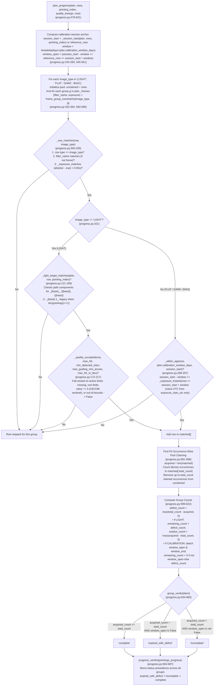

# Execution Flow: Progress Tracking, Whole-Project Capture Audit & Live Frame Telemetry

[⬆️ Up to Atlas Index](../README.md) · [⬅️ Entrypoints & Lifecycle](./entrypoints-and-lifecycle.md) · [⬅️ Async, State & Error Model](./async-state-and-error-model.md) · **Related Module Specs:** [`tools/plans.py`](../03-modules/tools/plans.md) · [`core/progress.py`](../03-modules/core/progress.md) · [`core/metadata.py`](../03-modules/core/metadata.md) · [`core/imaging.py`](../03-modules/core/imaging.md) · [`core/plan_utils.py`](../03-modules/core/plan_utils.md) · [`core/nina_utils.py`](../03-modules/core/nina_utils.md) · [`models/pointing-and-frame.md`](../03-modules/models/pointing-and-frame.md) · [`models/plan.md`](../03-modules/models/plan.md) · [`tools/equipment.py`](../03-modules/tools/equipment.md) · [`core/client.py`](../03-modules/core/client.md)

---

## Overview

This document traces the four read-side data pipelines that reconcile **what an observation plan requested** against **what N.I.N.A. actually captured**:

1. **Workflow 1 — Metadata Ingestion & Path Resolution (`read_metadata` & `read_imaging_csv`):** How `nina_planner` resolves N.I.N.A.'s active `ImageSavePath` onto the local host filesystem (`windows_to_local`), walks visible subdirectories while pruning hidden/snapshot/quarantine/cache trees (`_prunable_dir`, `_walk_visible`, `visible_rglob`), normalizes `ImageMetaData.csv` rows, verifies file existence on disk (`_resolve_existing_file`), and either drops missing/`BAD_`-renamed files or returns them via `report_dropped=True`.
2. **Workflow 2 — Single-Plan Progress, Quality Filtering & Calibration Windows (`get_plan_progress`):** How a single observation plan JSON is evaluated per pointing against `ImageMetaData.csv` using delimited attribution tokens (`_light_target_matches`), fail-closed quality gates (`_quality_accepted`), symmetric calibration age windows anchored to the earliest attributed light (`_session_start`, `_within_age`), first-fit occurrence-wise pool claiming (`plan_progress`), and the 3-state completion classifier (`group_verdict`, `progress_verdict`) plus `overshot` warnings.
3. **Workflow 3 — Whole-Project Capture Audit (`audit_plans` & `list_plans`):** How `audit_plans` reconciles every project plan against `ImageMetaData.csv` and the imaging root in a single sweep—using a CSV-driven LEFT JOIN with `never_shot` blind-spot closure (`_never_shot_report`), on-disk `BAD_` reject counting (`_count_fits`), degenerate exposure detection (`_junk_count`, `is_junk_row`), the 7-state row classifier (`_status_for`), actionable `left_to_do` vs. `blocked` work queues, and unclaimed directory `orphans` detection.
4. **Workflow 4 — Live Frame Telemetry Watchdog (`get_frame_stats`):** How `get_frame_stats` queries N.I.N.A.'s `GET /v2/api/image-history` endpoint for the current frame, normalizes wire keys and ASCOM `NaN` vs. genuine `0` readings through `FrameStats._normalize`, and pairs with `nina-notify`'s `QUALITY-WATCHDOG` wakes and the `frame-quality-diagnostics` skill.

---

## Workflow 1: Metadata Ingestion & Path Resolution (`read_metadata` & `read_imaging_csv`)

Every tool and CLI that reasons about captured frames (`get_plan_progress`, `audit_plans`, `load_sequence`, `nina-archive`, `nina-purge`, and `scripts/gen_sequence.py`) ingests N.I.N.A.'s Session Metadata plugin records (`ImageMetaData.csv`) through the `metadata.py` $\rightarrow$ `imaging.py` pipeline.

### 1.1 End-to-End Sequence Diagram

```mermaid
sequenceDiagram
    autonumber
    participant Caller as Caller (get_plan_progress /<br/>audit_plans / load_sequence)
    participant Meta as metadata.py<br/>(read_metadata / resolve_imaging_root)
    participant Equip as tools/equipment.py<br/>(get_site_profile)
    participant Prof as models/profile.py<br/>(ObservatoryProfile)
    participant Thread as anyio.to_thread.run_sync
    participant Img as imaging.py<br/>(read_imaging_csv)
    participant FS as Local Host Filesystem<br/>(Imaging Root)

    Caller->>Meta: await metadata.read_metadata(image_type=None) (metadata.py:50-66)
    Meta->>Meta: await resolve_imaging_root() (metadata.py:12-19)
    Meta->>Equip: await equipment_tools.get_site_profile() (metadata.py:18)
    Equip->>Prof: Build ObservatoryProfile from /profile/show?active=true
    Prof->>Img: windows_to_local(self.image_save_path) (profile.py:128, imaging.py:65-81)
    Img-->>Prof: Mapped local Path (via NINA_DRIVE_MOUNT or /mnt/<drive>)
    Equip-->>Meta: profile (with local_image_save_path)
    Meta-->>Meta: root = Path(profile.local_image_save_path) (metadata.py:19)

    Meta->>Thread: await anyio.to_thread.run_sync(lambda: read_imaging_csv(root=root, image_type=image_type)) (metadata.py:64-66)
    Thread->>Img: read_imaging_csv(root, image_type, report_dropped=False) (imaging.py:167-222)
    Img->>Img: _require_root(root) (imaging.py:139-152, 193)
    Img->>FS: root.is_dir() stat check
    alt root missing or not a directory
        FS-->>Img: False
        Img-->>Caller: Raise FileNotFoundError (fail-closed: never masquerade as 0 frames)
    end

    Img->>Img: visible_rglob(root, "ImageMetaData.csv") (imaging.py:55-62, 197)
    loop _walk_visible(root) via os.walk(root, followlinks=False) (imaging.py:39-52)
        Img->>FS: List dirpath, dirnames, filenames
        Img->>Img: dirnames[:] = sorted(d for d in dirnames if not _prunable_dir(d)) (imaging.py:51)
        Note over Img: Prunes name.startswith(".") (.archive, .quarantine,<br/>.snapshot, .Trashes, .git, .venv) and<br/>_PRUNED_DIR_NAMES (node_modules, __pycache__)
    end

    loop For each meta_path in visible_rglob results (imaging.py:197-219)
        Img->>Img: bases = (meta_path.parent, meta_path.parent.parent, root) (imaging.py:198-200)
        Img->>FS: _read_csv(meta_path) with encoding="utf-8-sig" & to_snake(k) (imaging.py:106-108, 201)
        loop For each row in CSV (imaging.py:201-219)
            Img->>Img: Filter row_image_type against image_type_upper or _FRAME_TYPES_UPPER (imaging.py:202-207)
            Img->>Img: resolved = _resolve_existing_file(raw_path, bases=bases) (imaging.py:127-136, 209)
            Img->>Img: _resolve_image_path(raw_path, bases) -> windows_to_local(raw_path) (imaging.py:111-124)
            Img->>FS: Path(resolved).is_file() check (imaging.py:122, 134)
            alt raw_path is non-empty and resolved is None (File missing or renamed to BAD_*)
                alt report_dropped == True (archive.py / purge.py)
                    Img->>Img: row["file_path"] = _resolve_image_path(raw_path, bases) (imaging.py:212)
                    Img->>Img: dropped.append(row) (imaging.py:213)
                end
                Img->>Img: continue (drop row from active attribution) (imaging.py:214)
            else File exists (or raw_path empty in synthetic test fixtures)
                Img->>Img: row["file_path"] = resolved (if truthy) (imaging.py:215-216)
                Img->>Img: row["frame_type"] = row_image_type; row["source"] = "image_metadata" (imaging.py:217-218)
                Img->>Img: rows.append(row) (imaging.py:219)
            end
        end
    end
    Img-->>Thread: Return rows (or (rows, dropped) when report_dropped=True) (imaging.py:220-222)
    Thread-->>Meta: rows
    Meta-->>Caller: list[dict[str, Any]]
```

### 1.2 Step-by-Step Pipeline Mechanics

#### 1. Async Root Resolution & CLI Fallback (`metadata.py:12-66`)
- **`resolve_imaging_root()` (`metadata.py:12-19`):** Calls `await equipment_tools.get_site_profile()` (`line 18`) and wraps `profile.local_image_save_path` in a `Path` (`line 19`). Inside `ObservatoryProfile.local_image_save_path` (`@computed_field` at `models/profile.py:119-128`), N.I.N.A.'s raw Windows `image_save_path` is passed through `imaging.windows_to_local(...)`.
- **`resolve_cli_root(imaging_root, error, command)` (`metadata.py:22-47`):** Used by `nina-archive` (`archive.py:921`) and `nina-purge` (`purge.py:223`). If `--imaging-root` is supplied on the command line, expands `~` via `Path(imaging_root).expanduser()` (`line 36`), verifies `root.is_dir()` (`line 37`), and returns `root` without contacting N.I.N.A. Otherwise falls back to `await resolve_imaging_root()` (`line 41`), wrapping any connection/profile exception into the caller's domain error (`ArchiveError` / `PurgeError`) with a hint to pass `--imaging-root` when N.I.N.A. is offline (`lines 42-47`).
- **`read_metadata(image_type=None)` (`metadata.py:50-66`):** Resolves `root = await resolve_imaging_root()` (`line 63`) and offloads the synchronous tree walk to an `anyio` worker thread:
  ```python
  return await anyio.to_thread.run_sync(
      lambda: read_imaging_csv(root=root, image_type=image_type)
  )
  ```

#### 2. Fail-Closed Root Existence Guard (`_require_root`, `imaging.py:139-152`)
At the entry of `read_imaging_csv` (`imaging.py:193`), `_require_root(root)` checks `if root.is_dir(): return` (`lines 146-147`). If `root` is missing or not a directory, it raises `FileNotFoundError`:
```text
imaging root does not exist or is not a directory: <root> (check the site profile's image save path and, on non-Windows hosts, NINA_DRIVE_MOUNT)
```
Without this guard, `os.walk(root)` inside `_walk_visible` would silently yield zero directories and return `[]`, causing `get_plan_progress`, `load_sequence`, and `audit_plans` to mistake an unmounted SMB share or misconfigured `NINA_DRIVE_MOUNT` for "0 frames acquired" and re-shoot completed targets.

#### 3. Directory Pruning & Deterministic Tree Walk (`_prunable_dir`, `_walk_visible`, `visible_rglob`, `imaging.py:26-62`)
- **`_PRUNED_DIR_NAMES` (`imaging.py:26`):** `frozenset({"node_modules", "__pycache__"})`.
- **`_prunable_dir(name)` (`imaging.py:34-36`):** Returns `name.startswith(".") or name in _PRUNED_DIR_NAMES`. This single predicate is shared across `imaging.py`, `plan_utils.py`, `tools/plans.py`, and `purge.py`, pruning:
  - Dot-directories (`name.startswith(".")`): `.archive`, `.quarantine` (where `nina-purge` moves retired directories before final deletion), SMB `.snapshot`, macOS `.Trashes`, `.git`, `.opencode`, and `.venv`.
  - Tool/cache trees (`_PRUNED_DIR_NAMES`): `node_modules` and `__pycache__`.
- **`_walk_visible(root)` (`imaging.py:39-52`):** Wraps `os.walk(root)` (which defaults to `followlinks=False`, preventing symlink cycles from hanging an unattended audit). At each directory level, it mutates `dirnames[:]` in place (`line 51`):
  ```python
  dirnames[:] = sorted(d for d in dirnames if not _prunable_dir(d))
  ```
  and yields `Path(dirpath), sorted(filenames)` (`line 52`). Because `dirnames[:]` is pruned before descent, `os.walk` never enters hidden or cache subtrees, and snapshots/quarantined copies can never duplicate `ImageMetaData.csv` rows or inflate FITS counts.
- **`visible_rglob(root, name)` (`imaging.py:55-62`):** Returns `[directory / name for directory, names in _walk_visible(root) if name in names]`, locating every visible `"ImageMetaData.csv"` in deterministic depth-first lexicographical order (`line 197`).

#### 4. Windows-to-Local Drive Mapping (`windows_to_local`, `imaging.py:65-81`)
N.I.N.A. runs on Windows and records Windows drive-rooted paths (`Z:\landing\...` or `C:\Users\...`) both in the active profile (`ImageSavePath`) and in `ImageMetaData.csv` (`FilePath`). `windows_to_local(windows_path, drive_mount=None)` translates them without performing any disk I/O:
1. **Windows host (`lines 73-74`):** If `sys.platform == "win32"`, returns `Path(windows_path)` unchanged.
2. **Drive-less path (`lines 75-77`):** Parses `win = PureWindowsPath(windows_path)`. If `not win.drive` (already a POSIX path or a relative path), returns `Path(windows_path)` verbatim.
3. **POSIX drive rebasing (`lines 78-81`):** Resolves `drive_mount = drive_mount if drive_mount is not None else os.environ.get("NINA_DRIVE_MOUNT")`, sets `mount = drive_mount or f"/mnt/{win.drive[0].lower()}"`, and strips the Windows drive root (`win.parts[0]`) via `Path(mount).joinpath(*win.parts[1:])`.

#### 5. Path Resolution, Existence Verification & `BAD_` Rejects (`_resolve_image_path`, `_resolve_existing_file`, `read_imaging_csv`, `imaging.py:106-222`)
For each `meta_path` discovered by `visible_rglob(root, "ImageMetaData.csv")`, `read_imaging_csv` constructs three fallback base directories (`lines 198-200`):
```python
csv_dir = meta_path.parent
parent_dir = csv_dir.parent
bases = (csv_dir, parent_dir, root)
```
and reads the file via `_read_csv(meta_path)` (`lines 106-108`), which opens `meta_path` with `encoding="utf-8-sig"` (stripping any Windows UTF-8 BOM) and normalizes every column header via `nina_utils.to_snake` (e.g., `FilePath` $\rightarrow$ `file_path`, `ImageType` $\rightarrow$ `image_type`, `ExposureStartUTC` $\rightarrow$ `exposure_start_utc`, `HFRStDev` $\rightarrow$ `hfr_st_dev`, `GuidingRMSArcSec` $\rightarrow$ `guiding_rms_arc_sec`).

For each row:
1. **Frame-Type Filter (`lines 202-207`):** Reads `row_image_type = (row.get("image_type") or "").upper()`. When `image_type is None`, keeps only rows in `_FRAME_TYPES_UPPER` (`("LIGHT", "DARK", "BIAS", "FLAT")`, `lines 30-31`), doing all four canonical types in a **single directory walk**. When `image_type` is specified, keeps only `row_image_type == image_type.upper()`.
2. **Path Resolution (`_resolve_image_path`, `lines 111-124`):**
   - Returns `None` if `file_path` is empty/missing (`lines 115-116`).
   - Maps `p = Path(windows_to_local(file_path))` (`line 117`).
   - If `p.is_absolute()`, returns `str(p)` immediately (`lines 118-119`).
   - If `p` is relative, probes `candidate = Path(base) / p` across `bases = (csv_dir, parent_dir, root)` in order and returns the first candidate where `candidate.is_file()` is `True` (`lines 120-123`), falling back to `str(p)` if none exist (`line 124`).
3. **Existence Gate (`_resolve_existing_file`, `lines 127-136`):** Calls `resolved = _resolve_image_path(file_path, bases)` and returns `resolved` **only if** `resolved and Path(resolved).is_file()` (`lines 134-135`), else `None` (`line 136`).
4. **Dropping Missing & `BAD_`-Renamed Files vs. `report_dropped=True` (`lines 208-222`):**
   - When an operator or N.I.N.A. marks a frame as bad on disk, N.I.N.A. renames the file on the filesystem to `BAD_<filename>` while leaving the original pre-rename `FilePath` in `ImageMetaData.csv`.
   - Consequently, `_resolve_existing_file(raw_path, bases=bases)` returns `None` for any `BAD_`-renamed or deleted file (`line 209`).
   - At `lines 210-214`, if `raw_path and resolved is None`:
     - Under the default `report_dropped=False` (`lines 155-158`), the row is silently skipped (`continue`), so no deleted or `BAD_`-rejected frame is ever credited toward plan completion.
     - Under `report_dropped=True` (`lines 161-164`, used by `nina-archive` at `archive.py:984` and `nina-purge` at `purge.py:797`), `read_imaging_csv` rewrites `row["file_path"] = _resolve_image_path(raw_path, bases)` (best-effort mapped local path without requiring file existence) and appends `row` to `dropped` (`lines 211-213`), returning `(rows, dropped)` (`lines 220-221`) so the archive/purge CLIs can check whether `BAD_<name>` exists alongside the missing path or report the frame as genuinely lost.
   - Surviving rows have `row["file_path"] = resolved` (if `resolved` is truthy), `row["frame_type"] = row_image_type`, and `row["source"] = "image_metadata"` stamped (`lines 215-219`).

---

## Workflow 2: Single-Plan Progress, Quality Filtering & Calibration Windows (`get_plan_progress`)

`tools.plans.get_plan_progress(file_path)` (`tools/plans.py:202-311`) computes per-pointing light and pooled calibration progress for one observation plan JSON file. Its underlying engine—`progress.plan_progress` (`progress.py:478-631`) and `progress.progress_verdict` (`progress.py:663-687`)—is shared with `load_sequence` (`mode="remaining"`), `audit_plans`, `nina-archive`, `nina-purge`, and `scripts/gen_sequence.py`.

### 2.1 End-to-End Sequence Diagram (`get_plan_progress`)

```mermaid
sequenceDiagram
    autonumber
    participant Agent as MCP Caller / Controller Agent
    participant Tool as tools/plans.py<br/>(get_plan_progress)
    participant PUtil as plan_utils.py<br/>(load_plan / quality_kwargs)
    participant Plan as models/plan.py<br/>(ObservationPlan)
    participant Meta as metadata.py<br/>(read_metadata)
    participant Prog as progress.py<br/>(plan_progress / progress_verdict)
    participant Utils as nina_utils.py<br/>(to_local_display)
    participant Client as client.py<br/>(log_payload)

    Note over Tool: At import time, _forbid_unknown_arguments() (plans.py:314-341)<br/>subclasses get_plan_progress's arg_model with ConfigDict(extra="forbid")
    Agent->>Tool: get_plan_progress(file_path) (plans.py:202-311)
    Tool->>PUtil: await plan_utils.load_plan(file_path) (plans.py:212, plan_utils.py:258-287)
    PUtil->>Plan: ObservationPlan.model_validate(data) (plan_utils.py:275)
    PUtil->>PUtil: Enforce len(plan.pointings) >= 1 (plan_utils.py:281-286)
    PUtil-->>Tool: plan

    Tool->>Meta: rows = await metadata.read_metadata() (plans.py:213)
    Meta-->>Tool: rows (all visible ImageMetaData.csv records)
    Tool->>Tool: now = datetime.now(UTC).replace(microsecond=0) (plans.py:214)

    loop For index in 1 .. len(plan.pointings) (plans.py:228-250)
        Tool->>PUtil: plan_utils.quality_kwargs(plan) (plans.py:221, plan_utils.py:290-309)
        PUtil-->>Tool: {max_hfr, max_hfr_st_dev, min_detected_stars, max_guiding_rms_arcsec}
        Tool->>Prog: plan_progress(plan, rows, pointing_index=index, **quality_kwargs, now=now) (plans.py:217-223, progress.py:478-631)

        Prog->>Prog: Normalize reference_now to naive UTC (progress.py:545-547)
        Prog->>Prog: session_start = _session_start(plan, rows, pointing_index) or reference_now (progress.py:242-265, 548)
        Prog->>Prog: window = timedelta(days=plan.calibration_window_days) (progress.py:549)
        Prog->>Prog: window_open = (session_start - window <= reference_now <= session_start + window) (progress.py:550)
        Prog->>Prog: window_end = session_start + window (progress.py:551)

        loop For each (image_type, groups) in LIGHT, FLAT, DARK, BIAS (progress.py:553-631)
            Prog->>Prog: unclaimed = rows (progress.py:560)
            loop For each exposure group g in groups (progress.py:561-623)
                Prog->>Prog: filter_name, exposure = frame_group_constraints(image_type, g) (progress.py:332-364, 565)
                Prog->>Prog: matched = _select_matching(unclaimed, image_type, ...) (progress.py:367-406, 567-580)
                Note over Prog: _row_matches checks type, filter, exposure (±0.05s),<br/>and LIGHT (_light_target_matches + _quality_accepted)<br/>or CALIBRATION (_within_age) (progress.py:300-329)
                Prog->>Prog: Claim matched[:total] by id(row) occurrence counter -> rebuild unclaimed (progress.py:582-598)
                alt image_type == "LIGHT"
                    Prog->>Prog: Set acquired_count, remaining_count, deficit_count, surplus_count (progress.py:599-615)
                else image_type in ("FLAT", "DARK", "BIAS")
                    Prog->>Utils: to_local_display(window_end.replace(tzinfo=UTC)) (progress.py:620, nina_utils.py:107-123)
                    Prog->>Prog: Set window_open, window_end; if not window_open: remaining_count = 0 (progress.py:616-622)
                end
            end
        end
        Prog-->>Tool: pointings_progress = {"light": [...], "flat": [...], "dark": [...], "bias": [...]}

        Tool->>Prog: verdict = progress_verdict(pointings_progress) (plans.py:233, progress.py:663-687)
        Prog->>Prog: Evaluate group_verdict(item) for all items (progress.py:634-660, 676)
        Prog-->>Tool: {"status": status, "complete": bool, "expired_with_deficit": bool}
        Tool->>Tool: Append pointing entry (pointing_index, label, effective_plan_id, complete, status, frame_types) (plans.py:239-250)
    end

    Tool->>Tool: Sum light surplus_count across pointings -> set overshot & warning if > 0 (plans.py:267-282)
    Tool->>Tool: If expired_any -> collect expired_types & set/append warning (plans.py:283-309)
    Tool->>Client: client.log_payload("Progress:", json.dumps(res, indent=2)) (plans.py:310)
    Tool-->>Agent: Return progress dict (plans.py:311)
```

### 2.2 Per-Row Matching, Pool Claiming & Verdict Flowchart



### 2.3 Detailed Component Breakdown

#### 1. Import-Time Unknown Argument Refusal (`_forbid_unknown_arguments`, `tools/plans.py:314-341`)
Light quality thresholds live exclusively in the plan file's `quality` section (`QualityConfig` in `models/plan.py:118-149`), never as parameters on `get_plan_progress`. Because FastMCP's default generated `arg_model` ignores unknown fields, a caller passing `get_plan_progress(file_path="...", max_hfr=2.5)` would otherwise silently receive unfiltered counts. At module import time (`plans.py:341`), `_forbid_unknown_arguments()` looks up `get_plan_progress` on `mcp._tool_manager`, dynamically subclasses its `arg_model` with `model_config = ConfigDict(extra="forbid")`, and replaces `tool.fn_metadata` (`lines 326-338`).

#### 2. Plan Loading & Quality Unpacking (`plan_utils.py:258-309`)
- **`load_plan(file_path)` (`plan_utils.py:258-287`):** Resolves `file_path` relative to `config.PROJECT_DIR` (`lines 270-272`), reads the JSON asynchronously via `anyio.open_file` (`lines 273-274`), validates `ObservationPlan.model_validate(data)` (`line 275`), and enforces `if not plan.pointings: raise ValueError(...)` (`lines 281-286`) so an unexpanded mosaic file can never be treated as vacuously complete.
- **`quality_kwargs(plan)` (`plan_utils.py:290-309`):** Extracts `plan.quality` into `{"max_hfr": q.max_hfr, "max_hfr_st_dev": q.max_hfr_st_dev, "min_detected_stars": q.min_detected_stars, "max_guiding_rms_arcsec": q.max_guiding_rms_arcsec}`. Passing these explicitly into `plan_progress` keeps `plan_progress` itself free of implicit `plan.quality` reads so `audit_plans` and `nina-archive` can call `plan_progress` without thresholds to count raw disk frames (`progress.py:491-495`).

#### 3. Delimited Token Matching (`_light_target_matches`, `progress.py:121-169`)
When `sequence_deepsky` builds a N.I.N.A. target container (`sequence/builders.py:134-135`), it embeds `plan.attribution_token(pointing_index)` (`_{effective_plan_id}_`) into the container's `Name` (`$$TARGETNAME$$`). N.I.N.A. places `$$TARGETNAME$$` into the output directory or filename according to the profile's `FilePattern`, rewriting `[` and `]` to `_`.
- `_light_target_matches(plan, row, *, pointing_index=1)` splits `row["file_path"]` on both `\` and `/` via `_path_components(path)` (`progress.py:34-36, 138`).
- It builds `base = plan.effective_plan_id(pointing_index)` (`line 145`):
  - For a **single-pointing plan** (`len(plan.pointings) == 1`), `effective_plan_id(1)` is `plan._base_plan_id()` (bare ID, no `-1` suffix) (`models/plan.py:402-403`).
  - For a **multi-pointing mosaic** (`len(plan.pointings) > 1`), `effective_plan_id(i)` is `f"{plan._base_plan_id()}-{i}"` (`models/plan.py:404`).
- It checks for three delimited token shapes: `expected_tokens = [f"_{base}_", f"[{base}]", f"({base})"]` (`line 146`).
- If `len(plan.pointings) == 1 and pointing_index == 1`, it also appends the legacy per-pointing shapes `[f"_{per_pointing}_", f"[{per_pointing}]", f"({per_pointing})"]` where `per_pointing = plan.per_pointing_plan_id(1)` (`f"{base}-1"`) (`lines 147-155`).
- Because `plan_id` forbids `_` (`_PLAN_ID_ALLOWED = re.compile(r"[A-Za-z0-9.-]+")` at `models/plan.py:22`) and every token has both leading and trailing delimiters, `_plan-x_` never matches `_plan-x-1_`, and mosaic pane 1 (`_plan-x-1_`) never collides with mosaic pane 10 (`_plan-x-10_`) (`lines 157-169`).

#### 4. Per-Type Group Constraints (`frame_group_constraints` & `_exposure_matches`, `progress.py:60-69, 332-364`)
`frame_group_constraints(image_type, group)` (`progress.py:332-364`) defines the `(filter_name, exposure)` tuple checked by `_row_matches`:

| `image_type` | `filter_name` Constraint | `exposure` Constraint (`_exposure_matches`) | Rationale |
|---|---|---|---|
| `"LIGHT"` | `group.filter_name` | `group.exposure_time_seconds` ($\pm 0.05\text{ s}$) | Light frames must match the pointing's token, filter, and sub-exposure duration (`line 364`). |
| `"FLAT"` | `group.filter_name` | `None` (unconstrained) | N.I.N.A.'s `SkyFlat` dynamically adapts exposure time to hit target histogram ADU (`lines 358-359`). |
| `"DARK"` | `None` (unconstrained) | `group.exposure_time_seconds` ($\pm 0.05\text{ s}$) | Dark current scales with integration time, independent of filter wheel position (`lines 360-361`). |
| `"BIAS"` | `None` (unconstrained) | `None` (unconstrained) | Bias exposures have `0s` duration and no filter dependency (`lines 362-363`). |

#### 5. Fail-Closed Quality Filtering (`_quality_accepted`, `progress.py:172-217`)
In `ImageMetaData.csv`, N.I.N.A.'s Session Metadata plugin serializes unmeasured ASCOM metrics as `0` (or `0.0`). `_quality_accepted` enforces **fail-closed sentinel semantics** on `LIGHT` rows:
- For each float upper-bound metric `(("hfr", max_hfr), ("guiding_rms_arc_sec", max_guiding_rms_arcsec), ("hfr_st_dev", max_hfr_st_dev))` (`lines 191-206`):
  - If `limit is None`, the check is skipped (`lines 196-197`).
  - If `raw` is `None`, `""`, unparseable as `float`, non-finite (`not math.isfinite(value)`), **`value == 0`** (the ASCOM unmeasured sentinel), or `value > limit`, returns `False` (`lines 198-206`).
- For `min_detected_stars` (`lines 207-216`):
  - If `min_detected_stars is not None`, rejects `None`, `""`, unparseable `int`, **`stars == 0`**, or `stars < min_detected_stars` (`lines 208-216`).
- Only when all active thresholds pass does `_quality_accepted` return `True` (`line 217`).

#### 6. Calibration Window Anchoring (`_exposure_instant`, `_session_start`, `_within_age`, `progress.py:220-297`)
Calibration frames (`FLAT`, `DARK`, `BIAS`) are pooled across plans and credited when captured within `plan.calibration_window_days` (default `7`, `models/plan.py:290-301`) of the pointing's light session:
- **Naive UTC Timestamp Normalization (`_exposure_instant`, `progress.py:220-239`):** Reads **only** `row.get("exposure_start_utc")` (`ExposureStartUTC`), ignoring the naive local `ExposureStart` column so local timezone offsets can never shift window comparisons. Converts any aware ISO-8601 string (`Z` or `+HH:MM`) to UTC and strips `tzinfo` so all comparisons use naive UTC (`lines 234-239`).
- **Earliest Light Anchor (`_session_start`, `progress.py:242-265`):** Scans `rows` for all `"LIGHT"` rows matching `_light_target_matches(plan, row, pointing_index=pointing_index)` and returns `min(stamps)` (`line 265`), or `None` if no light frames with a valid UTC timestamp exist for that pointing yet. In `plan_progress` (`line 548`), `session_start` falls back to `reference_now` when `_session_start` returns `None`.
- **Symmetric Inclusive Age Window (`_within_age`, `progress.py:268-297`):** Computes `window = timedelta(days=max_age_days)` and checks:
  $$\text{\texttt{session\_start}} - \text{\texttt{window}} \le \text{\texttt{shot\_at}} \le \text{\texttt{session\_start}} + \text{\texttt{window}}$$
  Because `session_start` is anchored to the earliest attributed light rather than the moving wall clock `now`, calibration frames captured within $\pm\text{\texttt{calibration\_window\_days}}$ of `session_start` remain permanently credited to that plan on all future checks.
- **Window Open vs. Closed State (`progress.py:550-551, 616-622`):** `window_open` checks whether `reference_now` itself still lies within `[session_start - window, session_start + window]`. Every calibration group item records:
  - `"window_open": window_open` (`bool`)
  - `"window_end": to_local_display(window_end.replace(tzinfo=UTC))` (`str`, host-local ISO-8601 with UTC offset)
  - When `not window_open`, `item["remaining_count"]` is overridden to `0` (`lines 621-622`) because any calibration frame shot at `reference_now` would fall outside `[session_start - window, session_start + window]` and could never be credited; meanwhile `item["deficit_count"]` preserves the raw `max(total - acquired, 0)` shortfall (`line 607`).

#### 7. First-Fit Occurrence-Wise Pool Claiming (`progress.py:553-598`)
Within each `image_type` in `plan_progress`, `unclaimed` starts as `rows` (`line 560`). For each exposure group `g` in plan order:
1. `matched = _select_matching(unclaimed, image_type, ...)` collects all unclaimed rows matching `g` (`lines 567-580`), and `acquired = len(matched)` (`line 581`).
2. To prevent overlapping or duplicate groups (e.g., two `FlatExposurePlan` groups on filter `"L"`, or two identical `LightExposurePlan` groups) from double-counting the same rows, `plan_progress` claims up to `total = data["total_count"]` rows (`matched[:total]`) and removes them from `unclaimed` before evaluating the next group (`lines 582-598`).
3. Rather than using a `set` of `id(row)`, it builds an **occurrence counter** `claim: dict[int, int] = {}` over `matched[:total]` keyed by `id(row)` (`lines 587-590`) and decrements `claim[id(row)]` while rebuilding `unclaimed = keep` (`lines 591-598`). This guarantees that even if a caller/test passes aliased row dicts (`[row] * n`), only the exact claimed count `total` is removed from `unclaimed`.

#### 8. Three-State Completion Verdict (`group_verdict` & `progress_verdict`, `progress.py:634-687`) and `overshot` Warnings (`tools/plans.py:267-309`)
- **`group_verdict(item)` (`progress.py:634-660`):** Classifies each group item without consulting `remaining_count`:
  1. `acquired_count >= total_count` $\rightarrow$ `"complete"` (`lines 656-657`).
  2. `acquired_count < total_count` and `item.get("window_open") is False` $\rightarrow$ `"expired_with_deficit"` (`lines 658-659`).
  3. Otherwise $\rightarrow$ `"incomplete"` (`line 660`).
- **`progress_verdict(progress)` (`progress.py:663-687`):** Rolls all group verdicts for a pointing into a single pointing verdict using worst-status precedence:
  $$\text{\texttt{"expired\_with\_deficit"}} \succ \text{\texttt{"incomplete"}} \succ \text{\texttt{"complete"}}$$
  and returns `{"status": status, "complete": status == "complete", "expired_with_deficit": status == "expired_with_deficit"}`.
- **`overshot` & `expired_with_deficit` Warnings (`tools/plans.py:267-309`):**
  - Each light group carries `"surplus_count": max(acquired - total, 0)` (`progress.py:615`). In `get_plan_progress`, if the sum of light `surplus_count` across all pointings is `> 0` (`plans.py:267-272`), `res["overshot"] = True` and `res["warning"]` warns that cumulative frames exceed `total_count` (e.g., after a `mode="full"` re-shoot or multi-night run) so `complete: true` only proves frames exist, not that the latest run delivered (`lines 273-282`).
  - If `expired_any` is `True` (`lines 283-309`), `get_plan_progress` identifies the affected calibration types (`flat`, `dark`, `bias`) where `window_open is False and deficit_count > 0` and sets (or appends with `" ALSO: "`) a warning instructing the operator/agent to raise `calibration_window_days` or write a new plan rather than shooting more frames.

---

## Workflow 3: Whole-Project Capture Audit (`audit_plans` & `list_plans`)

While `get_plan_progress` inspects one plan file at a time with quality filtering enabled, `tools.plans.audit_plans` (`tools/plans.py:759-1165`) sweeps the entire project directory and imaging root in a single call to answer two operational questions:
1. **"Are all captures saved (`all_saved`)?"**
2. **"What work is left to do (`left_to_do`, `blocked`, `never_shot`, `orphans`, `errors`)?"**

### 3.1 End-to-End Sequence Diagram (`audit_plans` & `list_plans`)

```mermaid
sequenceDiagram
    autonumber
    participant Agent as MCP Caller / Controller Agent
    participant Audit as tools/plans.py<br/>(audit_plans / list_plans)
    participant PUtil as plan_utils.py<br/>(resolve_plan_dir / plan_files / load_plan)
    participant Meta as metadata.py<br/>(resolve_imaging_root / read_metadata)
    participant Img as imaging.py<br/>(_prunable_dir / _walk_visible)
    participant Prog as progress.py<br/>(_light_target_matches / path_has_id /<br/>plan_progress / is_junk_row / group_verdict)
    participant Client as client.py<br/>(log_payload)

    rect rgb(240, 248, 255)
        Note over Agent,Client: A. list_plans(project_dir) (plans.py:1168-1199)
        Agent->>Audit: list_plans(project_dir=None)
        Audit->>PUtil: plan_dir = resolve_plan_dir(project_dir) (plans.py:1182, plan_utils.py:223-232)
        Audit->>Audit: plans, errors = await _load_project_plans(plan_dir) (plans.py:393-421, 1183)
        Audit->>PUtil: plan_files(plan_dir) via _walk_visible, sorted shallowest-first (depth, name) (plan_utils.py:235-255)
        loop For each file in files (plans.py:416-420)
            Audit->>PUtil: await load_plan(str(file))
            Note over Audit: Valid plans -> plans[]; exceptions caught into errors[] ({file, reason})
        end
        Audit->>Audit: Build entries with file, path, plan_id, target, intent, pointing_count, _written_iso(path) (plans.py:1184-1196)
        Audit->>Client: log_payload("Plans:", ...) (plans.py:1198)
        Audit-->>Agent: {"plans": entries, "errors": errors}
    end

    rect rgb(255, 250, 240)
        Note over Agent,Client: B. audit_plans(plans, project_dir, types, include_orphans) (plans.py:759-1165)
        Agent->>Audit: audit_plans(plans=None, project_dir=None, types=None, include_orphans=True)
        Audit->>PUtil: plan_dir = resolve_plan_dir(project_dir); validate types against _AUDIT_TYPES (plans.py:785-792)

        alt Explicit mode: plans is non-empty (plans.py:811-822)
            Audit->>Audit: all_loaded, errors = await _load_project_plans(plan_dir, plans)
            Audit->>Audit: audited = all_loaded; unreferenced = []
            opt audited is non-empty
                Audit->>Meta: root = await resolve_imaging_root(); rows = await read_metadata()
            end
        else Discovery mode & plan_files(plan_dir) is empty (plans.py:823-826)
            Audit->>Audit: Skip N.I.N.A. profile / imaging root probe (root = None, audited = [])
        else Discovery mode: LEFT JOIN (ImageMetaData.csv -> plan files) (plans.py:827-930)
            Audit->>Meta: root = await resolve_imaging_root(); rows = await read_metadata() (plans.py:836-837)
            Audit->>Audit: all_loaded, load_errors = await _load_project_plans(plan_dir) (plans.py:839)
            Audit->>Prog: Match LIGHT path_rows against all_loaded via _light_target_matches (plans.py:851-864)
            Audit->>Audit: Split all_loaded into audited (referenced) and unreferenced (_base_plan_id not in claimed_ids) (plans.py:865-875)
            Audit->>Prog: Probe load_errors via _probe_plan_id & path_has_id -> append referenced failures to errors (plans.py:882-900)
            Audit->>Audit: Group unclaimed LIGHT rows via _plan_ids_in_path -> append gap entries to errors (plans.py:906-930)
        end

        Audit->>Audit: never_shot, never_shot_todos = _never_shot_report(unreferenced) (plans.py:695-756, 932)
        alt audited is empty (plans.py:934-963)
            Audit->>Client: log_payload("Audit:", ...) & return early summary with warning
        end

        Audit->>Img: Scan root.iterdir() (skipping _prunable_dir) against tokens_longest_first (plans.py:976-1018)
        Note over Audit,Img: • Unmatched dirs with .fits/.fits.fz -> unclaimed[] (for orphans)<br/>• Matched dirs -> bad_files[matched_key] += _count_fits(entry).get("bad_light", 0)

        loop For each (_path, plan) in audited (plans.py:1024-1079)
            loop For each pointing i in 1..len(plan.pointings) (plans.py:1027-1049)
                Audit->>Prog: progress = plan_progress(plan, rows, pointing_index=i, now=now) (NO quality kwargs)
                Audit->>Prog: junk = _junk_count(plan, rows, "light", pointing_index=i) -> is_junk_row
                Audit->>Audit: _audit_row(image_type="light", ...) -> _status_for(...) -> append to rows_out
            end
            loop For each calibration type in ("flat", "dark", "bias") in wanted (plans.py:1055-1078)
                Audit->>Prog: progress = plan_progress(plan, rows, pointing_index=1, now=now)
                Audit->>Audit: own_rows = len(_own_token_rows(plan, rows, image_type, pointing_index=1))
                Audit->>Prog: junk = _junk_count(plan, rows, image_type, pointing_index=1)
                Audit->>Audit: _audit_row(image_type=image_type, ...) -> _status_for(...) -> append to rows_out
            end
        end

        Audit->>Audit: Partition rows_out into left_to_do (MISSING_FILES, NEVER_SHOT) & blocked (EXPIRED) (plans.py:1083-1121)
        Audit->>Audit: Extend left_to_do with never_shot_todos; build orphans via _count_fits if include_orphans (plans.py:1123-1141)
        Audit->>Audit: Compute all_saved = not broken and not errors and not never_shot (plans.py:1136, 1148)
        Audit->>Client: log_payload("Audit:", ...) (plans.py:1164)
        Audit-->>Agent: Return complete audit dict (plans.py:1165)
    end
```

### 3.2 `audit_plans` Architecture & Decision Flowchart

```mermaid
flowchart TD
    Entry["audit_plans(plans, project_dir, types, include_orphans)\n(tools/plans.py:759-1165)"] --> Mode{"explicit = bool(plans)?\n(plans.py:795, 811)"}

    Mode -- "Explicit Mode\n(plans provided)" --> ExpLoad["Load exact files via _load_project_plans(plan_dir, plans)\naudited = all_loaded; unreferenced = []\nEvery load failure is recorded in errors[]\n(plans.py:814-822)"]
    Mode -- "Discovery Mode\n(plans is None)" --> HasPlans{"plan_utils.plan_files(plan_dir)\nnon-empty? (plans.py:823)"}

    HasPlans -- "No" --> EmptyShort["Skip imaging root probe\nroot = None, audited = [], unreferenced = []\n(plans.py:823-826)"]
    HasPlans -- "Yes" --> LeftJoin["CSV-Driven LEFT JOIN (plans.py:827-930):\n1. Resolve root & read rows = metadata.read_metadata()\n2. Load all_loaded, load_errors = _load_project_plans(plan_dir)\n   (ordered shallowest-first by plan_files)\n3. For each LIGHT row in path_rows:\n   find first plan in all_loaded matching _light_target_matches"]

    LeftJoin --> JoinOutcomes["Three Join Outcomes + Blind-Spot Closure:\n• Referenced plans -> audited[] (lines 865-866)\n• Loadable plans whose _base_plan_id() not in claimed_ids -> unreferenced[] (lines 872-875)\n• Failed files (_probe_plan_id) whose id is in path_rows & not in loadable_ids -> errors[] (lines 882-900)\n• Unclaimed LIGHT rows grouped by _plan_ids_in_path(path)[0] -> errors[] (lines 906-930)"]

    ExpLoad & EmptyShort & JoinOutcomes --> NeverShot["never_shot, never_shot_todos = _never_shot_report(unreferenced)\nDeduplicates by plan._base_plan_id() (shallowest file wins)\nBuilds plan-level never_shot[] & per-pointing NEVER_SHOT todos\n(plans.py:695-756, 932)"]

    NeverShot --> CheckAudited{"audited is empty?\n(plans.py:934)"}
    CheckAudited -- "Yes" --> EarlyRet["Return early summary with warning\nall_saved = not errors and not never_shot\nleft_to_do = never_shot_todos\n(plans.py:935-963)"]

    CheckAudited -- "No" --> DiskScan["Single-Pass Imaging Root Scan (plans.py:976-1018):\nBuild known token map from all_loaded (_{effective_id}_ & _{base}_),\nsorted longest-first so mosaic pane _base-N_ beats _base_.\nFor each visible dir entry in sorted(root.iterdir()):"]

    DiskScan --> TokenMatch{"entry.name.endswith(token)\nfor token in tokens_longest_first?"}
    TokenMatch -- "Matched" --> CountBad["bad_files[matched_key] += _count_fits(entry).get('bad_light', 0)\n(counts BAD_*.fits / BAD_*.fits.fz under light/)\n(plans.py:444-472, 1016-1018)"]
    TokenMatch -- "Unmatched" --> HasFits{"Contains any .fits / .fits.fz\nin _walk_visible(entry)?\n(plans.py:1004-1009)"}
    HasFits -- "Yes" --> AddOrphan["unclaimed.append(entry)\n-> summarized in orphans[] if include_orphans"]
    HasFits -- "No" --> NextDir["Ignore directory"]

    CountBad & AddOrphan & NextDir --> BuildRows["Build rows_out for each plan in audited (plans.py:1024-1081):\n• Lights: per-pointing plan_progress (no quality filter), _junk_count, bad_light\n• Calibration: plan-level plan_progress (pointing 1 anchor), own_rows (_own_token_rows), _junk_count\n• Classify each row via 7-state _status_for (plans.py:545-599)"]

    BuildRows --> Partition["Route rows_out & finalize verdict (plans.py:1083-1165):\n• status in ('MISSING_FILES', 'NEVER_SHOT') -> left_to_do[]\n• status == 'EXPIRED' -> blocked[]\n• left_to_do.extend(never_shot_todos)\n• broken = [r for r in rows_out if r['status'] in ('MISSING_FILES', 'EXPIRED', 'SUSPECT_JUNK', 'NEVER_SHOT')]\n• all_saved = not broken and not errors and not never_shot"]
```



### 3.3 Key Subsystems in `audit_plans` & `list_plans`

#### 1. Shallowest-First Plan Discovery (`plan_files` & `_load_project_plans`, `plan_utils.py:235-255`, `tools/plans.py:393-421`)
Both `list_plans` (`plans.py:1183`) and `audit_plans` (`plans.py:815, 839`) load plans through `_load_project_plans(plan_dir, selected)`. When `selected is None`, `plan_utils.plan_files(plan_dir)` walks `plan_dir` via `_walk_visible(plan_dir)` (skipping `.git`, `.opencode`, `.venv`, `node_modules`, `__pycache__`) and sorts all discovered `*.json` files by:
```python
found.sort(key=lambda p: (len(p.relative_to(plan_dir).parts), p.name))
```
Sorting by `(depth, filename)` ensures that a top-level live plan (`m47.json`, depth 1) always precedes an archived copy in a subdirectory (`archive/m47.json`, depth 2), whereas pure alphabetical sorting would place `archive/m47.json` first. Any file that fails `load_plan` is caught (`except Exception as exc`) and appended to `errors` as `{"file": file.name, "reason": str(exc)}` so a single corrupt JSON file never aborts a project-wide sweep.

#### 2. CSV-Driven LEFT JOIN & Closing the `never_shot` Blind Spot (`tools/plans.py:827-932, 695-756`)
In discovery mode (`plans is None`), `audit_plans` performs a **LEFT JOIN** from `ImageMetaData.csv` (`path_rows`) to `all_loaded` (`lines 828-930`):
1. **Why LIGHT rows drive the join (`lines 841-864`):** Only `"LIGHT"` rows determine whether a plan was referenced (`claimed_by`). Calibration frames (`FLAT`, `DARK`, `BIAS`) are pool-credited across plans, so a plan whose ID appears only on calibration rows has never had a single light frame acquired and must still be treated as `never_shot`.
2. **Partitioning `audited` vs. `unreferenced` at the Plan-ID Level (`lines 865-875`):**
   - `referenced = {i for i in claimed_by if i is not None}`
   - `audited = [pair for idx, pair in enumerate(all_loaded) if idx in referenced]`
   - `claimed_ids = {all_loaded[i][1]._base_plan_id() for i in referenced}`
   - `unreferenced = [pair for pair in all_loaded if pair[1]._base_plan_id() not in claimed_ids]`
   Filtering `unreferenced` by `_base_plan_id() not in claimed_ids` (rather than file index `idx not in referenced`) ensures that if an archived duplicate file shares the same `plan_id` as a shallow live file that claimed the rows, the duplicate is not falsely reported as `never_shot`.
3. **Closing the LEFT JOIN Blind Spot (`_never_shot_report`, `lines 695-756`):** Because a wholly unshot plan has zero rows in `ImageMetaData.csv`, a pure LEFT JOIN from CSV rows would omit it completely. `_never_shot_report(unreferenced)` closes this blind spot by deduplicating `unreferenced` by `base = plan._base_plan_id()` (keeping the shallowest file) and producing:
   - `never_shot`: Plan-level summaries (`plan_id`, `file`, `target`, `intent`, `pointing_count`, `light_expected = per_pointing * len(plan.pointings)`, `written = _written_iso(path)`).
   - `never_shot_todos`: One `left_to_do` entry per pointing (`pointing_index = i if multi else None`, `type = "light"`, `missing = per_pointing`, `reason = "NEVER_SHOT"`, `action = "load_sequence light for this plan"`, `label`).
   Wholly unshot plans deliberately emit **no** entries in `rows` (`lines 710-713`) so they do not clutter per-plan deficit tables, while still setting `all_saved: False` (`line 1148`).
4. **Probing Load Failures & Unclaimed Light Rows (`_probe_plan_id`, `_plan_ids_in_path`, `lines 362-390, 877-930`):**
   - **Referenced Load Failures (`lines 882-900`):** In discovery mode, an unrelated or corrupt JSON file in `plan_dir` is only an audit error if it carries a `"plan_id"` (extracted via `_probe_plan_id(path)`, `lines 362-376`) that is **not** covered by `loadable_ids` and **is** referenced by `path_rows` via `path_has_id(r["file_path"], plan_id)`.
   - **Unclaimed Light Rows (`lines 906-930`):** Any `"LIGHT"` row in `path_rows` claimed by neither `all_loaded` nor `failed_ids` is scanned by `_plan_ids_in_path(path)` (`lines 379-390`), which matches `_PLAN_ID_CANDIDATE_RE = re.compile(r"[_\[(]([A-Za-z][A-Za-z0-9.\-]{2,})[_\])]")` (`line 359`) and filters for `"-" in token and len(token) >= 5` so filename tokens like `"60.00s"` or `"L"` are ignored. Unclaimed light counts are grouped by their first candidate plan ID (`key`) and appended to `errors` (`lines 918-930`).

#### 3. On-Disk `BAD_` Reject Scanning & Orphan Detection (`_count_fits`, `tools/plans.py:444-472, 976-1018, 1123-1134`)
Because `read_imaging_csv` drops rows whose files were renamed to `BAD_<name>`, `ImageMetaData.csv` alone cannot report how many frames N.I.N.A. rejected. `audit_plans` performs one top-level scan of `root.iterdir()` (`lines 976-1018`):
1. **Longest-First Token Matching (`lines 976-990`):** Builds `known: dict[str, tuple[str, int | None]]` from `all_loaded` (mapping `f"_{plan.effective_plan_id(i)}_"` to `(base, i if multi else None)` and `f"_{base}_"` to `(base, None)`), sorted longest-first (`tokens_longest_first`) so mosaic pane tokens (`_plan-abc-1_`) match before the shorter base token (`_plan-abc_`).
2. **Counting `BAD_` Files (`_count_fits`, `lines 444-472, 1016-1018`):** For each visible directory `entry` in `root.iterdir()` whose name ends with a known token:
   - `_count_fits(entry)` walks `_walk_visible(entry)` (`line 462`), inspects every file ending in `_FITS_SUFFIXES = (".fits", ".fits.fz")` (`lines 348, 468`), and buckets it by its immediate parent directory name lowercased (`key = directory.name.lower()`, e.g. `"light"`, `"dark"`, `"flat"`, `"bias"`):
     ```python
     bucket = f"bad_{key}" if lower.startswith("bad_") else key
     counts[bucket] = counts.get(bucket, 0) + 1
     ```
   - `audit_plans` accumulates `_count_fits(entry).get("bad_light", 0)` into `bad_files[matched_key]` (`lines 1016-1018`), which is reported as `"bad"` on each light row (`line 654`).
3. **Orphan Detection (`lines 1001-1010, 1123-1134`):** Any visible directory in `root.iterdir()` that matches **no** token in `all_loaded` (even unshot plans claim their tokens, so an unshot plan's folders are never orphans) and contains at least one `.fits` / `.fits.fz` file is appended to `unclaimed`. When `include_orphans=True`, each `unclaimed` directory is summarized via `_count_fits(entry)` into `orphans`:
   ```python
   {"dir": entry.name, "frames": sum(counts.values()), "types": counts, "note": "no plan file with this plan_id"}
   ```

#### 4. Degenerate Frame Detection (`_own_token_rows`, `_junk_count`, `is_junk_row`, `tools/plans.py:475-542`, `progress.py:72-118`)
When N.I.N.A.'s default `Smart Exposure` dark/light sequence aborts before its exposure count initializes, it writes a degenerate `0.00003s` frame.
- **Why `_own_token_rows` is separate from `filter_metadata_rows` (`tools/plans.py:475-512`):** `filter_metadata_rows` applies `_exposure_matches` ($\pm 0.05\text{ s}$), which excludes a `0.00003s` dark from a `60s` dark group! `_own_token_rows(plan, rows, image_type, pointing_index=...)` therefore selects all CSV rows of `image_type` whose `file_path` contains a path component carrying the plan's `_{id}_` token, **without** exposure, filter, or calibration-window filtering.
- **Shared Degenerate Predicate (`progress.is_junk_row`, `progress.py:72-118`):**
  - Exempts `"bias"` (`0s` is normal) and `"flat"` (`SkyFlat` legitimately adapts down to `0.01s`); only `"light"` and `"dark"` can be junk (`lines 97-98`).
  - Computes the dynamic exposure floor from `plan.light_frames` or `plan.dark_frames`:
    $$\text{\texttt{floor}} = \max\bigl(0.01,\; 0.5 \times \min(\text{exposures})\bigr)$$
    (or `0.01` if `exposures` is empty, `lines 107-111`).
  - Parses `duration = float(str(row.get("duration")))` (`lines 112-117`). If `duration` is missing or unparseable, returns `False` (**fail-open for junk**, because `nina-archive` diverts junk frames to `junk/` for deletion, so a parse quirk must never classify a real frame as junk).
  - Returns `duration < floor` (`line 118`).
- **`_junk_count` (`tools/plans.py:514-542`):** Counts rows in `_own_token_rows(...)` where `is_junk_row(plan, row, image_type)` is `True`.

#### 5. The 7-State Row Precedence in `_status_for` (`tools/plans.py:545-599`)
Every row built by `_audit_row` (`tools/plans.py:602-661`) receives a single `status` from `_status_for` using strict **first-match-wins** precedence:

| Priority | Status | Condition in `_status_for` (`plans.py:569-599`) | In `_AUDIT_BROKEN`? | Work Queue Routing & Operational Meaning |
|:---:|---|---|:---:|---|
| **1** | `"EXPIRED"` | `is_calibration and group_verdict({"acquired_count": attributed, "total_count": expected, "window_open": window_open}) == "expired_with_deficit"` (`lines 572-583`) | **Yes** | Routed to **`blocked`** (`lines 1105-1121`). Must precede `remaining > 0` because closed calibration windows report `remaining == 0`. Fix: raise `calibration_window_days` or write a new plan. |
| **2** | `"NEVER_SHOT"` | `not is_calibration and expected > 0 and attributed == 0` (`lines 584-588`) | **Yes** | Routed to **`left_to_do`** (`lines 1085-1104`). Must precede `remaining > 0` so an untried light pointing (e.g., an unshot mosaic pane or an unshot plan in explicit mode) is distinguished from a partial deficit. |
| **3** | `"MISSING_FILES"` | `remaining > 0` (`lines 589-590`) | **Yes** | Routed to **`left_to_do`** (`lines 1085-1104`) with `missing = remaining`. Note: a junk *dark* fails the $\pm 0.05\text{ s}$ exposure matcher, leaving `remaining > 0`, so it lands here (scheduling a re-shoot) with `junk > 0` naming the cause. |
| **4** | `"SUSPECT_JUNK"` | `junk > 0` (`lines 591-592`) | **Yes** | Not routed to `left_to_do` or `blocked`, but **sets `all_saved = False`** (`line 353, 1136`). Fires when `remaining == 0` while degenerate frames exist under the plan's token. |
| **5** | `"POOL_CREDITED"` | `is_calibration and attributed >= expected and own_rows < expected` (`lines 593-596`) | No | Informational (`all_saved` remains `True`). Calibration was satisfied from the shared pool (`attributed >= expected`), while fewer than `expected` frames sit under this plan's own token (`own_rows < expected`). |
| **6** | `"OVERSHOT"` | `not is_calibration and attributed > expected` (`lines 597-598`) | No | Informational (`all_saved` remains `True`). Surplus light frames exist from a `mode="full"` re-shoot or multi-night run. |
| **7** | `"OK"` | Fallback (`line 599`) | No | All expected frames are attributed under this plan's own token with zero deficit and zero junk. |

#### 6. `left_to_do` vs. `blocked` and Top-Level `all_saved` (`tools/plans.py:1083-1165`)
- **`left_to_do` (`lines 1085-1104, 1141`):** Contains **only** deficits that running a sequence can fix:
  1. Row-level `"MISSING_FILES"` and `"NEVER_SHOT"` entries from `rows_out`, carrying `plan_id`, `target`, `intent`, `pointing_index`, `type`, `missing` (`row["remaining"]`), `reason` (`status`), `action` (`_action_for(row["type"])`), and `label` (for light rows).
  2. Followed by `never_shot_todos` from `_never_shot_report(unreferenced)` (`line 1141`).
- **`blocked` (`lines 1105-1121`):** Contains `"EXPIRED"` calibration rows (`plan_id`, `target`, `intent`, `type`, `expected`, `attributed`, `window_end`, `reason: "EXPIRED"`, `action: "raise calibration_window_days or write a new plan to reopen the window"`). Kept separate from `left_to_do` so an automated night loop never wastes time shooting calibration frames that the closed window would refuse to credit.
- **`all_saved` (`lines 353, 1136, 1148`):**
  ```python
  broken = [r for r in rows_out if r["status"] in _AUDIT_BROKEN]
  all_saved = not broken and not errors and not never_shot
  ```
  where `_AUDIT_BROKEN = ("MISSING_FILES", "EXPIRED", "SUSPECT_JUNK", "NEVER_SHOT")`.

---

## Workflow 4: Live Frame Telemetry Watchdog (`get_frame_stats`)

During active acquisition, `ImageMetaData.csv` is written on disk while N.I.N.A.'s event WebSocket pushes only bare event names (routine per-frame saves do not wake the controller session). When the controller agent wakes—either on a milestone, an interval check, or a `QUALITY-WATCHDOG` alert from `nina-notify`—it calls `tools.plans.get_frame_stats(image_type)` (`tools/plans.py:34-97`) to read the exact live telemetry from `GET /v2/api/image-history`.

### 4.1 End-to-End Sequence Diagram (`get_frame_stats` & Watchdog Pairing)

```mermaid
sequenceDiagram
    autonumber
    participant NINA as N.I.N.A. Server<br/>(/v2/api/image-history & WebSocket)
    participant Notify as nina-notify Plugin<br/>(Quality Watchdog)
    participant Agent as Observatory Controller Agent<br/>(frame-quality-diagnostics skill)
    participant Tool as tools/plans.py<br/>(get_frame_stats)
    participant Client as client.py<br/>(api_get / unwrap_response / log_payload)
    participant Model as models/frame.py<br/>(FrameStats._normalize)
    participant Utils as nina_utils.py<br/>(ascom_float / ascom_int / ascom_datetime)

    rect rgb(255, 245, 238)
        Note over NINA,Agent: Background Watchdog Loop (during active LIGHT acquisition)
        NINA--)Notify: WebSocket event: IMAGE-SAVE
        Notify->>NINA: GET /v2/api/image-history
        NINA-->>Notify: Current frame record (Date, ImageType, HFR, HFRStDev, Stars, Mean, ...)
        Note over Notify: Accepts sample only if ImageType == "LIGHT" and Date > last seen Date.<br/>Tracks consecutive frames violating HFR > 3.0 or Stars < 10.
        opt Degradation held for 3 consecutive LIGHT frames
            Notify->>Agent: Wake prompt: QUALITY-WATCHDOG fault + [get_events(since=N) · M routine events waiting]
        end
    end

    rect rgb(240, 255, 240)
        Note over Agent,Utils: On-Demand Telemetry Inspection via get_frame_stats
        Agent->>Tool: get_frame_stats(image_type="light") (plans.py:34-97)
        Tool->>Tool: Build path = "/image-history?imageType=LIGHT" (plans.py:46-48)
        Tool->>Client: await client.api_get(path) (plans.py:50)
        Client->>NINA: HTTP GET /v2/api/image-history?imageType=LIGHT

        alt N.I.N.A. returns HTTP 200 with Success=false, Error="Index out of range"
            NINA-->>Client: {"Success": false, "Error": "Index out of range", ...}
            Client-->>Tool: Raise RuntimeError("... Index out of range ...")
            Tool->>Tool: Catch RuntimeError; match "Index out of range" in str(e) (plans.py:51-68)
            Tool-->>Agent: {"count": 0, "image_type": "LIGHT", "frame": None, "note": "no LIGHT frame recorded yet"}
        else N.I.N.A. returns current frame envelope
            NINA-->>Client: {"Success": true, "Response": [{PascalCase frame fields}]}
            Client-->>Tool: payload (list with 1 dict element, or dict)
            Tool->>Tool: Extract record = payload[0] (plans.py:73-80)
            alt record is empty or not a dict (plans.py:81-87)
                Tool-->>Agent: {"count": 0, "image_type": "LIGHT", "frame": None, "note": "image-history returned no frame record"}
            else Valid record dict
                Tool->>Model: FrameStats.model_validate(record) (plans.py:89, frame.py:53-109)
                Model->>Model: _normalize(cls, data) (@model_validator(mode="before")) (frame.py:92-109)
                loop For each (key, value) in data.items() (frame.py:98-108)
                    Model->>Model: name = _FIELD_MAP.get(str(key), str(key)) (frame.py:99-100)
                    alt name in _FLOAT_FIELDS (exposure_time, temperature, focal_length, hfr, hfr_st_dev, mean, median, st_dev)
                        Model->>Utils: ascom_float(value) (NaN/"NaN" -> None; 0.0 preserved as 0.0) (frame.py:101-102, nina_utils.py:33-56)
                    else name in _INT_FIELDS (gain, offset, stars, min, max)
                        Model->>Utils: ascom_int(value) (NaN -> None; 0 preserved as 0) (frame.py:103-104, nina_utils.py:58-72)
                    else name == "date"
                        Model->>Utils: ascom_datetime(value) (ISO-8601 -> datetime; 0001-01-01 MinValue -> None) (frame.py:105-106, nina_utils.py:74-105)
                    else String / bool fields (filename, image_type, target_name, filter, camera_name, telescope_name, is_bayered, rms_text)
                        Model->>Model: out[name] = value (frame.py:107-108)
                    end
                end
                Model-->>Tool: Validated FrameStats instance
                Tool->>Tool: Dump JSON via frame.model_dump(mode="json") (plans.py:90-95)
                Tool->>Client: client.log_payload("FrameStats:", json.dumps(res, indent=2)) (plans.py:96)
                Tool-->>Agent: {"count": 1, "image_type": "LIGHT", "frame": {...}, "note": None}
            end
        end
    end
```

### 4.2 Detailed Mechanics & Watchdog Integration

#### 1. Endpoint Scope & Empty-History Degradation (`tools/plans.py:46-87`)
- Despite its name, N.I.N.A.'s `GET /v2/api/image-history` endpoint returns **only the single most recently captured frame** (a 1-element list, with no pagination or history count parameter).
- When `image_type` is supplied (e.g. `image_type="light"`), `get_frame_stats` uppercases it and requests `/image-history?imageType=LIGHT` (`lines 46-48`).
- When N.I.N.A. has not yet captured a frame (or the current frame does not match `?imageType=...`), N.I.N.A. responds with HTTP 200 carrying `Success=false` and `Error="Index out of range"`. `client.unwrap_response` raises `RuntimeError` with that text; `get_frame_stats` catches `RuntimeError`, checks `"Index out of range" in str(e)` (`line 57`), and returns a clean empty reading instead of raising (`lines 58-68`):
  ```python
  {
      "count": 0,
      "image_type": image_type.upper() if image_type else None,
      "frame": None,
      "note": f"no {image_type.upper()} frame recorded yet" if image_type else "no frame recorded yet",
  }
  ```

#### 2. `FrameStats._normalize` & True Zero Preservation (`models/frame.py:15-109`, `nina_utils.py:33-123`)
Unlike `ImageMetaData.csv` on disk (where N.I.N.A. writes `0` for unmeasured metrics, requiring `_quality_accepted` to reject `0`), the live `GET /v2/api/image-history` endpoint reports unmeasured values as `NaN` (`"NaN"` or IEEE 754 `NaN`) while a genuine zero reading (such as `Stars: 0` when clouds roll in or the dust cover is closed) arrives as `0` (`models/frame.py:59-63`):
- **Explicit Wire Mapping (`_FIELD_MAP`, `models/frame.py:15-38`):** Maps all 22 PascalCase keys (`ExposureTime`, `ImageType`, `Filter`, `RmsText`, `Temperature`, `CameraName`, `TargetName`, `Gain`, `Offset`, `Date`, `TelescopeName`, `FocalLength`, `StDev`, `Mean`, `Median`, `Min`, `Max`, `Stars`, `HFR`, `HFRStDev`, `IsBayered`, `Filename`) to exact `snake_case` field names. `_FIELD_MAP` is pinned explicitly rather than calling `nina_utils.to_snake` because compound acronyms like `"HFRStDev"` would otherwise become `"hfrst_dev"` instead of `"hfr_st_dev"`.
- **Numeric & Timestamp Coercion (`models/frame.py:101-108`):**
  - `_FLOAT_FIELDS` (`exposure_time`, `temperature`, `focal_length`, `hfr`, `hfr_st_dev`, `mean`, `median`, `st_dev`) pass through `nina_utils.ascom_float(value)` (`nina_utils.py:33-56`), which maps `None`, `"NaN"`, `"N/A"`, `""`, and `float("nan")` to `None` while preserving `0.0`.
  - `_INT_FIELDS` (`gain`, `offset`, `stars`, `min`, `max`) pass through `nina_utils.ascom_int(value)` (`nina_utils.py:58-72`), which preserves `int` values (including `0`) and routes string/float inputs through `ascom_float` before truncating to `int`.
  - `"date"` passes through `nina_utils.ascom_datetime(value)` (`nina_utils.py:74-105`), which parses ISO-8601 strings and normalizes `.NET DateTime.MinValue` (`0001-01-01T00:00:00` in naive, `Z`, or offset form) to `None`. Note: in `tools/plans.py:93`, `frame.model_dump(mode="json")` serializes `frame.date` directly as an ISO-8601 string, whereas `nina_utils.to_local_display` (`nina_utils.py:107-123`) is used by `progress.py:620` (`window_end`) and `tools/equipment.py` / `sequence_state.py` to render UTC timestamps in the host's local timezone with UTC offset.

#### 3. Pairing with `nina-notify`'s `QUALITY-WATCHDOG` & the `frame-quality-diagnostics` Skill
As documented in `.agents/skills/frame-quality-diagnostics/SKILL.md` (`lines 10, 63-75`):
1. **Shared Telemetry Source:** `nina-notify` polls `GET /v2/api/image-history` on each `IMAGE-SAVE` WebSocket event while `LIGHT` frames are acquiring (preferring `/image-history` over `/equipment/camera/capture/statistics`, which is a transient buffer). It only accepts a sample whose `Date` is newer than the last seen timestamp.
2. **3-Frame Sustained Escalation Triggers:**
   - **Trigger 1 (`HFR > 3.0` sustained for 3 consecutive light frames):** Indicates scatter/haze halos or severe defocus.
   - **Trigger 2 (`stars < 10` sustained for 3 consecutive light frames):** Indicates cloud extinction or obstruction.
   - When either threshold holds for **3 consecutive light frames**, `nina-notify` wakes the controller session with a `QUALITY-WATCHDOG` operational fault prompt. Single-frame dither or post-recenter settles recover on the next frame and never trigger a wake; calibration frames (`dark`, `bias`, `flat`) never trigger the watchdog.
3. **Diagnostic Triage via `get_frame_stats()`:**
   - On a `QUALITY-WATCHDOG` wake, an `AUTOFOCUS-FAILED` event, or a routine interval check, the controller calls `get_frame_stats()` (and `get_events(since=...)` / `get_logs(since=...)`) to inspect the joint signature of `hfr`, `hfr_st_dev` ($\sigma$), `stars`, `mean` (background ADU), and `st_dev`:
     - **Scatter / thin cirrus:** Both `hfr` ($5.7\text{–}6.9''$) and `hfr_st_dev` ($\sigma \ge 4.0$) spike together while `mean` ADU rises.
     - **Defocus / trailing:** `hfr` rises ($\ge 2.5''$) while `hfr_st_dev` stays low ($\sigma \sim 0.2$, uniformly bloated stars).
     - **Cloud extinction:** `stars` drops sharply and `mean` ADU rises, while `hfr` may actually *fall* because only bright, high-SNR cores remain detectable.
     - **Trigger 3 (Hard Mean ADU drift):** Because gradual skyglow/dawn background climb with falling star counts is a multi-frame trend without a fixed single-frame threshold, `nina-notify` has no watchdog for Trigger 3; the controller catches it by comparing successive `get_frame_stats()` readings across interval checks.
   - Because `get_frame_stats()` returns only the current frame, a quiet notifier is not by itself proof of good frames (if `/image-history`'s `Date` did not advance, the watchdog defers once and stays silent); sampling `get_frame_stats()` on each wake or interval check builds the multi-frame trend without reading the full `ImageMetaData.csv` into context.
