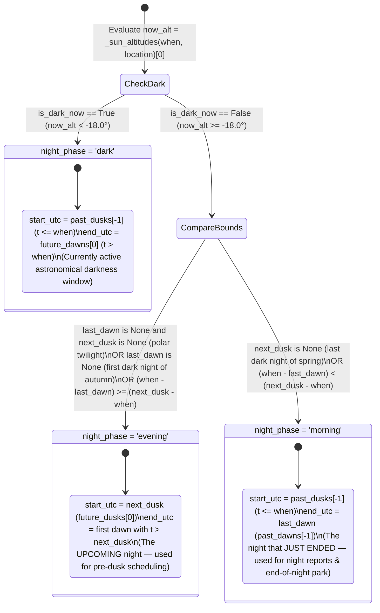
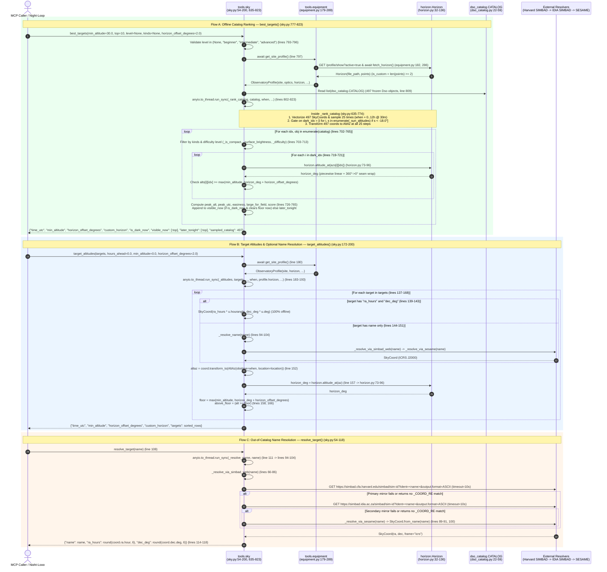
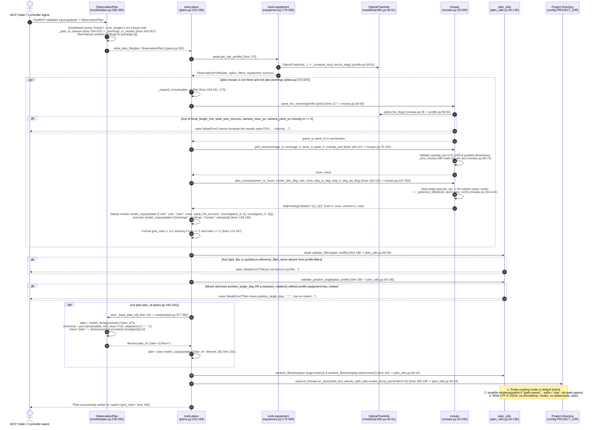

# Execution Flow: Sky Ephemeris, Horizon-Aware Target Ranking & Observation Plan Authoring

[⬆️ Up to Atlas Index](../README.md) · [⬅️ Entrypoints & Lifecycle](./entrypoints-and-lifecycle.md) · [⬅️ Async, State & Error Model](./async-state-and-error-model.md) · **Related Module Specs:** [`tools/sky.py`](../03-modules/tools/sky.md) · [`tools/plans.py`](../03-modules/tools/plans.md) · [`tools/equipment.py`](../03-modules/tools/equipment.md) · [`core/dso_catalog.py`](../03-modules/core/dso_catalog.md) · [`core/horizon.py`](../03-modules/core/horizon.md) · [`core/mosaic.py`](../03-modules/core/mosaic.md) · [`core/plan_utils.py`](../03-modules/core/plan_utils.md) · [`models/plan.py`](../03-modules/models/plan.md) · [`models/profile.py`](../03-modules/models/profile.md) · [`models/pointing.py`](../03-modules/models/pointing-and-frame.md)

---

## Overview

The sky ephemeris, target-ranking, and plan-authoring subsystem turns the active N.I.N.A. observatory profile (`ObservatoryProfile`) and user intent (`PLAN.md` or interactive prompts) into validated, on-disk `ObservationPlan` JSON files ready for sequence compilation (`load_sequence`).

Three architectural invariants govern these workflows:

1. **Offline-First Ephemeris & Catalog Ranking:** Solar/lunar ephemerides (`sun_times`, `moon_times`), catalog target ranking (`best_targets` over the 497-object `dso_catalog.CATALOG`), and coordinate-supplied altitude checks (`target_altitudes`) execute **100% offline** using `astropy`'s built-in solar-system ephemerides and pre-verified SIMBAD J2000 coordinates. External network calls (`httpx` to SIMBAD web mirrors or `SkyCoord.from_name` to SESAME) occur *only* when resolving an out-of-catalog target name via `resolve_target` or a coordinate-less entry in `target_altitudes`.
2. **Unified N.I.N.A. Horizon & Altitude Floor:** Both target-planning tools (`best_targets`, `target_altitudes`) and compiled N.I.N.A. sequences (`AboveHorizonCondition` via `loop_while_above_horizon` + `AltitudeCondition` via `loop_while_above_altitude`) enforce the exact same azimuth-dependent altitude floor:
   $$\text{floor}(\text{az}) = \max\!\bigl(\text{min\_altitude},\; \text{horizon.altitude\_at}(\text{az}) + \text{horizon\_offset\_degrees}\bigr)$$
   This guarantees `best_targets` never reports a target in `visible_now` (or `target_altitudes` with `above_floor: true`) that a loaded N.I.N.A. sequence would immediately park or terminate on.
3. **Intent-In, Provenance-Out Plan Persistence (`write_plan_file`):** Callers supply either explicit `pointings` or a declarative `mosaic` footprint (`center_ra_hours`, `center_dec_deg`, `coverage_width_arcmins`, `coverage_height_arcmins`, `overlap_pct`, `pa_deg`). `write_plan_file` expands the mosaic against the active profile's optical train (`pane_fov_arcmins` $\rightarrow$ ceiling `grid_size` $\rightarrow$ spherical-offset `plan_mosaic`), validates all filter names and rotator position angles before touching disk, stamps the `mosaic` provenance (`cols`, `rows`, `pane_fov_arcmins`) and deterministic `plan_id` (`plan-<sha1_hex12>`), and persists the JSON via an atomic sibling `.tmp` file + `os.replace`.

---

## Workflow 1: Solar & Lunar Ephemeris (`sun_times` & `moon_times`)

### 1.1 End-to-End Call Chain

1. **MCP Tool Entrypoints (`nina_planner/tools/sky.py:837-862`):**
   - `sun_times()` (`sky.py:837-846`) and `moon_times()` (`sky.py:849-862`) are `@mcp.tool()` async coroutines taking zero arguments.
2. **Site Location & Reference Clock Resolution (`_site_location_and_now`, `sky.py:826-834`):**
   - Both tools `await _site_location_and_now()` (`sky.py:845, 861`).
   - `_site_location_and_now()` calls `await equipment_tools.get_site_profile()` (`tools/equipment.py:179-289`), which issues `GET /profile/show?active=true` (`equipment.py:182`) and `await fetch_horizon(...)` (`GET /profile/horizon`, `equipment.py:286`, `horizon.py:123-136`) to build `ObservatoryProfile`.
   - Extracts `site = profile.site` (`SiteLocationInfo`, `models/profile.py:22-27`) and returns `(EarthLocation(lat=site.latitude_deg * u.deg, lon=site.longitude_deg * u.deg, height=site.elevation_m * u.m), Time(datetime.now(timezone.utc)))` (`sky.py:829-834`).
3. **Worker-Thread Offload (`anyio.to_thread.run_sync`):**
   - `sun_times()` dispatches `await anyio.to_thread.run_sync(_sun_events, when, location)` (`sky.py:846`).
   - `moon_times()` dispatches `await anyio.to_thread.run_sync(_moon_events, when, location)` (`sky.py:862`).
4. **Solar Ephemeris Engine (`_sun_events`, `sky.py:314-421`):**
   - Calls `_sun_altitudes(times, location)` (`sky.py:294-296`) $\rightarrow$ `_body_altitudes(get_sun(times), times, location)` (`sky.py:281-291`) across an 865-point 5-minute grid (`[-24h, +48h]`) and once at `when` (`sky.py:363`).
   - Linearly interpolates threshold crossings via `_interp_time(times, alts, i, threshold)` (`sky.py:308-311`), evaluates the `night_phase` state machine (`"dark"`, `"morning"`, `"evening"`), pairs the `darkness` window (`start_utc`, `end_utc`), and formats `site` via `_site_dict(location)` (`sky.py:299-305`).
5. **Lunar Ephemeris Engine (`_moon_events`, `sky.py:568-632`):**
   - Evaluates geocentric ecliptic elongation across a 1,537-point 1-hour grid (`[-32d, +32d]`) via `_elongation_series(ptimes)` (`sky.py:483-502`), maps target phase angles (`0°`, `90°`, `180°`, `270°`) via `_next_angle` (`sky.py:505-511`) and `_prev_angle` (`sky.py:514-516`), and locates phase instants via binary search + linear interpolation in `_crossing_time` (`sky.py:519-532`).
   - Evaluates topocentric lunar altitudes across a 577-point 5-minute grid (`[0h, +48h]`) via `_moon_altitudes(htimes, location)` (`sky.py:478-480`) $\rightarrow$ `_body_altitudes(get_body("moon", times, location), times, location)`, interpolating `moonrise` and `moonset` across `_MOON_HORIZON_ALT = -0.833°` via `_interp_time` (`sky.py:598-604`).
   - Computes instantaneous topocentric position (`moon_up_now`, `altitude_deg`, `azimuth_deg`, `distance_km`) at `when` (`sky.py:606-622`) and phase metadata via `_phase_from_elongation(base)` (`sky.py:535-565`).

### 1.2 Sequence Diagram: `sun_times()` & `moon_times()`

```mermaid
sequenceDiagram
    autonumber
    actor Caller as MCP Caller / Night-Loop
    participant Sky as tools.sky<br/>(sky.py:826-862)
    participant Eq as tools.equipment<br/>(equipment.py:179-289)
    participant HorizonMod as horizon<br/>(horizon.py:103-136)
    participant Client as client<br/>(client.py:118-134)
    participant NINA as N.I.N.A. REST API<br/>(/v2/api)
    participant Worker as anyio Worker Thread<br/>(sky.py:281-632)

    rect rgb(235, 245, 255)
        Note over Caller,NINA: Shared Step 1: Resolve Active Site Location & UTC Clock (_site_location_and_now, sky.py:826-834)
        Caller->>Sky: sun_times() (line 838) OR moon_times() (line 850)
        Sky->>Sky: await _site_location_and_now() (lines 845, 861)
        Sky->>Eq: await get_site_profile() (line 828 -> equipment.py:179)
        Eq->>Client: await api_get("/profile/show?active=true") (equipment.py:182)
        Client->>NINA: GET /v2/api/profile/show?active=true
        NINA-->>Client: {"Success": true, "Response": {...}}
        Client-->>Eq: raw profile dict
        Eq->>HorizonMod: await fetch_horizon(HorizonFilePath) (equipment.py:286 -> horizon.py:123)
        HorizonMod->>Client: await api_get("/profile/horizon") (horizon.py:132)
        Client->>NINA: GET /v2/api/profile/horizon
        NINA-->>Client: {"Success": true, "Response": {"Azimuths": [...], "Altitudes": [...]}}
        HorizonMod->>HorizonMod: parse_horizon(payload, file_path) (horizon.py:103-120)
        HorizonMod-->>Eq: Horizon(file_path, points)
        Eq-->>Sky: ObservatoryProfile(site=SiteLocationInfo(latitude_deg, longitude_deg, elevation_m), ...)
        Sky-->>Sky: location = EarthLocation(lat, lon, height), when = Time(datetime.now(timezone.utc)) (lines 829-834)
    end

    alt Branch A: sun_times() -> _sun_events(when, location) (sky.py:314-421)
        Sky->>Worker: anyio.to_thread.run_sync(_sun_events, when, location) (line 846)
        Worker->>Worker: Build 865-sample 5-min grid: times = when + [-24h .. +48h] (lines 328-329)
        Worker->>Worker: _sun_altitudes(times, location) -> _body_altitudes(get_sun(times), times, location) (lines 281-296, 330)
        Worker->>Worker: Scan i in 0..863 across 4 _SUN_CROSSINGS (-0.833°, -6°, -12°, -18°)<br/>Interpolate dusk/dawn crossings via _interp_time(times, alts, i, threshold) (lines 308-311, 333-345)
        Worker->>Worker: Pick first dusk (t > when) & first dawn (t > when) per threshold -> events (lines 349-357)
        Worker->>Worker: now_alt = _sun_altitudes(when, location)[0]; is_dark_now = (now_alt < -18.0) (lines 363-364)
        Worker->>Worker: Classify night_phase ("dark" | "morning" | "evening") & pair darkness {start_utc, end_utc} (lines 365-407)
        Worker->>Worker: _site_dict(location) (lines 299-305, 411)
        Worker-->>Sky: {"time_utc": str, "site": dict, "is_dark_now": bool, "night_phase": str, "events": dict, "darkness": dict}
        Sky-->>Caller: Return sun_times dict (lines 409-421)

    else Branch B: moon_times() -> _moon_events(when, location) (sky.py:568-632)
        Sky->>Worker: anyio.to_thread.run_sync(_moon_events, when, location) (line 862)
        Worker->>Worker: Build 1,537-sample 1h grid: ptimes = when + [-32d .. +32d], mid = 768 (lines 581-583)
        Worker->>Worker: elong = _elongation_series(ptimes); base = float(elong[mid]) (lines 483-502, 584-585)
        Worker->>Worker: Locate next new_moon (0°), first_quarter (90°), full_moon (180°), last_quarter (270°)<br/>via _crossing_time(ptimes, elong, _next_angle(base, target)) (lines 505-532, 587-589)
        Worker->>Worker: Locate previous_new via _crossing_time(ptimes, elong, _prev_angle(base, 0.0)) (lines 514-516, 590)
        Worker->>Worker: Build 577-sample 5-min grid: htimes = when + [0h .. +48h] (lines 593-594)
        Worker->>Worker: alts = _moon_altitudes(htimes, location) -> _body_altitudes(get_body("moon", htimes, location), ...) (lines 478-480, 595)
        Worker->>Worker: Scan i in 0..575 for first rise/set across _MOON_HORIZON_ALT (-0.833°) via _interp_time (lines 596-604)
        Worker->>Worker: Instantaneous topocentric Moon at when: get_body("moon", when, location) -> AltAz (lines 606-607)
        Worker->>Worker: phase = _phase_from_elongation(base) + age_days (lines 535-565, 608-612)
        Worker->>Worker: _site_dict(location) (lines 299-305, 616)
        Worker-->>Sky: {"time_utc": str, "site": dict, "moon_up_now": bool, "altitude_deg": float, "azimuth_deg": float, "distance_km": int, "phase": dict, "events": dict}
        Sky-->>Caller: Return moon_times dict (lines 614-632)
    end
```

### 1.3 Deep Dive: Solar Grid, `night_phase` State Machine & Paired `darkness` Window

#### 5-Minute Solar Altitude Grid (`-24h` to `+48h`, `sky.py:265-357`)
- **Sampling Window:** `_sun_events` constructs an 865-point time vector (`n_samples = int((24.0 + 48.0) * 60 / 5) + 1 = 865`) spanning `when - 24h` (`_SUN_BACKFILL_H = 24.0`) to `when + 48h` (`_SUN_FORWARD_H = 48.0`) at `_SUN_STEP_MIN = 5` minute intervals (`sky.py:276-278, 328-329`).
- **Why `-24h` Backfill and `+48h` Lookahead:**
  - The **24-hour backfill** ensures that if `sun_times()` is called near the end of an active night (just before dawn) or in `"morning"` right after astronomical dawn, the sampler captures the `astronomical_dusk` that opened that night (`past_dusks[-1]`, `sky.py:369, 393`).
  - The **48-hour forward lookahead** guarantees capturing both the next occurrence (`t > when`) of every twilight threshold and, when called during daytime/evening (`night_phase == "evening"`), both the upcoming `next_dusk` (`start_utc`) and the `astronomical_dawn` that closes that upcoming night (`end_utc`, `sky.py:399-407`).
- **Refraction-Absorbed Geometric Thresholds (`_SUN_CROSSINGS`, `sky.py:266-271`):**
  `_body_altitudes` (`sky.py:281-291`) transforms `get_sun(times)` into `AltAz(obstime=times, location=location)` with Astropy's default pressure of `0` (pure geometric altitude, no atmospheric refraction). Standard refraction (`~34'`) plus solar semidiameter (`~16'`) are absorbed directly into the sunrise/sunset threshold:

  | Threshold (`deg`) | Downward Crossing (`alts[i] >= T > alts[i+1]`) | Upward Crossing (`alts[i] < T <= alts[i+1]`) | Physical Meaning |
  |---:|---|---|---|
  | `-0.833` | `"sunset"` | `"sunrise"` | Upper solar limb on horizon (refraction + semidiameter) |
  | `-6.0` | `"civil_dusk"` | `"civil_dawn"` | Civil twilight boundary |
  | `-12.0` | `"nautical_dusk"` | `"nautical_dawn"` | Nautical twilight boundary |
  | `-18.0` (`_DARKNESS_SUN_ALT`) | `"astronomical_dusk"` | `"astronomical_dawn"` | Astronomical darkness boundary (shared with `_rank_catalog`) |

- **Linear Crossing Interpolation (`_interp_time`, `sky.py:308-311`):**
  Whenever adjacent samples bracket a threshold (`alts[i] >= threshold > alts[i + 1]` for `"dusk"`, or `alts[i] < threshold <= alts[i + 1]` for `"dawn"`), `_interp_time` computes:
  $$\text{frac} = \frac{\text{threshold} - \text{alts}[i]}{\text{alts}[i+1] - \text{alts}[i]}, \quad t_{\text{cross}} = t_i + \text{frac} \cdot (t_{i+1} - t_i)$$
  For each threshold in `_SUN_CROSSINGS`, `events[down_name]` and `events[up_name]` record the first crossing strictly after `when` (`t > when`, `sky.py:352-357`), or `None` if no crossing occurs in the 48-hour forward window (polar day/night).

#### `night_phase` State Machine & Paired `darkness` Window (`sky.py:363-407`)
`_sun_events` evaluates the instantaneous solar altitude at `when` (`now_alt = _sun_altitudes(when, location)[0]`, `is_dark_now = now_alt < -18.0`, `sky.py:363-364`) and partitions all `astronomical_dusk` / `astronomical_dawn` crossings (`astro = crosses["astronomical_dusk"]`) into `past_dawns` (`t <= when`) and `future_dusks` (`t > when`).



- **Why `darkness` is Paired with `night_phase`:** A naive implementation that simply returned `{start_utc: next_dusk, end_utc: next_dawn}` during daytime would return a mismatched pair (`next_dusk` tonight paired with `next_dawn` tomorrow morning, or in the morning, `next_dusk` tonight paired with `next_dawn` tomorrow while the controller is writing a report for the night that just finished). Instead, `_sun_events` guarantees `darkness` always represents a coherent single night (`start_utc < end_utc`):
  1. **`night_phase == "dark"` (`sky.py:368-373`):** `start_utc` is the most recent astronomical dusk (`past_dusks[-1]`), and `end_utc` is the upcoming astronomical dawn (`future_dawns[0]`).
  2. **`night_phase == "morning"` (`sky.py:383-384, 387-388, 391-395`):** `when` is closer to `last_dawn` than to `next_dusk` (or `next_dusk` is `None` entering polar summer). The night is over: `start_utc` is `past_dusks[-1]` and `end_utc` is `last_dawn`—documenting the completed night for `report_<YYYY-MM-DD>.md`.
  3. **`night_phase == "evening"` (`sky.py:381-382, 385-386, 389-390, 396-407`):** `when` is closer to `next_dusk` than `last_dawn` (or both are `None` in continuous polar twilight, avoiding a false end-of-night trigger). `start_utc` is `next_dusk` and `end_utc` is the first astronomical dawn strictly after `next_dusk` (`t > next_dusk`).

### 1.4 Deep Dive: Lunar Topocentric Horizon (`-0.833°`) & Unwrapped Geocentric Ecliptic Elongation (`_elongation_series`)

`_moon_events` (`sky.py:568-632`) deliberately separates **topocentric** observer geometry from **geocentric** synodic phase geometry:

1. **Unwrapped Geocentric Ecliptic Elongation (`_elongation_series`, `sky.py:483-502`):**
   - Samples `samples = int((32.0 + 32.0) * 24 / 1.0) + 1 = 1537` hourly instants spanning `when - 32d` (`_PHASE_BACK_D = 32.0`) to `when + 32d` (`_PHASE_FORWARD_D = 32.0`), with `when` sitting at exact midpoint index `mid = 768` (`sky.py:581-583`).
   - Transforms geocentric `get_body("moon", times)` and `get_sun(times)` into `GeocentricTrueEcliptic(obstime=times)` and computes wrapped longitude difference:
     $$\Delta\lambda = (\lambda_{\text{moon}} - \lambda_{\text{sun}}) \bmod 360.0^\circ \in [0^\circ, 360^\circ)$$
   - Converts $\Delta\lambda$ to radians, removes $360^\circ$ wraparound discontinuities via `np.unwrap(radians)`, and converts back to degrees (`sky.py:501-502`).
   - Because the Moon advances relative to the Sun by $\sim 12.2^\circ/\text{day}$ ($\sim 0.51^\circ/\text{hour}$) and never moves retrograde in ecliptic longitude, the unwrapped `elong` array is **strictly monotonically increasing**.
   - **Binary Search Phase Location (`_next_angle`, `_prev_angle`, `_crossing_time`, `sky.py:505-532, 585-590`):**
     - Taking `base = float(elong[mid])` as the unwrapped elongation at `when`, `_next_angle(base, target)` (`sky.py:505-511`) computes the smallest angle strictly `> base` congruent to `target` modulo `360°` for each `(name, target)` in `_PHASE_EVENT_ANGLES` (`("new_moon", 0.0)`, `("first_quarter", 90.0)`, `("full_moon", 180.0)`, `("last_quarter", 270.0)`).
     - `_prev_angle(base, 0.0)` (`sky.py:514-516`) computes the largest multiple of `360°` at or before `base` (`<= base`) to find `previous_new`, from which lunar age is derived as `age_days = (when - previous_new) / u.day` (`sky.py:608`).
     - `_crossing_time(ptimes, elong, want)` (`sky.py:519-532`) runs `np.searchsorted(values, want)` in $O(\log N)$ time and linearly interpolates between `ptimes[idx - 1]` and `ptimes[idx]`, achieving sub-minute phase timing accuracy across the $\pm 32\text{d}$ window.
   - **Illumination & Phase Banding (`_phase_from_elongation`, `sky.py:535-565`):**
     - Wraps `wrapped = float(elongation_deg) % 360.0`, computes illuminated fraction $k = \frac{1 - \cos(\text{radians}(\text{wrapped}))}{2}$, sets `waxing = 0.0 < wrapped < 180.0`, and classifies `name` using `_PHASE_NEW_MAX = 0.03` (`< 0.03` $\rightarrow$ `"new"`), `_PHASE_FULL_MIN = 0.97` (`> 0.97` $\rightarrow$ `"full"`), and `_PHASE_QUARTER_BAND = 0.03` (`|k - 0.5| <= 0.03` $\rightarrow$ `"first_quarter"` / `"last_quarter"`, else crescent/gibbous).
     - Applies `% 360.0` *after* rounding (`round(wrapped, 3) % 360.0`, `sky.py:564`) so an elongation like `359.9999°` just before new moon wraps to `0.0` rather than reporting `360.0`.
2. **Topocentric Lunar Rise/Set & Position (`_MOON_HORIZON_ALT = -0.833°`, `sky.py:438-445, 478-480, 593-622`):**
   - Unlike the Sun, the Moon has $\sim 1^\circ$ of horizontal parallax across Earth's radius. `_moon_altitudes(htimes, location)` passes `location` directly into `get_body("moon", times, location)` (`sky.py:480`), yielding topocentric coordinates for the observer's site before transforming to `AltAz`.
   - Samples `n_horizon = int(48.0 * 60 / 5) + 1 = 577` instants over `[when, when + 48h]` (`_MOON_FORWARD_H = 48.0`, `_MOON_STEP_MIN = 5`, `sky.py:593-595`). Because one lunar day is $\sim 24\text{h }50\text{m}$, a 48-hour window always contains the next `moonrise` and `moonset` unless the site is in polar lunar day/night.
   - Uses `_MOON_HORIZON_ALT = -0.833°` (`-(refraction + semidiameter)`) for both `rise` (`alts[i] < -0.833 <= alts[i+1]`), `set_` (`alts[i] >= -0.833 > alts[i+1]`), and instantaneous `moon_up_now = bool(float(altaz.alt.deg) > _MOON_HORIZON_ALT)` (`sky.py:599-602, 617`), guaranteeing `moon_up_now` never contradicts `moonrise`/`moonset`.

---

## Workflow 2: Horizon-Aware Target Ranking & Name Resolution (`best_targets`, `target_altitudes`, `resolve_target`)

### 2.1 End-to-End Call Chain

1. **`best_targets` (`nina_planner/tools/sky.py:777-823`):**
   - Validates `level in (None, "beginner", "intermediate", "advanced")` (`sky.py:793-796`) *before* making any HTTP call.
   - Calls `profile = await equipment_tools.get_site_profile()` (`sky.py:797` $\rightarrow$ `tools/equipment.py:179-289`), reading `site = profile.site`, `fov = profile.optics.field_of_view_deg` (`models/profile.py:56, 86-91`), and `profile.horizon` (`horizon.py:32-96`).
   - Offloads `_rank_catalog(list(dso_catalog.CATALOG), when, site.latitude_deg, site.longitude_deg, site.elevation_m, min_altitude, fov, level, kinds, top, profile.horizon, horizon_offset_degrees)` to a worker thread via `anyio.to_thread.run_sync` (`sky.py:802-823`).
   - Inside `_rank_catalog` (`sky.py:635-774`):
     - Vectorizes all 497 catalog objects (`dso_catalog.CATALOG`, `dso_catalog.py:59`) into a single `SkyCoord` array (`sky.py:666-669`).
     - Samples `samples = 25` instants (`when` through `when + 12h` in 30-minute steps, `sky.py:674-675`) and checks astronomical darkness at each step via `dark = [s < -18.0 for s in _sun_altitudes(times, location)]` (`sky.py:676`). If `not any(dark)`, returns early with `is_dark_now: False, visible_now: [], later_tonight: []` (`sky.py:677-686`).
     - Transforms the vectorized catalog coordinates into `AltAz` across all 25 sample times (`sky.py:689-695`).
     - For each `Dso`, filters by `kinds` (`sky.py:703-704`), computes `_is_compact` (`sky.py:240-241`), `_surface_brightness` (`sky.py:224-237`), and `_difficulty` (`sky.py:244-251`), and filters by `level` (`sky.py:712-713`).
     - Evaluates `_floor(az) = max(min_altitude, horizon.altitude_at(az) + horizon_offset_degrees)` (`sky.py:697-698`, `horizon.py:73-96`) at every dark sample `i in dark_idx` (`sky.py:719-721`). Objects that never clear `_floor(azs[i][idx])` during darkness are excluded (`sky.py:722-723`).
     - Computes `peak_alt, peak_i = max(clearing, key=lambda p: p[0])` (`sky.py:726`), `_easiness(metric, compact)` (`sky.py:254-257`), and `large_for_field = (obj.major_arcmin / 60.0 > max(fov_deg))` when `fov_deg is not None and not compact` else `False` (`sky.py:729-732`).
     - Partitions qualifying rows into `visible_now` (when `is_dark_now and alt_now >= _floor(azs[0][idx])`, scored on `alt_now`) or `later_tonight` (scored on `peak_alt`), sorts both descending by `score`, and truncates to `[:top]` (`sky.py:754-774`).
2. **`target_altitudes` (`nina_planner/tools/sky.py:172-200`):**
   - Calls `profile = await equipment_tools.get_site_profile()` (`sky.py:180`), computes `when = Time(datetime.now(timezone.utc)) + hours_ahead * u.hour` (`sky.py:182`), and dispatches `_altitudes(...)` via `anyio.to_thread.run_sync` (`sky.py:183-193`).
   - Inside `_altitudes` (`sky.py:121-169`), for each target dict:
     - If both `ra_hours` and `dec_deg` are provided (`sky.py:139`), constructs `SkyCoord` directly offline (`sky.py:140-143`).
     - Otherwise, resolves `name` over the network via `_resolve_name(name)` (`sky.py:146` $\rightarrow$ `sky.py:94-104`).
     - Transforms `coord` to `AltAz(obstime=when, location=location)` (`sky.py:152-154`), evaluates `horizon_deg = horizon.altitude_at(az)` and `floor = max(min_altitude, horizon_deg + horizon_offset_degrees)` (`sky.py:157-158`), and returns rows sorted descending by `alt_deg` (`sky.py:169`).
3. **`resolve_target` (`nina_planner/tools/sky.py:107-118`):**
   - Offloads `_resolve_name(name)` (`sky.py:94-104`) to a worker thread via `anyio.to_thread.run_sync` (`sky.py:111`), which queries `_resolve_via_simbad_web(name)` (`sky.py:66-86` $\rightarrow$ `_fetch_simbad` `sky.py:54-63`) across Harvard and IDIA SIMBAD mirrors and falls back to `_resolve_via_sesame(name)` (`sky.py:89-91` $\rightarrow$ `SkyCoord.from_name(name)`).

### 2.2 Sequence Diagram: `best_targets`, `target_altitudes` & `resolve_target`



### 2.3 Unified Horizon Interpolation (`GET /profile/horizon` $\rightarrow$ `Horizon` $\rightarrow$ Sequence Loop Conditions)

N.I.N.A. stores a site's custom skyline in a `.hrz` file (`AstrometrySettings.HorizonFilePath`) and serves its parsed arrays on `GET /profile/horizon` as `{"Azimuths": [...], "Altitudes": [...]}`. `nina_planner` unifies planning and execution around this skyline through three components:

1. **Best-Effort Ingestion & Normalization (`horizon.py:38-60, 103-136`):**
   - `get_site_profile()` (`tools/equipment.py:286`) awaits `fetch_horizon(str(astrometry.get("HorizonFilePath") or ""))` (`horizon.py:123-136`).
   - If `GET /profile/horizon` fails or returns a non-dict/missing-list payload, `fetch_horizon` / `parse_horizon` logs `"fetch_horizon: flat horizon (...)"` and returns a flat `Horizon(file_path=file_path, points=[])` (`is_custom == False`, `altitude_at(az) == 0.0`) so profile loading never fails on account of the horizon endpoint.
   - When valid arrays are returned, `Horizon._sort_and_wrap` (`@field_validator("points", mode="before")`, `horizon.py:38-60`) filters out non-finite values (`math.isfinite`), wraps every azimuth into $[0.0, 360.0)$ via `az_f % 360.0` (collapsing a closing $360^\circ$ knot onto $0^\circ$ with last-entry-wins), and sorts the deduplicated `(azimuth_deg, altitude_deg)` tuples ascending by azimuth.
2. **Piecewise Linear Interpolation Across the $360^\circ \rightarrow 0^\circ$ North Seam (`Horizon.altitude_at`, `horizon.py:73-96`):**
   - If `len(self.points) < 2` (`is_custom == False`), `altitude_at(az_deg)` immediately returns `0.0` (`horizon.py:82-83`).
   - Otherwise, normalizes `az = az_deg % 360.0` (`horizon.py:84`) and scans interior segments `pts[i] .. pts[i+1]` where `a0 <= az <= a1` (`horizon.py:85-90`), returning `_clamp(h0 + (h1 - h0) * (az - a0) / (a1 - a0))` clamped to `[-90.0, 90.0]`.
   - If `az` falls in the north wraparound gap (`az > pts[-1][0]` or `az < pts[0][0]`), `altitude_at` bridges the seam from `a0, h0 = pts[-1]` to `a1, h1 = pts[0][0] + 360.0, pts[0][1]` using `az_u = az if az >= a0 else az + 360.0` (`horizon.py:93-96`).
3. **Agreement Between Planning Tools and Sequence Loop Conditions:**
   - When `load_sequence` compiles a `light` sequence step (`sequence/targets.py:293-355`, `sequence/builders.py:389-423`), it emits both `WaitUntilAboveHorizon` / `AboveHorizonCondition` (`wait_until_above_horizon` / `loop_while_above_horizon`, parameterized by `plan.constraints.horizon_offset_degrees`, default `2.0°`) and `WaitForAltitude` / `AltitudeCondition` (`wait_until_above_altitude` / `loop_while_above_altitude`, parameterized by `plan.constraints.min_altitude`, default `30.0°`).
   - Both `_altitudes` (`sky.py:157-158`) and `_rank_catalog` (`sky.py:697-698, 720, 754`) evaluate the exact conjunction of those two conditions at the target's instantaneous azimuth `az`:
     $$\text{floor}(\text{az}) = \max\!\bigl(\text{min\_altitude},\; \text{horizon.altitude\_at}(\text{az}) + \text{horizon\_offset\_degrees}\bigr)$$
   - In `_rank_catalog`, each of the 25 half-hour samples is tested against the custom horizon **at that sample's own azimuth** (`_floor(azs[i][idx])`, `sky.py:720`), ensuring an object whose meridian transit sits behind a tall tree or building is never reported as `visible_now` or credited with an obstructed `peak_alt_deg`.

### 2.4 Offline `dso_catalog.CATALOG` vs. Multi-Tier Online Failover (`resolve_target`)

| Aspect | Offline Built-In Catalog (`dso_catalog.CATALOG`) | Online Name Resolution (`resolve_target` / `_resolve_name`) |
|---|---|---|
| **Source Code** | `nina_planner/dso_catalog.py:22-59` + `dso_catalog.csv` | `nina_planner/tools/sky.py:34-118` |
| **Coverage** | **497 objects** (211 `"galaxy"`, 151 `"open"`, 60 `"globular"`, 45 `"pn"`, 26 `"bn"`, 2 `"snr"`, 2 `"cloud"`): all Messier objects (except M40 and M73) plus bright NGC/IC/Caldwell showpieces across northern and southern skies. | Arbitrary SIMBAD/SESAME astronomical identifiers outside `dso_catalog.csv` (e.g., Sharpless, Barnard, LDN, LBN, Arp, or obscure NGC/IC targets in `PLAN.md`). |
| **Coordinate Authority** | Every row's J2000 `ra_hours` and `dec_deg` was pre-verified against SIMBAD and frozen into `tuple[Dso, ...]` at import time (`_load_catalog()`, `dso_catalog.py:41-59`). | Parsed live from SIMBAD's ASCII `sim-id` response via `_COORD_RE` (`^Coordinates\(ICRS,ep=J2000[^)]*\):\s*(\d{1,2}(?:\s+\d{1,2})+(?:\.\d+)?)\s+([+-]\d{1,2}(?:\s+\d{1,2})+(?:\.\d+)?)`, `sky.py:45-51`) or Astropy SESAME. |
| **Network Dependency** | **Zero network I/O.** `best_targets` and coordinate-supplied `target_altitudes` work when the observatory has no internet connectivity. | Requires internet access; fails over across three endpoints in order:<br/>1. **CfA Harvard SIMBAD** (`https://simbad.cfa.harvard.edu/simbad/sim-id`, `timeout=10.0s`)<br/>2. **IDIA South Africa SIMBAD** (`https://simbad.idia.ac.za/simbad/sim-id`, `timeout=10.0s`)<br/>3. **Astropy SESAME** (`SkyCoord.from_name(name)` $\rightarrow$ CDS Strasbourg / Harvard SESAME, `sky.py:89-91, 99-100`). |
| **Failure Mode** | Fail-fast at module import if `dso_catalog.csv` is malformed; runtime lookups are $O(1)$ in-memory reads. | If a SIMBAD mirror returns HTTP 200 with a `!!` unknown-identifier page, `_COORD_RE.search(...)` returns `None` and records `"<base>: no ICRS coordinates for '<name>'"` (`sky.py:81-83`). If both SIMBAD mirrors and SESAME fail, raises `ValueError("could not resolve target '<name>': SIMBAD mirrors failed (...); SESAME failed (...)")` (`sky.py:102-104, 113`). |

---

## Workflow 3: Observation Plan Authoring & Mosaic Grid Expansion (`write_plan_file`)

### 3.1 End-to-End Call Chain

1. **Pydantic Input Validation (`ObservationPlan`, `nina_planner/models/plan.py:238-375`):**
   - When `tools.plans.write_plan_file(plan: ObservationPlan)` (`tools/plans.py:164-199`) is invoked via FastMCP, Pydantic validates the input against `ObservationPlan` (`StrictModel` with `extra="forbid"`, `models/strict.py:6-16`).
   - All four exposure lists (`light_frames`, `flat_frames`, `dark_frames`, `bias_frames`) must have `min_length=1` (`models/plan.py:312-341`).
   - `ObservationPlan._plan_id_charset` (`@field_validator("plan_id")`, `models/plan.py:359-375`) verifies `plan_id` is either `""` or matches `_PLAN_ID_ALLOWED` (`[A-Za-z0-9.-]+`).
   - `ObservationPlan._pointings_or_mosaic` (`@model_validator(mode="after")`, `models/plan.py:343-357`) verifies that either `self.pointings` is non-empty or `self.mosaic` (`MosaicConfig`, `models/plan.py:155-235`) is provided. If the caller omitted `"pointings"` when supplying `"mosaic"`, `Field(default_factory=list)` normalizes `self.pointings` to `[]` (`models/plan.py:264-265`).
2. **Active Profile Fetch (`tools/plans.py:170`):**
   - `write_plan_file` awaits `profile = await equipment_tools.get_site_profile()` (`tools/equipment.py:179-289`), obtaining live `profile.optics` (`OpticalTrainInfo`), `profile.filters` (`list[FilterInfo]`), and `profile.equipment` (`EquipmentConfig`).
3. **Conditional Mosaic Grid Expansion (`_expand_mosaic`, `tools/plans.py:103-161, 172-187`):**
   - If `plan.mosaic is not None and not plan.pointings` (`tools/plans.py:172`), `write_plan_file` calls `plan, grid = _expand_mosaic(plan, profile)` (`tools/plans.py:173`):
     1. **`mosaic.pane_fov_arcmins(profile.optics)` (`mosaic.py:29-55`):** Calls `optics.fov_deg()` (`models/profile.py:58-84`), which computes $2 \cdot \operatorname{atan2}(\text{sensor\_mm} / 2, f_{\text{mm}})$ in degrees along X and Y. If any of `focal_length_mm`, `pixel_size_microns`, `camera_xsize_px`, or `camera_ysize_px` is missing or $\le 0$, `pane_fov_arcmins` raises a `ValueError` naming every missing parameter (`mosaic.py:40-54`). Otherwise returns `(fov[0] * 60.0, fov[1] * 60.0)` in arcminutes.
     2. **`mosaic.grid_size(...)` (`mosaic.py:75-101`):** Validates `0.0 < overlap_pct < 100.0`, positive pane FOV, and positive coverage dimensions, then calls `_axis_count` (`mosaic.py:58-72`) independently for width (`cols`) and height (`rows`):
        $$n = \begin{cases} 1 & \text{if } \text{coverage} \le \text{pane\_fov} \\ \left\lceil \dfrac{\text{coverage} - \text{pane\_fov}}{\text{pane\_fov} \cdot (1 - \text{overlap\_pct}/100)} \right\rceil + 1 & \text{otherwise} \end{cases}$$
     3. **`mosaic.plan_mosaic(...)` (`mosaic.py:147-200`):** Converts center steps to degrees (`step_w_deg = (pane_w / 60.0) * overlap_fraction`, `step_h_deg = (pane_h / 60.0) * overlap_fraction`, `tools/plans.py:125-129`). Iterates row-major (`r` in `0..rows-1` north-to-south, `c` in `0..cols-1` west-to-east), rotates the tangent-plane grid offset `(dx, dy)` by `pa_deg` (`mosaic.py:182-187`), projects `(east, north)` onto the celestial sphere via `_spherical_offset(ra0, dec0, east, north)` (`R_z(ra0) · R_y(-dec0)` 3D unit-vector rotation, `mosaic.py:104-144`), and returns `cols * rows` `Pointing` objects labeled `"r{r+1}_c{c+1}"` (`mosaic.py:190-200`).
     4. **Provenance Stamping (`tools/plans.py:139-146`):** Copies `plan.mosaic` with `cols=cols`, `rows=rows`, and `pane_fov_arcmins=(round(pane_w, 3), round(pane_h, 3))` (`stamped`), and copies `plan` with `pointings=pointings, mosaic=stamped` (`expanded`).
     5. **1×1 Grid Warning (`tools/plans.py:174-187`):** Formats `grid_note` summarizing the grid dimensions, pane FOV, step size, and achieved vs. requested coverage; if `cols == 1 and rows == 1`, appends a warning prompting the caller to verify coverage units (arcminutes vs. degrees).
4. **Pre-Write Hardware & Filter Validation (`tools/plans.py:188-189`):**
   - `await plan_utils.validate_filters(plan, profile)` (`plan_utils.py:65-90`) checks that every `filter_name` in `plan.light_frames`, `plan.flat_frames`, and `plan.autofocus.reference_filter_name` exists in `{f.name for f in profile.filters}`.
   - `plan_utils.validate_position_angle(plan, profile)` (`plan_utils.py:93-136`) enforces all-or-none consistency of `position_angle_deg` across `plan.pointings` and checks that if any pointing has `p.requests_rotation() == True` (`position_angle_deg` neither `None` nor `0`, `models/pointing.py:78-90`), `profile.equipment.has_rotator` is `True`.
5. **Deterministic `plan_id` Stamping (`tools/plans.py:190-191` $\rightarrow$ `models/plan.py:377-382`):**
   - If `not plan.plan_id`, updates `plan = plan.model_copy(update={"plan_id": plan._base_plan_id()})`.
6. **Filename Generation & Atomic Disk Persistence (`tools/plans.py:192-199` $\rightarrow$ `plan_utils.py:30-62`):**
   - Formats host-local timestamp `YYYYMMDDTHHMMSS` (`tools/plans.py:192`) and builds `filename = f"{plan_utils.sanitize_filename(plan.target.lower())}_{plan_utils.sanitize_filename(plan.intent.lower())}_{timestamp}.json".replace(" ", "-")` (`tools/plans.py:193-195`).
   - Offloads `plan_utils.write_text_atomic(path, plan.model_dump_json(indent=2))` to a worker thread via `anyio.to_thread.run_sync` (`tools/plans.py:196-198`) and returns `"Plan successfully written to <path><grid_note>"` (`tools/plans.py:199`).

### 3.2 Sequence Diagram: `write_plan_file(plan)`



### 3.3 Deterministic Content Hashing (`_base_plan_id`), `pointings: []` Normalization & Provenance Stamping

The interaction between `ObservationPlan` validation, `_expand_mosaic`, and `_base_plan_id()` (`models/plan.py:377-382`) guarantees deterministic plan identity across both in-memory construction and on-disk persistence:

1. **`pointings: []` Default Normalization Before Hashing (`models/plan.py:264-274, 377-382`):**
   - `ObservationPlan.pointings` is declared as `pointings: list[Pointing] = Field(default_factory=list)` (`models/plan.py:264-265`).
   - When a caller constructs an unexpanded mosaic `ObservationPlan` in memory, omitting the `"pointings"` key entirely produces the exact same normalized attribute (`self.pointings == []`) as explicitly passing `"pointings": []`.
   - Consequently, `self.model_dump(exclude={"plan_id"})` (`models/plan.py:380`) serializes `"pointings": []` in both cases, so `json.dumps(data, sort_keys=True, separators=(",", ":"))` and `hashlib.sha1(canonical.encode()).hexdigest()[:12]` produce an identical `"plan-<12hex>"` digest regardless of whether `"pointings": []` was spelled out or omitted (`tests/test_plan.py:398-413`).
2. **Order of Operations in `write_plan_file`: Expand & Stamp Provenance First, Then Hash & Stamp `plan_id` (`tools/plans.py:172-191`):**
   - In `write_plan_file`, `_expand_mosaic(plan, profile)` executes at line `173` **before** `plan._base_plan_id()` is called at line `191`.
   - `_expand_mosaic` (`tools/plans.py:139-146`) produces an updated `ObservationPlan` where:
     - `plan.pointings` contains the expanded `cols * rows` `Pointing` objects (`r1_c1`, `r1_c2`, ...).
     - `plan.mosaic` has its three provenance fields stamped: `cols`, `rows`, and `pane_fov_arcmins=(round(pane_w, 3), round(pane_h, 3))`.
   - Next, after `validate_filters` (`line 188`) and `validate_position_angle` (`line 189`) succeed, lines `190-191` check `if not plan.plan_id:`:
     ```python
     if not plan.plan_id:
         plan = plan.model_copy(update={"plan_id": plan._base_plan_id()})
     ```
   - At this point, `plan._base_plan_id()` hashes the **fully expanded** plan (including the expanded `pointings` and the stamped `mosaic` provenance `cols`, `rows`, and `pane_fov_arcmins`) and writes that derived `"plan-<12hex>"` string into the top-level `"plan_id"` field of the saved JSON file.
3. **Post-Write Stability & Authority of `pointings` (`models/plan.py:378-379`, `plan_utils.py:275-286`):**
   - Because `write_plan_file` stamps `"plan_id"` directly into the JSON file on disk, every subsequent read via `plan_utils.load_plan` sees a non-empty `self.plan_id` and returns it immediately at `if self.plan_id: return self.plan_id` (`models/plan.py:378-379`). Even if a user later edits exposure counts, `calibration_window_days`, or `quality` thresholds in the JSON file, the stamped `plan_id` remains frozen so already-captured FITS frames (`_plan-<12hex>_` or `_plan-<12hex>-<pane>_`) never lose attribution.
   - Furthermore, even if `"plan_id"` were cleared from the written file (or inspected by `nina-pin-id` on a legacy unpinned file), the on-disk JSON already contains the expanded `pointings` and stamped `mosaic` provenance, so `model_dump(exclude={"plan_id"})` hashes the exact same on-disk structure every time.
   - On read, `plan_utils.load_plan` (`plan_utils.py:281-286`) enforces the **on-disk pointing invariant**: `if not plan.pointings: raise ValueError(...)`. A persisted plan file's `pointings` list is always the sole runtime authority for `load_sequence`, `get_plan_progress`, and `audit_plans`, while `plan.mosaic` (`cols`, `rows`, `pane_fov_arcmins`) serves as immutable audit provenance of how that grid was derived.

---

## Cross-Cutting Summary Table

| Tool / Helper | Module & Lines | Primary Inputs | External / Disk I/O | Key Output / Guarantee |
|---|---|---|---|---|
| `sun_times()` $\rightarrow$ `_sun_events()` | `tools/sky.py:837-846` $\rightarrow$ `314-421` | Active site `EarthLocation`, UTC `Time` | `GET /profile/show?active=true`, `GET /profile/horizon` | 5-min grid (`-24h..+48h`), 8 twilight crossings, `is_dark_now` (`< -18°`), `night_phase` (`dark`/`morning`/`evening`), paired `darkness` window. |
| `moon_times()` $\rightarrow$ `_moon_events()` | `tools/sky.py:849-862` $\rightarrow$ `568-632` | Active site `EarthLocation`, UTC `Time` | `GET /profile/show?active=true`, `GET /profile/horizon` | Unwrapped geocentric elongation (`±32d` @ `1h`) via `_elongation_series`, topocentric rise/set (`+48h` @ `5m`, `-0.833°`), `phase` (`illumination_fraction`, `age_days`). |
| `best_targets()` $\rightarrow$ `_rank_catalog()` | `tools/sky.py:777-823` $\rightarrow$ `635-774` | `min_altitude`, `top`, `level`, `kinds`, `horizon_offset_degrees` | `GET /profile/show?active=true`, `GET /profile/horizon` (zero internet) | Ranks 497 SIMBAD-verified `dso_catalog.CATALOG` objects over 12h (`25` steps) within astro darkness (`< -18°`) clearing `max(min_altitude, horizon(az) + offset)`. |
| `target_altitudes()` $\rightarrow$ `_altitudes()` | `tools/sky.py:172-200` $\rightarrow$ `121-169` | `targets`, `hours_ahead`, `min_altitude`, `horizon_offset_degrees` | `get_site_profile()`; SIMBAD/SESAME only if target omits `ra_hours`/`dec_deg` | Per-target `alt_deg`, `az_deg`, `horizon_deg`, `clearance_deg`, and `above_floor` sorted highest-first. |
| `resolve_target()` $\rightarrow$ `_resolve_name()` | `tools/sky.py:107-118` $\rightarrow$ `54-104` | Out-of-catalog `name: str` | Harvard SIMBAD $\rightarrow$ IDIA SIMBAD $\rightarrow$ Astropy SESAME | J2000 `{"name", "ra_hours", "dec_deg"}` rounded to 6 decimal places. |
| `write_plan_file()` $\rightarrow$ `_expand_mosaic()` | `tools/plans.py:164-199` $\rightarrow$ `103-161` | `plan: ObservationPlan` | `get_site_profile()`, atomic write via `plan_utils.write_text_atomic` | Expands `mosaic` (`pane_fov_arcmins` $\rightarrow$ `grid_size` $\rightarrow$ `plan_mosaic`), validates filters & rotator PA, stamps `mosaic` provenance + `plan_id`, writes JSON atomically. |
