# CLI Lifecycle Engines (`nina-archive`, `nina-purge`, `nina-pin-id`)

[⬆️ Up to Atlas Index](../../README.md) · [➡️ `archive.py`](./archive.md) · [➡️ `purge.py`](./purge.md) · [➡️ `pin_id.py`](./pin_id.md) · [🔗 `progress.py`](../core/progress.md) · [🔗 `imaging.py`](../core/imaging.md) · [🔗 `plan_utils.py`](../core/plan_utils.md) · [🔗 `tools/plans.py`](../tools/plans.md)

---

## 1. Package Overview

The `nina_planner` package exposes three standalone command-line tools alongside the `nina-planner` MCP server (`pyproject.toml:58-63`). Together, they govern the offline **pin → archive → verify → quarantine → purge** lifecycle of observation plans and captured FITS/XISF frames on the observatory filesystem:

| CLI Binary | Entrypoint Callable | Source Module | Lines | Core Responsibility |
|---|---|---|---:|---|
| **`nina-archive`** | `nina_planner.archive:main` | `.opencode/local/mcps/nina_planner/nina_planner/archive.py` | 1,204 | Copies completed observation plans (light frames, pooled calibration frames, diverted junk frames, joined `WeatherData.csv` + `ImageMetaData.csv` sidecars, verbatim `plan.json`, and `manifest.json` v2) into a portable destination directory (`--dest`, default `./.archive`). |
| **`nina-purge`** | `nina_planner.purge:main` | `.opencode/local/mcps/nina_planner/nina_planner/purge.py` | 1,091 | Retires archived frames and finished plan files from the N.I.N.A. imaging root in two human-gated stages: `--apply` moves released frame directories into `<imaging-root>/.quarantine/`, and `--purge` permanently deletes quarantined directories and unlinks the original project `plan.json` files. |
| **`nina-pin-id`** | `nina_planner.pin_id:main` | `.opencode/local/mcps/nina_planner/nina_planner/pin_id.py` | 166 | Freezes a plan's content-derived hash ID (`plan-<hex12>`) into its explicit `plan_id` JSON field before the user edits the plan, ensuring frames already captured under `_{plan_id}_` continue to attribute to the edited plan. |

---

## 2. End-to-End Lifecycle Architecture

```mermaid
flowchart TD
    subgraph Phase0["0. Pre-Edit Identity Preservation (Optional)"]
        P0["Plan JSON with blank plan_id<br/>(derives volatile plan-&lt;hex12&gt;)"] -->|nina-pin-id PLAN.json| P1["Atomic rewrite via write_text_atomic<br/>Stamps explicit plan_id before edits"]
    end

    subgraph Phase1["1. Acquisition & Attribution"]
        NINA["N.I.N.A. Sequencer + Session Metadata Plugin"] -->|"Writes FITS + ImageMetaData.csv + WeatherData.csv"| ROOT["Imaging Root<br/>(&lt;imaging-root&gt;/&lt;target-or-date-dir&gt;/)"]
        P1 -.->|"Provides _{plan_id}_ token"| NINA
    end

    subgraph Phase2["2. Portable Archival (nina-archive)"]
        ROOT -->|"read_imaging_csv(report_dropped=True)<br/>+ read_weather_rows()"| ARCH["nina-archive"]
        ARCH -->|"Atomically builds .&lt;folder&gt;.partial<br/>then renames to &lt;dest&gt;/&lt;stem&gt;__&lt;plan-id&gt;/"| DEST["Archive Destination (--dest, default ./.archive)<br/>├── plan.json (verbatim)<br/>├── manifest.json (v2)<br/>├── lights/  flats/  darks/  biases/<br/>├── junk/ (degenerate + uncredited)<br/>└── archive-index.jsonl"]
    end

    subgraph Phase3["3. Cloud Transfer & Human Verification"]
        DEST -->|"Operator uploads to cloud storage<br/>& verifies workstation download"| VERIFIED["Verified Off-Site Backup"]
    end

    subgraph Phase4["4. Two-Step Retirement (nina-purge)"]
        VERIFIED -.->|"Receipts in &lt;dest&gt;/*/manifest.json"| PURGE_REPORT["nina-purge (Dry-Run Verdict Table)"]
        PURGE_REPORT -->|"nina-purge --apply<br/>(Requires N.I.N.A. sequence idle)"| QUAR["Quarantine (&lt;imaging-root&gt;/.quarantine/&lt;dir&gt;)<br/>Hidden from _walk_visible / audit_plans<br/>Logged in purge-index.jsonl"]
        QUAR -->|"nina-purge --purge<br/>(Re-verifies 3 plan-file gates)"| DELETED["Unlinks .quarantine/&lt;dir&gt;<br/>Unlinks project plan.json last<br/>Appends purge & plan-file records"]
    end
```



---

## 3. Shared Cross-Module Invariants

The three CLI modules and `tools/plans.py` (`audit_plans`, `get_plan_progress`) are tightly coupled by six shared invariants:

### 3.1 Attribution & Token Stability (`_{plan_id}_`)
- A plan with an empty `plan_id` derives a deterministic 12-hex-character ID (`plan-<hex12>`) via `ObservationPlan._base_plan_id()` (`models/plan.py:377-382`) by hashing the plan JSON minus `plan_id`.
- N.I.N.A. embeds `_{plan_id}_` (or pane-suffixed `_{plan_id}-<N>_`) into every captured light frame path.
- Editing any field of an unpinned plan changes its derived hash, severing attribution for already-captured frames. Running `nina-pin-id` before editing stamps the derived hash into `plan_id` (`pin_id.py:74-83`), making it immutable across subsequent edits.
- Both `nina-archive` and `nina-purge` call `archive._select_frames` (`archive.py:347-384`), which delegates to `progress.filter_metadata_rows` (`progress.py:409-475`). Light selection is token-only (all frames carrying the plan's token, regardless of filter/exposure or surplus count), whereas calibration frames (`FLAT`, `DARK`, `BIAS`) are pooled across the imaging root by type+filter, type+exposure, or type alone within `plan.calibration_window_days` of each pointing's session start.

### 3.2 Completeness Verdict & `--all` Waiver
- `archive._progress_facts` (`archive.py:306-344`, imported directly by `purge.py:102`) evaluates plan completeness using `progress.plan_progress` and `progress.progress_verdict` (`progress.py:663-687`) across all pointings (`1..len(plan.pointings)`).
- It checks `acquired_count` vs `total_count` and calibration window state—**never** `remaining_count` (which `plan_progress` zeroes when a calibration window expires).
- By default, `nina-archive` refuses incomplete plans (`archive.py:1043-1052`). Passing `--all` overrides this gate and records `"complete": false` in `manifest.json` (`archive.py:781`).
- At purge time, `nina-purge` recomputes `_progress_facts` against live rows (`purge.py:916`): a plan releases its claims if and only if its archive gates pass **and** either it is still complete on disk now **or** its `manifest.json` carries the explicit `"complete": false` (`--all`) waiver (`purge.py:915-918`).

### 3.3 The `junk/` Diversion Invariant & `manifest.json` v2
- `nina-archive` enforces the invariant that **every live own-token CSV row lands in `manifest.files[]`** (`archive.py:48-51`).
- Degenerate captures (e.g., 0.00003s `Smart Exposure` darks/lights identified by `progress.is_junk_row`) are stripped from normal type selection by `_without_degenerate` (`archive.py:387-403`).
- After computing the union of selected frames across **all** loaded plans (`shipped` in Pass 2, `archive.py:1026-1038`), `_divert_frames` (`archive.py:406-441`) collects every remaining live CSV row carrying this plan's base ID token (`path_has_id(path, base_id)`) that no plan selected into a type folder, classifying each as `"degenerate"` or `"uncredited"`.
- These diverted frames are copied into `<dest>/<folder>/junk/` (`_FOLDER_NAMES["JUNK"]`) and recorded in `manifest.json` (schema `"version": 2`, `archive.py:773`) under both `files[]` (`"type": "JUNK"`, `"frame_type": ...`, `"reason": ...`) and `disk.junk`.
- Because `nina-purge` builds its `preserved` set from the union of all `manifest.files[].source` paths (`purge.py:293-295`), diverted `junk/` frames automatically read as `preserved(F) = True` and never block a landing directory from being quarantined.

### 3.4 Siril-Compatible Folder Naming vs. N.I.N.A. Manifest Types
- On disk inside each archive folder (`<dest>/<stem>__<plan-id>/`), frame subdirectories use lowercase plural names (`lights/`, `flats/`, `darks/`, `biases/`, plus `junk/`), defined in `_FOLDER_NAMES` (`archive.py:106-112`), satisfying Siril's case-sensitive preprocessing scripts (`OSC_Preprocessing.ssf`) while remaining compatible with header-driven stackers (PixInsight WBPP, Astro Pixel Processor, DeepSkyStacker).
- Inside `manifest.json`, frame types remain uppercase (`"LIGHT"`, `"FLAT"`, `"DARK"`, `"BIAS"`, `"JUNK"`) to match N.I.N.A.'s `ImageType` verbatim.

### 3.5 Destination Containment & Atomic Directory Swap
- Both `nina-archive` (`archive.py:971-979`) and `nina-purge` (`purge.py:782-792`) refuse to run if `--dest` resolves inside `--imaging-root` (`_inside(dest, imaging_root)`), because archived `ImageMetaData.csv` sidecars inside the imaging root would be discovered by `read_imaging_csv` on subsequent passes and double-count every archived frame.
- Both tools also filter out any plan files inside `--dest` during project directory discovery (`not _inside(p, dest)` at `archive.py:959` and `purge.py:823`).
- `_folder_name` (`archive.py:166-194`) and `_dest_child` (`archive.py:197-215`) guard against `"."` or `".."` plan IDs so `dest / folder` can never resolve to `dest` itself or above it before `shutil.rmtree`.
- `_archive_one` builds each archive in `<dest>/.<folder>.partial`, moves any existing `<dest>/<folder>` aside to `<dest>/.<folder>.replaced`, renames staging into `<dest>/<folder>`, and removes `.replaced` (`archive.py:798-810`). `_recover_replaced` (`archive.py:218-238`) reconciles interrupted swaps on the next run, and `purge._read_manifests` ignores dot-prefixed directories (`folder.name.startswith(".")`, `purge.py:273`) so half-built staging folders never release frames.

### 3.6 Two-Phase Quarantine (`.quarantine/`) & Three Plan-File Gates
- `nina-purge` never deletes frames from the live imaging root in one step:
  1. **Dry-run (default):** Prints the per-directory `PRUNE` / `HOLD` verdict table and previews plan-file removals.
  2. **`--apply` (Quarantine):** Moves prunable top-level directories into `<imaging-root>/.quarantine/<dir>` (appending `~1`, `~2` on name collision, `purge.py:437-441`). Because `imaging._prunable_dir` skips dot-directories (`.quarantine`), quarantined frames immediately disappear from `read_imaging_csv`, `get_plan_progress`, and `audit_plans`, while remaining recoverable with a single `mv`.
  3. **`--purge` (Permanent Delete):** Evaluates `_quarantine_gates` (`purge.py:534-609`) against `purge-index.jsonl` claimants, unlinks released directories inside `.quarantine/`, removes the empty `.quarantine/` container, and finally runs `_sweep_plan_files` (`purge.py:612-698`) to unlink each purged plan's original JSON file once all of its selected frames are confirmed gone from both the imaging root and `.quarantine/`.
- Before any frame or plan file is released or deleted, `_plan_file_gate` (`purge.py:174-219`) enforces three gates:
  - **Gate 1 (`archive_ok`):** `<dest>/<stem>__<plan-id>/plan.json` must exist as a file.
  - **Gate 2 (`not stale`):** `<dest>/<stem>__<plan-id>/plan.json` must be **byte-identical** (`plan_file.read_bytes() == archived.read_bytes()`) to the live project plan file. If edited after archiving, `stale=True` refuses the entire plan ID (`archive is stale, re-run nina-archive --force first`).
  - **Gate 3 (`not _inside(plan_file, dest)`):** The plan file itself must not reside inside `--dest`.

---

## 4. On-Disk Artifacts & Schema Reference

### 4.1 `<dest>/<stem>__<plan-id>/manifest.json` (v2)
Written by `archive._archive_one` (`archive.py:765-793`) and read by `purge._read_manifests` (`purge.py:250-296`):

```json
{
  "tool": "nina-archive",
  "version": 2,
  "archived_at": "2026-10-03T12:00:00+00:00",
  "plan_file": "/abs/path/to/plans/m15.json",
  "plan_id": "plan-0123456789ab",
  "target": "M 15",
  "intent": "full",
  "pointing_count": 1,
  "imaging_root": "/abs/path/to/N.I.N.A",
  "complete": true,
  "counts": {
    "light": { "expected": 20, "acquired": 20, "archived": 20 },
    "flat":  { "expected": 15, "acquired": 15, "archived": 15 },
    "dark":  { "expected": 10, "acquired": 10, "archived": 10 },
    "bias":  { "expected": 20, "acquired": 20, "archived": 20 }
  },
  "files": [
    {
      "type": "LIGHT",
      "path": "lights/frame_0001.fits.fz",
      "source": "/abs/path/to/N.I.N.A/2026-10-02/frame_0001.fits.fz",
      "bytes": 16777216
    },
    {
      "type": "JUNK",
      "path": "junk/dark_smart_exp.fits.fz",
      "source": "/abs/path/to/N.I.N.A/2026-10-02/dark_smart_exp.fits.fz",
      "bytes": 16777216,
      "frame_type": "DARK",
      "reason": "degenerate"
    }
  ],
  "file_count": 66,
  "total_bytes": 1107296256,
  "missing": [],
  "disk": {
    "rejected": [{ "type": "LIGHT", "source": "/abs/.../f.fits", "found": "BAD_f.fits" }],
    "gone": [],
    "not_selected": [],
    "junk": [{ "type": "DARK", "source": "/abs/.../dark_smart_exp.fits.fz", "reason": "degenerate" }]
  },
  "warnings": []
}
```

### 4.2 `<dest>/archive-index.jsonl`
Appended by `archive._archive_one` (`archive.py:820-835`), one JSON line per committed archive folder:
- Keys: `archived_at`, `plan_id`, `plan_file`, `folder`, `target`, `complete`, `counts`, `file_count`, `junk`, `total_bytes`, `missing` (count), `disk` (`{rejected, gone, not_selected, junk}` integer counts).

### 4.3 `<imaging-root>/purge-index.jsonl`
Appended by `purge._append_index` (`purge.py:137-139`) across three action types:
1. **`"action": "quarantine"`** (`purge.py:449-460`): `{ "at", "action": "quarantine", "dir", "quarantine", "frames", "rejects", "unrecorded", "bytes", "claimants": [<plan_id>, ...] }`. Read back by `_quarantine_gates` (`purge.py:558-568`) during `--purge` to map quarantined directory names to claiming `plan_id`s.
2. **`"action": "purge"`** (`purge.py:514-523`): `{ "at", "action": "purge", "removed", "files", "bytes" }`.
3. **`"action": "plan-file"`** (`purge.py:642-652`): `{ "at", "action": "plan-file", "plan_id", "plan_file", "folder", "plan_file_deleted": bool, "reason"?: str }`.

---

## 5. Module Documentation Index

1. **[`archive.py` — `nina-archive` Specification](./archive.md)**
   Complete specification of `ArchiveError` and all 20 functions (`_human_bytes`, `_sha256`, `_inside`, `_looks_like_plan_file`, `_folder_name`, `_dest_child`, `_recover_replaced`, `_merge_weather`, `_write_image_metadata_csv`, `_progress_facts`, `_select_frames`, `_without_degenerate`, `_divert_frames`, `disk_report`, `_copy_file`, `_archive_one`, `_build_parser`, `_resolve_root`, `run`, `main`).
2. **[`purge.py` — `nina-purge` Specification](./purge.md)**
   Complete specification of `PurgeError` and all 18 functions (`_now`, `_norm`, `_append_index`, `_tree_size`, `_unrecorded_count`, `_unique_join`, `_plan_file_gate`, `_resolve_root`, `_idle_state`, `_read_manifests`, `_classify`, `_quarantine`, `_purge_quarantine`, `_quarantine_gates`, `_sweep_plan_files`, `_build_parser`, `run`, `main`).
3. **[`pin_id.py` — `nina-pin-id` Specification](./pin_id.md)**
   Complete specification of `PinError` and all 5 functions (`_resolve`, `pin_plan_file`, `_build_parser`, `run`, `main`).
