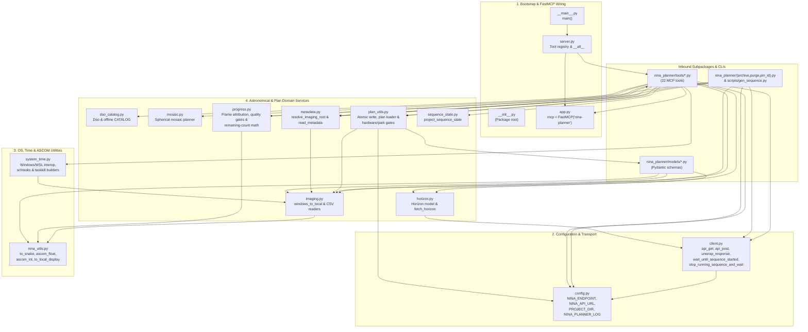

# Core & Root Domain Modules (`nina_planner`)

[⬆️ Up to Atlas Index](../../README.md) · [⬅️ File & Symbol Manifest](../../00-inventory/file-and-symbol-manifest.md) · [⬅️ MCP Surface Catalog](../../00-inventory/mcp-surface-catalog.md) · [➡️ Bootstrap & Server](./bootstrap-and-server.md)

---

## 1. Package Overview

The root `nina_planner` package (`.opencode/local/mcps/nina_planner/nina_planner/`) forms the foundational kernel and shared domain layer of the **nina-planner** MCP server and its companion CLI utilities (`nina-planner`, `nina-archive`, `nina-pin-id`, `nina-purge`).

Unlike the higher-level MCP endpoint handlers in [`nina_planner/tools/`](../tools/README.md), the Pydantic schema layer in [`nina_planner/models/`](../models/README.md), or the N.I.N.A. Sequence AST compiler in [`nina_planner/sequence/`](../sequence/README.md), the root package modules provide:

1. **Server Bootstrap & FastMCP Registry (`__init__.py`, `__main__.py`, `app.py`, `server.py`):** Instantiates the singleton `FastMCP("nina-planner")` server, embeds the authoritative safety/park/lifecycle/progress instructions contract sent to every connected MCP client during `initialize`, registers all 22 `@mcp.tool()` endpoints via module-import side effects, and starts the stdio JSON-RPC event loop.
2. **Environment & Path Configuration (`config.py`):** Resolves import-time settings (`NINA_ENDPOINT`, `NINA_API_URL`, sequence API paths, `NINA_PLANNER_LOG`, and `PROJECT_DIR`).
3. **Async HTTP Transport & Sequencer Synchronization (`client.py`):** Wraps `httpx.AsyncClient` against `http://<NINA_ENDPOINT>/v2/api` with `10.0s` per-request timeouts, unwraps N.I.N.A.'s `{Success, Error, Response}` envelope while preserving N.I.N.A.'s refusal diagnostics, writes best-effort debug payloads to `NINA_PLANNER_LOG`, and implements deterministic polling barriers for sequence stop (`stop_running_sequence_and_wait`) and start (`wait_until_sequence_started`).
4. **ASCOM & Cross-OS Normalization (`nina_utils.py`, `system_time.py`):** Coerces ASCOM sentinel values (`NaN`, `"NaN"`, `"N/A"`, `.NET DateTime.MinValue`), converts PascalCase keys to `snake_case`, formats timestamps in host-local ISO-8601 (`±HH:MM`), and manages Windows/WSL process interop (`taskkill.exe`, `schtasks.exe`, `cmd.exe`) for launching and stopping `NINA.exe` inside the interactive desktop session.
5. **Astronomical & Geometric Engines (`horizon.py`, `dso_catalog.py`, `mosaic.py`):** Evaluates custom azimuth/altitude horizon profiles, loads the offline SIMBAD-verified 497-object Messier/bright-NGC catalog (`dso_catalog.csv`), and computes spherical gnomonic tangent-plane mosaic grids.
6. **Plan Validation, Metadata I/O & Progress Accounting (`plan_utils.py`, `metadata.py`, `imaging.py`, `progress.py`, `sequence_state.py`):** Enforces hardware capability and safety gates (`require_parkable`, `require_light_capabilities`), resolves Windows-to-POSIX imaging paths (`NINA_DRIVE_MOUNT`), parses `ImageMetaData.csv` and `WeatherData.csv` on worker threads, attributes captured frames to plans and pointings (`plan_progress`, `plan_with_remaining`), and projects raw `/sequence/json` trees into compact execution summaries (`project_sequence_state`).

---

## 2. Architectural Topology & Module Dependency Graph

---

## 3. Core Module Specifications Index (`docs/03-modules/core/*.md`)

Every module in the root `nina_planner/` package (excluding the CLI engines documented under [`docs/03-modules/cli/`](../cli/archive.md)) is specified in detail across the following module documents:

| Specification Document | Covered Source File(s) | Lines | Primary Symbols & Responsibilities |
|---|---|---:|---|
| **[`bootstrap-and-server.md`](./bootstrap-and-server.md)** | `nina_planner/__init__.py` `nina_planner/__main__.py` `nina_planner/app.py` `nina_planner/server.py` | 1 12 21 61 | `main()`, `mcp` (`FastMCP` instance and client instructions contract), 22 tool registrations, and `__all__` export surface. |
| **[`config.md`](./config.md)** | `nina_planner/config.py` | 19 | `NINA_ENDPOINT`, `NINA_API_URL`, `SEQUENCE_START_PATH`, `SEQUENCE_STATE_PATH`, `SEQUENCE_JSON_PATH`, `NINA_PLANNER_LOG`, `PROJECT_DIR`. |
| **[`client.md`](./client.md)** | `nina_planner/client.py` | 281 | `_log_file`, `log_payload`, `_error_detail`, `unwrap_response`, `api_get`, `api_post`, `_sequence_running`, `_sequence_is_running`, `stop_running_sequence_and_wait`, `SEQUENCE_START_TIMEOUT`, `_node_statuses`, `wait_until_sequence_started`, `load_sequence_payload`, `api_probe`, `nina_api_responsive`, `run_blocking`. |
| **[`nina_utils.md`](./nina_utils.md)** | `nina_planner/nina_utils.py` | 123 | `to_snake`, `_missing_string`, `ascom_float`, `ascom_int`, `ascom_datetime`, `to_local_display`. |
| **[`system_time.md`](./system_time.md)** | `nina_planner/system_time.py` | 174 | `nina_exe_path`, `kill_nina_command`, `_is_wsl`, `windows_interop_available`, `get_launcher_paths`, `_batch_quoted`, `write_nina_launcher`, `schtasks_create_command`, `schtasks_run_command`, `schtasks_delete_command`. |
| **[`horizon.md`](./horizon.md)** | `nina_planner/horizon.py` | 136 | `Horizon` (`_sort_and_wrap`, `is_custom`, `altitude_at`), `_clamp`, `parse_horizon`, `fetch_horizon`. |
| **[`dso_catalog.md`](./dso_catalog.md)** | `nina_planner/dso_catalog.py` | 59 | `Dso` frozen dataclass, `_load_catalog`, `CATALOG` (497 pre-verified objects from `dso_catalog.csv`). |
| **[`mosaic.md`](./mosaic.md)** | `nina_planner/mosaic.py` | 200 | `pane_fov_arcmins`, `_axis_count`, `grid_size`, `_spherical_offset`, `plan_mosaic`. |
| **[`plan_utils.md`](./plan_utils.md)** | `nina_planner/plan_utils.py` | 309 | `write_text_atomic`, `sanitize_filename`, `validate_filters`, `validate_position_angle`, `check_pointing_index`, `require_parkable`, `require_light_capabilities`, `resolve_plan_dir`, `plan_files`, `load_plan`, `quality_kwargs`. |
| **[`metadata.md`](./metadata.md)** | `nina_planner/metadata.py` | 66 | `resolve_imaging_root`, `resolve_cli_root`, `read_metadata`. |
| **[`imaging.md`](./imaging.md)** | `nina_planner/imaging.py` | 222 | `_prunable_dir`, `_walk_visible`, `visible_rglob`, `windows_to_local`, `read_weather_rows`, `_read_csv`, `_resolve_image_path`, `_resolve_existing_file`, `_require_root`, `read_imaging_csv`. |
| **[`progress.md`](./progress.md)** | `nina_planner/progress.py` | 728 | `_path_components`, `path_has_id`, `_exposure_matches`, `is_junk_row`, `_light_target_matches`, `_quality_accepted`, `_exposure_instant`, `_session_start`, `_within_age`, `_row_matches`, `frame_group_constraints`, `_select_matching`, `filter_metadata_rows`, `plan_progress`, `group_verdict`, `progress_verdict`, `plan_with_remaining`. |
| **[`sequence_state.md`](./sequence_state.md)** | `nina_planner/sequence_state.py` | 241 | `_walk`, `_find`, `_target_area`, `_issues`, `_children`, `_counts_exposures`, `_exposure_groups`, `_exposure`, `_horizon`, `project_sequence_state`. |

---

## 4. Cross-Cutting Design Invariants in the Core Layer

1. **Zero Import-Time Network or Hardware I/O:** Importing `nina_planner`, `nina_planner.app`, `nina_planner.server`, `nina_planner.config`, or `nina_planner.client` performs zero network requests and zero subprocess spawns. Only `dso_catalog.py` reads the static package-bundled `dso_catalog.csv` file (`dso_catalog.py:41-59`), and `config.py` reads `os.environ` and `Path.cwd()` (`config.py:10-19`).
2. **Acyclic Tool Registration via `app.py`:** `app.py` holds the `FastMCP` singleton (`mcp`) with zero internal imports, allowing all five `nina_planner/tools/*.py` modules to import `from ..app import mcp` and decorate their functions without creating circular imports with `server.py`.
3. **Strict Stdout Hygiene for MCP Stdio Transport:** Because `mcp.run()` speaks JSON-RPC over process `stdin`/`stdout`, no module in `nina_planner` ever writes debug diagnostics to `stdout` (or `stderr` during normal operation). All diagnostic tracing goes through `client.log_payload()` to the file designated by `config.NINA_PLANNER_LOG`, silently dropping lines when unset or unwritable (`client.py:42-59`).
4. **Refusal Transparency:** `client.unwrap_response()` never relies on `httpx.Response.raise_for_status()`, which discards HTTP error response bodies. Instead, it extracts N.I.N.A.'s `"Error"` string from both non-2xx responses and HTTP 200 `{Success: false}` envelopes so the agent sees the exact domain refusal reason (`client.py:62-115`).
