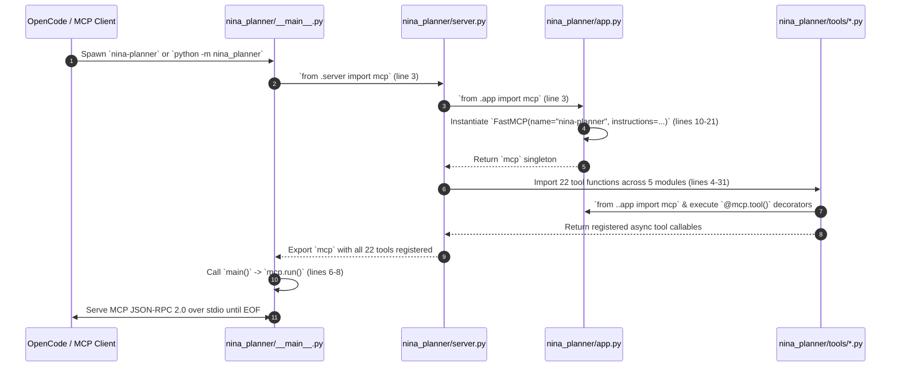

# Bootstrap & FastMCP Server Wiring (`__init__.py`, `__main__.py`, `app.py`, `server.py`)

[⬆️ Up to Atlas Index](../../README.md) · [⬆️ Core Package](./README.md) · [➡️ Configuration (`config.py`)](./config.md) · [➡️ HTTP Client (`client.py`)](./client.md) · [➡️ MCP Tools (`tools/`)](../tools/README.md)

---

## 1. Combined Architectural Overview

The MCP bootstrap layer is split across four small modules totaling **95 lines** of code so that the `FastMCP` application instance, the tool-registration side effects, and the CLI/module entrypoints remain cleanly separated and free of circular imports:

| Module Path | Lines | Architectural Role |
|---|---:|---|
| `.opencode/local/mcps/nina_planner/nina_planner/__init__.py` | 1 | Package marker and docstring (`"""MCP server package for planning and running N.I.N.A. observatory sessions."""`). |
| `.opencode/local/mcps/nina_planner/nina_planner/app.py` | 21 | Instantiates the singleton `mcp = FastMCP(name="nina-planner", instructions=...)` carrying the system-wide safety, park/home, lifecycle, and `PROGRESS.md` contract sent to every MCP client during handshake. |
| `.opencode/local/mcps/nina_planner/nina_planner/server.py` | 61 | Imports `mcp` from `.app` and imports all 22 `@mcp.tool()` functions from `.tools.{equipment,lifecycle,plans,sequence,sky}`, binding them to `mcp` and re-exporting them in `__all__`. Also supports direct execution (`python -m nina_planner.server`). |
| `.opencode/local/mcps/nina_planner/nina_planner/__main__.py` | 12 | Package execution entrypoint (`python -m nina_planner` and the `nina-planner` console script in `pyproject.toml:59`). Imports `mcp` from `.server` and invokes `mcp.run()`. |

### Bootstrap & Registration Sequence



---

## 2. Module 1: `nina_planner/__init__.py`

### Module Overview
- **File Path:** `.opencode/local/mcps/nina_planner/nina_planner/__init__.py`
- **Line Count:** 1 line (`1`)
- **Module Docstring (`line 1`):** `"""MCP server package for planning and running N.I.N.A. observatory sessions."""`
- **Architectural Layer:** Package Root Marker
- **Inbound Callers:** Implicitly executed whenever `nina_planner` or any submodule (`nina_planner.*`) is imported by Python.
- **Outbound Imports:** None (stdlib: none, third-party: none, internal: none).
- **Module-Level Constants:** None.
- **Environment Variables Read at Import Time:** None.
- **Global Caches / Singletons:** None.

### Classes, Data Models & Exceptions
None.

### Function & Method Reference
None (`__init__.py` intentionally avoids importing `server` or `app` so standalone CLI tools like `nina-archive`, `nina-purge`, and `nina-pin-id` can import `nina_planner.archive`, `nina_planner.purge`, or `nina_planner.pin_id` without pulling in the full MCP toolset unless needed).

---

## 3. Module 2: `nina_planner/app.py`

### Module Overview
- **File Path:** `.opencode/local/mcps/nina_planner/nina_planner/app.py`
- **Line Count:** 21 lines (`1-21`)
- **Module Docstring (`lines 1-6`):**
  > The FastMCP application instance and the server instructions sent to clients.
  >
  > The instructions text is the safety/lifecycle contract every agent session is handed: what `is_safe` gates, when park vs. find-home runs, and how progress is tracked. Editing it changes what every connected client is told.
- **Architectural Layer:** Core Application Singleton & Client Protocol Contract
- **Inbound Callers:**
  - `nina_planner/server.py:3` (`from .app import mcp`)
  - `nina_planner/tools/equipment.py:9` (`from ..app import mcp`)
  - `nina_planner/tools/lifecycle.py:10` (`from ..app import mcp`)
  - `nina_planner/tools/plans.py:14` (`from ..app import mcp`)
  - `nina_planner/tools/sequence.py:7` (`from ..app import mcp`)
  - `nina_planner/tools/sky.py:23` (`from ..app import mcp`)
  - `tests/test_mcp_entrypoint.py:80` (`from nina_planner.app import mcp as server_mcp`)
- **Outbound Imports:**
  - **Stdlib:** None.
  - **Third-Party:** `from mcp.server.fastmcp import FastMCP` (`line 8`)
  - **Internal:** None.
- **Environment Variables Read at Import Time:** None.
- **Global Caches / Singletons:**
  - `mcp: FastMCP` (`lines 10-21`): Singleton `FastMCP` server instance named `"nina-planner"`.

### Module-Level Constants & Singleton Specification (`mcp` at `nina_planner/app.py:10-21`)

`mcp` is initialized at import time with two arguments:
- `name="nina-planner"` (`line 11`)
- `instructions="""..."""` (`lines 12-20`): A 5-paragraph operational contract transmitted in the MCP `InitializeResult.instructions` field to every connecting client:

| Paragraph (`line`) | Domain | Contract Enforced on Connected Agents |
|---|---|---|
| **1 (`line 12`)** | High-Level Sequence Orchestration | Tools inspect equipment, read observatory setup, write observation plans, and load/start N.I.N.A. sequences built from those plans; individual leaf commands inside sequences are N.I.N.A.'s own. |
| **2 (`line 14`)** | Enclosure Safety (`is_safe`) & Dark/Bias Exemption | `safety_monitor.is_safe` indicates whether the roof/dome enclosure is open and safe to unpark and expose. While `is_safe=False`, the scope must remain parked and sky-dependent acquisition (`light`, `dawn`/`dusk` sky `flat`) is gated. Weather conditions are reported separately by the weather device. `dark` and `bias` steps are **not** sky-dependent and are exempt: they may be loaded and started with the enclosure closed because the step parks the mount first, never unparks, and cuts light at the camera (`Dark` filter slot, cover, or shutter). |
| **3 (`line 16`)** | Park vs. Find Home Semantics | `Park Scope` is the only closing maneuver: sequences emit it whenever `can_park=True`, and a mount with `can_park=False` (or no mount) is rejected at load time. `Find Home` (`can_find_home=True`) is never a park fallback; it is emitted once per `light` step ahead of `set_tracking` as a ~30-second physical reference sensor calibration to restore sync after power loss, bump, or driver restart. |
| **4 (`line 18`)** | N.I.N.A. Process Lifecycle | `start_nina()` launches N.I.N.A. into the active interactive desktop session; `stop_nina()` terminates N.I.N.A. immediately. Calling `start_nina` when already running raises an error requiring `stop_nina` first. `get_nina_status()` probes REST-API liveness (`running`), local host lifecycle capability (`lifecycle_control_available`), and a one-line summary without ever raising on a down N.I.N.A. When `lifecycle_control_available=False` (remote MCP server), `start_nina`/`stop_nina` cannot operate on N.I.N.A. |
| **5 (`line 20`)** | Shared Progress Log (`PROGRESS.md`) | Maintain `PROGRESS.md` in the project directory. Read it on session start to restore context; append short ISO-8601 timestamped entries after significant actions (status checks, plan writes, sequence loads/starts/stops, errors, interventions) so history is shared across active and automated worker sessions. |

> **Linting Note (`pyproject.toml:100`):** `"nina_planner/app.py" = ["E501"]` suppresses Ruff line-length warnings so the multi-paragraph `instructions` literal remains unbroken and readable.

### Classes, Data Models & Exceptions
None.

### Function & Method Reference
None.

---

## 4. Module 3: `nina_planner/server.py`

### Module Overview
- **File Path:** `.opencode/local/mcps/nina_planner/nina_planner/server.py`
- **Line Count:** 61 lines (`1-61`)
- **Module Docstring (`line 1`):** `"""MCP entry point: importing the tool modules registers their tools on ``mcp``."""`
- **Architectural Layer:** MCP Tool Registry Facade & Script Entrypoint
- **Inbound Callers:**
  - `nina_planner/__main__.py:3` (`from .server import mcp`)
  - Direct script/module invocation: `python -m nina_planner.server` (`lines 60-61`)
  - Test suites importing tool callables directly from the unified facade (`tests/test_server.py`, `tests/test_fake_nina.py`, `tests/test_live.py`, `tests/test_nina_settings.py`, `tests/test_system_time.py`, `tests/test_mcp_entrypoint.py`).
- **Outbound Imports:**
  - **Stdlib:** None.
  - **Third-Party:** None.
  - **Internal (`lines 3-31`):**
    - `from .app import mcp` (`line 3`)
    - `from .tools.equipment import get_events, get_logs, get_site_equipment_status, get_site_profile` (`lines 4-9`)
    - `from .tools.lifecycle import get_nina_status, start_nina, stop_nina` (`line 10`)
    - `from .tools.plans import audit_plans, get_frame_stats, get_nina_settings, get_plan_progress, list_plans, write_plan_file` (`lines 11-18`)
    - `from .tools.sequence import get_sequence_state, load_sequence, start_sequence, stop_sequence` (`lines 19-24`)
    - `from .tools.sky import best_targets, moon_times, resolve_target, sun_times, target_altitudes` (`lines 25-31`)
- **Module-Level Constants:**
  - `__all__: list[str]` (`lines 33-57`): Alphabetically sorted list of 23 exported symbols (all 22 MCP tool functions plus `"mcp"`).
- **Environment Variables Read at Import Time:** Transitive via `.tools.*` -> `.config` (`NINA_ENDPOINT`, `NINA_PLANNER_LOG`).
- **Global Caches / Singletons:** Re-exports `mcp` from `.app` after all `@mcp.tool()` decorators in `.tools.*` have mutated `mcp`'s internal tool registry.

### Exported Symbol Map (`__all__` at `nina_planner/server.py:33-57`)

| Exported Symbol | Source Module | Import Line in `server.py` | `__all__` Line | Kind |
|---|---|---:|---:|---|
| `audit_plans` | `.tools.plans` | `12` | `34` | `@mcp.tool()` async fn |
| `best_targets` | `.tools.sky` | `26` | `35` | `@mcp.tool()` async fn |
| `get_events` | `.tools.equipment` | `5` | `36` | `@mcp.tool()` async fn |
| `get_frame_stats` | `.tools.plans` | `13` | `37` | `@mcp.tool()` async fn |
| `get_logs` | `.tools.equipment` | `6` | `38` | `@mcp.tool()` async fn |
| `get_nina_settings` | `.tools.plans` | `14` | `39` | `@mcp.tool()` async fn |
| `get_nina_status` | `.tools.lifecycle` | `10` | `40` | `@mcp.tool()` async fn |
| `get_plan_progress` | `.tools.plans` | `15` | `41` | `@mcp.tool()` async fn |
| `get_sequence_state` | `.tools.sequence` | `20` | `42` | `@mcp.tool()` async fn |
| `get_site_equipment_status` | `.tools.equipment` | `7` | `43` | `@mcp.tool()` async fn |
| `get_site_profile` | `.tools.equipment` | `8` | `44` | `@mcp.tool()` async fn |
| `list_plans` | `.tools.plans` | `16` | `45` | `@mcp.tool()` async fn |
| `load_sequence` | `.tools.sequence` | `21` | `46` | `@mcp.tool()` async fn |
| `mcp` | `.app` | `3` | `47` | `FastMCP` instance |
| `moon_times` | `.tools.sky` | `27` | `48` | `@mcp.tool()` async fn |
| `resolve_target` | `.tools.sky` | `28` | `49` | `@mcp.tool()` async fn |
| `start_nina` | `.tools.lifecycle` | `10` | `50` | `@mcp.tool()` async fn |
| `start_sequence` | `.tools.sequence` | `22` | `51` | `@mcp.tool()` async fn |
| `stop_nina` | `.tools.lifecycle` | `10` | `52` | `@mcp.tool()` async fn |
| `stop_sequence` | `.tools.sequence` | `23` | `53` | `@mcp.tool()` async fn |
| `sun_times` | `.tools.sky` | `29` | `54` | `@mcp.tool()` async fn |
| `target_altitudes` | `.tools.sky` | `30` | `55` | `@mcp.tool()` async fn |
| `write_plan_file` | `.tools.plans` | `17` | `56` | `@mcp.tool()` async fn |

### Script Execution Guard (`nina_planner/server.py:60-61`)
```python
if __name__ == "__main__":
    mcp.run()
```
- When executed directly as `python -m nina_planner.server` or `python nina_planner/server.py`, calls `mcp.run()` (defaulting to FastMCP's `"stdio"` transport).
- Tested by `EntryPointWiringTest.test_server_module_runs_the_server_when_executed_directly` in `tests/test_mcp_entrypoint.py:95-99`.

### Classes, Data Models & Exceptions
None.

### Function & Method Reference
None defined directly in `server.py` (all 22 imported tool functions are documented in [`docs/03-modules/tools/`](../tools/README.md)).

---

## 5. Module 4: `nina_planner/__main__.py`

### Module Overview
- **File Path:** `.opencode/local/mcps/nina_planner/nina_planner/__main__.py`
- **Line Count:** 12 lines (`1-12`)
- **Module Docstring (`line 1`):** `"""Run the MCP server in stdio mode (``python -m nina_planner``)."""`
- **Architectural Layer:** CLI & Module Process Entrypoint
- **Inbound Callers:**
  - Python `-m` runner: `python -m nina_planner`
  - Console script wrapper generated from `pyproject.toml:59`: `nina-planner = "nina_planner.__main__:main"`
  - `tests/test_mcp_entrypoint.py:56` (`StdioServerParameters(command=sys.executable, args=["-m", "nina_planner"])`)
  - `tests/test_mcp_entrypoint.py:93` (`runpy.run_module("nina_planner.__main__", run_name="__main__")`)
- **Outbound Imports:**
  - **Stdlib:** None.
  - **Third-Party:** None.
  - **Internal:** `from .server import mcp` (`line 3`)
- **Module-Level Constants:** None.
- **Environment Variables Read at Import Time:** Transitive via `.server` -> `.tools.*` -> `.config`.
- **Global Caches / Singletons:** Uses `mcp` imported from `.server`.

### Classes, Data Models & Exceptions
None.

### Function & Method Reference

#### `main` (`nina_planner/__main__.py:6-8`)

1. **Purpose & Architectural Role**
   Entrypoint callable for the `nina-planner` console script (`pyproject.toml:59`) and `python -m nina_planner` (`__main__.py:11-12`). Starts the `FastMCP` server over standard input/output and blocks until the MCP client closes the stdio pipe.

2. **Signature, Decorators & Inputs**
   ```python
   def main() -> None:
   ```
   - **Decorators:** None.
   - **Inputs:** None.

3. **Outputs & Return Semantics**
   - Returns `None` after `mcp.run()` exits cleanly when the stdio transport disconnects.

4. **Step-by-Step Internal Logic**
   1. **Line 3 (module import):** Imports `mcp` from `.server`, which triggers import of `nina_planner.app` and all five tool modules (`equipment`, `lifecycle`, `plans`, `sequence`, `sky`), registering all 22 tools on `mcp`.
   2. **Line 8:** Calls `mcp.run()` with no arguments, starting the FastMCP stdio JSON-RPC server loop.
   3. **Lines 11-12 (`__main__` guard):** When `__name__ == "__main__"`, invokes `main()`.

5. **Side Effects & I/O**
   - Takes over process `sys.stdin` and `sys.stdout` for MCP JSON-RPC framing.
   - Runs an AnyIO/asyncio event loop inside `FastMCP.run()` for the lifetime of the server process.

6. **Error Handling & Edge Cases**
   - Any unhandled exception during `mcp.run()` or broken stdio pipe terminates the process.
   - If any imported module writes non-JSON-RPC bytes to `stdout`, the MCP stdio handshake corrupts and hangs; `tests/test_mcp_entrypoint.py:48-73` (`EntryPointHandshakeTest`) spawns a real `python -m nina_planner` subprocess and verifies `session.initialize()` and `session.list_tools()` over the MCP SDK's `stdio_client`.

7. **Complexity & Risk Notes**
   - **Time / Space Complexity:** $O(1)$ setup; runs indefinitely for the session duration.
   - **Import-Order Invariant:** Always import `mcp` from `nina_planner.server` (as `__main__.py:3` does) rather than `nina_planner.app` when booting the server; importing only `nina_planner.app.mcp` without importing `nina_planner.server` produces a `FastMCP` server with **0 registered tools**.
