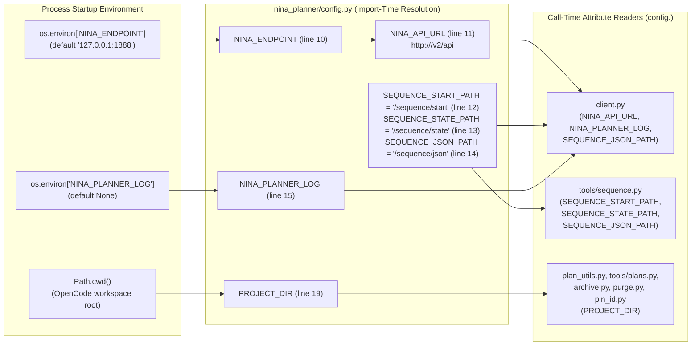

# Environment & Path Configuration (`nina_planner/config.py`)

[⬆️ Up to Atlas Index](../../README.md) · [⬆️ Core Package](./README.md) · [⬅️ Bootstrap & Server](./bootstrap-and-server.md) · [➡️ HTTP Client (`client.py`)](./client.md)

---

## 1. Module Overview

- **File Path:** `.opencode/local/mcps/nina_planner/nina_planner/config.py`
- **Line Count:** 19 lines (`1-19`)
- **Module Docstring (`lines 1-5`):**
  > Endpoint, API paths and filesystem roots, all resolved from the environment.
  >
  > Read once at import time: `NINA_ENDPOINT` selects the N.I.N.A. host, and `PROJECT_DIR` (the process cwd) anchors plan JSONs and PROGRESS.md.
- **Architectural Layer:** Core Configuration Leaf Module
- **Inbound Callers:**
  - `nina_planner/client.py:22` (`from . import config` — reads `config.NINA_PLANNER_LOG`, `config.NINA_API_URL`, `config.SEQUENCE_JSON_PATH`)
  - `nina_planner/plan_utils.py:19` (`from . import config` — reads `config.PROJECT_DIR` in `resolve_plan_dir` at `lines 229, 231` and `load_plan` at `line 272`)
  - `nina_planner/tools/sequence.py:6` (`from .. import client, config, metadata, plan_utils` — reads `config.SEQUENCE_START_PATH` at `line 432`, `config.SEQUENCE_STATE_PATH` at `line 447`, `config.SEQUENCE_JSON_PATH` at `line 451`)
  - `nina_planner/tools/plans.py:13` (`from .. import client, config, metadata, plan_utils` — reads `config.PROJECT_DIR` in `write_plan_file` at `line 195`)
  - `nina_planner/archive.py:90` (`from . import config, metadata, plan_utils` — reads `config.PROJECT_DIR` in `run` at `lines 932, 935`)
  - `nina_planner/purge.py:95` (`from . import config, metadata, plan_utils` — reads `config.PROJECT_DIR` in `run` at `lines 769, 772`)
  - `nina_planner/pin_id.py:36` (`from . import config, plan_utils` — reads `config.PROJECT_DIR` in `_resolve` at `line 50`)
  - `scripts/gen_sequence.py:44` (`from nina_planner import client, config, metadata, plan_utils`)
- **Outbound Imports:**
  - **Stdlib:**
    - `import os` (`line 7`)
    - `from pathlib import Path` (`line 8`)
  - **Third-Party:** None.
  - **Internal:** None (`config.py` is a pure leaf module with zero internal dependencies).
- **Environment Variables Read at Import Time:**
  - `NINA_ENDPOINT` (`line 10`): Host and port of N.I.N.A.'s Advanced API HTTP server. Defaults to `"127.0.0.1:1888"`.
  - `NINA_PLANNER_LOG` (`line 15`): Optional filesystem path for best-effort debug payload logging. Defaults to `None`.
- **Global Caches / Singletons:**
  - `PROJECT_DIR: Path` (`line 19`): Captured from `Path.cwd()` at module import time.

---

## 2. Module-Level Constants & Resolution Semantics

| Constant | Line | Type | Default / Derived Value | Resolution & Usage Contract |
|---|---:|---|---|---|
| `NINA_ENDPOINT` | `10` | `str` | `os.environ.get("NINA_ENDPOINT", "127.0.0.1:1888")` | Selects the N.I.N.A. host and port (`<host>:<port>`). Used at import time on `line 11` to construct `NINA_API_URL`. Also inspected dynamically via `os.environ` by `get_nina_settings()` in `nina_planner/tools/plans.py:1202-1238`. |
| `NINA_API_URL` | `11` | `str` | `f"http://{NINA_ENDPOINT}/v2/api"` | Base URL for all N.I.N.A. Advanced API v2 HTTP calls. Passed as `base_url=config.NINA_API_URL` to `httpx.AsyncClient` in `client.api_get` (`client.py:130`) and `client.api_post` (`client.py:150`), and formatted into error messages in `client.unwrap_response` (`client.py:91`). |
| `SEQUENCE_START_PATH` | `12` | `str` | `"/sequence/start"` | Relative endpoint path passed to `client.api_get(config.SEQUENCE_START_PATH)` by `start_sequence()` (`tools/sequence.py:432`). |
| `SEQUENCE_STATE_PATH` | `13` | `str` | `"/sequence/state"` | Relative endpoint path passed to `client.api_get(config.SEQUENCE_STATE_PATH)` by `get_sequence_state()` (`tools/sequence.py:447`). |
| `SEQUENCE_JSON_PATH` | `14` | `str` | `"/sequence/json"` | Relative endpoint path returning the full serialized N.I.N.A. sequence tree. Read by `client._sequence_is_running()` (`client.py:163`), `client.wait_until_sequence_started()` (`client.py:230`), and `get_sequence_state(detail="summary")` (`tools/sequence.py:451`). |
| `NINA_PLANNER_LOG` | `15` | `str \| None` | `os.environ.get("NINA_PLANNER_LOG")` | Optional debug log destination read by `client._log_file()` (`client.py:35-39`). When `None` or empty, `client.log_payload()` is a silent no-op. When set to a Windows drive path (`C:/...`) on a POSIX/WSL host, `client._log_file()` relocates it to `Path(tempfile.gettempdir()) / Path(config.NINA_PLANNER_LOG).name`. |
| `PROJECT_DIR` | `19` | `Path` | `Path.cwd()` | Anchors observatory workspace files: plan JSONs (`write_plan_file`, `load_plan`, `resolve_plan_dir`, `archive`, `purge`, `pin_id`), `PLAN.md`, `PROGRESS.md`, and `report_<YYYY-MM-DD>.md`. OpenCode starts local MCP servers with the workspace root as the working directory. |

### Import-Time vs. Call-Time Lookup Pattern

All inbound consumers import the `config` module namespace (`from . import config` or `from .. import config`) and read attributes as `config.PROJECT_DIR`, `config.NINA_API_URL`, and `config.NINA_PLANNER_LOG` at call time rather than importing the constants by value (`from .config import PROJECT_DIR`).

**Why this matters:**
1. **Test Isolation:** Unit tests patch `nina_planner.config.PROJECT_DIR` or `nina_planner.config.NINA_PLANNER_LOG` with `unittest.mock.patch` (e.g., `tests/test_server.py:227, 774`, `tests/test_plans_audit.py:680`, `tests/test_archive.py:1690`, `tests/test_purge.py:1133`, `tests/test_pin_id.py:233`), and every module immediately sees the patched value without needing module reloads.
2. **Caveat on `NINA_ENDPOINT` vs. `NINA_API_URL`:** Because `NINA_API_URL = f"http://{NINA_ENDPOINT}/v2/api"` (`line 11`) is evaluated once at module import time, mutating `os.environ["NINA_ENDPOINT"]` or patching `config.NINA_ENDPOINT` *after* `config.py` is imported will **not** update `config.NINA_API_URL` unless `config.NINA_API_URL` is patched directly. (Note: `get_nina_settings()` in `tools/plans.py:1215-1238` reads `os.environ.get("NINA_ENDPOINT")` directly when reporting live environment variables.)

---

## 3. Classes, Data Models & Exceptions

None.

---

## 4. Function & Method Reference

None (`config.py` defines only module-level constants).
