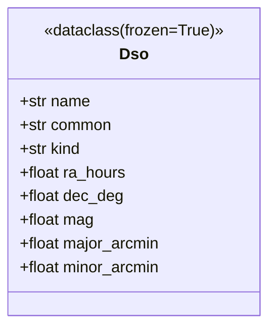

# `nina_planner/dso_catalog.py` — Built-in SIMBAD-Verified Deep-Sky Object Catalog (`Dso`, `CATALOG`)

[⬆️ Up to Atlas Index](../../README.md) · [⬆️ Core Package](./README.md) · **Callers:** [`tools/sky.py`](../tools/sky.md) · **Callees:** *(none — stdlib + package data `dso_catalog.csv`)*

---

## 1. Module Overview

- **File Path:** `.opencode/local/mcps/nina_planner/nina_planner/dso_catalog.py`
- **Line Count:** 59 lines (backed by `.opencode/local/mcps/nina_planner/nina_planner/dso_catalog.csv`, 498 lines: 1 header + 497 object rows)
- **Module Docstring & Purpose (`dso_catalog.py:1-13`):**
  > *"Built-in deep-sky catalog for target ranking (see `tools.sky.best_targets`). Static J2000 positions, integrated visual magnitudes, and angular sizes for every Messier object (minus the double star M40 and asterism M73) plus bright NGC/Caldwell showpieces, chosen to cover every season from northern latitudes and include the southern showpieces for southern sites. Magnitudes are integrated (total) visual magnitudes; sizes are major/minor axes in arcminutes. Every row's J2000 position was verified against SIMBAD, so catalog coordinates are safe to point from directly -- plans may use them without a `resolve_target` lookup, which keeps the whole flow working offline. `resolve_target` remains available for names NOT in this catalog."*
- **Architectural Layer:** Core Static Data / Domain Catalog (`nina_planner/`). Eagerly loads the bundled `dso_catalog.csv` package resource at import time into an immutable `tuple[Dso, ...]` (`CATALOG`), enabling completely offline target ranking in `tools/sky.py:best_targets` (`_rank_catalog`) without network calls to SIMBAD/Sesame.
- **Test Coverage:** `.opencode/local/mcps/nina_planner/tests/test_sky.py` (`CatalogIntegrityTest`, `RankCatalogTest`, `BestTargetsToolTest`).

### Outbound Imports

| Category | Import Statement | Lines | Usage |
|---|---|---|---|
| `__future__` | `from __future__ import annotations` | `15` | Deferred evaluation of type annotations. |
| Stdlib | `import csv` | `17` | `csv.DictReader` to parse rows of `dso_catalog.csv` (`dso_catalog.py:55`). |
| Stdlib | `from dataclasses import dataclass` | `18` | `@dataclass(frozen=True)` decorator on `Dso` (`dso_catalog.py:22`). |
| Stdlib | `from importlib.resources import as_file, files` | `19` | Resolves `files(__package__).joinpath("dso_catalog.csv")` as a concrete filesystem `Path` (`dso_catalog.py:42`). |
| Third-Party | *(none)* | — | — |
| Internal | *(none)* | — | — |

### Inbound Callers Across the Codebase

| Importing Module | Imported Symbols | Import Line | Call Sites & Role |
|---|---|---|---|
| `nina_planner/tools/sky.py` | `dso_catalog` (module) | `22` | `_rank_catalog` type annotation (`sky.py:636`: `catalog: "list[dso_catalog.Dso]"`) and `best_targets` (`sky.py:809`: passes `list(dso_catalog.CATALOG)` into `_rank_catalog`). |

### Module-Level Constants & Globals

| Symbol | Type | Line | Value | Purpose |
|---|---|---|---|---|
| `CATALOG` | `tuple[Dso, ...]` | `59` | `_load_catalog()` (497 frozen `Dso` instances) | Immutable in-memory tuple of all 497 deep-sky objects from `dso_catalog.csv`, initialized once at module import time. |

#### `dso_catalog.csv` Breakdown by `kind` (497 Total Objects)

| `kind` Tag | Meaning | Object Count | Example Entries (`name` / `common`) |
|---|---|---:|---|
| `"galaxy"` | Galaxy | 211 | `M31` (`Andromeda Galaxy`), `M33` (`Triangulum Galaxy`), `M51` (`The Whirlpool Galaxy`), `NGC 5128` (`Centaurus A`) |
| `"open"` | Open star cluster | 151 | `M45` (`Pleiades`), `M44` (`Beehive Cluster`), `NGC 869` / `NGC 884` (`Perseus Double Cluster`) |
| `"globular"` | Globular star cluster | 60 | `M13` (`Hercules Clust.`), `M22` (`Great Sagittarius Cluster`), `NGC 104` (`47 Tucanae`), `NGC 5139` (`Omega Centauri`) |
| `"pn"` | Planetary nebula | 45 | `M27` (`Dumbbell Nebula`), `M57` (`Ring Nebula`), `NGC 7293` (`The Helix Nebula`) |
| `"bn"` | Bright / diffuse nebula | 26 | `M42` (`Orion Nebula`), `NGC 7000` (`North America Nebula`), `IC 4703` (`Eagle Nebula--The Nebula`) |
| `"snr"` | Supernova remnant | 2 | `M1` (`Crab Nebula`), `NGC 6992/6995/6960/6979` (`Veil Nebula/The Witch Broom,Bridalveil, Etc`) |
| `"cloud"` | Star cloud | 2 | `M24` (`Sagittarius Star Cloud`), `NGC 206` (`Great Star Cloud In Andromeda Galaxy`) |

### Environment Variables

- *(None).*

---

## 2. Classes, Data Models & Exceptions

### 2.1 `Dso` (`nina_planner/dso_catalog.py:22-38`)

- **Decorators:** `@dataclass(frozen=True)` (`dso_catalog.py:22`) — instances are immutable and hashable (`FrozenInstanceError` raised on attribute mutation).
- **Docstring (`dso_catalog.py:24-29`):**
  > *"One catalog deep-sky object. `kind` is a short type tag: 'galaxy', 'globular', 'open' (open cluster), 'pn' (planetary nebula), 'bn' (bright/diffuse nebula), 'snr' (supernova remnant), or 'cloud' (star cloud)."*
- **Attributes:**

| Attribute | Type | Line | Units / Domain | Description |
|---|---|---|---|---|
| `name` | `str` | `31` | Catalog ID | Primary catalog designation (e.g., `"M31"`, `"NGC 7000"`, `"IC 1805"`). |
| `common` | `str` | `32` | Descriptive label | Common name or cross-identification (e.g., `"Andromeda Galaxy"`, `"NGC 581"`). |
| `kind` | `str` | `33` | `"galaxy"`, `"globular"`, `"open"`, `"pn"`, `"bn"`, `"snr"`, `"cloud"` | Short morphological classification tag used for difficulty scoring and `kinds` filtering in `best_targets`. |
| `ra_hours` | `float` | `34` | Hours $[0.0, 24.0)$ | J2000 Right Ascension in decimal hours, pre-verified against SIMBAD. |
| `dec_deg` | `float` | `35` | Degrees $[-90.0, +90.0]$ | J2000 Declination in decimal degrees, pre-verified against SIMBAD. |
| `mag` | `float` | `36` | Visual magnitude | Integrated (total) visual magnitude $m_V$. |
| `major_arcmin` | `float` | `37` | Arcminutes ($> 0$) | Major axis angular diameter in arcminutes. |
| `minor_arcmin` | `float` | `38` | Arcminutes ($> 0$) | Minor axis angular diameter in arcminutes. |



---

## 3. Function & Method Reference

### 3.1 `_load_catalog` (`nina_planner/dso_catalog.py:41-56`)

1. **Purpose & Architectural Role**
   Private loader invoked once at module import time (`CATALOG = _load_catalog()`, `dso_catalog.py:59`) to read the bundled `dso_catalog.csv` package resource and materialize all 497 rows into an immutable `tuple[Dso, ...]`.

2. **Signature, Decorators & Inputs**
   ```python
   def _load_catalog() -> tuple[Dso, ...]:
   ```
   - **Decorators:** None.
   - **Parameters:** None.

3. **Outputs & Return Semantics**
   - Returns `tuple[Dso, ...]`: Immutable tuple of `Dso` dataclass instances in the exact row order of `dso_catalog.csv`.

4. **Step-by-Step Internal Logic**
   1. **Resolve package resource (`dso_catalog.py:42`):** Enters context manager `with as_file(files(__package__).joinpath("dso_catalog.csv")) as catalog_path:`. Note: `pyproject.toml:72` declares `nina_planner = ["dso_catalog.csv"]` under `[tool.setuptools.package-data]`, ensuring the CSV is included in wheel and editable installs.
   2. **Open UTF-8 CSV stream (`dso_catalog.py:43`):** Enters `with catalog_path.open(newline="", encoding="utf-8") as source:`.
   3. **Parse rows & construct `tuple[Dso, ...]` (`dso_catalog.py:44-56`):** Iterates over `csv.DictReader(source)` in a generator expression passed to `tuple(...)`, instantiating `Dso` for each row with string fields `row["name"]`, `row["common"]`, `row["kind"]` and float conversions `float(row["ra_hours"])`, `float(row["dec_deg"])`, `float(row["mag"])`, `float(row["major_arcmin"])`, `float(row["minor_arcmin"])`.

5. **Side Effects & I/O**
   - Performs a synchronous file read of `nina_planner/dso_catalog.csv` once when `nina_planner.dso_catalog` is first imported (which occurs at server startup via `server.py` $\rightarrow$ `tools/sky.py` $\rightarrow$ `dso_catalog.py`).

6. **Error Handling & Edge Cases**
   - If `dso_catalog.csv` were missing or contained a missing column / non-float numeric cell, `FileNotFoundError`, `KeyError`, or `ValueError` would raise immediately at import time (fail-fast). Verified by `tests/test_sky.py:CatalogIntegrityTest`.

7. **Complexity & Risk Notes**
   - **Time / Space Complexity:** $\mathcal{O}(N)$ at import time where $N = 497$ rows; $\mathcal{O}(1)$ access thereafter via `dso_catalog.CATALOG`.
   - Because `CATALOG` is a `tuple` of `@dataclass(frozen=True)` objects, callers cannot accidentally mutate the shared catalog in memory.
