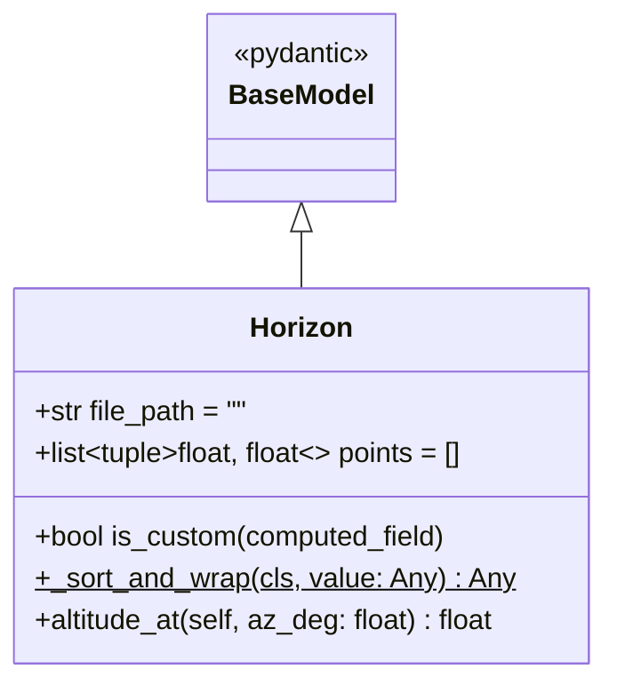

# `nina_planner/horizon.py` — Active Profile Custom Horizon Model, Linear Seam Interpolation & Best-Effort Fetching

[⬆️ Up to Atlas Index](../../README.md) · [⬆️ Core Package](./README.md) · **Callers:** [`models/profile.py`](../models/profile.md), [`tools/equipment.py`](../tools/equipment.md), [`tools/sky.py`](../tools/sky.md) · **Callees:** [`client.py`](./client.md)

---

## 1. Module Overview

- **File Path:** `.opencode/local/mcps/nina_planner/nina_planner/horizon.py`
- **Line Count:** 136 lines
- **Module Docstring & Purpose (`horizon.py:1-16`):**
  > *"The active profile's custom horizon: fetch, parse, and interpolate it. N.I.N.A. stores a custom horizon as azimuth/altitude pairs (a `.hrz` file referenced from the profile's `AstrometrySettings.HorizonFilePath`) and exposes the parsed values on `GET /profile/horizon`. The same skyline gates the sequencer's altitude conditions: `Loop while Altitude Above Horizon` / `Wait until Above Horizon` compare a target's altitude against the horizon at the target's azimuth plus an offset, so planning tools must apply the same floor or they disagree with what N.I.N.A. actually does -- e.g. ranking a target `visible_now` that the sequence would park on. With no horizon file configured the endpoint answers with empty arrays and the effective horizon is flat 0 degrees: `is_custom` is false and `altitude_at` returns 0, so every caller degrades to exactly the behavior it had before this module existed."*
- **Architectural Layer:** Core Domain Service & Model (`nina_planner/`). Encapsulates N.I.N.A.'s custom skyline representation (`Horizon(BaseModel)`), circular linear interpolation across the $360^\circ \rightarrow 0^\circ$ north seam (`altitude_at`), fault-tolerant payload parsing (`parse_horizon`), and best-effort HTTP fetching (`fetch_horizon`).
- **Test Coverage:** `.opencode/local/mcps/nina_planner/tests/test_horizon.py` (`HorizonModelTest`, `FetchHorizonTest`, `ProfileHorizonIntegrationTest`) and `.opencode/local/mcps/nina_planner/tests/test_sky.py`.

### Outbound Imports

| Category | Import Statement | Lines | Usage |
|---|---|---|---|
| `__future__` | `from __future__ import annotations` | `18` | Deferred evaluation of type annotations. |
| Stdlib | `import math` | `20` | `math.isfinite()` validation on azimuth and altitude knots in `Horizon._sort_and_wrap` (`horizon.py:58`). |
| Stdlib | `from typing import Any` | `21` | Typing for raw API payloads (`value: Any`, `payload: Any`). |
| Third-Party | `from pydantic import BaseModel, Field, computed_field, field_validator` | `23` | Pydantic v2 `BaseModel` definition, default factory `Field`, `@field_validator("points", mode="before")`, and `@computed_field` property `is_custom`. |
| Internal | `from . import client` | `25` | `await client.api_get("/profile/horizon")` (`horizon.py:132`) and `client.log_payload(...)` (`horizon.py:134`). |

### Inbound Callers Across the Codebase

| Importing Module | Imported Symbols | Import Line | Call Sites & Role |
|---|---|---|---|
| `nina_planner/models/profile.py` | `Horizon` | `10` | `ObservatoryProfile.horizon: Horizon = Horizon()` (`profile.py:117`) embeds the horizon into the site profile model. |
| `nina_planner/tools/equipment.py` | `fetch_horizon` | `10` | `get_site_profile` (`equipment.py:286`) calls `await fetch_horizon(str(astrometry.get("HorizonFilePath") or ""))` to attach the skyline to `ObservatoryProfile`. |
| `nina_planner/tools/sky.py` | `Horizon` | `24` | `_altitudes` (`sky.py:127, 135, 157`), `_rank_catalog` (`sky.py:646, 665, 698, 725, 738`), `target_altitudes` (`sky.py:190, 198`), and `best_targets` (`sky.py:807, 819`) evaluate `max(min_altitude, horizon.altitude_at(az) + horizon_offset_degrees)`. |

### Module-Level Constants & Globals

| Symbol | Type | Line | Value | Purpose |
|---|---|---|---|---|
| `_MAX_HORIZON_ALT` | `float` | `29` | `90.0` | Clamping bound (`[-90.0, 90.0]`) applied by `_clamp` (`horizon.py:99-100`) to interpolated horizon altitudes so malformed `.hrz` files cannot produce impossible elevations. |

### Environment Variables

- *(None directly — `fetch_horizon` delegates HTTP transport to `client.api_get`, which reads `NINA_API_URL` from `config.py`).*

---

## 2. Classes, Data Models & Exceptions

### 2.1 `Horizon(BaseModel)` (`nina_planner/horizon.py:32-96`)

- **Base Class:** `pydantic.BaseModel`
- **Docstring (`horizon.py:33`):** *"A profile's custom horizon as sorted `(azimuth_deg, altitude_deg)` pairs."*
- **Fields & Computed Properties:**

| Field / Property | Kind | Type | Default | Lines | Description |
|---|---|---|---|---|---|
| `file_path` | Stored field | `str` | `""` | `35` | Raw Windows path to the `.hrz` file from `AstrometrySettings.HorizonFilePath` (or `""` if none). |
| `points` | Stored field (validated) | `list[tuple[float, float]]` | `Field(default_factory=list)` | `36` | Sorted list of unique `(azimuth_deg, altitude_deg)` knots with `azimuth_deg` wrapped into $[0.0, 360.0)$. |
| `is_custom` | `@computed_field` `@property` | `bool` | Derived (`len(self.points) >= 2`) | `62-71` | Included in serialized model output (`model_dump` / JSON). `True` when at least 2 valid knots exist; `False` otherwise (flat $0^\circ$ horizon). |



---

## 3. Function & Method Reference

### 3.1 `Horizon._sort_and_wrap` (`nina_planner/horizon.py:38-60`)

1. **Purpose & Architectural Role**
   Pydantic pre-validation normalizer (`mode="before"`) for `Horizon.points` that filters out non-iterable or non-numeric/non-finite entries, wraps every azimuth modulo $360.0^\circ$ into $[0.0, 360.0)$, deduplicates colliding azimuths (such as a closing $360^\circ$ knot mirroring $0^\circ$, with later entries winning), and returns the knots sorted in ascending azimuth order.

2. **Signature, Decorators & Inputs**
   ```python
   @field_validator("points", mode="before")
   @classmethod
   def _sort_and_wrap(cls, value: Any) -> Any:
   ```
   - **Decorators:** `@field_validator("points", mode="before")`, `@classmethod`.
   - **Parameters:**
     - `cls` — The `Horizon` class.
     - `value: Any` — Raw candidate value for `points` (expected `list` or `tuple` of 2-element `(az, alt)` pairs, or arbitrary invalid input).

3. **Outputs & Return Semantics**
   - Returns `list[tuple[float, float]]`: Sorted list of `(azimuth_mod_360, altitude)` float tuples with unique azimuth keys in $[0.0, 360.0)$. Returns `[]` if `value` is not a `list` or `tuple` or if no finite numeric pairs survive filtering.

4. **Step-by-Step Internal Logic**
   1. **Container type check (`horizon.py:49-50`):** If `not isinstance(value, (list, tuple))`, returns `[]`.
   2. **Initialize deduplication map (`horizon.py:51`):** Creates `merged: dict[float, float] = {}`.
   3. **Iterate & coerce each pair (`horizon.py:52-57`):** Loops `for pair in value:`:
      - Inside `try:` (`lines 53-55`), unpacks `az, alt = pair` and converts `az_f, alt_f = float(az), float(alt)`.
      - On `(TypeError, ValueError)` (`lines 56-57`), skips the malformed pair via `continue` rather than failing the model.
   4. **Finite check & modulo-360 merge (`horizon.py:58-59`):** Checks `if math.isfinite(az_f) and math.isfinite(alt_f):` (rejecting `NaN` and `±inf`) and assigns `merged[az_f % 360.0] = alt_f`. Because Python's `%` operator with positive divisor `360.0` always yields a value in $[0.0, 360.0)$ (and `-0.0 == 0.0` in dict keys), `360.0 % 360.0` maps to `0.0`, overwriting any earlier `0.0` entry (or vice versa, last-entry-wins).
   5. **Sort by azimuth (`horizon.py:60`):** Returns `sorted(merged.items())`, producing a `list[tuple[float, float]]` ordered by ascending azimuth.

   ```mermaid
   flowchart TD
       A["Horizon._sort_and_wrap(cls, value)"] --> B{"isinstance(value, (list, tuple))?<br/>(line 49)"}
       B -- No --> R1["return [] (line 50)"]
       B -- Yes --> C["merged: dict[float, float] = {} (line 51)"]
       C --> D["For each pair in value (line 52)"]
       D --> E["Try: az, alt = pair<br/>az_f, alt_f = float(az), float(alt) (lines 53-55)"]
       E -- "TypeError / ValueError" --> D
       E -- Success --> F{"math.isfinite(az_f) and<br/>math.isfinite(alt_f)? (line 58)"}
       F -- No --> D
       F -- Yes --> G["merged[az_f % 360.0] = alt_f (line 59)<br/>(last entry wins on collision)"]
       G --> D
       D -- Loop done --> H["return sorted(merged.items()) (line 60)"]
   ```

5. **Side Effects & I/O**
   - Pure in-memory transformation during Pydantic model validation.

6. **Error Handling & Edge Cases**
   - Never raises: non-list inputs return `[]`; elements that are not 2-unpackable or have non-numeric strings/`None`/`NaN`/`inf` are silently skipped (`test_horizon.py:72-76`).
   - Closing $360^\circ$ entries collapse onto $0^\circ$ so `altitude_at` never encounters a zero-width segment ($a_1 - a_0 = 0$) (`test_horizon.py:64-70`).

7. **Complexity & Risk Notes**
   - **Time / Space Complexity:** $\mathcal{O}(n \log n)$ time and $\mathcal{O}(n)$ space where $n$ is the number of input pairs.

---

### 3.2 `Horizon.is_custom` (`nina_planner/horizon.py:62-71`)

1. **Purpose & Architectural Role**
   Computed boolean property serialized onto `Horizon` (and therefore `ObservatoryProfile`) indicating whether the profile has an active custom horizon with at least two distinct azimuth knots.

2. **Signature, Decorators & Inputs**
   ```python
   @computed_field  # type: ignore[prop-decorator]
   @property
   def is_custom(self) -> bool:
   ```
   - **Decorators:** `@computed_field`, `@property`.
   - **Parameters:** `self: Horizon`.

3. **Outputs & Return Semantics**
   - Returns `bool`: `True` when `len(self.points) >= 2`; `False` when `self.points` has 0 or 1 knot (matching N.I.N.A.'s rule that a single point cannot define a horizon skyline and degrades to a flat $0^\circ$ horizon).

4. **Step-by-Step Internal Logic**
   1. **Length threshold check (`horizon.py:71`):** Evaluates `return len(self.points) >= 2`.

5. **Side Effects & I/O**
   - Pure property evaluation.

6. **Error Handling & Edge Cases**
   - A 1-point horizon (`Horizon(points=[(90.0, 30.0)])`) returns `is_custom == False` (`test_horizon.py:19-25`).

7. **Complexity & Risk Notes**
   - **Time Complexity:** $\mathcal{O}(1)$.

---

### 3.3 `Horizon.altitude_at` (`nina_planner/horizon.py:73-96`)

1. **Purpose & Architectural Role**
   Evaluates the custom skyline altitude (in degrees) at any given azimuth `az_deg` using piecewise linear interpolation between adjacent sorted knots, wrapping seamlessly across the $360^\circ \rightarrow 0^\circ$ north seam and clamping the result to $[-90.0^\circ, 90.0^\circ]$. Directly mirrors N.I.N.A.'s internal horizon interpolation so `best_targets` and `target_altitudes` enforce the exact same floor as N.I.N.A. sequencer loop conditions.

2. **Signature, Decorators & Inputs**
   ```python
   def altitude_at(self, az_deg: float) -> float:
   ```
   - **Decorators:** None.
   - **Parameters:**
     - `self: Horizon`
     - `az_deg: float` — Target azimuth in degrees (any real float; normalized modulo $360.0^\circ$).

3. **Outputs & Return Semantics**
   - Returns `float`:
     - `0.0` if `len(self.points) < 2` (flat horizon default).
     - Otherwise, the linearly interpolated horizon altitude in degrees, clamped to $[-90.0, 90.0]$.

4. **Step-by-Step Internal Logic**
   1. **Flat-horizon guard (`horizon.py:81-83`):** Reads `pts = self.points`. If `len(pts) < 2`, returns `0.0`.
   2. **Normalize azimuth (`horizon.py:84`):** Computes `az = az_deg % 360.0` to map negative or $\ge 360^\circ$ bearings into $[0.0, 360.0)$.
   3. **Interior segment search & interpolation (`horizon.py:85-90`):** Loops `for i in range(len(pts) - 1):`:
      - Unpacks `a0, h0 = pts[i]` and `a1, h1 = pts[i + 1]` (`lines 86-87`).
      - If `a0 <= az <= a1` (`line 88`):
        - Computes fractional position `t = (az - a0) / (a1 - a0)` (`line 89`). Note that $a_1 > a_0$ is strictly guaranteed because `_sort_and_wrap` deduplicated and sorted the keys.
        - Returns `_clamp(h0 + (h1 - h0) * t)` (`line 90`).
   4. **North-seam wraparound interpolation (`horizon.py:93-96`):** Executed when `az` falls either after the last knot (`az > pts[-1][0]`) or before the first knot (`az < pts[0][0]`):
      - Sets `a0, h0 = pts[-1]` (last knot, `line 93`).
      - Sets `a1, h1 = pts[0][0] + 360.0, pts[0][1]` (first knot shifted by $+360^\circ$, `line 94`).
      - Unwraps `az` onto $[a_0, a_1)$ via `az_u = az if az >= a0 else az + 360.0` (`line 95`).
      - Interpolates and clamps: `return _clamp(h0 + (h1 - h0) * (az_u - a0) / (a1 - a0))` (`line 96`).

   ```mermaid
   flowchart TD
       A["Horizon.altitude_at(self, az_deg)"] --> B["pts = self.points (line 81)"]
       B --> C{"len(pts) < 2?<br/>(line 82)"}
       C -- Yes --> R1["return 0.0 (line 83)"]
       C -- No --> D["az = az_deg % 360.0 (line 84)"]
       D --> E["Loop i in range(len(pts) - 1)<br/>a0, h0 = pts[i]; a1, h1 = pts[i + 1] (lines 85-87)"]
       E --> F{"a0 <= az <= a1?<br/>(line 88)"}
       F -- Yes --> G["t = (az - a0) / (a1 - a0)<br/>return _clamp(h0 + (h1 - h0) * t) (lines 89-90)"]
       F -- No --> E
       E -- "Not in [pts[0][0], pts[-1][0]]<br/>(North seam)" --> H["a0, h0 = pts[-1]<br/>a1, h1 = pts[0][0] + 360.0, pts[0][1]<br/>az_u = az if az >= a0 else az + 360.0 (lines 93-95)"]
       H --> I["return _clamp(h0 + (h1 - h0) * (az_u - a0) / (a1 - a0))<br/>(line 96)"]
   ```

5. **Side Effects & I/O**
   - Pure mathematical calculation; no side effects.

6. **Error Handling & Edge Cases**
   - Division by zero is impossible: in step 3, `_sort_and_wrap` guarantees strictly increasing azimuth keys ($a_1 > a_0$); in step 4, `len(pts) >= 2` with keys in $[0, 360)$ guarantees $a_0 > \text{pts}[0][0]$, so $a_1 - a_0 = (\text{pts}[0][0] + 360) - \text{pts}[-1][0] \in (0, 360)$.
   - Out-of-range knot altitudes (e.g., `95.0` or `-95.0`) are clamped to `[-90.0, 90.0]` (`test_horizon.py:78-83`).

7. **Complexity & Risk Notes**
   - **Time Complexity:** $\mathcal{O}(n)$ linear scan over `self.points` where $n$ is the number of knots in the `.hrz` file (typically $10$–$360$ points).

---

### 3.4 `_clamp` (`nina_planner/horizon.py:99-100`)

1. **Purpose & Architectural Role**
   Private numeric helper that bounds an interpolated horizon altitude to the physical elevation interval $[-\text{\_MAX\_HORIZON\_ALT}, +\text{\_MAX\_HORIZON\_ALT}]$ ($[-90.0^\circ, 90.0^\circ]$).

2. **Signature, Decorators & Inputs**
   ```python
   def _clamp(alt: float) -> float:
   ```
   - **Decorators:** None.
   - **Parameters:**
     - `alt: float` — Raw interpolated altitude in degrees.

3. **Outputs & Return Semantics**
   - Returns `float`: `alt` clamped to $[-90.0, 90.0]$.

4. **Step-by-Step Internal Logic**
   1. **Min/Max clamp (`horizon.py:100`):** Evaluates `return max(-_MAX_HORIZON_ALT, min(_MAX_HORIZON_ALT, alt))`.

5. **Side Effects & I/O**
   - Pure function.

6. **Error Handling & Edge Cases**
   - Never raises for float inputs.

7. **Complexity & Risk Notes**
   - **Time Complexity:** $\mathcal{O}(1)$.

---

### 3.5 `parse_horizon` (`nina_planner/horizon.py:103-120`)

1. **Purpose & Architectural Role**
   Constructs a `Horizon` model from the raw JSON payload returned by `GET /profile/horizon` (`{"Azimuths": [...], "Altitudes": [...]}`). Designed to degrade gracefully to a flat horizon (`Horizon(file_path=file_path)`) whenever the payload is missing, malformed, or returned by a mock/older API build.

2. **Signature, Decorators & Inputs**
   ```python
   def parse_horizon(payload: Any, file_path: str = "") -> Horizon:
   ```
   - **Decorators:** None.
   - **Parameters:**
     - `payload: Any` — Unwrapped `Response` value from `client.api_get("/profile/horizon")`.
     - `file_path: str = ""` — Profile's `AstrometrySettings.HorizonFilePath` string to store on the returned `Horizon`.

3. **Outputs & Return Semantics**
   - Returns `Horizon`: Validated `Horizon` instance with `file_path` preserved and `points` populated (or `[]` if `payload` does not have list-typed `"Azimuths"` and `"Altitudes"`).

4. **Step-by-Step Internal Logic**
   1. **Dict check (`horizon.py:111-112`):** If `not isinstance(payload, dict)`, returns `Horizon(file_path=file_path)` (flat horizon).
   2. **Extract arrays & list check (`horizon.py:113-116`):** Reads `azs = payload.get("Azimuths")` and `alts = payload.get("Altitudes")`. If `not isinstance(azs, list) or not isinstance(alts, list)`, returns `Horizon(file_path=file_path)`.
   3. **Zip & validate (`horizon.py:120`):** Calls `return Horizon(file_path=file_path, points=list(zip(azs, alts, strict=False)))`. `zip(..., strict=False)` truncates to the shorter list if lengths differ, and `Horizon._sort_and_wrap` handles numeric filtering, modulo-360 wrapping, deduplication, and sorting.

5. **Side Effects & I/O**
   - Pure function; no I/O.

6. **Error Handling & Edge Cases**
   - **Never raises:** Any non-dict payload (`None`, `[]`, `"str"`), dict without `"Azimuths"`/`"Altitudes"` lists, or lists containing garbage elements cleanly yields a valid `Horizon` (`test_horizon.py:27-35`).

7. **Complexity & Risk Notes**
   - **Time Complexity:** $\mathcal{O}(n \log n)$ where $n = \min(\text{len}(azs), \text{len}(alts))$.

---

### 3.6 `fetch_horizon` (`nina_planner/horizon.py:123-136`)

1. **Purpose & Architectural Role**
   Asynchronous best-effort fetcher that queries `GET /profile/horizon` via `client.api_get` and parses the response with `parse_horizon`. If the HTTP call fails (e.g., an older ninaAPI plugin without `/profile/horizon` or a transient network hiccup), logs the error and returns a flat `Horizon(file_path=file_path)` so `get_site_profile` never fails on account of the horizon endpoint.

2. **Signature, Decorators & Inputs**
   ```python
   async def fetch_horizon(file_path: str = "") -> Horizon:
   ```
   - **Decorators:** None (`async def`).
   - **Parameters:**
     - `file_path: str = ""` — Profile's `AstrometrySettings.HorizonFilePath` string to attach to the returned `Horizon`.

3. **Outputs & Return Semantics**
   - Returns `Horizon` (awaited): Custom `Horizon` if `/profile/horizon` succeeds with $\ge 2$ valid knots, or flat `Horizon(file_path=file_path, points=[])` otherwise.

4. **Step-by-Step Internal Logic**
   1. **Await endpoint (`horizon.py:131-132`):** Calls `payload = await client.api_get("/profile/horizon")` inside a `try:` block.
   2. **Best-effort exception handler (`horizon.py:133-135`):** On `except Exception as exc:`, logs `client.log_payload("fetch_horizon:", f"flat horizon ({exc})")` and returns `Horizon(file_path=file_path)`.
   3. **Parse payload (`horizon.py:136`):** Returns `parse_horizon(payload, file_path=file_path)`.

5. **Side Effects & I/O**
   - Performs an async HTTP GET to `/v2/api/profile/horizon` via `client.api_get`.
   - Writes diagnostic entries to the planner log via `client.log_payload` (both inside `api_get` and on exception in `fetch_horizon`).

6. **Error Handling & Edge Cases**
   - Catches all `Exception` subclasses (`RuntimeError`, `httpx.HTTPError`, etc.)—never raises to the caller (`test_horizon.py:106-116, 174-188`). Note that `BaseException` subclasses like `asyncio.CancelledError` are not caught by `except Exception` and propagate normally.

7. **Complexity & Risk Notes**
   - **Latency:** Adds one HTTP round-trip to `get_site_profile()`.
