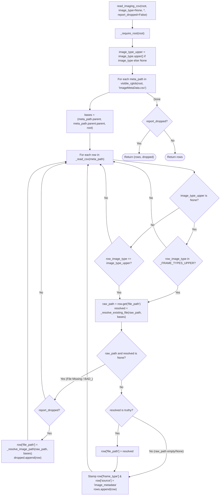

# `nina_planner.imaging` — Visible Tree Walks, Windows Drive Mapping & `ImageMetaData.csv` Attribution

[⬆️ Up to Atlas Index](../../README.md) · [⬆️ Core Package](./README.md) · **Callees:** [`nina_utils.py`](./nina_utils.md) · **Callers:** [`metadata.py`](./metadata.md) · [`plan_utils.py`](./plan_utils.md) · [`system_time.py`](./system_time.md) · [`models/profile.py`](../models/profile.md) · [`tools/plans.py`](../tools/plans.md) · [`archive.py`](../cli/archive.md) · [`purge.py`](../cli/purge.md)

---

## 1. Module Overview

| Attribute | Value |
|---|---|
| **Source File** | `.opencode/local/mcps/nina_planner/nina_planner/imaging.py` |
| **Line Count** | 222 lines |
| **Architectural Layer** | Core Domain Service — Filesystem Traversal, Cross-Platform Path Mapping & Session Metadata CSV Ingestion |
| **Package** | `nina_planner` |

### Purpose & Module Docstring (`imaging.py:1-8`)

`imaging.py` is the filesystem ingestion layer for N.I.N.A.'s Session Metadata plugin outputs (`ImageMetaData.csv` and `WeatherData.csv`) and cross-platform path translation. It enforces three core guarantees across the system:
1. **Pruned Tree Traversal (`_prunable_dir`, `_walk_visible`, `visible_rglob`):** Every directory walk skips hidden dot-directories (`.git`, `.opencode`, `.venv`, `.quarantine`, SMB `.snapshot`, macOS `.Trashes`) and dependency/cache trees (`node_modules`, `__pycache__`) in place, preventing snapshot/quarantine copies from duplicating CSV rows or inflating frame counts, and avoiding symlink cycles (`followlinks=False`).
2. **Windows-to-Host Drive Rebasing (`windows_to_local`):** Translates Windows drive-rooted paths (`Z:\landing\...`) written by N.I.N.A. onto POSIX/WSL/macOS mount points via `NINA_DRIVE_MOUNT` (defaulting to `/mnt/<drive>`).
3. **Existence-Gated Frame Attribution (`read_imaging_csv`):** Drops any `ImageMetaData.csv` row whose recorded `file_path` no longer exists on disk (such as frames N.I.N.A. later rejected and renamed to `BAD_<name>`), while optionally returning those dropped rows (`report_dropped=True`) so `nina-archive` and `nina-purge` can distinguish `BAD_` twins from missing files.

### Inbound Callers

| Caller Module | Imported Symbols | Call Sites & Usage Context |
|---|---|---|
| `nina_planner/metadata.py` | `read_imaging_csv` (`8`) | `read_metadata` (`65`) runs `read_imaging_csv(root=root, image_type=image_type)` in a worker thread. |
| `nina_planner/plan_utils.py` | `_walk_visible` (`20`) | `plan_files` (`252`) walks visible directories under `plan_dir`. |
| `nina_planner/models/profile.py` | `windows_to_local` (`11`) | `ObservatoryProfile.local_image_save_path` (`128`) translates `self.image_save_path`. |
| `nina_planner/system_time.py` | `windows_to_local` (`18`) | `get_launcher_paths` (`110`) maps Windows `%TEMP%` into a WSL-local path. |
| `nina_planner/tools/plans.py` | `_prunable_dir`, `_walk_visible` (`15-18`) | `_count_fits` (`462`) and `audit_plans` (`994`, `1006`) prune hidden/tool dirs during orphan and `BAD_` FITS scans. |
| `nina_planner/archive.py` | `read_imaging_csv`, `read_weather_rows` (`91`) | `_merge_weather` calls `read_weather_rows` (`260`); `run` calls `read_imaging_csv(root=imaging_root, image_type=None, report_dropped=True)` (`984-985`). |
| `nina_planner/purge.py` | `_prunable_dir`, `read_imaging_csv` (`107`) | `_classify` calls `_prunable_dir` (`349`); `run` calls `read_imaging_csv(root=root, image_type=None, report_dropped=True)` (`797-798`). |

### Outbound Imports

| Category | Import Statement | Line(s) | Purpose |
|---|---|---|---|
| **Future** | `from __future__ import annotations` | `10` | Postponed evaluation of type annotations. |
| **Stdlib** | `import csv` | `12` | `csv.DictReader` in `_read_csv`. |
| **Stdlib** | `import os` | `13` | `os.walk` in `_walk_visible` and `os.environ.get("NINA_DRIVE_MOUNT")` in `windows_to_local`. |
| **Stdlib** | `import sys` | `14` | Checks `sys.platform == "win32"` in `windows_to_local`. |
| **Stdlib** | `from collections.abc import Iterator` | `15` | Return type for `_walk_visible`. |
| **Stdlib** | `from pathlib import Path, PureWindowsPath` | `16` | Host path operations (`Path`) and platform-independent Windows path parsing (`PureWindowsPath`). |
| **Stdlib** | `from typing import Any, Literal, overload` | `17` | `@overload` signatures and `Literal[False]` / `Literal[True]` typing for `read_imaging_csv`. |
| **Internal** | `from .nina_utils import to_snake` | `19` | Normalizes PascalCase CSV header column names to `snake_case` in `_read_csv`. |

### Module-Level Constants (`imaging.py:26-31`)

| Constant | Line | Type | Value | Purpose |
|---|---:|---|---|---|
| `_PRUNED_DIR_NAMES` | `26` | `frozenset[str]` | `frozenset({"node_modules", "__pycache__"})` | Explicit non-dot directory names excluded from every directory walk alongside any directory starting with `"."`. |
| `FRAME_TYPES` | `30` | `tuple[str, ...]` | `("light", "dark", "bias", "flat")` | The four canonical lowercase frame types recognized during `ImageMetaData.csv` ingestion. |
| `_FRAME_TYPES_UPPER` | `31` | `tuple[str, ...]` | `("LIGHT", "DARK", "BIAS", "FLAT")` | Uppercase tuple derived from `FRAME_TYPES` (`tuple(t.upper() for t in FRAME_TYPES)`) for fast membership checks in `read_imaging_csv` when `image_type=None`. |

### Overloads (`imaging.py:155-164`)

`read_imaging_csv` defines two `@overload` signatures so static type checkers (`mypy`) resolve the exact return type based on the `report_dropped` keyword literal:
1. **`report_dropped: Literal[False] = False` (`155-158`):**
   ```python
   @overload
   def read_imaging_csv(
       root: Path, image_type: str | None, *, report_dropped: Literal[False] = False
   ) -> list[dict[str, Any]]: ...
   ```
2. **`report_dropped: Literal[True]` (`161-164`):**
   ```python
   @overload
   def read_imaging_csv(
       root: Path, image_type: str | None, *, report_dropped: Literal[True]
   ) -> tuple[list[dict[str, Any]], list[dict[str, Any]]]: ...
   ```

---

## 2. Classes, Data Models & Exceptions

`imaging.py` defines **no classes, Pydantic models, or custom exception subclasses**.
- Raises standard `FileNotFoundError` from `_require_root` when the imaging root directory is missing or not a directory.

---

## 3. Function & Method Reference

| Symbol | Kind | Lines | Summary |
|---|---|---|---|
| [`_prunable_dir`](#31-_prunable_dir) | `def` | `34-36` | Returns `True` if a directory name starts with `"."` or is in `_PRUNED_DIR_NAMES`. |
| [`_walk_visible`](#32-_walk_visible) | `def` | `39-52` | Pruned, deterministic depth-first `os.walk` generator over visible directories. |
| [`visible_rglob`](#33-visible_rglob) | `def` | `55-62` | Finds all files with exact name `name` under `root` in visible directories. |
| [`windows_to_local`](#34-windows_to_local) | `def` | `65-81` | Maps Windows drive paths onto the local host filesystem via `NINA_DRIVE_MOUNT` or `/mnt/<drive>`. |
| [`read_weather_rows`](#35-read_weather_rows) | `def` | `84-103` | Reads `WeatherData.csv` in `type_dir` into an `exposure_number`-keyed dict, degrading to `{}` on error. |
| [`_read_csv`](#36-_read_csv) | `def` | `106-108` | Reads a UTF-8/BOM CSV file via `csv.DictReader` and converts column keys with `to_snake`. |
| [`_resolve_image_path`](#37-_resolve_image_path) | `def` | `111-124` | Maps `file_path` via `windows_to_local` and resolves relative paths against candidate `bases`. |
| [`_resolve_existing_file`](#38-_resolve_existing_file) | `def` | `127-136` | Resolves `file_path` via `_resolve_image_path` and returns it only if `Path(resolved).is_file()` is `True`. |
| [`_require_root`](#39-_require_root) | `def` | `139-152` | Raises `FileNotFoundError` with an operator hint if `root.is_dir()` is `False`. |
| [`read_imaging_csv`](#310-read_imaging_csv) | `def` | `155-222` | Walks all visible `ImageMetaData.csv` files under `root`, filters by `image_type`, verifies file existence, and returns attributed rows (plus optional dropped rows). |

---

### 3.1 `_prunable_dir`

**Location:** `nina_planner/imaging.py:34-36`

#### 1. Purpose & Architectural Role
Predicate deciding whether a directory name must be excluded from every filesystem walk in `nina_planner`. Shared by `_walk_visible` (`51`), `tools/plans.py` (`994`), and `purge.py` (`349`). Notably, `nina-purge` quarantines folders into `<imaging-root>/.quarantine/<dir>`, which starts with `"."`, so `_prunable_dir` automatically hides quarantined frames from every subsequent attribution and audit scan.

#### 2. Signature, Decorators & Inputs
```python
def _prunable_dir(name: str) -> bool:
```
- **`name` (`str`):** Single directory basename (not a full path).

#### 3. Outputs & Return Semantics
- Returns `True` if `name.startswith(".")` or `name in _PRUNED_DIR_NAMES` (`{"node_modules", "__pycache__"}`); `False` otherwise.

#### 4. Step-by-Step Internal Logic
1. **Check prefix and set membership (`36`):** `return name.startswith(".") or name in _PRUNED_DIR_NAMES`.

#### 5. Side Effects & I/O
- Pure in-memory string check; no I/O.

#### 6. Error Handling & Edge Cases
- Expects a single path component (`name`), not a multi-segment path.

#### 7. Complexity & Risk Notes
- **Time Complexity:** $O(1)$ average time.

---

### 3.2 `_walk_visible`

**Location:** `nina_planner/imaging.py:39-52`

#### 1. Purpose & Architectural Role
Generator wrapping `os.walk(root)` that prunes hidden and tool directories in place (`dirnames[:] = ...`) before descending, sorts both `dirnames` and `filenames` deterministically, and never follows directory symlinks (`os.walk` default `followlinks=False`).

#### 2. Signature, Decorators & Inputs
```python
def _walk_visible(root: Path) -> Iterator[tuple[Path, list[str]]]:
```
- **`root` (`Path`):** Root directory to walk.

#### 3. Outputs & Return Semantics
- Yields `(Path(dirpath), sorted(filenames))` tuples in deterministic depth-first lexicographical directory order for `root` and every visible subdirectory beneath it.

#### 4. Step-by-Step Internal Logic
1. **Iterate `os.walk(root)` (`50`):** Loops `for dirpath, dirnames, filenames in os.walk(root):` (top-down by default, `followlinks=False`).
2. **In-place prune and sort `dirnames` (`51`):** Assigns `dirnames[:] = sorted(d for d in dirnames if not _prunable_dir(d))` so `os.walk` never enters pruned subdirectories and visits remaining subdirectories in alphabetical order.
3. **Yield current directory and sorted filenames (`52`):** `yield Path(dirpath), sorted(filenames)`.

#### 5. Side Effects & I/O
- Reads directory entries lazily via `os.scandir` inside `os.walk`.

#### 6. Error Handling & Edge Cases
- **Non-existent `root`:** `os.walk` yields nothing and stops cleanly without raising (callers that require `root` to exist call `_require_root(root)` first).
- **Hidden files:** Only *directories* are filtered by `_prunable_dir`; hidden files inside a visible directory are yielded in `sorted(filenames)` (`47-48`).

#### 7. Complexity & Risk Notes
- **Time Complexity:** $O(V + F \log F)$ over visible directories $V$ and their files $F$; pruned subtrees (`node_modules`, `.git`, `.snapshot`, `.quarantine`) are never traversed ($O(1)$ skip at parent level).

---

### 3.3 `visible_rglob`

**Location:** `nina_planner/imaging.py:55-62`

#### 1. Purpose & Architectural Role
Pruned replacement for `root.rglob(name)` (when `name` is an exact filename rather than a wildcard pattern) using `_walk_visible`. Used by `read_imaging_csv` (`197`) to locate every `ImageMetaData.csv` under the imaging root in deterministic order while ignoring `.quarantine/`, `.snapshot/`, `.Trashes/`, etc.

#### 2. Signature, Decorators & Inputs
```python
def visible_rglob(root: Path, name: str) -> list[Path]:
```
- **`root` (`Path`):** Root directory to search.
- **`name` (`str`):** Exact filename to match (e.g., `"ImageMetaData.csv"`).

#### 3. Outputs & Return Semantics
- Returns `list[Path]` of matching file paths in depth-first sorted directory order.

#### 4. Step-by-Step Internal Logic
1. **List comprehension over `_walk_visible` (`60-62`):** Returns `[directory / name for directory, names in _walk_visible(root) if name in names]`.

#### 5. Side Effects & I/O
- Traverses visible directory tree under `root`.

#### 6. Error Handling & Edge Cases
- Note that `name in names` tests exact filename equality, not glob pattern matching.

#### 7. Complexity & Risk Notes
- **Time Complexity:** $O(\text{total entries in visible directories})$.

---

### 3.4 `windows_to_local`

**Location:** `nina_planner/imaging.py:65-81`

#### 1. Purpose & Architectural Role
Maps a Windows path string recorded by N.I.N.A. (either in the profile's `ImageSavePath`, in `ImageMetaData.csv`'s `FilePath` column, or from Windows `%TEMP%`) onto the host filesystem where `nina_planner` is running.
- On Windows (`sys.platform == "win32"`), returns `Path(windows_path)` unchanged.
- On POSIX hosts (macOS, Linux, WSL), parses drive-rooted paths (`C:\...`, `Z:/...`) with `PureWindowsPath` and rebases the path components after the drive root onto `drive_mount` (or `os.environ.get("NINA_DRIVE_MOUNT")`, defaulting to `/mnt/<drive_letter_lower>`).
- Drive-less relative or POSIX paths pass through verbatim as `Path(windows_path)`.

#### 2. Signature, Decorators & Inputs
```python
def windows_to_local(windows_path: str, drive_mount: str | None = None) -> Path:
```
- **`windows_path` (`str`):** Path string to convert (may be Windows drive-rooted, Windows relative, or already POSIX).
- **`drive_mount` (`str | None`, default `None`):** Optional explicit local mount prefix overriding `NINA_DRIVE_MOUNT`.

#### 3. Outputs & Return Semantics
- Returns a `Path` representing the host-local equivalent of `windows_path`. Performs no disk I/O.

#### 4. Step-by-Step Internal Logic
1. **Short-circuit on Windows host (`73-74`):** If `sys.platform == "win32"`, returns `Path(windows_path)`.
2. **Parse as `PureWindowsPath` and check for drive letter (`75-77`):** Constructs `win = PureWindowsPath(windows_path)` (`75`). If `not win.drive` (`76`), returns `Path(windows_path)` (`77`).
3. **Resolve mount point (`78-80`):**
   - If `drive_mount is None` (`78`), reads `drive_mount = os.environ.get("NINA_DRIVE_MOUNT")` (`79`).
   - Sets `mount = drive_mount or f"/mnt/{win.drive[0].lower()}"` (`80`), handling both `drive_mount=None` and `drive_mount=""`.
4. **Rebase path segments (`81`):** Returns `Path(mount).joinpath(*win.parts[1:])` (where `win.parts[0]` is the drive root like `'Z:\\'` and `win.parts[1:]` are the subdirectories and filename).

#### 5. Side Effects & I/O
- Reads `os.environ.get("NINA_DRIVE_MOUNT")` when `drive_mount is None` on non-Windows platforms. No filesystem I/O.

#### 6. Error Handling & Edge Cases
- **Drive-less paths (`not win.drive`, `76-77`):** If `PureWindowsPath(windows_path).drive` is empty (e.g., POSIX paths or relative paths without a drive letter), returns `Path(windows_path)` unchanged without consulting `drive_mount` or `NINA_DRIVE_MOUNT`.
- **UNC paths (`\\server\share\...`):** `PureWindowsPath` sets `win.drive = '\\\\server\\share'`, so `win.drive[0].lower()` would be `'\\'`, unless `NINA_DRIVE_MOUNT` is set.

#### 7. Complexity & Risk Notes
- **Time Complexity:** $O(\text{number of path components})$.

---

### 3.5 `read_weather_rows`

**Location:** `nina_planner/imaging.py:84-103`

#### 1. Purpose & Architectural Role
Reads per-exposure weather telemetry from `<type_dir>/WeatherData.csv` (written alongside `ImageMetaData.csv` by N.I.N.A.'s Session Metadata plugin) and indexes rows by `exposure_number` (as a stripped string). Called by `archive.py:_merge_weather` (`260`) to join ambient weather metrics (`temperature`, `dew_point`, `humidity`, `wind_speed`, etc.) onto archived `ImageMetaData.csv` records.

#### 2. Signature, Decorators & Inputs
```python
def read_weather_rows(type_dir: Path) -> dict[str, dict[str, Any]]:
```
- **`type_dir` (`Path`):** Directory containing `ImageMetaData.csv` (or its parent date directory) where `WeatherData.csv` may reside.

#### 3. Outputs & Return Semantics
- Returns `dict[str, dict[str, Any]]` mapping each non-empty `exposure_number` string to its snake_cased CSV row dict.
- Returns `{}` if `WeatherData.csv` does not exist, is empty, or fails to parse for any reason.

#### 4. Step-by-Step Internal Logic
1. **Check file existence (`91-93`):** Builds `path = type_dir / "WeatherData.csv"` (`91`); if `not path.is_file()` (`92`), returns `{}` (`93`).
2. **Parse CSV with fail-open fallback (`94-97`):** Calls `rows = _read_csv(path)` (`95`); on any `Exception` (`96`), returns `{}` (`97`).
3. **Index by `exposure_number` (`98-103`):**
   - Initializes `out: dict[str, dict[str, Any]] = {}` (`98`).
   - Iterates `for r in rows:` (`99`), extracts `exp_nr = str(r.get("exposure_number", "")).strip()` (`100`).
   - If `exp_nr` is non-empty (`101`), stores `out[exp_nr] = r` (`102`, later rows with the same `exposure_number` overwrite earlier ones).
   - Returns `out` (`103`).

#### 5. Side Effects & I/O
- Synchronous file existence check (`is_file()`) and CSV read (`_read_csv`).

#### 6. Error Handling & Edge Cases
- **Graceful degradation (`96-97`):** Any I/O error, Unicode decode error, or CSV corruption returns `{}` so a corrupt or missing `WeatherData.csv` never aborts an archive run.
- **Missing `ExposureNumber` column or blank cell:** `r.get("exposure_number", "")` defaults to `""`, which strips to `""` and is skipped (`101`). Note: if `r.get("exposure_number")` is `None` (e.g., truncated CSV line), `str(None)` is `"None"`, which is truthy—though well-formed headers always map missing cells only on short rows.

#### 7. Complexity & Risk Notes
- **Time Complexity:** $O(W)$ where $W$ is the number of rows in `WeatherData.csv`.

---

### 3.6 `_read_csv`

**Location:** `nina_planner/imaging.py:106-108`

#### 1. Purpose & Architectural Role
Low-level CSV reader used by `read_weather_rows` (`95`) and `read_imaging_csv` (`201`). Opens `path` with `encoding="utf-8-sig"` (transparently stripping any UTF-8 BOM written by Windows/.NET CSV writers) and normalizes every header key through `nina_utils.to_snake` (e.g., `FilePath` $\rightarrow$ `file_path`, `ExposureStartUTC` $\rightarrow$ `exposure_start_utc`, `HFRStDev` $\rightarrow$ `hfr_st_dev`, `GuidingRMSArcSec` $\rightarrow$ `guiding_rms_arc_sec`).

#### 2. Signature, Decorators & Inputs
```python
def _read_csv(path: Path) -> list[dict[str, Any]]:
```
- **`path` (`Path`):** Path to the CSV file on disk.

#### 3. Outputs & Return Semantics
- Returns `list[dict[str, Any]]`, one dictionary per data row, with `snake_case` keys and raw string values (or `None` if a row has fewer columns than the header).

#### 4. Step-by-Step Internal Logic
1. **Open and parse with `csv.DictReader` (`107-108`):** Opens `path` in `"r"` mode with `encoding="utf-8-sig"` and `newline=""`, iterates `csv.DictReader(f)`, and transforms each row via `{to_snake(k): v for k, v in row.items()}`.

#### 5. Side Effects & I/O
- Synchronous disk read of `path`.

#### 6. Error Handling & Edge Cases
- **Extra columns without headers:** If a data row has more fields than the header row, `csv.DictReader` places overflow values under key `None`. Calling `to_snake(None)` would raise `AttributeError` in `read_imaging_csv` (caught in `read_weather_rows`). Well-formed N.I.N.A. Session Metadata CSVs always match header column counts.

#### 7. Complexity & Risk Notes
- **Time Complexity:** $O(\text{rows} \times \text{columns})$.

---

### 3.7 `_resolve_image_path`

**Location:** `nina_planner/imaging.py:111-124`

#### 1. Purpose & Architectural Role
Converts a raw `file_path` string from `ImageMetaData.csv` into a host-local path string without requiring the file to exist when the path is absolute, or probing candidate base directories (`bases`) in order when the path is relative. Used directly by `read_imaging_csv` (`212`) to populate best-effort `file_path` on dropped rows (`report_dropped=True`), and wrapped by `_resolve_existing_file` (`133`) for active rows.

#### 2. Signature, Decorators & Inputs
```python
def _resolve_image_path(
    file_path: str | None,
    bases: tuple[Path, ...] = (),
) -> str | None:
```
- **`file_path` (`str | None`):** Raw `FilePath` value from a CSV row, or `None` / `""`.
- **`bases` (`tuple[Path, ...]`, default `()`):** Ordered tuple of base directories to probe when `file_path` is relative. `read_imaging_csv` passes `(csv_dir, parent_dir, root)` (`200`).

#### 3. Outputs & Return Semantics
- Returns `None` if `file_path` is `None` or empty `""`.
- If `windows_to_local(file_path)` is absolute, returns `str(p)` immediately without checking disk existence.
- If `p` is relative, checks `Path(base) / p` for each `base` in `bases` and returns `str(candidate)` for the first candidate where `candidate.is_file()` is `True`. If none exist on disk, returns `str(p)` (the unresolved relative path).

#### 4. Step-by-Step Internal Logic
1. **Guard empty input (`115-116`):** If `not file_path`, returns `None`.
2. **Apply Windows-to-local mapping (`117`):** `p = Path(windows_to_local(file_path))`.
3. **Return immediately if absolute (`118-119`):** If `p.is_absolute()`, returns `str(p)`.
4. **Probe candidate bases for relative paths (`120-123`):** Iterates `for base in bases:`; computes `candidate = Path(base) / p` (`121`) and if `candidate.is_file()` (`122`), returns `str(candidate)` (`123`).
5. **Fallback (`124`):** Returns `str(p)`.

#### 5. Side Effects & I/O
- Performs `candidate.is_file()` filesystem `stat` calls only when `p` is relative.

#### 6. Error Handling & Edge Cases
- **Three relative path conventions supported via `bases = (csv_dir, parent_dir, root)`:**
  1. Relative to the CSV's own folder (`csv_dir`, e.g., `2026-09-21/LIGHT/ImageMetaData.csv` recording `frame.fits`).
  2. Relative to the CSV folder's parent (`parent_dir`, e.g., `2026-09-21/ImageMetaData.csv` or `2026-09-21/LIGHT/ImageMetaData.csv` recording `LIGHT/frame.fits`).
  3. Relative to the imaging root (`root`, e.g., recording `target/2026-09-21/LIGHT/frame.fits`).

#### 7. Complexity & Risk Notes
- **Time Complexity:** At most $|bases|$ (`3`) `stat` calls.

---

### 3.8 `_resolve_existing_file`

**Location:** `nina_planner/imaging.py:127-136`

#### 1. Purpose & Architectural Role
Resolves `file_path` via `_resolve_image_path(file_path, bases)` and verifies that the resulting path actually exists as a regular file on disk (`Path(resolved).is_file()`). This is the gate that prevents `read_imaging_csv` from crediting deleted files or frames N.I.N.A. rejected and renamed to `BAD_<filename>`.

#### 2. Signature, Decorators & Inputs
```python
def _resolve_existing_file(
    file_path: str | None,
    bases: tuple[Path, ...] = (),
) -> str | None:
```
- **`file_path` (`str | None`):** Raw `FilePath` cell from `ImageMetaData.csv`.
- **`bases` (`tuple[Path, ...]`, default `()`):** Candidate base directories for relative resolution.

#### 3. Outputs & Return Semantics
- Returns the resolved path `str` if and only if `file_path` is non-empty and resolves to an existing file on disk; otherwise returns `None`.

#### 4. Step-by-Step Internal Logic
1. **Guard empty input (`131-132`):** If `not file_path`, returns `None`.
2. **Resolve path (`133`):** `resolved = _resolve_image_path(file_path, bases)`.
3. **Verify file existence (`134-135`):** If `resolved and Path(resolved).is_file()`, returns `resolved`.
4. **Return `None` (`136`):** Returns `None` if the file is missing.

#### 5. Side Effects & I/O
- Performs `Path(resolved).is_file()` filesystem `stat`. (Note: if `file_path` was relative and matched a `base` in `_resolve_image_path`, `is_file()` is checked once inside `_resolve_image_path` and once on line `134`; if `file_path` was relative and matched no `base`, line `134` checks `Path(resolved).is_file()` against the current working directory—tested in `test_imaging.py:166-175`.)

#### 6. Error Handling & Edge Cases
- **Relative path when CWD happens to contain a matching filename:** Because `_resolve_image_path` falls back to `str(p)` when no `base` matches, `Path(resolved).is_file()` on line `134` checks relative to the process CWD as a final fallback.

#### 7. Complexity & Risk Notes
- **Time Complexity:** $O(|bases|)$ `stat` syscalls.

---

### 3.9 `_require_root`

**Location:** `nina_planner/imaging.py:139-152`

#### 1. Purpose & Architectural Role
Fail-closed guard called at the start of `read_imaging_csv` (`193`). If `root` does not exist or is not a directory, `visible_rglob` (`os.walk`) would silently yield nothing and return `[]`, causing `get_plan_progress`, `load_sequence`, and `audit_plans` to mistake an unmounted SMB share or wrong `NINA_DRIVE_MOUNT` for "0 frames acquired" and re-shoot completed targets.

#### 2. Signature, Decorators & Inputs
```python
def _require_root(root: Path) -> None:
```
- **`root` (`Path`):** Resolved imaging root path to verify.

#### 3. Outputs & Return Semantics
- Returns `None` if `root.is_dir()` is `True`.
- Raises `FileNotFoundError` otherwise.

#### 4. Step-by-Step Internal Logic
1. **Check directory existence (`146-147`):** If `root.is_dir()`, returns `None`.
2. **Raise `FileNotFoundError` (`148-152`):** Raises `FileNotFoundError` naming `root` and advising the operator to check the site profile's image save path and `NINA_DRIVE_MOUNT`.

#### 5. Side Effects & I/O
- Performs one `root.is_dir()` `stat` call.

#### 6. Error Handling & Edge Cases
- Fails if `root` does not exist OR if `root` is a regular file or broken symlink rather than a directory.

#### 7. Complexity & Risk Notes
- **Time Complexity:** $O(1)$.

---

### 3.10 `read_imaging_csv`

**Location:** `nina_planner/imaging.py:155-222` (overloads at `155-158`, `161-164`; implementation at `167-222`)

#### 1. Purpose & Architectural Role
Discovers and reads all visible `ImageMetaData.csv` files under `root` in a single pruned directory walk (`visible_rglob`), filters rows by `image_type` (or matches all four `FRAME_TYPES` when `image_type=None`), resolves Windows/relative `file_path` entries against `(csv_dir, parent_dir, root)`, drops rows whose image file no longer exists on disk, and stamps surviving rows with `"frame_type"` and `"source": "image_metadata"`. When `report_dropped=True` (used by `nina-archive` and `nina-purge`), returns `(rows, dropped)` so callers can inspect dropped rows for `BAD_<name>` rejected files or missing frames.

#### 2. Signature, Decorators & Inputs
```python
@overload
def read_imaging_csv(
    root: Path, image_type: str | None, *, report_dropped: Literal[False] = False
) -> list[dict[str, Any]]: ...

@overload
def read_imaging_csv(
    root: Path, image_type: str | None, *, report_dropped: Literal[True]
) -> tuple[list[dict[str, Any]], list[dict[str, Any]]]: ...

def read_imaging_csv(
    root: Path,
    image_type: str | None = None,
    *,
    report_dropped: bool = False,
) -> list[dict[str, Any]] | tuple[list[dict[str, Any]], list[dict[str, Any]]]:
```
- **Decorators:** Two `@typing.overload` declarations (`155`, `161`).
- **`root` (`Path`):** Host-local imaging root directory.
- **`image_type` (`str | None`, default `None`):** Case-insensitive frame type filter (`"light"`, `"dark"`, `"bias"`, `"flat"`), or `None` to collect all four canonical `FRAME_TYPES` in one pass.
- **`report_dropped` (`bool`, keyword-only, default `False`):** When `False`, returns `rows`. When `True`, returns `(rows, dropped)`.

#### 3. Outputs & Return Semantics
- **When `report_dropped=False`:** Returns `list[dict[str, Any]]` of active rows whose image files exist on disk. Each row contains all snake_cased CSV columns plus:
  - `"file_path"`: resolved host-local path string (if `raw_path` was non-empty).
  - `"frame_type"`: uppercase `row_image_type` (`"LIGHT"`, `"DARK"`, `"BIAS"`, or `"FLAT"`).
  - `"source"`: `"image_metadata"`.
- **When `report_dropped=True`:** Returns `(rows, dropped)` where `dropped` is a `list[dict[str, Any]]` of rows that matched the `image_type` filter and had a non-empty `file_path`, but whose file did not exist on disk. Each dropped row has `"file_path"` rewritten to `_resolve_image_path(raw_path, bases)` (best-effort mapped path without existence requirement) and does **not** have `"frame_type"` or `"source"` added.

#### 4. Step-by-Step Internal Logic
1. **Validate root exists (`193`):** Calls `_require_root(root)`.
2. **Initialize accumulators and normalize filter (`194-196`):**
   - `rows: list[dict[str, Any]] = []` (`194`)
   - `dropped: list[dict[str, Any]] = []` (`195`)
   - `image_type_upper = image_type.upper() if image_type is not None else None` (`196`)
3. **Locate all visible `ImageMetaData.csv` files (`197-200`):**
   - Loops `for meta_path in visible_rglob(root, "ImageMetaData.csv"):` (`197`).
   - Computes candidate resolution bases `csv_dir = meta_path.parent`, `parent_dir = csv_dir.parent`, `bases = (csv_dir, parent_dir, root)` (`198-200`).
4. **Parse and filter each CSV row (`201-219`):**
   - Loops `for row in _read_csv(meta_path):` (`201`).
   - Normalizes `row_image_type = (row.get("image_type") or "").upper()` (`202`).
   - **Type filter (`203-207`):**
     - If `image_type_upper is None`: skips row if `row_image_type not in _FRAME_TYPES_UPPER` (`203-205`, filtering out e.g. `SNAPSHOT` or blank rows).
     - Else: skips row if `row_image_type != image_type_upper` (`206-207`).
   - **Resolve and verify file existence (`208-216`):**
     - Reads `raw_path = row.get("file_path")` (`208`) and resolves `resolved = _resolve_existing_file(raw_path, bases=bases)` (`209`).
     - If `raw_path and resolved is None` (`210`, file missing on disk):
       - If `report_dropped` is `True` (`211`), sets `row["file_path"] = _resolve_image_path(raw_path, bases)` (`212`) and appends `row` to `dropped` (`213`).
       - Continues to next row (`214`).
     - If `resolved` is truthy (`215`), updates `row["file_path"] = resolved` (`216`).
   - **Enrich and keep row (`217-219`):** Sets `row["frame_type"] = row_image_type` (`217`), `row["source"] = "image_metadata"` (`218`), and appends `row` to `rows` (`219`).
5. **Return result (`220-222`):** Returns `(rows, dropped)` if `report_dropped` (`220-221`), else `rows` (`222`).



#### 5. Side Effects & I/O
- Walks visible directories under `root`, reads every discovered `ImageMetaData.csv`, and calls `Path.is_file()` on every matching row's `file_path`.

#### 6. Error Handling & Edge Cases
- **Rows with empty or missing `file_path` (`raw_path` is `""` or `None`):** Notice line `210` checks `if raw_path and resolved is None:`. When `raw_path` is empty/absent (common in synthetic unit test fixtures for calibration rows that only test duration/filter/timestamp matching), the row is **not** dropped—it proceeds to lines `217-219` and is included in `rows`! Downstream light attribution (`progress._light_target_matches`) still requires a non-empty `file_path` with the plan token, while calibration rows without `file_path` can still be matched in unit tests.
- **`BAD_` renamed files:** When N.I.N.A. marks a frame bad on disk, it renames `frame.fits` $\rightarrow$ `BAD_frame.fits` without updating `ImageMetaData.csv`. `_resolve_existing_file` returns `None`, so the rejected frame is automatically excluded from `rows` and placed in `dropped` when `report_dropped=True`.

#### 7. Complexity & Risk Notes
- **Time Complexity:** $O(D + M \times |bases|)$ where $D$ is visible directory entries under `root`, $M$ is total CSV rows matching `image_type`, and $|bases| = 3$. Single-walk design (`image_type=None`) avoids scanning the directory tree 4 separate times.
