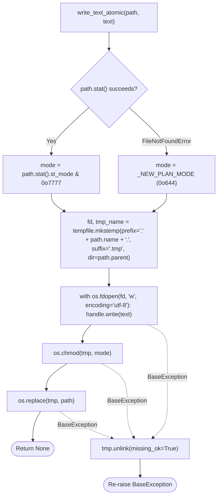

# `nina_planner.plan_utils` — Shared Plan Validation, Atomic Disk Writes & Discovery

[⬆️ Up to Atlas Index](../../README.md) · [⬆️ Core Package](./README.md) · **Callees:** [`config.py`](./config.md) · [`imaging.py`](./imaging.md) · [`models/plan.py`](../models/plan.md) · [`models/profile.py`](../models/profile.md) · [`models/observatory.py`](../models/core-rig-devices.md) · **Callers:** [`tools/plans.py`](../tools/plans.md) · [`tools/sequence.py`](../tools/sequence.md) · [`archive.py`](../cli/archive.md) · [`purge.py`](../cli/purge.md) · [`pin_id.py`](../cli/pin_id.md) · [`scripts/gen_sequence.py`](../scripts-and-skills/scripts.md)

---

## 1. Module Overview

| Attribute | Value |
|---|---|
| **Source File** | `.opencode/local/mcps/nina_planner/nina_planner/plan_utils.py` |
| **Line Count** | 309 lines |
| **Architectural Layer** | Core Domain Service — Plan Persistence, Pre-Flight Validation & Filesystem Discovery |
| **Package** | `nina_planner` |

### Purpose & Module Docstring (`plan_utils.py:1-8`)

`plan_utils.py` centralizes observation-plan validation rules, atomic file persistence, filename sanitization, quality-threshold argument unpacking, and recursive plan file discovery across MCP tools (`write_plan_file`, `load_sequence`, `get_plan_progress`, `audit_plans`, `list_plans`) and CLI utilities (`nina-archive`, `nina-purge`, `nina-pin-id`, `scripts/gen_sequence.py`).

Two architectural invariants govern this module:
1. **Fail-Before-Transmit Pre-Flight Guards (`validate_*` / `require_*` / `check_*`):** Every validation guard raises `ValueError` with an actionable, operator-facing message before any sequence payload is POSTed to N.I.N.A., preventing partial loads or unintended hardware auto-connections on invalid plans.
2. **Pruned, Shallowest-First Plan Discovery (`plan_files`):** Recursive discovery traverses only visible, non-tool directories (`imaging._walk_visible`) and sorts results by `(depth, filename)` so top-level live plans deterministically outrank deeper archived copies (`archive/`) sharing the same `plan_id`.

### Inbound Callers

| Caller Module | Imported Symbols | Call Sites & Usage Context |
|---|---|---|
| `nina_planner/tools/plans.py` | `plan_utils` (`13`) | `write_plan_file` calls `validate_filters` (`188`), `validate_position_angle` (`189`), `sanitize_filename` (`193`), `write_text_atomic` (`197`); `get_plan_progress` calls `load_plan` (`212`), `quality_kwargs` (`221`); `_load_project_plans` calls `plan_files` (`413`), `load_plan` (`418`); `audit_plans` calls `resolve_plan_dir` (`785`), `plan_files` (`823`); `list_plans` calls `resolve_plan_dir` (`1182`). |
| `nina_planner/tools/sequence.py` | `plan_utils` (`6`) | `_full_mode_note` calls `quality_kwargs` (`103`); `_load_many` calls `load_plan` (`235`), `validate_filters` (`252`), `validate_position_angle` (`253`), `check_pointing_index` (`255`), `require_light_capabilities` (`274`), `quality_kwargs` (`281`), `require_parkable` (`389`). |
| `nina_planner/archive.py` | `plan_utils` (`90`) | `_folder_name` calls `sanitize_filename` (`177`, `182`); `run` calls `plan_files` (`955`), `load_plan` (`1008`). |
| `nina_planner/purge.py` | `plan_utils` (`95`) | `run` calls `plan_files` (`823`), `load_plan` (`826`). |
| `nina_planner/pin_id.py` | `plan_utils` (`36`) | `pin_plan_file` calls `load_plan` (`69`), `write_text_atomic` (`82`). |
| `scripts/gen_sequence.py` | `plan_utils` (`44`) | `_generate` calls `load_plan` (`122`), `validate_filters` (`128`), `validate_position_angle` (`129`), `check_pointing_index` (`131`), `require_light_capabilities` (`143`), `quality_kwargs` (`159`), `require_parkable` (`246`). |

### Outbound Imports

| Category | Import Statement | Line(s) | Purpose |
|---|---|---|---|
| **Stdlib** | `import json` | `10` | Parses raw plan JSON payloads in `load_plan`. |
| **Stdlib** | `import os` | `11` | `os.fdopen`, `os.chmod`, and `os.replace` for atomic file replacement in `write_text_atomic`. |
| **Stdlib** | `import re` | `12` | Compiles `_INVALID_FILENAME_CHARS` regex for `sanitize_filename`. |
| **Stdlib** | `import tempfile` | `13` | `tempfile.mkstemp` for creating same-directory sibling temp files in `write_text_atomic`. |
| **Stdlib** | `from pathlib import Path` | `14` | Filesystem path manipulation across persistence and discovery helpers. |
| **Stdlib** | `from typing import Any` | `15` | Return type annotation for `quality_kwargs`. |
| **Third-Party** | `import anyio` | `17` | `anyio.open_file` for non-blocking async file reads in `load_plan`. |
| **Internal** | `from . import config` | `19` | Reads `config.PROJECT_DIR` in `resolve_plan_dir` and `load_plan`. |
| **Internal** | `from .imaging import _walk_visible` | `20` | Pruned directory walker used by `plan_files`. |
| **Internal** | `from .models.observatory import ObservatoryEquipment` | `21` | Type input for `require_parkable`. |
| **Internal** | `from .models.plan import ObservationPlan` | `22` | Pydantic model validated and inspected across plan helpers. |
| **Internal** | `from .models.profile import ObservatoryProfile` | `23` | Profile model inspected by `validate_filters`, `validate_position_angle`, and `require_light_capabilities`. |

### Module-Level Constants (`plan_utils.py:25-27`)

| Constant | Line | Type | Value | Purpose |
|---|---:|---|---|---|
| `_NEW_PLAN_MODE` | `25` | `int` | `0o644` | Default POSIX permission bits applied by `write_text_atomic` when creating a new file that does not yet exist on disk (`rw-r--r--`). |
| `_INVALID_FILENAME_CHARS` | `27` | `re.Pattern[str]` | `re.compile(r'[\\/:*?"<>|\x00-\x1f\x7f]')` | Matches Windows-forbidden filename punctuation (`\`, `/`, `:`, `*`, `?`, `"`, `<`, `>`, `|`) and ASCII control characters (`0x00–0x1F`, `0x7F`). |

---

## 2. Classes, Data Models & Exceptions

`plan_utils.py` defines **no classes, Pydantic models, or custom exception subclasses**.
- It consumes `ObservationPlan`, `ObservatoryProfile`, and `ObservatoryEquipment`.
- All validation guards raise the built-in `ValueError` (or `pydantic.ValidationError`, which inherits from `ValueError`, during `ObservationPlan.model_validate`).
- File I/O operations propagate standard `OSError` / `FileNotFoundError` / `json.JSONDecodeError` (which also inherits from `ValueError`).

---

## 3. Function & Method Reference

| Symbol | Kind | Lines | Summary |
|---|---|---|---|
| [`write_text_atomic`](#31-write_text_atomic) | `def` | `30-53` | Atomically writes UTF-8 text via a sibling `.tmp` file and `os.replace`, preserving existing file mode bits. |
| [`sanitize_filename`](#32-sanitize_filename) | `def` | `56-62` | Replaces Windows-illegal characters and ASCII control chars with `-`. |
| [`validate_filters`](#33-validate_filters) | `async def` | `65-90` | Verifies every filter referenced by light, flat, and autofocus blocks exists in `ObservatoryProfile.filters`. |
| [`validate_position_angle`](#34-validate_position_angle) | `def` | `93-136` | Enforces all-or-none `position_angle_deg` across pointings and requires `profile.equipment.has_rotator` for nonzero rotation. |
| [`check_pointing_index`](#35-check_pointing_index) | `def` | `139-149` | Bounds-checks a 1-based `pointing_index` against `1..len(plan.pointings)`. |
| [`require_parkable`](#36-require_parkable) | `def` | `152-175` | Single authoritative guard requiring `equipment.mount.can_park == True` before sequence emission/load. |
| [`require_light_capabilities`](#37-require_light_capabilities) | `def` | `178-220` | Rejects `action='light'` when the profile lacks a plate solver, guider, or focuser. |
| [`resolve_plan_dir`](#38-resolve_plan_dir) | `def` | `223-232` | Resolves an optional `project_dir` path against `config.PROJECT_DIR` without performing disk I/O. |
| [`plan_files`](#39-plan_files) | `def` | `235-255` | Recursively discovers `*.json` files under `plan_dir` via `_walk_visible`, sorted shallowest-first `(depth, name)`. |
| [`load_plan`](#310-load_plan) | `async def` | `258-287` | Asynchronously reads and validates an `ObservationPlan` JSON file and refuses unexpanded 0-pointing mosaic plans. |
| [`quality_kwargs`](#311-quality_kwargs) | `def` | `290-309` | Extracts `plan.quality` fields into a keyword dict matching `progress.plan_progress` parameters. |

---

### 3.1 `write_text_atomic`

**Location:** `nina_planner/plan_utils.py:30-53`

#### 1. Purpose & Architectural Role
Replaces `path` with `text` atomically via a temporary sibling file in `path.parent` followed by `os.replace`. Used by `write_plan_file` (`tools/plans.py:197`), `pin_plan_file` (`pin_id.py:82`), and archive/manifest writers (`archive.py:218-238` recovery pairs with atomic writes) so a crash, disk-full condition, or interrupted write never truncates an existing plan file or leaves stray `.tmp` files behind.

#### 2. Signature, Decorators & Inputs
```python
def write_text_atomic(path: Path, text: str) -> None:
```
- **Decorators:** None (synchronous function; async callers dispatch via `anyio.to_thread.run_sync` or `client.run_blocking`).
- **`path` (`Path`):** Target file path to create or overwrite. Its parent directory (`path.parent`) must already exist.
- **`text` (`str`):** Full UTF-8 string content to write.

#### 3. Outputs & Return Semantics
- Returns `None`. Upon return, `path` exists on disk with content `text` encoded as UTF-8 and permission bits matching either its previous mode or `_NEW_PLAN_MODE` (`0o644`).

#### 4. Step-by-Step Internal Logic
1. **Probe existing permission mode (`38-41`):** Calls `path.stat().st_mode & 0o7777` inside a `try` block (`38-39`). If `FileNotFoundError` is raised (`40`), falls back to `mode = _NEW_PLAN_MODE` (`0o644`, line `41`).
2. **Create sibling temporary file (`42-45`):** Calls `tempfile.mkstemp(prefix=f".{path.name}.", suffix=".tmp", dir=path.parent)` (`42-44`) so the temporary file is guaranteed to reside on the same mounted filesystem as `path` (a prerequisite for atomic `os.replace`) and starts with a leading dot (`.` prefix) so `_walk_visible` ignores it if another process scans concurrently. Wraps `tmp_name` in `tmp = Path(tmp_name)` (`45`).
3. **Write UTF-8 payload, apply permissions, and atomically rename (`46-50`):**
   - Opens file descriptor `fd` with `os.fdopen(fd, "w", encoding="utf-8")` and writes `text` (`47-48`). Exiting the `with` block flushes and closes `fd`.
   - Applies `os.chmod(tmp, mode)` (`49`) to override `mkstemp`'s restrictive `0o600` default with the preserved mode or `0o644`.
   - Calls `os.replace(tmp, path)` (`50`) for POSIX/Windows atomic replacement.
4. **Cleanup on any exception (`51-53`):** Catches `BaseException` (including `KeyboardInterrupt`, `SystemExit`, `OSError`), unlinks `tmp` via `tmp.unlink(missing_ok=True)` (`52`), and re-raises (`53`).



#### 5. Side Effects & I/O
- Performs synchronous filesystem I/O (`stat`, `mkstemp`, `write`, `chmod`, `replace`, and on failure `unlink`) in `path.parent`.

#### 6. Error Handling & Edge Cases
- **Non-existent `path.parent`:** If `path.parent` does not exist, `tempfile.mkstemp` raises `FileNotFoundError` before creating a temp file.
- **Other `stat()` errors (e.g., `PermissionError`):** Only `FileNotFoundError` is caught at line `40`; permission errors propagate immediately before `mkstemp`.
- **Disk full / interrupted write / `os.replace` failure:** Caught by `except BaseException:` (`51`), which deletes the `.tmp` file (`52`) and leaves the original `path` untouched (`test_pin_id.py:248-264`).
- **File descriptor ownership:** `os.fdopen(fd, ...)` takes ownership of `fd`; if an exception occurs inside the `with` block, `fd` is closed automatically before `tmp.unlink(missing_ok=True)` runs.

#### 7. Complexity & Risk Notes
- **Time & Space Complexity:** $O(|text|)$ sequential disk write.
- **Note on fsync:** `os.fdopen` flushes userspace buffers on close before `os.replace`, ensuring process-crash atomicity without incurring per-file `os.fsync` latency.

---

### 3.2 `sanitize_filename`

**Location:** `nina_planner/plan_utils.py:56-62`

#### 1. Purpose & Architectural Role
Replaces characters forbidden in Windows filenames (`\ / : * ? " < > |`) and ASCII control characters (`0x00–0x1F`, `0x7F`) with `-`. Used when constructing plan JSON filenames (`tools/plans.py:193`) and archive folder names (`archive.py:177, 182`) so generated paths are portable across Windows (where N.I.N.A. runs) and POSIX/macOS/Linux hosts.

#### 2. Signature, Decorators & Inputs
```python
def sanitize_filename(s: str) -> str:
```
- **`s` (`str`):** Raw target name, intent string, or plan identifier.

#### 3. Outputs & Return Semantics
- Returns a `str` of the same length as `s` with every match of `_INVALID_FILENAME_CHARS` replaced by `"-"`.

#### 4. Step-by-Step Internal Logic
1. **Regex substitution (`62`):** Invokes `_INVALID_FILENAME_CHARS.sub("-", s)` and returns the resulting string.

#### 5. Side Effects & I/O
- Pure in-memory string transformation; no I/O.

#### 6. Error Handling & Edge Cases
- Empty strings return `""`.
- Consecutive invalid characters are replaced 1-for-1 with `-` (not collapsed).

#### 7. Complexity & Risk Notes
- **Time Complexity:** $O(|s|)$ single regex pass.

---

### 3.3 `validate_filters`

**Location:** `nina_planner/plan_utils.py:65-90`

#### 1. Purpose & Architectural Role
Pre-flight guard verifying that every optical filter referenced anywhere in an `ObservationPlan` (`light_frames`, `flat_frames`, and `autofocus.reference_filter_name`) is defined in the active `ObservatoryProfile.filters`. Called by `write_plan_file` (`tools/plans.py:188`), `load_sequence` (`tools/sequence.py:252`), and `scripts/gen_sequence.py` (`128`).

#### 2. Signature, Decorators & Inputs
```python
async def validate_filters(plan: ObservationPlan, profile: ObservatoryProfile) -> None:
```
- **Decorators:** None (`async def` coroutine function, though its body performs no `await`).
- **`plan` (`ObservationPlan`):** The validated observation plan to check.
- **`profile` (`ObservatoryProfile`):** The active N.I.N.A. observatory profile containing `profile.filters: list[FilterInfo]`.

#### 3. Outputs & Return Semantics
- Returns `None` if all referenced filter names exist in `profile.filters`.
- Raises `ValueError` if one or more referenced filter names are absent from `profile.filters`.

#### 4. Step-by-Step Internal Logic
1. **Collect profile filter names (`74`):** Builds `profile_filter_names = {f.name for f in profile.filters}`.
2. **Collect plan filter names (`75-83`):**
   - Initializes `plan_filter_names: set[str] = set()` (`75`).
   - Iterates `plan.light_frames` (`76-78`); adds `light.filter_name` if truthy (non-`None`, non-empty).
   - Iterates `plan.flat_frames` (`79-81`); adds `flat.filter_name` if truthy.
   - Checks `plan.autofocus.reference_filter_name` (`82-83`); adds it if truthy.
3. **Compute set difference & raise on unknown (`84-90`):**
   - Computes `unknown = plan_filter_names - profile_filter_names` (`84`).
   - If `unknown` is non-empty (`85`), raises `ValueError` listing `profile.profile_name`, `sorted(unknown)`, and `sorted(profile_filter_names)` (`86-90`).

#### 5. Side Effects & I/O
- Pure in-memory set validation; no I/O or network calls.

#### 6. Error Handling & Edge Cases
- **Filterless rig (`profile.filters == []`):** Passes if and only if the plan specifies no filter names across lights, flats, and autofocus (`plan_filter_names == set()`).
- **Dark and Bias frames:** Dark and bias exposure plans carry no `filter_name` field (`DarkExposurePlan`, `BiasExposurePlan`); `wheel`-variant darks validate the `Dark` slot separately via `sequence/variants.py:validate_dark_variant`.

#### 7. Complexity & Risk Notes
- **Time Complexity:** $O(L + F + P \log P)$ where $L = |\text{light\_frames}|$, $F = |\text{flat\_frames}|$, and $P = |\text{profile.filters}|$.

---

### 3.4 `validate_position_angle`

**Location:** `nina_planner/plan_utils.py:93-136`

#### 1. Purpose & Architectural Role
Enforces the plan's camera rotator rules across all pointings in `plan.pointings`:
1. **All-or-None Consistency:** `position_angle_deg` must be explicitly set (`is not None`) on *every* pointing or omitted (`None`) on *every* pointing.
2. **Hardware Capability Check:** Any pointing where `p.requests_rotation()` is `True` (i.e., `position_angle_deg` is neither `None` nor `0`) requires `profile.equipment.has_rotator == True`. Both `0` and `None` mean "no rotation" and are shared with `sequence/targets.py` via `Pointing.requests_rotation()` so validation and sequence emission never diverge.

#### 2. Signature, Decorators & Inputs
```python
def validate_position_angle(plan: ObservationPlan, profile: ObservatoryProfile) -> None:
```
- **`plan` (`ObservationPlan`):** Plan whose `pointings` list is inspected.
- **`profile` (`ObservatoryProfile`):** Site profile whose `equipment.has_rotator` and `profile_name` are read.

#### 3. Outputs & Return Semantics
- Returns `None` when pointings are consistent and compatible with the rig's rotator configuration.
- Raises `ValueError` on mixed set/unset `position_angle_deg` or when a nonzero rotation angle is requested on a rig without a rotator.

#### 4. Step-by-Step Internal Logic
1. **Partition pointings by `is not None` vs `is None` (`105-112`):**
   - `set_idxs` (`105-109`): 1-based indices `i` where `p.position_angle_deg is not None`.
   - `unset_idxs` (`110-112`): 1-based indices `i` where `p.position_angle_deg is None`.
2. **Enforce all-or-none rule (`113-118`):** If both `set_idxs` and `unset_idxs` are non-empty, raises `ValueError` naming both 1-based index lists (`114-118`).
3. **Collect pointings requesting mechanical rotation (`122-124`):** Builds `nonzero_idxs = [i for i, p in enumerate(plan.pointings, start=1) if p.requests_rotation()]`.
4. **Enforce rotator hardware presence (`125-136`):** If `not profile.equipment.has_rotator and nonzero_idxs` (`125`):
   - Formats human-readable pointing labels (`f"pointing {i} ({p.label})"` if `p.label` else `f"pointing {i}"`, lines `126-130`).
   - Raises `ValueError` naming the offending pointings and `profile.profile_name` (`131-136`).

#### 5. Side Effects & I/O
- Pure in-memory validation; no I/O.

#### 6. Error Handling & Edge Cases
- **`position_angle_deg == 0.0` without a rotator:** `p.requests_rotation()` returns `False` for `0` (`models/pointing.py:78-90`), so a plan where all pointings set `position_angle_deg = 0` passes validation even when `has_rotator=False`.
- **Single-pointing plans:** Cannot fail the mixed set/unset check (`113`) because `len(plan.pointings) == 1`, but still run the `has_rotator` check (`125`).

#### 7. Complexity & Risk Notes
- **Time Complexity:** $O(N)$ where $N = |\text{plan.pointings}|$.

---

### 3.5 `check_pointing_index`

**Location:** `nina_planner/plan_utils.py:139-149`

#### 1. Purpose & Architectural Role
Validates that a 1-based `pointing_index` falls within the inclusive range `1..len(plan.pointings)`. Called by `load_sequence` (`tools/sequence.py:255`) and `scripts/gen_sequence.py` (`131`) before indexing into `plan.pointings`.

#### 2. Signature, Decorators & Inputs
```python
def check_pointing_index(plan: ObservationPlan, pointing_index: int) -> None:
```
- **`plan` (`ObservationPlan`):** Loaded observation plan (guaranteed to have $\ge 1$ pointing after `load_plan`).
- **`pointing_index` (`int`):** 1-based pointing index requested by the caller.

#### 3. Outputs & Return Semantics
- Returns `None` if `1 <= pointing_index <= len(plan.pointings)`.
- Raises `ValueError` otherwise.

#### 4. Step-by-Step Internal Logic
1. **Bounds check (`145-149`):** Checks `if pointing_index < 1 or pointing_index > len(plan.pointings):` (`145`) and raises `ValueError(f"pointing_index={pointing_index} out of range (plan has {len(plan.pointings)} pointings; valid 1..{len(plan.pointings)})")` (`146-149`).

#### 5. Side Effects & I/O
- Pure in-memory bounds check; no I/O.

#### 6. Error Handling & Edge Cases
- Rejects `0` and negative indices as well as indices past `len(plan.pointings)`.

#### 7. Complexity & Risk Notes
- **Time Complexity:** $O(1)$.

---

### 3.6 `require_parkable`

**Location:** `nina_planner/plan_utils.py:152-175`

#### 1. Purpose & Architectural Role
**The single authoritative park capability guard** in the codebase (`plan_utils.py:155-160`). Both `load_sequence` (`tools/sequence.py:389`) and `scripts/gen_sequence.py` (`246`) call this function before transmitting or emitting a sequence. Because every sequence ends with an End-area park instruction (`sequence_end`) and wait stages park before waiting (`sequence_safetynet`, `sequence_wait_until_*`), a mount with `can_park=False` (or `mount=None`) would cause `sequence_park_scope` to emit `[]` while still firing `PARK-STARTING` and `PARK-FINISHED` WebSocket announcements around a no-op instruction list—leaving the telescope unparked while claiming it parked.

#### 2. Signature, Decorators & Inputs
```python
def require_parkable(equipment: ObservatoryEquipment) -> None:
```
- **`equipment` (`ObservatoryEquipment`):** Current equipment state containing `equipment.mount: MountDevice | None`.

#### 3. Outputs & Return Semantics
- Returns `None` if `bool(equipment.mount and equipment.mount.can_park)` is `True`.
- Raises `ValueError` if `equipment.mount` is `None` or `equipment.mount.can_park` is falsy.

#### 4. Step-by-Step Internal Logic
1. **Evaluate park capability (`167`):** Computes `can_park = bool(equipment.mount and equipment.mount.can_park)`.
2. **Return if parkable (`168-169`):** If `can_park` is `True`, returns `None`.
3. **Raise descriptive refusal (`170-175`):** Raises `ValueError` stating `Mount cannot park (can_park=False) — nothing to park: the End area would announce PARK-STARTING/PARK-FINISHED around an instruction list that does nothing. Nothing was loaded.`

#### 5. Side Effects & I/O
- Pure in-memory check; no I/O.

#### 6. Error Handling & Edge Cases
- **Placement in `load_sequence` (`tools/sequence.py:380-389`):** Intentionally called *after* filtering out already-complete `remaining`-mode steps so an all-complete request list returns `"Nothing to load"` without failing on an unparkable/disconnected mount.
- **Direct builder callers:** Low-level builders (`sequence_park_scope`) still return `[]` rather than raising so unit tests inspecting isolated AST fragments can run without a parkable mount fixture (`plan_utils.py:162-165`).

#### 7. Complexity & Risk Notes
- **Time Complexity:** $O(1)$.

---

### 3.7 `require_light_capabilities`

**Location:** `nina_planner/plan_utils.py:178-220`

#### 1. Purpose & Architectural Role
Pre-flight hardware capability guard for `action="light"`. Because `target_payload_lights` (`sequence/targets.py:264-415`) unconditionally emits `slew_and_center` / `slew_center_and_rotate`, `start_guiding` / `stop_guiding`, and `run_autofocus`, a profile missing a plate solver, guider, or focuser would fail hours into the night inside N.I.N.A. This guard refuses the load upfront and aggregates *all* missing capabilities in a single error message. Calibration steps (`dark`, `bias`, `flat`) do not emit those instructions and never call this guard.

#### 2. Signature, Decorators & Inputs
```python
def require_light_capabilities(profile: ObservatoryProfile) -> None:
```
- **`profile` (`ObservatoryProfile`):** Active site profile with `plate_solver`, `blind_plate_solver`, `equipment.has_guider`, and `equipment.has_focuser`.

#### 3. Outputs & Return Semantics
- Returns `None` if at least one plate solver is configured (`plate_solver` or `blind_plate_solver`) AND `has_guider` is `True` AND `has_focuser` is `True`.
- Raises `ValueError` listing all missing capabilities separated by `"; "` otherwise.

#### 4. Step-by-Step Internal Logic
1. **Initialize accumulator (`197`):** `missing: list[str] = []`.
2. **Check plate solver (`198-203`):** If `not (profile.plate_solver or profile.blind_plate_solver)`, appends the plate solver diagnostic string (`199-203`).
3. **Check guider (`204-208`):** If `not profile.equipment.has_guider`, appends the guider diagnostic string (`205-208`).
4. **Check focuser (`209-213`):** If `not profile.equipment.has_focuser`, appends the focuser diagnostic string (`210-213`).
5. **Raise aggregated error (`214-220`):** If `missing` is non-empty, raises `ValueError` joining `missing` with `"; "` and advising the operator to configure them in the N.I.N.A. profile or load a `dark`/`bias`/`flat` step instead.

#### 5. Side Effects & I/O
- Pure in-memory check; no I/O.

#### 6. Error Handling & Edge Cases
- **Either solver suffices (`198`):** Having *either* `profile.plate_solver` (`PlateSolverType`) *or* `profile.blind_plate_solver` (`BlindSolverType`) satisfies the plate-solving requirement.
- **Evaluated before remaining-mode short-circuit (`tools/sequence.py:274`):** Checked before reading `ImageMetaData.csv` so a rig incapable of executing a lights step is always rejected consistently regardless of how many frames remain on disk.

#### 7. Complexity & Risk Notes
- **Time Complexity:** $O(1)$.

---

### 3.8 `resolve_plan_dir`

**Location:** `nina_planner/plan_utils.py:223-232`

#### 1. Purpose & Architectural Role
Resolves an optional caller-supplied `project_dir` string into an absolute `Path` pointing to the directory where observation plan JSON files should be discovered. Used by `audit_plans` (`tools/plans.py:785`) and `list_plans` (`tools/plans.py:1182`).

#### 2. Signature, Decorators & Inputs
```python
def resolve_plan_dir(project_dir: str | None) -> Path:
```
- **`project_dir` (`str | None`):** Optional directory override (absolute or relative to `config.PROJECT_DIR`), or `None`/empty string to select `config.PROJECT_DIR`.

#### 3. Outputs & Return Semantics
- Returns a `Path` object anchored to `config.PROJECT_DIR` when `project_dir` is `None` or relative, or `Path(project_dir)` unchanged when `project_dir` is already absolute.

#### 4. Step-by-Step Internal Logic
1. **Default to `config.PROJECT_DIR` (`229`):** `plan_dir = Path(project_dir) if project_dir else config.PROJECT_DIR`.
2. **Anchor relative path (`230-231`):** If `not plan_dir.is_absolute()`, sets `plan_dir = config.PROJECT_DIR / plan_dir`.
3. **Return (`232`):** Returns `plan_dir`.

#### 5. Side Effects & I/O
- Pure path arithmetic; performs no filesystem I/O and does not require `plan_dir` to exist yet.

#### 6. Error Handling & Edge Cases
- Empty string `""` is falsy and resolves to `config.PROJECT_DIR`.

#### 7. Complexity & Risk Notes
- **Time Complexity:** $O(1)$.

---

### 3.9 `plan_files`

**Location:** `nina_planner/plan_utils.py:235-255`

#### 1. Purpose & Architectural Role
Discovers all `*.json` files recursively under `plan_dir` while pruning hidden directories (`.git`, `.opencode`, `.venv`, `.quarantine`, `.snapshot`) and tool caches (`node_modules`, `__pycache__`) via `imaging._walk_visible`, then sorts the discovered paths **shallowest-first** (`(depth, filename)`).

This ordering is critical for `audit_plans`, `list_plans`, `nina-archive`, and `nina-purge`: when an archived copy of a plan (`archive/m47.json`) sits under the project directory alongside the top-level live plan (`m47.json`), lexicographical sorting would put `archive/m47.json` (`'a'`) before `m47.json` (`'m'`). Sorting by `(len(p.relative_to(plan_dir).parts), p.name)` guarantees the shallowest canonical file always wins ID-claiming passes deterministically.

#### 2. Signature, Decorators & Inputs
```python
def plan_files(plan_dir: Path) -> list[Path]:
```
- **`plan_dir` (`Path`):** Root directory to search for `*.json` files.

#### 3. Outputs & Return Semantics
- Returns `list[Path]` of all `.json` files in visible subdirectories under `plan_dir`, ordered ascending by `(depth_from_plan_dir, filename)`. If `plan_dir` does not exist, returns `[]` (`os.walk` yields nothing).

#### 4. Step-by-Step Internal Logic
1. **Initialize list (`251`):** `found: list[Path] = []`.
2. **Walk visible tree (`252-253`):** Iterates `for directory, filenames in _walk_visible(plan_dir):` and appends `directory / name` for every `name` in `filenames` ending with `".json"`.
3. **Sort shallowest-first (`254`):** Sorts `found` in place with `key=lambda p: (len(p.relative_to(plan_dir).parts), p.name)`. Note that if two files are at the same depth in different subdirectories (e.g., `a/foo.json` and `b/foo.json`), `_walk_visible` visits directories in sorted order (`a` before `b`), and Python's Timsort is stable, preserving directory order on ties of `(depth, p.name)`.
4. **Return (`255`):** Returns `found`.

#### 5. Side Effects & I/O
- Performs synchronous directory traversal via `_walk_visible` (`os.walk` with `followlinks=False`).

#### 6. Error Handling & Edge Cases
- **Symlink loops:** `_walk_visible` uses `os.walk`'s default `followlinks=False`, so directory symlink cycles cannot hang an unattended audit (`242-243`).
- **Hidden `.json` files in visible directories:** `_walk_visible` prunes hidden *directories* but yields all filenames in visible directories; any file ending in `.json` in a visible directory is returned (note `write_text_atomic` uses `.tmp` suffix, so temp files never match `.endswith(".json")`).

#### 7. Complexity & Risk Notes
- **Time Complexity:** $O(D + F \log F)$ where $D$ is the number of visible directory entries and $F$ is the number of `.json` files found.

---

### 3.10 `load_plan`

**Location:** `nina_planner/plan_utils.py:258-287`

#### 1. Purpose & Architectural Role
Asynchronously reads, parses, and validates an observation plan JSON file from disk into an `ObservationPlan` instance, enforcing the **on-disk pointing invariant**: while `ObservationPlan` permits `pointings=[]` when `mosaic` is set (the input shape to `write_plan_file` before mosaic grid expansion), a persisted plan file on disk must *always* contain expanded `pointings`. If `not plan.pointings`, `load_plan` raises `ValueError` rather than letting downstream tools treat a 0-pointing plan as vacuously complete.

#### 2. Signature, Decorators & Inputs
```python
async def load_plan(file_path: str) -> ObservationPlan:
```
- **`file_path` (`str`):** Absolute path or path relative to `config.PROJECT_DIR`.

#### 3. Outputs & Return Semantics
- Returns a validated `ObservationPlan` guaranteed to have `len(plan.pointings) >= 1`.

#### 4. Step-by-Step Internal Logic
1. **Resolve path against `config.PROJECT_DIR` (`270-272`):** Converts `file_path` to `Path(file_path)` (`270`); if `not path.is_absolute()`, prefixes `config.PROJECT_DIR / path` (`271-272`).
2. **Read and parse JSON asynchronously (`273-274`):** Opens `path` using `async with await anyio.open_file(path, "r", encoding="utf-8") as f:` (`273`) and parses `data = json.loads(await f.read())` (`274`).
3. **Validate Pydantic model (`275`):** Calls `plan = ObservationPlan.model_validate(data)`.
4. **Enforce non-empty pointings invariant (`281-286`):** Checks `if not plan.pointings:` (`281`). If empty, raises `ValueError` instructing the caller to re-run `write_plan_file` to expand the mosaic block (`282-286`).
5. **Return validated plan (`287`):** Returns `plan`.

#### 5. Side Effects & I/O
- Reads `path` from the local filesystem asynchronously via `anyio.open_file`.

#### 6. Error Handling & Edge Cases
- **`OSError` / `FileNotFoundError`:** Propagates if `path` does not exist or cannot be opened.
- **`json.JSONDecodeError` (subclass of `ValueError`):** Propagates if the file contains malformed JSON.
- **`pydantic.ValidationError` (subclass of `ValueError`):** Propagates if the JSON violates `ObservationPlan`'s strict schema (`extra="forbid"`, field ranges, etc.).
- **Hand-edited unexpanded mosaic (`pointings: []`):** Refused at lines `281-286` with `ValueError`.

#### 7. Complexity & Risk Notes
- **Time Complexity:** $O(\text{file size})$ I/O and JSON/Pydantic validation.

---

### 3.11 `quality_kwargs`

**Location:** `nina_planner/plan_utils.py:290-309`

#### 1. Purpose & Architectural Role
Single adapter that extracts `plan.quality` (`QualityConfig`) into the exact keyword argument dictionary accepted by `progress.plan_progress`. Centralizing this mapping guarantees that every quality-filtering caller (`get_plan_progress` at `tools/plans.py:221`, `load_sequence` at `tools/sequence.py:103, 281`, and `scripts/gen_sequence.py:159`) applies identical quality thresholds, while raw-disk accounting callers (`audit_plans`, `nina-archive`, `nina-purge`) omit it to count every frame on disk.

#### 2. Signature, Decorators & Inputs
```python
def quality_kwargs(plan: ObservationPlan) -> dict[str, Any]:
```
- **`plan` (`ObservationPlan`):** Loaded observation plan carrying `plan.quality: QualityConfig`.

#### 3. Outputs & Return Semantics
- Returns a 4-key `dict[str, Any]`:
  - `"max_hfr"`: `float | None`
  - `"max_hfr_st_dev"`: `float | None`
  - `"min_detected_stars"`: `int | None`
  - `"max_guiding_rms_arcsec"`: `float | None`

#### 4. Step-by-Step Internal Logic
1. **Bind quality sub-model (`303`):** `q = plan.quality`.
2. **Construct and return keyword dict (`304-309`):** Returns `{"max_hfr": q.max_hfr, "max_hfr_st_dev": q.max_hfr_st_dev, "min_detected_stars": q.min_detected_stars, "max_guiding_rms_arcsec": q.max_guiding_rms_arcsec}`.

#### 5. Side Effects & I/O
- Pure in-memory dictionary construction; no I/O.

#### 6. Error Handling & Edge Cases
- Default `QualityConfig` has all four fields set to `None`, which instructs `plan_progress` / `_quality_accepted` to perform no quality filtering.

#### 7. Complexity & Risk Notes
- **Time Complexity:** $O(1)$.
