# Pydantic Data Models Package (`nina_planner/models/`)

[⬆️ Up to Atlas Index](../../README.md) · [⬅️ File & Symbol Manifest](../../00-inventory/file-and-symbol-manifest.md) · [⬅️ MCP Surface Catalog](../../00-inventory/mcp-surface-catalog.md) · [➡️ Strict & Request Models](./strict-and-request.md) · [➡️ Observation Plan Models](./plan.md) · [➡️ Pointing & Frame Models](./pointing-and-frame.md) · [➡️ Observatory Profile Models](./profile.md) · [➡️ Core Rig Devices](./core-rig-devices.md) · [➡️ Auxiliary & Safety Devices](./auxiliary-and-safety-devices.md)

---

## 1. Package Purpose & Architectural Role

The `nina_planner.models` package (`.opencode/local/mcps/nina_planner/nina_planner/models/`, 20 Python modules totaling 1,750 lines) defines every Pydantic v2 schema used across the `nina-planner` MCP server, the N.I.N.A. Sequence AST compiler (`nina_planner/sequence/`), and the standalone CLI utilities (`nina-archive`, `nina-purge`, `nina-pin-id`, `scripts/gen_sequence.py`).

The package serves two distinct boundary roles:
1. **Strict Caller-Input & Plan-File Contracts (`StrictModel`, `extra="forbid"`):** Validates observation plan JSON files (`ObservationPlan` and its 11 constituent models) and sequence load instructions (`SequenceRequest`). Any unrecognized key is rejected at parse time so typos in exposure keys, quality thresholds, or mosaic options never fail open or silently drop user intent.
2. **Tolerant N.I.N.A. REST API & ASCOM Payload Normalizers (`BaseModel`, default `extra="ignore"`):** Parses live payloads from N.I.N.A.'s Advanced API (`/v2/api/equipment/info`, `/v2/api/profile/show`, `/v2/api/image-history`). These models coerce ASCOM sentinel values (`NaN`, `Int32.MinValue`, `"NaN"`, `24.0`-hour meridian flip sentinels) into clean Python `None`/typed values via `nina_utils.ascom_*`, attach explicit physical unit suffixes (`_c`, `_deg`, `_hours`, `_microns`, `_pct`, `_hpa`, `_mps`, `_mpsas`), and tolerate future upstream fields added by N.I.N.A. or device drivers.

---

## 2. The Validation Boundary: `StrictModel` vs. `BaseModel`

A foundational invariant of `nina_planner/models/` is the deliberate split between `StrictModel` (`models/strict.py:6-16`) and Pydantic's standard `BaseModel`:

| Dimension | `StrictModel` Subclasses (13 classes) | Direct `BaseModel` Subclasses (29 classes) |
|---|---|---|
| **Base Class** | `nina_planner.models.strict.StrictModel` (`models/strict.py:6-16`) | `pydantic.BaseModel` |
| **`model_config`** | `ConfigDict(extra="forbid")` (`models/strict.py:16`) | Default Pydantic v2 (`extra="ignore"`) |
| **Data Source** | User-authored or LLM-authored JSON plan files (`write_plan_file`, `load_plan`) and MCP tool parameters (`load_sequence(request=...)`). | Live HTTP JSON responses from N.I.N.A. (`GET /equipment/info`, `GET /profile/show`, `GET /image-history`). |
| **Unknown-Key Behavior** | Raises `pydantic.ValidationError` (`extra_forbidden`) naming the offending field. | Silently ignores unknown keys so N.I.N.A. version upgrades or extra driver properties never break equipment polling. |
| **Why It Matters** | Prevents silent misconfiguration—e.g., passing `"exposure": 60` instead of `"exposure_time_seconds": 60`, passing `"exposure_time_seconds"` on a sky flat (`FlatExposurePlan`), or passing `"max_hfr"` on `SequenceRequest` instead of `ObservationPlan.quality`. | Prevents brittle crashes when N.I.N.A.'s `CameraInfo`, `MountInfo`, or `ImageHistory` endpoints emit extra metadata keys not modeled by `nina_planner`. |
| **Dual-Presence Module** | `models/pointing.py` defines `Pointing(StrictModel)` (`pointing.py:30-90`) for plan files. | `models/pointing.py` also defines `PointingInfo(BaseModel)` (`pointing.py:10-27`) for live mount telemetry (`MountDevice.pointing`). |

```mermaid
flowchart LR
    subgraph StrictBoundary["Strict Caller / Plan Boundary (extra='forbid')"]
        direction TB
        SM["StrictModel\n(models/strict.py:6-16)\nConfigDict(extra='forbid')"]
        SR["SequenceRequest\n(models/request.py:38-124)"]
        OP["ObservationPlan\n(models/plan.py:238-455)"]
        PT["Pointing\n(models/pointing.py:30-90)"]
        SUB["10 Sub-Models in models/plan.py\n(Light/Flat/Dark/BiasExposurePlan,\nAutofocus/Guiding/Cooler/Constraints/\nQuality/MosaicConfig)"]
        SM --> SR
        SM --> OP
        SM --> PT
        SM --> SUB
        OP *-- PT
        OP *-- SUB
    end

    subgraph TolerantBoundary["Tolerant N.I.N.A. API Boundary (BaseModel, extra='ignore')"]
        direction TB
        BM["pydantic.BaseModel"]
        PROF["ObservatoryProfile & 4 Sub-Models\n(models/profile.py:14-143)\n+ Horizon (horizon.py:32-96)"]
        FRAME["FrameStats\n(models/frame.py:53-109)"]
        EQ["ObservatoryEquipment\n(models/observatory.py:20-38)"]
        DEV["11 Device Models & 11 Sub-Models\n(camera, mount, meridian, pointing.PointingInfo,\nfocuser, filter_wheel, guider, rotator,\ndome, switch, flat_device, weather, safety_monitor)"]
        BM --> PROF
        BM --> FRAME
        BM --> EQ
        BM --> DEV
        EQ *-- DEV
    end
```

---

## 3. Complete 20-Module Inventory (`nina_planner/models/`)

| # | Module File | Lines | Classes (`start-end`) | Functions / Validators / Properties (`start-end`) | Module Constants (`line`) | Target Specification Doc |
|---:|---|---:|---|---|---|---|
| 1 | `__init__.py` | 66 | *(re-exports 31 symbols)* | *(none)* | `__all__` (`34-66`) | [This Document (§5)](#5-package-re-export-surface-nina_plannermodels__init__py) |
| 2 | `strict.py` | 16 | `StrictModel(BaseModel)` (`6-16`) | *(none)* | *(none)* | [`strict-and-request.md`](./strict-and-request.md) |
| 3 | `request.py` | 124 | `SequenceRequest(StrictModel)` (`38-124`) | `SequenceRequest._check_variant` (`100-124`) | `Action` (`13-18`), `DARK_VARIANTS` (`23`), `VARIANTS` (`30-35`) | [`strict-and-request.md`](./strict-and-request.md) |
| 4 | `plan.py` | 455 | `LightExposurePlan` (`33-38`), `FlatExposurePlan` (`41-48`), `DarkExposurePlan` (`51-55`), `BiasExposurePlan` (`58-61`), `AutofocusConfig` (`64-71`), `GuidingConfig` (`74-86`), `CoolerConfig` (`89-98`), `ConstraintsConfig` (`101-115`), `QualityConfig` (`118-149`), `MosaicConfig` (`155-235`), `ObservationPlan` (`238-455`) | `ObservationPlan._pointings_or_mosaic` (`343-357`), `_plan_id_charset` (`359-375`), `_base_plan_id` (`377-382`), `per_pointing_plan_id` (`384-391`), `effective_plan_id` (`393-404`), `attribution_token` (`406-417`), `plan_token` (`419-425`), `target_prefix` (`427-440`), `calibration_prefix` (`442-455`) | `_PLAN_ID_ALLOWED` (`22`), `ATTRIBUTION_RE` (`30`) | [`plan.md`](./plan.md) |
| 5 | `pointing.py` | 90 | `PointingInfo(BaseModel)` (`10-27`), `Pointing(StrictModel)` (`30-90`) | `Pointing.requests_rotation` (`78-90`) | *(none)* | [`pointing-and-frame.md`](./pointing-and-frame.md) |
| 6 | `frame.py` | 109 | `FrameStats(BaseModel)` (`53-109`) | `FrameStats._normalize` (`92-109`) | `_FIELD_MAP` (`15-38`), `_FLOAT_FIELDS` (`40-49`), `_INT_FIELDS` (`50`) | [`pointing-and-frame.md`](./pointing-and-frame.md) |
| 7 | `profile.py` | 143 | `FilterInfo` (`14-19`), `SiteLocationInfo` (`22-27`), `EquipmentConfig` (`30-43`), `OpticalTrainInfo` (`46-91`), `ObservatoryProfile` (`94-143`) | `OpticalTrainInfo.fov_deg` (`58-84`), `OpticalTrainInfo._compute_fov` (`86-91`), `ObservatoryProfile.local_image_save_path` (`119-128`), `ObservatoryProfile.filter_position` (`130-143`) | *(none)* | [`profile.md`](./profile.md) |
| 8 | `observatory.py` | 38 | `ObservatoryEquipment(BaseModel)` (`20-38`) | *(none)* | *(none)* | [`core-rig-devices.md`](./core-rig-devices.md) |
| 9 | `camera.py` | 220 | `SensorInfo` (`36-43`), `GainInfo` (`46-53`), `ExposureInfo` (`56-62`), `OffsetInfo` (`65-71`), `BinningInfo` (`74-78`), `ThermalInfo` (`81-90`), `ReadoutInfo` (`93-97`), `CameraDevice` (`100-220`) | `_binning_axis` (`12-16`), `_parse_binning_mode` (`19-33`), `CameraDevice._derive_fields` (`125-220`) | *(none)* | [`core-rig-devices.md`](./core-rig-devices.md) |
| 10 | `mount.py` | 77 | `MountDevice(BaseModel)` (`12-77`) | `MountDevice._derive_fields` (`33-77`) | *(none)* | [`core-rig-devices.md`](./core-rig-devices.md) |
| 11 | `meridian.py` | 12 | `MeridianInfo(BaseModel)` (`8-12`) | *(none)* | *(none)* | [`core-rig-devices.md`](./core-rig-devices.md) |
| 12 | `focuser.py` | 40 | `FocuserDevice(BaseModel)` (`10-40`) | `FocuserDevice._derive_fields` (`28-40`) | *(none)* | [`core-rig-devices.md`](./core-rig-devices.md) |
| 13 | `filter_wheel.py` | 29 | `FilterWheelDevice(BaseModel)` (`8-29`) | `FilterWheelDevice._derive_fields` (`22-29`) | *(none)* | [`core-rig-devices.md`](./core-rig-devices.md) |
| 14 | `guider.py` | 69 | `GuiderMetric(BaseModel)` (`10-14`), `GuiderDevice(BaseModel)` (`17-69`) | `GuiderDevice._derive_fields` (`36-69`, inner `_build_metric` at `53-61`) | *(none)* | [`core-rig-devices.md`](./core-rig-devices.md) |
| 15 | `rotator.py` | 51 | `RotatorDevice(BaseModel)` (`10-51`) | `RotatorDevice._derive_fields` (`25-51`) | *(none)* | [`auxiliary-and-safety-devices.md`](./auxiliary-and-safety-devices.md) |
| 16 | `dome.py` | 67 | `DomeDevice(BaseModel)` (`10-49`) | `DomeDevice._derive_fields` (`28-49`), `compute_dome_status` (`52-67`) | *(none)* | [`auxiliary-and-safety-devices.md`](./auxiliary-and-safety-devices.md) |
| 17 | `switch.py` | 55 | `ReadonlySwitchInfo` (`8-14`), `WritableSwitchInfo` (`17-40`), `Switch` (`43-55`) | `WritableSwitchInfo.is_on` (`29-40`) | *(none)* | [`auxiliary-and-safety-devices.md`](./auxiliary-and-safety-devices.md) |
| 18 | `flat_device.py` | 27 | `FlatDevice(BaseModel)` (`8-27`) | *(none)* | *(none)* | [`auxiliary-and-safety-devices.md`](./auxiliary-and-safety-devices.md) |
| 19 | `weather.py` | 48 | `Weather(BaseModel)` (`10-48`) | `Weather._derive_fields` (`33-48`) | *(none)* | [`auxiliary-and-safety-devices.md`](./auxiliary-and-safety-devices.md) |
| 20 | `safety_monitor.py` | 19 | `SafetyMonitorDevice(BaseModel)` (`8-19`) | *(none)* | *(none)* | [`auxiliary-and-safety-devices.md`](./auxiliary-and-safety-devices.md) |

---

## 4. Complete Model Hierarchy (`classDiagram`)

```mermaid
classDiagram
    direction TB

    class BaseModel {
        <<pydantic.BaseModel>>
    }

    class StrictModel {
        <<models/strict.py:6-16>>
        +ConfigDict model_config = extra="forbid"
    }
    BaseModel <|-- StrictModel

    %% --- StrictModel Hierarchy (Plan & Request) ---
    class SequenceRequest {
        <<models/request.py:38-124>>
        +str|None plan = None
        +Action action = "light"
        +str|None variant = None
        +int|None pointing_index = None
        +str mode = "remaining"
        +_check_variant() SequenceRequest
    }
    StrictModel <|-- SequenceRequest

    class ObservationPlan {
        <<models/plan.py:238-455>>
        +str target = ""
        +str intent = ""
        +str plan_id = ""
        +str description = ""
        +list~Pointing~ pointings
        +MosaicConfig|None mosaic = None
        +int batch_size = 5
        +int calibration_window_days = 7
        +CoolerConfig cooler
        +ConstraintsConfig constraints
        +AutofocusConfig autofocus
        +GuidingConfig guiding
        +QualityConfig quality
        +list~LightExposurePlan~ light_frames
        +list~FlatExposurePlan~ flat_frames
        +list~DarkExposurePlan~ dark_frames
        +list~BiasExposurePlan~ bias_frames
        +_pointings_or_mosaic() ObservationPlan
        +_plan_id_charset(v) str
        +_base_plan_id() str
        +per_pointing_plan_id(pointing_index) str
        +effective_plan_id(pointing_index) str
        +attribution_token(pointing_index) str
        +plan_token() str
        +target_prefix(label) str
        +calibration_prefix() str
    }
    StrictModel <|-- ObservationPlan

    class Pointing {
        <<models/pointing.py:30-90>>
        +str|None label = None
        +float ra_hours
        +float dec_deg
        +float|None position_angle_deg = None
        +int|None row = None
        +int|None column = None
        +requests_rotation() bool
    }
    StrictModel <|-- Pointing

    class MosaicConfig {
        <<models/plan.py:155-235>>
        +float center_ra_hours
        +float center_dec_deg
        +float coverage_width_arcmins
        +float coverage_height_arcmins
        +float overlap_pct = 20.0
        +float pa_deg = 0.0
        +int|None cols = None
        +int|None rows = None
        +tuple~float,float~|None pane_fov_arcmins = None
    }
    StrictModel <|-- MosaicConfig

    class LightExposurePlan {
        <<models/plan.py:33-38>>
        +str filter_name
        +float exposure_time_seconds
        +int total_count
    }
    class FlatExposurePlan {
        <<models/plan.py:41-48>>
        +str filter_name
        +int total_count
    }
    class DarkExposurePlan {
        <<models/plan.py:51-55>>
        +float exposure_time_seconds
        +int total_count
    }
    class BiasExposurePlan {
        <<models/plan.py:58-61>>
        +int total_count
    }
    class AutofocusConfig {
        <<models/plan.py:64-71>>
        +str reference_filter_name = "L"
        +int hfr_increase_sample_size = 3
        +float hfr_increase_threshold_percent = 15.0
        +int every_n_exposures = 10
        +float threshold_celsius = 1.0
    }
    class GuidingConfig {
        <<models/plan.py:74-86>>
        +int dither_every_n_exposures = 2
        +int check_drift_every_n_exposures = 6
        +float max_drift_arcmin = 1.5
    }
    class CoolerConfig {
        <<models/plan.py:89-98>>
        +bool on = True
        +float setpoint_celsius = -10.0
    }
    class ConstraintsConfig {
        <<models/plan.py:101-115>>
        +float min_altitude = 30.0
        +float horizon_offset_degrees = 2.0
    }
    class QualityConfig {
        <<models/plan.py:118-149>>
        +float|None max_hfr = None
        +float|None max_hfr_st_dev = None
        +int|None min_detected_stars = None
        +float|None max_guiding_rms_arcsec = None
    }

    StrictModel <|-- LightExposurePlan
    StrictModel <|-- FlatExposurePlan
    StrictModel <|-- DarkExposurePlan
    StrictModel <|-- BiasExposurePlan
    StrictModel <|-- AutofocusConfig
    StrictModel <|-- GuidingConfig
    StrictModel <|-- CoolerConfig
    StrictModel <|-- ConstraintsConfig
    StrictModel <|-- QualityConfig

    ObservationPlan *-- "0..*" Pointing : pointings
    ObservationPlan *-- "0..1" MosaicConfig : mosaic
    ObservationPlan *-- "1" CoolerConfig : cooler
    ObservationPlan *-- "1" ConstraintsConfig : constraints
    ObservationPlan *-- "1" AutofocusConfig : autofocus
    ObservationPlan *-- "1" GuidingConfig : guiding
    ObservationPlan *-- "1" QualityConfig : quality
    ObservationPlan *-- "1..*" LightExposurePlan : light_frames
    ObservationPlan *-- "1..*" FlatExposurePlan : flat_frames
    ObservationPlan *-- "1..*" DarkExposurePlan : dark_frames
    ObservationPlan *-- "1..*" BiasExposurePlan : bias_frames

    %% --- BaseModel Hierarchy (Profile, Frame, Equipment) ---
    class ObservatoryProfile {
        <<models/profile.py:94-143>>
        +str profile_name
        +str profile_id
        +SiteLocationInfo site
        +OpticalTrainInfo optics
        +list~FilterInfo~ filters
        +str image_save_path
        +EquipmentConfig equipment
        +Horizon horizon
        +local_image_save_path() str
        +filter_position(name) int
    }
    class SiteLocationInfo {
        <<models/profile.py:22-27>>
    }
    class OpticalTrainInfo {
        <<models/profile.py:46-91>>
        +fov_deg() tuple|None
        +_compute_fov() Self
    }
    class FilterInfo {
        <<models/profile.py:14-19>>
    }
    class EquipmentConfig {
        <<models/profile.py:30-43>>
    }
    class FrameStats {
        <<models/frame.py:53-109>>
        +_normalize(data) object
    }
    class ObservatoryEquipment {
        <<models/observatory.py:20-38>>
        +MountDevice|None mount
        +CameraDevice|None camera
        +FocuserDevice|None focuser
        +GuiderDevice|None guider
        +FilterWheelDevice|None filter_wheel
        +FlatDevice|None flat_device
        +RotatorDevice|None rotator
        +DomeDevice|None dome
        +Weather|None weather
        +SafetyMonitorDevice|None safety_monitor
        +Switch|None switch
    }

    BaseModel <|-- ObservatoryProfile
    BaseModel <|-- SiteLocationInfo
    BaseModel <|-- OpticalTrainInfo
    BaseModel <|-- FilterInfo
    BaseModel <|-- EquipmentConfig
    BaseModel <|-- FrameStats
    BaseModel <|-- ObservatoryEquipment

    ObservatoryProfile *-- SiteLocationInfo
    ObservatoryProfile *-- OpticalTrainInfo
    ObservatoryProfile *-- FilterInfo
    ObservatoryProfile *-- EquipmentConfig

    class CameraDevice {
        <<models/camera.py:100-220>>
    }
    class SensorInfo {
        <<models/camera.py:36-43>>
    }
    class GainInfo {
        <<models/camera.py:46-53>>
    }
    class ExposureInfo {
        <<models/camera.py:56-62>>
    }
    class OffsetInfo {
        <<models/camera.py:65-71>>
    }
    class BinningInfo {
        <<models/camera.py:74-78>>
    }
    class ThermalInfo {
        <<models/camera.py:81-90>>
    }
    class ReadoutInfo {
        <<models/camera.py:93-97>>
    }
    class MountDevice {
        <<models/mount.py:12-77>>
    }
    class MeridianInfo {
        <<models/meridian.py:8-12>>
    }
    class PointingInfo {
        <<models/pointing.py:10-27>>
    }
    class FocuserDevice {
        <<models/focuser.py:10-40>>
    }
    class FilterWheelDevice {
        <<models/filter_wheel.py:8-29>>
    }
    class GuiderDevice {
        <<models/guider.py:17-69>>
    }
    class GuiderMetric {
        <<models/guider.py:10-14>>
    }
    class RotatorDevice {
        <<models/rotator.py:10-51>>
    }
    class DomeDevice {
        <<models/dome.py:10-49>>
    }
    class Switch {
        <<models/switch.py:43-55>>
    }
    class WritableSwitchInfo {
        <<models/switch.py:17-40>>
    }
    class ReadonlySwitchInfo {
        <<models/switch.py:8-14>>
    }
    class FlatDevice {
        <<models/flat_device.py:8-27>>
    }
    class Weather {
        <<models/weather.py:10-48>>
    }
    class SafetyMonitorDevice {
        <<models/safety_monitor.py:8-19>>
    }

    BaseModel <|-- CameraDevice
    BaseModel <|-- SensorInfo
    BaseModel <|-- GainInfo
    BaseModel <|-- ExposureInfo
    BaseModel <|-- OffsetInfo
    BaseModel <|-- BinningInfo
    BaseModel <|-- ThermalInfo
    BaseModel <|-- ReadoutInfo
    BaseModel <|-- MountDevice
    BaseModel <|-- MeridianInfo
    BaseModel <|-- PointingInfo
    BaseModel <|-- FocuserDevice
    BaseModel <|-- FilterWheelDevice
    BaseModel <|-- GuiderDevice
    BaseModel <|-- GuiderMetric
    BaseModel <|-- RotatorDevice
    BaseModel <|-- DomeDevice
    BaseModel <|-- Switch
    BaseModel <|-- WritableSwitchInfo
    BaseModel <|-- ReadonlySwitchInfo
    BaseModel <|-- FlatDevice
    BaseModel <|-- Weather
    BaseModel <|-- SafetyMonitorDevice

    ObservatoryEquipment *-- CameraDevice
    ObservatoryEquipment *-- MountDevice
    ObservatoryEquipment *-- FocuserDevice
    ObservatoryEquipment *-- FilterWheelDevice
    ObservatoryEquipment *-- GuiderDevice
    ObservatoryEquipment *-- RotatorDevice
    ObservatoryEquipment *-- DomeDevice
    ObservatoryEquipment *-- Switch
    ObservatoryEquipment *-- FlatDevice
    ObservatoryEquipment *-- Weather
    ObservatoryEquipment *-- SafetyMonitorDevice

    CameraDevice *-- SensorInfo
    CameraDevice *-- GainInfo
    CameraDevice *-- ExposureInfo
    CameraDevice *-- OffsetInfo
    CameraDevice *-- BinningInfo
    CameraDevice *-- ThermalInfo
    CameraDevice *-- ReadoutInfo
    MountDevice *-- MeridianInfo
    MountDevice *-- PointingInfo
    GuiderDevice *-- GuiderMetric
    Switch *-- WritableSwitchInfo
    Switch *-- ReadonlySwitchInfo
```



---

## 5. Package Re-Export Surface (`nina_planner/models/__init__.py`)

### 5.1 Module Header & Location
- **File Path:** `.opencode/local/mcps/nina_planner/nina_planner/models/__init__.py`
- **Line Count:** 66 lines (`1-66`)
- **Module Docstring (`line 1`):** `"""Pydantic models for N.I.N.A. plans, profile, and connected equipment."""`

### 5.2 Re-Exported Symbols (`__all__` at `models/__init__.py:34-66`)

`nina_planner/models/__init__.py` re-exports **31** symbols from 16 sibling modules in alphabetical order inside `__all__`:

| Symbol | Source Module (`lines`) | Kind | Exported in `models.__all__`? |
|---|---|---|---|
| `BinningInfo` | `.camera` (`3-12`) | `BaseModel` subclass (`camera.py:74-78`) | Yes (`line 35`) |
| `CameraDevice` | `.camera` (`3-12`) | `BaseModel` subclass (`camera.py:100-220`) | Yes (`line 36`) |
| `DomeDevice` | `.dome` (`13`) | `BaseModel` subclass (`dome.py:10-49`) | Yes (`line 37`) |
| `ExposureInfo` | `.camera` (`3-12`) | `BaseModel` subclass (`camera.py:56-62`) | Yes (`line 38`) |
| `FilterInfo` | `.profile` (`23-28`) | `BaseModel` subclass (`profile.py:14-19`) | Yes (`line 39`) |
| `FilterWheelDevice` | `.filter_wheel` (`14`) | `BaseModel` subclass (`filter_wheel.py:8-29`) | Yes (`line 40`) |
| `FlatDevice` | `.flat_device` (`15`) | `BaseModel` subclass (`flat_device.py:8-27`) | Yes (`line 41`) |
| `FocuserDevice` | `.focuser` (`16`) | `BaseModel` subclass (`focuser.py:10-40`) | Yes (`line 42`) |
| `FrameStats` | `.frame` (`17`) | `BaseModel` subclass (`frame.py:53-109`) | Yes (`line 43`) |
| `GainInfo` | `.camera` (`3-12`) | `BaseModel` subclass (`camera.py:46-53`) | Yes (`line 44`) |
| `GuiderDevice` | `.guider` (`18`) | `BaseModel` subclass (`guider.py:17-69`) | Yes (`line 45`) |
| `GuiderMetric` | `.guider` (`18`) | `BaseModel` subclass (`guider.py:10-14`) | Yes (`line 46`) |
| `MeridianInfo` | `.meridian` (`19`) | `BaseModel` subclass (`meridian.py:8-12`) | Yes (`line 47`) |
| `MountDevice` | `.mount` (`20`) | `BaseModel` subclass (`mount.py:12-77`) | Yes (`line 48`) |
| `ObservatoryEquipment` | `.observatory` (`21`) | `BaseModel` subclass (`observatory.py:20-38`) | Yes (`line 49`) |
| `ObservatoryProfile` | `.profile` (`23-28`) | `BaseModel` subclass (`profile.py:94-143`) | Yes (`line 50`) |
| `OffsetInfo` | `.camera` (`3-12`) | `BaseModel` subclass (`camera.py:65-71`) | Yes (`line 51`) |
| `OpticalTrainInfo` | `.profile` (`23-28`) | `BaseModel` subclass (`profile.py:46-91`) | Yes (`line 52`) |
| `Pointing` | `.pointing` (`22`) | `StrictModel` subclass (`pointing.py:30-90`) | Yes (`line 53`) |
| `PointingInfo` | `.pointing` (`22`) | `BaseModel` subclass (`pointing.py:10-27`) | Yes (`line 54`) |
| `ReadonlySwitchInfo` | `.switch` (`31`) | `BaseModel` subclass (`switch.py:8-14`) | Yes (`line 55`) |
| `ReadoutInfo` | `.camera` (`3-12`) | `BaseModel` subclass (`camera.py:93-97`) | Yes (`line 56`) |
| `RotatorDevice` | `.rotator` (`29`) | `BaseModel` subclass (`rotator.py:10-51`) | Yes (`line 57`) |
| `SafetyMonitorDevice` | `.safety_monitor` (`30`) | `BaseModel` subclass (`safety_monitor.py:8-19`) | Yes (`line 58`) |
| `SensorInfo` | `.camera` (`3-12`) | `BaseModel` subclass (`camera.py:36-43`) | Yes (`line 59`) |
| `SiteLocationInfo` | `.profile` (`23-28`) | `BaseModel` subclass (`profile.py:22-27`) | Yes (`line 60`) |
| `Switch` | `.switch` (`31`) | `BaseModel` subclass (`switch.py:43-55`) | Yes (`line 61`) |
| `ThermalInfo` | `.camera` (`3-12`) | `BaseModel` subclass (`camera.py:81-90`) | Yes (`line 62`) |
| `Weather` | `.weather` (`32`) | `BaseModel` subclass (`weather.py:10-48`) | Yes (`line 63`) |
| `WritableSwitchInfo` | `.switch` (`31`) | `BaseModel` subclass (`switch.py:17-40`) | Yes (`line 64`) |
| `compute_dome_status` | `.dome` (`13`) | Helper function (`dome.py:52-67`) | Yes (`line 65`) |

### 5.3 Symbols Imported Directly from Submodules (Not Re-Exported in `models/__init__.py`)
The following symbols are intentionally imported directly from their defining submodules (`from .models.plan import ...`, `from .models.request import ...`, `from .models.profile import EquipmentConfig`):
- **`models/strict.py`:** `StrictModel`
- **`models/request.py`:** `SequenceRequest`, `Action`, `DARK_VARIANTS`, `VARIANTS`
- **`models/plan.py`:** `ObservationPlan`, `MosaicConfig`, `QualityConfig`, `ConstraintsConfig`, `CoolerConfig`, `GuidingConfig`, `AutofocusConfig`, `LightExposurePlan`, `FlatExposurePlan`, `DarkExposurePlan`, `BiasExposurePlan`, `ATTRIBUTION_RE`, `_PLAN_ID_ALLOWED`
- **`models/profile.py`:** `EquipmentConfig`
- **`models/camera.py`:** `_binning_axis`, `_parse_binning_mode`

---

## 6. Deep-Dive Module Documentation Index

1. **[`strict-and-request.md` — `strict.py` & `request.py` Specification](./strict-and-request.md)**
   `StrictModel`, `Action`, `DARK_VARIANTS`, `VARIANTS`, `SequenceRequest`, and `SequenceRequest._check_variant`.
2. **[`plan.md` — `plan.py` Observation Plan Schema Specification](./plan.md)**
   `_PLAN_ID_ALLOWED`, `ATTRIBUTION_RE`, all 10 configuration/exposure sub-models (`LightExposurePlan`, `FlatExposurePlan`, `DarkExposurePlan`, `BiasExposurePlan`, `AutofocusConfig`, `GuidingConfig`, `CoolerConfig`, `ConstraintsConfig`, `QualityConfig`, `MosaicConfig`), and `ObservationPlan` with all 9 validators and identity/token/prefix methods.
3. **[`pointing-and-frame.md` — `pointing.py` & `frame.py` Specification](./pointing-and-frame.md)**
   `PointingInfo`, `Pointing`, `Pointing.requests_rotation`, `_FIELD_MAP`, `_FLOAT_FIELDS`, `_INT_FIELDS`, `FrameStats`, and `FrameStats._normalize`.
4. **[`profile.md` — `profile.py` Observatory Profile Specification](./profile.md)**
   `FilterInfo`, `SiteLocationInfo`, `EquipmentConfig`, `OpticalTrainInfo` (`fov_deg`, `_compute_fov`), and `ObservatoryProfile` (`local_image_save_path`, `filter_position`).
5. **[`core-rig-devices.md` — Core Imaging & Tracking Rig Devices](./core-rig-devices.md)**
   `observatory.py`, `camera.py`, `mount.py`, `meridian.py`, `focuser.py`, `filter_wheel.py`, and `guider.py`.
6. **[`auxiliary-and-safety-devices.md` — Enclosure, Environmental & Auxiliary Devices](./auxiliary-and-safety-devices.md)**
   `rotator.py`, `dome.py`, `switch.py`, `flat_device.py`, `weather.py`, and `safety_monitor.py`.
