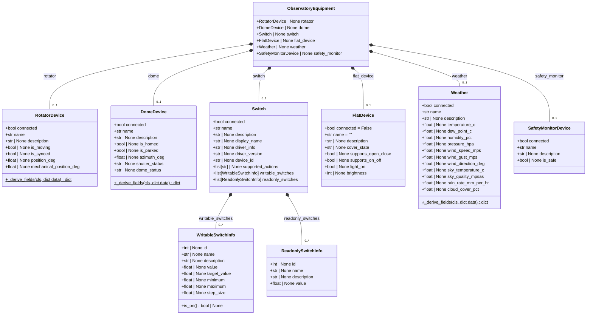

# Auxiliary & Safety Device Models Reference (`rotator.py`, `dome.py`, `switch.py`, `flat_device.py`, `weather.py`, `safety_monitor.py`)

[⬆️ Up to Atlas Index](../../README.md) · [⬆️ Models Package](./README.md) · [⬅️ Core Rig Devices](./core-rig-devices.md) · [➡️ Pointing & Frame Models](./pointing-and-frame.md) · [➡️ Equipment Tools](../tools/equipment.md) · [➡️ ASCOM Coercion Utilities](../core/nina_utils.md)

This document provides the complete module, class, field, validator, computed property, and helper function reference for the six auxiliary, calibration, environmental, and safety device modules under `.opencode/local/mcps/nina_planner/nina_planner/models/`:

1. [`rotator.py`](#1-module-rotatorpy) — Camera rotator model (`RotatorDevice`) normalizing sky and mechanical angles in degrees and multi-driver sync state (`is_synced` / `synced` / `sync_state`).
2. [`dome.py`](#2-module-domepy) — Observatory dome / roll-off roof controller model (`DomeDevice`) and status state-machine function (`compute_dome_status`).
3. [`switch.py`](#3-module-switchpy) — Power/relay/dew switch hub model (`Switch`), read-only switch (`ReadonlySwitchInfo`), and writable switch (`WritableSwitchInfo`) with strict binary `is_on` `@computed_field`.
4. [`flat_device.py`](#4-module-flat_devicepy) — Flat-field panel / motorized dust cover model (`FlatDevice`) with defensive default fields for dark/bias `"cover"` variant gating.
5. [`weather.py`](#5-module-weatherpy) — Environmental weather station model (`Weather`) mapping 11 ASCOM sensor readings onto explicit physical-unit fields.
6. [`safety_monitor.py`](#6-module-safety_monitorpy) — Observatory enclosure safety gate model (`SafetyMonitorDevice` carrying `is_safe`).

---

## Architecture & Cross-Module Relationships



---

## 1. Module: `rotator.py`

[⬆️ Top](#auxiliary--safety-device-models-reference-rotatorpy-domepy-switchpy-flat_devicepy-weatherpy-safety_monitorpy) · **Callers:** [`observatory.py`](./core-rig-devices.md#1-module-observatorypy), [`tools/equipment.py`](../tools/equipment.md) · **Callees:** [`nina_utils.py`](../core/nina_utils.md)

### Module Overview
- **File Path:** `.opencode/local/mcps/nina_planner/nina_planner/models/rotator.py`
- **Line Count:** 51 lines
- **Module Docstring:** `"Rotator device model: mechanical and reported position in degrees."`
- **Architectural Layer:** Domain Data Models (`nina_planner.models`) — Represents the camera field rotator (`RotatorDevice`) reported by `GET /equipment/info`, normalizing both sky-synced and raw mechanical angles to degrees (`_deg`) and reconciling multi-driver synchronization flags.
- **Inbound Callers:**
  - `nina_planner/models/__init__.py:29` (re-export as `RotatorDevice`)
  - `nina_planner/models/observatory.py:14, 34` (`ObservatoryEquipment.rotator`)
  - `nina_planner/tools/equipment.py:92, 109, 165` (`_get_site_equipment_status`)
- **Outbound Imports:**
  - `from __future__ import annotations` (line 3)
  - `from pydantic import BaseModel, model_validator` (line 5)
  - `from ..nina_utils import ascom_float` (line 7)

### Classes, Data Models & Exceptions

#### `RotatorDevice(BaseModel)` (`rotator.py:10-51`)
Connected field rotator as reported by `GET /equipment/info`.

| Field | Type | Default | Lines | Purpose / Semantics |
| :--- | :--- | :--- | :--- | :--- |
| `connected` | `bool` | *(required)* | 17 | Whether the rotator driver is connected in N.I.N.A. |
| `name` | `str` | *(required)* | 18 | Rotator device name. |
| `description` | `str \| None` | `None` | 19 | Rotator driver description. |
| `is_moving` | `bool \| None` | `None` | 20 | `True` while the rotator motor is actively turning. |
| `is_synced` | `bool \| None` | `None` | 21 | Whether the rotator's sky position angle has been synchronized to a plate solve. Derived from `is_synced`, boolean `synced`, or string/boolean `sync_state`. |
| `position_deg` | `float \| None` | `None` | 22 | Sky-synced position angle in degrees (`position` via `ascom_float`). |
| `mechanical_position_deg` | `float \| None` | `None` | 23 | Raw hardware mechanical angle in degrees (`mechanical_position` via `ascom_float`). |

---

### Function & Method Reference

#### 1.1 `RotatorDevice._derive_fields` (`rotator.py:25-51`)

1. **Purpose & Architectural Role**
   Pydantic `mode="before"` model validator that maps `position` -> `position_deg`, `mechanical_position` -> `mechanical_position_deg`, and resolves `is_synced` across three driver conventions (`is_synced`, `synced`, and `sync_state`).

2. **Signature, Decorators & Inputs**
   ```python
   @model_validator(mode="before")
   @classmethod
   def _derive_fields(cls, data: dict) -> dict:
   ```
   - Decorators: `@model_validator(mode="before")`, `@classmethod`.
   - `cls`: `type[RotatorDevice]`.
   - `data: dict` — Raw snake-cased rotator dictionary.

3. **Outputs & Return Semantics**
   - Returns `data` unchanged if `data` is not a `dict`.
   - When `data` is a `dict`, conditionally populates `data["position_deg"]`, `data["mechanical_position_deg"]`, and `data["is_synced"]`, and returns `data`.

4. **Step-by-Step Internal Logic**
   1. **Line 28:** Checks `if isinstance(data, dict):`. (Note: does not gate on `connected`.)
   2. **Lines 29-31 (Sky Position Angle):** Parses `position = ascom_float(data.get("position"))`. If `position is not None`, sets `data["position_deg"] = position`.
   3. **Lines 32-34 (Mechanical Position Angle):** Parses `mechanical = ascom_float(data.get("mechanical_position"))`. If `mechanical is not None`, sets `data["mechanical_position_deg"] = mechanical`.
   4. **Lines 36-49 (Three-Tier `is_synced` Resolution):**
      - Checks `if "is_synced" not in data:` (line 36) so an explicit `is_synced` key is preserved.
      - **Tier 1 (`synced` boolean, lines 39-41):** Reads `synced = data.get("synced")`. If `synced is not None`, sets `data["is_synced"] = bool(synced)`.
      - **Tier 2 (`sync_state` string/bool fallback, lines 42-49):** Otherwise reads `sync_state = data.get("sync_state")`. If `sync_state is not None`, sets `data["is_synced"] = sync_state in ("Synced", "Synchronized", True)`.
   5. **Line 51:** Returns `data`.

5. **Side Effects & I/O**
   - **In-place dictionary mutation:** Mutates `data["position_deg"]`, `data["mechanical_position_deg"]`, and `data["is_synced"]` in place when their source keys are present.
   - **Preserves direct fields when raw keys are absent:** Because assignments are guarded by `if position is not None:`, `if mechanical is not None:`, and `if "is_synced" not in data:`, callers can construct `RotatorDevice` directly with `position_deg=...`, `mechanical_position_deg=...`, and `is_synced=...` without them being clobbered.

6. **Error Handling & Edge Cases**
   - **Python truthiness of `1 in ("Synced", "Synchronized", True)`:** Because `1 == True` in Python, `sync_state = 1` evaluates to `True`, while strings such as `"Unsynced"`, `"NotSynced"`, or `False` evaluate to `False`.
   - **Case sensitivity on `sync_state`:** Only exact `"Synced"` and `"Synchronized"` (or `True`) match; lowercase `"synced"` evaluates to `False`.

7. **Complexity & Risk Notes**
   $O(1)$ time and space.

---

## 2. Module: `dome.py`

[⬆️ Top](#auxiliary--safety-device-models-reference-rotatorpy-domepy-switchpy-flat_devicepy-weatherpy-safety_monitorpy) · **Callers:** [`observatory.py`](./core-rig-devices.md#1-module-observatorypy), [`tools/equipment.py`](../tools/equipment.md) · **Callees:** [`nina_utils.py`](../core/nina_utils.md)

### Module Overview
- **File Path:** `.opencode/local/mcps/nina_planner/nina_planner/models/dome.py`
- **Line Count:** 67 lines
- **Module Docstring:** `"Dome device model: shutter/azimuth state and the derived dome status."`
- **Architectural Layer:** Domain Data Models (`nina_planner.models`) — Represents the observatory dome or roll-off roof (`DomeDevice`) reported by `GET /equipment/info` and provides `compute_dome_status` to collapse N.I.N.A.'s separate `slewing`, `is_following`, and `is_synchronized` booleans into a single status string (`"SLEWING"`, `"IDLE"`, `"SYNCING"`, or `"READY"`).
- **Inbound Callers:**
  - `nina_planner/models/__init__.py:13` (re-exports `DomeDevice`, `compute_dome_status`)
  - `nina_planner/models/observatory.py:8, 35` (`ObservatoryEquipment.dome`)
  - `nina_planner/tools/equipment.py:86, 106, 162` (`_get_site_equipment_status`)
- **Outbound Imports:**
  - `from __future__ import annotations` (line 3)
  - `from pydantic import BaseModel, model_validator` (line 5)
  - `from ..nina_utils import ascom_float` (line 7)

### Classes, Data Models & Exceptions

#### `DomeDevice(BaseModel)` (`dome.py:10-49`)
Connected observatory dome as reported by `GET /equipment/info`.

| Field | Type | Default | Lines | Purpose / Semantics |
| :--- | :--- | :--- | :--- | :--- |
| `connected` | `bool` | *(required)* | 19 | Whether the dome driver is connected in N.I.N.A. |
| `name` | `str` | *(required)* | 20 | Dome device name. |
| `description` | `str \| None` | `None` | 21 | Dome driver description. |
| `is_homed` | `bool \| None` | `None` | 22 | Derived from `at_home` when connected (`None` when disconnected). |
| `is_parked` | `bool \| None` | `None` | 23 | Derived from `at_park` when connected (`None` when disconnected). |
| `azimuth_deg` | `float \| None` | `None` | 24 | Dome slit azimuth in degrees (0–360° from North, derived from `azimuth` via `ascom_float`). |
| `shutter_status` | `str \| None` | `None` | 25 | ASCOM/N.I.N.A. shutter status string (e.g., `"ShutterOpen"`, `"ShutterClosed"`, `"ShutterOpening"`, `"ShutterClosing"`, `"ShutterError"`). |
| `dome_status` | `str \| None` | `None` | 26 | Derived status string computed by `compute_dome_status()`: `"SLEWING"`, `"IDLE"`, `"SYNCING"`, or `"READY"` (`None` when disconnected). |

---

### Function & Method Reference

#### 2.1 `DomeDevice._derive_fields` (`dome.py:28-49`)

1. **Purpose & Architectural Role**
   Pydantic `mode="before"` model validator that maps `at_park` -> `is_parked`, `at_home` -> `is_homed`, `azimuth` -> `azimuth_deg`, and computes `dome_status` via `compute_dome_status(slewing, is_following, is_synchronized)` when `connected=True`.

2. **Signature, Decorators & Inputs**
   ```python
   @model_validator(mode="before")
   @classmethod
   def _derive_fields(cls, data: dict) -> dict:
   ```
   - Decorators: `@model_validator(mode="before")`, `@classmethod`.
   - `cls`: `type[DomeDevice]`.
   - `data: dict` — Raw snake-cased dome dictionary.

3. **Outputs & Return Semantics**
   - Returns `data` unchanged if `data` is not a `dict` or `not data.get("connected", False)`.
   - When connected, mutates `data["is_parked"]`, `data["is_homed"]`, `data["azimuth_deg"]` (if `azimuth` is non-`None`), and `data["dome_status"]`, and returns `data`.

4. **Step-by-Step Internal Logic**
   1. **Lines 31-33 (Type & Connection Gate):** Checks `if isinstance(data, dict):`. If `not data.get("connected", False):`, returns `data` untouched.
   2. **Lines 35-36 (Park & Home Mapping):** Sets `data["is_parked"] = data.get("at_park", False)` and `data["is_homed"] = data.get("at_home", False)`.
   3. **Lines 38-40 (Azimuth Coercion):** Computes `azimuth = ascom_float(data.get("azimuth"))`. If `azimuth is not None`, sets `data["azimuth_deg"] = azimuth`.
   4. **Lines 42-47 (Dome Status Computation):**
      - Reads `slewing = data.get("slewing", False)`, `is_following = data.get("is_following", False)`, and `is_synchronized = data.get("is_synchronized", False)` (lines 42-44).
      - Calls `data["dome_status"] = compute_dome_status(slewing, is_following, is_synchronized)` (lines 45-47).
   5. **Line 49:** Returns the mutated `data` dictionary.

5. **Side Effects & I/O**
   - **In-place dictionary mutation:** Mutates `data["is_parked"]`, `data["is_homed"]`, `data["azimuth_deg"]`, and `data["dome_status"]` in place when `connected=True`.

6. **Error Handling & Edge Cases**
   - **Disconnected dome (`connected=False`):** Returns early at line 33 so `is_parked`, `is_homed`, `azimuth_deg`, and `dome_status` remain `None`.
   - **Roll-off roof without azimuth encoder (`azimuth="NaN"` or `None`):** `ascom_float` returns `None`, leaving `azimuth_deg` as `None`.

7. **Complexity & Risk Notes**
   $O(1)$ time and space.

---

#### 2.2 `compute_dome_status` (`dome.py:52-67`)

1. **Purpose & Architectural Role**
   Public pure helper function that collapses N.I.N.A.'s three separate dome motion/tracking booleans (`slewing`, `is_following`, `is_synchronized`) into a single human- and agent-readable status string following a strict priority hierarchy.

2. **Signature, Decorators & Inputs**
   ```python
   def compute_dome_status(
       slewing: bool, is_following: bool, is_synchronized: bool
   ) -> str:
   ```
   - `slewing: bool` — Whether the dome azimuth motor or roof is currently in motion.
   - `is_following: bool` — Whether the dome is coupled to follow telescope slews.
   - `is_synchronized: bool` — Whether the dome slit is currently aligned with the telescope optical axis.

3. **Outputs & Return Semantics**
   Returns one of four literal uppercase strings:
   - `"SLEWING"` — Dome is actively moving (`slewing` is truthy), regardless of `is_following` or `is_synchronized`.
   - `"IDLE"` — Dome is stationary (`not slewing`) and not following the telescope (`not is_following`).
   - `"SYNCING"` — Dome is stationary (`not slewing`) and following (`is_following`), but not yet synchronized (`not is_synchronized`).
   - `"READY"` — Dome is stationary (`not slewing`), following (`is_following`), and synchronized with the scope (`is_synchronized`).

4. **Step-by-Step Internal Logic**
   1. **Lines 61-62:** `if slewing: return "SLEWING"` — physical movement overrides all other flags.
   2. **Lines 63-64:** `if not is_following: return "IDLE"` — stationary and uncoupled from the mount.
   3. **Lines 65-66:** `if not is_synchronized: return "SYNCING"` — stationary and following, awaiting slit alignment.
   4. **Line 67:** `return "READY"` — stationary, following, and aligned.

   ```mermaid
   flowchart TD
       A["compute_dome_status(slewing, is_following, is_synchronized)"] --> B{"slewing?"}
       B -- True --> C["Return 'SLEWING'"]
       B -- False --> D{"not is_following?"}
       D -- True --> E["Return 'IDLE'"]
       D -- False --> F{"not is_synchronized?"}
       F -- True --> G["Return 'SYNCING'"]
       F -- False --> H["Return 'READY'"]
   ```

5. **Side Effects & I/O**
   Pure function; no side effects or I/O.

6. **Error Handling & Edge Cases**
   Evaluates truthiness of its arguments (`if slewing:`, `if not is_following:`, `if not is_synchronized:`), so `None` values from partial payloads are treated as `False` (yielding `"IDLE"` when all three are `None`).

7. **Complexity & Risk Notes**
   $O(1)$ time and space.

---

## 3. Module: `switch.py`

[⬆️ Top](#auxiliary--safety-device-models-reference-rotatorpy-domepy-switchpy-flat_devicepy-weatherpy-safety_monitorpy) · **Callers:** [`observatory.py`](./core-rig-devices.md#1-module-observatorypy), [`tools/equipment.py`](../tools/equipment.md) · **Callees:** *(none — leaf model)*

### Module Overview
- **File Path:** `.opencode/local/mcps/nina_planner/nina_planner/models/switch.py`
- **Line Count:** 55 lines
- **Module Docstring:** `"Switch device model: writable/readonly switches and derived on/off state."`
- **Architectural Layer:** Domain Data Models (`nina_planner.models`) — Represents an ASCOM switch hub (e.g., Pegasus Pocket Powerbox / Ultimate Powerbox) along with its collections of `WritableSwitchInfo` and `ReadonlySwitchInfo` channels.
- **Inbound Callers:**
  - `nina_planner/models/__init__.py:31` (re-exports `ReadonlySwitchInfo`, `Switch`, `WritableSwitchInfo`)
  - `nina_planner/models/observatory.py:16, 38` (`ObservatoryEquipment.switch`)
  - `nina_planner/tools/equipment.py:94, 110, 166` (`_get_site_equipment_status`)
- **Outbound Imports:**
  - `from __future__ import annotations` (line 3)
  - `from pydantic import BaseModel, Field, computed_field` (line 5)

### Classes, Data Models & Exceptions

#### `ReadonlySwitchInfo(BaseModel)` (`switch.py:8-14`)
A read-only sensor/telemetry switch channel (e.g., input voltage, current draw, ambient sensor on a powerbox) whose `value` cannot be modified.

| Field | Type | Default | Lines | Purpose / Semantics |
| :--- | :--- | :--- | :--- | :--- |
| `id` | `int \| None` | `None` | 11 | Switch channel index reported by the driver. |
| `name` | `str \| None` | `None` | 12 | Channel name. |
| `description` | `str \| None` | `None` | 13 | Channel description. |
| `value` | `float \| None` | `None` | 14 | Current numeric reading of the channel. |

#### `WritableSwitchInfo(BaseModel)` (`switch.py:17-40`)
A controllable switch channel (e.g., 12V power port, adjustable PWM dew heater, USB port toggle) exposing its range, step size, current value, and computed binary `is_on` property.

| Field / Computed Property | Type | Default | Lines | Purpose / Semantics |
| :--- | :--- | :--- | :--- | :--- |
| `id` | `int \| None` | `None` | 20 | Switch channel index. |
| `name` | `str \| None` | `None` | 21 | Channel name. |
| `description` | `str \| None` | `None` | 22 | Channel description. |
| `value` | `float \| None` | `None` | 23 | Current output value reported by the driver. |
| `target_value` | `float \| None` | `None` | 24 | Target setpoint value requested of the driver. |
| `minimum` | `float \| None` | `None` | 25 | Minimum allowed value for this channel. |
| `maximum` | `float \| None` | `None` | 26 | Maximum allowed value for this channel. |
| `step_size` | `float \| None` | `None` | 27 | Minimum increment step between `minimum` and `maximum`. |
| `is_on` *(computed)* | `bool \| None` | *(derived)* | 29-40 | `@computed_field` property included in `model_dump()` / JSON serialization: `None` when `value is None`, `True` iff `value == 1`, else `False`. |

#### `Switch(BaseModel)` (`switch.py:43-55`)
Top-level switch controller device as reported by `GET /equipment/info` (`Switch`).

| Field | Type | Default | Lines | Purpose / Semantics |
| :--- | :--- | :--- | :--- | :--- |
| `connected` | `bool` | *(required)* | 46 | Whether the switch controller is connected in N.I.N.A. |
| `name` | `str` | *(required)* | 47 | Switch controller device name. |
| `description` | `str \| None` | `None` | 48 | Driver description string. |
| `display_name` | `str \| None` | `None` | 49 | N.I.N.A. display name (`DisplayName`). |
| `driver_info` | `str \| None` | `None` | 50 | ASCOM driver info string (`DriverInfo`). |
| `driver_version` | `str \| None` | `None` | 51 | ASCOM driver version string (`DriverVersion`). |
| `device_id` | `str \| None` | `None` | 52 | Unique profile/driver device identifier (`DeviceId`). |
| `supported_actions` | `list[str] \| None` | `None` | 53 | Custom ASCOM actions advertised by the driver (`SupportedActions`). |
| `writable_switches` | `list[WritableSwitchInfo]` | `Field(default_factory=list)` | 54 | List of writable switch channels (`WritableSwitches`). |
| `readonly_switches` | `list[ReadonlySwitchInfo]` | `Field(default_factory=list)` | 55 | List of read-only switch/sensor channels (`ReadonlySwitches`). |

---

### Function & Method Reference

#### 3.1 `WritableSwitchInfo.is_on` (`switch.py:29-40`)

1. **Purpose & Architectural Role**
   Pydantic `@computed_field` property that derives a strict, range-agnostic binary on/off indicator from `self.value` and includes `is_on` in serialized model outputs (`model_dump()`, `model_dump_json()`).

2. **Signature, Decorators & Inputs**
   ```python
   @computed_field  # type: ignore[prop-decorator]
   @property
   def is_on(self) -> bool | None:
   ```
   - Decorators: `@computed_field`, `@property`.
   - `self`: `WritableSwitchInfo` instance (reads `self.value`).

3. **Outputs & Return Semantics**
   - Returns `None` when `self.value is None` (unknown state, never guessed as `False`).
   - Returns `True` when `self.value == 1` (`1.0 == 1` in Python).
   - Returns `False` for any other numeric value (e.g., `0.0`, `-1.0`, or `10.0` on a 0–10 dimmer).

4. **Step-by-Step Internal Logic**
   1. **Lines 38-39:** Checks `if self.value is None: return None`.
   2. **Line 40:** Evaluates and returns `self.value == 1`.

5. **Side Effects & I/O**
   Pure read-only property; no mutation or I/O. Automatically evaluated by Pydantic during serialization (`model_dump` / `model_dump_json`).

6. **Error Handling & Edge Cases**
   - **Deliberate range-agnosticism (lines 34-36):** As documented in the docstring, an analog 0–10 or 0–255 PWM dimmer set to `10.0` or `255.0` returns `is_on = False` (and `is_on = True` if set to `1.0`), while a `±1` tri-state switch at `+1.0` returns `True`. Callers inspecting analog dimmers should read `value` / `maximum` directly rather than `is_on`.

7. **Complexity & Risk Notes**
   $O(1)$ time and space.

---

## 4. Module: `flat_device.py`

[⬆️ Top](#auxiliary--safety-device-models-reference-rotatorpy-domepy-switchpy-flat_devicepy-weatherpy-safety_monitorpy) · **Callers:** [`observatory.py`](./core-rig-devices.md#1-module-observatorypy), [`tools/equipment.py`](../tools/equipment.md), [`sequence/variants.py`](../sequence/targets-and-variants.md) · **Callees:** *(none — leaf model)*

### Module Overview
- **File Path:** `.opencode/local/mcps/nina_planner/nina_planner/models/flat_device.py`
- **Line Count:** 27 lines
- **Module Docstring:** `"Flat-panel / motorized-cover device model."`
- **Architectural Layer:** Domain Data Models (`nina_planner.models`) — Represents the flat-field panel and/or motorized dust cover (`FlatDevice`) reported by `GET /equipment/info`. Crucial for gating the `"cover"` dark/bias acquisition variant in `sequence/variants.py`.
- **Inbound Callers:**
  - `nina_planner/models/__init__.py:15` (re-export as `FlatDevice`)
  - `nina_planner/models/observatory.py:10, 33` (`ObservatoryEquipment.flat_device`)
  - `nina_planner/tools/equipment.py:88, 108, 164` (`_get_site_equipment_status`)
  - `nina_planner/sequence/variants.py:53-68` (`dark_variant_reasons` inspects `equipment.flat_device.connected`, `equipment.flat_device.supports_open_close`, and `equipment.flat_device.cover_state` to determine whether the `"cover"` dark/bias variant can physically close over the objective)
- **Outbound Imports:**
  - `from __future__ import annotations` (line 3)
  - `from pydantic import BaseModel` (line 5)

### Classes, Data Models & Exceptions

#### `FlatDevice(BaseModel)` (`flat_device.py:8-27`)
Flat-field light panel or motorized flip-flat cover as reported by `GET /equipment/info`. Uniquely among all 11 device models, **every field on `FlatDevice` has a default** (`connected: bool = False`, `name: str = ""`) so a partial or empty payload gracefully constructs a disconnected, capability-free `FlatDevice()` that `dark_variant_reasons()` cleanly rejects rather than failing the equipment status call.

| Field | Type | Default | Lines | Purpose / Semantics |
| :--- | :--- | :--- | :--- | :--- |
| `connected` | `bool` | `False` | 20 | Whether the flat device is connected in N.I.N.A. |
| `name` | `str` | `""` | 21 | Device name (defaults to empty string). |
| `description` | `str \| None` | `None` | 22 | Driver description string. |
| `cover_state` | `str \| None` | `None` | 23 | N.I.N.A. `CoverState` enum name: `"Unknown"`, `"NeitherOpenNorClosed"`, `"Closed"`, `"Open"`, `"Error"`, or `"NotPresent"`. |
| `supports_open_close` | `bool \| None` | `None` | 24 | Whether the hardware has a motorized cover that can physically open and close (`SupportsOpenClose`). Required for the `"cover"` dark/bias variant (`sequence/variants.py:60`). |
| `supports_on_off` | `bool \| None` | `None` | 25 | Whether the hardware has a controllable electroluminescent/LED flat light panel (`SupportsOnOff`). |
| `light_on` | `bool \| None` | `None` | 26 | Whether the flat light panel is currently illuminated (`LightOn`). |
| `brightness` | `int \| None` | `None` | 27 | Current panel brightness level (`Brightness`). |

### Function & Method Reference
`flat_device.py` defines no standalone functions, methods, or validators; `_convert_keys` in `tools/equipment.py` maps N.I.N.A.'s PascalCase `FlatDevice` keys (`CoverState`, `SupportsOpenClose`, `SupportsOnOff`, `LightOn`, `Brightness`) directly onto `FlatDevice`'s snake_case field names.

---

## 5. Module: `weather.py`

[⬆️ Top](#auxiliary--safety-device-models-reference-rotatorpy-domepy-switchpy-flat_devicepy-weatherpy-safety_monitorpy) · **Callers:** [`observatory.py`](./core-rig-devices.md#1-module-observatorypy), [`tools/equipment.py`](../tools/equipment.md) · **Callees:** [`nina_utils.py`](../core/nina_utils.md)

### Module Overview
- **File Path:** `.opencode/local/mcps/nina_planner/nina_planner/models/weather.py`
- **Line Count:** 48 lines
- **Module Docstring:** `"Weather device model with explicit physical units on every reading."`
- **Architectural Layer:** Domain Data Models (`nina_planner.models`) — Represents the site's local weather station (`Weather`) reported by `GET /equipment/info` (`WeatherData`), normalizing 11 environmental metrics with explicit SI/astronomical unit suffixes and ensuring missing sensor channels read as `None` (never `0`).
- **Inbound Callers:**
  - `nina_planner/models/__init__.py:32` (re-export as `Weather`)
  - `nina_planner/models/observatory.py:17, 36` (`ObservatoryEquipment.weather`)
  - `nina_planner/tools/equipment.py:95, 105, 161` (`_get_site_equipment_status`)
- **Outbound Imports:**
  - `from __future__ import annotations` (line 3)
  - `from pydantic import BaseModel, model_validator` (line 5)
  - `from ..nina_utils import ascom_float` (line 7)

### Classes, Data Models & Exceptions

#### `Weather(BaseModel)` (`weather.py:10-48`)
Local observatory weather station telemetry as reported by `GET /equipment/info` (`WeatherData`).

| Field | Type | Default | Lines | Raw `ninaAPI` Key (snake_case) | Physical Unit & Semantics |
| :--- | :--- | :--- | :--- | :--- | :--- |
| `connected` | `bool` | *(required)* | 18 | `connected` | Whether the weather station driver is connected in N.I.N.A. |
| `name` | `str` | *(required)* | 19 | `name` | Weather device name. |
| `description` | `str \| None` | `None` | 20 | `description` | Weather driver description. |
| `temperature_c` | `float \| None` | `None` | 21 | `temperature` | Ambient air temperature in degrees Celsius (°C). |
| `dew_point_c` | `float \| None` | `None` | 22 | `dew_point` | Dew point temperature in degrees Celsius (°C). |
| `humidity_pct` | `float \| None` | `None` | 23 | `humidity` | Relative humidity in percent (0–100%). |
| `pressure_hpa` | `float \| None` | `None` | 24 | `pressure` | Barometric pressure in hectopascals (hPa / mbar). |
| `wind_speed_mps` | `float \| None` | `None` | 25 | `wind_speed` | Sustained wind speed in meters per second (m/s). |
| `wind_gust_mps` | `float \| None` | `None` | 26 | `wind_gust` | Peak wind gust speed in meters per second (m/s). |
| `wind_direction_deg` | `float \| None` | `None` | 27 | `wind_direction` | Wind direction azimuth in degrees (0–360°). |
| `sky_temperature_c` | `float \| None` | `None` | 28 | `sky_temperature` | Infrared sky temperature in degrees Celsius (°C). |
| `sky_quality_mpsas` | `float \| None` | `None` | 29 | `sky_quality` | Sky brightness (SQM) in magnitudes per square arcsecond ($\text{mag/arcsec}^2$). |
| `rain_rate_mm_per_hr` | `float \| None` | `None` | 30 | `rain_rate` | Precipitation rate in millimeters per hour (mm/hr). |
| `cloud_cover_pct` | `float \| None` | `None` | 31 | `cloud_cover` | Cloud cover fraction in percent (0–100%). |

---

### Function & Method Reference

#### 5.1 `Weather._derive_fields` (`weather.py:33-48`)

1. **Purpose & Architectural Role**
   Pydantic `mode="before"` model validator that maps all 11 unitless ASCOM `ObservingConditions` keys (`temperature`, `dew_point`, `humidity`, `pressure`, `wind_speed`, `wind_gust`, `wind_direction`, `sky_temperature`, `sky_quality`, `rain_rate`, `cloud_cover`) onto `Weather`'s explicit unit-suffixed fields via `ascom_float`.

2. **Signature, Decorators & Inputs**
   ```python
   @model_validator(mode="before")
   @classmethod
   def _derive_fields(cls, data: dict) -> dict:
   ```
   - Decorators: `@model_validator(mode="before")`, `@classmethod`.
   - `cls`: `type[Weather]`.
   - `data: dict` — Raw snake-cased weather dictionary.

3. **Outputs & Return Semantics**
   - Returns `data` unchanged if `data` is not a `dict`.
   - When `data` is a `dict`, sets all 11 unit-suffixed keys on `data` in place (mapping missing keys and ASCOM `"NaN"`/`"N/A"` sentinels to `None`) and returns `data`.

4. **Step-by-Step Internal Logic**
   1. **Line 36:** Checks `if isinstance(data, dict):`. (Does not gate on `connected`.)
   2. **Lines 37-47:** Coerces each of the 11 raw keys via `ascom_float(data.get("<raw_key>"))` and assigns to its unit-suffixed counterpart:
      - `data["temperature_c"] = ascom_float(data.get("temperature"))` (line 37)
      - `data["dew_point_c"] = ascom_float(data.get("dew_point"))` (line 38)
      - `data["humidity_pct"] = ascom_float(data.get("humidity"))` (line 39)
      - `data["pressure_hpa"] = ascom_float(data.get("pressure"))` (line 40)
      - `data["wind_speed_mps"] = ascom_float(data.get("wind_speed"))` (line 41)
      - `data["wind_gust_mps"] = ascom_float(data.get("wind_gust"))` (line 42)
      - `data["wind_direction_deg"] = ascom_float(data.get("wind_direction"))` (line 43)
      - `data["sky_temperature_c"] = ascom_float(data.get("sky_temperature"))` (line 44)
      - `data["sky_quality_mpsas"] = ascom_float(data.get("sky_quality"))` (line 45)
      - `data["rain_rate_mm_per_hr"] = ascom_float(data.get("rain_rate"))` (line 46)
      - `data["cloud_cover_pct"] = ascom_float(data.get("cloud_cover"))` (line 47)
   3. **Line 48:** Returns the mutated `data` dictionary.

5. **Side Effects & I/O**
   - **In-place dictionary mutation:** Unconditionally assigns all 11 unit-suffixed keys on `data` in place.
   - **Overwrites pre-suffixed keys:** Passing `Weather(connected=True, name="W", temperature_c=15.0)` without `temperature=15.0` will overwrite `data["temperature_c"]` with `ascom_float(data.get("temperature"))` (`None`). Callers constructing `Weather` directly must pass the raw unsuffixed keys (`temperature=15.0`, etc.).

6. **Error Handling & Edge Cases**
   - **Unimplemented ASCOM sensor properties:** Weather stations that lack an SQM or rain sensor typically emit `"NaN"` in `ninaAPI` when the ASCOM property throws `PropertyNotImplementedException`. `ascom_float` converts `"NaN"`, `float("nan")`, `"N/A"`, and `""` cleanly to `None` while preserving legitimate `0.0` readings (e.g., `0.0`°C freezing point or `0.0` mm/hr rain rate).

7. **Complexity & Risk Notes**
   $O(1)$ time and space (11 dictionary lookups).

---

## 6. Module: `safety_monitor.py`

[⬆️ Top](#auxiliary--safety-device-models-reference-rotatorpy-domepy-switchpy-flat_devicepy-weatherpy-safety_monitorpy) · **Callers:** [`observatory.py`](./core-rig-devices.md#1-module-observatorypy), [`tools/equipment.py`](../tools/equipment.md) · **Callees:** *(none — leaf model)*

### Module Overview
- **File Path:** `.opencode/local/mcps/nina_planner/nina_planner/models/safety_monitor.py`
- **Line Count:** 19 lines
- **Module Docstring:** `"Safety-monitor device model: the enclosure's is_safe gate."`
- **Architectural Layer:** Domain Data Models (`nina_planner.models`) — Represents the observatory's safety monitor (`SafetyMonitorDevice`) reported by `GET /equipment/info` (`SafetyMonitor`). Under the observatory's safety semantics, `is_safe=True` means the enclosure (roof/dome) is open and sky-dependent acquisition may proceed; `is_safe=False` or `is_safe=None` means the enclosure is closed or unknown and all sky-dependent acquisition (lights, dawn/dusk sky flats) is gated while the scope remains parked.
- **Inbound Callers:**
  - `nina_planner/models/__init__.py:30` (re-export as `SafetyMonitorDevice`)
  - `nina_planner/models/observatory.py:15, 37` (`ObservatoryEquipment.safety_monitor`)
  - `nina_planner/tools/equipment.py:93, 104, 160` (`_get_site_equipment_status`)
- **Outbound Imports:**
  - `from __future__ import annotations` (line 3)
  - `from pydantic import BaseModel` (line 5)

### Classes, Data Models & Exceptions

#### `SafetyMonitorDevice(BaseModel)` (`safety_monitor.py:8-19`)
Observatory safety monitor as reported by `GET /equipment/info` (`SafetyMonitor`).

| Field | Type | Default | Lines | Purpose / Semantics |
| :--- | :--- | :--- | :--- | :--- |
| `connected` | `bool` | *(required)* | 16 | Whether the safety monitor driver is connected in N.I.N.A. |
| `name` | `str` | *(required)* | 17 | Safety monitor device name. |
| `description` | `str \| None` | `None` | 18 | Safety monitor driver description. |
| `is_safe` | `bool \| None` | `None` | 19 | Authoritative enclosure safety gate (`IsSafe` snake-cased to `is_safe` by `_convert_keys`). `True` = enclosure open and safe to unpark/expose; `False` = enclosure closed/unsafe; `None` = unread/unreported (must be treated as unsafe by all callers). |

### Function & Method Reference
`safety_monitor.py` defines no standalone functions, methods, or validators; `_convert_keys` in `tools/equipment.py` maps N.I.N.A.'s `IsSafe` boolean directly onto `is_safe`.
