# Core Rig Device Models Reference (`observatory.py`, `camera.py`, `mount.py`, `meridian.py`, `focuser.py`, `filter_wheel.py`, `guider.py`)

[⬆️ Up to Atlas Index](../../README.md) · [⬆️ Models Package](./README.md) · [➡️ Auxiliary & Safety Devices](./auxiliary-and-safety-devices.md) · [➡️ Pointing & Frame Models](./pointing-and-frame.md) · [➡️ Equipment Tools](../tools/equipment.md) · [➡️ ASCOM Coercion Utilities](../core/nina_utils.md)

This document provides the complete module, class, field, validator, and helper function reference for the seven core optical/mechanical rig device modules under `.opencode/local/mcps/nina_planner/nina_planner/models/`:

1. [`observatory.py`](#1-module-observatorypy) — Aggregate container `ObservatoryEquipment` combining all 11 rig devices.
2. [`camera.py`](#2-module-camerapy) — Primary imaging camera model (`CameraDevice`) and seven nested capability/state sub-models (`SensorInfo`, `GainInfo`, `ExposureInfo`, `OffsetInfo`, `BinningInfo`, `ThermalInfo`, `ReadoutInfo`) plus ASCOM binning normalization helpers (`_binning_axis`, `_parse_binning_mode`).
3. [`mount.py`](#3-module-mountpy) — Equatorial/alt-az mount model (`MountDevice`) normalizing park/home state, tri-state motion status (`SLEWING` / `TRACKING` / `IDLE`), coordinates, and ASCOM 24.0h meridian-flip sentinels.
4. [`meridian.py`](#4-module-meridianpy) — Meridian-flip countdown and pier-side sub-model (`MeridianInfo`).
5. [`focuser.py`](#5-module-focuserpy) — Electronic focuser model (`FocuserDevice`) normalizing step position, nominal micron step size, and temperature telemetry.
6. [`filter_wheel.py`](#6-module-filter_wheelpy) — Filter wheel model (`FilterWheelDevice`) lifting nested `selected_filter.id` into top-level `position`.
7. [`guider.py`](#7-module-guiderpy) — Autoguider model (`GuiderDevice`) and dual-unit error metric (`GuiderMetric`) lifting nested `rms_error` structures via inner helper `_build_metric`.

---

## Architecture & Cross-Module Relationships

```mermaid
classDiagram
    direction TB
    class ObservatoryEquipment {
        +MountDevice | None mount
        +CameraDevice | None camera
        +FocuserDevice | None focuser
        +GuiderDevice | None guider
        +FilterWheelDevice | None filter_wheel
        +FlatDevice | None flat_device
        +RotatorDevice | None rotator
        +DomeDevice | None dome
        +Weather | None weather
        +SafetyMonitorDevice | None safety_monitor
        +Switch | None switch
    }

    class CameraDevice {
        +bool connected
        +str name
        +str | None description
        +str | None state
        +bool | None has_shutter
        +SensorInfo sensor
        +ExposureInfo exposure
        +GainInfo gain
        +OffsetInfo offset
        +BinningInfo binning
        +ThermalInfo thermal
        +ReadoutInfo readout
        +_derive_fields(cls, dict data)$ dict
    }

    class SensorInfo {
        +tuple[int, int] | None bayer_offset
        +str | None sensor_type
        +tuple[int, int] | None resolution_px
        +float | None pixel_size_microns
        +int | None bit_depth
    }

    class ExposureInfo {
        +bool | None is_exposing
        +float | None min_seconds
        +float | None max_seconds
        +datetime | None last_exposure_end
    }

    class GainInfo {
        +int | None current
        +int | None default
        +tuple[int, int] | None range
        +bool | None controllable
        +float | None electrons_per_adu
    }

    class OffsetInfo {
        +int | None current
        +int | None default
        +tuple[int, int] | None range
        +bool | None controllable
    }

    class BinningInfo {
        +tuple[int, int] | None current
        +list[tuple[int, int]] supported_modes
    }

    class ThermalInfo {
        +float | None temperature_c
        +bool has_cooler
        +bool cooler_on
        +float | None target_temperature_c
        +float | None cooler_power_pct
        +bool has_dew_heater
        +bool dew_heater_on
    }

    class ReadoutInfo {
        +str | None current
        +list[str] supported_modes
    }

    class MountDevice {
        +bool connected
        +str name
        +str | None description
        +str | None alignment_mode
        +bool | None can_park
        +bool | None can_find_home
        +bool | None is_parked
        +bool | None is_homed
        +str | None mount_status
        +MeridianInfo meridian
        +PointingInfo pointing
        +_derive_fields(cls, dict data)$ dict
    }

    class MeridianInfo {
        +float | None hours_to_flip
        +str | None side_of_pier
    }

    class FocuserDevice {
        +bool connected
        +str name
        +str | None description
        +bool | None is_moving
        +bool | None is_settling
        +int | None position
        +float | None temperature_c
        +int | None step_size_microns
        +bool | None temp_comp
        +_derive_fields(cls, dict data)$ dict
    }

    class FilterWheelDevice {
        +bool connected
        +str name
        +str | None description
        +bool | None is_moving
        +int | None position
        +_derive_fields(cls, dict data)$ dict
    }

    class GuiderDevice {
        +bool connected
        +str name
        +str | None description
        +str | None state
        +float | None pixel_scale
        +GuiderMetric ra_rms_error
        +GuiderMetric dec_rms_error
        +GuiderMetric total_rms_error
        +GuiderMetric peak_ra_excursion
        +GuiderMetric peak_dec_excursion
        +_derive_fields(cls, dict data)$ dict
    }

    class GuiderMetric {
        +float | None arcseconds
        +float | None pixel
    }

    ObservatoryEquipment *-- "0..1" CameraDevice : camera
    ObservatoryEquipment *-- "0..1" MountDevice : mount
    ObservatoryEquipment *-- "0..1" FocuserDevice : focuser
    ObservatoryEquipment *-- "0..1" FilterWheelDevice : filter_wheel
    ObservatoryEquipment *-- "0..1" GuiderDevice : guider

    CameraDevice *-- "1" SensorInfo : sensor
    CameraDevice *-- "1" ExposureInfo : exposure
    CameraDevice *-- "1" GainInfo : gain
    CameraDevice *-- "1" OffsetInfo : offset
    CameraDevice *-- "1" BinningInfo : binning
    CameraDevice *-- "1" ThermalInfo : thermal
    CameraDevice *-- "1" ReadoutInfo : readout

    MountDevice *-- "1" MeridianInfo : meridian
    GuiderDevice *-- "5" GuiderMetric : ra/dec/total/peak
```



---

## 1. Module: `observatory.py`

[⬆️ Top](#core-rig-device-models-reference-observatorypy-camerapy-mountpy-meridianpy-focuserpy-filter_wheelpy-guiderpy) · **Callers:** [`tools/equipment.py`](../tools/equipment.md), [`tools/sequence.py`](../tools/sequence.md), [`plan_utils.py`](../core/plan_utils.md), [`sequence/builders.py`](../sequence/builders.md), [`sequence/targets.py`](../sequence/targets-and-variants.md), [`sequence/variants.py`](../sequence/targets-and-variants.md) · **Callees:** [`camera.py`](#2-module-camerapy), [`mount.py`](#3-module-mountpy), [`focuser.py`](#5-module-focuserpy), [`filter_wheel.py`](#6-module-filter_wheelpy), [`guider.py`](#7-module-guiderpy), [`dome.py`](./auxiliary-and-safety-devices.md#2-module-domepy), [`flat_device.py`](./auxiliary-and-safety-devices.md#4-module-flat_devicepy), [`rotator.py`](./auxiliary-and-safety-devices.md#1-module-rotatorpy), [`safety_monitor.py`](./auxiliary-and-safety-devices.md#6-module-safety_monitorpy), [`switch.py`](./auxiliary-and-safety-devices.md#3-module-switchpy), [`weather.py`](./auxiliary-and-safety-devices.md#5-module-weatherpy)

### Module Overview
- **File Path:** `.opencode/local/mcps/nina_planner/nina_planner/models/observatory.py`
- **Line Count:** 38 lines
- **Module Docstring:** `"Aggregate model of every device N.I.N.A. reports for the rig."`
- **Architectural Layer:** Domain Data Models (`nina_planner.models`) — Root aggregate returned by `get_site_equipment_status()` and consumed by sequence builders, dark/bias variant resolvers, and parkability validators.
- **Inbound Callers:**
  - `nina_planner/models/__init__.py:21` (re-export as `ObservatoryEquipment`)
  - `nina_planner/tools/equipment.py:11, 84, 155, 171, 176` (`_get_site_equipment_status`, `get_site_equipment_status`)
  - `nina_planner/tools/sequence.py:8, 196, 201` (`load_sequence` lazy `equipment()` getter)
  - `nina_planner/plan_utils.py:21, 152` (`require_parkable`)
  - `nina_planner/sequence/builders.py:11, 190, 200, 244, 250, 261, 341, 361, 379, 391, 427, 475` (`sequence_warm_camera`, `sequence_cool_camera`, `sequence_park_scope`, `sequence_home_scope`, `sequence_unpark_scope`, wait helpers, `sequence_safetynet`, `sequence_end`, `_sequence_with_steps`)
  - `nina_planner/sequence/targets.py:5, 86, 110, 198, 266` (`build_sequence_many`, `target_payload_darks`, `target_payload_flats`, `target_payload_lights`)
  - `nina_planner/sequence/variants.py:14, 24, 90` (`dark_variant_reasons`, `validate_dark_variant`)
- **Outbound Imports:**
  - `from __future__ import annotations` (line 3)
  - `from pydantic import BaseModel` (line 5)
  - Relative model imports: `CameraDevice` (`.camera`, line 7), `DomeDevice` (`.dome`, line 8), `FilterWheelDevice` (`.filter_wheel`, line 9), `FlatDevice` (`.flat_device`, line 10), `FocuserDevice` (`.focuser`, line 11), `GuiderDevice` (`.guider`, line 12), `MountDevice` (`.mount`, line 13), `RotatorDevice` (`.rotator`, line 14), `SafetyMonitorDevice` (`.safety_monitor`, line 15), `Switch` (`.switch`, line 16), `Weather` (`.weather`, line 17).

### Classes, Data Models & Exceptions

#### `ObservatoryEquipment(BaseModel)` (`observatory.py:20-38`)
Aggregate root model representing all connected/configured devices returned by `GET /equipment/info`. Every field defaults to `None` when a device is omitted from the active profile or fails the connection/name presence guard in `_get_site_equipment_status._build()` (`tools/equipment.py:143-153`), enabling downstream capability guards to check `equipment.mount is None` rather than checking both existence and connection state separately.

| Field | Type | Default | Lines | Purpose / Semantics |
| :--- | :--- | :--- | :--- | :--- |
| `mount` | `MountDevice \| None` | `None` | 28 | Equatorial or alt-az telescope mount (`GET /equipment/info` -> `Mount`). |
| `camera` | `CameraDevice \| None` | `None` | 29 | Primary imaging camera (`GET /equipment/info` -> `Camera`). |
| `focuser` | `FocuserDevice \| None` | `None` | 30 | Electronic focuser (`GET /equipment/info` -> `Focuser`). |
| `guider` | `GuiderDevice \| None` | `None` | 31 | Autoguider / PHD2 interface (`GET /equipment/info` -> `Guider`). |
| `filter_wheel` | `FilterWheelDevice \| None` | `None` | 32 | Motorized filter wheel (`GET /equipment/info` -> `FilterWheel`). |
| `flat_device` | `FlatDevice \| None` | `None` | 33 | Flat panel / motorized flip-flat cover (`GET /equipment/info` -> `FlatDevice`). |
| `rotator` | `RotatorDevice \| None` | `None` | 34 | Camera rotator (`GET /equipment/info` -> `Rotator`). |
| `dome` | `DomeDevice \| None` | `None` | 35 | Observatory dome or roll-off roof controller (`GET /equipment/info` -> `Dome`). |
| `weather` | `Weather \| None` | `None` | 36 | Weather station telemetry (`GET /equipment/info` -> `WeatherData`). |
| `safety_monitor` | `SafetyMonitorDevice \| None` | `None` | 37 | Enclosure/sky safety monitor (`GET /equipment/info` -> `SafetyMonitor`). |
| `switch` | `Switch \| None` | `None` | 38 | Power/dew/relay switch hub (`GET /equipment/info` -> `Switch`). |

### Function & Method Reference
`observatory.py` defines no standalone functions, custom methods, or validators; all validation is delegated to the constituent device models.

---

## 2. Module: `camera.py`

[⬆️ Top](#core-rig-device-models-reference-observatorypy-camerapy-mountpy-meridianpy-focuserpy-filter_wheelpy-guiderpy) · **Callers:** [`observatory.py`](#1-module-observatorypy), [`tools/equipment.py`](../tools/equipment.md), [`sequence/builders.py`](../sequence/builders.md), [`sequence/variants.py`](../sequence/targets-and-variants.md) · **Callees:** [`nina_utils.py`](../core/nina_utils.md)

### Module Overview
- **File Path:** `.opencode/local/mcps/nina_planner/nina_planner/models/camera.py`
- **Line Count:** 220 lines
- **Module Docstring:** `"Camera device model: sensor, exposure, gain, binning, thermal and readout."`
- **Architectural Layer:** Domain Data Models (`nina_planner.models`) — Reshapes N.I.N.A.'s flat ~35-key `CameraInfo` payload from `GET /equipment/info` into seven cohesive sub-models (`SensorInfo`, `ExposureInfo`, `GainInfo`, `OffsetInfo`, `BinningInfo`, `ThermalInfo`, `ReadoutInfo`) under `CameraDevice`.
- **Inbound Callers:**
  - `nina_planner/models/__init__.py:3-12` (re-exports `BinningInfo`, `CameraDevice`, `ExposureInfo`, `GainInfo`, `OffsetInfo`, `ReadoutInfo`, `SensorInfo`, `ThermalInfo`)
  - `nina_planner/models/observatory.py:7, 29` (`ObservatoryEquipment.camera`)
  - `nina_planner/tools/equipment.py:85, 101, 157` (`_get_site_equipment_status`)
  - `nina_planner/sequence/builders.py:194, 205` (`sequence_warm_camera`, `sequence_cool_camera` inspect `equipment.camera.thermal.has_cooler`)
  - `nina_planner/sequence/variants.py:73-79` (`dark_variant_reasons` inspects `equipment.camera.has_shutter` for the `"shutter"` dark/bias variant)
- **Outbound Imports:**
  - `from __future__ import annotations` (line 3)
  - `from datetime import datetime` (line 5)
  - `from pydantic import BaseModel, Field, model_validator` (line 7)
  - `from ..nina_utils import ascom_datetime, ascom_float, ascom_int` (line 9)

### Classes, Data Models & Exceptions

#### `SensorInfo(BaseModel)` (`camera.py:36-43`)
Imaging sensor geometry: resolution in pixels, pixel pitch in microns, Bayer offset, sensor type, and bit depth.

| Field | Type | Default | Lines | Purpose / Semantics |
| :--- | :--- | :--- | :--- | :--- |
| `bayer_offset` | `tuple[int, int] \| None` | `None` | 39 | `(bayer_offset_x, bayer_offset_y)` CFA matrix offset; populated as `(0, 0)` minimum when connected. |
| `sensor_type` | `str \| None` | `None` | 40 | N.I.N.A. sensor color type string (e.g., `"Monochrome"`, `"RGGB"`). |
| `resolution_px` | `tuple[int, int] \| None` | `None` | 41 | `(x_size, y_size)` sensor dimensions in pixels; populated as `(0, 0)` fallback when connected. |
| `pixel_size_microns` | `float \| None` | `None` | 42 | Physical pixel pitch in micrometers (`pixel_size` via `ascom_float`). |
| `bit_depth` | `int \| None` | `None` | 43 | ADC bit depth (`bit_depth`, defaulting to `8` when falsy/0 while connected). |

#### `GainInfo(BaseModel)` (`camera.py:46-53`)
Camera gain configuration and read-noise scale.

| Field | Type | Default | Lines | Purpose / Semantics |
| :--- | :--- | :--- | :--- | :--- |
| `current` | `int \| None` | `None` | 49 | Active gain setting (`gain` via `ascom_int`). |
| `default` | `int \| None` | `None` | 50 | Driver/profile default gain (`default_gain` via `ascom_int`). |
| `range` | `tuple[int, int] \| None` | `None` | 51 | `(gain_min, gain_max)` tuple; each bound defaults to `0` if falsy/`None` while connected. |
| `controllable` | `bool \| None` | `None` | 52 | Whether gain can be set (`bool(data.get("can_set_gain", False))`). |
| `electrons_per_adu` | `float \| None` | `None` | 53 | Sensor system gain in $e^-/\text{ADU}$ (`electrons_per_adu` via `ascom_float`). |

#### `ExposureInfo(BaseModel)` (`camera.py:56-62`)
Exposure state, hardware duration limits in seconds, and completion timestamp of the last exposure.

| Field | Type | Default | Lines | Purpose / Semantics |
| :--- | :--- | :--- | :--- | :--- |
| `is_exposing` | `bool \| None` | `None` | 59 | `True` while an exposure is actively integrating (`is_exposing`). |
| `min_seconds` | `float \| None` | `None` | 60 | Minimum supported exposure time in seconds (`exposure_min` via `ascom_float`, or `0.0`). |
| `max_seconds` | `float \| None` | `None` | 61 | Maximum supported exposure time in seconds (`exposure_max` via `ascom_float`, or `0.0`). |
| `last_exposure_end` | `datetime \| None` | `None` | 62 | Timestamp when the previous exposure ended (`exposure_end_time` via `ascom_datetime`, normalizing `.NET DateTime.MinValue` to `None`). |

#### `OffsetInfo(BaseModel)` (`camera.py:65-71`)
Sensor pedestal/black-level offset setting and controllable range.

| Field | Type | Default | Lines | Purpose / Semantics |
| :--- | :--- | :--- | :--- | :--- |
| `current` | `int \| None` | `None` | 68 | Current offset value (`offset` via `ascom_int`). |
| `default` | `int \| None` | `None` | 69 | Default offset value (`default_offset` via `ascom_int`). |
| `range` | `tuple[int, int] \| None` | `None` | 70 | `(offset_min, offset_max)` tuple; each bound defaults to `0` if falsy/`None` while connected. |
| `controllable` | `bool \| None` | `None` | 71 | Whether offset is software-adjustable (`bool(data.get("can_set_offset", False))`). |

#### `BinningInfo(BaseModel)` (`camera.py:74-78`)
Current `(x, y)` binning factor and the list of binning modes advertised by the camera driver.

| Field | Type | Default | Lines | Purpose / Semantics |
| :--- | :--- | :--- | :--- | :--- |
| `current` | `tuple[int, int] \| None` | `None` | 77 | Active `(bin_x, bin_y)` tuple; defaults to `(1, 1)` per axis if unparseable or missing while connected. |
| `supported_modes` | `list[tuple[int, int]]` | `Field(default_factory=list)` | 78 | List of valid `(x, y)` binning tuples parsed from `binning_modes`. |

#### `ThermalInfo(BaseModel)` (`camera.py:81-90`)
Thermoelectric cooler (TEC) and dew-heater telemetry and capabilities. Note that boolean capability flags default to `False` even when disconnected.

| Field | Type | Default | Lines | Purpose / Semantics |
| :--- | :--- | :--- | :--- | :--- |
| `temperature_c` | `float \| None` | `None` | 84 | Current sensor temperature in °C (`temperature` via `ascom_float`). |
| `has_cooler` | `bool` | `False` | 85 | Derived from `bool(data.get("can_set_temperature", False))`; gates `CoolCamera` and `WarmCamera` sequence items. |
| `cooler_on` | `bool` | `False` | 86 | Whether the TEC is currently active (`cooler_on`). |
| `target_temperature_c` | `float \| None` | `None` | 87 | TEC setpoint in °C (`target_temp` via `ascom_float`). |
| `cooler_power_pct` | `float \| None` | `None` | 88 | Current TEC power draw in percent 0–100 (`cooler_power` via `ascom_float`). |
| `has_dew_heater` | `bool` | `False` | 89 | Whether the camera has a controllable anti-dew heater (`has_dew_heater`). |
| `dew_heater_on` | `bool` | `False` | 90 | Whether the anti-dew heater is currently enabled (`dew_heater_on`). |

#### `ReadoutInfo(BaseModel)` (`camera.py:93-97`)
Active readout mode name and driver-advertised readout modes.

| Field | Type | Default | Lines | Purpose / Semantics |
| :--- | :--- | :--- | :--- | :--- |
| `current` | `str \| None` | `None` | 96 | Current readout mode name or stringified index (`readout_mode`). |
| `supported_modes` | `list[str]` | `Field(default_factory=list)` | 97 | All supported readout mode names (`[str(m) for m in raw_readout_modes]`). |

#### `CameraDevice(BaseModel)` (`camera.py:100-220`)
Top-level connected camera model. When `connected` is `False`, `_derive_fields` returns the raw payload untouched so all nested groups retain their default-constructed empty states (`None` / `[]` / `False`) instead of fabricating `0` or `(1, 1)` values from disconnected driver placeholders.

| Field | Type | Default | Lines | Purpose / Semantics |
| :--- | :--- | :--- | :--- | :--- |
| `connected` | `bool` | *(required)* | 109 | Whether the camera driver is connected in N.I.N.A. |
| `name` | `str` | *(required)* | 110 | Device name reported by N.I.N.A. |
| `description` | `str \| None` | `None` | 111 | Driver description string. |
| `state` | `str \| None` | `None` | 112 | Operational camera state lifted from `camera_state`. |
| `has_shutter` | `bool \| None` | `None` | 116 | Maps `CameraInfo.HasShutter` (snake-cased to `has_shutter`); indicates whether the camera has a mechanical dark shutter for the `"shutter"` dark/bias variant. `None` means unread/unsupported. |
| `sensor` | `SensorInfo` | `Field(default_factory=SensorInfo)` | 117 | Nested sensor geometry group. |
| `exposure` | `ExposureInfo` | `Field(default_factory=ExposureInfo)` | 118 | Nested exposure state and limits group. |
| `gain` | `GainInfo` | `Field(default_factory=GainInfo)` | 119 | Nested gain settings group. |
| `offset` | `OffsetInfo` | `Field(default_factory=OffsetInfo)` | 120 | Nested offset settings group. |
| `binning` | `BinningInfo` | `Field(default_factory=BinningInfo)` | 121 | Nested binning configuration group. |
| `thermal` | `ThermalInfo` | `Field(default_factory=ThermalInfo)` | 122 | Nested cooler and dew-heater telemetry group. |
| `readout` | `ReadoutInfo` | `Field(default_factory=ReadoutInfo)` | 123 | Nested readout modes group. |

---

### Function & Method Reference

#### 2.1 `_binning_axis` (`camera.py:12-16`)

1. **Purpose & Architectural Role**
   Module-private coercion helper that converts a single raw binning axis value (`X` or `Y`) into an `int` via `ascom_int`, catching `TypeError` and `ValueError` and normalizing failures to `None`.

2. **Signature, Decorators & Inputs**
   ```python
   def _binning_axis(value: object) -> int | None:
   ```
   - `value: object` — Raw axis value from `bin_x`, `bin_y`, or a `binning_modes` entry dict (`mode.get("x")`, `mode.get("y")`).

3. **Outputs & Return Semantics**
   - Returns `int` when `ascom_int(value)` succeeds and is non-`None`.
   - Returns `None` when `value` is a missing sentinel (`None`, `"NaN"`, `"N/A"`, `""`) or raises `TypeError` / `ValueError` (e.g., `"bad"`).

4. **Step-by-Step Internal Logic**
   1. **Lines 13-14:** Enters a `try` block and delegates to `ascom_int(value)`.
   2. **Lines 15-16:** Catches `(TypeError, ValueError)` and returns `None`.

5. **Side Effects & I/O**
   Pure function; no I/O or mutation.

6. **Error Handling & Edge Cases**
   Swallows `TypeError` and `ValueError` from malformed strings or unsupported types so a corrupt driver binning report never aborts `CameraDevice` validation. Note: `OverflowError` (e.g., `float("inf")`) is not caught here if passed as a float, though JSON payloads from `ninaAPI` do not carry raw Python `inf` floats.

7. **Complexity & Risk Notes**
   $O(1)$ time and space.

---

#### 2.2 `_parse_binning_mode` (`camera.py:19-33`)

1. **Purpose & Architectural Role**
   Module-private normalizer that converts one element of N.I.N.A.'s `BinningModes` array (after `_convert_keys` has snake-cased keys to `{"name": "2x2", "x": 2, "y": 2}`) into a `(x, y)` integer tuple, or returns `None` to drop malformed entries.

2. **Signature, Decorators & Inputs**
   ```python
   def _parse_binning_mode(mode: object) -> tuple[int, int] | None:
   ```
   - `mode: object` — A single element from `data.get("binning_modes", [])`, expected to be a `dict` with `"x"` and `"y"` keys.

3. **Outputs & Return Semantics**
   - Returns `tuple[int, int]` `(x, y)` when `mode` is a `dict` and both `"x"` and `"y"` coerce to non-`None` integers.
   - Returns `None` if `mode` is not a `dict` or either axis is missing/unparseable.

4. **Step-by-Step Internal Logic**
   1. **Line 27:** Checks `if isinstance(mode, dict):`.
   2. **Lines 28-29:** Extracts `x = _binning_axis(mode.get("x"))` and `y = _binning_axis(mode.get("y"))`.
   3. **Lines 30-31:** If `x is not None and y is not None`, returns `(x, y)`.
   4. **Line 33:** Otherwise returns `None`.

5. **Side Effects & I/O**
   Pure function; does not mutate `mode`.

6. **Error Handling & Edge Cases**
   Handles non-dict elements (strings, `None`, numbers) and dicts missing `"x"` or `"y"` gracefully by returning `None`. Note that keys must already be lowercase (`"x"`, `"y"`); raw PascalCase `{"X": 2, "Y": 2}` dicts passed without `_convert_keys` will return `None`.

7. **Complexity & Risk Notes**
   $O(1)$ time and space per mode entry.

---

#### 2.3 `CameraDevice._derive_fields` (`camera.py:125-220`)

1. **Purpose & Architectural Role**
   Pydantic `mode="before"` model validator that transforms a flat, snake-cased `ninaAPI` camera dictionary into the nested sub-models (`SensorInfo`, `ExposureInfo`, `GainInfo`, `OffsetInfo`, `BinningInfo`, `ThermalInfo`, `ReadoutInfo`) and aliases `camera_state` to `state`, gated on `connected=True`.

2. **Signature, Decorators & Inputs**
   ```python
   @model_validator(mode="before")
   @classmethod
   def _derive_fields(cls, data: dict) -> dict:
   ```
   - Decorators: `@model_validator(mode="before")`, `@classmethod`.
   - `cls`: `type[CameraDevice]`.
   - `data: dict` — Raw input dictionary (typically produced by `_convert_keys(raw["Camera"])` in `tools/equipment.py:150`).

3. **Outputs & Return Semantics**
   - Returns `data` unchanged if `data` is not a `dict` or if `not data.get("connected", False)`.
   - When `data.get("connected", False)` is truthy, mutates `data` in place by setting `"state"`, `"sensor"`, `"exposure"`, `"gain"`, `"offset"`, `"binning"`, `"thermal"`, and `"readout"`, and returns `data`.

4. **Step-by-Step Internal Logic**
   1. **Lines 128-130 (Type & Connection Gate):** Checks `if isinstance(data, dict):`. If `not data.get("connected", False):`, immediately returns `data` without populating any derived sub-models.
   2. **Line 132 (State Alias):** Copies `data.get("camera_state")` into `data["state"]`.
   3. **Lines 135-145 (Binning Extraction):**
      - Parses `bin_x = _binning_axis(data.get("bin_x"))` and `bin_y = _binning_axis(data.get("bin_y"))` (lines 135-136).
      - Reads `raw_binning_modes = data.get("binning_modes", [])` and initializes `supported_modes: list[tuple[int, int]] = []` (lines 138-139).
      - If `isinstance(raw_binning_modes, list)`, loops over each `mode`, calls `_parse_binning_mode(mode)`, and appends non-`None` `(x, y)` tuples to `supported_modes` (lines 140-144).
   4. **Lines 146-158 (`SensorInfo` Construction):** Assigns `data["sensor"] = SensorInfo(...)`:
      - `bayer_offset=(data.get("bayer_offset_x", 0) or 0, data.get("bayer_offset_y", 0) or 0)` (lines 147-150).
      - `sensor_type=data.get("sensor_type")` (line 151).
      - `resolution_px=(data.get("x_size", 0) or 0, data.get("y_size", 0) or 0)` (lines 152-155).
      - `pixel_size_microns=ascom_float(data.get("pixel_size"))` (line 156).
      - `bit_depth=data.get("bit_depth", 8) or 8` (line 157).
   5. **Lines 160-165 (`ExposureInfo` Construction):** Assigns `data["exposure"] = ExposureInfo(...)`:
      - `is_exposing=bool(data.get("is_exposing", False))` (line 161).
      - `min_seconds=ascom_float(data.get("exposure_min")) or 0.0` (line 162).
      - `max_seconds=ascom_float(data.get("exposure_max")) or 0.0` (line 163).
      - `last_exposure_end=ascom_datetime(data.get("exposure_end_time"))` (line 164).
   6. **Lines 166-177 (`GainInfo` Construction):**
      - Computes `gain_current = ascom_int(data.get("gain"))` and `gain_default = ascom_int(data.get("default_gain"))` (lines 166-167).
      - Assigns `data["gain"] = GainInfo(current=gain_current, default=gain_default, range=(ascom_int(data.get("gain_min")) or 0, ascom_int(data.get("gain_max")) or 0), controllable=bool(data.get("can_set_gain", False)), electrons_per_adu=ascom_float(data.get("electrons_per_adu")))` (lines 168-177).
   7. **Lines 179-189 (`OffsetInfo` Construction):**
      - Computes `offset_current = ascom_int(data.get("offset"))` and `offset_default = ascom_int(data.get("default_offset"))` (lines 179-180).
      - Assigns `data["offset"] = OffsetInfo(current=offset_current, default=offset_default, range=(ascom_int(data.get("offset_min")) or 0, ascom_int(data.get("offset_max")) or 0), controllable=bool(data.get("can_set_offset", False)))` (lines 181-189).
   8. **Lines 191-197 (`BinningInfo` Construction):** Assigns `data["binning"] = BinningInfo(current=(bin_x if bin_x is not None else 1, bin_y if bin_y is not None else 1), supported_modes=supported_modes)`.
   9. **Lines 199-207 (`ThermalInfo` Construction):** Assigns `data["thermal"] = ThermalInfo(...)`:
      - `temperature_c=ascom_float(data.get("temperature"))` (line 200).
      - `has_cooler=bool(data.get("can_set_temperature", False))` (line 201).
      - `cooler_on=bool(data.get("cooler_on", False))` (line 202).
      - `target_temperature_c=ascom_float(data.get("target_temp"))` (line 203).
      - `cooler_power_pct=ascom_float(data.get("cooler_power"))` (line 204).
      - `has_dew_heater=bool(data.get("has_dew_heater", False))` (line 205).
      - `dew_heater_on=bool(data.get("dew_heater_on", False))` (line 206).
   10. **Lines 209-218 (`ReadoutInfo` Construction):**
       - Reads `raw_readout_modes = data.get("readout_modes", [])`; if not a `list`, resets to `[]` (lines 209-211).
       - Reads `readout_current = data.get("readout_mode")`; if not `isinstance(readout_current, str)`, converts via `str(readout_current) if readout_current else None` (lines 212-214).
       - Assigns `data["readout"] = ReadoutInfo(current=readout_current, supported_modes=[str(m) for m in raw_readout_modes])` (lines 215-218).
   11. **Line 220:** Returns the mutated `data` dictionary.

   ```mermaid
   flowchart TD
       A["Input: data (dict)"] --> B{"isinstance(data, dict)?"}
       B -- No --> Z["Return data unchanged"]
       B -- Yes --> C{"data.get('connected', False)?"}
       C -- No --> Z
       C -- Yes --> D["Set data['state'] = data.get('camera_state')"]
       D --> E["Parse bin_x, bin_y via _binning_axis()<br/>Filter binning_modes via _parse_binning_mode()"]
       E --> F["Build data['sensor'] = SensorInfo(...)<br/>(bayer_offset, sensor_type, resolution_px, pixel_size_microns, bit_depth)"]
       F --> G["Build data['exposure'] = ExposureInfo(...)<br/>(is_exposing, min_seconds, max_seconds, last_exposure_end)"]
       G --> H["Build data['gain'] = GainInfo(...)<br/>(current, default, range, controllable, electrons_per_adu)"]
       H --> I["Build data['offset'] = OffsetInfo(...)<br/>(current, default, range, controllable)"]
       I --> J["Build data['binning'] = BinningInfo(...)<br/>(current defaults to 1x1 if None, supported_modes)"]
       J --> K["Build data['thermal'] = ThermalInfo(...)<br/>(temperature_c, has_cooler, cooler_on, target_temperature_c, cooler_power_pct, dew_heater)"]
       K --> L["Normalize readout_modes list & readout_mode str<br/>Build data['readout'] = ReadoutInfo(...)"]
       L --> M["Return mutated data dict"]
   ```

5. **Side Effects & I/O**
   - **In-place dictionary mutation:** Directly mutates the caller's `data` dictionary in place (`data["state"]`, `data["sensor"]`, `data["exposure"]`, `data["gain"]`, `data["offset"]`, `data["binning"]`, `data["thermal"]`, `data["readout"]`) whenever `data.get("connected", False)` is truthy.
   - **Overrides pre-supplied nested fields:** Because the assignments on lines 132 and 146–218 are unconditional when `connected=True`, passing an already-constructed `CameraDevice(connected=True, name="Cam", thermal=ThermalInfo(has_cooler=True))` as a dict without raw flat keys (`can_set_temperature=True`) will overwrite `data["thermal"]` with `ThermalInfo(has_cooler=False)`. Callers constructing `CameraDevice` directly in tests either pass flat `ninaAPI`-shaped keys or mutate attributes after construction.

6. **Error Handling & Edge Cases**
   - **Disconnected camera (`connected=False`):** Short-circuits at line 130 so all sub-models use their `default_factory` defaults where fields are `None`/`False`/`[]`.
   - **Integer readout mode `0`:** On line 214, `str(readout_current) if readout_current else None` treats integer `0` as falsy and maps it to `None`, whereas non-zero integers (e.g., `1`) become `"1"` and string `"0"` passes the `isinstance(readout_current, str)` check on line 213 and stays `"0"`.
   - **`bit_depth=0` or `None`:** Normalized to `8` via `data.get("bit_depth", 8) or 8` (line 157).
   - **Missing `bin_x`/`bin_y`:** Defaults each axis independently to `1` (`1x1` ASCOM default, lines 193-195).

7. **Complexity & Risk Notes**
   $O(B + R)$ time and space, where $B$ is the number of entries in `binning_modes` and $R$ is the number of entries in `readout_modes` (typically $\le 8$ each).

---

## 3. Module: `mount.py`

[⬆️ Top](#core-rig-device-models-reference-observatorypy-camerapy-mountpy-meridianpy-focuserpy-filter_wheelpy-guiderpy) · **Callers:** [`observatory.py`](#1-module-observatorypy), [`tools/equipment.py`](../tools/equipment.md), [`plan_utils.py`](../core/plan_utils.md), [`sequence/builders.py`](../sequence/builders.md) · **Callees:** [`meridian.py`](#4-module-meridianpy), [`pointing.py`](./pointing-and-frame.md), [`nina_utils.py`](../core/nina_utils.md)

### Module Overview
- **File Path:** `.opencode/local/mcps/nina_planner/nina_planner/models/mount.py`
- **Line Count:** 77 lines
- **Module Docstring:** `"Mount device model: park/home capabilities, status and pointing."`
- **Architectural Layer:** Domain Data Models (`nina_planner.models`) — Represents the telescope mount (`MountDevice`), synthesizing park/home flags, a tri-state `mount_status` (`"SLEWING"`, `"TRACKING"`, `"IDLE"`), J2000 + horizon `PointingInfo`, and `MeridianInfo` with ASCOM `24.0` hour sentinel normalization.
- **Inbound Callers:**
  - `nina_planner/models/__init__.py:20` (re-export as `MountDevice`)
  - `nina_planner/models/observatory.py:13, 28` (`ObservatoryEquipment.mount`)
  - `nina_planner/tools/equipment.py:91, 100, 156` (`_get_site_equipment_status`)
  - `nina_planner/plan_utils.py:167` (`require_parkable` checks `bool(equipment.mount and equipment.mount.can_park)`)
  - `nina_planner/sequence/builders.py:247, 258, 272` (`sequence_park_scope` and `sequence_unpark_scope` check `equipment.mount.can_park`; `sequence_home_scope` checks `equipment.mount.can_find_home`)
- **Outbound Imports:**
  - `from __future__ import annotations` (line 3)
  - `from pydantic import BaseModel, Field, model_validator` (line 5)
  - `from ..nina_utils import ascom_float` (line 7)
  - `from .meridian import MeridianInfo` (line 8)
  - `from .pointing import PointingInfo` (line 9)

### Classes, Data Models & Exceptions

#### `MountDevice(BaseModel)` (`mount.py:12-77`)
Connected telescope mount as reported by `GET /equipment/info`.

| Field | Type | Default | Lines | Purpose / Semantics |
| :--- | :--- | :--- | :--- | :--- |
| `connected` | `bool` | *(required)* | 21 | Whether the mount driver is connected in N.I.N.A. |
| `name` | `str` | *(required)* | 22 | Mount driver name. |
| `description` | `str \| None` | `None` | 23 | Mount driver description. |
| `alignment_mode` | `str \| None` | `None` | 24 | Mount geometry/alignment mode (e.g., `"GermanPolar"`, `"Polar"`, `"AltAz"`). |
| `can_park` | `bool \| None` | `None` | 25 | Whether the mount driver supports parking. Gates `require_parkable()`, `sequence_park_scope()`, and `sequence_unpark_scope()`. |
| `can_find_home` | `bool \| None` | `None` | 26 | Whether the mount driver supports homing (`FindHome`). Gates `sequence_home_scope()` before tracking in light sequences. |
| `is_parked` | `bool \| None` | `None` | 27 | Derived from `at_park` when connected (`None` when disconnected). |
| `is_homed` | `bool \| None` | `None` | 28 | Derived from `at_home` when connected (`None` when disconnected). |
| `mount_status` | `str \| None` | `None` | 29 | Derived tri-state motion status: `"SLEWING"` > `"TRACKING"` > `"IDLE"` (`None` when disconnected). |
| `meridian` | `MeridianInfo` | `Field(default_factory=MeridianInfo)` | 30 | Nested meridian-flip timing and pier-side state. |
| `pointing` | `PointingInfo` | `Field(default_factory=PointingInfo)` | 31 | Nested J2000 (`ra_hours`, `dec_deg`, `epoch`) and horizon (`azimuth_deg`, `altitude_deg`) coordinates. |

---

### Function & Method Reference

#### 3.1 `MountDevice._derive_fields` (`mount.py:33-77`)

1. **Purpose & Architectural Role**
   Pydantic `mode="before"` model validator that maps `ninaAPI`'s mount payload (`at_park`, `at_home`, `slewing`, `tracking_enabled`, nested `coordinates` or top-level `right_ascension`/`declination`, `time_to_meridian_flip`, `side_of_pier`) onto `MountDevice`'s normalized fields and sub-models (`PointingInfo`, `MeridianInfo`).

2. **Signature, Decorators & Inputs**
   ```python
   @model_validator(mode="before")
   @classmethod
   def _derive_fields(cls, data: dict) -> dict:
   ```
   - Decorators: `@model_validator(mode="before")`, `@classmethod`.
   - `cls`: `type[MountDevice]`.
   - `data: dict` — Raw mount dictionary (snake-cased by `_convert_keys` in `tools/equipment.py`).

3. **Outputs & Return Semantics**
   - Returns `data` unchanged if `data` is not a `dict` or `not data.get("connected", False)`.
   - When connected, populates `data["is_parked"]`, `data["is_homed"]`, `data["mount_status"]`, `data["pointing"]`, and `data["meridian"]` in place, normalizes the `24.0` hours-to-flip sentinel to `None`, and returns `data`.

4. **Step-by-Step Internal Logic**
   1. **Lines 36-38 (Type & Connection Gate):** Checks `if isinstance(data, dict):`. If `not data.get("connected", False):`, returns `data` untouched.
   2. **Lines 40-41 (Park & Home State):** Sets `data["is_parked"] = data.get("at_park", False)` and `data["is_homed"] = data.get("at_home", False)`.
   3. **Lines 43-50 (Priority Motion Status):**
      - Reads `slewing = data.get("slewing", False)` and `tracking = data.get("tracking_enabled", False)` (lines 43-44).
      - Priority branch: if `slewing` is truthy -> `data["mount_status"] = "SLEWING"` (lines 45-46); `elif tracking` is truthy -> `data["mount_status"] = "TRACKING"` (lines 47-48); `else` -> `data["mount_status"] = "IDLE"` (lines 49-50).
   4. **Lines 52-65 (Coordinate Extraction & Fallback):**
      - Extracts `coords = data.get("coordinates", {}) or {}` (handling both missing `"coordinates"` and `"coordinates": None`, line 52).
      - Parses `ra = ascom_float(coords.get("ra"))` and `dec = ascom_float(coords.get("dec"))` (lines 53-54).
      - **Fallback (lines 55-57):** Only if **both** `ra is None and dec is None`, falls back to top-level `ra = ascom_float(data.get("right_ascension"))` and `dec = ascom_float(data.get("declination"))`.
      - Constructs `data["pointing"] = PointingInfo(ra_hours=ra, dec_deg=dec, epoch=coords.get("epoch"), azimuth_deg=ascom_float(data.get("azimuth")), altitude_deg=ascom_float(data.get("altitude")))` (lines 59-65).
   5. **Lines 67-75 (`MeridianInfo` & ASCOM 24.0 Sentinel Normalization):**
      - Constructs `data["meridian"] = MeridianInfo(hours_to_flip=ascom_float(data.get("time_to_meridian_flip")), side_of_pier=data.get("side_of_pier"))` (lines 67-70).
      - Checks `if data["meridian"].hours_to_flip == 24.0:` and sets `data["meridian"].hours_to_flip = None` (lines 74-75), normalizing N.I.N.A.'s "no flip pending" max-value sentinel.
   6. **Line 77:** Returns the mutated `data` dictionary.

   ```mermaid
   flowchart TD
       A["Input: data (dict)"] --> B{"isinstance(data, dict)?"}
       B -- No --> Z["Return data unchanged"]
       B -- Yes --> C{"data.get('connected', False)?"}
       C -- No --> Z
       C -- Yes --> D["data['is_parked'] = data.get('at_park', False)<br/>data['is_homed'] = data.get('at_home', False)"]
       D --> E{"data.get('slewing', False)?"}
       E -- Yes --> F["data['mount_status'] = 'SLEWING'"]
       E -- No --> G{"data.get('tracking_enabled', False)?"}
       G -- Yes --> H["data['mount_status'] = 'TRACKING'"]
       G -- No --> I["data['mount_status'] = 'IDLE'"]
       F & H & I --> J["coords = data.get('coordinates', {}) or {}<br/>ra = ascom_float(coords.get('ra'))<br/>dec = ascom_float(coords.get('dec'))"]
       J --> K{"ra is None and dec is None?"}
       K -- Yes --> L["ra = ascom_float(data.get('right_ascension'))<br/>dec = ascom_float(data.get('declination'))"]
       K -- No --> M["Build data['pointing'] = PointingInfo(...)"]
       L --> M
       M --> N["Build data['meridian'] = MeridianInfo(<br/>hours_to_flip=ascom_float(time_to_meridian_flip),<br/>side_of_pier=side_of_pier)"]
       N --> O{"data['meridian'].hours_to_flip == 24.0?"}
       O -- Yes --> P["data['meridian'].hours_to_flip = None"]
       O -- No --> Q["Return mutated data dict"]
       P --> Q
   ```

5. **Side Effects & I/O**
   - **In-place dictionary mutation:** Mutates `data` in place (`is_parked`, `is_homed`, `mount_status`, `pointing`, `meridian`) when `connected=True`.
   - **Overwrites pre-supplied derived keys:** Note that if a caller constructs `MountDevice(connected=True, name="M", is_parked=True)` without passing `at_park=True`, line 40 overwrites `data["is_parked"]` with `data.get("at_park", False)` (`False`).

6. **Error Handling & Edge Cases**
   - **Out-of-range coordinates from an unaligned/uninitialized mount driver:** `PointingInfo` (`models/pointing.py:13-24`) enforces `ge=0.0, lt=24.0` on `ra_hours` and `ge=-90.0, le=90.0` on `dec_deg`. If a driver reports negative RA (e.g., `-1.0` sentinel) or `24.0`, `PointingInfo(...)` raises a Pydantic `ValidationError`.
   - **Partial `coordinates` dict:** If `coords` has a valid `ra` but `dec` is `None`, the fallback `if ra is None and dec is None:` (line 55) does not trigger, preserving the partial `coords` reading rather than mixing nested and top-level coordinate sources.
   - **Exact `24.0` float comparison:** `hours_to_flip == 24.0` matches exact IEEE-754 `24.0` (including `"24"`, `"24.0"`, `24`).

7. **Complexity & Risk Notes**
   $O(1)$ time and space.

---

## 4. Module: `meridian.py`

[⬆️ Top](#core-rig-device-models-reference-observatorypy-camerapy-mountpy-meridianpy-focuserpy-filter_wheelpy-guiderpy) · **Callers:** [`mount.py`](#3-module-mountpy) · **Callees:** *(none — leaf model)*

### Module Overview
- **File Path:** `.opencode/local/mcps/nina_planner/nina_planner/models/meridian.py`
- **Line Count:** 12 lines
- **Module Docstring:** `"Meridian-flip timing model: hours until flip and side of pier."`
- **Architectural Layer:** Domain Data Models (`nina_planner.models`) — Leaf sub-model embedded in `MountDevice.meridian`.
- **Inbound Callers:**
  - `nina_planner/models/__init__.py:19` (re-export as `MeridianInfo`)
  - `nina_planner/models/mount.py:8, 30, 67` (`MountDevice.meridian`)
- **Outbound Imports:**
  - `from __future__ import annotations` (line 3)
  - `from pydantic import BaseModel` (line 5)

### Classes, Data Models & Exceptions

#### `MeridianInfo(BaseModel)` (`meridian.py:8-12`)
Meridian-flip timing and pier-side state reported by the mount.

| Field | Type | Default | Lines | Purpose / Semantics |
| :--- | :--- | :--- | :--- | :--- |
| `hours_to_flip` | `float \| None` | `None` | 11 | Remaining time in hours until a meridian flip is required, or `None` when no flip is pending (including when N.I.N.A. reports its `24.0` sentinel, normalized by `MountDevice._derive_fields`). |
| `side_of_pier` | `str \| None` | `None` | 12 | Current ASCOM pier side string (e.g., `"pierEast"`, `"pierWest"`, `"pierUnknown"`). |

### Function & Method Reference
`meridian.py` defines no standalone functions, methods, or validators.

---

## 5. Module: `focuser.py`

[⬆️ Top](#core-rig-device-models-reference-observatorypy-camerapy-mountpy-meridianpy-focuserpy-filter_wheelpy-guiderpy) · **Callers:** [`observatory.py`](#1-module-observatorypy), [`tools/equipment.py`](../tools/equipment.md) · **Callees:** [`nina_utils.py`](../core/nina_utils.md)

### Module Overview
- **File Path:** `.opencode/local/mcps/nina_planner/nina_planner/models/focuser.py`
- **Line Count:** 40 lines
- **Module Docstring:** `"Focuser device model: position in steps, temperature in Celsius."`
- **Architectural Layer:** Domain Data Models (`nina_planner.models`) — Represents the electronic focuser (`FocuserDevice`) returned by `GET /equipment/info`.
- **Inbound Callers:**
  - `nina_planner/models/__init__.py:16` (re-export as `FocuserDevice`)
  - `nina_planner/models/observatory.py:11, 30` (`ObservatoryEquipment.focuser`)
  - `nina_planner/tools/equipment.py:89, 102, 158` (`_get_site_equipment_status`)
- **Outbound Imports:**
  - `from __future__ import annotations` (line 3)
  - `from pydantic import BaseModel, model_validator` (line 5)
  - `from ..nina_utils import ascom_float, ascom_int` (line 7)

### Classes, Data Models & Exceptions

#### `FocuserDevice(BaseModel)` (`focuser.py:10-40`)
Connected electronic focuser as reported by `GET /equipment/info`. As noted in the class docstring (lines 13-15), `position` and `step_size_microns` carry integer step counts (the `_microns` suffix on `step_size_microns` is nominal and coerced via `ascom_int`), while `temperature_c` is in degrees Celsius.

| Field | Type | Default | Lines | Purpose / Semantics |
| :--- | :--- | :--- | :--- | :--- |
| `connected` | `bool` | *(required)* | 18 | Whether the focuser driver is connected in N.I.N.A. |
| `name` | `str` | *(required)* | 19 | Focuser device name. |
| `description` | `str \| None` | `None` | 20 | Focuser driver description. |
| `is_moving` | `bool \| None` | `None` | 21 | `True` while the drawtube motor is actively moving. |
| `is_settling` | `bool \| None` | `None` | 22 | `True` during the post-move settle delay. |
| `position` | `int \| None` | `None` | 23 | Current drawtube position in discrete motor steps. |
| `temperature_c` | `float \| None` | `None` | 24 | Ambient/tube temperature reading in °C (`temperature` via `ascom_float`). |
| `step_size_microns` | `int \| None` | `None` | 25 | Driver-reported step size coerced to `int` (`step_size` via `ascom_int`). |
| `temp_comp` | `bool \| None` | `None` | 26 | Whether hardware temperature compensation is enabled. |

---

### Function & Method Reference

#### 5.1 `FocuserDevice._derive_fields` (`focuser.py:28-40`)

1. **Purpose & Architectural Role**
   Pydantic `mode="before"` model validator that maps `ninaAPI`'s unitless `temperature` and `step_size` keys onto the unit-suffixed `temperature_c` and `step_size_microns` fields when the focuser is connected.

2. **Signature, Decorators & Inputs**
   ```python
   @model_validator(mode="before")
   @classmethod
   def _derive_fields(cls, data: dict) -> dict:
   ```
   - Decorators: `@model_validator(mode="before")`, `@classmethod`.
   - `cls`: `type[FocuserDevice]`.
   - `data: dict` — Raw snake-cased focuser dictionary.

3. **Outputs & Return Semantics**
   - Returns `data` unchanged if `data` is not a `dict` or `not data.get("connected", False)`.
   - When connected, sets `data["temperature_c"]` and `data["step_size_microns"]` in place and returns `data`.

4. **Step-by-Step Internal Logic**
   1. **Lines 31-33 (Type & Connection Gate):** Checks `if isinstance(data, dict):`. If `not data.get("connected", False):`, returns `data` immediately.
   2. **Line 37 (Temperature Coercion):** Sets `data["temperature_c"] = ascom_float(data.get("temperature"))`, converting ASCOM `"NaN"` / `"N/A"` sentinels to `None`.
   3. **Line 38 (Step Size Coercion):** Sets `data["step_size_microns"] = ascom_int(data.get("step_size"))`, truncating float step sizes toward zero or mapping `"NaN"` to `None`.
   4. **Line 40:** Returns the mutated `data` dictionary.

5. **Side Effects & I/O**
   - **In-place dictionary mutation:** Mutates `data["temperature_c"]` and `data["step_size_microns"]` in place when `connected=True`.
   - **Unconditional assignment when connected:** Overwrites any direct `temperature_c` or `step_size_microns` keys in `data` with the result of reading `data.get("temperature")` and `data.get("step_size")`.

6. **Error Handling & Edge Cases**
   - **Fractional micron step sizes:** Because `step_size_microns` is typed `int | None` and parsed with `ascom_int`, a driver reporting a sub-micron or fractional step size (e.g., `0.5` or `1.75` microns) is truncated toward zero (`0` or `1`).
   - **Disconnected focuser (`connected=False`):** Leaves `temperature_c` and `step_size_microns` as `None` (though `position` is not cleared by `_derive_fields` if present at top level in `data`).

7. **Complexity & Risk Notes**
   $O(1)$ time and space.

---

## 6. Module: `filter_wheel.py`

[⬆️ Top](#core-rig-device-models-reference-observatorypy-camerapy-mountpy-meridianpy-focuserpy-filter_wheelpy-guiderpy) · **Callers:** [`observatory.py`](#1-module-observatorypy), [`tools/equipment.py`](../tools/equipment.md) · **Callees:** *(none — leaf model)*

### Module Overview
- **File Path:** `.opencode/local/mcps/nina_planner/nina_planner/models/filter_wheel.py`
- **Line Count:** 29 lines
- **Module Docstring:** `"Filter-wheel device model: current position and motion state."`
- **Architectural Layer:** Domain Data Models (`nina_planner.models`) — Represents the connected filter wheel (`FilterWheelDevice`) returned by `GET /equipment/info`.
- **Inbound Callers:**
  - `nina_planner/models/__init__.py:14` (re-export as `FilterWheelDevice`)
  - `nina_planner/models/observatory.py:9, 32` (`ObservatoryEquipment.filter_wheel`)
  - `nina_planner/tools/equipment.py:87, 107, 163` (`_get_site_equipment_status`)
- **Outbound Imports:**
  - `from __future__ import annotations` (line 3)
  - `from pydantic import BaseModel, model_validator` (line 5)

### Classes, Data Models & Exceptions

#### `FilterWheelDevice(BaseModel)` (`filter_wheel.py:8-29`)
Connected filter wheel as reported by `GET /equipment/info`. N.I.N.A. nests the active slot inside `SelectedFilter.Id` (snake-cased to `selected_filter.id`), which `_derive_fields` lifts to `position`.

| Field | Type | Default | Lines | Purpose / Semantics |
| :--- | :--- | :--- | :--- | :--- |
| `connected` | `bool` | *(required)* | 16 | Whether the filter wheel driver is connected in N.I.N.A. |
| `name` | `str` | *(required)* | 17 | Filter wheel device name. |
| `description` | `str \| None` | `None` | 18 | Filter wheel driver description. |
| `is_moving` | `bool \| None` | `None` | 19 | `True` while the carousel is rotating between slots. |
| `position` | `int \| None` | `None` | 20 | Active filter slot ID lifted from `selected_filter.id` (matches `FilterInfo.position` in the profile). |

---

### Function & Method Reference

#### 6.1 `FilterWheelDevice._derive_fields` (`filter_wheel.py:22-29`)

1. **Purpose & Architectural Role**
   Pydantic `mode="before"` model validator that extracts `selected_filter["id"]` from N.I.N.A.'s nested filter wheel payload and assigns it to `data["position"]`.

2. **Signature, Decorators & Inputs**
   ```python
   @model_validator(mode="before")
   @classmethod
   def _derive_fields(cls, data: dict) -> dict:
   ```
   - Decorators: `@model_validator(mode="before")`, `@classmethod`.
   - `cls`: `type[FilterWheelDevice]`.
   - `data: dict` — Raw snake-cased filter wheel dictionary.

3. **Outputs & Return Semantics**
   - Returns `data` with `data["position"] = selected.get("id")` set whenever `data` is a `dict` and `data.get("selected_filter")` is a `dict`.
   - Otherwise returns `data` unchanged (preserving any existing `data["position"]` key).

4. **Step-by-Step Internal Logic**
   1. **Line 25:** Checks `if isinstance(data, dict):`.
   2. **Line 26:** Reads `selected = data.get("selected_filter")`.
   3. **Lines 27-28:** If `isinstance(selected, dict):`, assigns `data["position"] = selected.get("id")`.
   4. **Line 29:** Returns `data`.

5. **Side Effects & I/O**
   - **In-place dictionary mutation:** Sets `data["position"]` in place when `selected_filter` is a `dict`.
   - Unlike `CameraDevice`, `MountDevice`, `FocuserDevice`, and `DomeDevice`, this validator does **not** gate on `data.get("connected", False)`, and only overwrites `data["position"]` when `selected_filter` is a `dict`.

6. **Error Handling & Edge Cases**
   - **`selected_filter` is `None` or omitted:** When no filter is selected (e.g., while moving or disconnected, where `SelectedFilter` is `null`), `isinstance(selected, dict)` is `False` and `position` defaults to `None` (or retains a directly passed `position`).

7. **Complexity & Risk Notes**
   $O(1)$ time and space.

---

## 7. Module: `guider.py`

[⬆️ Top](#core-rig-device-models-reference-observatorypy-camerapy-mountpy-meridianpy-focuserpy-filter_wheelpy-guiderpy) · **Callers:** [`observatory.py`](#1-module-observatorypy), [`tools/equipment.py`](../tools/equipment.md) · **Callees:** [`nina_utils.py`](../core/nina_utils.md)

### Module Overview
- **File Path:** `.opencode/local/mcps/nina_planner/nina_planner/models/guider.py`
- **Line Count:** 69 lines
- **Module Docstring:** `"Guider device model: guiding errors in arcseconds and pixels."`
- **Architectural Layer:** Domain Data Models (`nina_planner.models`) — Represents the autoguider (`GuiderDevice`, e.g., PHD2) and its five dual-unit RMS/peak error metrics (`GuiderMetric`).
- **Inbound Callers:**
  - `nina_planner/models/__init__.py:18` (re-exports `GuiderDevice`, `GuiderMetric`)
  - `nina_planner/models/observatory.py:12, 31` (`ObservatoryEquipment.guider`)
  - `nina_planner/tools/equipment.py:90, 103, 159` (`_get_site_equipment_status`)
- **Outbound Imports:**
  - `from __future__ import annotations` (line 3)
  - `from pydantic import BaseModel, Field, model_validator` (line 5)
  - `from ..nina_utils import ascom_float` (line 7)

### Classes, Data Models & Exceptions

#### `GuiderMetric(BaseModel)` (`guider.py:10-14`)
Dual-unit guiding error reading in both sky arcseconds and guider camera pixels.

| Field | Type | Default | Lines | Purpose / Semantics |
| :--- | :--- | :--- | :--- | :--- |
| `arcseconds` | `float \| None` | `None` | 13 | Guiding error in arcseconds (`ascom_float(entry.get("arcseconds"))`). |
| `pixel` | `float \| None` | `None` | 14 | Guiding error in guider sensor pixels (`ascom_float(entry.get("pixel"))`). |

#### `GuiderDevice(BaseModel)` (`guider.py:17-69`)
Connected autoguider as reported by `GET /equipment/info`. N.I.N.A. nests RMS and peak guiding errors inside `RMSError` (`{"RA": {"Pixel": ..., "Arcseconds": ...}, "Dec": ..., "Total": ..., "PeakRA": ..., "PeakDec": ...}`), which `_convert_keys` snake-cases to `rms_error.{ra,dec,total,peak_ra,peak_dec}.{pixel,arcseconds}` and `_derive_fields` lifts into five top-level `GuiderMetric` fields.

| Field | Type | Default | Lines | Purpose / Semantics |
| :--- | :--- | :--- | :--- | :--- |
| `connected` | `bool` | *(required)* | 25 | Whether the guider is connected in N.I.N.A. |
| `name` | `str` | *(required)* | 26 | Guider name (e.g., `"PHD2"`). |
| `description` | `str \| None` | `None` | 27 | Guider description string. |
| `state` | `str \| None` | `None` | 28 | Guider application state lifted from `app_state` (falling back to `state`). |
| `pixel_scale` | `float \| None` | `None` | 29 | Guider image scale in arcseconds/pixel (`pixel_scale` via `ascom_float`). |
| `ra_rms_error` | `GuiderMetric` | `Field(default_factory=GuiderMetric)` | 30 | Right ascension RMS guiding error (`rms_error.ra`). |
| `dec_rms_error` | `GuiderMetric` | `Field(default_factory=GuiderMetric)` | 31 | Declination RMS guiding error (`rms_error.dec`). |
| `total_rms_error` | `GuiderMetric` | `Field(default_factory=GuiderMetric)` | 32 | Combined total RMS guiding error (`rms_error.total`). |
| `peak_ra_excursion` | `GuiderMetric` | `Field(default_factory=GuiderMetric)` | 33 | Peak RA excursion (`rms_error.peak_ra`). |
| `peak_dec_excursion` | `GuiderMetric` | `Field(default_factory=GuiderMetric)` | 34 | Peak Dec excursion (`rms_error.peak_dec`). |

---

### Function & Method Reference

#### 7.1 `GuiderDevice._derive_fields` (`guider.py:36-69`)

1. **Purpose & Architectural Role**
   Pydantic `mode="before"` model validator that normalizes `app_state` -> `state`, coerces `pixel_scale` via `ascom_float`, and unpacks the nested `rms_error` dictionary into the five `GuiderMetric` fields using the inner helper `_build_metric`.

2. **Signature, Decorators & Inputs**
   ```python
   @model_validator(mode="before")
   @classmethod
   def _derive_fields(cls, data: dict) -> dict:
   ```
   - Decorators: `@model_validator(mode="before")`, `@classmethod`.
   - `cls`: `type[GuiderDevice]`.
   - `data: dict` — Raw snake-cased guider dictionary.

3. **Outputs & Return Semantics**
   - Returns `data` unchanged if `data` is not a `dict`.
   - Otherwise populates `data["state"]`, conditionally updates `data["pixel_scale"]`, populates all five `GuiderMetric` keys (`ra_rms_error`, `dec_rms_error`, `total_rms_error`, `peak_ra_excursion`, `peak_dec_excursion`), and returns `data`.

4. **Step-by-Step Internal Logic**
   1. **Line 39:** Checks `if isinstance(data, dict):`. (Note: does not gate on `connected`, so even a disconnected guider dict has its `rms_error` unpacked into empty `GuiderMetric()` instances.)
   2. **Line 40 (State Resolution):** Sets `data["state"] = data.get("app_state", data.get("state"))`.
   3. **Lines 42-44 (Pixel Scale Coercion):** Computes `pixel_scale = ascom_float(data.get("pixel_scale"))`. Only if `pixel_scale is not None`, writes `data["pixel_scale"] = pixel_scale` (Wait: if `data["pixel_scale"]` was `"NaN"`, `ascom_float` returns `None`, so `if pixel_scale is not None:` is skipped and `data["pixel_scale"]` would remain `"NaN"`! See Edge Cases below).
   4. **Lines 49-51 (`rms_error` Extraction):** Reads `nested = data.get("rms_error")`; if `not isinstance(nested, dict):`, normalizes `nested = {}`.
   5. **Lines 53-61 (Closure Definition):** Defines inner helper `_build_metric(nested_key: str) -> GuiderMetric`.
   6. **Lines 63-67 (Metric Population):** Invokes `_build_metric` for `"ra"`, `"dec"`, `"total"`, `"peak_ra"`, and `"peak_dec"`, assigning the resulting `GuiderMetric` instances to `data["ra_rms_error"]`, `data["dec_rms_error"]`, `data["total_rms_error"]`, `data["peak_ra_excursion"]`, and `data["peak_dec_excursion"]`.
   7. **Line 69:** Returns the mutated `data` dictionary.

   ```mermaid
   flowchart TD
       A["Input: data (dict)"] --> B{"isinstance(data, dict)?"}
       B -- No --> Z["Return data unchanged"]
       B -- Yes --> C["data['state'] = data.get('app_state', data.get('state'))"]
       C --> D["pixel_scale = ascom_float(data.get('pixel_scale'))"]
       D --> E{"pixel_scale is not None?"}
       E -- Yes --> F["data['pixel_scale'] = pixel_scale"]
       E -- No --> G["nested = data.get('rms_error')<br/>if not isinstance(nested, dict): nested = {}"]
       F --> G
       G --> H["Define _build_metric(nested_key)"]
       H --> I["data['ra_rms_error'] = _build_metric('ra')<br/>data['dec_rms_error'] = _build_metric('dec')<br/>data['total_rms_error'] = _build_metric('total')<br/>data['peak_ra_excursion'] = _build_metric('peak_ra')<br/>data['peak_dec_excursion'] = _build_metric('peak_dec')"]
       I --> J["Return mutated data dict"]
   ```

5. **Side Effects & I/O**
   - **In-place dictionary mutation:** Mutates `data["state"]`, `data["pixel_scale"]` (when non-`None`), and the five `*_rms_error` / `peak_*_excursion` keys in place.
   - **Overwrites pre-supplied `GuiderMetric` fields:** Because lines 63-67 unconditionally overwrite `data["ra_rms_error"]` etc. from `data.get("rms_error")`, passing pre-built `GuiderMetric` fields without a nested `rms_error` dict resets them to `GuiderMetric(arcseconds=None, pixel=None)`.

6. **Error Handling & Edge Cases**
   - **`pixel_scale="NaN"` or `"N/A"` in input dict:** Because line 43 checks `if pixel_scale is not None: data["pixel_scale"] = pixel_scale`, if `data` contains `"pixel_scale": "N/A"`, `ascom_float("N/A")` returns `None` and does **not** overwrite `data["pixel_scale"]`, leaving `"N/A"` in `data` to fail Pydantic's subsequent `float | None` field validation. (Numeric strings like `"1.25"` return `1.25` and succeed; `None` or absent keys also succeed.)
   - **`app_state=None`:** `data.get("app_state", data.get("state"))` returns `None` if `"app_state"` is explicitly present with value `None`, even if `"state"` had a value.

7. **Complexity & Risk Notes**
   $O(1)$ time and space (fixed 5-key lookup).

---

#### 7.2 `GuiderDevice._derive_fields._build_metric` (`guider.py:53-61`)

1. **Purpose & Architectural Role**
   Inner closure inside `GuiderDevice._derive_fields` that extracts one sub-dictionary (`"ra"`, `"dec"`, `"total"`, `"peak_ra"`, or `"peak_dec"`) from the enclosing `nested` (`rms_error`) dictionary and builds a validated `GuiderMetric` instance with `ascom_float`-coerced `arcseconds` and `pixel` readings.

2. **Signature, Decorators & Inputs**
   ```python
   def _build_metric(nested_key: str) -> GuiderMetric:
   ```
   - `nested_key: str` — Key into the enclosing `nested: dict` (`"ra"`, `"dec"`, `"total"`, `"peak_ra"`, or `"peak_dec"`).
   - Captures `nested: dict` from the enclosing `_derive_fields` scope (lines 49-51).

3. **Outputs & Return Semantics**
   - Returns a `GuiderMetric(arcseconds=..., pixel=...)` instance where missing or sentinel values (`None`, `"NaN"`, `"N/A"`) are normalized to `None`.

4. **Step-by-Step Internal Logic**
   1. **Lines 54-56:** Looks up `entry = nested.get(nested_key)`. If `not isinstance(entry, dict):`, replaces `entry` with `{}`.
   2. **Lines 58-61:** Constructs and returns `GuiderMetric(arcseconds=ascom_float(entry.get("arcseconds")), pixel=ascom_float(entry.get("pixel")))`.

5. **Side Effects & I/O**
   Pure closure over `nested`; does not mutate `nested` or `entry`.

6. **Error Handling & Edge Cases**
   Gracefully handles missing keys, `None` sub-entries, non-dict sub-entries, and ASCOM `"NaN"`/`"N/A"` strings by returning `GuiderMetric(arcseconds=None, pixel=None)`.

7. **Complexity & Risk Notes**
   $O(1)$ time and space per call.
