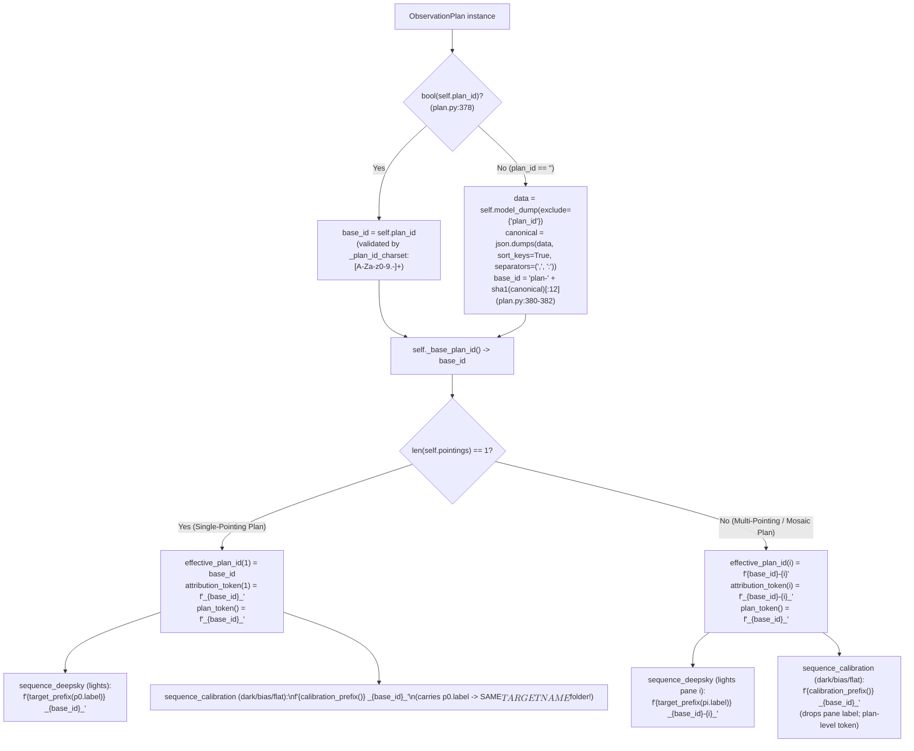

# Observation Plan Schema & Frame Attribution (`nina_planner/models/plan.py`)

[⬆️ Up to Models Package](./README.md) · [⬅️ Strict & Request Models](./strict-and-request.md) · [➡️ Pointing & Frame Models](./pointing-and-frame.md) · [🔗 `plan_utils.py`](../core/plan_utils.md) · [🔗 `progress.py`](../core/progress.md) · [🔗 `tools/plans.py`](../tools/plans.md)

---

## 1. Module Header & Overview

- **File Path:** `.opencode/local/mcps/nina_planner/nina_planner/models/plan.py`
- **Line Count:** 455 lines (`1-455`)
- **Module Docstring (`lines 1-5`):**
  > `The observation-plan file schema: exposures, cadence, mosaic, identity.`
  > `Strict (extra="forbid"): a typo in a plan file fails validation instead of silently loading as if it were honoured.`
- **Imports (`lines 7-14`):**
  - Standard library: `hashlib` (`line 7`), `json` (`line 8`), `re` (`line 9`)
  - Third-party: `from pydantic import Field, field_validator, model_validator` (`line 11`)
  - Internal: `from .pointing import Pointing` (`line 13`), `from .strict import StrictModel` (`line 14`)

### 1.1 Architectural Role & Key Invariants
1. **Strict Schema Enforcement (`StrictModel`, `extra="forbid"`):** All 11 classes in `models/plan.py` subclass `StrictModel`. Any unrecognized key at the top level, in a nested hardware/cadence block (`cooler`, `constraints`, `autofocus`, `guiding`, `quality`, `mosaic`), or inside a frame exposure entry raises `pydantic.ValidationError`.
2. **All Four Frame Lists Required (`min_length=1`):** Every `ObservationPlan` requires non-empty `light_frames`, `flat_frames`, `dark_frames`, and `bias_frames` (`lines 312-341`), guaranteeing that every written plan has a complete calibration budget.
3. **Flats Have No Exposure Duration:** `FlatExposurePlan` (`lines 41-48`) defines only `filter_name` and `total_count`—never `exposure_time_seconds`—because N.I.N.A.'s `SkyFlat` instruction dynamically determines flat exposure times to hit a target histogram ADU level (`lines 44-46`). Passing `exposure_time_seconds` on a flat entry is rejected by `extra="forbid"`.
4. **Plan Identity & Path-Safe Attribution Tokens (`_PLAN_ID_ALLOWED` & `ATTRIBUTION_RE`):** N.I.N.A. substitutes `$$TARGETNAME$$` into the saved FITS directory/filename and sanitizes characters such as `[` and `]` into `_` (`lines 16-21`). Therefore:
   - `plan_id` may contain only `[A-Za-z0-9.-]+` (`_PLAN_ID_ALLOWED`, `line 22`) or be `""` (which derives `"plan-" + sha1(canonical_json)[:12]` via `_base_plan_id()`).
   - `_` is forbidden inside `plan_id` because `_` is the attribution token delimiter (`_plan-abc123_` or `_plan-abc123-1_`).
   - `ATTRIBUTION_RE` (`line 30`) is the single regex used across `sequence_state.py` and consumers to parse stamped target names.
5. **Single-Pointing vs. Multi-Pointing (Mosaic) Token Sharing:**
   - For a **single-pointing plan** (`len(self.pointings) == 1`), `effective_plan_id(1)` returns the bare `_base_plan_id()` (no `-1` suffix), and `calibration_prefix()` includes `self.pointings[0].label`. As a result, single-pointing lights and plan-level calibration emit the exact same `$$TARGETNAME$$` string (`f"{prefix} _{base_id}_"`) and land in **one shared directory** on disk (`lines 393-404`, `442-455`).
   - For a **multi-pointing (mosaic) plan** (`len(self.pointings) > 1`), `effective_plan_id(i)` appends `-{i}` (`per_pointing_plan_id(i)`) so each pane attributes independently (`_plan-abc-1_`, `_plan-abc-2_`), while plan-level calibration uses `plan_token()` (`_plan-abc_`) and `calibration_prefix()` drops the pane label (`lines 404`, `419-425`, `453-455`).
6. **Intent-In, Provenance-Out Mosaic Expansion:** On input to `write_plan_file`, a plan may omit `pointings` (or pass `pointings=[]`) if `mosaic` (`MosaicConfig`) is provided (`_pointings_or_mosaic`, `lines 343-357`). `write_plan_file` expands `mosaic` into `pointings` and stamps `cols`, `rows`, and `pane_fov_arcmins` onto `mosaic` as provenance. On disk, `plan_utils.load_plan` requires `pointings` to be non-empty (`plan_utils.py:276-286`).

---

## 2. Architecture & Visual Diagrams

### 2.1 `models/plan.py` Complete Class & Composition Diagram

```mermaid
classDiagram
    direction TB

    class StrictModel {
        <<models/strict.py:6-16>>
        +ConfigDict model_config = ConfigDict(extra="forbid")
    }

    class ObservationPlan {
        <<models/plan.py:238-455>>
        +str target = ""
        +str intent = ""
        +str plan_id = ""
        +str description = ""
        +list~Pointing~ pointings = []
        +MosaicConfig | None mosaic = None
        +int batch_size = 5 [ge=0]
        +int calibration_window_days = 7 [ge=1]
        +CoolerConfig cooler
        +ConstraintsConfig constraints
        +AutofocusConfig autofocus
        +GuidingConfig guiding
        +QualityConfig quality
        +list~LightExposurePlan~ light_frames [min_length=1]
        +list~FlatExposurePlan~ flat_frames [min_length=1]
        +list~DarkExposurePlan~ dark_frames [min_length=1]
        +list~BiasExposurePlan~ bias_frames [min_length=1]
        +_pointings_or_mosaic() ObservationPlan
        +_plan_id_charset(v: str) str
        +_base_plan_id() str
        +per_pointing_plan_id(pointing_index: int) str
        +effective_plan_id(pointing_index: int) str
        +attribution_token(pointing_index: int) str
        +plan_token() str
        +target_prefix(label: str | None = "") str
        +calibration_prefix() str
    }

    class LightExposurePlan {
        <<models/plan.py:33-38>>
        +str filter_name
        +float exposure_time_seconds [gt=0]
        +int total_count [ge=1]
    }
    class FlatExposurePlan {
        <<models/plan.py:41-48>>
        +str filter_name
        +int total_count [ge=1]
    }
    class DarkExposurePlan {
        <<models/plan.py:51-55>>
        +float exposure_time_seconds [gt=0]
        +int total_count [ge=1]
    }
    class BiasExposurePlan {
        <<models/plan.py:58-61>>
        +int total_count [ge=1]
    }
    class AutofocusConfig {
        <<models/plan.py:64-71>>
        +str reference_filter_name = "L"
        +int hfr_increase_sample_size = 3 [ge=1]
        +float hfr_increase_threshold_percent = 15.0 [gt=0]
        +int every_n_exposures = 10 [ge=1]
        +float threshold_celsius = 1.0 [gt=0]
    }
    class GuidingConfig {
        <<models/plan.py:74-86>>
        +int dither_every_n_exposures = 2 [ge=0]
        +int check_drift_every_n_exposures = 6 [ge=1]
        +float max_drift_arcmin = 1.5 [gt=0]
    }
    class CoolerConfig {
        <<models/plan.py:89-98>>
        +bool on = True
        +float setpoint_celsius = -10.0 [ge=-40.0, le=30.0]
    }
    class ConstraintsConfig {
        <<models/plan.py:101-115>>
        +float min_altitude = 30.0 [ge=0.0, le=90.0]
        +float horizon_offset_degrees = 2.0 [ge=0.0, le=10.0]
    }
    class QualityConfig {
        <<models/plan.py:118-149>>
        +float | None max_hfr = None
        +float | None max_hfr_st_dev = None
        +int | None min_detected_stars = None
        +float | None max_guiding_rms_arcsec = None
    }
    class MosaicConfig {
        <<models/plan.py:155-235>>
        +float center_ra_hours [ge=0.0, lt=24.0]
        +float center_dec_deg [ge=-90.0, le=90.0]
        +float coverage_width_arcmins [gt=0.0]
        +float coverage_height_arcmins [gt=0.0]
        +float overlap_pct = 20.0 [gt=0.0, lt=100.0]
        +float pa_deg = 0.0 [ge=0.0, lt=360.0]
        +int | None cols = None [ge=1]
        +int | None rows = None [ge=1]
        +tuple~float, float~ | None pane_fov_arcmins = None
    }
    class Pointing {
        <<models/pointing.py:30-90>>
        +str | None label = None
        +float ra_hours [ge=0.0, lt=24.0]
        +float dec_deg [ge=-90.0, le=90.0]
        +float | None position_angle_deg = None [ge=0.0, lt=360.0]
        +int | None row = None [ge=0]
        +int | None column = None [ge=0]
    }

    StrictModel <|-- ObservationPlan
    StrictModel <|-- LightExposurePlan
    StrictModel <|-- FlatExposurePlan
    StrictModel <|-- DarkExposurePlan
    StrictModel <|-- BiasExposurePlan
    StrictModel <|-- AutofocusConfig
    StrictModel <|-- GuidingConfig
    StrictModel <|-- CoolerConfig
    StrictModel <|-- ConstraintsConfig
    StrictModel <|-- QualityConfig
    StrictModel <|-- MosaicConfig
    StrictModel <|-- Pointing

    ObservationPlan *-- "0..*" Pointing : pointings
    ObservationPlan *-- "0..1" MosaicConfig : mosaic
    ObservationPlan *-- "1" CoolerConfig : cooler
    ObservationPlan *-- "1" ConstraintsConfig : constraints
    ObservationPlan *-- "1" AutofocusConfig : autofocus
    ObservationPlan *-- "1" GuidingConfig : guiding
    ObservationPlan *-- "1" QualityConfig : quality
    ObservationPlan *-- "1..*" LightExposurePlan : light_frames
    ObservationPlan *-- "1..*" FlatExposurePlan : flat_frames
    ObservationPlan *-- "1..*" DarkExposurePlan : dark_frames
    ObservationPlan *-- "1..*" BiasExposurePlan : bias_frames
```



### 2.2 Plan Identity, Token & Target-Name Derivation Pipeline



---

## 3. Module-Level Constants & Compiled Regular Expressions

| Symbol | Location | Value / Pattern | Semantics & Consumers |
|---|---|---|---|
| `_PLAN_ID_ALLOWED` | `models/plan.py:22` | `re.compile(r"[A-Za-z0-9.-]+")` | Full-match whitelist enforced by `ObservationPlan._plan_id_charset` (`line 367`). Allows only ASCII letters, digits, `.`, and `-`. Refuses `_` (reserved as the attribution token delimiter) and all other characters (such as `[`, `]`, `:`, `/`, spaces, or non-ASCII) because N.I.N.A. rewrites them when substituting `$$TARGETNAME$$` into disk file paths (`lines 16-21`). |
| `ATTRIBUTION_RE` | `models/plan.py:30` | `re.compile(r"_([A-Za-z0-9.-]+?)(?:-(\d+))?_")` | Extracts `(base_plan_id, pointing_index_str | None)` from a stamped N.I.N.A. target name (`_<id>_` or `_<id>-<n>_`). Group 1 (`[A-Za-z0-9.-]+?`) is non-greedy so an optional `-(\d+)` pointing suffix binds to Group 2 instead of being swallowed by Group 1 (`lines 24-29`). Imported by `sequence_state.py:9,189` (`project_sequence_state`) to recover `plan_id` and `pointing_index` from live N.I.N.A. sequence containers. |

---

## 4. Classes, Fields & Data Schemas (All 11 Classes)

### 4.1 `LightExposurePlan` (`nina_planner/models/plan.py:33-38`)
- **Qualified Name:** `nina_planner.models.plan.LightExposurePlan`
- **Base Class:** `StrictModel` (`extra="forbid"`)
- **Docstring (`line 34`):** `"""One filter's light budget: exposure duration in seconds and frame count."""`

| Field | Line | Type | Default | Constraints | Units & Semantics |
|---|---:|---|---|---|---|
| `filter_name` | `36` | `str` | *(required)* | *(none)* | Profile filter name (validated against `ObservatoryProfile.filters` by `plan_utils.validate_filters`). |
| `exposure_time_seconds` | `37` | `float` | *(required)* | `Field(gt=0)` | Sub-exposure duration in seconds (`> 0`). |
| `total_count` | `38` | `int` | *(required)* | `Field(ge=1)` | Total number of light frames required for this filter/exposure per pointing (`>= 1`). |

---

### 4.2 `FlatExposurePlan` (`nina_planner/models/plan.py:41-48`)
- **Qualified Name:** `nina_planner.models.plan.FlatExposurePlan`
- **Base Class:** `StrictModel` (`extra="forbid"`)
- **Docstring (`line 42`):** `"""One filter's flat budget; list order is shoot order (see flat_frames)."""`

| Field | Line | Type | Default | Constraints | Units & Semantics |
|---|---:|---|---|---|---|
| `filter_name` | `47` | `str` | *(required)* | *(none)* | Profile filter name. |
| `total_count` | `48` | `int` | *(required)* | `Field(ge=1)` | Total number of flat frames required for this filter across the plan (`>= 1`). |

- **Schema Invariant (`lines 44-46`):** Deliberately has **no** `exposure_time_seconds` field because N.I.N.A.'s `SkyFlat` instruction calculates the exposure duration dynamically during twilight. Because `FlatExposurePlan` inherits from `StrictModel`, supplying `exposure_time_seconds` raises `ValidationError` (`Extra inputs are not permitted`).

---

### 4.3 `DarkExposurePlan` (`nina_planner/models/plan.py:51-55`)
- **Qualified Name:** `nina_planner.models.plan.DarkExposurePlan`
- **Base Class:** `StrictModel` (`extra="forbid"`)
- **Docstring (`line 52`):** `"""Dark frames of one exposure duration (seconds) and count."""`

| Field | Line | Type | Default | Constraints | Units & Semantics |
|---|---:|---|---|---|---|
| `exposure_time_seconds` | `54` | `float` | *(required)* | `Field(gt=0)` | Dark exposure duration in seconds (`> 0`), matching the corresponding light exposure duration(s). |
| `total_count` | `55` | `int` | *(required)* | `Field(ge=1)` | Total number of dark frames required at this exposure duration (`>= 1`). |

---

### 4.4 `BiasExposurePlan` (`nina_planner/models/plan.py:58-61`)
- **Qualified Name:** `nina_planner.models.plan.BiasExposurePlan`
- **Base Class:** `StrictModel` (`extra="forbid"`)
- **Docstring (`line 59`):** `"""Bias frames: a count only — bias exposures have no duration."""`

| Field | Line | Type | Default | Constraints | Units & Semantics |
|---|---:|---|---|---|---|
| `total_count` | `61` | `int` | *(required)* | `Field(ge=1)` | Total number of bias frames required (`>= 1`). Emitted with `exposure_time=0.0` in `sequence/targets.py:151-155`. |

---

### 4.5 `AutofocusConfig` (`nina_planner/models/plan.py:64-71`)
- **Qualified Name:** `nina_planner.models.plan.AutofocusConfig`
- **Base Class:** `StrictModel` (`extra="forbid"`)
- **Docstring (`line 65`):** `"""Autofocus cadence and thresholds (HFR in pixels, temperature in Celsius)."""`

| Field | Line | Type | Default | Constraints | Units & Semantics |
|---|---:|---|---|---|---|
| `reference_filter_name` | `67` | `str` | `"L"` | *(none)* | Filter switched to before running the initial autofocus in `target_payload_lights` (`sequence/targets.py:284-285,378-380`). Validated against `ObservatoryProfile.filters` by `plan_utils.validate_filters` (`plan_utils.py:72`). |
| `hfr_increase_sample_size` | `68` | `int` | `3` | `Field(default=3, ge=1)` | Number of recent frames (`SampleSize >= 1`) evaluated by `AutofocusAfterHFRIncreaseTrigger` (`sequence/nodes.py:325-329`). |
| `hfr_increase_threshold_percent` | `69` | `float` | `15.0` | `Field(default=15.0, gt=0)` | Percentage HFR degradation (`Amount > 0`) that triggers an autofocus run (`sequence/nodes.py:325-329`). |
| `every_n_exposures` | `70` | `int` | `10` | `Field(default=10, ge=1)` | Exposure count cadence (`AfterExposures >= 1`) for `AutofocusAfterExposuresTrigger` (`sequence/nodes.py:318-322`). |
| `threshold_celsius` | `71` | `float` | `1.0` | `Field(default=1.0, gt=0)` | Ambient/focuser temperature delta in °C (`Amount > 0`) for `AutofocusAfterTemperatureChangeTrigger` (`sequence/nodes.py:311-315`). |

---

### 4.6 `GuidingConfig` (`nina_planner/models/plan.py:74-86`)
- **Qualified Name:** `nina_planner.models.plan.GuidingConfig`
- **Base Class:** `StrictModel` (`extra="forbid"`)
- **Docstring (`line 75`):** `"""Dither and drift-check cadence; drift limit in arcminutes."""`

| Field | Lines | Type | Default | Constraints | Units & Semantics |
|---|---|---|---|---|---|
| `dither_every_n_exposures` | `77-84` | `int` | `2` | `Field(default=2, ge=0)` | Dither cadence in exposures (`>= 0`). **`0` is a meaningful sentinel meaning "never dither"**: when `0`, `sequence_count_exposure` (`sequence/builders.py:316-320`) omits the `DitherAfterExposures` trigger entirely. |
| `check_drift_every_n_exposures` | `85` | `int` | `6` | `Field(default=6, ge=1)` | Plate-solve drift check cadence (`AfterExposures >= 1`) for `CenterAfterDriftTrigger` (`sequence/nodes.py:332-341`). Rejects `0`. |
| `max_drift_arcmin` | `86` | `float` | `1.5` | `Field(default=1.5, gt=0)` | Maximum pointing drift in arcminutes (`DistanceArcMinutes > 0`) before `CenterAfterDriftTrigger` re-centers (`sequence/nodes.py:332-341`). Rejects `0`. |

---

### 4.7 `CoolerConfig` (`nina_planner/models/plan.py:89-98`)
- **Qualified Name:** `nina_planner.models.plan.CoolerConfig`
- **Base Class:** `StrictModel` (`extra="forbid"`)
- **Docstring (`line 90`):** `"""Camera cooler target; setpoint in Celsius within ASCOM's −40…+30 range."""`

| Field | Lines | Type | Default | Constraints | Units & Semantics |
|---|---|---|---|---|---|
| `on` | `92` | `bool` | `True` | *(none)* | Whether `sequence_cool_camera` (`sequence/builders.py:199-207`) emits a `CoolCamera` instruction when the camera has a cooler. |
| `setpoint_celsius` | `93-98` | `float` | `-10.0` | `Field(default=-10.0, ge=-40.0, le=30.0)` | Target sensor temperature in °C within `[-40.0, +30.0]`. Also enforced within `±2.0°C` during calibration frame matching when `cooler.on` is `True` (`progress.py:345-351`). |

---

### 4.8 `ConstraintsConfig` (`nina_planner/models/plan.py:101-115`)
- **Qualified Name:** `nina_planner.models.plan.ConstraintsConfig`
- **Base Class:** `StrictModel` (`extra="forbid"`)
- **Docstring (`line 102`):** `"""Altitude floor for the whole plan: degrees above horizon or skyline."""`

| Field | Lines | Type | Default | Constraints | Units & Semantics |
|---|---|---|---|---|---|
| `min_altitude` | `104-109` | `float` | `30.0` | `Field(default=30.0, ge=0.0, le=90.0)` | Baseline minimum target altitude in degrees `[0.0, 90.0]`, passed to `wait_until_above_altitude` and `loop_while_above_altitude`. |
| `horizon_offset_degrees` | `110-115` | `float` | `2.0` | `Field(default=2.0, ge=0.0, le=10.0)` | Safety buffer in degrees `[0.0, 10.0]` added above the custom horizon profile (`wait_until_above_horizon` / `loop_while_above_horizon`). |

---

### 4.9 `QualityConfig` (`nina_planner/models/plan.py:118-149`)
- **Qualified Name:** `nina_planner.models.plan.QualityConfig`
- **Base Class:** `StrictModel` (`extra="forbid"`)
- **Docstring (`lines 119-128`):**
  > `Optional light-frame quality thresholds for the progress tools.`
  > `The ONLY place quality thresholds live: load_sequence and get_plan_progress read them from the plan file, so every tool that counts this plan's frames applies the same rules — there is deliberately no per-call override. All four default to None (no filtering). Lights only; fail-closed when active: a light frame missing an enabled metric (or carrying NINA's 0 for an unmeasured value) does NOT count toward total_count.`

| Field | Lines | Type | Default | Constraints | Units & Semantics |
|---|---|---|---|---|---|
| `max_hfr` | `130-133` | `float \| None` | `None` | *(none)* | Maximum acceptable mean Half-Flux Radius (HFR in pixels). Frames with `HFR > max_hfr` or unmeasured `HFR <= 0` are rejected (`progress.py:186-193`). |
| `max_hfr_st_dev` | `134-141` | `float \| None` | `None` | *(none)* | Maximum acceptable per-star HFR standard deviation (`HFRStDev` in pixels). Catches guiding spikes, tilt, or flexure hidden by an acceptable mean HFR (`progress.py:194-201`). |
| `min_detected_stars` | `142-145` | `int \| None` | `None` | *(none)* | Minimum detected star count (`DetectedStars >= min_detected_stars` and `> 0`) (`progress.py:202-209`). |
| `max_guiding_rms_arcsec` | `146-149` | `float \| None` | `None` | *(none)* | Maximum guiding total RMS error in arcseconds (`GuidingRMSArcSec <= max_guiding_rms_arcsec` and `> 0`) (`progress.py:210-216`). |

---

### 4.10 `MosaicConfig` (`nina_planner/models/plan.py:155-235`)
- **Qualified Name:** `nina_planner.models.plan.MosaicConfig`
- **Base Class:** `StrictModel` (`extra="forbid"`)
- **Docstring (`lines 156-166`):**
  > `How to derive a mosaic's pointings — intent in, grid recorded out.`
  > `The caller states WHAT to cover (center + coverage in arcmins, measured in the grid frame BEFORE pa_deg rotation) and how much panes may overlap; write_plan_file derives HOW (cols x rows, sized per axis with ceil so it never under-covers) from the rig's pane FOV at write time and stamps the decision back into cols/rows/pane_fov_arcmins as provenance. Those three are None on input and never drive expansion — an expanded plan's pointings are the authority.`

| Field | Lines | Role | Type | Default | Constraints | Units & Semantics |
|---|---|---|---|---|---|---|
| `center_ra_hours` | `168-172` | Caller Intent | `float` | *(required)* | `Field(ge=0.0, lt=24.0)` | J2000 Right Ascension of the mosaic center in hours `[0.0, 24.0)`. |
| `center_dec_deg` | `173-177` | Caller Intent | `float` | *(required)* | `Field(ge=-90.0, le=90.0)` | J2000 Declination of the mosaic center in degrees `[-90.0, +90.0]`. |
| `coverage_width_arcmins` | `178-186` | Caller Intent | `float` | *(required)* | `Field(gt=0.0)` | Sky width to cover in arcminutes (`> 0.0`) along the columns axis before `pa_deg` rotation. |
| `coverage_height_arcmins` | `187-193` | Caller Intent | `float` | *(required)* | `Field(gt=0.0)` | Sky height to cover in arcminutes (`> 0.0`) along the rows axis before `pa_deg` rotation. |
| `overlap_pct` | `194-199` | Caller Intent | `float` | `20.0` | `Field(default=20.0, gt=0.0, lt=100.0)` | Adjacent pane overlap percentage `(0.0, 100.0)`. Both `0.0` and `100.0` are rejected. |
| `pa_deg` | `200-209` | Caller Intent | `float` | `0.0` | `Field(default=0.0, ge=0.0, lt=360.0)` | Grid position angle in degrees `[0.0, 360.0)` east of north. Non-zero values require a rotator in `ObservatoryProfile.equipment.has_rotator` (`plan_utils.validate_position_angle`). |
| `cols` | `211-218` | Provenance Stamp | `int \| None` | `None` | `Field(default=None, ge=1)` | Derived column count (`>= 1`), stamped by `tools/plans.py:_expand_mosaic` (`plans.py:103-161`). Rejected on input by `_expand_mosaic` if pre-populated without `pointings`. |
| `rows` | `219-226` | Provenance Stamp | `int \| None` | `None` | `Field(default=None, ge=1)` | Derived row count (`>= 1`), stamped by `tools/plans.py:_expand_mosaic`. |
| `pane_fov_arcmins` | `227-235` | Provenance Stamp | `tuple[float, float] \| None` | `None` | *(none)* | Single-pane `(width, height)` FOV in arcminutes snapshotted from `ObservatoryProfile.optics` during expansion (`tools/plans.py:139`). |

---

### 4.11 `ObservationPlan` (`nina_planner/models/plan.py:238-455`)
- **Qualified Name:** `nina_planner.models.plan.ObservationPlan`
- **Base Class:** `StrictModel` (`extra="forbid"`)
- **Docstring (`lines 239-244`):**
  > `A complete observation plan: identity, pointings, exposures, cadence.`
  > `The on-disk unit of work — always written with its pointings expanded (see plan_utils.load_plan), and identified for frame attribution by plan_id.`

#### Field Specification Table (`ObservationPlan`)

| Field | Lines | Type | Default | Constraints | Semantics |
|---|---|---|---|---|---|
| `target` | `246` | `str` | `""` | *(none)* | Catalog designation (e.g. `"M31"`, `"NGC 7000"`). Used in `target_prefix` and plan filename generation. |
| `intent` | `247-249` | `str` | `""` | *(none)* | 2–3 words describing the observation goal (e.g. `"Galaxy portrait"`, `"HOO mosaic"`). Appended after `target` in `target_prefix`. |
| `plan_id` | `250-256` | `str` | `""` | `@field_validator("plan_id")` (`_plan_id_charset`) | Stable frame-attribution ID. Either `""` (derived from content hash via `_base_plan_id()` and stamped on write by `write_plan_file`) or matching `[A-Za-z0-9.-]+`. |
| `description` | `257-263` | `str` | `""` | *(none)* | Free-text narrative of rationale, exposure goals, equipment, or sky constraints. |
| `pointings` | `264-274` | `list[Pointing]` | `default_factory=list` (`[]`) | `@model_validator(mode="after")` (`_pointings_or_mosaic`) | Target pointings (`Pointing`). May be empty on model construction **only** when `mosaic` is present; once written to disk by `write_plan_file`, `pointings` is always populated and authoritative. |
| `mosaic` | `275-286` | `MosaicConfig \| None` | `None` | `@model_validator(mode="after")` (`_pointings_or_mosaic`) | Optional mosaic grid specification expanded by `write_plan_file` into `pointings`. |
| `batch_size` | `287-289` | `int` | `5` | `Field(default=5, ge=0)` | Exposures per round-robin filter batch (`sequence/nodes.py:_round_robin`, `nodes.py:134-160`). `0` disables batching (shoots each filter's full count sequentially). |
| `calibration_window_days` | `290-301` | `int` | `7` | `Field(default=7, ge=1)` | Maximum age difference in days (`>= 1`, on either side of the pointing's earliest attributed light frame) within which pooled calibration frames (`DARK`, `BIAS`, `FLAT`) are credited (`progress.py:_within_age`, `progress.py:268-297`). |
| `cooler` | `304` | `CoolerConfig` | `default_factory=CoolerConfig` | Nested `StrictModel` | Camera cooling configuration. |
| `constraints` | `305` | `ConstraintsConfig` | `default_factory=ConstraintsConfig` | Nested `StrictModel` | Minimum altitude and custom-horizon safety offset. |
| `autofocus` | `306` | `AutofocusConfig` | `default_factory=AutofocusConfig` | Nested `StrictModel` | Autofocus reference filter, cadence, and HFR/temperature triggers. |
| `guiding` | `307` | `GuidingConfig` | `default_factory=GuidingConfig` | Nested `StrictModel` | Dither cadence and plate-solve drift re-centering limits. |
| `quality` | `309` | `QualityConfig` | `default_factory=QualityConfig` | Nested `StrictModel` | Light-frame quality filtering thresholds (`max_hfr`, `max_hfr_st_dev`, `min_detected_stars`, `max_guiding_rms_arcsec`). |
| `light_frames` | `312-315` | `list[LightExposurePlan]` | *(required)* | `Field(min_length=1)` | Non-empty list of light exposure budgets (`action="light"`). |
| `flat_frames` | `316-326` | `list[FlatExposurePlan]` | *(required)* | `Field(min_length=1)` | Non-empty list of sky-flat filter budgets (`action="flat"`). List order is shoot order (`dawn` shoots as written; `dusk` reverses the list in `sequence/targets.py:229-232`). |
| `dark_frames` | `327-334` | `list[DarkExposurePlan]` | *(required)* | `Field(min_length=1)` | Non-empty list of dark exposure budgets (`action="dark"`). |
| `bias_frames` | `335-341` | `list[BiasExposurePlan]` | *(required)* | `Field(min_length=1)` | Non-empty list of bias count budgets (`action="bias"`). |

---

## 5. Methods & Validators on `ObservationPlan` (All 9 Symbols)

### 5.1 `ObservationPlan._pointings_or_mosaic` (`nina_planner/models/plan.py:343-357`)
1. **Location & Signature:**
   - **File & Lines:** `.opencode/local/mcps/nina_planner/nina_planner/models/plan.py:343-357`
   - **Qualified Name:** `nina_planner.models.plan.ObservationPlan._pointings_or_mosaic`
   - **Signature:** `def _pointings_or_mosaic(self) -> "ObservationPlan"`
2. **Decorator / Hook:** `@model_validator(mode="after")` (`line 343`)
3. **Parameters:** `self: ObservationPlan`
4. **Return Type & Semantics:** Returns `self` (`ObservationPlan`) if at least one of `self.pointings` (non-empty) or `self.mosaic` (not `None`) is present. Both present is legal (representing an already-expanded mosaic plan on disk).
5. **Exceptions & Refusals:**
   - Raises `ValueError` (`lines 352-356`, wrapped by Pydantic in `ValidationError`) when `not self.pointings and self.mosaic is None`:
     ```text
     a plan needs at least one pointing, or a `mosaic` block (center + coverage) for write_plan_file to expand into pointings
     ```
6. **Step-by-Step Logic & Control Flow:**
   - **Line 351:** Checks `if not self.pointings and self.mosaic is None:`.
   - **Lines 352-356:** Raises `ValueError` explaining both valid ways to specify target pointings.
   - **Line 357:** Returns `self`.
7. **Callers & Test Coverage:**
   - Runs automatically on every `ObservationPlan` validation. Complemented at disk-read time by `plan_utils.load_plan` (`plan_utils.py:276-286`), which additionally rejects an on-disk file where `not plan.pointings` even if `plan.mosaic is not None` (catching hand-edited unexpanded mosaic files).
   - Tested in `tests/test_plan.py:203-253` (`LoadPlanPointingsTest`) and `tests/test_plan.py:362-424` (`MosaicBlockTest`).

---

### 5.2 `ObservationPlan._plan_id_charset` (`nina_planner/models/plan.py:359-375`)
1. **Location & Signature:**
   - **File & Lines:** `.opencode/local/mcps/nina_planner/nina_planner/models/plan.py:359-375`
   - **Qualified Name:** `nina_planner.models.plan.ObservationPlan._plan_id_charset`
   - **Signature:** `@classmethod def _plan_id_charset(cls, v: str) -> str`
2. **Decorator / Hook:** `@field_validator("plan_id")` (`line 359`), `@classmethod` (`line 360`)
3. **Parameters:**
   - `cls: type[ObservationPlan]`
   - `v: str` — candidate `plan_id` string.
4. **Return Type & Semantics:** Returns `v` (`str`) unchanged if `v == ""` or `_PLAN_ID_ALLOWED.fullmatch(v)` succeeds.
5. **Exceptions & Refusals:**
   - Raises `ValueError` (`lines 368-374`, wrapped in `ValidationError`) if `v` is non-empty and contains any character outside `[A-Za-z0-9.-]`:
     ```text
     plan_id {v!r} must be empty (a content-derived id is stamped instead) or consist only of ASCII letters, digits, '.' and '-' — '_' is the token delimiter, and every other character is refused because N.I.N.A. rewrites it in the file path, so the frames could never be matched back to this id.
     ```
6. **Step-by-Step Logic & Control Flow:**
   - **Line 367:** Evaluates `if v and not _PLAN_ID_ALLOWED.fullmatch(v):`.
   - **Lines 368-374:** Raises `ValueError` with the two-part explanation (`_` delimiter conflict + N.I.N.A. path sanitization).
   - **Line 375:** Returns `v`.
7. **Callers & Test Coverage:**
   - Tested exhaustively in `tests/test_plan.py:35-93` (`PlanIdCharsetTest`) and `tests/test_plan.py:182-201` (`LoadPlanPlanIdTest`).

---

### 5.3 `ObservationPlan._base_plan_id` (`nina_planner/models/plan.py:377-382`)
1. **Location & Signature:**
   - **File & Lines:** `.opencode/local/mcps/nina_planner/nina_planner/models/plan.py:377-382`
   - **Qualified Name:** `nina_planner.models.plan.ObservationPlan._base_plan_id`
   - **Signature:** `def _base_plan_id(self) -> str`
2. **Decorator / Hook:** Standard instance method.
3. **Parameters:** `self: ObservationPlan`
4. **Return Type & Semantics:** Returns `str` — either the explicit `self.plan_id` (if non-empty) or a deterministic 17-character content-derived ID of the form `"plan-<12 lowercase hex chars>"` (e.g. `"plan-a745ffa2357a"`).
5. **Exceptions & Refusals:** None (pure deterministic computation).
6. **Step-by-Step Logic & Control Flow:**
   - **Lines 378-379:** `if self.plan_id: return self.plan_id`. Once `plan_id` is stamped on disk (by `write_plan_file` at `tools/plans.py:191` or `nina-pin-id` at `pin_id.py:74`), subsequent edits to `quality`, `exposure_time_seconds`, or `total_count` never alter `_base_plan_id()`.
   - **Line 380:** Dumps the model excluding `plan_id`: `data = self.model_dump(exclude={"plan_id"})`.
   - **Line 381:** Serializes `data` into compact canonical JSON with sorted keys: `canonical = json.dumps(data, sort_keys=True, separators=(",", ":"))`.
   - **Line 382:** Computes SHA-1 over UTF-8 bytes and takes the first 12 hex digits: `return "plan-" + hashlib.sha1(canonical.encode()).hexdigest()[:12]`.
7. **Callers & Test Coverage:**
   - Called internally by `per_pointing_plan_id` (`line 391`), `effective_plan_id` (`line 403`), and `plan_token` (`line 425`).
   - Called externally by `tools/plans.py` (`lines 191, 252, 499, 632, 635, 723, 872, 874, 883, 978, 1025, 1190`), `progress.py` (`line 727`), `archive.py` (`lines 178, 429, 500, 776, 822, 1098`), `purge.py` (`line 833`), and `pin_id.py` (`line 74`).
   - Tested in `tests/test_plan.py:53-62`, `309-319`, `398-413`, and `tests/test_pin_id.py`.

---

### 5.4 `ObservationPlan.per_pointing_plan_id` (`nina_planner/models/plan.py:384-391`)
1. **Location & Signature:**
   - **File & Lines:** `.opencode/local/mcps/nina_planner/nina_planner/models/plan.py:384-391`
   - **Qualified Name:** `nina_planner.models.plan.ObservationPlan.per_pointing_plan_id`
   - **Signature:** `def per_pointing_plan_id(self, pointing_index: int) -> str`
2. **Decorator / Hook:** Standard instance method.
3. **Parameters:**
   - `self: ObservationPlan`
   - `pointing_index: int` — 1-based pointing index.
4. **Return Type & Semantics:** Returns `f"{self._base_plan_id()}-{pointing_index}"` (`str`). Always appends `-{pointing_index}`, even when `len(self.pointings) == 1`. Kept for multi-pointing delegation from `effective_plan_id` and for backward-compatible matching of legacy single-pointing frames that were shot with a `-1` suffix.
5. **Exceptions & Refusals:** None.
6. **Step-by-Step Logic & Control Flow:**
   - **Line 391:** `return f"{self._base_plan_id()}-{pointing_index}"`.
7. **Callers & Test Coverage:**
   - Called by `effective_plan_id` (`models/plan.py:404`), `progress._light_target_matches` (`progress.py:150`, accepting legacy `-1` frames on single-pointing plans), and `tools/plans.py:_own_token_rows` (`plans.py:496`).

---

### 5.5 `ObservationPlan.effective_plan_id` (`nina_planner/models/plan.py:393-404`)
1. **Location & Signature:**
   - **File & Lines:** `.opencode/local/mcps/nina_planner/nina_planner/models/plan.py:393-404`
   - **Qualified Name:** `nina_planner.models.plan.ObservationPlan.effective_plan_id`
   - **Signature:** `def effective_plan_id(self, pointing_index: int) -> str`
2. **Decorator / Hook:** Standard instance method.
3. **Parameters:**
   - `self: ObservationPlan`
   - `pointing_index: int` — 1-based pointing index.
4. **Return Type & Semantics:** Returns the exact plan ID string stamped onto light frames for `pointing_index`:
   - If `len(self.pointings) == 1`: returns `self._base_plan_id()` (bare base ID, no `-1` suffix).
   - Otherwise (`len(self.pointings) != 1`): returns `self.per_pointing_plan_id(pointing_index)` (`f"{base}-{pointing_index}"`).
5. **Exceptions & Refusals:** None.
6. **Step-by-Step Logic & Control Flow:**
   - **Lines 402-403:** `if len(self.pointings) == 1: return self._base_plan_id()`.
   - **Line 404:** `return self.per_pointing_plan_id(pointing_index)`.
7. **Callers & Test Coverage:**
   - Called by `attribution_token` (`models/plan.py:417`), `progress._light_target_matches` (`progress.py:145`), and `tools/plans.py` (`lines 243, 495, 500, 630, 981`).

---

### 5.6 `ObservationPlan.attribution_token` (`nina_planner/models/plan.py:406-417`)
1. **Location & Signature:**
   - **File & Lines:** `.opencode/local/mcps/nina_planner/nina_planner/models/plan.py:406-417`
   - **Qualified Name:** `nina_planner.models.plan.ObservationPlan.attribution_token`
   - **Signature:** `def attribution_token(self, pointing_index: int) -> str`
2. **Decorator / Hook:** Standard instance method.
3. **Parameters:**
   - `self: ObservationPlan`
   - `pointing_index: int` — 1-based pointing index.
4. **Return Type & Semantics:** Returns `f"_{self.effective_plan_id(pointing_index)}_"` (`str`). The leading and trailing underscores survive N.I.N.A.'s `$$TARGETNAME$$` path substitution verbatim and prevent prefix collisions (`_plan-x_` never substring-matches inside `_plan-x-1_`).
5. **Exceptions & Refusals:** None.
6. **Step-by-Step Logic & Control Flow:**
   - **Line 417:** `return f"_{self.effective_plan_id(pointing_index)}_"`.
7. **Callers & Test Coverage:**
   - Called by `sequence/builders.py:sequence_deepsky` (`builders.py:135`) when stamping the `DSOContainer` target name.
   - Tested in `tests/test_plan.py:89-93` and `tests/test_sequence.py`.

---

### 5.7 `ObservationPlan.plan_token` (`nina_planner/models/plan.py:419-425`)
1. **Location & Signature:**
   - **File & Lines:** `.opencode/local/mcps/nina_planner/nina_planner/models/plan.py:419-425`
   - **Qualified Name:** `nina_planner.models.plan.ObservationPlan.plan_token`
   - **Signature:** `def plan_token(self) -> str`
2. **Decorator / Hook:** Standard instance method.
3. **Parameters:** `self: ObservationPlan`
4. **Return Type & Semantics:** Returns `f"_{self._base_plan_id()}_"` (`str`) — the plan-level underscore token without any pointing suffix, used for calibration steps (`dark`, `bias`, `flat`).
5. **Exceptions & Refusals:** None.
6. **Step-by-Step Logic & Control Flow:**
   - **Line 425:** `return f"_{self._base_plan_id()}_"`.
7. **Callers & Test Coverage:**
   - Called by `sequence/builders.py:sequence_calibration` (`builders.py:171`).

---

### 5.8 `ObservationPlan.target_prefix` (`nina_planner/models/plan.py:427-440`)
1. **Location & Signature:**
   - **File & Lines:** `.opencode/local/mcps/nina_planner/nina_planner/models/plan.py:427-440`
   - **Qualified Name:** `nina_planner.models.plan.ObservationPlan.target_prefix`
   - **Signature:** `def target_prefix(self, label: str | None = "") -> str`
2. **Decorator / Hook:** Standard instance method.
3. **Parameters:**
   - `self: ObservationPlan`
   - `label: str | None = ""` — optional pointing label (e.g. `"r1_c1"` or `"core"`).
4. **Return Type & Semantics:** Constructs the human-readable prefix `<target> <intent> [- <label>]` placed before the attribution token in N.I.N.A. container target names. Empty segments are omitted cleanly without leaving leading, trailing, or doubled spaces/hyphens:

   | `self.target` | `self.intent` | `label` | Returned `target_prefix(label)` |
   |---|---|---|---|
   | `"M31"` | `""` | `""` or `None` | `"M31"` |
   | `"M31"` | `"Galaxy portrait"` | `""` or `None` | `"M31 Galaxy portrait"` |
   | `"M31"` | `""` | `"core"` | `"M31 - core"` |
   | `"M31"` | `"Galaxy portrait"` | `"core"` | `"M31 Galaxy portrait - core"` |
   | `""` | `""` | `"core"` | `"core"` |
   | `""` | `""` | `""` or `None` | `""` |

5. **Exceptions & Refusals:** None.
6. **Step-by-Step Logic & Control Flow:**
   - **Line 437:** Joins non-empty `target` and `intent` with a single space: `base = " ".join(part for part in (self.target, self.intent) if part)`.
   - **Lines 438-439:** `if not label: return base`.
   - **Line 440:** `return f"{base} - {label}" if base else label`.
7. **Callers & Test Coverage:**
   - Called by `calibration_prefix` (`models/plan.py:454-455`) and `sequence/builders.py:sequence_deepsky` (`builders.py:134`).
   - Tested in `tests/test_plan.py:95-124` (`TargetPrefixTest`).

---

### 5.9 `ObservationPlan.calibration_prefix` (`nina_planner/models/plan.py:442-455`)
1. **Location & Signature:**
   - **File & Lines:** `.opencode/local/mcps/nina_planner/nina_planner/models/plan.py:442-455`
   - **Qualified Name:** `nina_planner.models.plan.ObservationPlan.calibration_prefix`
   - **Signature:** `def calibration_prefix(self) -> str`
2. **Decorator / Hook:** Standard instance method.
3. **Parameters:** `self: ObservationPlan`
4. **Return Type & Semantics:** Returns the readable target prefix for plan-level calibration containers (`sequence_calibration`):
   - When `len(self.pointings) == 1`: calls `self.target_prefix(self.pointings[0].label)`. Because single-pointing plans also use the bare base token (`_base_plan_id()`) for lights, including `pointings[0].label` ensures lights and calibration produce the **identical** `$$TARGETNAME$$` string and save into a single directory.
   - When `len(self.pointings) != 1` (multi-pointing mosaic or defensive `0` pointings): calls `self.target_prefix()` (omitting any pane-specific label such as `r1_c1`).
5. **Exceptions & Refusals:** None.
6. **Step-by-Step Logic & Control Flow:**
   - **Lines 453-454:** `if len(self.pointings) == 1: return self.target_prefix(self.pointings[0].label)`.
   - **Line 455:** `return self.target_prefix()`.
7. **Callers & Test Coverage:**
   - Called by `sequence/builders.py:sequence_calibration` (`builders.py:171`).
   - Tested in `tests/test_sequence.py`.

---

## 6. Cross-Module Dependencies, Callers & Consumers

| Consumer Module | Imported Symbol(s) from `models/plan.py` | Exact Lines | Usage Context |
|---|---|---|---|
| `nina_planner/plan_utils.py` | `ObservationPlan` | `22`, `65`, `93`, `139`, `258`, `275`, `290` | `load_plan`, `validate_filters`, `validate_position_angle`, `check_pointing_index`, `quality_kwargs`. |
| `nina_planner/progress.py` | `ObservationPlan` | `16`, `72`, `122`, `243`, `306`, `373`, `410`, `479`, `691-692` | `is_junk_row`, `_light_target_matches`, `_session_start`, `_row_matches`, `_select_matching`, `filter_metadata_rows`, `plan_progress`, `plan_with_remaining`. |
| `nina_planner/tools/plans.py` | `ObservationPlan` | `20`, `104-105`, `165`, `395`, `476`, `516`, `604`, `685`, `696`, `800-806` | `write_plan_file`, `_expand_mosaic`, `get_plan_progress`, `audit_plans`, `list_plans`. |
| `nina_planner/tools/sequence.py` | `ObservationPlan` | `9`, `67` | `_full_mode_note` and `_load_many`. |
| `nina_planner/sequence/nodes.py` | `LightExposurePlan` | `10`, `135` | `_round_robin(exposures: list[LightExposurePlan], batch_size: int = 0)`. |
| `nina_planner/sequence/builders.py` | `ObservationPlan` | `12`, `101`, `122`, `149`, `200` | `_validated_pointing`, `sequence_deepsky`, `sequence_calibration`, `sequence_cool_camera`. |
| `nina_planner/sequence/targets.py` | `ObservationPlan` | `6`, `109`, `197`, `265` | `target_payload_darks`, `target_payload_flats`, `target_payload_lights`. |
| `nina_planner/sequence_state.py` | `ATTRIBUTION_RE` | `9`, `189` | `project_sequence_state` regex extraction of `plan_id` and `pointing_index` from running/loaded N.I.N.A. container names. |
| `nina_planner/archive.py` | `ObservationPlan` | `92`, `166`, `307`, `348`, `388`, `407`, `445`, `544`, `1005` | `nina-archive` plan loading, frame selection, junk diversion, and manifest generation. |
| `nina_planner/purge.py` | `ObservationPlan` | `108`, `175`, `826` | `nina-purge` plan-file gates and frame retirement verification. |

---

## 7. Verification & Test Coverage Matrix

Primarily verified in `.opencode/local/mcps/nina_planner/tests/test_plan.py` (476 lines, 8 test classes):

| Test Class (`tests/test_plan.py`) | Lines | Methods & Verified Scenarios |
|---|---|---|
| `PlanIdCharsetTest` | `35-93` | `test_accepted_charset` (`41-51`), `test_empty_id_allowed_and_the_derived_id_passes_too` (`53-61`), `test_underscore_rejected` (`63-69`), `test_characters_nina_may_rewrite_are_rejected` (`71-79`), `test_error_explains_both_reasons` (`81-87`), `test_token_still_built_from_a_valid_id` (`89-92`). |
| `TargetPrefixTest` | `95-148` | `test_intent_follows_the_target` (`101-106`), `test_label_keeps_its_separator_after_the_intent` (`108-114`), `test_empty_parts_leave_no_stray_separator` (`116-123`), `test_flat_spec_is_filter_and_count_only` (`126-131`), `test_stale_exposure_time_in_a_flat_entry_is_refused` (`133-147`). |
| `UnknownFieldTest` | `150-180` | `test_unknown_top_level_field_refused` (`157-161`), `test_unknown_field_in_a_nested_config_refused` (`163-167`), `test_unknown_field_in_a_frame_spec_refused` (`169-173`), `test_unknown_field_in_a_pointing_refused` (`175-179`). |
| `LoadPlanPlanIdTest` | `182-201` | `test_load_plan_refuses_bad_id` (`185-192`), `test_load_plan_accepts_recorded_id` (`194-200`). |
| `LoadPlanPointingsTest` | `203-253` | `test_never_expanded_mosaic_file_refused_at_load` (`225-231`), `test_expanded_mosaic_file_loads` (`233-244`), `test_pointing_less_file_without_mosaic_still_refused_by_model` (`246-252`). |
| `QualityConfigTest` | `255-319` | `test_defaults_to_no_filtering` (`258-264`), `test_plan_written_before_quality_field_still_loads` (`266-281`), `test_quality_section_round_trips` (`283-292`), `test_unknown_quality_key_refused` (`294-300`), `test_quality_value_type_enforced` (`302-307`), `test_explicit_plan_id_unaffected_by_quality` (`309-318`). |
| `GuidingConfigTest` | `321-360` | `test_zero_dither_means_never_dither` (`330-333`), `test_negative_dither_refused` (`335-339`), `test_drift_thresholds_still_must_be_positive` (`341-346`), `test_defaults_unchanged` (`348-353`), `test_guiding_round_trips_through_json` (`355-359`). |
| `MosaicBlockTest` | `362-476` | `test_mosaic_without_pointings_is_valid` (`375-388`), `test_empty_pointings_without_mosaic_refused` (`390-396`), `test_omitted_pointings_with_mosaic_is_valid` (`398-412`), `test_omitted_pointings_without_mosaic_names_the_fix` (`414-423`), `test_mosaic_and_pointings_together_load_and_pointings_win` (`425-442`), `test_mosaic_field_bounds` (`444-459`), `test_unknown_mosaic_key_refused` (`461-467`), `test_mosaic_requires_center_and_coverage` (`469-476`). |
