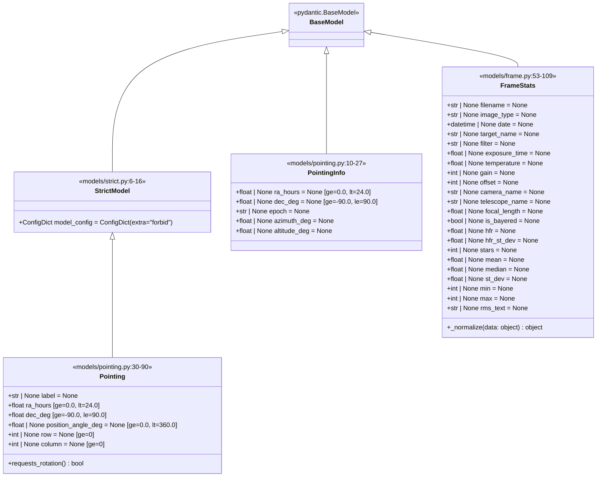
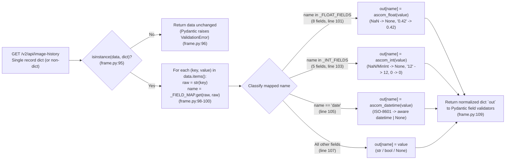

# Target Pointing & Live Frame Statistics Models (`pointing.py`, `frame.py`)

[⬆️ Up to Models Package](./README.md) · [⬅️ Observation Plan Models](./plan.md) · [➡️ Observatory Profile Models](./profile.md) · [🔗 `nina_utils.py`](../core/nina_utils.md) · [🔗 `tools/plans.py`](../tools/plans.md)

---

## 1. Module Header & Overview

| Module | File Path | Lines | Primary Responsibility |
|---|---|---:|---|
| `nina_planner.models.pointing` | `.opencode/local/mcps/nina_planner/nina_planner/models/pointing.py` | 90 (`1-90`) | Defines both the tolerant live-telemetry pointing model `PointingInfo(BaseModel)` (embedded in `MountDevice.pointing`) and the strict plan-file target pane model `Pointing(StrictModel)` (embedded in `ObservationPlan.pointings`), including the single shared rotation predicate `Pointing.requests_rotation()`. |
| `nina_planner.models.frame` | `.opencode/local/mcps/nina_planner/nina_planner/models/frame.py` | 109 (`1-109`) | Defines `FrameStats(BaseModel)` and its pre-validator `_normalize` for parsing N.I.N.A.'s live current-frame statistics payload from `GET /v2/api/image-history`. |

### 1.1 Architectural Invariants
1. **Why `models/pointing.py` Houses Both `BaseModel` and `StrictModel`:**
   - `PointingInfo(BaseModel)` (`pointing.py:10-27`) parses live mount coordinates from N.I.N.A.'s `/equipment/info` endpoint (`models/mount.py:59-65`), where coordinates may be `None` when disconnected or uninitialized and extra driver keys must be ignored.
   - `Pointing(StrictModel)` (`pointing.py:30-90`) validates user/mosaic target panes inside `ObservationPlan.pointings`, where `ra_hours` and `dec_deg` are mandatory and unknown keys (such as a mistyped `ra_deg`) must be refused with `ValidationError` (`extra="forbid"`).
2. **The Single Rotation Rule (`Pointing.requests_rotation()`):**
   - Both `position_angle_deg=None` and `position_angle_deg=0` (or `0.0`) mean **no rotation is requested** (`pointing.py:78-90`).
   - Why `0` means no rotation: `mosaic.plan_mosaic` (`mosaic.py:195`) stamps `position_angle_deg=pa_deg` (which defaults to `0.0`) onto every generated mosaic pane for a north-aligned grid. Treating `0.0` as an active rotation request would reject every default north-aligned mosaic on a rotator-less rig (`plan_utils.validate_position_angle`, `plan_utils.py:119-130`) and emit `Slew, Center and Rotate` (`CenterAndRotate`, which requires a connected rotator) instead of `Slew and Center` (`sequence/targets.py:384-391`).
3. **`FrameStats` Preserves True Zero Readings (`0` vs. `NaN`):**
   - Unlike `ImageMetaData.csv` on disk—where N.I.N.A.'s Session Metadata plugin serializes unmeasured values as `0`—the live `GET /v2/api/image-history` endpoint reports unmeasured metrics as `NaN` (`frame.py:59-63`).
   - `FrameStats._normalize` delegates numeric coercion to `nina_utils.ascom_float` and `nina_utils.ascom_int`, which convert `NaN` / `"NaN"` / `Int32.MinValue` to `None` while preserving a genuine `0` or `0.0` (so `Stars: 0` during cloud-out or with a closed cover is preserved as `stars=0`, not confused with missing data).

---

## 2. Architecture & Visual Diagrams

### 2.1 Class Diagram (`pointing.py` and `frame.py`)

### 2.2 `FrameStats._normalize` Ingestion Pipeline (`models/frame.py:92-109`)

---

## 3. Module-Level Constants & Mappings

### 3.1 `nina_planner/models/pointing.py`
- **Imports (`lines 3-7`):**
  - `from __future__ import annotations` (`line 3`)
  - `from pydantic import BaseModel, Field` (`line 5`)
  - `from .strict import StrictModel` (`line 7`)
- **Module-Level Constants:** *(none)*

### 3.2 `nina_planner/models/frame.py`
- **Imports (`lines 3-9`):**
  - `from __future__ import annotations` (`line 3`)
  - `from datetime import datetime` (`line 5`)
  - `from pydantic import BaseModel, model_validator` (`line 7`)
  - `from ..nina_utils import ascom_datetime, ascom_float, ascom_int` (`line 9`)

| Symbol | Location | Type | Value / Contents | Purpose |
|---|---|---|---|---|
| `_FIELD_MAP` | `models/frame.py:15-38` | `dict[str, str]` | Maps all 22 PascalCase keys returned by `GET /v2/api/image-history` to `FrameStats` `snake_case` field names: • `"ExposureTime": "exposure_time"` • `"ImageType": "image_type"` • `"Filter": "filter"` • `"RmsText": "rms_text"` • `"Temperature": "temperature"` • `"CameraName": "camera_name"` • `"TargetName": "target_name"` • `"Gain": "gain"` • `"Offset": "offset"` • `"Date": "date"` • `"TelescopeName": "telescope_name"` • `"FocalLength": "focal_length"` • `"StDev": "st_dev"` • `"Mean": "mean"` • `"Median": "median"` • `"Min": "min"` • `"Max": "max"` • `"Stars": "stars"` • `"HFR": "hfr"` • `"HFRStDev": "hfr_st_dev"` • `"IsBayered": "is_bayered"` • `"Filename": "filename"` | Pinned explicitly rather than using generic `nina_utils.to_snake` because compound acronyms like `"HFRStDev"` (`to_snake` would produce `"hfrst_dev"`) need exact mapping to `"hfr_st_dev"`, and the explicit table documents the endpoint's exact wire contract (`lines 11-14`). |
| `_FLOAT_FIELDS` | `models/frame.py:40-49` | `set[str]` | `{"exposure_time", "temperature", "focal_length", "hfr", "hfr_st_dev", "mean", "median", "st_dev"}` | The 8 fields coerced via `ascom_float(value)` inside `FrameStats._normalize` (`line 101-102`). |
| `_INT_FIELDS` | `models/frame.py:50` | `set[str]` | `{"gain", "offset", "stars", "min", "max"}` | The 5 fields coerced via `ascom_int(value)` inside `FrameStats._normalize` (`line 103-104`). |

---

## 4. Classes, Fields & Data Schemas

### 4.1 `PointingInfo` (`nina_planner/models/pointing.py:10-27`)
- **Qualified Name:** `nina_planner.models.pointing.PointingInfo`
- **Source Location:** `.opencode/local/mcps/nina_planner/nina_planner/models/pointing.py:10-27`
- **Base Class:** `pydantic.BaseModel` (tolerant `extra="ignore"`)
- **Docstring (`line 11`):** `"""A reported pointing: J2000 RA/dec plus horizon angles, all nullable."""`
- **Role:** Represents live telescope pointing coordinates reported by N.I.N.A. (`MountDevice.pointing`, `models/mount.py:31,59-65`).

| Field | Lines | Type | Default | Constraints | Units & Semantics |
|---|---|---|---|---|---|
| `ra_hours` | `13-18` | `float \| None` | `None` | `Field(default=None, ge=0.0, lt=24.0)` | J2000 Right Ascension in sidereal hours `[0.0, 24.0)`. |
| `dec_deg` | `19-24` | `float \| None` | `None` | `Field(default=None, ge=-90.0, le=90.0)` | J2000 Declination in degrees `[-90.0, +90.0]`. |
| `epoch` | `25` | `str \| None` | `None` | *(none)* | Coordinate epoch string reported by N.I.N.A. (e.g. `"J2000"`). |
| `azimuth_deg` | `26` | `float \| None` | `None` | *(none)* | Current mount horizon azimuth in degrees. |
| `altitude_deg` | `27` | `float \| None` | `None` | *(none)* | Current mount horizon altitude in degrees. |

---

### 4.2 `Pointing` (`nina_planner/models/pointing.py:30-90`)
- **Qualified Name:** `nina_planner.models.pointing.Pointing`
- **Source Location:** `.opencode/local/mcps/nina_planner/nina_planner/models/pointing.py:30-90`
- **Base Class:** `StrictModel` (`extra="forbid"`)
- **Docstring (`lines 31-36`):**
  > `One mosaic pane/pointing of a plan: target coordinates plus layout.`
  > `ra_hours/dec_deg are J2000 (validated ranges in the field descriptions); row/column label the mosaic grid and are never sent to N.I.N.A.`

| Field | Lines | Type | Default | Constraints | Units & Semantics |
|---|---|---|---|---|---|
| `label` | `38` | `str \| None` | `None` | *(none)* | Optional pane/pointing label (e.g. `"r1_c1"` stamped by `mosaic.plan_mosaic` at `mosaic.py:192`, or user-supplied `"core"`). Passed to `ObservationPlan.target_prefix(pointing.label)`. |
| `ra_hours` | `39-43` | `float` | *(required)* | `Field(ge=0.0, lt=24.0)` | Target J2000 Right Ascension in hours `[0.0, 24.0)`. `24.0` is strictly rejected (`lt=24.0`). |
| `dec_deg` | `44-48` | `float` | *(required)* | `Field(ge=-90.0, le=90.0)` | Target J2000 Declination in degrees `[-90.0, +90.0]`. |
| `position_angle_deg` | `49-60` | `float \| None` | `None` | `Field(default=None, ge=0.0, lt=360.0)` | Rotator position angle in degrees `[0.0, 360.0)` measured east of north. Both `None` and `0` (`0.0`) forward `0` to N.I.N.A.'s `DSOContainer` and request **no** physical rotator movement (`requests_rotation() == False`). `360.0` is strictly rejected (`lt=360.0`). |
| `row` | `61-68` | `int \| None` | `None` | `Field(default=None, ge=0)` | Non-negative mosaic grid row index (`>= 0`; `plan_mosaic` stamps 1-based indices `1..rows` at `mosaic.py:196`). Stored in the plan JSON for labeling, ordering, and post-processing mosaic assembly; never sent to N.I.N.A. |
| `column` | `69-76` | `int \| None` | `None` | `Field(default=None, ge=0)` | Non-negative mosaic grid column index (`>= 0`; `plan_mosaic` stamps 1-based indices `1..cols` at `mosaic.py:197`). Never sent to N.I.N.A. |

---

### 4.3 `FrameStats` (`nina_planner/models/frame.py:53-109`)
- **Qualified Name:** `nina_planner.models.frame.FrameStats`
- **Source Location:** `.opencode/local/mcps/nina_planner/nina_planner/models/frame.py:53-109`
- **Base Class:** `pydantic.BaseModel` (tolerant `extra="ignore"`)
- **Docstring (`lines 54-64`):**
  > `Per-frame statistics for N.I.N.A.'s current (most recent) frame.`
  > `Sourced from GET /v2/api/image-history, which despite the name returns only the most recent frame's record — a single element, no paging.`
  > `Unlike ImageMetaData.csv (where NINA serializes unmeasured values as 0), a genuine 0 here is preserved as 0: Stars: 0 is a real star-count reading, not a missing value. Unmeasured values arrive as NaN and are normalized to None by the ascom_* helpers, so 0 always means a true reading.`

#### Field Specification Table (`FrameStats` — All 22 Fields)

| Field | Line | Wire Key (`_FIELD_MAP`) | Type | Default | Normalization Helper | Units & Semantics |
|---|---:|---|---|---|---|---|
| `filename` | `66` | `"Filename"` | `str \| None` | `None` | Pass-through | Saved frame filename or path reported by N.I.N.A. |
| `image_type` | `67` | `"ImageType"` | `str \| None` | `None` | Pass-through | Frame type string (e.g. `"LIGHT"`, `"FLAT"`, `"DARK"`, `"BIAS"`, `"SNAPSHOT"`). |
| `date` | `68` | `"Date"` | `datetime \| None` | `None` | `ascom_datetime` (`line 106`) | Exposure timestamp parsed as a timezone-aware `datetime` (converted to local ISO string by `tools/plans.py:get_frame_stats` at `plans.py:91-94`). |
| `target_name` | `69` | `"TargetName"` | `str \| None` | `None` | Pass-through | N.I.N.A. sequence target name (containing `_{plan_id}_` when shot from a plan). |
| `filter` | `70` | `"Filter"` | `str \| None` | `None` | Pass-through | Active filter name (e.g. `"L"`, `"Ha"`). |
| `exposure_time` | `71` | `"ExposureTime"` | `float \| None` | `None` | `ascom_float` (`line 102`) | Exposure duration in seconds. |
| `temperature` | `72` | `"Temperature"` | `float \| None` | `None` | `ascom_float` (`line 102`) | Sensor temperature in degrees Celsius. |
| `gain` | `73` | `"Gain"` | `int \| None` | `None` | `ascom_int` (`line 104`) | Camera gain setting. |
| `offset` | `74` | `"Offset"` | `int \| None` | `None` | `ascom_int` (`line 104`) | Camera sensor offset setting. |
| `camera_name` | `75` | `"CameraName"` | `str \| None` | `None` | Pass-through | Camera device name. |
| `telescope_name` | `76` | `"TelescopeName"` | `str \| None` | `None` | Pass-through | Telescope name from profile. |
| `focal_length` | `77` | `"FocalLength"` | `float \| None` | `None` | `ascom_float` (`line 102`) | Optical focal length in millimetres. |
| `is_bayered` | `78` | `"IsBayered"` | `bool \| None` | `None` | Pass-through | Whether the frame uses a Bayer color filter array. |
| `hfr` | `80` | `"HFR"` | `float \| None` | `None` | `ascom_float` (`line 102`) | Mean Half-Flux Radius across detected stars in pixels (`0.0` preserved; `NaN` → `None`). |
| `hfr_st_dev` | `81` | `"HFRStDev"` | `float \| None` | `None` | `ascom_float` (`line 102`) | Per-star HFR standard deviation (HFR $\sigma$) in pixels. |
| `stars` | `82` | `"Stars"` | `int \| None` | `None` | `ascom_int` (`line 104`) | Number of detected stars (`0` preserved; `NaN` → `None`). |
| `mean` | `84` | `"Mean"` | `float \| None` | `None` | `ascom_float` (`line 102`) | Frame background mean ADU. |
| `median` | `85` | `"Median"` | `float \| None` | `None` | `ascom_float` (`line 102`) | Frame background median ADU. |
| `st_dev` | `86` | `"StDev"` | `float \| None` | `None` | `ascom_float` (`line 102`) | Frame ADU standard deviation. |
| `min` | `87` | `"Min"` | `int \| None` | `None` | `ascom_int` (`line 104`) | Minimum pixel ADU value. |
| `max` | `88` | `"Max"` | `int \| None` | `None` | `ascom_int` (`line 104`) | Maximum pixel ADU value. |
| `rms_text` | `90` | `"RmsText"` | `str \| None` | `None` | Pass-through | Guiding RMS string formatted by N.I.N.A. (e.g. `'Tot: 0.42 (0.31")'`). |

---

## 5. Methods & Validators

### 5.1 `Pointing.requests_rotation` (`nina_planner/models/pointing.py:78-90`)
1. **Location & Signature:**
   - **File & Lines:** `.opencode/local/mcps/nina_planner/nina_planner/models/pointing.py:78-90`
   - **Qualified Name:** `nina_planner.models.pointing.Pointing.requests_rotation`
   - **Signature:** `def requests_rotation(self) -> bool`
2. **Decorator / Hook:** Standard instance method.
3. **Parameters:** `self: Pointing`
4. **Return Type & Semantics:** Returns `bool`:
   - `False` when `self.position_angle_deg is None` or `self.position_angle_deg == 0` (`0.0`).
   - `True` when `self.position_angle_deg` is any non-zero float in `(0.0, 360.0)`.
5. **Exceptions & Refusals:** None.
6. **Step-by-Step Logic & Control Flow:**
   - **Line 90:** `return self.position_angle_deg is not None and self.position_angle_deg != 0`.
7. **Callers & Test Coverage:**
   - **Validation Caller (`plan_utils.py:119-130`):** `validate_position_angle(plan, profile)` checks `[i for i, p in enumerate(plan.pointings, start=1) if p.requests_rotation()]` and refuses the plan when `!profile.equipment.has_rotator` and any pointing returns `True`.
   - **Sequence Emission Caller (`sequence/targets.py:387-389`):** `target_payload_lights` emits `slew_center_and_rotate()` if `pointing.requests_rotation()` is `True`, and `slew_and_center()` otherwise (both inherit target coordinates and position angle from the enclosing `DeepSkyObjectContainer`).
   - Tested in `tests/test_pointing.py` and `tests/test_sequence.py` (`SequenceBehaviorTest`).

---

### 5.2 `FrameStats._normalize` (`nina_planner/models/frame.py:92-109`)
1. **Location & Signature:**
   - **File & Lines:** `.opencode/local/mcps/nina_planner/nina_planner/models/frame.py:92-109`
   - **Qualified Name:** `nina_planner.models.frame.FrameStats._normalize`
   - **Signature:** `@classmethod def _normalize(cls, data: object) -> object`
2. **Decorator / Hook:** `@model_validator(mode="before")` (`line 92`), `@classmethod` (`line 93`)
3. **Parameters:**
   - `cls: type[FrameStats]`
   - `data: object` — raw input payload passed to `FrameStats.model_validate(data)`.
4. **Return Type & Semantics:**
   - If `data` is not a `dict`, returns `data` unchanged (`lines 95-96`) so Pydantic's core validator raises a clean `ValidationError` rather than crashing with `AttributeError: ... has no attribute 'items'`.
   - If `data` is a `dict`, returns a new `dict[str, object]` with PascalCase keys mapped via `_FIELD_MAP` and values coerced via `ascom_float`, `ascom_int`, or `ascom_datetime`.
5. **Exceptions & Refusals:**
   - Any unparseable float/int/datetime string raises `ValueError` inside `ascom_*`, which Pydantic converts into a `ValidationError`.
6. **Step-by-Step Logic & Control Flow:**
   - **Lines 95-96:** `if not isinstance(data, dict): return data`.
   - **Lines 97-100:** Initializes `out: dict[str, object] = {}` and iterates `for key, value in data.items():`, setting `raw = str(key)` and `name = _FIELD_MAP.get(raw, raw)` (accepting both PascalCase wire keys and already-normalized `snake_case` keys).
   - **Lines 101-102:** If `name in _FLOAT_FIELDS`, sets `out[name] = ascom_float(value)`.
   - **Lines 103-104:** Else if `name in _INT_FIELDS`, sets `out[name] = ascom_int(value)`.
   - **Lines 105-106:** Else if `name == "date"`, sets `out[name] = ascom_datetime(value)`.
   - **Lines 107-108:** Else sets `out[name] = value`.
   - **Line 109:** Returns `out`.
7. **Callers & Test Coverage:**
   - Called by `tools/plans.py:get_frame_stats` (`plans.py:89`: `frame = FrameStats.model_validate(record)`).
   - Tested in `tests/test_frame.py:11-59` (`FrameStatsNormalizationTest`).

---

## 6. Cross-Module Dependencies, Callers & Consumers

| Module | Symbol | Consumer File & Lines | Usage Context |
|---|---|---|---|
| `models/pointing.py` | `PointingInfo` | `models/mount.py:9,31,59-65` | `MountDevice.pointing` field and `MountDevice._derive_fields` construction. |
| `models/pointing.py` | `PointingInfo`, `Pointing` | `models/__init__.py:22,53-54` | Re-exported in `nina_planner.models.__all__`. |
| `models/pointing.py` | `Pointing` | `models/plan.py:13,264` | `ObservationPlan.pointings: list[Pointing]`. |
| `models/pointing.py` | `Pointing` | `mosaic.py:23,155,177,191` | `plan_mosaic(...) -> list[Pointing]` instantiates `Pointing` panes with `label`, `ra_hours`, `dec_deg`, `position_angle_deg`, `row`, `column`. |
| `models/pointing.py` | `Pointing` | `sequence/builders.py:13,101` | `_validated_pointing(plan: ObservationPlan, pointing_index: int) -> Pointing`. |
| `models/pointing.py` | `Pointing.requests_rotation` | `plan_utils.py:123,129` `sequence/targets.py:388` | Shared rotation gate between rotator capability validation and `CenterAndRotate` vs. `Center` sequence emission. |
| `models/frame.py` | `FrameStats` | `models/__init__.py:17,43` | Re-exported in `nina_planner.models.__all__`. |
| `models/frame.py` | `FrameStats` | `tools/plans.py:19,89` | `get_frame_stats` MCP tool validates `GET /image-history` record and dumps normalized JSON. |

---

## 7. Verification & Test Coverage Matrix

### 7.1 `tests/test_pointing.py` (86 lines)

| Test Class | Method | Lines | Verified Contract |
|---|---|---|---|
| `PointingPositionAngleDegValidationTest` | `test_accepted_values` | `23-29` | Accepts `0.0`, `90.0`, `180.0`, `270.0`, `359.9999`, and string `"90.0"` (coerced to `90.0`). |
| `PointingPositionAngleDegValidationTest` | `test_none_is_allowed` | `31-33` | Accepts `position_angle_deg=None`. |
| `PointingPositionAngleDegValidationTest` | `test_rejected_values` | `35-42` | Rejects `-0.001`, `360.0`, and `360.001` with `ValidationError` naming `position_angle_deg`. |
| `PointingPositionAngleDegValidationTest` | `test_rejected_value_blames_only_the_pa_field` | `44-50` | Ensures out-of-range PA error message does not blame `ra_hours` or `dec_deg`. |
| `PointingMosaicMetadataTest` | `test_row_and_column_default_none` | `56-60` | Verifies `row` and `column` default to `None`. |
| `PointingMosaicMetadataTest` | `test_row_and_column_accepted` | `62-66` | Verifies positive integer `row=2, column=3` storage. |
| `PointingMosaicMetadataTest` | `test_row_and_column_coerced_from_string` | `68-72` | Verifies string digits `"1"` and `"4"` coerce to `int`. |
| `PointingMosaicMetadataTest` | `test_negative_row_raises_validation_error` | `74-77` | Verifies `row=-1` fails `ge=0`. |
| `PointingMosaicMetadataTest` | `test_negative_column_raises_validation_error` | `79-82` | Verifies `column=-1` fails `ge=0`. |

### 7.2 `tests/test_frame.py` (63 lines)

| Test Class | Method | Lines | Verified Contract |
|---|---|---|---|
| `FrameStatsNormalizationTest` | `test_camel_case_fields_map_and_coerce` | `14-38` | Verifies `_FIELD_MAP` maps `"Filename"`, `"ImageType"`, `"HFR"`, `"HFRStDev"`, `"Stars"`, `"Gain"`, `"RmsText"`, and `"Date"` to `snake_case` fields and coerces string numerics + UTC ISO-8601 dates. |
| `FrameStatsNormalizationTest` | `test_unmeasured_nan_normalizes_to_none` | `39-46` | Verifies `float("nan")` for `"HFR"` and `"Stars"` normalizes to `None`. |
| `FrameStatsNormalizationTest` | `test_zero_star_count_is_preserved` | `47-52` | Verifies `"Stars": 0` and `"HFR": 0.0` are preserved as `0` and `0.0` rather than turned into `None`. |
| `FrameStatsNormalizationTest` | `test_non_mapping_payload_is_rejected_not_crashed` | `53-59` | Verifies `FrameStats.model_validate("not a frame")` raises `pydantic.ValidationError` instead of `AttributeError`. |
