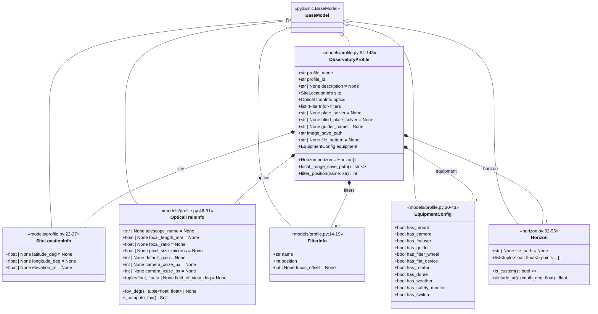
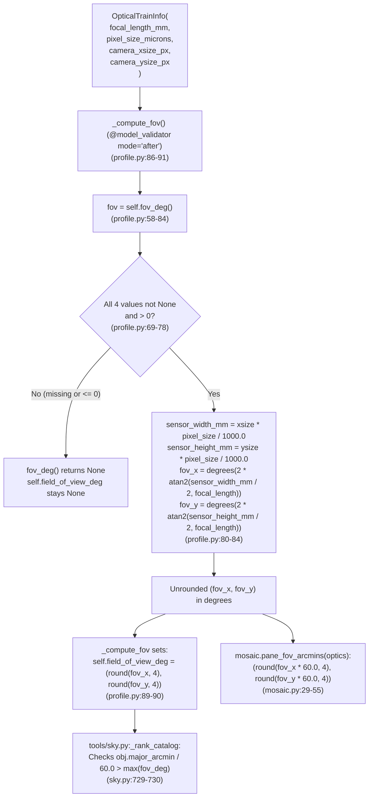

# Observatory Profile & Optical Train Models (`nina_planner/models/profile.py`)

[⬆️ Up to Models Package](./README.md) · [⬅️ Pointing & Frame Models](./pointing-and-frame.md) · [➡️ Core Rig Devices](./core-rig-devices.md) · [🔗 `horizon.py`](../core/horizon.md) · [🔗 `imaging.py`](../core/imaging.md) · [🔗 `mosaic.py`](../core/mosaic.md) · [🔗 `tools/equipment.py`](../tools/equipment.md)

---

## 1. Module Header & Overview

- **File Path:** `.opencode/local/mcps/nina_planner/nina_planner/models/profile.py`
- **Line Count:** 143 lines (`1-143`)
- **Module Docstring (`line 1`):** `"""Profile models: site, optics, filters and the equipment the profile declares."""`
- **Imports (`lines 3-11`):**
  - Standard library: `from __future__ import annotations` (`line 3`), `import math` (`line 5`), `from typing import Self` (`line 6`)
  - Third-party: `from pydantic import BaseModel, computed_field, model_validator` (`line 8`)
  - Internal: `from ..horizon import Horizon` (`line 10`), `from ..imaging import windows_to_local` (`line 11`)

### 1.1 Architectural Role & Key Invariants
1. **Live Validation Authority (`ObservatoryProfile`):** Constructed fresh by `tools/equipment.py:get_site_profile()` (`equipment.py:179-289`) from `GET /v2/api/profile/show?active=true` and `GET /v2/api/profile/horizon`. Never cached across sessions (`profile.py:97-99`), because every sequence load and plan expansion validates filter names/slots, rotator presence, optical FOV, and custom horizon altitudes against the currently active N.I.N.A. profile.
2. **Single Source of Truth for FOV Trigonometry (`OpticalTrainInfo.fov_deg`):**
   - Computes the sensor's angular field of view in degrees using exact gnomonic tangent-plane trigonometry:
     $$\text{FOV}_x = 2 \cdot \operatorname{atan2}\!\left(\frac{\text{sensor\_width\_mm}}{2},\; f_{\text{mm}}\right), \quad \text{FOV}_y = 2 \cdot \operatorname{atan2}\!\left(\frac{\text{sensor\_height\_mm}}{2},\; f_{\text{mm}}\right)$$
     where $\text{sensor\_width\_mm} = \frac{\text{camera\_xsize\_px} \times \text{pixel\_size\_microns}}{1000.0}$.
   - `fov_deg()` (`profile.py:58-84`) returns the **unrounded** `(width_deg, height_deg)` tuple so `mosaic.pane_fov_arcmins` (`mosaic.py:29-55`) can multiply by `60.0` without intermediate rounding drift, while `_compute_fov()` (`profile.py:86-91`) rounds `self.field_of_view_deg` to 4 decimal places for display in serialized profile responses.
   - If any of the four optical parameters (`focal_length_mm`, `pixel_size_microns`, `camera_xsize_px`, `camera_ysize_px`) is `None` or `<= 0`, `fov_deg()` returns `None` (`lines 69-79`) rather than dividing by zero or producing a nonsensical `180.0°` FOV when `focal_length_mm == 0`.
3. **Cross-OS Save Path Translation (`ObservatoryProfile.local_image_save_path`):**
   - N.I.N.A. runs on Windows and stores `image_save_path` as a Windows path (e.g. `C:\Users\me\Documents\N.I.N.A`).
   - Decorated with `@computed_field` (`profile.py:119-128`), `local_image_save_path` delegates to `imaging.windows_to_local(self.image_save_path)`: on Windows (`sys.platform == "win32"`) it returns the path unchanged; on Linux/macOS/WSL it maps the drive letter through `NINA_DRIVE_MOUNT` (default `/mnt/<drive>`) so local file readers (`metadata.resolve_imaging_root`, `read_imaging_csv`, `audit_plans`) can access the imaging root directly.
   - Because it is a `@computed_field`, `local_image_save_path` appears in `model_dump()` and `model_dump_json()` output for MCP callers, but is **not** an input property in `ObservatoryProfile.model_json_schema()`.

---

## 2. Architecture & Visual Diagrams

### 2.1 Class Hierarchy & Composition (`models/profile.py`)



### 2.2 `OpticalTrainInfo` FOV Derivation & Consumer Flow



---

## 3. Module-Level Constants & Globals

*(None — `models/profile.py` defines no module-level constants.)*

---

## 4. Classes, Fields & Data Schemas (All 5 Classes)

### 4.1 `FilterInfo` (`nina_planner/models/profile.py:14-19`)
- **Qualified Name:** `nina_planner.models.profile.FilterInfo`
- **Source Location:** `.opencode/local/mcps/nina_planner/nina_planner/models/profile.py:14-19`
- **Base Class:** `pydantic.BaseModel`
- **Docstring (`line 15`):** `"""One profile filter: its name, 1-based wheel slot, and focus offset in steps."""`

| Field | Line | Type | Default | Units & Semantics |
|---|---:|---|---|---|
| `name` | `17` | `str` | *(required)* | Filter name configured in the N.I.N.A. profile (e.g. `"L"`, `"R"`, `"G"`, `"B"`, `"Ha"`, `"Dark"`). |
| `position` | `18` | `int` | *(required)* | Wheel slot index read from N.I.N.A.'s `FilterWheelSettings.FilterWheelFilters` (`tools/equipment.py:224-251`) and emitted into `SwitchFilter` sequence instructions (`_position`). |
| `focus_offset` | `19` | `int \| None` | `None` | Focuser step offset relative to the reference filter (`FocusOffset`), or `None`. |

---

### 4.2 `SiteLocationInfo` (`nina_planner/models/profile.py:22-27`)
- **Qualified Name:** `nina_planner.models.profile.SiteLocationInfo`
- **Source Location:** `.opencode/local/mcps/nina_planner/nina_planner/models/profile.py:22-27`
- **Base Class:** `pydantic.BaseModel`
- **Docstring (`line 23`):** `"""Observatory site: latitude/longitude in degrees, elevation in metres."""`

| Field | Line | Type | Default | Units & Semantics |
|---|---:|---|---|---|
| `latitude_deg` | `25` | `float \| None` | `None` | Observatory geodetic latitude in degrees (`AstrometrySettings.Latitude`). |
| `longitude_deg` | `26` | `float \| None` | `None` | Observatory geodetic longitude in degrees (`AstrometrySettings.Longitude`). |
| `elevation_m` | `27` | `float \| None` | `None` | Observatory elevation above sea level in metres (`AstrometrySettings.Elevation`). |

---

### 4.3 `EquipmentConfig` (`nina_planner/models/profile.py:30-43`)
- **Qualified Name:** `nina_planner.models.profile.EquipmentConfig`
- **Source Location:** `.opencode/local/mcps/nina_planner/nina_planner/models/profile.py:30-43`
- **Base Class:** `pydantic.BaseModel`
- **Docstring (`line 31`):** `"""Which device classes the profile declares — the capability guards read these."""`
- **Role:** Populated by `tools/equipment.py:get_site_profile` (`equipment.py:257-269`) by checking whether each device's driver `Id` in the N.I.N.A. profile is neither `"No_Device"` nor empty. Read by `_get_site_equipment_status` (`equipment.py:82-167`), `plan_utils.require_light_capabilities` (`plan_utils.py:178-220`), `plan_utils.validate_position_angle` (`plan_utils.py:93-136`), and `sequence/variants.py:dark_variant_reasons` (`variants.py:23-86`).

| Field | Line | Type | Default | N.I.N.A. Profile Source (`tools/equipment.py:257-269`) | Capability Gate Consumers |
|---|---:|---|---|---|---|
| `has_mount` | `33` | `bool` | *(required)* | `TelescopeSettings.Id != "No_Device"` | `require_light_capabilities`, `_get_site_equipment_status` |
| `has_camera` | `34` | `bool` | *(required)* | `CameraSettings.Id != "No_Device"` | `require_light_capabilities`, `_get_site_equipment_status` |
| `has_focuser` | `35` | `bool` | *(required)* | `FocuserSettings.Id != "No_Device"` | `require_light_capabilities`, `_get_site_equipment_status` |
| `has_guider` | `36` | `bool` | *(required)* | `GuiderSettings.GuiderName != "No_Guider"` | `require_light_capabilities`, `_get_site_equipment_status` |
| `has_filter_wheel` | `37` | `bool` | *(required)* | `FilterWheelSettings.Id != "No_Device"` | `require_light_capabilities`, `dark_variant_reasons("wheel")`, `_get_site_equipment_status` |
| `has_flat_device` | `38` | `bool` | *(required)* | `FlatDeviceSettings.Id != "No_Device"` | `dark_variant_reasons("cover")`, `_get_site_equipment_status` |
| `has_rotator` | `39` | `bool` | *(required)* | `RotatorSettings.Id != "No_Device"` | `validate_position_angle`, `_get_site_equipment_status` |
| `has_dome` | `40` | `bool` | *(required)* | `DomeSettings.Id != "No_Device"` | `_get_site_equipment_status` |
| `has_weather` | `41` | `bool` | *(required)* | `WeatherDataSettings.Id != "No_Device"` | `_get_site_equipment_status` |
| `has_safety_monitor` | `42` | `bool` | *(required)* | `SafetyMonitorSettings.Id != "No_Device"` | `_get_site_equipment_status` |
| `has_switch` | `43` | `bool` | *(required)* | `SwitchSettings.Id != "No_Device"` | `_get_site_equipment_status` |

---

### 4.4 `OpticalTrainInfo` (`nina_planner/models/profile.py:46-91`)
- **Qualified Name:** `nina_planner.models.profile.OpticalTrainInfo`
- **Source Location:** `.opencode/local/mcps/nina_planner/nina_planner/models/profile.py:46-91`
- **Base Class:** `pydantic.BaseModel`
- **Docstring (`line 47`):** `"""Scope/camera optics: focal length in mm, pixels in microns, FOV in degrees."""`

| Field | Line | Type | Default | Units & Semantics |
|---|---:|---|---|---|
| `telescope_name` | `49` | `str \| None` | `None` | Telescope name from `TelescopeSettings.Name`. |
| `focal_length_mm` | `50` | `float \| None` | `None` | Optical focal length in millimetres (`TelescopeSettings.FocalLength`). |
| `focal_ratio` | `51` | `float \| None` | `None` | Optical focal ratio $f/\#$ (`TelescopeSettings.FocalRatio`). |
| `pixel_size_microns` | `52` | `float \| None` | `None` | Camera pixel pitch in micrometres ($\mu\text{m}$, `CameraSettings.PixelSize`). |
| `default_gain` | `53` | `int \| None` | `None` | Default camera gain in profile (`CameraSettings.Gain`). |
| `camera_xsize_px` | `54` | `int \| None` | `None` | Sensor width in pixels (`FramingAssistantSettings.CameraWidth`). |
| `camera_ysize_px` | `55` | `int \| None` | `None` | Sensor height in pixels (`FramingAssistantSettings.CameraHeight`). |
| `field_of_view_deg` | `56` | `tuple[float, float] \| None` | `None` | Derived `(width_deg, height_deg)` rounded to 4 decimal places by `_compute_fov()`, or `None` when optical parameters are missing or non-positive. |

---

### 4.5 `ObservatoryProfile` (`nina_planner/models/profile.py:94-143`)
- **Qualified Name:** `nina_planner.models.profile.ObservatoryProfile`
- **Source Location:** `.opencode/local/mcps/nina_planner/nina_planner/models/profile.py:94-143`
- **Base Class:** `pydantic.BaseModel`
- **Docstring (`lines 95-100`):**
  > `The active N.I.N.A. profile: site, optics, filters, equipment, horizon.`
  > `Everything a plan validates against — filter slots, rotator presence, the custom horizon — so it must be read fresh from N.I.N.A. before a load rather than cached across sessions.`

| Field |Line | Type | Default | Semantics |
|---|---:|---|---|---|
| `profile_name` | `102` | `str` | *(required)* | Active profile display name (`Name`). |
| `profile_id` | `103` | `str` | *(required)* | Active profile UUID string (`Id`). |
| `description` | `104` | `str \| None` | `None` | Optional profile description (`Description`). |
| `site` | `105` | `SiteLocationInfo` | *(required)* | Observatory latitude, longitude, and elevation. |
| `optics` | `106` | `OpticalTrainInfo` | *(required)* | Telescope and camera sensor geometry + derived FOV. |
| `filters` | `107` | `list[FilterInfo]` | *(required)* | Configured filter wheel slots. |
| `plate_solver` | `108` | `str \| None` | `None` | Primary plate solver enum string (`PlateSolveSettings.PlateSolverType`). Checked against `"NONE"` by `plan_utils.require_light_capabilities`. |
| `blind_plate_solver` | `109` | `str \| None` | `None` | Blind plate solver enum string (`PlateSolveSettings.BlindSolverType`). |
| `guider_name` | `110` | `str \| None` | `None` | Configured guider name (`GuiderSettings.GuiderName`). |
| `image_save_path` | `111` | `str` | *(required)* | Raw `ImageFileSettings.FilePath` string from the N.I.N.A. profile (typically a Windows path such as `C:\Users\...\N.I.N.A`). |
| `file_pattern` | `112` | `str \| None` | `None` | Image file naming pattern (`ImageFileSettings.FilePattern`, e.g. `$$TARGETNAME$$\$$IMAGETYPE$$\...`). |
| `equipment` | `113` | `EquipmentConfig` | *(required)* | Boolean flags indicating which device classes are configured in the profile. |
| `horizon` | `117` | `Horizon` | `Horizon()` | Custom horizon profile (`horizon.py:32-96`) fetched from `GET /profile/horizon`. Defaults to an empty `Horizon()` (`is_custom=False`, flat `0.0°` horizon). |

---

## 5. Methods, Validators & Computed Properties

### 5.1 `OpticalTrainInfo.fov_deg` (`nina_planner/models/profile.py:58-84`)
1. **Location & Signature:**
   - **File & Lines:** `.opencode/local/mcps/nina_planner/nina_planner/models/profile.py:58-84`
   - **Qualified Name:** `nina_planner.models.profile.OpticalTrainInfo.fov_deg`
   - **Signature:** `def fov_deg(self) -> tuple[float, float] | None`
2. **Decorator / Hook:** Standard instance method.
3. **Parameters:** `self: OpticalTrainInfo`
4. **Return Type & Semantics:**
   - Returns `tuple[float, float]` `(fov_width_deg, fov_height_deg)` unrounded in degrees when all four optical inputs (`focal_length_mm`, `pixel_size_microns`, `camera_xsize_px`, `camera_ysize_px`) are non-`None` and strictly positive (`> 0`).
   - Returns `None` if any of the four inputs is `None` or `<= 0`.
5. **Exceptions & Refusals:** None (guards against `None` and `<= 0` before any division or `atan2`).
6. **Step-by-Step Logic & Control Flow:**
   - **Lines 65-68:** Reads `focal_length`, `pixel_size`, `xsize`, `ysize` from `self`.
   - **Lines 69-79:** Checks `if focal_length is None or pixel_size is None or xsize is None or ysize is None or focal_length <= 0 or pixel_size <= 0 or xsize <= 0 or ysize <= 0: return None`.
   - **Lines 80-81:** Converts sensor dimensions from pixel count × microns to millimetres:
     - `sensor_width_mm = xsize * pixel_size / 1000.0`
     - `sensor_height_mm = ysize * pixel_size / 1000.0`
   - **Lines 82-83:** Computes angular width and height in radians:
     - `fov_x = 2.0 * math.atan2(sensor_width_mm / 2.0, focal_length)`
     - `fov_y = 2.0 * math.atan2(sensor_height_mm / 2.0, focal_length)`
   - **Line 84:** Returns `(math.degrees(fov_x), math.degrees(fov_y))`.
7. **Callers & Test Coverage:**
   - Called by `OpticalTrainInfo._compute_fov` (`models/profile.py:88`) and `mosaic.pane_fov_arcmins` (`mosaic.py:39`).
   - Tested in `tests/test_profile.py:18-65` (`OpticalTrainInfoFovTest`) and `tests/test_mosaic.py:24-54` (`PaneFovTest`).

---

### 5.2 `OpticalTrainInfo._compute_fov` (`nina_planner/models/profile.py:86-91`)
1. **Location & Signature:**
   - **File & Lines:** `.opencode/local/mcps/nina_planner/nina_planner/models/profile.py:86-91`
   - **Qualified Name:** `nina_planner.models.profile.OpticalTrainInfo._compute_fov`
   - **Signature:** `def _compute_fov(self) -> Self`
2. **Decorator / Hook:** `@model_validator(mode="after")` (`line 86`)
3. **Parameters:** `self: Self` (`OpticalTrainInfo`)
4. **Return Type & Semantics:** Mutates `self.field_of_view_deg` in place to `(round(fov[0], 4), round(fov[1], 4))` when `self.fov_deg()` returns a tuple, and returns `self`.
5. **Exceptions & Refusals:** None.
6. **Step-by-Step Logic & Control Flow:**
   - **Line 88:** `fov = self.fov_deg()`.
   - **Lines 89-90:** `if fov is not None: self.field_of_view_deg = (round(fov[0], 4), round(fov[1], 4))`.
   - **Line 91:** `return self`.
7. **Callers & Test Coverage:**
   - Executed automatically by Pydantic upon every `OpticalTrainInfo` construction (`tools/equipment.py:214-222`).
   - Tested in `tests/test_profile.py:34-65`.

---

### 5.3 `ObservatoryProfile.local_image_save_path` (`nina_planner/models/profile.py:119-128`)
1. **Location & Signature:**
   - **File & Lines:** `.opencode/local/mcps/nina_planner/nina_planner/models/profile.py:119-128`
   - **Qualified Name:** `nina_planner.models.profile.ObservatoryProfile.local_image_save_path`
   - **Signature:** `def local_image_save_path(self) -> str`
2. **Decorator / Hook:** `@computed_field` (`line 119`) + `@property` (`line 120`)
3. **Parameters:** `self: ObservatoryProfile`
4. **Return Type & Semantics:** Returns `str(windows_to_local(self.image_save_path))` (`str`).
   - On Windows (`sys.platform == "win32"`): returns `self.image_save_path` unchanged.
   - On non-Windows hosts (Linux, macOS, WSL): translates a Windows drive prefix (`C:\...` or `D:/...`) via `os.environ.get("NINA_DRIVE_MOUNT")` (or `/mnt/<drive_lower>` when unset) into a POSIX path (`imaging.py:65-81`). Paths without a Windows drive letter pass through unchanged.
5. **Exceptions & Refusals:** None.
6. **Step-by-Step Logic & Control Flow:**
   - **Line 128:** `return str(windows_to_local(self.image_save_path))`.
7. **Callers & Test Coverage:**
   - Called by `metadata.resolve_imaging_root` (`metadata.py:19`: `return Path(profile.local_image_save_path)`) and serialized automatically in `get_site_profile()` responses.
   - Tested in `tests/test_profile.py:115-191` (`ObservatoryProfileLocalSavePathTest`).

---

### 5.4 `ObservatoryProfile.filter_position` (`nina_planner/models/profile.py:130-143`)
1. **Location & Signature:**
   - **File & Lines:** `.opencode/local/mcps/nina_planner/nina_planner/models/profile.py:130-143`
   - **Qualified Name:** `nina_planner.models.profile.ObservatoryProfile.filter_position`
   - **Signature:** `def filter_position(self, name: str) -> int`
2. **Decorator / Hook:** Standard instance method.
3. **Parameters:**
   - `self: ObservatoryProfile`
   - `name: str` — exact case-sensitive name of the filter to look up.
4. **Return Type & Semantics:** Returns `filt.position` (`int`), the wheel slot number of the first `FilterInfo` in `self.filters` whose `.name == name`.
5. **Exceptions & Refusals:**
   - Raises `ValueError` (`lines 138-142`) when no filter in `self.filters` matches `name`:
     ```text
     Filter {name!r} not found in profile {self.profile_name!r}. Available: {[f.name for f in self.filters]}
     ```
6. **Step-by-Step Logic & Control Flow:**
   - **Line 137:** Searches `self.filters` linearly: `filt = next((f for f in self.filters if f.name == name), None)`.
   - **Lines 138-142:** If `filt is None`, raises `ValueError` naming the requested filter, `self.profile_name`, and the list of available filter names.
   - **Line 143:** Returns `filt.position`.
7. **Callers & Test Coverage:**
   - Called in `sequence/targets.py`:
     - `target_payload_darks` (`targets.py:144`: `profile.filter_position(dark_filter)`)
     - `target_payload_flats` (`targets.py:251`: `profile.filter_position(f.filter_name)`)
     - `target_payload_lights` (`targets.py:285`: `profile.filter_position(reference_filter_name)`, and `targets.py:405`: `profile.filter_position(filter_name)`)
   - Tested in `tests/test_profile.py:67-113` (`ObservatoryProfileFilterPositionTest`).

---

## 6. Cross-Module Dependencies, Callers & Consumers

### 6.1 Outbound Internal Imports
- `from ..horizon import Horizon` (`line 10`) — used as the type and default value (`Horizon()`) of `ObservatoryProfile.horizon` (`line 117`).
- `from ..imaging import windows_to_local` (`line 11`) — called by `ObservatoryProfile.local_image_save_path` (`line 128`).

### 6.2 Inbound Callers Across the Repository

| Consumer Module | Imported Symbol(s) | Exact Lines | Usage Context |
|---|---|---|---|
| `nina_planner/models/__init__.py` | `FilterInfo`, `ObservatoryProfile`, `OpticalTrainInfo`, `SiteLocationInfo` | `23-28`, `39`, `50`, `52`, `60` | Re-exported in `nina_planner.models.__all__`. |
| `nina_planner/tools/equipment.py` | `EquipmentConfig`, `FilterInfo`, `ObservatoryProfile`, `OpticalTrainInfo`, `SiteLocationInfo` | `13-17`, `83`, `180`, `208-271` | Constructed in `get_site_profile()` from `/profile/show?active=true` + `/profile/horizon`, and passed to `_get_site_equipment_status(profile)`. |
| `nina_planner/mosaic.py` | `OpticalTrainInfo` | `24`, `29`, `39` | `pane_fov_arcmins(optics: OpticalTrainInfo)` calls `optics.fov_deg()`. |
| `nina_planner/metadata.py` | `ObservatoryProfile.local_image_save_path` | `19` | `resolve_imaging_root()` reads `Path(profile.local_image_save_path)`. |
| `nina_planner/plan_utils.py` | `ObservatoryProfile` | `23`, `65`, `93`, `178` | `validate_filters`, `validate_position_angle`, `require_light_capabilities`. |
| `nina_planner/tools/plans.py` | `ObservatoryProfile` | `21`, `104` | `_expand_mosaic(plan, profile)` and `write_plan_file`. |
| `nina_planner/tools/sequence.py` | `ObservatoryProfile` | `10`, `191-194` | Lazy profile loader inside `_load_many`. |
| `nina_planner/sequence/targets.py` | `ObservatoryProfile` | `7`, `111`, `144`, `199`, `251`, `267`, `285`, `405` | Looks up filter positions via `profile.filter_position(...)` for darks, flats, and lights. |
| `nina_planner/sequence/variants.py` | `ObservatoryProfile` | `15`, `24`, `90` | `dark_variant_reasons` and `validate_dark_variant` inspect `profile.equipment` and `profile.filters`. |

---

## 7. Verification & Test Coverage Matrix

Verified in `.opencode/local/mcps/nina_planner/tests/test_profile.py` (191 lines, 3 test classes) and `.opencode/local/mcps/nina_planner/tests/test_horizon.py`:

| Test Class (`tests/test_profile.py`) | Method | Lines | Verified Contract |
|---|---|---|---|
| `OpticalTrainInfoFovTest` | `test_normal_case_computes_fov` | `34-44` | Verifies `field_of_view_deg` matches `round(degrees(2 * atan2(sensor_mm / 2, 540.0)), 4)` for a `6224×4168` sensor with `3.76µm` pixels at `540mm` focal length. |
| `OpticalTrainInfoFovTest` | `test_zero_focal_length_does_not_produce_180` | `46-49` | Verifies `focal_length_mm=0` yields `field_of_view_deg is None` instead of `180.0°`. |
| `OpticalTrainInfoFovTest` | `test_missing_focal_length_no_fov` | `51-54` | Verifies `focal_length_mm=None` yields `field_of_view_deg is None`. |
| `OpticalTrainInfoFovTest` | `test_zero_pixel_size_no_fov` | `56-59` | Verifies `pixel_size_microns=0` yields `field_of_view_deg is None`. |
| `OpticalTrainInfoFovTest` | `test_zero_camera_dimensions_no_fov` | `61-64` | Verifies `camera_xsize_px=0, camera_ysize_px=0` yields `field_of_view_deg is None`. |
| `ObservatoryProfileFilterPositionTest` | `test_returns_position_for_known_filter` | `93-102` | Verifies `profile.filter_position("L") == 2` and `profile.filter_position("R") == 3`. |
| `ObservatoryProfileFilterPositionTest` | `test_missing_filter_raises_value_error_naming_filter_and_profile` | `104-112` | Verifies `profile.filter_position("X")` raises `ValueError` containing `"X"`, `"TestProfile"`, and `"L"`. |
| `ObservatoryProfileLocalSavePathTest` | `test_windows_drive_translated_to_local_mount` | `146-153` | Verifies `C:\Users\me\Documents\N.I.N.A` maps to `/mnt/c/Users/me/Documents/N.I.N.A` on Linux when `NINA_DRIVE_MOUNT` is unset. |
| `ObservatoryProfileLocalSavePathTest` | `test_env_drive_mount_honored` | `155-163` | Verifies `NINA_DRIVE_MOUNT="/mnt/windows"` maps `D:\N.I.N.A` to `/mnt/windows/N.I.N.A`. |
| `ObservatoryProfileLocalSavePathTest` | `test_path_without_drive_passes_through` | `165-172` | Verifies POSIX path `/tmp/save` passes through unchanged on Linux. |
| `ObservatoryProfileLocalSavePathTest` | `test_on_windows_the_profile_path_is_used_directly` | `174-182` | Verifies on `win32` `local_image_save_path` returns `C:\Users\me\N.I.N.A` unchanged even if `NINA_DRIVE_MOUNT` is set. |
| `ObservatoryProfileLocalSavePathTest` | `test_serialized_but_not_an_input_field` | `184-191` | Verifies `@computed_field` includes `local_image_save_path` in `model_dump()` and `model_dump_json()`, while omitting it from `model_json_schema()["properties"]` and `"required"`. |
| `ProfileHorizonIntegrationTest` (`tests/test_horizon.py`) | `test_profile_carries_default_and_custom_horizon` | `128-187` | Verifies `ObservatoryProfile.horizon` defaults to an empty `Horizon()` (`is_custom=False`) and serializes custom azimuth/altitude horizon points when populated. |
