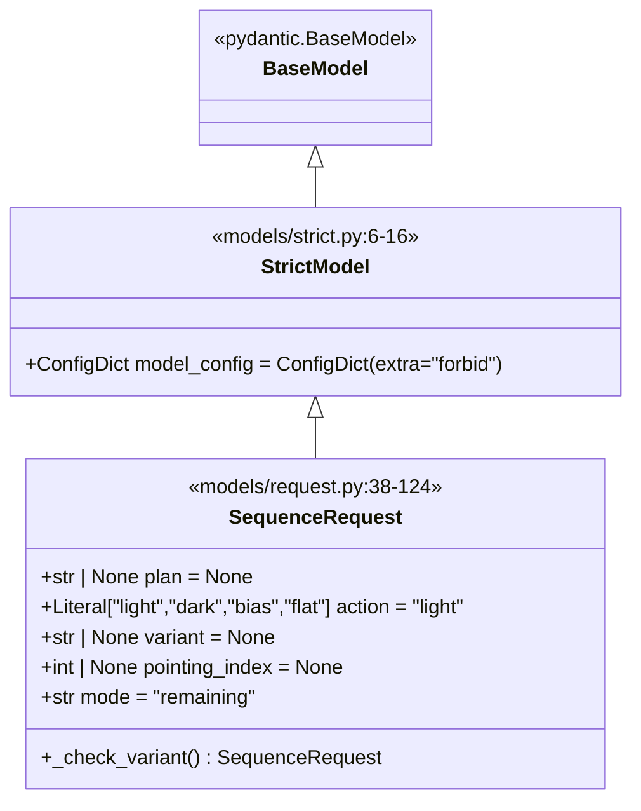

# Strict Validation Base & Sequence Request Models (`strict.py`, `request.py`)

[⬆️ Up to Models Package](./README.md) · [⬅️ File & Symbol Manifest](../../00-inventory/file-and-symbol-manifest.md) · [➡️ Observation Plan Models](./plan.md) · [🔗 `tools/sequence.py`](../tools/sequence.md) · [🔗 `sequence/variants.py`](../sequence/targets-and-variants.md)

---

## 1. Module Header & Overview

| Module | File Path | Lines | Primary Responsibility |
|---|---|---:|---|
| `nina_planner.models.strict` | `.opencode/local/mcps/nina_planner/nina_planner/models/strict.py` | 16 (`1-16`) | Defines `StrictModel(BaseModel)` with `model_config = ConfigDict(extra="forbid")` as the base class for all plan-file and caller-request schemas. |
| `nina_planner.models.request` | `.opencode/local/mcps/nina_planner/nina_planner/models/request.py` | 124 (`1-124`) | Defines the `load_sequence` item schema (`SequenceRequest`), the action enum (`Action`), the canonical dark/bias variant order (`DARK_VARIANTS`), the action-scoped variant matrix (`VARIANTS`), and the post-init validator `SequenceRequest._check_variant`. |

### 1.1 Architectural Invariants
1. **Fail-Closed Extra Key Rejection (`extra="forbid"`):** Both plan JSON files and `load_sequence` requests inherit from `StrictModel` (`strict.py:6-16`). If a caller passes an unknown field (such as a misspelled `"exposure"` in a plan or a misplaced `"max_hfr"` quality threshold on `SequenceRequest` instead of in `ObservationPlan.quality`), Pydantic immediately raises a `ValidationError` (`extra_forbidden`) rather than silently dropping the key (`strict.py:9-11`, `request.py:45-48`, `request.py:97-99`).
2. **Orthogonal `action` × `variant` Axes:** Rather than multiplying combinations into a flat action enum (`dawn_flat`, `dusk_flat`, `wheel_dark`, `cover_dark`, `shutter_dark`, ...), `SequenceRequest` separates **what** to shoot (`action`: `"light" | "dark" | "bias" | "flat"`) from **how/when** to shoot it (`variant`, validated against `VARIANTS[self.action]`) (`request.py:25-35`).
3. **Every Action Requires a Plan; Empty List Parks:** There is no `"park"` action in `Action` (`request.py:9-18`). Every `SequenceRequest` represents a plan-backed frame sequence; passing `request=[]` to `load_sequence` emits a sequence with an empty Target area whose End container parks the mount and warms the camera (`request.py:9-12`).
4. **Canonical Dark Variant Preference Order:** `DARK_VARIANTS = ("wheel", "cover", "shutter")` (`request.py:23`) is the single source of truth imported by `sequence/variants.py:16`, `sequence/targets.py:8`, and `sequence/__init__.py:104`. `"wheel"` is first because it is the default fallback when `variant=None` on `"dark"` or `"bias"`.

---

## 2. Architecture & Validation Diagrams

### 2.1 Class Hierarchy & Composition



### 2.2 `SequenceRequest._check_variant` Control Flow (`models/request.py:100-124`)

```mermaid
flowchart TD
    Start(["SequenceRequest.model_validate(data)"]) --> StrictCheck{"Unknown keys present\nor field type/bound\nviolated (e.g. pointing_index < 1)?"}
    StrictCheck -- "Yes" --> ErrPydantic["Raise pydantic.ValidationError\n(extra_forbidden / greater_than_equal / literal_error)"]
    StrictCheck -- "No" --> Lookup["allowed = VARIANTS[self.action]\n(request.py:110)"]
    Lookup --> CheckNone{"self.variant is None?\n(request.py:111)"}
    CheckNone -- "Yes" --> CheckFlat{"self.action == 'flat'?\n(request.py:112)"}
    CheckFlat -- "Yes" --> ErrFlat["Raise ValueError:\n\"action='flat' requires a variant:\n'dawn' (morning twilight) or\n'dusk' (evening twilight).\"\n(request.py:113-116)"]
    CheckFlat -- "No ('light', 'dark', 'bias')" --> ReturnSelf["Return self\n(request.py:117)"]
    CheckNone -- "No (variant is str)" --> CheckAllowed{"self.variant in allowed?\n(request.py:118)"}
    CheckAllowed -- "No" --> ErrMismatch["Raise ValueError:\n\"variant={self.variant!r} does not apply to\naction={self.action!r}; allowed:\n{', '.join(sorted(allowed)) or 'none'}\"\n(request.py:119-123)"]
    CheckAllowed -- "Yes" --> ReturnSelf2["Return self\n(request.py:124)"]
```

---

## 3. Module-Level Constants, Type Aliases & Globals

### 3.1 `nina_planner/models/strict.py`
- **Imports (`line 3`):** `from pydantic import BaseModel, ConfigDict`
- **Module-Level Constants:** *(none)*

### 3.2 `nina_planner/models/request.py`
- **Imports (`lines 3-7`):**
  - `from typing import Literal` (`line 3`)
  - `from pydantic import Field, model_validator` (`line 5`)
  - `from .strict import StrictModel` (`line 7`)

| Symbol | Location | Type / Value | Semantics & Consumers |
|---|---|---|---|
| `Action` | `models/request.py:13-18` | `Literal["light", "dark", "bias", "flat"]` | Type alias enumerating the four plan-backed frame sequences accepted by `SequenceRequest.action`. |
| `DARK_VARIANTS` | `models/request.py:23` | `tuple[str, str, str] = ("wheel", "cover", "shutter")` | Canonical ordered tuple of dark/bias light-blocking recipes. `"wheel"` is first (default fallback when `variant` is omitted on `"dark"`/`"bias"`), followed by `"cover"` (motorized flip-flat cover) and `"shutter"` (internal camera mechanical shutter). Re-exported by `sequence/__init__.py:104,111` and validated against by `sequence/variants.py:16,100-109` and `sequence/targets.py:8,129-132`. |
| `VARIANTS` | `models/request.py:30-35` | `dict[str, frozenset[str]]` | Action-scoped mapping of valid `variant` strings per `Action`:<br>• `"light"`: `frozenset()` (no variants allowed)<br>• `"dark"`: `frozenset({"wheel", "cover", "shutter"})`<br>• `"bias"`: `frozenset({"wheel", "cover", "shutter"})`<br>• `"flat"`: `frozenset({"dawn", "dusk"})` |

---

## 4. Classes, Fields & Data Schemas

### 4.1 `StrictModel` (`nina_planner/models/strict.py:6-16`)
- **Qualified Name:** `nina_planner.models.strict.StrictModel`
- **Source Location:** `.opencode/local/mcps/nina_planner/nina_planner/models/strict.py:6-16`
- **Base Class:** `pydantic.BaseModel`
- **Configuration (`line 16`):** `model_config = ConfigDict(extra="forbid")`
- **Fields:** *(none — base class only)*
- **Direct Subclasses (13 total):**
  - `models/request.py`: `SequenceRequest` (`38-124`)
  - `models/pointing.py`: `Pointing` (`30-90`)
  - `models/plan.py`: `LightExposurePlan` (`33-38`), `FlatExposurePlan` (`41-48`), `DarkExposurePlan` (`51-55`), `BiasExposurePlan` (`58-61`), `AutofocusConfig` (`64-71`), `GuidingConfig` (`74-86`), `CoolerConfig` (`89-98`), `ConstraintsConfig` (`101-115`), `QualityConfig` (`118-149`), `MosaicConfig` (`155-235`), `ObservationPlan` (`238-455`)
- **Design Rationale (`lines 7-14`):** Any key not declared in a `StrictModel` subclass schema is rejected with `ValidationError` rather than silently dropped. Conversely, models parsing N.I.N.A.'s own HTTP responses (`ObservatoryProfile`, `ObservatoryEquipment`, `CameraDevice`, `FrameStats`, `PointingInfo`, etc.) deliberately inherit from `BaseModel` directly so new fields added by N.I.N.A. or ASCOM drivers do not break deserialization.

---

### 4.2 `SequenceRequest` (`nina_planner/models/request.py:38-124`)
- **Qualified Name:** `nina_planner.models.request.SequenceRequest`
- **Source Location:** `.opencode/local/mcps/nina_planner/nina_planner/models/request.py:38-124`
- **Base Class:** `StrictModel` (`extra="forbid"`)
- **Role:** Represents one step in the `request: list[SequenceRequest]` argument passed to the `load_sequence` MCP tool (`tools/sequence.py:24-63`).

#### Field Specification Table (`SequenceRequest`)

| Field Name | Lines | Type Annotation | Default | Pydantic Constraints | Domain Semantics & Downstream Validation |
|---|---|---|---|---|---|
| `plan` | `49-55` | `str \| None` | `None` | *(none on field)* | Path to the observation-plan JSON file on disk. Although typed `str \| None = None` so missing-plan errors can be reported with step context by `tools/sequence.py:_load_many` (`sequence.py:224-228`), it is required at runtime for every `SequenceRequest`. |
| `action` | `56-59` | `Action` (`Literal["light", "dark", "bias", "flat"]`) | `"light"` | Literal check (`"light"`, `"dark"`, `"bias"`, `"flat"`) | Selects which frame group from `plan` to compile into a sequence step. |
| `variant` | `60-75` | `str \| None` | `None` | Checked by `_check_variant` (`100-124`) | Action-scoped execution recipe:<br>• `action="light"`: must be `None` (`VARIANTS["light"]` is empty).<br>• `action="flat"`: **required** (`"dawn"` for morning twilight or `"dusk"` for evening twilight).<br>• `action="dark"` or `"bias"`: optional (`None` defaults downstream to `"wheel"`); accepts `"wheel"`, `"cover"`, or `"shutter"`. Hardware capability is checked at load time by `sequence.variants.validate_dark_variant`. |
| `pointing_index` | `76-88` | `int \| None` | `None` | `ge=1` (`line 78`) | 1-based index into `plan.pointings`. Applies to `action="light"` only (defaults to `1` when `None` in `tools/sequence.py:239`). Must be omitted (`None`) for `"dark"`, `"bias"`, and `"flat"` because calibration is plan-level (`tools/sequence.py:230-237` rejects non-`None` `pointing_index` on calibration actions). |
| `mode` | `89-95` | `str` | `"remaining"` | Checked in `tools/sequence.py:241-246` (`"remaining"` or `"full"`) | `"remaining"` (default) subtracts already-acquired frames recorded in `ImageMetaData.csv` (respecting `plan.quality` for lights and `plan.calibration_window_days` for calibration) via `progress.plan_with_remaining`. `"full"` compiles the full `total_count` budget from the plan file regardless of prior captures. |

#### Action × Variant × `pointing_index` Truth Table

| `action` | Allowed `variant` (`VARIANTS[action]`) | `variant=None` Behavior in `_check_variant` | Downstream Default for `variant=None` | `pointing_index` Rule |
|---|---|---|---|---|
| `"light"` | `frozenset()` *(none)* | Accepted (`returns self`) | `None` | Optional `int >= 1` (defaults to `1` in `_load_many`); checked against `1..len(plan.pointings)` by `check_pointing_index`. |
| `"flat"` | `frozenset({"dawn", "dusk"})` | **Raises `ValueError`** (`request.py:113-116`) | *(none — required)* | Must be `None` (rejected in `tools/sequence.py:230-237` if set). |
| `"dark"` | `frozenset({"wheel", "cover", "shutter"})` | Accepted (`returns self`) | `"wheel"` (`DARK_VARIANTS[0]`) | Must be `None` (rejected in `tools/sequence.py:230-237` if set). |
| `"bias"` | `frozenset({"wheel", "cover", "shutter"})` | Accepted (`returns self`) | `"wheel"` (`DARK_VARIANTS[0]`) | Must be `None` (rejected in `tools/sequence.py:230-237` if set). |

---

## 5. Methods, Validators & Computed Properties

### 5.1 `SequenceRequest._check_variant` (`nina_planner/models/request.py:100-124`)

1. **Location & Signature:**
   - **File & Lines:** `.opencode/local/mcps/nina_planner/nina_planner/models/request.py:100-124`
   - **Qualified Name:** `nina_planner.models.request.SequenceRequest._check_variant`
   - **Signature:** `def _check_variant(self) -> "SequenceRequest"`
2. **Decorator / Hook:**
   - `@model_validator(mode="after")` (`line 100`) — executes after field-level validation (`Action` literal check and `pointing_index >= 1` check) has succeeded.
3. **Parameters:**
   - `self: SequenceRequest` — the populated model instance with validated `self.action` and `self.variant`.
4. **Return Type & Semantics:**
   - Returns `self` (`SequenceRequest`) unchanged when `self.variant` is valid for `self.action`.
5. **Exceptions & Refusals:**
   - **`ValueError` (missing flat variant, `lines 112-116`):** Raised when `self.variant is None` and `self.action == "flat"`:
     ```text
     action='flat' requires a variant: 'dawn' (morning twilight) or 'dusk' (evening twilight).
     ```
   - **`ValueError` (disallowed variant for action, `lines 118-123`):** Raised when `self.variant is not None` and `self.variant not in VARIANTS[self.action]`:
     ```text
     variant={self.variant!r} does not apply to action={self.action!r}; allowed: {', '.join(sorted(allowed)) or 'none'}
     ```
     - Note: When `self.action == "light"`, `allowed` is `frozenset()`, so `', '.join(sorted(allowed)) or 'none'` evaluates to `'none'`.
     - Note: Pydantic wraps the `ValueError` inside a `pydantic.ValidationError`. When invoked via `load_sequence`, `tools/sequence.py:59-62` catches `ValidationError` and re-raises `ValueError(f"request[{i}]: not a valid SequenceRequest: {e}")`.
6. **Step-by-Step Logic & Control Flow:**
   - **Line 110:** Looks up `allowed = VARIANTS[self.action]`.
   - **Lines 111-117:** If `self.variant is None`:
     - If `self.action == "flat"`, raises `ValueError` (`lines 113-116`) because dawn vs. dusk sky flats require an explicit twilight selection.
     - Otherwise (`"light"`, `"dark"`, `"bias"`), returns `self` (`line 117`).
   - **Lines 118-123:** If `self.variant not in allowed`, raises `ValueError` naming `self.variant`, `self.action`, and the sorted allowed variants (or `'none'`).
   - **Line 124:** Returns `self`.
7. **Callers & Test Coverage:**
   - Triggered automatically on every `SequenceRequest(...)` construction or `SequenceRequest.model_validate(...)` call (`tools/sequence.py:60`).
   - Tested in `tests/test_server.py` (`load_sequence` validation tests) and `tests/test_variants.py:170-220`.

---

## 6. Cross-Module Dependencies, Callers & Consumers

### 6.1 Outbound Imports
- `models/strict.py`: imports `BaseModel, ConfigDict` from `pydantic` (`line 3`). Zero internal imports.
- `models/request.py`: imports `Literal` from `typing` (`line 3`), `Field, model_validator` from `pydantic` (`line 5`), and `StrictModel` from `.strict` (`line 7`).

### 6.2 Inbound Callers Across the Repository

| Consumer Module | Imported Symbol(s) | Exact Lines | Usage Context |
|---|---|---|---|
| `nina_planner/models/plan.py` | `StrictModel` | `14`, `33`, `41`, `51`, `58`, `64`, `74`, `89`, `101`, `118`, `155`, `238` | Base class for `ObservationPlan` and all 10 nested exposure/config models. |
| `nina_planner/models/pointing.py` | `StrictModel` | `7`, `30` | Base class for `Pointing`. |
| `nina_planner/models/request.py` | `StrictModel` | `7`, `38` | Base class for `SequenceRequest`. |
| `nina_planner/tools/sequence.py` | `SequenceRequest` | `11`, `27`, `54-62`, `176`, `220` | Parameter schema for `@mcp.tool() async def load_sequence(request: list[SequenceRequest] = [])` and internal step compiler `_load_many`. |
| `nina_planner/sequence/variants.py` | `DARK_VARIANTS` | `16`, `100-101`, `109` | Validates dark/bias variants against rig capabilities in `validate_dark_variant` and lists supported variants in `DARK_VARIANTS` preference order. |
| `nina_planner/sequence/targets.py` | `DARK_VARIANTS` | `8`, `129-132` | Guards `target_payload_darks(..., variant: str = "wheel")` against unknown variant strings. |
| `nina_planner/sequence/__init__.py` | `DARK_VARIANTS` | `104`, `111` | Re-exports `DARK_VARIANTS` at the `nina_planner.sequence` package root. |

---

## 7. Verification & Test Coverage Matrix

| Test File | Test Class / Method | Lines | Verified Contract |
|---|---|---|---|
| `tests/test_plan.py` | `UnknownFieldTest.test_unknown_top_level_field_refused` | `157-161` | Verifies `StrictModel` (`extra="forbid"`) rejects unknown top-level keys on `ObservationPlan`. |
| `tests/test_plan.py` | `UnknownFieldTest.test_unknown_field_in_a_nested_config_refused` | `163-167` | Verifies `StrictModel` rejects unknown keys in nested config models (`GuidingConfig`). |
| `tests/test_plan.py` | `UnknownFieldTest.test_unknown_field_in_a_frame_spec_refused` | `169-173` | Verifies `StrictModel` rejects unknown keys in exposure specs (`DarkExposurePlan`). |
| `tests/test_plan.py` | `UnknownFieldTest.test_unknown_field_in_a_pointing_refused` | `175-179` | Verifies `StrictModel` rejects unknown keys in `Pointing`. |
| `tests/test_variants.py` | `ValidateDarkVariantTest.test_every_variant_loads_on_a_capable_rig` | `173-179` | Iterates `DARK_VARIANTS` (`"wheel"`, `"cover"`, `"shutter"`) and verifies acceptance on a full rig. |
| `tests/test_variants.py` | `ValidateDarkVariantTest.test_the_default_is_the_wheel_variant` | `181-186` | Locks `DARK_VARIANTS[0] == "wheel"` as the default fallback when `SequenceRequest.variant` is omitted. |
| `tests/test_variants.py` | `ValidateDarkVariantTest.test_an_unknown_variant_is_still_rejected` | `211-220` | Verifies unknown variants (`"lens"`) raise `ValueError` listing `"wheel"`, `"cover"`, and `"shutter"`. |
| `tests/test_server.py` | `McpToolDirectTest` (`load_sequence` tests) | `2100-2750` | End-to-end validation of `SequenceRequest`: extra fields (`max_hfr`), missing flat variant, cross-action variants (`variant="dawn"` on `"light"` or `"dark"`), and `pointing_index` bounds. |
