# Scripts and Agent Skills

[⬆️ Up to Atlas Index](../../README.md) · [➡️ Repository Scripts (`scripts.md`)](./scripts.md) · [➡️ Clear Outside Forecast Utility (`fetch_conditions.md`)](./fetch_conditions.md)

---

## 1. Overview & Architectural Layer

The **Scripts & Skills** layer resides at the repository root outside the packaged `.opencode/local/mcps/nina_planner/` MCP server distribution. It comprises two complementary developer and agent-execution surfaces:

1. **Standalone Repository Scripts (`scripts/*.py`)** — Three CLI utilities used by operators, developers, git hooks, and automated test suites for sequence generation/inspection (`scripts/gen_sequence.py`), documentation synchronization (`scripts/update_readme.py`), and live N.I.N.A. test fixture capture (`scripts/refresh_fixtures.py`).
2. **Agent Skills & Utilities (`.agents/skills/`)** — Seven specialized OpenCode skill definitions (`SKILL.md`) plus one zero-dependency Python forecast scraper and parser (`.agents/skills/site-conditions/fetch_conditions.py`). These govern how the autonomous Observatory Controller agent interacts with the `nina-planner` MCP server, invokes CLI tools, diagnoses telemetry, and evaluates multi-day weather forecasts.

```mermaid
flowchart TD
    subgraph RepoRoot["Repository Root (scripts/ & makefile & .githooks/)"]
        MAKE["makefile\n(readme, commit, lint, archive, purge, test)"]
        HOOK[".githooks/pre-commit"]
        GENSEQ["scripts/gen_sequence.py\n(409 lines)"]
        UPREADME["scripts/update_readme.py\n(105 lines)"]
        REFFIX["scripts/refresh_fixtures.py\n(72 lines)"]
    end

    subgraph SkillsDir[".agents/skills/ (Agent Skill Definitions & Utilities)"]
        S_COND["site-conditions/SKILL.md"]
        FETCH_PY["site-conditions/fetch_conditions.py\n(817 lines)"]
        S_RUN["run-nina-tools/SKILL.md"]
        S_ARCH["archive-lifecycle/SKILL.md"]
        S_LOOP["night-loop/SKILL.md"]
        S_SAFE["safety-interrupt-recovery/SKILL.md"]
        S_QUAL["frame-quality-diagnostics/SKILL.md"]
        S_LIFE["nina-lifecycle/SKILL.md"]
    end

    subgraph NinaPlanner["nina_planner Package (.opencode/local/mcps/nina_planner/)"]
        MCP["MCP Server Tools\n(tools/sequence.py, equipment.py, plans.py, sky.py, lifecycle.py)"]
        SEQ_COMP["Sequence Compiler & Validators\n(sequence/*, plan_utils.py, progress.py, metadata.py, client.py)"]
        CLI_TOOLS["Packaged Console Scripts\n(nina-archive, nina-purge, nina-pin-id, nina-planner)"]
        FIXTURES["Test Fixtures\n(tests/fixtures/sequence_*.json)"]
    end

    subgraph External["External Endpoints & Files"]
        NINA_API["Live N.I.N.A. Advanced API\n(http://HOST:1888/v2/api/*)"]
        CLEAR_OUT["Clear Outside HTML Forecast\n(https://clearoutside.com/forecast/*)"]
        README_MD["README.md & Quoted Repo Files"]
    end

    MAKE -->|"make readme / make commit"| UPREADME
    HOOK -->|"Step 1: refresh & re-stage"| UPREADME
    UPREADME -->|"reads quoted files & rewrites"| README_MD

    GENSEQ -->|"imports & calls"| SEQ_COMP
    GENSEQ -->|"GET profile/equipment & optional POST /sequence/load"| NINA_API

    REFFIX -->|"GET /sequence/state & /sequence/json"| NINA_API
    REFFIX -->|"writes JSON envelopes"| FIXTURES

    S_COND -->|"instructs agent to run"| FETCH_PY
    FETCH_PY -->|"GET ?view=current|midnight|midday"| CLEAR_OUT

    S_RUN -->|"resolves .venv -> uv run -> PATH"| CLI_TOOLS
    S_ARCH -->|"orchestrates via run-nina-tools"| CLI_TOOLS
    S_LOOP -->|"orchestrates"| MCP
    S_SAFE -->|"orchestrates"| MCP
    S_QUAL -->|"orchestrates"| MCP
    S_LIFE -->|"orchestrates"| MCP
```



---

## 2. Python Module Inventory

| File Path | Lines | Dependencies | Exception Classes | Functions (`def` / `async def`) | Detailed Spec |
|---|---:|---|---|---|---|
| `scripts/gen_sequence.py` | 409 | `nina_planner.*` (`client`, `config`, `metadata`, `plan_utils`, `models.*`, `progress`, `sequence`, `tools.*`) + Python stdlib | `ScriptError` (`73-74`) | `_fetch_profile` (`80-88`), `_fetch_equipment` (`91-96`), `_generate` (`102-249`), `_build_parser` (`255-333`), `_validate` (`336-356`), `_run` (`358-383`), `main` (`386-405`) | [➡️ `scripts.md` §1](./scripts.md#1-scriptsgen_sequencepy) |
| `scripts/update_readme.py` | 105 | Python stdlib only (`os`, `re`, `pathlib`) | *(none)* | `insert_file_contents_and_links` (`66-89`, inner `replacer` at `72-87`), `main` (`92-101`) | [➡️ `scripts.md` §2](./scripts.md#2-scriptsupdate_readmepy) |
| `scripts/refresh_fixtures.py` | 72 | Python stdlib only (`argparse`, `json`, `sys`, `urllib.request`, `pathlib`) | *(none)* | `fetch` (`26-43`), `main` (`46-68`) | [➡️ `scripts.md` §3](./scripts.md#3-scriptsrefresh_fixturespy) |
| `.agents/skills/site-conditions/fetch_conditions.py` | 817 | Python stdlib only (`argparse`, `json`, `re`, `sys`, `urllib.error`, `urllib.request`, `datetime`) | `FetchError` (`103-106`), `ParseError` (`109-112`) | `_fmt_coord` (`115-131`), `fetch` (`134-167`), `_mins` (`170-178`), `_is_dark` (`181-212`), `_fmt_run` (`215-217`), `_compress` (`220-242`), `_row_cells` (`245-264`), `_fit` (`267-286`), `_row_ints` (`289-296`), `_row_frost` (`299-311`), `_row_wind` (`314-335`), `parse` (`338-507`), `slice_hours` (`510-538`), `summarize` (`541-595`), `_tag` (`598-599`), `summarize_conditions` (`602-698`), `main` (`701-813`) | [➡️ `fetch_conditions.md`](./fetch_conditions.md) |

---

## 3. Integration with `nina_planner`, `makefile`, and `.githooks`

### 3.1 `scripts/gen_sequence.py` ↔ `nina_planner` Parity Contract
`scripts/gen_sequence.py` is the CLI counterpart to the MCP tool `load_sequence` (`nina_planner/tools/sequence.py`). Rather than re-implementing sequence generation, it imports the exact internal modules from `nina_planner`:
- **Environment Guard (`43-70`):** Because `nina_planner` lives inside `.opencode/local/mcps/nina_planner/.venv`, `gen_sequence.py` wraps its `nina_planner` imports in a `try...except ImportError` block that exits cleanly with instructions to run via `uv run --project .opencode/local/mcps/nina_planner python scripts/gen_sequence.py <plan.json>`.
- **Validation & Guardrail Parity (`126-246`):** Executes the identical validation sequence in the identical order as `load_sequence`:
  1. `plan_utils.validate_filters(plan, profile)` (`128`)
  2. `plan_utils.validate_position_angle(plan, profile)` (`129`)
  3. `plan_utils.check_pointing_index(plan, pointing_index)` for lights (`130-131`)
  4. `_get_site_equipment_status(profile)` (auto-connecting present but disconnected hardware ONLY after cheap plan/profile checks succeed) (`132`)
  5. `validate_dark_variant(variant or "wheel", equipment, profile)` for darks/biases (`133-137`)
  6. `plan_utils.require_light_capabilities(profile)` for lights (`138-143`)
  7. `plan_progress` + `group_verdict` + `plan_with_remaining` in `--mode remaining` (`145-187`), or `_full_mode_note` in `--mode full` (`188-206`)
  8. `$$TARGETNAME$$` attribution check on `profile.file_pattern` unless `--allow-unattributed` (`210-219`)
  9. `plan_utils.require_parkable(equipment)` (`246`)
- **Output Separation (`20-22`, `360-383`):** Writes only pure sequence JSON to `stdout` (unless `sequence is None`, in which case `stdout` stays empty) and routes all progress notes, warnings, and errors to `stderr`. Optional `--load` POSTs the compiled AST via `client.load_sequence_payload(sequence)` without ever starting it.
- **Test Coverage:** Verified in `.opencode/local/mcps/nina_planner/tests/test_gen_sequence.py` (`671` lines) using both stubbed in-process runs (`GenSequenceScriptTest`) and a local HTTP server (`_StubNina`, `GenSequenceLoadOverHttpTest`).

### 3.2 `scripts/update_readme.py` ↔ `makefile` & `.githooks/pre-commit`
`scripts/update_readme.py` prevents documentation drift by finding named fenced code blocks in `README.md` (` ```<lang> <filename> `), reading `<filename>` relative to `PROJECT_ROOT`, injecting its verbatim contents into the code fence, and placing a repo-relative Markdown link (`[<filename>](./<filename>)`) immediately above the fence.
- **`makefile` Integration (`makefile:92-100`):**
  - `make readme` invokes `python3 scripts/update_readme.py` (`makefile:92-93`).
  - `make commit` depends on `lint readme` (`makefile:98`), ensuring `README.md` is refreshed before `git commit -a`.
- **`.githooks/pre-commit` Integration (`.githooks/pre-commit:46-81`):**
  - Enabled per-clone via `git config core.hooksPath .githooks`.
  - Resolves `$repo_root/.opencode/local/mcps/nina_planner/.venv/bin/python` first (because `str | os.PathLike[str]` on line `67` requires Python 3.10+, and macOS system `python3` may be 3.9), falling back to `python3` if `.venv` is not built.
  - Compares `git hash-object -- README.md` before and after running `scripts/update_readme.py`; if `README.md` changed, the hook automatically runs `git add README.md` and proceeds with the commit.

### 3.3 `scripts/refresh_fixtures.py` ↔ `tests/fixtures/`
`scripts/refresh_fixtures.py` captures live N.I.N.A. Advanced API responses from `/v2/api/sequence/state` and `/v2/api/sequence/json` and writes them to `.opencode/local/mcps/nina_planner/tests/fixtures/sequence_state_<label>.json` and `sequence_json_<label>.json`. These fixtures back the unit tests in `tests/test_sequence_state.py`.

### 3.4 `makefile` ↔ Packaged CLI Tools (`nina-archive`, `nina-purge`)
`makefile` defines variables `DIRNAME := $(abspath .opencode/local/mcps/nina_planner)` and `PYTHON := $(BINDIR)/python` (`makefile:2-12`) and exposes targets:
- `make install_uv` (`makefile:116-119`): Creates `.opencode/local/mcps/nina_planner/.venv`, syncs dependencies via `uv sync`, and writes `.envrc`.
- `make archive` (`makefile:155-160`): Invokes `$(PYTHON) -m nina_planner.archive --project-dir $(abspath .) --dest $(abspath $(ARCHIVE_DEST)) $(ARCHIVE_ARGS)` where `ARCHIVE_DEST ?= .archive`.
- `make purge` (`makefile:169-174`): Invokes `$(PYTHON) -m nina_planner.purge --project-dir $(abspath .) --dest $(abspath $(ARCHIVE_DEST)) $(PURGE_ARGS)`.

---

## 4. Agent Skills Catalog (`.agents/skills/`)

The Observatory Controller agent (`.opencode/rules/AGENTS.md`) loads task-specific instructions from `.agents/skills/<skill-id>/SKILL.md`:

| Skill ID | File Path | Companion Script / Tools Used | Architectural Role |
|---|---|---|---|
| `site-conditions` | `.agents/skills/site-conditions/SKILL.md` | `.agents/skills/site-conditions/fetch_conditions.py`, `get_site_profile`, `get_site_equipment_status`, `sun_times`, `moon_times` | Fetches and parses the 7-day hourly forecast from `clearoutside.com` (cloud cover, wind, precip probability, temperature, dew point, dew-point spread, frost flag, Bortle/SQM, astro-dark window). **Advisory only** — never overrides `safety_monitor.is_safe`. |
| `run-nina-tools` | `.agents/skills/run-nina-tools/SKILL.md` | `nina-archive`, `nina-purge`, `nina-pin-id`, `nina-planner`, `get_nina_settings`, `get_nina_status` | Resolves CLI binaries that are not installed on global `PATH` using a strict 4-branch precedence chain: (1) `.opencode/local/mcps/nina_planner/.venv/bin/<tool>`, (2) `uv run --project .opencode/local/mcps/nina_planner <tool>`, (3) `<tool>` on `PATH` (with version warning), (4) stop. Passes `NINA_ENDPOINT` and `NINA_DRIVE_MOUNT` from `get_nina_settings()`. |
| `archive-lifecycle` | `.agents/skills/archive-lifecycle/SKILL.md` | `get_nina_settings`, `nina-archive`, `NINA_UPLOAD_CMD`, `NINA_VERIFY_CMD`, `nina-purge` | Human-gated 5-stage workflow: (0) inspect `get_nina_settings()`, (1) dry-run then checksum archive of completed plans via `nina-archive`, (2) user-confirmed cloud upload, (3) upload verification via `NINA_VERIFY_CMD`, (4) two-phase imaging-root cleanup via `nina-purge --apply` (quarantine) and `nina-purge --purge` (delete), (5) local archive folder cleanup preserving `archive-index.jsonl`. |
| `night-loop` | `.agents/skills/night-loop/SKILL.md` | `target_altitudes`, `best_targets`, `sun_times`, `write_plan_file`, `get_plan_progress`, `load_sequence`, `start_sequence`, `stop_sequence`, `get_sequence_state` | Multi-target scheduling loop triggered by interval checks or `RUN-FINISHED` wakes. Evaluates `PLAN.md` candidates against `above_floor`, sequences single-pointing or pane-by-pane mosaic runs, logs `plan_id` tokens to `PROGRESS.md`, and generates `report_<YYYY-MM-DD>.md` at end-of-night. |
| `safety-interrupt-recovery` | `.agents/skills/safety-interrupt-recovery/SKILL.md` | `get_nina_status`, `start_nina`, `get_site_equipment_status`, `get_sequence_state`, `get_site_profile`, `load_sequence`, `start_sequence`, `get_events`, `get_logs` | Handles safety interrupts and interval checks: verifies N.I.N.A. liveness, enforces `is_safe=false` and weather gates on sky-dependent steps (while allowing roof-closed `dark`/`bias` runs), and ensures the mount is parked via `load_sequence()` + `start_sequence()` when idle or unsafe. |
| `frame-quality-diagnostics` | `.agents/skills/frame-quality-diagnostics/SKILL.md` | `get_frame_stats`, `get_events`, `get_logs`, `get_plan_progress`, `audit_plans` | Diagnoses autofocus R² failures (sweep span vs. star count), separates cirrus scatter (high HFR + high σ) from extinction (low HFR + falling stars) and dither/recenter settles, handles `QUALITY-WATCHDOG` wakes, and cross-checks `mode=full` re-shoots via `audit_plans`. |
| `nina-lifecycle` | `.agents/skills/nina-lifecycle/SKILL.md` | `get_nina_status`, `start_nina`, `stop_nina` | Manages the N.I.N.A. desktop process lifecycle and interprets `lifecycle_control_available` (whether local Windows interop via `tasklist`/`taskkill`/`schtasks` is present). |

---

## 5. Navigation Links

- **[⬆️ Up to Atlas Index](../../README.md)**
- **[➡️ Standalone Repository Scripts (`scripts/gen_sequence.py`, `scripts/update_readme.py`, `scripts/refresh_fixtures.py`)](./scripts.md)**
- **[➡️ Clear Outside Forecast Scraper & Parser (`.agents/skills/site-conditions/fetch_conditions.py`)](./fetch_conditions.md)**
- **[➡️ CLI Modules (`nina_planner/archive.py`, `nina_planner/purge.py`, `nina_planner/pin_id.py`)](../cli/README.md)**
- **[➡️ MCP Tool Modules (`nina_planner/tools/*.py`)](../tools/README.md)**
- **[➡️ Sequence Compiler (`nina_planner/sequence/*.py`)](../sequence/README.md)**
