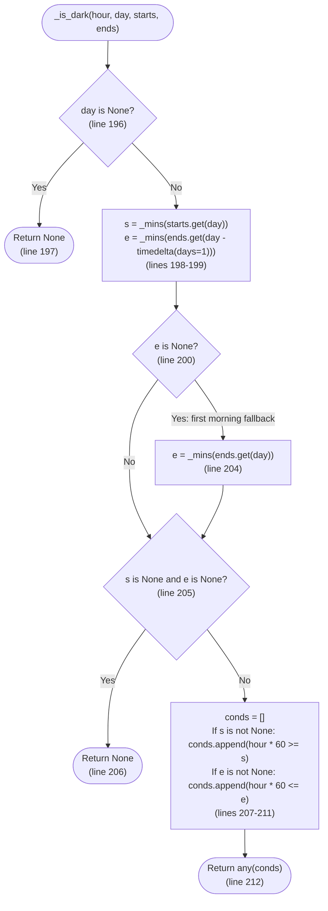
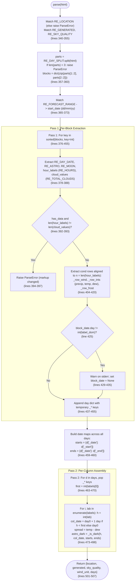
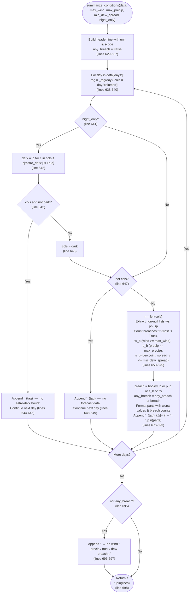

# Clear Outside Forecast Scraper & Parser (`fetch_conditions.py`)

[⬆️ Up to Atlas Index](../../README.md) · [⬆️ Scripts & Skills](./README.md) · [⬅️ Repository Scripts (`scripts.md`)](./scripts.md) · [➡️ Sky & Ephemeris Tools (`../tools/sky.md`)](../tools/sky.md)

---

## Table of Contents

1. [Module Overview](#1-module-overview)
   - [1.1 File Metadata & Architectural Layer](#11-file-metadata--architectural-layer)
   - [1.2 Constants & Compiled Regular Expressions](#12-constants--compiled-regular-expressions)
   - [1.3 Maintenance Invariants](#13-maintenance-invariants)
2. [Classes, Data Models & Exceptions](#2-classes-data-models--exceptions)
   - [2.1 `FetchError`](#21-fetcherror-at-agentsskillssite-conditionsfetch_conditionspy103-106)
   - [2.2 `ParseError`](#22-parseerror-at-agentsskillssite-conditionsfetch_conditionspy109-112)
   - [2.3 Parsed Forecast Dict Schema](#23-parsed-forecast-dict-schema)
3. [Function & Method Reference](#3-function--method-reference)
   - [3.1 `_fmt_coord`](#31-_fmt_coord-at-agentsskillssite-conditionsfetch_conditionspy115-131)
   - [3.2 `fetch`](#32-fetch-at-agentsskillssite-conditionsfetch_conditionspy134-167)
   - [3.3 `_mins`](#33-_mins-at-agentsskillssite-conditionsfetch_conditionspy170-178)
   - [3.4 `_is_dark`](#34-_is_dark-at-agentsskillssite-conditionsfetch_conditionspy181-212)
   - [3.5 `_fmt_run`](#35-_fmt_run-at-agentsskillssite-conditionsfetch_conditionspy215-217)
   - [3.6 `_compress`](#36-_compress-at-agentsskillssite-conditionsfetch_conditionspy220-242)
   - [3.7 `_row_cells`](#37-_row_cells-at-agentsskillssite-conditionsfetch_conditionspy245-264)
   - [3.8 `_fit`](#38-_fit-at-agentsskillssite-conditionsfetch_conditionspy267-286)
   - [3.9 `_row_ints`](#39-_row_ints-at-agentsskillssite-conditionsfetch_conditionspy289-296)
   - [3.10 `_row_frost`](#310-_row_frost-at-agentsskillssite-conditionsfetch_conditionspy299-311)
   - [3.11 `_row_wind`](#311-_row_wind-at-agentsskillssite-conditionsfetch_conditionspy314-335)
   - [3.12 `parse`](#312-parse-at-agentsskillssite-conditionsfetch_conditionspy338-507)
   - [3.13 `slice_hours`](#313-slice_hours-at-agentsskillssite-conditionsfetch_conditionspy510-538)
   - [3.14 `summarize`](#314-summarize-at-agentsskillssite-conditionsfetch_conditionspy541-595)
   - [3.15 `_tag`](#315-_tag-at-agentsskillssite-conditionsfetch_conditionspy598-599)
   - [3.16 `summarize_conditions`](#316-summarize_conditions-at-agentsskillssite-conditionsfetch_conditionspy602-698)
   - [3.17 `main`](#317-main-at-agentsskillssite-conditionsfetch_conditionspy701-813)

---

## 1. Module Overview

### 1.1 File Metadata & Architectural Layer

- **File Path:** `.agents/skills/site-conditions/fetch_conditions.py`
- **Line Count:** `817` lines (`1-817`)
- **Module Docstring & Purpose (`2-18`):**
  Fetches and parses the Clear Outside (`https://clearoutside.com/forecast/<lat>/<lon>`) 7-day hourly astronomical weather forecast for an observing site using only the Python standard library (zero third-party dependencies). Companion executable to `.agents/skills/site-conditions/SKILL.md`. Requires `<lat>` and `<lon>` read live from `get_site_profile()` (`site.latitude_deg` / `site.longitude_deg`); never hardcodes coordinates. Exits `0` on success, `1` on fetch/parse/file error, and `2` on bad CLI usage.
- **Architectural Layer:** Standalone Agent Skill CLI Utility (`.agents/skills/site-conditions/`). Provides advisory forward-looking 7-day hourly sky conditions (total cloud %, wind speed, precipitation probability %, temperature °C, dew point °C, derived dew-point spread °C, frost flag, Bortle class, SQM magnitude, and astro-dark boundaries) that never override `safety_monitor.is_safe`.
- **Inbound Callers:**
  - Invoked by the Observatory Controller agent via the `shell` tool when following `.agents/skills/site-conditions/SKILL.md` (`python3 .agents/skills/site-conditions/fetch_conditions.py <lat> <lon> ...`).
  - Direct CLI invocation (`__main__` at `816-817`).
- **Outbound Imports (`20-28`):**
  - Python stdlib only: `from __future__ import annotations` (`20`), `argparse` (`22`), `json` (`23`), `re` (`24`), `sys` (`25`), `urllib.error` (`26`), `urllib.request` (`27`), `from datetime import date, timedelta` (`28`).

---

### 1.2 Constants & Compiled Regular Expressions

All module-level constants and regexes are defined at `.agents/skills/site-conditions/fetch_conditions.py:30-100`:

| Symbol | Line(s) | Type | Pattern / Value | Purpose & HTML Quirk Handled |
|---|---|---|---|---|
| `BASE_URL` | `30` | `str` | `"https://clearoutside.com/forecast"` | Root forecast endpoint; coordinates and `?view=` are appended in `fetch()` (`143-146`) and `main()` (`790`). |
| `USER_AGENT` | `31` | `str` | `"Mozilla/5.0 (observatory-controller; site-conditions skill)"` | HTTP `User-Agent` header sent by `fetch()` (`147`). |
| `RE_LOCATION` | `34` | `re.Pattern[str]` | `r"<h1>Forecast for (.*?)</h1>"` | Extracts the human-readable location header; absence raises `ParseError` (`340-342`). |
| `RE_GENERATED` | `35` | `re.Pattern[str]` | `r"<h2>Generated:(.*?)</h2>"` | Extracts the generation timestamp and site timezone offset banner (`344-345`). |
| `RE_FORECAST_RANGE` | `38-40` | `re.Pattern[str]` | `r"Forecast:\s*(\d{2})/(\d{2})/(\d{2})\s*to\s*(\d{2})/(\d{2})/(\d{2})"` | Captures `(dd, mm, yy)` start and end dates from `"Forecast: 07/11/26 to 13/11/26"` to anchor block `0` to a real calendar `datetime.date` (`365-373`). |
| `RE_SKY_QUALITY` | `41-45` | `re.Pattern[str]` | `r"Est\. Sky Quality:.*?<strong>([\d.]+)</strong> Magnitude\..*?<strong>Class (\d+)</strong> Bortle"` (`re.DOTALL`) | Captures estimated SQM `magnitude` (`float`) and `bortle_class` (`int`) (`347-355`). |
| `RE_DAY_SPLIT` | `48` | `re.Pattern[str]` | `r'<div class="fc_day" id="day_(\d+)">'` | Splits the HTML document into alternating `(day_index_str, block_html)` pairs (`357-360`). |
| `RE_DAY_DATE` | `49` | `re.Pattern[str]` | `r'<div class="fc_day_date"[^>]*><span>(\w+)</span> (\d+)'` | Captures `(weekday_abbrev, day_of_month)` from each day header (`378`, `423-424`) and cross-checks against the derived calendar `block_date.day` (`425`). |
| `RE_ASTRO` | `50` | `re.Pattern[str]` | `r"Astro Dark:\s*(\d{2}:\d{2}) - (\d{2}:\d{2})"` | Captures `(start_hhmm, end_hhmm)` of that night's astronomical darkness window (`379`, `399-400`). |
| `RE_MOON` | `51-55` | `re.Pattern[str]` | `r'<span class="fc_moon_phase">([^<]+)</span>.*?<span class="fc_moon_percentage">(\d+)%</span>'` (`re.DOTALL`) | Captures `(moon_phase_name, moon_pct_str)` (`380`, `444-445`). |
| `RE_HOURS` | `59-61` | `re.Pattern[str]` | `r'<div class="fc_hours fc_hour_ratings">\s*<ul>(.*?)</ul>'` (`re.DOTALL`) | Isolates the `<ul>` block containing the rolling 24-hour column labels (`382`). |
| `RE_HOUR_LABEL` | `62-64` | `re.Pattern[str]` | `r'<span class="glyphicon glyphicon-time"></span>\s*(\d{2})\s*<span>'` | Extracts each 2-digit hour label (`"00"`..`"23"`) from `RE_HOURS` (`383`). |
| `RE_TOTAL_CLOUDS` | `68-70` | `re.Pattern[str]` | `r"<span>Total Clouds \(% Sky Obscured\)</span>.*?<ul>(.*?)</ul>"` (`re.DOTALL`) | Isolates the `<ul>` for total cloud cover (`385`). Note: `<li>` CSS classes (`fc_cl_0`) encode *clearness* (inverted), whereas inner text encodes *cloud cover*. |
| `RE_INT_CELL` | `76` | `re.Pattern[str]` | `r"<li[^>]*>(-?\d+)</li>"` | Extracts signed integer `<li>` values (`387`). Signed `(-?\d+)` is mandatory so negative values do not fail to match. |
| `RE_LI` | `84` | `re.Pattern[str]` | `r"<li\b([^>]*)>(.*?)</li>"` (`re.DOTALL`) | Generic cell extractor used by `_row_cells()` (`261`), capturing `(attrs_str, inner_html)` regardless of HTML attribute order. |
| `RE_TITLE` | `85` | `re.Pattern[str]` | `r'title="([^"]*)"'` | Extracts the `title="..."` attribute from `RE_LI`'s `attrs` string (`262`). |
| `RE_WIND_TITLE_SPEED` | `90` | `re.Pattern[str]` | `r"(\d+(?:\.\d+)?)\s*(?:mph|km/h)"` | Fallback extractor for wind speed from the `<li>`'s `title` attribute when inner `<span>` text is absent (`329`). |
| `RE_WIND_UNIT` | `91` | `re.Pattern[str]` | `r"Wind Speed/Direction \(([^)]+)\)"` | Extracts the site's wind speed unit (`"mph"` or `"km/h"`) from the row label (`405`, `420`). |
| `ROW_PRECIP` | `95` | `str` | `r"Precipitation Probability \(%\)"` | Regex label fragment passed to `_row_cells` for precipitation probability (`409`). |
| `ROW_TEMP` | `96` | `str` | `r"Temperature \(&deg;C\)"` | Regex label fragment passed to `_row_cells` for temperature in °C (`412`). |
| `ROW_DEW` | `97` | `str` | `r"Dew Point \(&deg;C\)"` | Regex label fragment passed to `_row_cells` for dew point in °C (`415`). |
| `ROW_FROST` | `98` | `str` | `r"Chance of Frost"` | Regex label fragment passed to `_row_cells` for the binary frost flag row (`417`). |
| `ROW_WIND` | `99` | `str` | `r"Wind Speed/Direction \([^)]+\)"` | Unit-agnostic regex label fragment passed to `_row_cells` for wind speed (`406`). |

---

### 1.3 Maintenance Invariants

Documented across `.agents/skills/site-conditions/SKILL.md:98-117` and enforced in `fetch_conditions.py`:
1. **2-Decimal Coordinate Canonicalization (`_fmt_coord`, `115-131`):** Clear Outside 301-redirects high-precision coordinates (`31.54738/-99.382423`) to 2 decimal places (`31.55/-99.38`) and **drops the `?view=` query string** during the redirect. `_fmt_coord` rounds to 2 decimal places before building the URL, and `fetch()` warns to `stderr` if `view=` is missing from the final URL (`159-164`).
2. **Rolling Hour Labels (`RE_HOURS`, `56-64`, `478-480`):** Hour columns start at the view's anchor hour (`current` local hour, `00` for `midnight`, `12` for `midday`), not `00..23`. Each column's calendar date wraps to `day0 + timedelta(days=1)` as soon as `h < first` (`478-480`), and `_is_dark` resolves darkness strictly by calendar date (`181-212`).
3. **Cloud Cover from Text, Never Class (`66-70`):** `fc_cl_0` in the `<li>` class attribute means `0% clear` (`100% cloud`). Only the inner text of `<li>` is read.
4. **Empty Final Day Shell (`390-397`):** When the 7-day forecast ends mid-day, the final block has empty `<ul></ul>` lists (`has_data = False`). That is reported as `no forecast data`, never a `ParseError` and never `0% cloud`.
5. **Signed Integer Parsing (`72-76`, `289-296`):** Negative temperatures (e.g., `-14` °C on Jan Mayen `80.00/-3.52`) require signed parsing (`RE_INT_CELL` and `int(text)` in `_row_ints`).
6. **Frost from `title`, Wind from Stripped Inner HTML (`78-91`, `245-264`, `299-335`):** Frost `<li>` elements have empty bodies and carry their binary state (`"No Frost"` vs `"Chance of Frost"`) in `title="..."` with varying attribute order. Wind `<li>` elements nest the speed inside a `<span>` and keep `"<speed> mph from the <dir> (<deg>°)"` in `title="..."` as a fallback.

---

## 2. Classes, Data Models & Exceptions

### 2.1 `FetchError` at `.agents/skills/site-conditions/fetch_conditions.py:103-106`

```python
class FetchError(Exception):
    """The forecast page could not be downloaded (network or HTTP failure)."""

    pass
```

- **Inheritance:** `builtins.Exception`
- **Raised By:** `fetch()` (`153`, `155`) on `urllib.error.HTTPError`, `urllib.error.URLError`, `OSError`, or `TimeoutError`.
- **Caught By:** `main()` (`780-782`), which prints `site-conditions: <exc>` to `sys.stderr` and returns exit code `1`.

### 2.2 `ParseError` at `.agents/skills/site-conditions/fetch_conditions.py:109-112`

```python
class ParseError(Exception):
    """The downloaded page is not a parseable Clear Outside forecast."""

    pass
```

- **Inheritance:** `builtins.Exception`
- **Raised By:**
  - `fetch()` (`166`) if `"Forecast for"` is not in the response body.
  - `parse()` (`342`) if `RE_LOCATION` does not match.
  - `parse()` (`359`) if `RE_DAY_SPLIT` finds fewer than 3 split parts (no day blocks).
  - `parse()` (`394-397`) if `has_data` is true for a day block but `len(hour_labels) != len(cloud_values)`.
- **Caught By:** `main()` (`780-782`), which prints `site-conditions: <exc>` to `sys.stderr` and returns exit code `1`.

### 2.3 Parsed Forecast Dict Schema

Returned by `parse(html)` (`501-507`), optionally truncated by `slice_hours(data, n)` (`510-538`), and enriched in `main()` (`787-800`) when `--json` is passed:

```python
{
    "location": str,                     # e.g. "31.55, -99.38 ..."
    "generated": str | None,             # e.g. "07/11/26 22:15:04. Timezone: UTC-6.00"
    "sky_quality": {                     # None if RE_SKY_QUALITY did not match
        "magnitude": float,              # e.g. 21.85
        "bortle_class": int,             # e.g. 2
    } | None,
    "wind_unit": str | None,             # e.g. "mph" or "km/h"
    "days": [
        {
            "day_index": int,            # 0..6 (from id="day_N")
            "weekday": str | None,       # e.g. "Sat"
            "day_of_month": str | None,  # e.g. "7"
            "date": str | None,          # ISO-8601 "YYYY-MM-DD" or None on mismatch
            "astro_dark": [str | None, str | None],  # ["19:04", "05:38"]
            "moon_phase": str | None,    # e.g. "Waning Crescent"
            "moon_pct": int | None,      # e.g. 14
            "has_data": bool,            # True if both hour_labels and cloud_values non-empty
            "columns": [
                {
                    "hour": int,                    # 0..23
                    "total_clouds": int,            # 0..100 (% sky obscured)
                    "astro_dark": bool | None,      # True, False, or None if boundaries unknown
                    "precip_probability": int | None,
                    "temperature_c": int | None,
                    "dew_point_c": int | None,
                    "dewpoint_spread_c": int | None,# temperature_c - dew_point_c
                    "frost": bool | None,           # True ("Chance of Frost"), False ("No Frost"), or None
                    "wind_speed": int | float | None,
                },
                ...
            ],
        },
        ...
    ],
    # Added by slice_hours() / main() in --json mode:
    "hours": int | None,
    "url": str,
    "view": "current" | "midnight" | "midday",
    "threshold": int,
    "breach_thresholds": {
        "max_wind": float,
        "max_precip": int,
        "min_dew_spread": int,
    },
}
```

---

## 3. Function & Method Reference

---

### 3.1 `_fmt_coord` at `.agents/skills/site-conditions/fetch_conditions.py:115-131`

1. **Purpose & Architectural Role:**
   Normalizes a latitude or longitude string to Clear Outside's canonical 2-decimal-place format (`"31.55"`), preventing the server from issuing a 301 redirect that strips the `?view=` query parameter, and suppressing negative zero (`"-0.00"` -> `"0.00"`).
2. **Signature, Decorators & Inputs:**
   ```python
   def _fmt_coord(value: str) -> str:
   ```
   - **Decorators:** None.
   - **Parameters:**
     - `value: str` — Raw coordinate value (typically a string from CLI `args.lat` / `args.lon`).
3. **Outputs & Return Semantics:**
   - **Returns:** `str` — The coordinate formatted to 2 decimal places (`f"{v:.2f}"`), or `str(value)` unchanged if `float(value)` fails.
4. **Step-by-Step Internal Logic:**
   1. Attempts `v = round(float(value), 2)` inside a `try` block (`125-126`).
   2. On `(TypeError, ValueError)` (`127`), returns `str(value)` (`128`).
   3. Checks `if v == 0:` (`129`) and normalizes `v = 0.0` (`130`) so inputs like `"-0.001"` format as `"0.00"` rather than `"-0.00"`.
   4. Returns `f"{v:.2f}"` (`131`).
5. **Side Effects & I/O:**
   - Pure function; no side effects or I/O.
6. **Error Handling & Edge Cases:**
   - Gracefully returns `str(value)` on non-numeric strings (`127-128`).
   - Eliminates signed negative zero (`-0.00`).
7. **Complexity & Risk Notes:**
   - $O(1)$.

---

### 3.2 `fetch` at `.agents/skills/site-conditions/fetch_conditions.py:134-167`

1. **Purpose & Architectural Role:**
   Downloads the Clear Outside HTML forecast page for `(lat, lon)` under the requested `view` (`"current"`, `"midnight"`, or `"midday"`), verifies that `?view=` was not dropped by an HTTP redirect, checks that the body contains a forecast header, and returns `(url, body)`.
2. **Signature, Decorators & Inputs:**
   ```python
   def fetch(lat: str, lon: str, view: str = "current") -> tuple[str, str]:
   ```
   - **Decorators:** None.
   - **Parameters:**
     - `lat: str` — Site latitude string.
     - `lon: str` — Site longitude string.
     - `view: str = "current"` — Column starting alignment (`"current"`, `"midnight"`, or `"midday"`). Any other value falls back to `"current"`.
3. **Outputs & Return Semantics:**
   - **Returns:** `tuple[str, str]` — `(url, body)` where `url` is the requested canonical URL string and `body` is the UTF-8 decoded HTML string.
4. **Step-by-Step Internal Logic:**
   1. Builds `url = f"{BASE_URL}/{_fmt_coord(lat)}/{_fmt_coord(lon)}?view={view if view in ('current', 'midnight', 'midday') else 'current'}"` (`143-146`).
   2. Constructs `req = urllib.request.Request(url, headers={"User-Agent": USER_AGENT})` (`147`).
   3. Opens `urllib.request.urlopen(req, timeout=30)` as `resp` (`149`), records `final = resp.geturl()` (`150`), and reads `body = resp.read().decode("utf-8", "replace")` (`151`).
   4. Catches `urllib.error.HTTPError as exc` (`152`) and raises `FetchError(f"HTTP {exc.code} from {url}") from exc` (`153`).
   5. Catches `(urllib.error.URLError, OSError, TimeoutError) as exc` (`154`) and raises `FetchError(f"network failure fetching {url}: {exc}") from exc` (`155`).
   6. Checks `if "view=" not in final and "view=" in url:` (`159`); if true, prints a warning to `sys.stderr` alerting that the redirect dropped the `view` parameter (`160-164`).
   7. Checks `if "Forecast for" not in body:` (`165`); if missing, raises `ParseError(f"{url} did not return a Clear Outside forecast page")` (`166`).
   8. Returns `(url, body)` (`167`).
5. **Side Effects & I/O:**
   - Performs an HTTPS GET request over the network with a 30-second timeout.
   - Prints a warning to `sys.stderr` if a redirect strips `view=`.
6. **Error Handling & Edge Cases:**
   - Uses `errors="replace"` when decoding UTF-8 (`151`) so stray invalid bytes never crash decoding.
   - Distinguishes transport/HTTP failures (`FetchError`) from unexpected non-forecast HTML responses (`ParseError`).
7. **Complexity & Risk Notes:**
   - $O(B)$ over the HTML response size $B$ (~100–150 KB).

---

### 3.3 `_mins` at `.agents/skills/site-conditions/fetch_conditions.py:170-178`

1. **Purpose & Architectural Role:**
   Converts an `"HH:MM"` time string (such as an astro-dark boundary `"18:30"`) into minutes since midnight (`0..1439`).
2. **Signature, Decorators & Inputs:**
   ```python
   def _mins(hhmm: str | None) -> int | None:
   ```
   - **Decorators:** None.
   - **Parameters:**
     - `hhmm: str | None` — 24-hour time string `"HH:MM"` or `None`.
3. **Outputs & Return Semantics:**
   - **Returns:** `int | None` — Total minutes since `00:00` (`int(h) * 60 + int(m)`), or `None` if `hhmm` is empty, `None`, or unparseable.
4. **Step-by-Step Internal Logic:**
   1. If `not hhmm:` (`172`), returns `None` (`173`).
   2. Inside `try` (`174`), splits `h, m = hhmm.split(":")` (`175`) and returns `int(h) * 60 + int(m)` (`176`).
   3. On `(ValueError, AttributeError)` (`177`), returns `None` (`178`).
5. **Side Effects & I/O:**
   - Pure function; no I/O.
6. **Error Handling & Edge Cases:**
   - Returns `None` cleanly for polar nights/days or malformed time strings.
7. **Complexity & Risk Notes:**
   - $O(1)$.

---

### 3.4 `_is_dark` at `.agents/skills/site-conditions/fetch_conditions.py:181-212`

1. **Purpose & Architectural Role:**
   Determines whether a given hour column (`hour: int`, `0..23`) on calendar date `day` falls inside astronomical darkness, resolving strictly by **calendar date** across neighbouring day blocks rather than column position so that the result is invariant across `--view current`, `--view midnight`, and `--view midday`.
2. **Signature, Decorators & Inputs:**
   ```python
   def _is_dark(hour: int, day: date | None, starts: dict, ends: dict) -> bool | None:
   ```
   - **Decorators:** None.
   - **Parameters:**
     - `hour: int` — Integer hour of the column (`0..23`).
     - `day: date | None` — Resolved calendar `datetime.date` for that specific column (`col_date`), or `None` if date anchoring failed.
     - `starts: dict[date, str]` — Mapping from calendar date $D$ to dusk astro-dark start `"HH:MM"` on evening $D$.
     - `ends: dict[date, str]` — Mapping from calendar date $D$ to dawn astro-dark end `"HH:MM"` on morning $D+1$ (recorded in day $D$'s block header).
3. **Outputs & Return Semantics:**
   - **Returns:** `bool | None`:
     - `True` if `hour * 60 >= s` (at or after evening dusk on `day`) OR `hour * 60 <= e` (at or before morning dawn from `day - 1`, or `day`'s own dawn on the first morning of the forecast).
     - `False` if at least one boundary is known and neither condition holds.
     - `None` if `day is None` or both `s` and `e` are `None` (unknown darkness boundaries).
4. **Step-by-Step Internal Logic:**
   1. If `day is None:` (`196`), returns `None` (`197`).
   2. Looks up that date's evening dusk start in minutes: `s = _mins(starts.get(day))` (`198`).
   3. Looks up the previous night's morning dawn end in minutes: `e = _mins(ends.get(day - timedelta(days=1)))` (`199`).
   4. If `e is None:` (`200`), falls back to `e = _mins(ends.get(day))` (`204`) to cover the very first morning of the 7-day forecast window (where `day - 1` predates block 0, and astro dawn shifts by only minutes per day).
   5. If `s is None and e is None:` (`205`), returns `None` (`206`).
   6. Initializes `conds = []` (`207`):
      - If `s is not None:` (`208`), appends `hour * 60 >= s` (`209`).
      - If `e is not None:` (`210`), appends `hour * 60 <= e` (`211`).
   7. Returns `any(conds)` (`212`).



5. **Side Effects & I/O:**
   - Pure function; no I/O.
6. **Error Handling & Edge Cases:**
   - **First-Morning Stand-In (`200-204`):** Block 0 starts on date $D_0$, so morning hours `00..05` on $D_0$ belong to night $D_0 - 1$, which is not on the page. Falling back to `ends.get(day)` accurately classifies those early-morning dark hours under `--view midnight`.
   - **Final Block Wrapping Into $D_6 + 1$ (`208-211`):** On the last block's post-midnight wrap into $D_6 + 1$, `starts.get(D_6 + 1)` is `None`, while `ends.get(D_6)` is known; `conds` evaluates `[hour * 60 <= e]`, accurately classifying the last morning's dawn hours and daytime hours without returning `None`.
7. **Complexity & Risk Notes:**
   - $O(1)$ dictionary lookups and arithmetic.

---

### 3.5 `_fmt_run` at `.agents/skills/site-conditions/fetch_conditions.py:215-217`

1. **Purpose & Architectural Role:**
   Formats a contiguous run of clear hours from `first` to `last` with a trailing `"*"` when the run lies inside astronomical darkness.
2. **Signature, Decorators & Inputs:**
   ```python
   def _fmt_run(first: str, last: str, dark: bool) -> str:
   ```
   - **Decorators:** None.
   - **Parameters:**
     - `first: str` — Starting 2-digit hour label (e.g. `"20"`).
     - `last: str` — Ending 2-digit hour label (e.g. `"05"` or `"20"`).
     - `dark: bool` — Whether every hour in the run has `astro_dark is True`.
3. **Outputs & Return Semantics:**
   - **Returns:** `str` — Single hour (`"21*"` or `"08"`) when `first == last`, or range (`"20-05*"` or `"06-19"`) when `first != last`.
4. **Step-by-Step Internal Logic:**
   1. Sets `text = first if first == last else f"{first}-{last}"` (`216`).
   2. Returns `text + ("*" if dark else "")` (`217`).
5. **Side Effects & I/O:**
   - Pure function; no I/O.
6. **Error Handling & Edge Cases:**
   - Collapses 1-hour runs so `"21-21*"` is never emitted.
7. **Complexity & Risk Notes:**
   - $O(1)$.

---

### 3.6 `_compress` at `.agents/skills/site-conditions/fetch_conditions.py:220-242`

1. **Purpose & Architectural Role:**
   Compresses a chronological list of `(hour_label_str, is_dark_bool)` pairs into a comma-separated run-length string (e.g. `"20-05*,06-19"`), splitting runs whenever hours are non-contiguous or when the `dark` flag changes.
2. **Signature, Decorators & Inputs:**
   ```python
   def _compress(pairs: list[tuple[str, bool]]) -> str:
   ```
   - **Decorators:** None.
   - **Parameters:**
     - `pairs: list[tuple[str, bool]]` — Chronological sequence of `(2-digit hour string, dark boolean)` for clear hours in a day block.
3. **Outputs & Return Semantics:**
   - **Returns:** `str` — Comma-joined compressed run strings, or `"—"` (em-dash) if `pairs` is empty.
4. **Step-by-Step Internal Logic:**
   1. If `not pairs:` (`228`), returns `"—"` (`229`).
   2. Initializes `runs: list[str] = []` (`230`), unpacks `start_lab, start_dark = pairs[0]` (`231`), and sets `prev_lab = start_lab` (`232`).
   3. Iterates `for lab, dark in pairs[1:]:` (`233`):
      - Converts `p, c = int(prev_lab), int(lab)` (`234`).
      - Computes `contiguous = c == p + 1 or (p == 23 and c == 0)` (`235`), recognizing the `23 -> 00` midnight wrap as contiguous.
      - If `contiguous and dark == start_dark:` (`236`), advances `prev_lab = lab` (`237`) and continues (`238`).
      - Otherwise appends `_fmt_run(start_lab, prev_lab, start_dark)` to `runs` (`239`) and resets `start_lab, start_dark, prev_lab = lab, dark, lab` (`240`).
   4. Appends the final run `_fmt_run(start_lab, prev_lab, start_dark)` (`241`) and returns `",".join(runs)` (`242`).
5. **Side Effects & I/O:**
   - Pure function; no I/O.
6. **Error Handling & Edge Cases:**
   - Because `dark == start_dark` is required to continue a run (`236`), a run never mixes dark and non-dark hours; a trailing `*` unambiguously applies to the entire run (`20-05*`).
7. **Complexity & Risk Notes:**
   - $O(K)$ where $K = \text{len}(pairs) \le 24$.

---

### 3.7 `_row_cells` at `.agents/skills/site-conditions/fetch_conditions.py:245-264`

1. **Purpose & Architectural Role:**
   Locates a detail row inside a day's HTML block by matching its `<span class="fc_detail_label"><span>{label}</span></span>` header and extracts every `<li>` cell in its `<ul>` as a `(stripped_text, title_attr_or_None)` tuple.
2. **Signature, Decorators & Inputs:**
   ```python
   def _row_cells(block: str, label: str) -> list[tuple[str, str | None]] | None:
   ```
   - **Decorators:** None.
   - **Parameters:**
     - `block: str` — HTML slice for a single day (`day_0`..`day_6`).
     - `label: str` — Regex pattern matching the row's label text (`ROW_PRECIP`, `ROW_TEMP`, `ROW_DEW`, `ROW_FROST`, `ROW_WIND`).
3. **Outputs & Return Semantics:**
   - **Returns:** `list[tuple[str, str | None]] | None` — List of `(cell_text_without_tags, title_attribute_or_None)` for each `<li>` in the row's `<ul>`, or `None` if the row label is not found in `block`.
4. **Step-by-Step Internal Logic:**
   1. Searches `block` with `re.search(r'<span class="fc_detail_label"><span>' + label + r"</span></span>.*?<ul>(.*?)</ul>", block, re.DOTALL)` (`252-257`).
   2. If `not m:` (`258`), returns `None` (`259`).
   3. Initializes `cells: list[tuple[str, str | None]] = []` (`260`).
   4. Iterates `for attrs, inner in RE_LI.findall(m.group(1)):` (`261`):
      - Searches `attrs` for `t = RE_TITLE.search(attrs)` (`262`).
      - Strips all HTML tags from `inner` via `re.sub(r"<[^>]+>", "", inner).strip()` and appends `(stripped_text, t.group(1) if t else None)` to `cells` (`263`).
   5. Returns `cells` (`264`).
5. **Side Effects & I/O:**
   - Pure function; no I/O.
6. **Error Handling & Edge Cases:**
   - Attribute-order independent: `RE_LI` captures the entire `<li ...>` attribute string (`attrs`), and `RE_TITLE` searches `attrs` separately (`261-262`), handling sites where `class` precedes `title` as well as sites where `title` precedes `class`.
   - Tag-stripping (`re.sub(r"<[^>]+>", "", inner).strip()`) extracts text nested inside `<span>` tags (as used in the Wind Speed row).
7. **Complexity & Risk Notes:**
   - $O(|block|)$ regex scan per row.

---

### 3.8 `_fit` at `.agents/skills/site-conditions/fetch_conditions.py:267-286`

1. **Purpose & Architectural Role:**
   Aligns a parsed condition row list `seq` to the exact length `n` of the day's `hour_labels`, returning `[None] * n` when the row is absent/empty, emitting a loud alignment warning to `sys.stderr` if a present row has fewer than `n` cells (`0 < len(seq) < n`), and right-padding or truncating to `n`.
2. **Signature, Decorators & Inputs:**
   ```python
   def _fit(seq: list, n: int, name: str = "") -> list:
   ```
   - **Decorators:** None.
   - **Parameters:**
     - `seq: list` — Parsed cell values for a row.
     - `n: int` — Target column count (`len(hour_labels)`).
     - `name: str = ""` — Diagnostic row & day identifier (e.g. `"wind (day 0)"`) used in the `stderr` warning.
3. **Outputs & Return Semantics:**
   - **Returns:** `list` — A list of length `n`.
4. **Step-by-Step Internal Logic:**
   1. If `not seq:` (`278`), returns `[None] * n` (`279`).
   2. If `0 < len(seq) < n:` (`280`), prints `f"site-conditions: row {name or '?'} has {len(seq)} cells for {n} hour labels -- check alignment"` to `sys.stderr` (`281-285`).
   3. Returns `(list(seq) + [None] * n)[:n]` (`286`).
5. **Side Effects & I/O:**
   - Prints a warning to `sys.stderr` when `0 < len(seq) < n`.
6. **Error Handling & Edge Cases:**
   - When `n == 0` (an empty final day shell), `not seq` is true and `[None] * 0` (`[]`) is returned with no warning.
7. **Complexity & Risk Notes:**
   - $O(n)$.

---

### 3.9 `_row_ints` at `.agents/skills/site-conditions/fetch_conditions.py:289-296`

1. **Purpose & Architectural Role:**
   Converts the stripped text of each `(text, title)` cell from `_row_cells` into a signed Python `int` (or `None` on `ValueError`) and aligns the result to `n` columns via `_fit`. Used for `precip_probability`, `temperature_c`, and `dew_point_c`.
2. **Signature, Decorators & Inputs:**
   ```python
   def _row_ints(cells: list[tuple[str, str | None]] | None, n: int, name: str) -> list:
   ```
   - **Decorators:** None.
   - **Parameters:**
     - `cells: list[tuple[str, str | None]] | None` — Output of `_row_cells()`.
     - `n: int` — Number of hour columns in the day block.
     - `name: str` — Diagnostic row name passed through to `_fit()`.
3. **Outputs & Return Semantics:**
   - **Returns:** `list[int | None]` of length `n`.
4. **Step-by-Step Internal Logic:**
   1. Initializes `out = []` (`290`).
   2. Iterates `for text, _ in cells or []:` (`291`), attempting `out.append(int(text))` (`292-293`) and appending `None` on `ValueError` (`294-295`).
   3. Returns `_fit(out, n, name)` (`296`).
5. **Side Effects & I/O:**
   - Delegates to `_fit()`, which may warn on `sys.stderr` if `0 < len(out) < n`.
6. **Error Handling & Edge Cases:**
   - `int(text)` natively parses negative integers (e.g. `"-14"` -> `-14`), satisfying Maintenance Invariant 4.
7. **Complexity & Risk Notes:**
   - $O(n)$.

---

### 3.10 `_row_frost` at `.agents/skills/site-conditions/fetch_conditions.py:299-311`

1. **Purpose & Architectural Role:**
   Parses the binary `Chance of Frost` row from each `<li>` cell's `title` attribute (`"No Frost"` -> `False`, any title containing `"frost"` -> `True`, anything else or missing -> `None`) and aligns the list to `n` columns via `_fit`.
2. **Signature, Decorators & Inputs:**
   ```python
   def _row_frost(cells: list[tuple[str, str | None]] | None, n: int, name: str) -> list:
   ```
   - **Decorators:** None.
   - **Parameters:**
     - `cells: list[tuple[str, str | None]] | None` — Output of `_row_cells(block, ROW_FROST)`.
     - `n: int` — Number of hour columns in the day block.
     - `name: str` — Diagnostic row name (`f"frost (day {idx})"`).
3. **Outputs & Return Semantics:**
   - **Returns:** `list[bool | None]` of length `n`.
4. **Step-by-Step Internal Logic:**
   1. Initializes `out = []` (`301`).
   2. Iterates `for _, title in cells or []:` (`302`):
      - If `title is None:` (`303`), appends `None` (`304`).
      - Else if `title.strip().lower() == "no frost":` (`305`), appends `False` (`306`).
      - Else if `"frost" in title.lower():` (`307`), appends `True` (`308`).
      - Else (`309`), appends `None` (`310`).
   3. Returns `_fit(out, n, name)` (`311`).
5. **Side Effects & I/O:**
   - Delegates to `_fit()`.
6. **Error Handling & Edge Cases:**
   - Evaluates per-cell rather than per-day (mixed frost days are common), and maps any unrecognized title string to `None` rather than guessing `False`.
7. **Complexity & Risk Notes:**
   - $O(n)$.

---

### 3.11 `_row_wind` at `.agents/skills/site-conditions/fetch_conditions.py:314-335`

1. **Purpose & Architectural Role:**
   Extracts hourly wind speeds from the `Wind Speed/Direction` row, reading the stripped cell text first (`int(text)`) and falling back to `RE_WIND_TITLE_SPEED` on the `title` attribute if the inner `<span>` text is absent or non-integer, then aligns to `n` columns via `_fit`.
2. **Signature, Decorators & Inputs:**
   ```python
   def _row_wind(cells: list[tuple[str, str | None]] | None, n: int, name: str) -> list:
   ```
   - **Decorators:** None.
   - **Parameters:**
     - `cells: list[tuple[str, str | None]] | None` — Output of `_row_cells(block, ROW_WIND)`.
     - `n: int` — Number of hour columns in the day block.
     - `name: str` — Diagnostic row name (`f"wind (day {idx})"`).
3. **Outputs & Return Semantics:**
   - **Returns:** `list[int | float | None]` of length `n`.
4. **Step-by-Step Internal Logic:**
   1. Initializes `speeds: list = []` (`321`).
   2. Iterates `for text, title in cells or []:` (`322`):
      - Sets `speed: object | None = None` (`323`).
      - Attempts `speed = int(text)` (`324-327`).
      - If `speed is None and title:` (`328`):
        - Searches `m = RE_WIND_TITLE_SPEED.search(title)` (`329`).
        - If `m` matches (`330`), parses `speed = float(m.group(1))` (`331`) and coerces whole numbers to `int` (`if speed == int(speed): speed = int(speed)`, `332-333`).
      - Appends `speed` to `speeds` (`334`).
   3. Returns `_fit(speeds, n, name)` (`335`).
5. **Side Effects & I/O:**
   - Delegates to `_fit()`.
6. **Error Handling & Edge Cases:**
   - Deliberately ignores wind bearing/degrees (`RE_WIND_TITLE_SPEED` matches only `(\d+(?:\.\d+)?)\s*(?:mph|km/h)`), as all condition thresholds operate solely on speed.
7. **Complexity & Risk Notes:**
   - $O(n)$.

---

### 3.12 `parse` at `.agents/skills/site-conditions/fetch_conditions.py:338-507`

1. **Purpose & Architectural Role:**
   Two-pass HTML parser that transforms a complete Clear Outside forecast HTML document into the structured dictionary consumed by `slice_hours`, `summarize`, `summarize_conditions`, and `--json`. Pass 1 extracts site headers and per-day blocks (including date anchoring and condition rows); Pass 2 cross-links astro-dark boundaries across calendar dates and constructs each day's chronological `columns` list with derived `dewpoint_spread_c` and `_is_dark` flags.
2. **Signature, Decorators & Inputs:**
   ```python
   def parse(html: str) -> dict:
   ```
   - **Decorators:** None.
   - **Parameters:**
     - `html: str` — Full HTML source of a Clear Outside forecast page.
3. **Outputs & Return Semantics:**
   - **Returns:** `dict` — Complete parsed forecast dictionary (`location`, `generated`, `sky_quality`, `wind_unit`, `days`). See [§2.3 Parsed Forecast Dict Schema](#23-parsed-forecast-dict-schema).
4. **Step-by-Step Internal Logic:**
   1. **Site Header Extraction (`340-355`):**
      - Matches `loc = RE_LOCATION.search(html)` (`340`); raises `ParseError("no 'Forecast for <site>' header -- not a forecast page")` if missing (`341-342`).
      - Matches `gen = RE_GENERATED.search(html)` (`344`) and normalizes whitespace via `" ".join(gen.group(1).split())` (`345`).
      - Matches `sq = RE_SKY_QUALITY.search(html)` (`347`) and builds `sky_quality = {"magnitude": float(sq.group(1)), "bortle_class": int(sq.group(2))}` or `None` (`348-355`).
   2. **Day Block Splitting & Date Anchor (`357-374`):**
      - Splits `parts = RE_DAY_SPLIT.split(html)` (`357`); raises `ParseError("no day blocks found in forecast page")` if `len(parts) < 3` (`358-359`).
      - Zips day IDs and block HTML into `blocks = dict(zip(parts[1::2], parts[2::2]))` (`360`).
      - Searches `fr = RE_FORECAST_RANGE.search(html)` (`365`) and parses `start_date = date(2000 + int(fr.group(3)), int(fr.group(2)), int(fr.group(1)))` (`366-373`), defaulting to `None` on `ValueError`.
   3. **Pass 1 — Per-Day Block Extraction (`375-456`):**
      - Iterates `for key in sorted(blocks, key=int):` (`376`):
        - Searches `RE_DAY_DATE` (`378`), `RE_ASTRO` (`379`), `RE_MOON` (`380`), `RE_HOURS` + `RE_HOUR_LABEL` (`382-383`), and `RE_TOTAL_CLOUDS` + `RE_INT_CELL` (`385-388`).
        - Computes `has_data = bool(hour_labels) and bool(cloud_values)` (`392`).
        - If `has_data and len(hour_labels) != len(cloud_values):` (`393`), raises `ParseError(f"day {key}: {len(hour_labels)} hour labels vs {len(cloud_values)} cloud values -- markup changed")` (`394-397`).
        - Extracts `start`, `end` from `astro` (`399-400`) and `idx = int(key)` (`401`).
        - Extracts `n = len(hour_labels)` (`404`), `wind_unit_m = RE_WIND_UNIT.search(block)` (`405`), and parses all 5 condition rows (`wind_speed`, `precip_probability`, `temperature_c`, `dew_point_c`, `frost`) aligned to `n` via `_row_wind`, `_row_ints`, and `_row_frost` (`406-420`).
        - Computes `block_date = start_date + timedelta(days=idx) if start_date else None` (`422`).
        - Cross-checks `if block_date and label_dom and block_date.day != int(label_dom):` (`425`); on mismatch, warns to `sys.stderr` and resets `block_date = None` so darkness degrades safely to `None` (`"unknown"`) rather than misattributing hours (`429-435`).
        - Appends day dictionary with temporary underscore keys (`_date`, `_start`, `_end`, `_labels`, `_values`, `_cond`, `_wind_unit`) to `days` (`437-455`).
   4. **Pass 2 — Cross-Day Darkness Resolution & Column Assembly (`459-500`):**
      - Builds date-keyed lookup dicts `starts = {d["_date"]: d["_start"] for d in days if d["_date"] and d["_start"]}` (`459`) and `ends = {d["_date"]: d["_end"] for d in days if d["_date"] and d["_end"]}` (`460`).
      - Iterates `for d in days:` (`463`):
        - Pops all temporary underscore keys (`_labels`, `_values`, `_cond`, `_wind_unit`, `_date`, `_start`, `_end`) (`464-468`), latching the first non-null `wind_unit` (`466`) and setting `first = int(labels[0])` when `labels` is non-empty (`469-470`).
        - Iterates `for i, lab in enumerate(labels):` (`473`):
          - Sets `h = int(lab)` (`474`).
          - Resolves column calendar date: `col_date = day0 + timedelta(days=1) if (first is not None and h < first) else day0` (`478-480`).
          - Computes `spread = (temp - dew) if temp is not None and dew is not None else None` (`485`).
          - Appends column dict with `hour`, `total_clouds`, `astro_dark` (via `_is_dark(h, col_date, starts, ends)`), `precip_probability`, `temperature_c`, `dew_point_c`, `dewpoint_spread_c`, `frost`, and `wind_speed` (`486-498`).
        - Sets `d["columns"] = columns` (`499`).
   5. **Return Top-Level Dict (`501-507`):**
      - Returns `{"location": loc.group(1), "generated": generated, "sky_quality": sky_quality, "wind_unit": wind_unit, "days": days}`.



5. **Side Effects & I/O:**
   - Pure in-memory parsing, except for diagnostic warnings printed to `sys.stderr` if `_fit` detects a short condition row (`281-285`) or if `block_date.day != int(label_dom)` (`429-434`).
6. **Error Handling & Edge Cases:**
   - Fails hard with `ParseError` on structural corruption (`RE_LOCATION` missing, no `fc_day` blocks, or `len(hour_labels) != len(cloud_values)` on a populated block).
   - Fails soft (degrading specific fields to `None`) when optional sections (`RE_GENERATED`, `RE_SKY_QUALITY`, `RE_FORECAST_RANGE`, `RE_ASTRO`, `RE_MOON`, or individual condition rows) are absent.
7. **Complexity & Risk Notes:**
   - $O(|html|)$ linear pass over the HTML document (~7 day blocks $\times$ 24 columns = 168 hourly records).

---

### 3.13 `slice_hours` at `.agents/skills/site-conditions/fetch_conditions.py:510-538`

1. **Purpose & Architectural Role:**
   Post-parse display filter that retains only the first `n` hourly columns across the flattened chronological sequence of days, omitting any subsequent days that fall completely outside the `n`-hour window and recording `"hours": n` on the returned dictionary.
2. **Signature, Decorators & Inputs:**
   ```python
   def slice_hours(data: dict, n: int) -> dict:
   ```
   - **Decorators:** None.
   - **Parameters:**
     - `data: dict` — Full parsed forecast dictionary returned by `parse()`.
     - `n: int` — Maximum total number of hourly columns to keep (`>= 1`).
3. **Outputs & Return Semantics:**
   - **Returns:** `dict` — Shallow copy of `data` with `"days"` replaced by the truncated list of day dicts and `"hours"` set to `n`.
4. **Step-by-Step Internal Logic:**
   1. Initializes `kept: list[dict] = []` (`524`) and `remaining = n` (`525`).
   2. Iterates `for day in data["days"]:` (`526`):
      - If `remaining <= 0:` (`527`), breaks out of the loop (`528`).
      - If `not day["columns"]:` (`529`), skips the empty day (`530`).
      - Shallow-copies `sliced = dict(day)` (`531`), truncates `sliced["columns"] = day["columns"][:remaining]` (`532`), appends `sliced` to `kept` (`533`), and decrements `remaining -= len(sliced["columns"])` (`534`).
   3. Copies `out = dict(data)` (`535`), sets `out["days"] = kept` (`536`) and `out["hours"] = n` (`537`), and returns `out` (`538`).
5. **Side Effects & I/O:**
   - Pure function; does not mutate the input `data` or its nested `day` dicts in-place.
6. **Error Handling & Edge Cases:**
   - Days after the `n`-hour horizon are omitted rather than kept with empty columns so `summarize()` and `summarize_conditions()` never misreport them as `"no forecast data"`.
7. **Complexity & Risk Notes:**
   - $O(D + n)$ where $D \le 7$ is the number of day blocks.

---

### 3.14 `summarize` at `.agents/skills/site-conditions/fetch_conditions.py:541-595`

1. **Purpose & Architectural Role:**
   Renders the first section of the human-readable report: site header, generation timestamp, SQM/Bortle estimate, cloud threshold rule, optional `--hours` window banner, and one line per day showing the astro-dark window and run-length compressed clear hours (`total_clouds <= threshold`).
2. **Signature, Decorators & Inputs:**
   ```python
   def summarize(data: dict, threshold: int, night_only: bool) -> str:
   ```
   - **Decorators:** None.
   - **Parameters:**
     - `data: dict` — Parsed (and optionally `slice_hours`-truncated) forecast dictionary.
     - `threshold: int` — Maximum cloud cover percentage (`0..100`, default `20`) considered "clear".
     - `night_only: bool` — When `True`, filters `clear` columns to those where `c["astro_dark"] is True`.
3. **Outputs & Return Semantics:**
   - **Returns:** `str` — Multi-line formatted summary string (without trailing newline).
4. **Step-by-Step Internal Logic:**
   1. Builds header lines (`543-562`):
      - Appends `f"Clear Outside — {data['location']}"` (`545`).
      - Appends `data["generated"]` if present (`546-547`).
      - Appends `f"Sky quality {sq['magnitude']:.2f} mag/arcsec² | Bortle {sq['bortle_class']}"` if `sky_quality` is present (`548-552`).
      - Appends the cloud-cover threshold rule (distinguishing `night_only` vs full-day with `* = run lies inside astro dark`) (`553-558`).
      - If `data.get("hours")` is set, appends `f"Window: first {data['hours']} hourly columns"` (`559-560`).
      - Appends a blank separator line `""` (`561`).
   2. Initializes `any_clear = False` (`563`) and iterates `for day in data["days"]:` (`564`):
      - Formats `tag` (`"Sat  7"`) and `astro_txt` (`"19:04→05:38"` or `"unknown"`) (`565-567`).
      - If `not day["has_data"]:` (`569`), appends `f"{tag}  astro {astro_txt}   no forecast data"` and continues (`570-571`).
      - Filters `clear = [c for c in day["columns"] if c["total_clouds"] <= threshold]` (`573`), and if `night_only`, further filters `clear = [c for c in clear if c["astro_dark"] is True]` (`574-575`).
      - If `clear` is non-empty (`577`):
        - Sets `any_clear = True` (`578`).
        - Builds `pairs = [(f"{c['hour']:02d}", c["astro_dark"] is True) for c in clear]` (`579`), counts `dark_n` (`580`), compresses runs via `txt = _compress(pairs)` (`581`), formats `extra = f", {dark_n} dark" if dark_n else ""` (`582`), and appends `f"{tag}  astro {astro_txt}   clear: {txt}  ({len(clear)}/{len(day['columns'])}h{extra})"` (`583-586`).
      - Else (`587`): appends `f"{tag}  astro {astro_txt}   clear: —  (0/{len(day['columns'])}h)"` (`588-590`).
   3. If `not any_clear:` (`592`), appends a blank line and `f"No hour in the forecast is at or under {threshold}% cloud."` (`593-594`).
   4. Returns `"\n".join(lines)` (`595`).
5. **Side Effects & I/O:**
   - Pure function; no I/O.
6. **Error Handling & Edge Cases:**
   - Note that under `night_only=True`, the denominator of `({len(clear)}/{len(day['columns'])}h)` intentionally remains `len(day["columns"])` (the row length, e.g. `24h`), whereas `summarize_conditions()` changes its denominator to the number of dark hours (`SKILL.md:68`).
7. **Complexity & Risk Notes:**
   - $O(C)$ where $C \le 168$ is total columns across `data["days"]`.

---

### 3.15 `_tag` at `.agents/skills/site-conditions/fetch_conditions.py:598-599`

1. **Purpose & Architectural Role:**
   Formats a day dictionary's weekday abbreviation and day-of-month into a fixed-width 6-character column prefix (e.g. `"Sat  7"`, `"Wed 11"`, or `"??? ??"` when missing).
2. **Signature, Decorators & Inputs:**
   ```python
   def _tag(day: dict) -> str:
   ```
   - **Decorators:** None.
   - **Parameters:**
     - `day: dict` — Day entry from `data["days"]`.
3. **Outputs & Return Semantics:**
   - **Returns:** `str` — 3-character left-aligned weekday + space + 2-character right-aligned day of month.
4. **Step-by-Step Internal Logic:**
   1. Evaluates and returns `f"{day['weekday'][:3] if day['weekday'] else '???':<3} {day['day_of_month'] or '??':>2}"` (`599`).
5. **Side Effects & I/O:**
   - Pure function; no I/O.
6. **Error Handling & Edge Cases:**
   - Safely handles `None` or empty strings for `weekday` and `day_of_month`.
7. **Complexity & Risk Notes:**
   - $O(1)$.

---

### 3.16 `summarize_conditions` at `.agents/skills/site-conditions/fetch_conditions.py:602-698`

1. **Purpose & Architectural Role:**
   Renders the second, exceptions-first section of the human-readable report (`Conditions (...)`), evaluating each day's columns (or astro-dark columns when `night_only=True`) against `max_wind`, `max_precip`, `min_dew_spread`, and the page's binary `frost` flag. Marks each day with `⚠` (breach) or `✓` (no breach) and reports both breach hour counts (`b/nh`) and worst-case values (`max` wind, `max` precip %, `min` dew spread °C, frost hours).
2. **Signature, Decorators & Inputs:**
   ```python
   def summarize_conditions(
       data: dict,
       max_wind: float,
       max_precip: int,
       min_dew_spread: int,
       night_only: bool = False,
   ) -> str:
   ```
   - **Decorators:** None.
   - **Parameters:**
     - `data: dict` — Parsed (and optionally `slice_hours`-truncated) forecast dictionary.
     - `max_wind: float` — Wind speed breach threshold (`wind_speed >= max_wind`, default `12`).
     - `max_precip: int` — Precipitation probability breach threshold in percent (`precip_probability >= max_precip`, default `40`).
     - `min_dew_spread: int` — Dew-point spread breach threshold in °C (`dewpoint_spread_c <= min_dew_spread`, default `2`).
     - `night_only: bool = False` — When `True`, restricts all counts, denominators, and `max`/`min` calculations to columns with `astro_dark is True`.
3. **Outputs & Return Semantics:**
   - **Returns:** `str` — Multi-line formatted conditions summary string.
4. **Step-by-Step Internal Logic:**
   1. Resolves `unit = data.get("wind_unit") or "mph"` (`629`) and `scope = "astro-dark hours only · " if night_only else ""` (`630`).
   2. Initializes `lines` with the header `f"Conditions  ({scope}wind>={max_wind:g}{unit} · precip>={max_precip}% · dew-spread<={min_dew_spread}°C · any frost)"` (`631-636`) and sets `any_breach = False` (`637`).
   3. Iterates `for day in data["days"]:` (`638`):
      - Formats `tag = _tag(day)` (`639`) and extracts `cols = day["columns"]` (`640`).
      - If `night_only:` (`641`):
        - Filters `dark = [c for c in cols if c["astro_dark"] is True]` (`642`).
        - If `cols and not dark:` (`643`), appends `f"  {tag}  —  no astro-dark hours"` and continues (`644-645`), preserving Invariant 3 by distinguishing "window has no dark hours" from `"no forecast data"`.
        - Replaces `cols = dark` (`646`).
      - If `not cols:` (`647`), appends `f"  {tag}  —  no forecast data"` and continues (`648-649`).
      - Sets `n = len(cols)` (`650`) and extracts non-null metric lists `ws` (`wind_speed`), `pp` (`precip_probability`), and `sp` (`dewpoint_spread_c`) (`651-657`).
      - Counts breach hours:
        - `fr = sum(1 for c in cols if c["frost"] is True)` (`658`)
        - `w_b = sum(1 for c in cols if c["wind_speed"] is not None and c["wind_speed"] >= max_wind)` (`659-663`)
        - `p_b = sum(1 for c in cols if c["precip_probability"] is not None and c["precip_probability"] >= max_precip)` (`664-669`)
        - `s_b = sum(1 for c in cols if c["dewpoint_spread_c"] is not None and c["dewpoint_spread_c"] <= min_dew_spread)` (`670-675`)
      - Computes `breach = bool(w_b or p_b or s_b or fr)` (`676`) and updates `any_breach = any_breach or breach` (`677`).
      - Builds `parts = []` (`679-692`), including breach fractions `{b}/{n}h` only on metrics that breached while always reporting `max(ws)`, `max(pp)%`, `min(sp)°C`, and `frost {fr}/{n}h` vs `"no frost"`.
      - Appends `f"  {tag}  {'⚠' if breach else '✓'} " + " · ".join(parts)` (`693`).
   4. After the loop, if `not any_breach:` (`695`), appends `f"  → no wind / precip / frost / dew breach in {'the astro-dark hours' if night_only else 'this forecast'}."` (`696-697`).
   5. Returns `"\n".join(lines)` (`698`).



5. **Side Effects & I/O:**
   - Pure function; no I/O.
6. **Error Handling & Edge Cases:**
   - Gracefully omits any metric (`ws`, `pp`, `sp`) from `parts` if all cells for that metric in `cols` are `None` (`680`, `684`, `688`).
   - Separates `dew` (`dewpoint_spread_c <= min_dew_spread`) from `frost` (`c["frost"] is True`) so warm high-humidity nights flag dew-heater risk without false frost alarms (`615-619`).
7. **Complexity & Risk Notes:**
   - $O(C)$ over total columns $C \le 168$.

---

### 3.17 `main` at `.agents/skills/site-conditions/fetch_conditions.py:701-813`

1. **Purpose & Architectural Role:**
   CLI entrypoint for `fetch_conditions.py`. Parses coordinates and flags, fetches live HTML (or reads a local `--html FILE`), parses the forecast via `parse()`, optionally truncates columns via `slice_hours()`, and prints either enriched JSON (`--json`) or the two-section human-readable text report (`summarize` + `summarize_conditions`) to `stdout`.
2. **Signature, Decorators & Inputs:**
   ```python
   def main(argv: list[str] | None = None) -> int:
   ```
   - **Decorators:** None.
   - **Parameters:**
     - `argv: list[str] | None = None` — Optional CLI argument list; defaults to `sys.argv[1:]`.
3. **Outputs & Return Semantics:**
   - **Returns:** `int` — Exit code:
     - `0`: Forecast successfully parsed and printed.
     - `1`: `FetchError`, `ParseError`, or `OSError` encountered.
     - *(Exit code `2` is raised via `SystemExit(2)` by `argparse` on invalid flags or `--hours < 1`.)*
4. **Step-by-Step Internal Logic:**
   1. Configures `ap = argparse.ArgumentParser(...)` (`708-767`) with:
      - Positional `lat` (`711`) and `lon` (`712`).
      - `--threshold` (`type=int`, `default=20`, `713-719`).
      - `--night-only` (`action="store_true"`, `720-725`).
      - `--view` (`choices=("current", "midnight", "midday")`, `default="current"`, `726-732`).
      - `--hours` (`type=int`, `default=None`, `733-741`).
      - `--max-wind` (`type=float`, `default=12`, `742-747`).
      - `--max-precip` (`type=int`, `default=40`, `748-753`).
      - `--min-dew-spread` (`type=int`, `default=2`, `754-763`).
      - `--json` (`action="store_true"`, `764`).
      - `--html` (`metavar="FILE"`, `765-767`).
   2. Parses `args = ap.parse_args(argv)` (`768`) and validates `if args.hours is not None and args.hours < 1: ap.error("--hours must be at least 1")` (`769-770`).
   3. Inside `try` (`772-779`):
      - If `args.html` is provided (`773`), reads `html` from `args.html` (`encoding="utf-8", errors="replace"`) and sets `url = None` (`774-776`).
      - Otherwise calls `url, html = fetch(args.lat, args.lon, args.view)` (`778`).
      - Calls `data = parse(html)` (`779`).
   4. Catches `(FetchError, ParseError, OSError) as exc` (`780`), prints `f"site-conditions: {exc}"` to `sys.stderr` (`781`), and returns `1` (`782`).
   5. If `args.hours is not None:` (`784`), calls `data = slice_hours(data, args.hours)` (`785`).
   6. If `args.json:` (`787`):
      - Shallow-copies `data = dict(data)` (`788`) and populates `"url"`, `"view"`, `"hours"`, `"threshold"`, and `"breach_thresholds"` (`789-799`).
      - Prints `json.dumps(data, indent=2)` to `stdout` (`800`).
   7. Else (`801`):
      - Prints `summarize(data, args.threshold, args.night_only)` (`802`), a blank line (`803`), and `summarize_conditions(data, args.max_wind, args.max_precip, args.min_dew_spread, args.night_only)` (`804-812`).
   8. Returns `0` (`813`).
5. **Side Effects & I/O:**
   - Reads local file (`--html`) or performs HTTPS GET (`fetch`).
   - Writes formatted report or JSON to `sys.stdout`.
   - Writes error messages to `sys.stderr`.
6. **Error Handling & Edge Cases:**
   - `slice_hours` always runs *after* `parse(html)` (`779`, `784-785`), ensuring that all full-page parsing invariants (date anchoring, cross-day darkness boundaries, row length checks) are validated on the complete 7-day HTML before display slicing occurs.
7. **Complexity & Risk Notes:**
   - End-to-end execution is $O(|html|)$ CPU and memory, bounded by the 30-second HTTP timeout when fetching over the network.
