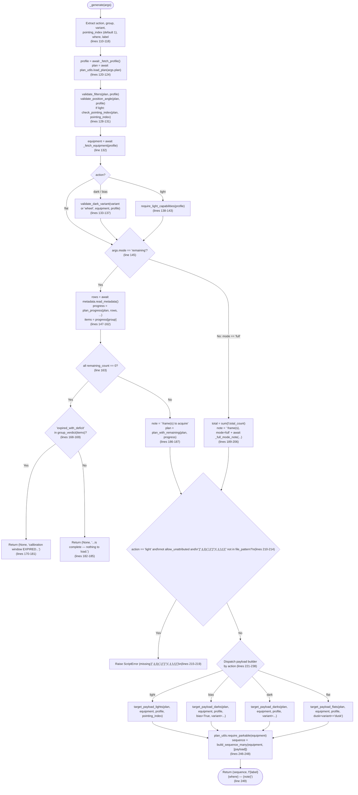

# Standalone Repository Scripts (`scripts/*.py`)

[⬆️ Up to Atlas Index](../../README.md) · [⬆️ Scripts & Skills](./README.md) · [➡️ Clear Outside Forecast Utility (`fetch_conditions.md`)](./fetch_conditions.md) · [➡️ Sequence Compiler (`../sequence/README.md`)](../sequence/README.md) · [➡️ MCP Sequence Tool (`../tools/sequence.md`)](../tools/sequence.md)

---

## Table of Contents

1. [`scripts/gen_sequence.py` (409 lines)](#1-scriptsgen_sequencepy)
   - [1.1 Module Overview](#11-module-overview)
   - [1.2 Classes, Data Models & Exceptions](#12-classes-data-models--exceptions)
   - [1.3 Function & Method Reference](#13-function--method-reference)
     - [`_fetch_profile`](#131-_fetch_profile-at-scriptsgen_sequencepy80-88)
     - [`_fetch_equipment`](#132-_fetch_equipment-at-scriptsgen_sequencepy91-96)
     - [`_generate`](#133-_generate-at-scriptsgen_sequencepy102-249)
     - [`_build_parser`](#134-_build_parser-at-scriptsgen_sequencepy255-333)
     - [`_validate`](#135-_validate-at-scriptsgen_sequencepy336-356)
     - [`_run`](#136-_run-at-scriptsgen_sequencepy358-383)
     - [`main`](#137-main-at-scriptsgen_sequencepy386-405)
2. [`scripts/update_readme.py` (105 lines)](#2-scriptsupdate_readmepy)
   - [2.1 Module Overview](#21-module-overview)
   - [2.2 Classes, Data Models & Exceptions](#22-classes-data-models--exceptions)
   - [2.3 Function & Method Reference](#23-function--method-reference)
     - [`insert_file_contents_and_links`](#231-insert_file_contents_and_links-at-scriptsupdate_readmepy66-89)
     - [`insert_file_contents_and_links.<locals>.replacer`](#232-insert_file_contents_and_linkslocalsreplacer-at-scriptsupdate_readmepy72-87)
     - [`main`](#233-main-at-scriptsupdate_readmepy92-101)
3. [`scripts/refresh_fixtures.py` (72 lines)](#3-scriptsrefresh_fixturespy)
   - [3.1 Module Overview](#31-module-overview)
   - [3.2 Classes, Data Models & Exceptions](#32-classes-data-models--exceptions)
   - [3.3 Function & Method Reference](#33-function--method-reference)
     - [`fetch`](#331-fetch-at-scriptsrefresh_fixturespy26-43)
     - [`main`](#332-main-at-scriptsrefresh_fixturespy46-68)

---

## 1. `scripts/gen_sequence.py`

### 1.1 Module Overview

- **File Path:** `scripts/gen_sequence.py`
- **Line Count:** `409` lines (`1-409`)
- **Module Docstring & Purpose (`2-32`):**
  Generates a N.I.N.A. Advanced Sequencer JSON AST from an `ObservationPlan` JSON file and prints the serialized JSON to `stdout`. Builds the exact sequence `load_sequence` (`nina_planner/tools/sequence.py`) would emit for a single request-list entry — sharing the same builders, validations, and guardrails — while routing all human-readable notes, warnings, and errors to `stderr`. When `--load` is passed, it also POSTs the sequence to N.I.N.A.'s `/v2/api/sequence/load` endpoint so N.I.N.A. validates and accepts it without ever starting execution.
- **Architectural Layer:** Standalone Developer / Operator CLI (`scripts/`) wrapping `nina_planner` domain services, equipment probes, and sequence AST builders.
- **Inbound Callers:**
  - CLI operator invocations (`uv run --project .opencode/local/mcps/nina_planner python scripts/gen_sequence.py ...` or `__main__` at `408-409`).
  - Automated unit and HTTP integration test suite: `.opencode/local/mcps/nina_planner/tests/test_gen_sequence.py` (`GenSequenceScriptTest` at `99-440` and `GenSequenceLoadOverHttpTest` at `556-667`).
- **Outbound Imports (`34-70`):**
  - Python stdlib (`34-41`): `from __future__ import annotations`, `argparse`, `asyncio`, `json`, `sys`, `datetime.UTC`, `datetime.datetime`, `typing.Any`.
  - Internal `nina_planner` imports (`43-63`), guarded by `try ... except ImportError` (`64-70`):
    - `from nina_planner import client, config, metadata, plan_utils` (`44`)
    - `from nina_planner.models.observatory import ObservatoryEquipment` (`45`)
    - `from nina_planner.models.profile import ObservatoryProfile` (`46`)
    - `from nina_planner.progress import group_verdict, plan_progress, plan_with_remaining` (`47-51`)
    - `from nina_planner.sequence import build_sequence_many, target_payload_darks, target_payload_flats, target_payload_lights, validate_dark_variant` (`52-58`)
    - `from nina_planner.tools.equipment import _get_site_equipment_status, get_site_profile` (`59-62`)
    - `from nina_planner.tools.sequence import _full_mode_note` (`63`)
- **Constants & Module-Level Guards:**
  - Import guard (`64-70`): If `nina_planner` cannot be imported from the active Python interpreter, raises `SystemExit` with an actionable error message instructing the user to run via `uv run --project .opencode/local/mcps/nina_planner python scripts/gen_sequence.py <plan.json>`.

---

### 1.2 Classes, Data Models & Exceptions

#### `ScriptError(Exception)` at `scripts/gen_sequence.py:73-74`

```python
class ScriptError(Exception):
    """A refusal whose message is meant for the operator, not a traceback."""
```

- **Inheritance:** `builtins.Exception`
- **Role:** Domain/operational refusal exception raised when N.I.N.A. cannot be reached (`_fetch_profile`, `_fetch_equipment`), the plan file fails to load (`_generate`), imaging metadata cannot be read in `--mode remaining` (`_generate`), the `FilePattern` lacks `$$TARGETNAME$$` (`_generate`), or N.I.N.A. rejects the POSTed sequence under `--load` (`_run`). Caught alongside `ValueError` in `main()` (`400-402`) to print `✗ <message>` to `stderr` and return exit code `1`.

---

### 1.3 Function & Method Reference

---

#### 1.3.1 `_fetch_profile` at `scripts/gen_sequence.py:80-88`

1. **Purpose & Architectural Role:**
   Asynchronously fetches the active N.I.N.A. profile (`ObservatoryProfile`) from the live N.I.N.A. REST API (`config.NINA_API_URL`), translating any transport or parsing failure into an operator-facing `ScriptError`.
2. **Signature, Decorators & Inputs:**
   ```python
   async def _fetch_profile() -> ObservatoryProfile:
   ```
   - **Decorators:** None.
   - **Parameters:** None.
3. **Outputs & Return Semantics:**
   - **Returns:** `ObservatoryProfile` — The validated active profile model returned by `get_site_profile()`.
4. **Step-by-Step Internal Logic:**
   1. Enters `try` block (`82`) and awaits `get_site_profile()` (`83`), which queries N.I.N.A.'s `/v2/api/profile/show` and custom horizon file.
   2. On any `Exception as exc` (`84`), raises `ScriptError` (`85-88`) formatted with `config.NINA_API_URL` and `exc`, chaining `from exc`.
5. **Side Effects & I/O:**
   - Performs HTTP GET requests to the N.I.N.A. Advanced API via `get_site_profile()`.
6. **Error Handling & Edge Cases:**
   - Catches broad `Exception` (`84`) and converts it to `ScriptError("cannot read the N.I.N.A. profile from {config.NINA_API_URL} — is N.I.N.A. running? ({exc})")`.
7. **Complexity & Risk Notes:**
   - $O(1)$ local execution bound by network round-trip latency to N.I.N.A.

---

#### 1.3.2 `_fetch_equipment` at `scripts/gen_sequence.py:91-96`

1. **Purpose & Architectural Role:**
   Asynchronously probes N.I.N.A.'s equipment status using the active `ObservatoryProfile`, auto-connecting any configured hardware device that is present in the profile but currently disconnected.
2. **Signature, Decorators & Inputs:**
   ```python
   async def _fetch_equipment(profile: ObservatoryProfile) -> ObservatoryEquipment:
   ```
   - **Decorators:** None.
   - **Parameters:**
     - `profile: ObservatoryProfile` — The active observatory profile fetched by `_fetch_profile()`, used by `_get_site_equipment_status` to determine which devices are configured (`profile.equipment`).
3. **Outputs & Return Semantics:**
   - **Returns:** `ObservatoryEquipment` — The aggregated equipment snapshot across all 11 N.I.N.A. hardware endpoints.
4. **Step-by-Step Internal Logic:**
   1. Enters `try` block (`93`) and awaits `_get_site_equipment_status(profile)` (`94`).
   2. On any `Exception as exc` (`95`), raises `ScriptError(f"cannot read N.I.N.A.'s equipment status: {exc}") from exc` (`96`).
5. **Side Effects & I/O:**
   - Queries N.I.N.A. equipment endpoints over HTTP and **auto-connects** present-but-disconnected devices (issuing `/connect` calls inside `_get_site_equipment_status`). Because of this hardware side effect, `_generate` deliberately delays calling `_fetch_equipment` until after cheap plan and profile validations pass (`126-132`).
6. **Error Handling & Edge Cases:**
   - Wraps any downstream HTTP or validation exception into `ScriptError`.
7. **Complexity & Risk Notes:**
   - $O(D)$ sequential/concurrent device HTTP probes inside `_get_site_equipment_status` ($D = 11$ device categories).

---

#### 1.3.3 `_generate` at `scripts/gen_sequence.py:102-249`

1. **Purpose & Architectural Role:**
   Core sequence compiler pipeline for the CLI. Loads and validates the observation plan against the live N.I.N.A. profile and equipment capabilities, resolves frame counts under `--mode full` or `--mode remaining` (including calibration-window expiration checks), enforces `$$TARGETNAME$$` attribution and mount parkability, and compiles the single-target payload into a full N.I.N.A. sequence dictionary via `build_sequence_many`.
2. **Signature, Decorators & Inputs:**
   ```python
   async def _generate(args: argparse.Namespace) -> tuple[dict[str, Any] | None, str]:
   ```
   - **Decorators:** None.
   - **Parameters:**
     - `args: argparse.Namespace` — Parsed and `_validate()`-checked CLI arguments containing `plan` (`str`), `action` (`"light" | "dark" | "bias" | "flat"`), `variant` (`str | None`), `pointing_index` (`int | None`), `mode` (`"full" | "remaining"`), and `allow_unattributed` (`bool`).
3. **Outputs & Return Semantics:**
   - **Returns:** `tuple[dict[str, Any] | None, str]` — A 2-tuple `(sequence, note)`:
     - When frames remain to be shot (or `args.mode == "full"`): `sequence` is the complete root N.I.N.A. sequence AST `dict[str, Any]` ready for JSON serialization, and `note` is the status summary string (e.g. `` "`light` pointing 1 — 12 frame(s), mode=full..." `` or `` "`dark` (cover) — 10 frame(s) to acquire" ``).
     - When `args.mode == "remaining"` finds `remaining_count == 0` for all items in the exposure group: `sequence` is `None`, and `note` explains either that the calibration window expired with a deficit (`"expired_with_deficit"`) or that all frames are already acquired.
4. **Step-by-Step Internal Logic:**
   1. **Label & Index Setup (`110-118`):**
      - Extracts `action = args.action` (`110`), sets `group = action` (`112`), `variant = args.variant` (`113`), and defaults `pointing_index = args.pointing_index or 1` (`114`).
      - Sets `where = f" pointing {pointing_index}"` if `action == "light"` else `""` (`115`).
      - Formats `label = f"`{action}` ({variant})"` when `variant is not None` else `f"`{action}`"` (`118`).
   2. **Profile Fetch & Plan Load (`120-124`):**
      - Awaits `profile = await _fetch_profile()` (`120`).
      - Awaits `plan = await plan_utils.load_plan(args.plan)` (`122`), wrapping any `Exception` into `ScriptError(f"{args.plan}: {exc}")` (`123-124`).
   3. **Pre-Equipment Plan/Profile Validations (`126-131`):**
      - Awaits `plan_utils.validate_filters(plan, profile)` (`128`) to ensure every filter in the plan exists in `profile.filters` and has a valid slot.
      - Calls `plan_utils.validate_position_angle(plan, profile)` (`129`) to ensure rotation requests match rotator presence in the profile.
      - If `action == "light"`, calls `plan_utils.check_pointing_index(plan, pointing_index)` (`130-131`) to verify `1 <= pointing_index <= len(plan.pointings)`.
   4. **Equipment Fetch & Capability Validations (`132-143`):**
      - Awaits `equipment = await _fetch_equipment(profile)` (`132`).
      - If `action in ("dark", "bias")`, calls `validate_dark_variant(variant or "wheel", equipment, profile)` (`133-137`) so even the default `"wheel"` variant is verified against the hardware/profile.
      - If `action == "light"`, calls `plan_utils.require_light_capabilities(profile)` (`138-143`) to ensure plate solver, guider, and focuser are configured in the profile.
   5. **Mode Branching (`145-206`):**
      - **Branch A (`args.mode == "remaining"` at `145-187`):**
        - Reads imaging metadata rows via `rows = await metadata.read_metadata()` (`147`), catching `(RuntimeError, FileNotFoundError)` and raising `ScriptError` advising `--mode full` (`148-152`).
        - Anchors `now = datetime.now(UTC).replace(microsecond=0)` (`154`).
        - Computes `progress = plan_progress(plan, rows, pointing_index=pointing_index, **plan_utils.quality_kwargs(plan), now=now)` (`155-161`) and extracts `items = progress[group]` (`162`).
        - Checks if `all(item["remaining_count"] == 0 for item in items)` (`163`):
          - Sums `total = sum(item["total_count"] for item in items)` (`164`).
          - Computes `verdicts = [group_verdict(item) for item in items]` (`168`).
          - If `"expired_with_deficit" in verdicts` (`169`), sums `expired` deficit counts across items with that verdict (`170-174`) and returns `(None, "<label><where> — calibration window EXPIRED with <expired> frame(s) short of <total> total...")` (`175-181`).
          - Otherwise returns `(None, "<label><where> is complete — <total> of <total> frames already acquired; nothing to load.")` (`182-185`).
        - If frames remain, sets `note = f"{sum(item['remaining_count'] for item in items)} frame(s) to acquire"` (`186`) and rewrites `plan = plan_with_remaining(plan, progress)` (`187`).
      - **Branch B (`args.mode == "full"` at `188-206`):**
        - Maps `"light"`, `"dark"`, `"bias"`, `"flat"` to the corresponding frame list on `plan` (`189-194`) and sums `total = sum(f.total_count for f in frame_groups[group])` (`195`).
        - Sets `note = f"{total} frame(s), mode=full" + await _full_mode_note(plan, group, pointing_index, total, datetime.now(UTC).replace(microsecond=0))` (`200-206`), appending an overshoot/re-shoot warning if metadata indicates frames were already acquired.
   6. **Attribution Guard (`210-219`):**
      - If `action == "light"`, `not args.allow_unattributed`, and `"$$TARGETNAME$$" not in (profile.file_pattern or "")` (`210-214`), raises `ScriptError` refusing unattributed light frames (`215-219`).
   7. **Target Payload Construction (`221-238`):**
      - `action == "light"` (`221-224`): calls `target_payload_lights(plan, equipment, profile, pointing_index=pointing_index)`.
      - `action == "bias"` (`225-232`): calls `target_payload_darks(plan, equipment, profile, bias=True, variant=variant or "wheel")`.
      - `action == "dark"` (`233-236`): calls `target_payload_darks(plan, equipment, profile, variant=variant or "wheel")`.
      - `action == "flat"` (`237-238`): calls `target_payload_flats(plan, equipment, profile, dusk=variant == "dusk")`.
   8. **Park Guard & Sequence Assembly (`246-249`):**
      - Calls `plan_utils.require_parkable(equipment)` (`246`) to verify `equipment.mount.can_park is True`.
      - Calls `sequence = build_sequence_many(equipment, [payload])` (`248`) and returns `(sequence, f"{label}{where} — {note}")` (`249`).



5. **Side Effects & I/O:**
   - Reads the plan JSON file from disk (`plan_utils.load_plan`).
   - Performs HTTP GETs to N.I.N.A. (`_fetch_profile`, `_fetch_equipment`) and may auto-connect disconnected hardware via `_fetch_equipment`.
   - Reads `ImageMetaData.csv` / `AcquisitionDetails.csv` from the imaging root on disk when `args.mode == "remaining"` (`metadata.read_metadata`) or inside `_full_mode_note` when `args.mode == "full"`.
6. **Error Handling & Edge Cases:**
   - **Fail-Fast Ordering (`126-132`):** Filter, position-angle, and pointing-index validations run *before* `_fetch_equipment(profile)` so a malformed plan never triggers hardware auto-connection on the way to failing.
   - **Expired Calibration Window (`165-181`):** Distinguishes `remaining_count == 0` caused by `expired_with_deficit` from genuine completion via `group_verdict(item)`, returning `sequence = None` with a diagnostic note rather than falsely claiming completion or raising an error.
   - **Validation Exceptions:** Downstream helpers (`validate_filters`, `validate_position_angle`, `check_pointing_index`, `validate_dark_variant`, `require_light_capabilities`, `require_parkable`, `target_payload_*`) raise `ValueError` on refusal, which propagates out of `_generate` and is caught alongside `ScriptError` in `main()` (`400`).
7. **Complexity & Risk Notes:**
   - Time complexity is $O(R \log R + F)$ when reading metadata ($R$ = CSV rows in the imaging root, $F$ = exposure groups in the plan) plus $O(N)$ AST node construction for `build_sequence_many`.

---

#### 1.3.4 `_build_parser` at `scripts/gen_sequence.py:255-333`

1. **Purpose & Architectural Role:**
   Constructs and configures the `argparse.ArgumentParser` defining all positional and optional CLI flags for `scripts/gen_sequence.py`.
2. **Signature, Decorators & Inputs:**
   ```python
   def _build_parser() -> argparse.ArgumentParser:
   ```
   - **Decorators:** None.
   - **Parameters:** None.
3. **Outputs & Return Semantics:**
   - **Returns:** `argparse.ArgumentParser` — Configured parser with `prog="gen_sequence.py"` and `RawDescriptionHelpFormatter`.
4. **Step-by-Step Internal Logic:**
   1. Instantiates `argparse.ArgumentParser` (`256-274`) with `prog="gen_sequence.py"`, description, `formatter_class=argparse.RawDescriptionHelpFormatter`, and usage examples in `epilog`.
   2. Registers positional argument `"plan"` (`metavar="PLAN.json"`, `275-279`).
   3. Registers `--action` (`choices=("light", "dark", "bias", "flat")`, `default="light"`, `280-285`).
   4. Registers `--variant` (`default=None`, `286-294`).
   5. Registers `--pointing-index` (`type=int`, `default=None`, `metavar="N"`, `295-301`).
   6. Registers `--mode` (`choices=("full", "remaining")`, `default="full"`, `302-310`).
   7. Registers `--load` (`action="store_true"`, `311-319`).
   8. Registers `--allow-unattributed` (`action="store_true"`, `320-327`).
   9. Registers `--compact` (`action="store_true"`, `328-332`).
   10. Returns `parser` (`333`).
5. **Side Effects & I/O:**
   - Pure in-memory object construction; no I/O.
6. **Error Handling & Edge Cases:**
   - Defers cross-argument relational validation (`--action` vs `--variant` vs `--pointing-index`) to `_validate()`.
7. **Complexity & Risk Notes:**
   - $O(1)$.

---

#### 1.3.5 `_validate` at `scripts/gen_sequence.py:336-356`

1. **Purpose & Architectural Role:**
   Enforces cross-option constraints between `--action`, `--variant`, and `--pointing-index`, calling `parser.error(...)` (which exits with status `2`) on any invalid combination.
2. **Signature, Decorators & Inputs:**
   ```python
   def _validate(parser: argparse.ArgumentParser, args: argparse.Namespace) -> None:
   ```
   - **Decorators:** None.
   - **Parameters:**
     - `parser: argparse.ArgumentParser` — The parser instance used to invoke `parser.error(...)`.
     - `args: argparse.Namespace` — Parsed arguments from `parser.parse_args(argv)`.
3. **Outputs & Return Semantics:**
   - **Returns:** `None` if all argument combinations are valid; otherwise terminates via `parser.error()` (`SystemExit(2)`).
4. **Step-by-Step Internal Logic:**
   1. If `args.action == "light"` (`338`): checks `if args.variant is not None` (`339`) and calls `parser.error(f"--action light takes no --variant (got {args.variant!r})")` (`340`).
   2. Else if `args.action == "flat"` (`341`): checks `if args.variant not in ("dawn", "dusk")` (`342`) and calls `parser.error("--action flat requires --variant dawn or --variant dusk")` (`343`).
   3. Else (`args.action` is `"dark"` or `"bias"`, `344`): checks `if args.variant not in (None, "wheel", "cover", "shutter")` (`344`) and calls `parser.error(f"--action {args.action} --variant must be wheel, cover or shutter (got {args.variant!r})")` (`345-348`).
   4. If `args.pointing_index is not None` (`349`):
      - Checks `if args.action != "light"` (`350`) and calls `parser.error(f"--pointing-index applies to lights only (got --action {args.action})")` (`351-353`).
      - Checks `if args.pointing_index < 1` (`354`) and calls `parser.error("--pointing-index must be >= 1")` (`355`).
5. **Side Effects & I/O:**
   - On validation failure, `parser.error()` writes usage and error message to `sys.stderr` and raises `SystemExit(2)`.
6. **Error Handling & Edge Cases:**
   - Guarantees that `_generate()` only ever sees valid `(action, variant, pointing_index)` combinations, matching the Pydantic `SequenceRequest._check_variant` invariants in `nina_planner/models/request.py`.
7. **Complexity & Risk Notes:**
   - $O(1)$.

---

#### 1.3.6 `_run` at `scripts/gen_sequence.py:358-383`

1. **Purpose & Architectural Role:**
   Asynchronous execution driver that calls `_generate(args)`, prints the status note to `stderr`, writes the serialized JSON sequence to `stdout` (if non-empty), and optionally POSTs the payload to N.I.N.A.'s `/v2/api/sequence/load` when `--load` is set.
2. **Signature, Decorators & Inputs:**
   ```python
   async def _run(args: argparse.Namespace) -> int:
   ```
   - **Decorators:** None.
   - **Parameters:**
     - `args: argparse.Namespace` — Validated CLI arguments.
3. **Outputs & Return Semantics:**
   - **Returns:** `int` — Always `0` on completion (either nothing to build, JSON written to `stdout`, or JSON written and accepted by N.I.N.A. via `--load`).
4. **Step-by-Step Internal Logic:**
   1. Awaits `sequence, note = await _generate(args)` (`359`).
   2. Prints `note` to `sys.stderr` (`360`).
   3. If `sequence is None` (`361`), returns `0` immediately without writing anything to `sys.stdout` (`364`), ensuring shell redirection (`> seq.json`) produces an empty file rather than a stale or non-JSON file.
   4. Writes `json.dumps(sequence, indent=None if args.compact else 2, separators=(",", ":") if args.compact else None) + "\n"` to `sys.stdout` (`365-372`).
   5. If `args.load` is `True` (`373`):
      - Awaits `client.load_sequence_payload(sequence)` (`375`).
      - Catches any `Exception as exc` (`376`) and raises `ScriptError(f"N.I.N.A. refused the sequence: {exc}") from exc` (`377`).
      - Prints `"✅ sequence accepted by N.I.N.A. — loaded, not started; call start_sequence() (or GET /v2/api/sequence/start) to begin."` to `sys.stderr` (`378-382`).
   6. Returns `0` (`383`).
5. **Side Effects & I/O:**
   - Writes `note` and optional `--load` confirmation to `sys.stderr`.
   - Writes sequence JSON to `sys.stdout`.
   - When `args.load` is true, sends an HTTP POST to N.I.N.A. (`/v2/api/sequence/load`) via `client.load_sequence_payload`.
6. **Error Handling & Edge Cases:**
   - Note that `sys.stdout.write` (`365`) happens *before* `await client.load_sequence_payload(sequence)` (`375`), so `stdout` always receives the generated JSON even if N.I.N.A. subsequently rejects the `/sequence/load` POST (satisfying the docstring contract at `20-22`).
7. **Complexity & Risk Notes:**
   - $O(N)$ JSON serialization over the sequence AST size $N$, plus optional HTTP POST round-trip.

---

#### 1.3.7 `main` at `scripts/gen_sequence.py:386-405`

1. **Purpose & Architectural Role:**
   Synchronous CLI entrypoint that parses and validates arguments, runs `_run(args)` inside `asyncio.run()`, and translates exceptions into standardized POSIX exit codes (`0`, `1`, `2`, `130`).
2. **Signature, Decorators & Inputs:**
   ```python
   def main(argv: list[str] | None = None) -> int:
   ```
   - **Decorators:** None.
   - **Parameters:**
     - `argv: list[str] | None = None` — Optional argument list for programmatic/test invocation; defaults to `sys.argv[1:]` inside `argparse`.
3. **Outputs & Return Semantics:**
   - **Returns:** `int` — Exit status code:
     - `0`: Sequence built (and accepted if `--load`), or nothing left to build.
     - `1`: Refusal from plan validation, profile/equipment probe, or N.I.N.A. (`ScriptError` or `ValueError`).
     - `130`: Interrupted by `KeyboardInterrupt`.
     - *(Exit code `2` is raised directly as `SystemExit(2)` by `argparse` during `parse_args` or `_validate`.)*
4. **Step-by-Step Internal Logic:**
   1. Calls `parser = _build_parser()` (`395`).
   2. Parses arguments via `args = parser.parse_args(argv)` (`396`).
   3. Validates argument combinations via `_validate(parser, args)` (`397`).
   4. Runs `return asyncio.run(_run(args))` inside a `try` block (`398-399`).
   5. Catches `(ScriptError, ValueError) as exc` (`400`), prints `f"✗ {exc}"` to `sys.stderr` (`401`), and returns `1` (`402`).
   6. Catches `KeyboardInterrupt` (`403`), prints `"✗ interrupted"` to `sys.stderr` (`404`), and returns `130` (`405`).
5. **Side Effects & I/O:**
   - Creates and closes an `asyncio` event loop via `asyncio.run()`.
   - Writes error diagnostics to `sys.stderr`.
6. **Error Handling & Edge Cases:**
   - Catching both `ScriptError` and `ValueError` in one handler (`400`) allows `nina_planner` domain validators (which raise `ValueError`) and script-local I/O wrappers (which raise `ScriptError`) to produce identical `✗ <reason>` operator messages without stack traces.
7. **Complexity & Risk Notes:**
   - End-to-end wrapper around `_run(args)`.

---

## 2. `scripts/update_readme.py`

### 2.1 Module Overview

- **File Path:** `scripts/update_readme.py`
- **Line Count:** `105` lines (`1-105`)
- **Module Docstring & Purpose (`1-44`):**
  Refreshes `README.md`'s fenced file excerpts from the real files on disk. Finds ```` ```<lang> <filename> ```` blocks in `README.md`, reads `<filename>` relative to `PROJECT_ROOT`, injects the file's current contents into the fenced block, and places a repo-relative Markdown link (`[<filename>](./<filename>)`) immediately above it. Idempotent: running it against an already-fresh `README.md` produces zero byte changes.
- **Architectural Layer:** Repository Build / Pre-Commit Documentation Synchronizer (`scripts/`).
- **Inbound Callers:**
  - `.githooks/pre-commit` (`.githooks/pre-commit:73`) — Runs automatically on every `git commit` when `git config core.hooksPath .githooks` is enabled, re-staging `README.md` if modified.
  - `makefile` (`makefile:92-93`, `98`) — Invoked by `make readme` and as a prerequisite of `make commit`.
  - Direct CLI execution (`python3 scripts/update_readme.py`, `__main__` at `104-105`).
- **Outbound Imports (`46-48`):**
  - Python stdlib only: `os` (`46`), `re` (`47`), `from pathlib import Path` (`48`).
- **Constants & Regexes (`51-63`):**
  - `PROJECT_ROOT: Path = Path(__file__).resolve().parent.parent` (`51`) — Resolves to the repository root regardless of the caller's current working directory.
  - `README_PATH: Path = PROJECT_ROOT / "README.md"` (`52`) — Target Markdown file to read and rewrite.
  - `_PATTERN: str` (`58-63`):
    ```python
    _PATTERN = (
        r"(?P<existing_link>\[[^\]]+\]\([^\)]+\)\s*)?"
        r"(?P<opening>```\w+[ \t]+(?P<filename>[^\n\(\r\)]+)[ \t]*\n)"
        r"(?:[\s\(\S\)]*?)"
        r"(?P<closing>```)"
    )
    ```
    Matches four structural parts:
    1. `(?P<existing_link>\[[^\]]+\]\([^\)]+\)\s*)?` — Optional preceding Markdown link `[text](url)` plus trailing whitespace so repeated runs replace the existing link rather than stacking duplicate links.
    2. `(?P<opening>```\w+[ \t]+(?P<filename>[^\n\(\r\)]+)[ \t]*\n)` — Opening code fence with language tag (`\w+`), horizontal whitespace (`[ \t]+`), and a required `filename` capture group (`[^\n\(\r\)]+`) on the same line. Standard code fences without a trailing filename do not match and are left untouched.
    3. `(?:[\s\(\S\)]*?)` — Non-greedy match of the old fenced block body across newlines.
    4. `(?P<closing>```)` — Closing three-backtick fence.

---

### 2.2 Classes, Data Models & Exceptions

*(No custom classes or exceptions are defined in `scripts/update_readme.py`; file errors inside `main()` propagate as standard `OSError`, while missing quoted files inside `insert_file_contents_and_links()` are rendered inline as `<Error: File '<filename>' not found on disk>`.)*

---

### 2.3 Function & Method Reference

---

#### 2.3.1 `insert_file_contents_and_links` at `scripts/update_readme.py:66-89`

1. **Purpose & Architectural Role:**
   Pure string transformation (given disk reads under `base_dir`) that locates every named fenced code block in `markdown_text` matching `_PATTERN` and replaces its body and preceding link with the current contents of the referenced file under `base_dir`.
2. **Signature, Decorators & Inputs:**
   ```python
   def insert_file_contents_and_links(
       markdown_text: str, base_dir: str | os.PathLike[str] = PROJECT_ROOT
   ) -> str:
   ```
   - **Decorators:** None.
   - **Parameters:**
     - `markdown_text: str` — Raw Markdown content (such as `README.md`).
     - `base_dir: str | os.PathLike[str] = PROJECT_ROOT` — Base directory against which captured `<filename>` paths are resolved. Defaults to `PROJECT_ROOT`.
3. **Outputs & Return Semantics:**
   - **Returns:** `str` — The updated Markdown string with all named fenced blocks refreshed and preceded by `[<filename>](./<filename>)`.
4. **Step-by-Step Internal Logic:**
   1. Converts `base_dir` to `base = Path(base_dir)` (`70`).
   2. Defines the inner closure `replacer(match: re.Match[str]) -> str` (`72-87`).
   3. Invokes and returns `re.sub(_PATTERN, replacer, markdown_text)` (`89`).
5. **Side Effects & I/O:**
   - Reads referenced files under `base_dir` via `replacer`. Does not modify `README.md` directly.
6. **Error Handling & Edge Cases:**
   - Fenced blocks without a filename after the language tag (e.g. plain ```` ```bash ```` or ```` ```json ````) are ignored by `_PATTERN`.
   - Note that the type annotation `str | os.PathLike[str]` (`67`) is evaluated at import/definition time (since `from __future__ import annotations` is not present in this file), requiring Python 3.10+ (handled by `.githooks/pre-commit:56-65` which prefers `.venv/bin/python`).
7. **Complexity & Risk Notes:**
   - $O(M + \sum S_i)$ where $M$ is the length of `markdown_text` and $S_i$ is the byte size of each quoted file.

---

#### 2.3.2 `insert_file_contents_and_links.<locals>.replacer` at `scripts/update_readme.py:72-87`

1. **Purpose & Architectural Role:**
   Regex substitution callback passed to `re.sub(_PATTERN, ...)` that resolves a single matched fence's `filename` against `base`, reads its UTF-8 text (or substitutes an inline error placeholder), and formats the replacement link + fenced block.
2. **Signature, Decorators & Inputs:**
   ```python
   def replacer(match: re.Match[str]) -> str:
   ```
   - **Decorators:** None (closure capturing `base: Path` from `insert_file_contents_and_links`).
   - **Parameters:**
     - `match: re.Match[str]` — Regex match object containing named groups `existing_link`, `opening`, `filename`, and `closing`.
3. **Outputs & Return Semantics:**
   - **Returns:** `str` — Replacement string formatted as `f"[{filename}](./{filename})\n{opening}{file_contents}\n{closing}"`.
4. **Step-by-Step Internal Logic:**
   1. Extracts `filename = match.group("filename").strip()` (`73`), `opening = match.group("opening")` (`74`), and `closing = match.group("closing")` (`75`).
   2. Computes `file_path = base / filename` (`80`).
   3. If `file_path.exists()` (`81`), reads `file_contents = file_path.read_text(encoding="utf-8").strip()` (`82`).
   4. Otherwise (`83`), sets `file_contents = f"<Error: File '{filename}' not found on disk>"` (`84`).
   5. Returns `f"[{filename}](./{filename})\n{opening}{file_contents}\n{closing}"` (`87`), intentionally emitting a repo-relative `./{filename}` link rather than an absolute machine path.
5. **Side Effects & I/O:**
   - Checks `file_path.exists()` and reads `file_path` as UTF-8 text from disk.
6. **Error Handling & Edge Cases:**
   - Missing target files do not raise `FileNotFoundError`; they embed `<Error: File '<filename>' not found on disk>` inside the code block.
7. **Complexity & Risk Notes:**
   - $O(S)$ where $S$ is the size of `file_path`.

---

#### 2.3.3 `main` at `scripts/update_readme.py:92-101`

1. **Purpose & Architectural Role:**
   CLI entrypoint that reads `README_PATH`, refreshes all named fenced excerpts via `insert_file_contents_and_links`, writes the result back to `README_PATH`, and returns exit code `0`.
2. **Signature, Decorators & Inputs:**
   ```python
   def main() -> int:
   ```
   - **Decorators:** None.
   - **Parameters:** None.
3. **Outputs & Return Semantics:**
   - **Returns:** `int` — Always `0` when `README.md` is successfully read and written.
4. **Step-by-Step Internal Logic:**
   1. Reads `raw_markdown = README_PATH.read_text(encoding="utf-8")` (`98`).
   2. Calls `updated_markdown = insert_file_contents_and_links(raw_markdown)` (`99`).
   3. Writes `README_PATH.write_text(updated_markdown, encoding="utf-8")` (`100`).
   4. Returns `0` (`101`).
5. **Side Effects & I/O:**
   - Reads and overwrites `/Users/george/share/nina/main/README.md` in-place.
6. **Error Handling & Edge Cases:**
   - Propagates `OSError` if `README.md` cannot be read or written (`95-96`).
7. **Complexity & Risk Notes:**
   - Idempotent: running `main()` repeatedly produces identical file contents on disk.

---

## 3. `scripts/refresh_fixtures.py`

### 3.1 Module Overview

- **File Path:** `scripts/refresh_fixtures.py`
- **Line Count:** `72` lines (`1-72`)
- **Module Docstring & Purpose (`2-11`):**
  Refreshes the sequence-state test fixtures (`sequence_state_<label>.json` and `sequence_json_<label>.json`) by querying a live N.I.N.A. Advanced API host (`HOST[:PORT]`, default port `1888`). Used by developers after loading or running a sequence in N.I.N.A. to capture ground-truth API envelopes for `.opencode/local/mcps/nina_planner/tests/fixtures/`.
- **Architectural Layer:** Test Fixture Capture Utility (`scripts/`).
- **Inbound Callers:**
  - Developer manual CLI invocation (`scripts/refresh_fixtures.py HOST[:PORT] [--label unrun] [--out DIR]`, `__main__` at `71-72`).
  - Referenced in `.opencode/local/mcps/nina_planner/tests/test_sequence_state.py:421` as the generator for `sequence_state_lights.json` and `sequence_json_lights.json`.
- **Outbound Imports (`13-17`):**
  - Python stdlib only: `argparse` (`13`), `json` (`14`), `sys` (`15`), `urllib.request` (`16`), `from pathlib import Path` (`17`).
- **Constants (`19-23`):**
  - `DEFAULT_OUT: Path` (`19-22`):
    ```python
    DEFAULT_OUT = (
        Path(__file__).resolve().parent.parent
        / ".opencode/local/mcps/nina_planner/tests/fixtures"
    )
    ```
  - `ENDPOINTS: dict[str, str] = {"state": "/sequence/state", "json": "/sequence/json"}` (`23`) — Maps fixture filename stem keys (`state`, `json`) to N.I.N.A. `/v2/api` paths.

---

### 3.2 Classes, Data Models & Exceptions

*(No custom classes or exceptions are defined in `scripts/refresh_fixtures.py`; API-level failures exit via `sys.exit(...)` (`SystemExit`), and network failures propagate as `urllib.error.URLError`.)*

---

### 3.3 Function & Method Reference

---

#### 3.3.1 `fetch` at `scripts/refresh_fixtures.py:26-43`

1. **Purpose & Architectural Role:**
   Performs an HTTP GET against `http://<host>/v2/api<path>`, parses the JSON response, verifies that the N.I.N.A. API envelope reports `"Success": true`, and returns the full response dictionary.
2. **Signature, Decorators & Inputs:**
   ```python
   def fetch(host: str, path: str) -> dict:
   ```
   - **Decorators:** None.
   - **Parameters:**
     - `host: str` — N.I.N.A. API hostname or IP address, optionally including `:PORT` (if `":"` is absent, `":1888"` is appended).
     - `path: str` — Endpoint path suffix under `/v2/api` (e.g. `"/sequence/state"` or `"/sequence/json"`).
3. **Outputs & Return Semantics:**
   - **Returns:** `dict` — The full N.I.N.A. API response envelope (`Response`, `Error`, `StatusCode`, `Success`, `Type`).
4. **Step-by-Step Internal Logic:**
   1. Checks `if ":" not in host:` (`36`) and appends `host += ":1888"` (`37`).
   2. Formats `url = f"http://{host}/v2/api{path}"` (`38`).
   3. Opens `urllib.request.urlopen(url, timeout=10)` as `resp` (`39`) and deserializes `data = json.load(resp)` (`40`).
   4. Checks `if not data.get("Success"):` (`41`); if falsey, terminates the process with `sys.exit(f"{url}: {data.get('Error') or 'API request failed'}")` (`42`).
   5. Returns `data` (`43`).
5. **Side Effects & I/O:**
   - Performs a synchronous HTTP GET request with a 10-second socket timeout.
   - Terminates the process via `sys.exit()` if `"Success"` is false.
6. **Error Handling & Edge Cases:**
   - Raises `SystemExit` with the formatted URL and N.I.N.A. `Error` string when `"Success"` is false (`41-42`).
   - Allows `urllib.error.URLError` / `TimeoutError` / `json.JSONDecodeError` to propagate uncaught if the host is unreachable or returns non-JSON.
7. **Complexity & Risk Notes:**
   - $O(B)$ where $B$ is the response payload byte size. Note that `":" not in host` assumes IPv4 or hostname syntax (a bare IPv6 literal without brackets would contain colons).

---

#### 3.3.2 `main` at `scripts/refresh_fixtures.py:46-68`

1. **Purpose & Architectural Role:**
   CLI entrypoint that parses `host`, `--label`, and `--out`, fetches both `/sequence/state` and `/sequence/json` from the live N.I.N.A. instance, writes the JSON envelopes to disk, and prints each written file's path and byte size.
2. **Signature, Decorators & Inputs:**
   ```python
   def main() -> None:
   ```
   - **Decorators:** None.
   - **Parameters:** None (reads `sys.argv` via `ap.parse_args()`).
3. **Outputs & Return Semantics:**
   - **Returns:** `None`.
4. **Step-by-Step Internal Logic:**
   1. Creates `ap = argparse.ArgumentParser(description=__doc__.split("\n\n")[0])` (`48`).
   2. Registers positional `"host"` (`49-51`), optional `"--label"` (`default="unrun"`, `52-54`), and optional `"--out"` (`type=Path`, `default=DEFAULT_OUT`, `55-60`).
   3. Parses `args = ap.parse_args()` (`61`).
   4. Ensures the output directory exists via `args.out.mkdir(parents=True, exist_ok=True)` (`63`).
   5. Iterates `for key, path in ENDPOINTS.items():` (`64`, iterating `("state", "/sequence/state")` and `("json", "/sequence/json")`):
      - Calls `data = fetch(args.host, path)` (`65`).
      - Computes `target = args.out / f"sequence_{key}_{args.label}.json"` (`66`).
      - Writes `target.write_text(json.dumps(data))` (`67`).
      - Prints `f"{target} ({target.stat().st_size} bytes)"` to `stdout` (`68`).
5. **Side Effects & I/O:**
   - Creates `args.out` directory if missing.
   - Performs two HTTP GET requests to N.I.N.A.
   - Writes `sequence_state_<label>.json` and `sequence_json_<label>.json` to `args.out`.
   - Prints written paths and file sizes to `stdout`.
6. **Error Handling & Edge Cases:**
   - If the first endpoint (`state`) succeeds and the second (`json`) fails inside `fetch()`, `sequence_state_<label>.json` will already have been written before `sys.exit()` aborts on the second call.
7. **Complexity & Risk Notes:**
   - $O(B_{\text{state}} + B_{\text{json}})$ network read and disk write.
