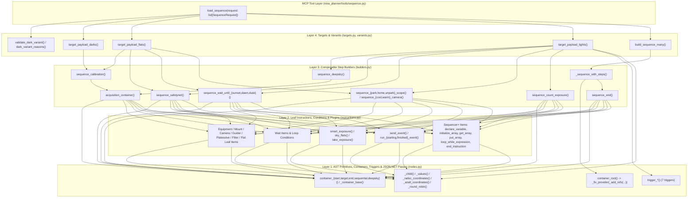

# Sequence Package (`nina_planner.sequence`)

> **Navigation:** [⬆️ Up to Atlas Index](../../README.md) | **Modules:** [nodes.md](./nodes.md) · [instructions.md](./instructions.md) · [builders.md](./builders.md) · [targets-and-variants.md](./targets-and-variants.md) | **Primary Caller:** [`tools/sequence.py`](../tools/sequence.md)

---

## 1. Package Overview & File Inventory

The `nina_planner.sequence` package (`.opencode/local/mcps/nina_planner/nina_planner/sequence/`) is a deterministic, side-effect-free **4-layer sequence compiler** that translates validated `ObservationPlan`, `ObservatoryEquipment`, and `ObservatoryProfile` domain models into N.I.N.A. Advanced Sequencer JSON documents serialized for N.I.N.A.'s Newtonsoft.Json (`JSON.NET`) runtime deserializer.

| File | Lines | Architectural Layer | Responsibility | Spec Doc |
| :--- | ---: | :--- | :--- | :--- |
| `__init__.py` | 198 | Facade / Public Surface | Re-exports 88 symbols across `nodes`, `instructions`, `builders`, `targets`, and `variants` via `__all__`. | [Section 2](#2-package-facade-__init__py) |
| `nodes.py` | 346 | Layer 1 — AST Primitives, Containers, Triggers & JSON.NET Pass | Primitive node wrappers (`_child`, `_values`), sexagesimal coordinate converters, round-robin light batcher (`_round_robin`), container factories, 7 trigger factories, and the root JSON.NET serialization passes (`_add_refs`, `_fix_provider`). | [`nodes.md`](./nodes.md) |
| `instructions.py` | 582 | Layer 2 — Leaf Instructions, Conditions & Plugin Items | 54 pure factory functions emitting N.I.N.A. core instructions, wait items, loop conditions, `SmartExposure`, `ninaAPI` event emitters (`SendEventInstruction`), and `Sequencer+` variable/array/loop nodes. | [`instructions.md`](./instructions.md) |
| `builders.py` | 494 | Layer 3 — Composable Mid-Level Sequence Builders | 16 composable step builders: `acquisition_container`, `sequence_deepsky`, `sequence_calibration`, thermal and mount capability wrappers, canonical park/home/safety policy, Sequencer+ countdown groups (`sequence_count_exposure`), twilight wait sets, `sequence_safetynet`, `sequence_end`, and `_sequence_with_steps`. | [`builders.md`](./builders.md) |
| `targets.py` | 415 | Layer 4a — Plan-to-Payload Compilers | 5 top-level functions compiling `ObservationPlan` steps into Target-area payloads (`target_payload_darks`, `target_payload_flats`, `target_payload_lights`), enforcing the dark/bias sky-gate AST invariant (`_contains_type`), and assembling full multi-step night sequences (`build_sequence_many`). | [`targets-and-variants.md`](./targets-and-variants.md) |
| `variants.py` | 114 | Layer 4b — Load-Time Hardware Capability Gate | 2 fail-closed validation functions (`dark_variant_reasons`, `validate_dark_variant`) verifying whether the rig's profile and connected hardware can cut light via `'wheel'`, `'cover'`, or `'shutter'`. | [`targets-and-variants.md`](./targets-and-variants.md) |

---

## 2. Package Facade (`__init__.py`)

- **File Path:** `.opencode/local/mcps/nina_planner/nina_planner/sequence/__init__.py` (lines `1-198`)
- **Purpose:** Provides a unified import namespace (`from nina_planner.sequence import ...`) used by `nina_planner/tools/sequence.py` and the test suite (`tests/test_sequence.py`, `tests/test_variants.py`, `tests/sequence_helpers.py`).
- **Re-exported Symbols (88 total in `__all__`, lines `109-198`):**
  - **From `.builders` (lines `10-24`, 13 symbols):** `acquisition_container`, `sequence_calibration`, `sequence_cool_camera`, `sequence_count_exposure`, `sequence_deepsky`, `sequence_end`, `sequence_park_scope`, `sequence_safetynet`, `sequence_unpark_scope`, `sequence_wait_until_dawn`, `sequence_wait_until_dusk`, `sequence_wait_until_sunset`, `sequence_warm_camera`. *(Note: `_validated_pointing`, `sequence_home_scope`, `_sequence_with_steps`, `COUNT_ARRAY`, `COUNT_VARIABLE`, and `EXPOSURE_GROUP_NAME` are internal to the package and imported directly from `.builders` by `.targets`.)*
  - **From `.instructions` (lines `25-75`, 48 symbols):** `annotation`, `close_cover`, `connect_all_equipment`, `cool_camera`, `dither_after_exposures`, `end_instruction`, `home_scope`, `loop_for_iterations`, `loop_until_dawn`, `loop_until_dusk`, `loop_until_meridian`, `loop_until_sun_altitude`, `loop_until_sun_altitude_above`, `loop_until_sun_altitude_below`, `loop_until_sunrise`, `loop_until_sunset`, `loop_until_time`, `loop_while_above_altitude`, `loop_while_above_horizon`, `loop_while_safe`, `open_cover`, `park_scope`, `run_autofocus`, `run_finished_event`, `run_starting_event`, `send_event`, `set_tracking`, `sky_flats`, `slew_and_center`, `slew_center_and_rotate`, `slew_to_azalt`, `smart_exposure`, `start_guiding`, `stop_guiding`, `switch_filter`, `take_exposure`, `unpark_scope`, `wait_for_timespan`, `wait_if_sun_altitude`, `wait_if_sun_altitude_above`, `wait_if_sun_altitude_below`, `wait_until_above_altitude`, `wait_until_above_horizon`, `wait_until_dawn`, `wait_until_dusk`, `wait_until_safe`, `wait_until_sunset`, `wait_until_time`, `warm_camera`. *(Note: `_step_word`, `declare_variable`, `loop_while_expression`, `initialize_array`, `get_array`, and `put_array` are not re-exported here; `declare_variable`, `loop_while_expression`, `initialize_array`, `get_array`, and `put_array` are imported directly from `.instructions` by `.builders` and `.targets`.)*
  - **From `.nodes` (lines `76-96`, 20 symbols):** `NINA_FLATS_ALTITUDE`, `NINA_FLATS_AZIMUTH_DAWN`, `NINA_FLATS_AZIMUTH_DUSK`, `_add_refs`, `_container_base`, `_round_robin`, `container_deepsky`, `container_end`, `container_root`, `container_sequential`, `container_start`, `container_target`, `trigger_autofocus_after_exposures`, `trigger_autofocus_after_filter_change`, `trigger_autofocus_after_hfr_increase`, `trigger_autofocus_after_temperature_change`, `trigger_center_after_drift`, `trigger_meridian_flip`, `trigger_restore_guiding`. *(Note: `_fix_provider`, `_child`, `_values`, `_to_minutes`, `_to_seconds`, `_radec_coordinates`, and `_azalt_coordinates` remain module-internal to `nodes.py` / `instructions.py`.)*
  - **From `.targets` (lines `97-102`, 4 symbols):** `build_sequence_many`, `target_payload_darks`, `target_payload_flats`, `target_payload_lights`.
  - **From `.variants` (lines `103-107`, 3 symbols):** `DARK_VARIANTS`, `dark_variant_reasons`, `validate_dark_variant`.

---

## 3. The 4-Layer Sequence Compiler Architecture

### Architectural Principles

1. **Bottom-Up Pure Dictionary Construction:** Layers 1–4 construct nested Python dicts and lists without mutating shared global state or performing network/disk I/O. Every node begins with placeholder `"$id": None` and `"Parent": None` emitted by `nodes._child(ctype)` (`nodes.py:87-88`) and collection wrappers emitted by `nodes._values(ctype, values)` (`nodes.py:91-94`).
2. **Single Root Finalization Pass:** Only `nodes.container_root()` (`nodes.py:200-214`) invokes `_add_refs()` followed by `_fix_provider()`. Intermediate containers and payloads remain unnumbered trees until wrapped in the root container by `_sequence_with_steps()` (`builders.py:474-494`).
3. **Target Name Hygiene (`$$TARGETNAME$$` vs. Event Tags):** N.I.N.A. expands `$$TARGETNAME$$` from `DeepSkyObjectContainer.Target.TargetName` into the output directory and filename. Therefore, frame-kind tags (`[light]`, `[dark]`, `[bias]`, `[dawn flats]`, `[dusk flats]`) are **only** placed in `ninaAPI` `SendEventInstruction` messages (`ACQUISITION-STARTING: [<tag>] <target>`), never inside `TargetName` (`builders.py:81-86`, `121-171`).
4. **Clean Target Area Invariant:** `RUN-STARTING: N step(s)` is emitted at the tail of `StartAreaContainer` (`builders.py:487-490`) and `RUN-FINISHED: N step(s) complete` is emitted at the head of `EndAreaContainer` (`builders.py:446-453`). Consequently, `TargetAreaContainer.Items` contains **strictly** the step containers (`DeepSkyObjectContainer` items) and nothing else, allowing `sequence_state.py` to inspect Target-area children directly as steps.

---

## 4. JSON.NET `$id` / `$ref` / `Parent` Serialization Rules

N.I.N.A. saves and loads sequences using **Newtonsoft.Json (`JSON.NET`)** with `PreserveReferencesHandling` and explicit `$type` polymorphism. Two passes in `nodes.py` transform the raw tree into a valid JSON.NET object graph:

### 4.1 Pass 1: `_add_refs(data)` (`nodes.py:39-84`)

`_add_refs` walks the dictionary tree in depth-first pre-order, assigning monotonically increasing stringified integers (`"1"`, `"2"`, ...) to every dict containing `"$id"`, and wiring `"Parent": {"$ref": "<parent_id>"}`.

It enforces **three critical invariants** required by N.I.N.A. and the `Sequencer+` C# plugin:

1. **Every Node Retains Its `Parent` Reference (`nodes.py:44-51`, `67-70`):**
   - `Parent` is mandatory at runtime, not merely UI metadata.
   - In `Sequencer+`, `GetArray.Execute` resolves its destination variable via `Symbol.FindSymbol(name, Parent)`, walking upward through the `Parent` chain to find the enclosing `DeepSkyObjectContainer` where `SetVariable` (`declare_variable`) registered the symbol. Without `Parent`, `FindSymbol` fails, `n` never updates, `LoopWhile(n > 0)` evaluates false, and zero exposures are taken.
   - An unattached `SetVariable` (`Parent == null`) causes `SetVariable.Validate()` to return `true` without initializing its `Issues` property, causing N.I.N.A.'s start-time validation aggregator (`issues.AddRange(v.Issues)`) to throw `ArgumentNullException` and abort sequence startup in ~20 ms.
   - Note on line `69`: `if "Instructions" not in data: parent = {"$ref": str(ident)}` updates the downward `parent` pointer for all nodes except any dict carrying an `"Instructions"` key (N.I.N.A. containers use `"Items"`, so standard containers update `parent` to themselves).

2. **Key Ordering — Leaves vs. Containers (`nodes.py:52-58`, `71-75`):**
   - JSON.NET deserializes object properties sequentially in **document key order**.
   - **Leaf Nodes (`"Items" not in data and "Conditions" not in data`):** `_add_refs` executes `data["Parent"] = data.pop("Parent")` (`nodes.py:75`), moving `"Parent"` to the **last key** of the dictionary, *after* all item-specific properties (such as `SetVariable.Identifier` and `SetVariable.OriginalDefinition`). In `Sequencer+`, setting `Parent` triggers symbol registration using the current `Identifier`; if `"Parent"` appears before `"Identifier"` (as initially constructed by `_child(ctype) | {...}`), `Symbol.Identifier` is still empty when attached to the parent scope, breaking variable lookup.
   - **Container Nodes (`"Items" in data` or `"Conditions" in data`):** Containers keep `"Parent"` in its initial position **before** `"Conditions"`, `"Items"`, and `"Triggers"`. When JSON.NET deserializes a container's children inside `"Items"`, the container itself must already have its `"Parent"` attached so that the upward ancestor chain up to `SequenceRootContainer` is unbroken when children attach.

### 4.2 Pass 2: `_fix_provider(data)` (`nodes.py:17-36`)

N.I.N.A. time-based instructions (`WaitForTime`) and loop conditions (`TimeCondition`) contain a `"SelectedProvider"` child object (e.g., `DawnProvider`, `DuskProvider`, `SunsetProvider`, `SunriseProvider`, `MeridianProvider`).
- `_fix_provider` traverses the tree after `_add_refs` has assigned `"$id"` strings.
- It maintains `store: dict[str, str] = {}` mapping each provider's `$type` string to the `"$id"` of its **first occurrence** (`nodes.py:24-28`).
- Every subsequent `"SelectedProvider"` dict with the same `$type` is replaced in-place with `{"$ref": store[ptype]}` (`nodes.py:26`), deduplicating date/time providers across the sequence graph as N.I.N.A. expects.

---

## 5. Sequencer+ Countdown Array Design (`'count'`, `n`)

### 5.1 Why a Countdown Array is Necessary for Lights

In `target_payload_lights` (`targets.py:341-412`), the `"Image Object"` container is wrapped in `sequence_safetynet` (`builders.py:389-423`). Whenever the safety monitor turns unsafe (`is_safe=false`) or the target dips out of its safe condition, the inner `"On Safe"` sequential container exits, parks the scope, and waits at `WaitUntilSafe`. When conditions become safe again before sunrise, the outer `"Image Object"` loop **re-enters `"On Safe"` from the top**.

Standard N.I.N.A. `LoopCondition` (`loop_for_iterations(count)`) resets `CompletedIterations` when its container restarts. Without external state surviving across `"On Safe"` restarts, an interrupted light sequence would re-shoot already-completed exposure batches from the beginning.

### 5.2 Two-Mechanism Guard & Exact Expression Spellings

`builders.py` defines two module-level constants (`builders.py:280-281`):
- `COUNT_ARRAY = "'count'"` — **Single-quoted string literal inside the expression string.** `InitializeArray`, `GetArray`, and `PutArray` evaluate `NameExpr` and read the array name via `Expr.StringValue`. Passing a bare identifier `"count"` would evaluate as an undefined symbol; passing `"'count'"` evaluates to the string `"count"`.
- `COUNT_VARIABLE = "n"` — **Bare symbol identifier.**
  - `declare_variable("n", "0")` (`instructions.py:503-518`) emits `SetVariable` with `"Identifier": "n"` and `"OriginalDefinition": "0"`.
  - `get_array("'count'", index, "n")` (`instructions.py:551-566`) sets `VExpr.Expression = "n"`. `GetArray.Execute` passes `VExpr.Expression` verbatim to `Symbol.FindSymbol("n", Parent)` — quoting it (`"'n'"`) would look up a symbol literally named `'n'` and fail with `"Result Variable is not defined"`.
  - `loop_while_expression("n > 0")` (`instructions.py:521-533`) evaluates `n > 0` as a boolean expression (quoting it would evaluate to a non-empty string literal that is always truthy).
  - `put_array("'count'", index, "n-1")` (`instructions.py:569-582`) evaluates the arithmetic expression `n-1` and writes the decremented value back into cell `index`.

### 5.3 Execution Lifecycle in `target_payload_lights` & `sequence_count_exposure`

1. **Single Round-Robin Pass (`targets.py:291`):** `exposure_groups = _round_robin(plan.light_frames, plan.batch_size)` computes the interleaved `(count, exposure_time_seconds, filter_name)` tuples once.
2. **Priming Before the Safetynet (`targets.py:334-339`):** Outside and immediately ahead of `"Image Object"` (so it executes **once** per target step, after `"Wait For Dusk"` and `"Wait For Object"`), the sequence emits:
   - `declare_variable("n", "0")`
   - `initialize_array("'count'")`
   - For each `index, (count, _, _)` in `enumerate(exposure_groups)`: `put_array("'count'", index, str(count))`
3. **Per-Batch Countdown Inside `"Image Object"` (`builders.py:290-338`):** For each batch `index`, `sequence_count_exposure` emits a 2-element list:
   - `get_array("'count'", index, "n")` — loads the remaining frame count for batch `index` into `n` before entering the `"Exposure Group"` container.
   - `container_sequential(name="Exposure Group", ...)` guarded by **both**:
     1. `loop_for_iterations(count)` — caps iterations in the normal uninterrupted case and exposes `CompletedIterations`/`Iterations` for live progress tracking (`sequence_state.py`).
     2. `loop_while_expression("n > 0")` — immediately skips the group if `n == 0` on re-entry after a safety interrupt, or stops after the remaining `n` frames.
   - Inside the container's `Items`:
     1. Optional `switch_filter(filter_name, filter_position)` (omitted when `filter_name is None`).
     2. `take_exposure(exposure, "LIGHT")`.
     3. `put_array("'count'", index, "n-1")` — decrements persistent cell `index`.
     4. `get_array("'count'", index, "n")` — refreshes `n` in scope before the next loop condition evaluation.

---

## 6. Canonical Park / Home / Safety Policy

The comment block above `sequence_park_scope` in `builders.py` (`builders.py:210-241`) is the **single canonical source of truth** across the entire codebase (summarized in `nina_planner/app.py` and `nina_planner/tools/sequence.py`):

| Policy Pillar | Canonical Rule & Implementation Details |
| :--- | :--- |
| **1. Park is the ONLY Closing Maneuver** | Sequences emit `ParkScope` (`sequence_park_scope`, `builders.py:244-247`) whenever `equipment.mount and equipment.mount.can_park` is true. A rig with no mount or `can_park=False` is rejected at load time by `plan_utils.require_parkable` before any sequence is sent. The conditional check in `sequence_park_scope` is purely a defensive default for unit tests or direct payload inspection. |
| **2. Find Home is NEVER a Park Fallback** | `FindHome` (`sequence_home_scope`, `builders.py:250-258`) is a ~30-second physical axis sensor calibration, never a closing maneuver. It is emitted **once per lights step**, inside `"Image Object"` *after* `sequence_unpark_scope(equipment)` and *before* `set_tracking(0)` (`targets.py:372-377`), gated solely on `equipment.mount.can_find_home`. Unparking must precede homing because N.I.N.A.'s `/equipment/mount/home` endpoint returns HTTP 409 `"Mount parked"` if called while parked (`builders.py:252-256`). Calibration steps (darks, biases, flats) **never** emit `FindHome`. |
| **3. Unpark Proxy (`can_park`)** | Neither ASCOM nor N.I.N.A.'s `MountInfo` exposes a `CanUnpark` boolean capability (only `CanFindHome`, `CanPark`, `CanSetPark`). Therefore, `sequence_unpark_scope` (`builders.py:261-272`) deliberately gates `UnparkScope` on `equipment.mount and equipment.mount.can_park`. |
| **4. Safety Gate & The Dark/Bias Exemption** | `is_safe=True` means the observatory roof/dome is open and sky-dependent work (`lights`, `dawn/dusk flats`) may unpark and expose inside `sequence_safetynet`. `is_safe=False` means the enclosure is closed: `sequence_safetynet` exits its inner `"On Safe"` block, parks the mount, and blocks at `WaitUntilSafe` (bounded by `loop_until_sunrise()`). **Darks and biases are exempt from the `is_safe` gate:** `target_payload_darks` (`targets.py:108-190`) parks the mount first, sets cooler setpoint, cuts light at the camera (`wheel` `Dark` slot, motorized `cover`, or camera `shutter`), never unparks, and never slews/solves/guides. This invariant is hard-asserted at payload construction time by checking `not _contains_type(built, needle)` for `("UnparkScope", "Platesolving", "StartGuiding")` (`targets.py:175-180`). |
| **5. Self-Contained End Area & Event Bracketing** | `sequence_end` (`builders.py:426-471`) executes only when the Target area is exhausted. If `step_count > 0`, it emits `RUN-FINISHED: N step(s) complete` *first* (before the 3-minute pre-park delay) so the night-loop controller can re-plan while the mount is still idle before parking. It then runs a 1-iteration `"On Safe"` 3-minute delay (`PREPARK-DELAY: 3 min` + `WaitForTimeSpan(180)` — skipped immediately if already unsafe), emits `PARK-STARTING`, runs `connect_all_equipment()`, parks the scope, warms the camera, and emits `PARK-FINISHED`. When `step_count == 0` (an empty `load_sequence([])` park request), neither `RUN-STARTING` nor `RUN-FINISHED` is emitted so a bare park is never mistaken for a completed imaging run. |
