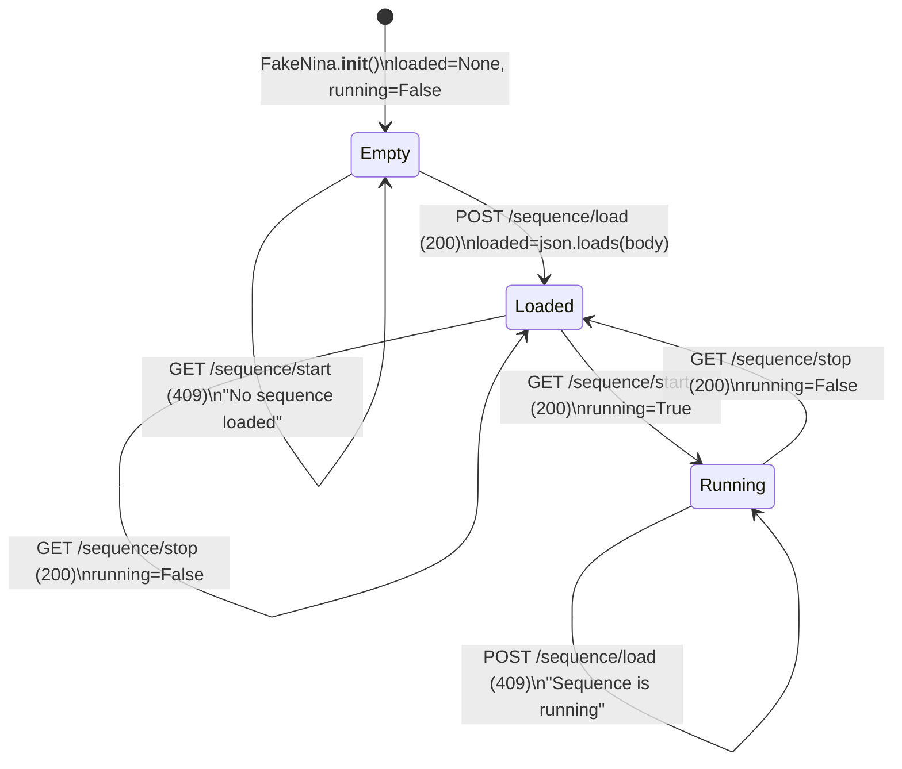

# Test Infrastructure & Harness (`tests/`)

[⬆️ Up to Atlas Index](../../README.md) · [➡️ Test Suite Reference](./test-suite-reference.md)

---

## 1. Package Overview

- **Directory:** `.opencode/local/mcps/nina_planner/tests/`
- **Total Files:** 36 Python files (3 shared harness modules + 33 `test_*.py` suites) totaling **20,099 lines** (`186` harness lines + `19,913` test-suite lines), plus JSON/CSV fixtures in `tests/fixtures/`.
- **Execution Configuration (`.opencode/local/mcps/nina_planner/pyproject.toml:104-119`):**
  - `testpaths = ["tests"]`
  - `pythonpath = ["."]"`
  - `addopts = "-v -m 'not live'"` (offline unit/contract tests run by default; live hardware/VM tests require `-m live`).
  - Coverage target (`[tool.coverage.run]`): `source = ["nina_planner"]`.

---

## 2. Shared Harness Module Specifications

### 2.1 `tests/conftest.py` (43 lines)

- **File Path:** `.opencode/local/mcps/nina_planner/tests/conftest.py:1-43`
- **Purpose:** Pytest root configuration file providing the shared `make_metadata_row` CSV row factory and the `requires_windows_interop` `unittest.skipUnless` decorator.
- **Outbound Imports:**
  - `from __future__ import annotations` (`line 7`)
  - `import unittest` (`line 9`)
  - `from datetime import UTC, datetime` (`line 10`)
  - `from nina_planner.system_time import windows_interop_available` (`line 12`)
- **Module-Level Constants / Decorators:**
  - `requires_windows_interop` (`lines 39-43`): `unittest.skipUnless(windows_interop_available(), ...)` decorator used by `tests/test_live.py` to skip Task Scheduler / `taskkill.exe` lifecycle tests on macOS or non-WSL Linux hosts.

#### `make_metadata_row` (`tests/conftest.py:15-36`)
1. **Purpose & Architectural Role:** Shared test factory producing a single `ImageMetaData.csv` dictionary row as consumed by `nina_planner.progress` and `nina_planner.tools.plans.audit_plans`.
2. **Signature, Decorators & Inputs:**
   ```python
   def make_metadata_row(
       image_type="LIGHT",
       filter_name="LP",
       duration="60.0",
       target: str | None = "M31 _plan-abc123_",
       exposure_start: str | None = None,
   ) -> dict[str, str]
   ```
3. **Outputs & Return Semantics:** Returns a `dict[str, str]` containing `"image_type"`, `"filter_name"`, `"duration"`, `"exposure_start_utc"`, and (when `target is not None`) `"file_path": f"C:/NINA/LIGHT/{target}__60.00s_0000.fits"`.
4. **Step-by-Step Internal Logic:**
   - **Lines 23-24:** Defaults `exposure_start` to `datetime.now(UTC).strftime("%Y-%m-%dT%H:%M:%SZ")` when `None`.
   - **Lines 25-33:** Builds the base dict with `"exposure_start_utc"` only (deliberately omitting the naive local `ExposureStart` column so any regression that reads local time sees a missing timestamp).
   - **Lines 34-35:** Populates `"file_path"` when `target` is not `None`.
5. **Side Effects & I/O:** Reads system clock via `datetime.now(UTC)` when `exposure_start is None`; otherwise pure.
6. **Error Handling & Edge Cases:** Passing `target=None` produces a row without `"file_path"`, exercising defensive missing-path handling in `progress.py`.
7. **Complexity & Risk Notes:** O(1).

---

### 2.2 `tests/fake_nina.py` (84 lines)

- **File Path:** `.opencode/local/mcps/nina_planner/tests/fake_nina.py:1-84`
- **Purpose:** In-process stateful simulator of N.I.N.A.'s `/v2/api` sequence and plugin endpoints served over `httpx.MockTransport` so `nina_planner.client` executes real HTTP serialization and envelope unwrapping.
- **Outbound Imports:** `from __future__ import annotations` (`8`), `import json` (`10`), `from contextlib import contextmanager` (`11`), `from typing import Any` (`12`), `from unittest.mock import patch` (`13`), `import httpx` (`15`).
- **Module-Level Constants:** `_REAL_ASYNC_CLIENT = httpx.AsyncClient` (`line 17`).



#### `_envelope` (`tests/fake_nina.py:20-28`)
1. **Purpose & Architectural Role:** Wraps a mock payload or error message in N.I.N.A.'s standard `{"Response", "Error", "StatusCode", "Success", "Type": "API"}` HTTP response envelope.
2. **Signature:** `def _envelope(response: Any = None, *, error: str = "", status: int = 200) -> httpx.Response`
3. **Outputs:** `httpx.Response(status, json=body)` where `Success` is `not error`.
4. **Internal Logic:** Constructs the 5-key envelope dict (`21-27`) and returns `httpx.Response` (`28`).
5. **Side Effects:** None (pure helper).
6. **Edge Cases:** Converts `response=None` to `""`.
7. **Complexity:** O(1).

#### `FakeNina` (`tests/fake_nina.py:31-84`)
- **Attributes:**
  - `self.requests: list[tuple[str, str]]` (`line 36`) — Ordered log of `(HTTP_METHOD, path_without_v2_api)` tuples.
  - `self.loaded: dict[str, Any] | None` (`line 37`) — Most recently loaded sequence JSON dict.
  - `self.running: bool` (`line 38`) — Current execution state (`True` after `/sequence/start`, `False` initially and after `/sequence/stop`).
- **Methods:**
  - `FakeNina.__init__(self) -> None` (`lines 34-38`): Initializes `requests=[]`, `loaded=None`, `running=False`.
  - `FakeNina._state(self) -> dict[str, Any]` (`lines 40-41`): Returns `{"Status": "RUNNING" if self.running else "CREATED"}`.
  - `FakeNina.handle(self, request: httpx.Request) -> httpx.Response` (`lines 43-68`): Strips `"/v2/api"` prefix (`45`), appends `(request.method, path)` to `self.requests` (`46`), and dispatches:
    - `POST /sequence/load` (`48-52`): Returns HTTP `409` if `self.running`; otherwise parses `request.content` into `self.loaded` and returns `200`.
    - `GET /sequence/start` (`53-57`): Returns HTTP `409` if `self.loaded is None`; otherwise sets `self.running = True` and returns `200`.
    - `GET /sequence/stop` (`58-60`): Sets `self.running = False` and returns `200`.
    - `GET /sequence/json` or `/sequence/state` (`61-62`): Returns `_envelope(self._state())`.
    - `GET /application/plugins` (`63-67`): Returns `_envelope(["Sequencer+"])`.
    - Any other route (`68`): Returns HTTP `404` (`Unknown endpoint {path}`).
  - `FakeNina.posts` (`@property`, `lines 70-73`): Filters `self.requests` to `path`s where `method == "POST"`.
  - `FakeNina.installed(self)` (`@contextmanager`, `lines 75-84`): Wraps `self.handle` in `httpx.MockTransport` and patches `nina_planner.client.httpx.AsyncClient` to inject `transport=transport`.

---

### 2.3 `tests/sequence_helpers.py` (59 lines)

- **File Path:** `.opencode/local/mcps/nina_planner/tests/sequence_helpers.py:1-59`
- **Purpose:** Convenience wrappers that build complete single-step N.I.N.A. sequences through production `build_sequence_many` for unit tests in `test_sequence.py` and `test_sequence_state_contract.py`.
- **Functions:**
  1. `build_sequence_park(equipment: ObservatoryEquipment) -> dict[str, Any]` (`lines 20-22`): Calls `build_sequence_many(equipment, [])`.
  2. `build_sequence_lights(plan: ObservationPlan, equipment: ObservatoryEquipment, profile: ObservatoryProfile, *, pointing_index: int = 1) -> dict[str, Any]` (`lines 25-36`): Calls `target_payload_lights(plan, equipment, profile, pointing_index=pointing_index)` and wraps in `build_sequence_many(equipment, [payload])`.
  3. `build_sequence_darks(plan: ObservationPlan, equipment: ObservatoryEquipment, profile: ObservatoryProfile, bias: bool = False, variant: str = "wheel") -> dict[str, Any]` (`lines 39-48`): Calls `target_payload_darks(plan, equipment, profile, bias, variant)` and wraps in `build_sequence_many(equipment, [payload])`.
  4. `build_sequence_flats(plan: ObservationPlan, equipment: ObservatoryEquipment, profile: ObservatoryProfile, dusk: bool = False) -> dict[str, Any]` (`lines 51-59`): Calls `target_payload_flats(plan, equipment, profile, dusk=dusk)` and wraps in `build_sequence_many(equipment, [payload])`.

---

## 3. Fixture Corpus (`tests/fixtures/`)

| Fixture Path | Format | Used By | Purpose |
|---|---|---|---|
| `tests/fixtures/capture_plan.json` | ObservationPlan JSON | `test_gen_sequence.py` | Canonical multi-filter observation plan fixture. |
| `tests/fixtures/veil.json` | ObservationPlan JSON | `test_sequence.py` | 2-pointing Cygnus Loop mosaic observation plan fixture. |
| `tests/fixtures/sequence_state_{unrun,lights,lightsrunning,lightsfinished,finished}.json` | N.I.N.A. `/sequence/state` | `test_sequence_state.py` | Captured live N.I.N.A. `/sequence/state` envelopes across 5 execution phases. |
| `tests/fixtures/sequence_json_{unrun,lights,lightsrunning,lightsfinished,finished}.json` | N.I.N.A. `/sequence/json` | `test_sequence_state.py` | Paired `/sequence/json` envelopes carrying `WaitForAltitude` `Data.Offset`/`CurrentAltitude`. |
| `tests/fixtures/nina-sample/2026-09-20/LIGHT/{ImageMetaData,WeatherData,AcquisitionDetails}.csv` | Session Metadata CSVs | `test_imaging.py` | Real N.I.N.A. Session Metadata plugin CSV output for integration testing. |
