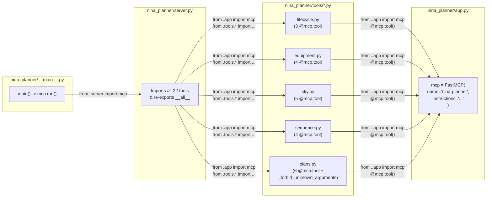
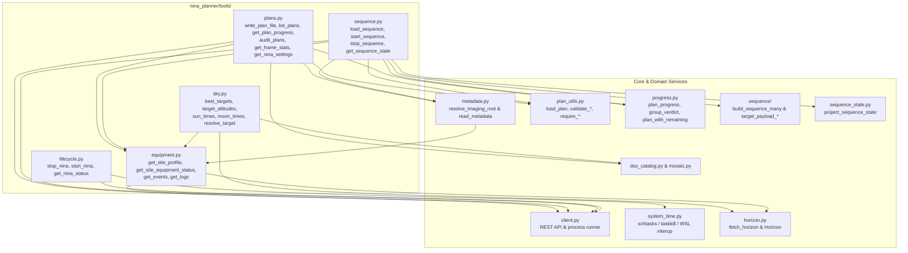

# MCP Tools Package (`nina_planner/tools/`)

[⬆️ Up to Atlas Index](../../README.md) · [⬅️ Core & Bootstrap (`core/`)](../core/README.md) · [⬅️ MCP Surface Catalog](../../00-inventory/mcp-surface-catalog.md) · [➡️ Lifecycle Tools (`lifecycle.py`)](./lifecycle.md)

---

## 1. Package Overview

- **Package Path:** `.opencode/local/mcps/nina_planner/nina_planner/tools/`
- **Package Marker (`__init__.py`):** `.opencode/local/mcps/nina_planner/nina_planner/tools/__init__.py` (1 line: `"""MCP tool implementations, grouped by domain (equipment, plans, sequence, sky)."""`)
- **Total Package Footprint:** 6 files (`__init__.py` + 5 domain tool modules), **3,096 lines** of Python
- **Architectural Layer:** MCP Presentation & High-Level Orchestration Layer (`nina-planner` FastMCP server)

The `nina_planner/tools/` subpackage implements all **22 MCP tools** (plus 42 domain-specific private helpers) exposed by the `nina-planner` MCP server. Rather than exposing low-level hardware commands directly to the LLM agent, this layer enforces the observatory's safety, hardware-capability, attribution, and lifecycle invariants:

1. **Process Lifecycle (`lifecycle.py`):** Probes N.I.N.A.'s REST API liveness (`GET /time`), checks local Windows/WSL interop availability (`cmd.exe`, `taskkill.exe`, `schtasks.exe`), terminates `NINA.exe` with post-kill API verification (`stop_nina`), and launches `NINA.exe` into the active interactive desktop session via a temporary Windows Scheduled Task (`start_nina`).
2. **Equipment, Profile & Telemetry (`equipment.py`):** Queries and normalizes N.I.N.A.'s active profile (`/profile/show?active=true`) and custom horizon (`get_site_profile`), polls live device status across all 11 ASCOM/N.I.N.A. equipment slots while auto-triggering `/connect` on configured-but-disconnected devices (`get_site_equipment_status`), and filters recent event history (`get_events`) and application logs (`get_logs`) into host-local ISO-8601 (`±HH:MM`) timestamps within a relative `since` window.
3. **Sky, Ephemeris & Target Ranking (`sky.py`):** Computes offline topocentric solar twilight and astronomical-darkness windows (`sun_times`), lunar phase/illumination/rise/set ephemerides (`moon_times`), target altitudes against the profile's custom azimuth/altitude skyline (`target_altitudes`), surface-brightness EAA target rankings from the 173-object SIMBAD-verified catalog (`best_targets`), and online SIMBAD/SESAME name resolution for out-of-catalog targets (`resolve_target`).
4. **Sequence Orchestration (`sequence.py`):** Validates multi-step `SequenceRequest` lists (`light`, `dark`, `bias`, `flat`, or empty `[]` for `park`), enforces hardware capability gates (`require_parkable`, `require_light_capabilities`, `validate_dark_variant`, `_require_sequencer_plus`), computes remaining frame counts from `ImageMetaData.csv`, compiles the complete N.I.N.A. Sequence AST (`build_sequence_many`), POSTs it in a single payload (`load_sequence`), starts execution with a node-status transition barrier (`start_sequence`), stops execution with a completion barrier (`stop_sequence`), and projects live sequencer state into compact summaries (`get_sequence_state`).
5. **Observation Plans & Capture Auditing (`plans.py`):** Expands spherical mosaic grids and atomically writes validated `ObservationPlan` JSON files (`write_plan_file`), enumerates project plans (`list_plans`), computes per-pointing and pooled calibration progress with strict unknown-argument rejection (`get_plan_progress`), performs whole-project LEFT JOIN capture audits across `ImageMetaData.csv`, plan files, and on-disk `BAD_` rejects (`audit_plans`), reads live single-frame quality telemetry (`get_frame_stats`), and inspects launch-time archive/endpoint environment variables (`get_nina_settings`).

---

## 2. How `@mcp.tool()` Registration Works Through `server.py`

Tool registration uses an **acyclic import-side-effect pattern** split between `nina_planner/app.py`, `nina_planner/tools/*.py`, and `nina_planner/server.py`:

### Step-by-Step Registration Mechanics

1. **Singleton Instantiation (`nina_planner/app.py:10-21`):**
   `app.py` instantiates `mcp = FastMCP(name="nina-planner", instructions=...)` with zero internal package imports. This prevents circular dependencies when tool modules import `mcp`.
2. **Decorator Binding (`nina_planner/tools/*.py`):**
   Each of the 5 tool modules imports `from ..app import mcp` and decorates its public `async def` functions with `@mcp.tool()`. When Python imports a tool module, FastMCP introspects each function's name, docstring, and type annotations (including Pydantic models like `ObservationPlan`, `SequenceRequest`, `ObservatoryEquipment`, and `ObservatoryProfile`) to build its JSON Schema and register it on `mcp._tool_manager`.
3. **Post-Registration Schema Hardening (`nina_planner/tools/plans.py:314-341`):**
   Immediately after `get_plan_progress` is registered with `@mcp.tool()` (`plans.py:202`), `plans.py` executes `_forbid_unknown_arguments()` at import time (`line 341`). This helper looks up `mcp._tool_manager.get_tool("get_plan_progress")`, subclasses its generated `fn_metadata.arg_model` with `ConfigDict(extra="forbid")`, and swaps the strict model in so callers passing stray arguments (such as legacy `max_hfr` kwargs instead of setting `plan.quality`) fail validation immediately rather than silently receiving unfiltered counts.
4. **Centralized Import Trigger (`nina_planner/server.py:3-57`):**
   `nina_planner/tools/__init__.py` intentionally contains only a docstring (`line 1`) and does **not** import the 5 submodules. Instead, `nina_planner/server.py` explicitly imports `mcp` (`line 3`) and all 22 tool functions from `.tools.equipment` (`lines 4-9`), `.tools.lifecycle` (`line 10`), `.tools.plans` (`lines 11-18`), `.tools.sequence` (`lines 19-24`), and `.tools.sky` (`lines 25-31`), and re-exports them in `__all__` (`lines 33-57`).
5. **Cross-Tool Reuse Without Circular Imports:**
   Because `equipment.py` defines foundational profile and status readers (`get_site_profile`, `_get_site_equipment_status`), sibling modules (`sequence.py:21`, `sky.py:25`, `plans.py:31`) and `metadata.py:9` import `equipment` directly (`from . import equipment as equipment_tools`) without importing `server.py`. Furthermore, `equipment.py:85-95` uses function-scoped imports for its 11 device models inside `_get_site_equipment_status` to keep module-import overhead minimal until equipment status is actually requested.

---

## 3. Package Module & Tool Inventory

| Module | File Path | Lines | `@mcp.tool()` Functions (22) | Private Helpers (42) | Spec Link |
|---|---|---:|---|---|---|
| **`__init__.py`** | `nina_planner/tools/__init__.py` | 1 | *(none)* | *(none)* | Documented in §1–§2 above |
| **`lifecycle.py`** | `nina_planner/tools/lifecycle.py` | 231 | `stop_nina` (`93-155`) `start_nina` (`158-188`) `get_nina_status` (`191-231`) | `_run_launch_command` (`22-33`) `_launch_nina_interactive` (`36-60`) `_raise_for_command_failure` (`63-78`) `_poll_until_async` (`81-90`) | **[`lifecycle.md`](./lifecycle.md)** |
| **`equipment.py`** | `nina_planner/tools/equipment.py` | 310 | `get_site_equipment_status` (`170-176`) `get_site_profile` (`179-289`) `get_events` (`292-298`) `get_logs` (`301-310`) | `_convert_keys` (`22-27`) `_convert_to_met` (`30-79`) `_get_site_equipment_status` (`82-167`, plus nested `_build` at `143-153` and `_exists` in `get_site_profile` at `251-255`) | **[`equipment.md`](./equipment.md)** |
| **`sky.py`** | `nina_planner/tools/sky.py` | 862 | `resolve_target` (`107-118`) `target_altitudes` (`172-200`) `best_targets` (`777-823`) `sun_times` (`837-846`) `moon_times` (`849-862`) | `_fetch_simbad` (`54-63`), `_resolve_via_simbad_web` (`66-86`), `_resolve_via_sesame` (`89-91`), `_resolve_name` (`94-104`), `_altitudes` (`121-169`), `_surface_brightness` (`224-237`), `_is_compact` (`240-241`), `_difficulty` (`244-251`), `_easiness` (`254-257`), `_body_altitudes` (`281-291`), `_sun_altitudes` (`294-296`), `_site_dict` (`299-305`), `_interp_time` (`308-311`), `_sun_events` (`314-421`), `_moon_altitudes` (`478-480`), `_elongation_series` (`483-502`), `_next_angle` (`505-511`), `_prev_angle` (`514-516`), `_crossing_time` (`519-532`), `_phase_from_elongation` (`535-565`), `_moon_events` (`568-632`), `_rank_catalog` (`635-774`), `_site_location_and_now` (`826-834`) | **[`sky.md`](./sky.md)** |
| **`sequence.py`** | `nina_planner/tools/sequence.py` | 454 | `load_sequence` (`24-63`) `stop_sequence` (`419-423`) `start_sequence` (`426-434`) `get_sequence_state` (`437-454`) | `_full_mode_note` (`66-113`) `_require_sequencer_plus` (`126-173`) `_load_many` (`176-416`, plus nested `profile`, `equipment`, `rows`, `now`, `step` at `191-360`) | **[`sequence.md`](./sequence.md)** |
| **`plans.py`** | `nina_planner/tools/plans.py` | 1,238 | `get_frame_stats` (`34-97`) `write_plan_file` (`164-199`) `get_plan_progress` (`202-311`) `audit_plans` (`759-1165`) `list_plans` (`1168-1199`) `get_nina_settings` (`1215-1238`) | `_expand_mosaic` (`103-161`), `_forbid_unknown_arguments` (`314-338`), `_probe_plan_id` (`362-376`), `_plan_ids_in_path` (`379-390`), `_load_project_plans` (`393-421`), `_plan_type_totals` (`424-441`), `_count_fits` (`444-472`), `_own_token_rows` (`475-512`), `_junk_count` (`515-542`), `_status_for` (`545-599`), `_audit_row` (`602-661`), `_action_for` (`664-670`), `_written_iso` (`673-682`), `_light_expected_per_pointing` (`685-692`), `_never_shot_report` (`695-756`) | **[`plans.md`](./plans.md)** |

---

## 4. Cross-Module Dependency & Data-Flow Matrix

---

## 5. Deep-Dive Module Specifications

- **[`lifecycle.md`](./lifecycle.md)** — `nina_planner/tools/lifecycle.py` (231 lines, 7 functions: `_run_launch_command`, `_launch_nina_interactive`, `_raise_for_command_failure`, `_poll_until_async`, `stop_nina`, `start_nina`, `get_nina_status`)
- **[`equipment.md`](./equipment.md)** — `nina_planner/tools/equipment.py` (310 lines, 7 functions: `_convert_keys`, `_convert_to_met`, `_get_site_equipment_status`, `get_site_equipment_status`, `get_site_profile`, `get_events`, `get_logs`)
- **[`sky.md`](./sky.md)** — `nina_planner/tools/sky.py` (862 lines, 28 functions covering target resolution, horizon-aware altitudes, difficulty/surface-brightness scoring, solar twilight, and lunar phase/horizon ephemerides)
- **[`sequence.md`](./sequence.md)** — `nina_planner/tools/sequence.py` (454 lines, 7 functions: `load_sequence`, `_full_mode_note`, `_require_sequencer_plus`, `_load_many`, `stop_sequence`, `start_sequence`, `get_sequence_state`)
- **[`plans.md`](./plans.md)** — `nina_planner/tools/plans.py` (1,238 lines, 21 functions covering frame telemetry, mosaic expansion, atomic plan creation, progress calculation, project-wide capture auditing, and environment settings inspection)
