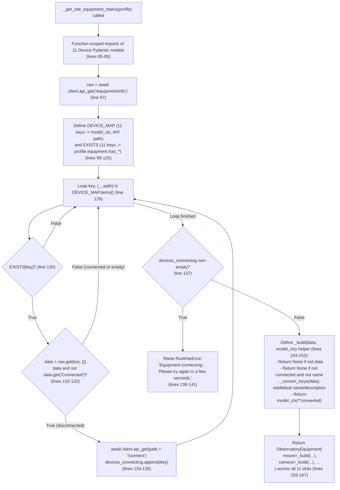

# Equipment, Profile & Telemetry Tools (`nina_planner/tools/equipment.py`)

[⬆️ Up to Atlas Index](../../README.md) · [⬆️ Tools Package](./README.md) · [⬅️ Lifecycle Tools (`lifecycle.py`)](./lifecycle.md) · [➡️ Sequence Tools (`sequence.py`)](./sequence.md) · [➡️ Sky Tools (`sky.py`)](./sky.md) · [➡️ Plan Tools (`plans.py`)](./plans.md)

---

## 1. Module Overview

- **File Path:** `.opencode/local/mcps/nina_planner/nina_planner/tools/equipment.py`
- **Line Count:** 310 lines (`1-310`)
- **Module Docstring (`line 1`):** `"""Equipment and profile MCP tools: status, site, filters, safety and weather."""`
- **Architectural Layer:** MCP Tool Layer & Shared Internal Equipment/Profile Service
- **Purpose:** Provides four `@mcp.tool()` endpoints (`get_site_equipment_status`, `get_site_profile`, `get_events`, `get_logs`) and three module-level private helpers (`_convert_keys`, `_convert_to_met`, `_get_site_equipment_status`, plus two nested closures `_build` and `_exists`) that inspect live observatory hardware state, read static N.I.N.A. profile and custom horizon configuration, and retrieve time-filtered event history and application logs.
- **Dual Role (MCP Tools + Internal Service):** Beyond serving direct MCP tool calls, `equipment.py` is imported as `equipment_tools` by `nina_planner/tools/sequence.py:21`, `nina_planner/tools/sky.py:25`, `nina_planner/tools/plans.py:31`, and `nina_planner/metadata.py:9` whenever those modules need the active `ObservatoryProfile` (`get_site_profile()`) or live `ObservatoryEquipment` (`_get_site_equipment_status(profile)`).
- **Inbound Callers:**
  - `nina_planner/server.py:4-9` (`from .tools.equipment import get_events, get_logs, get_site_equipment_status, get_site_profile`)
  - `nina_planner/metadata.py:9, 18` (`from .tools import equipment as equipment_tools` -> `await equipment_tools.get_site_profile()`)
  - `nina_planner/tools/sequence.py:21, 193, 198` (`from . import equipment as equipment_tools` -> `get_site_profile()`, `_get_site_equipment_status(await profile())`)
  - `nina_planner/tools/sky.py:25, 180, 797, 828` (`from . import equipment as equipment_tools` -> `get_site_profile()`)
  - `nina_planner/tools/plans.py:31, 170` (`from . import equipment as equipment_tools` -> `get_site_profile()`)
  - Test suites (`tests/test_server.py`, `tests/test_horizon.py`, `tests/test_live.py`, etc.)
- **Outbound Imports:**
  - **Top-Level Stdlib (`lines 3-6`):**
    - `import json` (`line 3`)
    - `from collections.abc import Set as AbstractSet` (`line 4`)
    - `from datetime import datetime` (`line 5`)
    - `from typing import Any, cast` (`line 6`)
  - **Top-Level Internal (`lines 8-19`):**
    - `from .. import client` (`line 8`)
    - `from ..app import mcp` (`line 9`)
    - `from ..horizon import fetch_horizon` (`line 10`)
    - `from ..models.observatory import ObservatoryEquipment` (`line 11`)
    - `from ..models.profile import EquipmentConfig, FilterInfo, ObservatoryProfile, OpticalTrainInfo, SiteLocationInfo` (`lines 12-18`)
    - `from ..nina_utils import ascom_float, ascom_int, to_local_display, to_snake` (`line 19`)
  - **Function-Scoped Internal Imports (`lines 85-95` inside `_get_site_equipment_status`):**
    - `from ..models.camera import CameraDevice` (`line 85`)
    - `from ..models.dome import DomeDevice` (`line 86`)
    - `from ..models.filter_wheel import FilterWheelDevice` (`line 87`)
    - `from ..models.flat_device import FlatDevice` (`line 88`)
    - `from ..models.focuser import FocuserDevice` (`line 89`)
    - `from ..models.guider import GuiderDevice` (`line 90`)
    - `from ..models.mount import MountDevice` (`line 91`)
    - `from ..models.rotator import RotatorDevice` (`line 92`)
    - `from ..models.safety_monitor import SafetyMonitorDevice` (`line 93`)
    - `from ..models.switch import Switch` (`line 94`)
    - `from ..models.weather import Weather` (`line 95`)
- **Module-Level Constants:** None.

---

## 2. Function & Method Reference

### 2.1 `_convert_keys` (`nina_planner/tools/equipment.py:22-27`)

#### 1. Purpose & Architectural Role
Recursively converts all dictionary keys in a nested JSON-like data structure (`dict`, `list`, or primitive) from N.I.N.A.'s PascalCase / camelCase convention into `snake_case` using `nina_utils.to_snake`. Used by `_convert_to_met` (`line 61`) and `_get_site_equipment_status._build` (`line 150`) before instantiating Pydantic device models or returning event/log records.

#### 2. Signature, Decorators & Inputs
```python
def _convert_keys(d: Any) -> Any:
```
- **Decorators:** None (private synchronous helper).
- **Inputs:**
  - `d: Any` — Arbitrary JSON-deserialized value (`dict`, `list`, `str`, `int`, `float`, `bool`, or `None`).

#### 3. Outputs & Return Semantics
- **Returns:** `Any` — A new `dict` (with `to_snake(k)` keys and recursively converted values) if `d` is a `dict`, a new `list` (with recursively converted elements) if `d` is a `list`, or `d` unchanged for any other type.

#### 4. Step-by-Step Internal Logic
1. **Lines 23–24:** If `isinstance(d, dict)`, returns `{to_snake(k): _convert_keys(v) for k, v in d.items()}`.
2. **Lines 25–26:** If `isinstance(d, list)`, returns `[_convert_keys(v) for v in d]`.
3. **Line 27:** Otherwise returns `d` verbatim.

#### 5. Side Effects & I/O
- Pure function; does not mutate the input `d`.

#### 6. Error Handling & Edge Cases
- Assumes dictionary keys `k` are `str` (standard for JSON payloads from `client.api_get`).
- If two distinct keys in the same `dict` normalize to the same `snake_case` string, the later key in iteration order overwrites the earlier one.

#### 7. Complexity & Risk Notes
- **Time & Space Complexity:** $O(N)$ where $N$ is the total number of nodes and keys in the nested data structure; recursion depth equals JSON nesting depth.

---

### 2.2 `_convert_to_met` (`nina_planner/tools/equipment.py:30-79`)

#### 1. Purpose & Architectural Role
Normalizes, filters, and sorts raw event-history or application-log lists returned by N.I.N.A. (`get_events` at `line 296`, `get_logs` at `line 305`). Extracts each record's ISO-8601 timestamp field (`name="Time"` for events, `name="Timestamp"` for logs), drops malformed records with a diagnostic log, converts all keys to `snake_case`, sorts records chronologically ascending, filters to records within the last `since` seconds relative to `now` (`since + (ts - now).total_seconds() > 0`), and formats each surviving `"timestamp"` in host-local ISO-8601 with UTC offset via `to_local_display(ts)`.

#### 2. Signature, Decorators & Inputs
```python
def _convert_to_met(
    data: list[dict[str, Any]],
    since: int,
    name: str,
    now: datetime | None = None,
) -> list[dict[str, Any]]:
```
- **Decorators:** None (private synchronous helper).
- **Inputs:**
  - `data: list[dict[str, Any]]` — Raw list of event or log dictionaries from N.I.N.A.
  - `since: int` — Lookback window in seconds prior to `now` (records with `ts > now - since` are kept, as well as any record with `ts >= now`).
  - `name: str` — Source dictionary key holding the ISO-8601 timestamp string (`"Time"` for `/event-history`, `"Timestamp"` for `/application/logs`).
  - `now: datetime | None = None` — Optional reference timestamp (used by unit tests); defaults to `datetime.now().astimezone()` (`line 37`).

#### 3. Outputs & Return Semantics
- **Returns:** `list[dict[str, Any]]` — Chronologically sorted list of `snake_case` dictionaries whose timestamp falls within `since` seconds of `now`, with the original `name` key removed and replaced by `"timestamp": "<YYYY-MM-DDTHH:MM:SS±HH:MM>"`.

#### 4. Step-by-Step Internal Logic
1. **Lines 36–43:** Sets `timestamp = "timestamp"` (`line 36`) and resolves `now = now or datetime.now().astimezone()` (`line 37`). If a caller passed a naive `now` (`now.tzinfo is None`), tags it with the host's local timezone (`now = now.replace(tzinfo=datetime.now().astimezone().tzinfo)`, `lines 41-42`) so `ts - now` subtraction against offset-aware timestamps never raises `TypeError`. Captures `tzinfo = now.tzinfo` (`line 43`).
2. **Lines 44–45:** Initializes `res = []` and `dropped = 0`.
3. **Lines 46–63:** Iterates over each dictionary `d` in `data`:
   - Reads `value = d.get(name)` (`line 49`). If `not isinstance(value, str) or not value`, increments `dropped += 1` and `continue`s (`lines 50-52`).
   - Parses `ts = datetime.fromisoformat(value)` (`lines 53-54`); on `ValueError`, increments `dropped += 1` and `continue`s (`lines 55-57`).
   - Copies `d` excluding `name` (`d = {k: v for k, v in d.items() if k != name}`, `line 58`).
   - If `ts.tzinfo is None`, attaches host-local `tzinfo` (`ts = ts.replace(tzinfo=tzinfo)`, `lines 59-60`).
   - Recursively converts remaining keys to `snake_case` via `d = _convert_keys(d)` (`line 61`), sets `d[timestamp] = ts` (`line 62`), and appends `d` to `res` (`line 63`).
4. **Lines 64–68:** If `dropped` is nonzero, logs the count via `client.log_payload("_convert_to_met:", f"dropped {dropped} record(s) without a usable {name!r} timestamp")`.
5. **Line 69:** Sorts valid records chronologically ascending: `data = sorted(res, key=lambda d: d[timestamp])`.
6. **Lines 70–79:** Resets `res = []` and iterates over sorted `data`:
   - Computes `elapsed = (ts - now).total_seconds()` (`line 75`, negative for past events).
   - If `since + elapsed > 0` (`line 76`, i.e., event is newer than `now - since` seconds), formats `d[timestamp] = to_local_display(ts)` (`line 77`) and appends `d` to `res` (`line 78`).
   - Returns `res` (`line 79`).

#### 5. Side Effects & I/O
- Does not mutate the caller's input dictionaries (creates new dicts at `lines 58, 61`).
- Calls `client.log_payload` only when `dropped > 0` (`lines 64-68`).

#### 6. Error Handling & Edge Cases
- **Missing, Null, Non-String, or Unparseable Timestamps (`lines 49-57`):** Gracefully skipped and counted in `dropped` rather than crashing `get_events` or `get_logs`.
- **Mixed Timezone-Aware and Naive Timestamps (`lines 41-42, 59-60`):** Both `now` and parsed `ts` are guaranteed to have non-`None` `tzinfo` before sorting (`line 69`) and subtraction (`line 75`).
- **Boundary Condition (`line 76`):** Uses strict inequality `since + elapsed > 0`, so a record at exactly `now - since` seconds (`elapsed == -since`) is excluded.

#### 7. Complexity & Risk Notes
- **Time Complexity:** $O(R \log R + R \cdot K)$ where $R = \text{len}(data)$ and $K$ is the average key count per record.
- **Space Complexity:** $O(R \cdot K)$ for the copied and converted dictionaries.

---

### 2.3 `_get_site_equipment_status` (`nina_planner/tools/equipment.py:82-167`)

#### 1. Purpose & Architectural Role
Core internal equipment-status fetcher and auto-connector. Queries N.I.N.A.'s `/equipment/info` endpoint, cross-references the 11 device sections against `profile.equipment` (`has_*` flags), triggers `/equipment/<device>/connect` for any configured device that is currently disconnected (raising a retryable `RuntimeError` while devices are connecting), and constructs the validated `ObservatoryEquipment` Pydantic model via its nested `_build` helper.

Called both by the public `get_site_equipment_status` MCP tool (`line 174`) and directly by `sequence._load_many` (`nina_planner/tools/sequence.py:198`) so `load_sequence` shares the already-fetched `ObservatoryProfile` without making a redundant `/profile/show` call.

#### 2. Signature, Decorators & Inputs
```python
async def _get_site_equipment_status(
    profile: ObservatoryProfile,
) -> ObservatoryEquipment:
```
- **Decorators:** None (private async function shared across `tools/`).
- **Inputs:**
  - `profile: ObservatoryProfile` — The active observatory profile (obtained from `get_site_profile()`), whose `profile.equipment` (`EquipmentConfig`) flags indicate which of the 11 device slots are configured in N.I.N.A.

#### 3. Outputs & Return Semantics
- **Returns:** `ObservatoryEquipment` — Validated Pydantic container holding optional device models for all 11 slots: `mount`, `camera`, `focuser`, `guider`, `safety_monitor`, `weather`, `dome`, `filter_wheel`, `flat_device`, `rotator`, and `switch`. Any slot whose `/equipment/info` section is empty or both disconnected and unnamed is set to `None`.

#### 4. Step-by-Step Internal Logic



1. **Lines 85–95:** Performs function-scoped imports of the 11 device Pydantic classes: `CameraDevice`, `DomeDevice`, `FilterWheelDevice`, `FlatDevice`, `FocuserDevice`, `GuiderDevice`, `MountDevice`, `RotatorDevice`, `SafetyMonitorDevice`, `Switch`, and `Weather`.
2. **Line 97:** Fetches raw equipment telemetry via `raw = await client.api_get("/equipment/info")`.
3. **Lines 99–111:** Defines `DEVICE_MAP` mapping each N.I.N.A. JSON section key (`"Mount"`, `"Camera"`, `"Focuser"`, `"Guider"`, `"SafetyMonitor"`, `"WeatherData"`, `"Dome"`, `"FilterWheel"`, `"FlatDevice"`, `"Rotator"`, `"Switch"`) to its `(model_cls, endpoint_prefix)` pair.
4. **Lines 113–125:** Defines `EXISTS` mapping the same 11 keys to the corresponding boolean flags on `profile.equipment` (`has_mount`, `has_camera`, `has_focuser`, `has_filter_wheel`, `has_flat_device`, `has_guider`, `has_rotator`, `has_dome`, `has_weather`, `has_safety_monitor`, `has_switch`).
5. **Lines 127–135:** Initializes `devices_connecting: list[str] = []` and iterates over `DEVICE_MAP.items()`. If `EXISTS[key]` is `False`, skips the device (`lines 130-131`). Otherwise reads `data = raw.get(key, {})` (`line 132`); if `data` is non-empty and `not data.get("Connected")` (`line 133`), awaits `client.api_get(path + "/connect")` (`line 134`) and appends `key` to `devices_connecting` (`line 135`).
6. **Lines 137–141:** If `devices_connecting` is non-empty after checking all 11 slots, raises `RuntimeError(f"Equipment connecting: {', '.join(devices_connecting)}. Please try again in a few seconds.")`.
7. **Lines 143–153:** Defines inner helper `def _build(data: dict, model_cls: type) -> Any:`:
   - If `not data`, returns `None` (`lines 144-145`).
   - Checks `connected = data.get("Connected", data.get("connected", False))` (`line 146`) and `name = data.get("Name") or data.get("name") or data.get("DisplayName")` (`line 147`). If `not connected and not name`, returns `None` (`lines 148-149`).
   - Converts all keys to `snake_case` via `converted = _convert_keys(data)` (`line 150`), ensures `"name"` and `"description"` default to `""` via `setdefault` (`lines 151-152`), and returns `model_cls(**converted)` (`line 153`).
8. **Lines 155–167:** Instantiates and returns `ObservatoryEquipment(...)` by calling `_build` for each of the 11 sections in `raw`.

#### 5. Side Effects & I/O
- 1 HTTP GET to `/equipment/info` (`line 97`).
- Up to 11 sequential HTTP GETs to `/equipment/<device>/connect` (`line 134`) if configured devices are currently disconnected.

#### 6. Error Handling & Edge Cases
- **Auto-Connect Gate (`lines 129-141`):** Connecting hardware is asynchronous inside N.I.N.A./ASCOM drivers, so `/equipment/info` fetched *before* `/connect` still carries stale disconnected telemetry. Raising `RuntimeError("Equipment connecting: ...")` forces the caller/agent to wait a few seconds and re-query once the drivers have initialized.
- **Unconfigured Devices (`lines 130-131, 144-149`):** A device with `EXISTS[key] == False` is never sent `/connect`. In `_build`, if N.I.N.A. returns an empty dict or a stub with `Connected=False` and no `Name`/`DisplayName`, `_build` returns `None` rather than constructing an empty device model.

#### 7. Complexity & Risk Notes
- $O(1)$ fixed number of device slots (11); network latency is 1 GET in steady state (all configured devices already connected).

---

### 2.4 `get_site_equipment_status` (`nina_planner/tools/equipment.py:170-176`)

#### 1. Purpose & Architectural Role
MCP tool that returns the live connection state, telemetry, safety-monitor state (`is_safe`), weather readings, and mount capabilities (`can_park`, `can_find_home`) for all active observatory equipment. Fetches the active site profile first, delegates to `_get_site_equipment_status(profile)`, and logs the serialized `ObservatoryEquipment` JSON payload.

#### 2. Signature, Decorators & Inputs
```python
@mcp.tool()
async def get_site_equipment_status() -> ObservatoryEquipment:
```
- **Decorators:** `@mcp.tool()` (`line 170`).
- **Inputs:** None.

#### 3. Outputs & Return Semantics
- **Returns:** `ObservatoryEquipment` — Validated Pydantic model containing live state for `mount`, `camera`, `focuser`, `guider`, `safety_monitor`, `weather`, `dome`, `filter_wheel`, `flat_device`, `rotator`, and `switch`.

#### 4. Step-by-Step Internal Logic
1. **Line 173:** Awaits `profile = await get_site_profile()`.
2. **Line 174:** Awaits `equipment = await _get_site_equipment_status(profile)`.
3. **Line 175:** Logs the pretty-printed JSON model via `client.log_payload("Equipment:", equipment.model_dump_json(indent=2))`.
4. **Line 176:** Returns `cast(ObservatoryEquipment, equipment)`.

#### 5. Side Effects & I/O
- Performs 2–3 HTTP GET requests in steady state (`/profile/show?active=true`, optional `/profile/horizon` via `get_site_profile()`, and `/equipment/info` via `_get_site_equipment_status()`), plus `/equipment/<device>/connect` for any configured-but-disconnected devices.
- Writes both `"Profile:"` and `"Equipment:"` JSON snapshots to `NINA_PLANNER_LOG` via `client.log_payload`.

#### 6. Error Handling & Edge Cases
- Propagates `RuntimeError("Equipment connecting: ...")` if any configured device had to be connected (`lines 137-141`).
- Propagates HTTP/network `RuntimeError` or `httpx.HTTPError` if N.I.N.A.'s REST API is down.

#### 7. Complexity & Risk Notes
- Makes at least two REST API round-trips; for a cheap liveness-only check that never touches ASCOM drivers or raises on a down N.I.N.A., callers use `get_nina_status()` instead.

---

### 2.5 `get_site_profile` (`nina_planner/tools/equipment.py:179-289`)

#### 1. Purpose & Architectural Role
Read-only MCP tool (and internal helper) that fetches N.I.N.A.'s active profile (`/profile/show?active=true`) and custom horizon (`fetch_horizon`), normalizes ASCOM numeric sentinels (`ascom_float`, `ascom_int`), validates filter-wheel slot positions, determines which equipment categories are configured (`_exists`), and returns a structured `ObservatoryProfile` Pydantic model.

#### 2. Signature, Decorators & Inputs
```python
@mcp.tool()
async def get_site_profile() -> ObservatoryProfile:
```
- **Decorators:** `@mcp.tool()` (`line 179`).
- **Inputs:** None.

#### 3. Outputs & Return Semantics
- **Returns:** `ObservatoryProfile` containing:
  - `profile_name: str`, `profile_id: str`, `description: str | None`
  - `site: SiteLocationInfo` (`latitude_deg`, `longitude_deg`, `elevation_m`)
  - `optics: OpticalTrainInfo` (`telescope_name`, `focal_length_mm`, `focal_ratio`, `pixel_size_microns`, `default_gain`, `camera_xsize_px`, `camera_ysize_px`, plus computed `field_of_view_deg` / `fov_deg`)
  - `filters: list[FilterInfo]` (`name`, `position`, `focus_offset`)
  - `plate_solver: str | None`, `blind_plate_solver: str | None`, `guider_name: str | None`
  - `image_save_path: str`, `local_image_save_path: str` (computed property on `ObservatoryProfile`), `file_pattern: str | None`
  - `equipment: EquipmentConfig` (`has_mount`, `has_guider`, `has_camera`, `has_focuser`, `has_filter_wheel`, `has_flat_device`, `has_rotator`, `has_dome`, `has_weather`, `has_safety_monitor`, `has_switch`)
  - `horizon: Horizon` (`file_path`, `is_custom`, `points`)

#### 4. Step-by-Step Internal Logic
1. **Line 182:** Fetches the active profile via `raw = await client.api_get("/profile/show?active=true")`.
2. **Lines 184–202:** Extracts the 15 settings sub-dictionaries from `raw` (defaulting each to `{}`): `AstrometrySettings`, `TelescopeSettings`, `CameraSettings`, `FilterWheelSettings`, `ImageFileSettings`, `PlateSolveSettings`, `FramingAssistantSettings`, `GuiderSettings`, `RotatorSettings`, `DomeSettings`, `WeatherDataSettings`, `SafetyMonitorSettings`, `FocuserSettings`, `SwitchSettings`, and `FlatDeviceSettings`.
3. **Lines 203–206:** Coerces camera/framing parameters:
   - `pixel_size = ascom_float(camera.get("PixelSize")) or 0` (`line 203`)
   - `gain = ascom_int(camera.get("Gain")) or 0` (`line 204`)
   - `camera_xsize = framing.get("CameraWidth", 0)` (`line 205`)
   - `camera_ysize = framing.get("CameraHeight", 0)` (`line 206`)
4. **Lines 208–212:** Builds `site = SiteLocationInfo(latitude_deg=float(astrometry.get("Latitude", 0)), longitude_deg=float(astrometry.get("Longitude", 0)), elevation_m=float(astrometry.get("Elevation", 0)))`.
5. **Lines 214–222:** Builds `optics = OpticalTrainInfo(...)` from `telescope`, `pixel_size`, `gain`, `camera_xsize`, and `camera_ysize`.
6. **Lines 224–249:** Iterates over `filter_wheel.get("FilterWheelFilters", [])` to build `filters: list[FilterInfo]`:
   - Skips any entry that is not a `dict` or lacks a truthy `"Name"` (`lines 226-227`).
   - Parses `position = ascom_int(f.get("Position"))` (`lines 229-232`). If `position is None` (missing, ASCOM sentinel, or non-integer), logs a warning via `client.log_payload("get_site_profile: skipping filter", ...)` and skips the filter (`lines 233-241`) so a plan referencing it will fail `validate_filters` by name rather than driving the filter wheel to a bogus slot.
   - Parses `focus_offset = ascom_int(f.get("FocusOffset"))` (`lines 242-246`), defaulting to `None` on `TypeError`/`ValueError` because focus offset is metadata rather than a slot address.
   - Appends `FilterInfo(name=name, position=position, focus_offset=focus_offset)` (`lines 247-249`).
7. **Lines 251–255:** Defines inner helper `def _exists(section: dict, field: str, skip: AbstractSet[str] = frozenset({"No_Device"})) -> bool:` which returns `True` iff `section.get(field)` is not `None`, not in `skip`, and `!= ""`.
8. **Lines 257–269:** Builds `equipment = EquipmentConfig(...)`:
   - `has_mount=_exists(telescope, "MountName") or _exists(telescope, "Name")` (`line 258`)
   - `has_guider=_exists(guider, "GuiderName", {"No_Guider", "No_Device"})` (`line 259`)
   - `has_camera`, `has_focuser`, `has_filter_wheel`, `has_flat_device`, `has_rotator`, `has_dome`, `has_weather`, `has_safety_monitor`, `has_switch` checked via `_exists(<section>, "Id")` (`lines 260-268`).
9. **Lines 271–287:** Constructs `profile = ObservatoryProfile(...)`, awaiting `fetch_horizon(str(astrometry.get("HorizonFilePath") or ""))` at `line 286`.
10. **Lines 288–289:** Logs `profile.model_dump_json(indent=2)` via `client.log_payload("Profile:", ...)` and returns `profile`.

#### 5. Side Effects & I/O
- 1 HTTP GET to `/profile/show?active=true` (`line 182`).
- 1 best-effort HTTP GET to `/profile/horizon` inside `fetch_horizon` (`line 286`, which degrades gracefully to a flat `0°` `Horizon()` if the endpoint is unavailable).
- Logs skipped filters (`line 237`) and the serialized profile (`line 288`) via `client.log_payload`.

#### 6. Error Handling & Edge Cases
- **Invalid Filter Position (`lines 229-241`):** Dropped with a log entry rather than defaulting to slot `0`, preventing physical filter misattribution.
- **Invalid Focus Offset (`lines 242-246`):** Coerced to `None` without dropping the filter.
- **ASCOM Sentinel Values (`lines 203-204`):** `ascom_float` and `ascom_int` convert `"NaN"` or `-2147483648` to `None`, which `or 0` then normalizes to `0`.

#### 7. Complexity & Risk Notes
- $O(F + H)$ time and space where $F$ is the number of configured filters and $H$ is the number of custom horizon azimuth/altitude points.

---

### 2.6 `get_events` (`nina_planner/tools/equipment.py:292-298`)

#### 1. Purpose & Architectural Role
Read-only MCP tool that retrieves recent timestamped observatory events (`SEQUENCE-*`, `IMAGE-SAVE`, `AUTOFOCUS-*`, `ERROR-*`, safety/equipment events) from N.I.N.A.'s `/event-history` endpoint over the last `since` seconds. Used by the controller agent on wake notifications (`[get_events(since=N) · M routine events waiting]`) to reconstruct activity across quiet windows.

#### 2. Signature, Decorators & Inputs
```python
@mcp.tool()
async def get_events(since: int = 300) -> Any:
```
- **Decorators:** `@mcp.tool()` (`line 292`).
- **Inputs:**
  - `since: int = 300` — Lookback window in seconds (default 5 minutes).

#### 3. Outputs & Return Semantics
- **Returns:** `list[dict[str, Any]]` (typed as `Any`) — Chronologically sorted list of `snake_case` event dictionaries within the last `since` seconds, each carrying `"timestamp"` formatted as host-local ISO-8601 (`±HH:MM`) and `"event"` (plus any event-specific fields such as `"attachment"`).

#### 4. Step-by-Step Internal Logic
1. **Line 295:** Fetches raw event history via `res = await client.api_get("/event-history")`.
2. **Line 296:** Normalizes, sorts, and filters records via `res = _convert_to_met(res, since=since, name="Time")`.
3. **Line 297:** Logs the filtered event list via `client.log_payload("Events:", json.dumps(res, indent=2))`.
4. **Line 298:** Returns `res`.

#### 5. Side Effects & I/O
- 1 HTTP GET to `/event-history` (`line 295`).
- Writes filtered events JSON to `NINA_PLANNER_LOG` via `client.log_payload` (`line 297`).

#### 6. Error Handling & Edge Cases
- Records lacking a valid `"Time"` ISO timestamp are dropped inside `_convert_to_met`.
- Propagates `RuntimeError` / `httpx.HTTPError` if N.I.N.A.'s REST API is unreachable.

#### 7. Complexity & Risk Notes
- $O(E \log E)$ where $E$ is the number of events returned by `/event-history`.

---

### 2.7 `get_logs` (`nina_planner/tools/equipment.py:301-310`)

#### 1. Purpose & Architectural Role
Read-only MCP tool that retrieves up to 1,000 recent N.I.N.A. application log entries from `/application/logs?lineCount=1000`, filters them to the last `since` seconds in host-local ISO-8601 time via `_convert_to_met`, and strips noisy C# source-location keys (`"line"`, `"member"`, `"source"`) before returning.

#### 2. Signature, Decorators & Inputs
```python
@mcp.tool()
async def get_logs(since: int = 300) -> Any:
```
- **Decorators:** `@mcp.tool()` (`line 301`).
- **Inputs:**
  - `since: int = 300` — Lookback window in seconds (default 5 minutes).

#### 3. Outputs & Return Semantics
- **Returns:** `list[dict[str, Any]]` (typed as `Any`) — Chronologically sorted list of `snake_case` log entry dictionaries from the last `since` seconds (typically containing `"timestamp"`, `"level"`, and `"message"`), with `"line"`, `"member"`, and `"source"` removed.

#### 4. Step-by-Step Internal Logic
1. **Line 304:** Fetches the last 1,000 log lines via `res = await client.api_get("/application/logs?lineCount=1000")`.
2. **Line 305:** Normalizes keys to `snake_case`, sorts chronologically, and filters to `since` seconds via `res = _convert_to_met(res, since=since, name="Timestamp")`.
3. **Lines 306–308:** Iterates over each dictionary `d` in `res` and removes internal C# call-site keys (`"line"`, `"member"`, `"source"`) via `d.pop(key, None)`.
4. **Line 309:** Logs the filtered log entries via `client.log_payload("Logs:", json.dumps(res, indent=2))`.
5. **Line 310:** Returns `res`.

#### 5. Side Effects & I/O
- 1 HTTP GET to `/application/logs?lineCount=1000` (`line 304`).
- Writes filtered logs JSON to `NINA_PLANNER_LOG` via `client.log_payload` (`line 309`).

#### 6. Error Handling & Edge Cases
- Records lacking a valid `"Timestamp"` field are dropped inside `_convert_to_met`.
- `d.pop(key, None)` (`line 308`) safely ignores any record where `"line"`, `"member"`, or `"source"` is already absent.

#### 7. Complexity & Risk Notes
- Bounded at $N \le 1000$ log lines per call (`lineCount=1000`); sorting and filtering take $O(N \log N)$ time.
