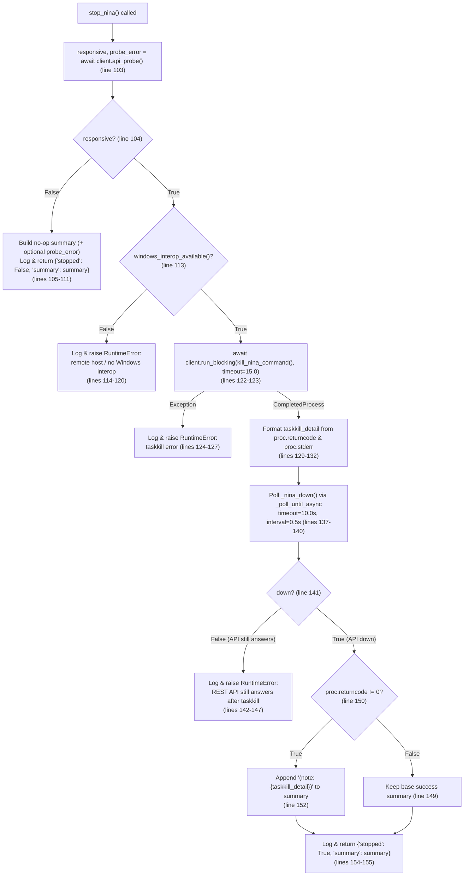
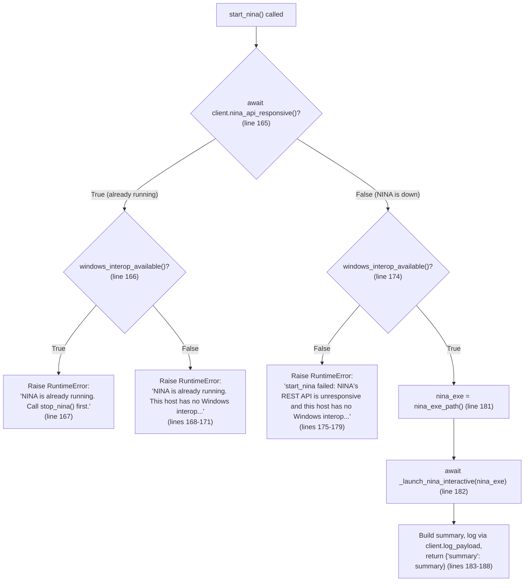

# N.I.N.A. Application Lifecycle Tools (`nina_planner/tools/lifecycle.py`)

[⬆️ Up to Atlas Index](../../README.md) · [⬆️ Tools Package](./README.md) · [⬅️ Bootstrap & Server (`server.py`)](../core/bootstrap-and-server.md) · [➡️ Equipment Tools (`equipment.py`)](./equipment.md) · [➡️ HTTP Client (`client.py`)](../core/client.md) · [➡️ Windows Interop (`system_time.py`)](../core/system_time.md)

---

## 1. Module Overview

- **File Path:** `.opencode/local/mcps/nina_planner/nina_planner/tools/lifecycle.py`
- **Line Count:** 231 lines (`1-231`)
- **Module Docstring (`line 1`):** `"""N.I.N.A. lifecycle MCP tools: start, stop and status of the application."""`
- **Architectural Layer:** MCP Tool Layer — Application Process & Liveness Management
- **Purpose:** Provides three `@mcp.tool()` endpoints (`stop_nina`, `start_nina`, `get_nina_status`) and four private process/polling helpers (`_run_launch_command`, `_launch_nina_interactive`, `_raise_for_command_failure`, `_poll_until_async`) that manage the `NINA.exe` application lifecycle across both local Windows/WSL hosts and remote N.I.N.A. hosts.
- **Core Design Invariants:**
  1. **REST API is the Authoritative Liveness Oracle:** Liveness is always determined by probing N.I.N.A.'s REST API (`client.api_probe()` / `client.nina_api_responsive()`, which hit `GET /time`), never by inspecting local OS process tables (`tasklist`). This guarantees accurate liveness reporting whether `NINA.exe` runs on the same host (Windows/WSL) or a remote observatory PC.
  2. **Explicit Windows Interop Gate:** Starting or stopping `NINA.exe` requires local Windows process interop (`windows_interop_available()`, which verifies Windows or WSL with `cmd.exe`, `taskkill.exe`, and `schtasks.exe` on `PATH`). When `windows_interop_available()` is `False`, `get_nina_status` reports `lifecycle_control_available: False`, and `start_nina` / `stop_nina` raise clear, actionable `RuntimeError`s explaining that a remote N.I.N.A. instance must be started or stopped on its own host.
  3. **Interactive Desktop Session Launch via Task Scheduler:** Because an MCP server or SSH daemon may run in a non-interactive session, `start_nina` never spawns `NINA.exe` directly as a child process. Instead, `_launch_nina_interactive` writes a temporary `.cmd` launcher (`write_nina_launcher`), registers a one-shot interactive Scheduled Task (`schtasks.exe /Create ... /IT`), runs it (`schtasks.exe /Run`), and deletes the task in a `finally` block (`schtasks.exe /Delete`).
- **Inbound Callers:**
  - `nina_planner/server.py:10` (`from .tools.lifecycle import get_nina_status, start_nina, stop_nina`)
  - MCP Clients invoking `stop_nina`, `start_nina`, or `get_nina_status`
  - Test suites (`tests/test_system_time.py`, `tests/test_server.py`, `tests/test_live.py`)
- **Outbound Imports:**
  - **Stdlib:**
    - `import subprocess` (`line 3`)
    - `from collections.abc import Awaitable, Callable` (`line 4`)
    - `from typing import Any` (`line 5`)
  - **Third-Party:**
    - `import anyio` (`line 7`)
  - **Internal:**
    - `from .. import client` (`line 9`)
    - `from ..app import mcp` (`line 10`)
    - `from ..system_time import kill_nina_command, nina_exe_path, schtasks_create_command, schtasks_delete_command, schtasks_run_command, windows_interop_available, write_nina_launcher` (`lines 11-19`)
- **Module-Level Constants:** None.
- **Environment Variables Read Directly:** None (transitively uses `NINA_EXE_PATH` via `system_time.nina_exe_path()` and `NINA_ENDPOINT` / `NINA_PLANNER_LOG` via `client`).

---

## 2. Function & Method Reference

### 2.1 `_run_launch_command` (`nina_planner/tools/lifecycle.py:22-33`)

#### 1. Purpose & Architectural Role
Executes a single blocking subprocess command asynchronously via `client.run_blocking` and normalizes `subprocess.TimeoutExpired` into a `RuntimeError` formatted identically to `_raise_for_command_failure`. Used by `_launch_nina_interactive` for `schtasks /Create` and `schtasks /Run`.

#### 2. Signature, Decorators & Inputs
```python
async def _run_launch_command(argv: list[str], timeout: float, action: str) -> Any:
```
- **Decorators:** None (private module helper).
- **Inputs:**
  - `argv: list[str]` — Command argument vector passed to `client.run_blocking` (e.g., `["schtasks.exe", "/Create", ...]`).
  - `timeout: float` — Maximum execution time in seconds before `subprocess.TimeoutExpired` is raised.
  - `action: str` — Human-readable description of the operation (e.g., `"Task Scheduler task creation"` or `"Task Scheduler task execution"`) prefixed to any timeout error message.

#### 3. Outputs & Return Semantics
- **Returns:** `Any` (specifically `subprocess.CompletedProcess[str]` returned by `client.run_blocking`).
- Does **not** inspect `returncode`; nonzero exit codes are checked subsequently by `_raise_for_command_failure`.

#### 4. Step-by-Step Internal Logic
1. **Lines 28–29:** Inside a `try` block, awaits `client.run_blocking(argv, timeout=timeout)` and returns the resulting `CompletedProcess` object if it finishes before `timeout`.
2. **Lines 30–33:** Catches `subprocess.TimeoutExpired as e` and raises `RuntimeError(f"{action} command {' '.join(argv)!r} timed out after {timeout:.0f}s") from e`.

#### 5. Side Effects & I/O
- Spawns an OS subprocess on a worker thread via `client.run_blocking` (`anyio.to_thread.run_sync(subprocess.run, ...)`).

#### 6. Error Handling & Edge Cases
- **`subprocess.TimeoutExpired` (`lines 30-33`):** Converted to `RuntimeError` with `timeout` formatted to 0 decimal places (`{timeout:.0f}s`) and chained via `from e`.
- **Other `OSError` / `SubprocessError` exceptions:** Propagate unmodified to the caller.

#### 7. Complexity & Risk Notes
- **Time Complexity:** $O(1)$ Python overhead; bounded by wall-clock `timeout` seconds.
- **Space Complexity:** $O(M)$ where $M$ is captured `stdout`/`stderr` buffer length.

---

### 2.2 `_launch_nina_interactive` (`nina_planner/tools/lifecycle.py:36-60`)

#### 1. Purpose & Architectural Role
Launches `NINA.exe` inside the active Windows interactive desktop session by writing a temporary `.cmd` batch script, creating a temporary interactive Scheduled Task (`NINA_Launch_Interactive`), triggering it immediately, and cleaning up the task definition in a guaranteed `finally` block. Called exclusively by `start_nina` (`line 182`).

#### 2. Signature, Decorators & Inputs
```python
async def _launch_nina_interactive(nina_exe: str) -> None:
```
- **Decorators:** None (private module helper).
- **Inputs:**
  - `nina_exe: str` — Path to the N.I.N.A. executable resolved by `nina_exe_path()` (defaulting to `C:\Program Files\N.I.N.A. - Nighttime Imaging 'N' Astronomy\NINA.exe` or `NINA_EXE_PATH`).

#### 3. Outputs & Return Semantics
- **Returns:** `None`.

#### 4. Step-by-Step Internal Logic
1. **Line 38:** Calls `_, win_path = write_nina_launcher(nina_exe)` to write the `@start "" "<nina_exe>"` batch file to the local temp directory and obtain its Windows path (`win_path`).
2. **Lines 39–41:** Builds the three `schtasks.exe` command vectors:
   - `create_cmd = schtasks_create_command(win_path)` (`line 39`)
   - `run_cmd = schtasks_run_command()` (`line 40`)
   - `del_cmd = schtasks_delete_command()` (`line 41`)
3. **Line 42:** Logs the task creation command via `client.log_payload("_launch_nina_interactive: create", " ".join(create_cmd))`.
4. **Lines 43–48:** Awaits `create_result = await _run_launch_command(create_cmd, 15.0, "Task Scheduler task creation")` (`lines 43-45`) and validates exit code 0 via `_raise_for_command_failure(create_result, create_cmd, "Task Scheduler task creation")` (`lines 46-48`).
5. **Line 49:** Logs the task run command via `client.log_payload("_launch_nina_interactive: run", " ".join(run_cmd))`.
6. **Lines 50–54:** Enters a `try` block to execute the scheduled task: awaits `run_result = await _run_launch_command(run_cmd, 15.0, "Task Scheduler task execution")` (`lines 51-53`) and checks exit code 0 via `_raise_for_command_failure(run_result, run_cmd, "Task Scheduler task execution")` (`line 54`).
7. **Lines 55–60:** In the `finally` block (which always executes once task creation succeeded, even if `/Run` timed out or exited nonzero), awaits `client.run_blocking(del_cmd, timeout=10.0)` (`line 58`) to delete the temporary scheduled task. Any exception during task deletion is caught (`line 59`) and logged via `client.log_payload("_launch_nina_interactive: delete task warning", repr(e))` (`line 60`) without masking the primary result or exception.

#### 5. Side Effects & I/O
- Writes `nina_launch.cmd` to disk via `write_nina_launcher` (`line 38`).
- Appends up to 3 diagnostic log entries via `client.log_payload` (`lines 42, 49, 60`).
- Spawns 3 `schtasks.exe` subprocesses (`/Create`, `/Run`, `/Delete`) via `client.run_blocking`.

#### 6. Error Handling & Edge Cases
- If `write_nina_launcher` fails (e.g., cannot determine Windows `%TEMP%` on WSL), the `RuntimeError` or `OSError` propagates before any scheduled task is created.
- If `schtasks /Create` times out (`15.0s`) or exits nonzero, `RuntimeError` is raised (`lines 43-48`) before entering the `try...finally` block (since no task exists to delete).
- If `schtasks /Run` times out (`15.0s`) or exits nonzero, `finally` still deletes the task (`lines 55-60`) before propagating the `RuntimeError`.
- If `schtasks /Delete` fails or times out (`10.0s`), the error is swallowed and logged as a warning (`lines 59-60`).

#### 7. Complexity & Risk Notes
- **Time Complexity:** Bounded by three sequential subprocess calls with timeouts of `15.0s` + `15.0s` + `10.0s` = `40.0s` worst-case wall time.
- **Asynchronous Launch Semantics:** `schtasks /Run` returns as soon as Windows Task Scheduler dispatches `nina_launch.cmd` (which runs `@start "" "NINA.exe"`). `NINA.exe` continues initializing its GUI and REST API asynchronously after `_launch_nina_interactive` returns.

---

### 2.3 `_raise_for_command_failure` (`nina_planner/tools/lifecycle.py:63-78`)

#### 1. Purpose & Architectural Role
Inspects a completed subprocess result and raises a descriptive `RuntimeError` combining the action label, full command string, exit code, and stripped `stdout`/`stderr` output whenever `result.returncode != 0`.

#### 2. Signature, Decorators & Inputs
```python
def _raise_for_command_failure(result: Any, argv: list[str], action: str) -> None:
```
- **Decorators:** None (private synchronous helper).
- **Inputs:**
  - `result: Any` — A `subprocess.CompletedProcess`-compatible object exposing `.returncode`, `.stdout`, and `.stderr`.
  - `argv: list[str]` — The command argument vector that was executed.
  - `action: str` — Human-readable prefix describing the failed step.

#### 3. Outputs & Return Semantics
- **Returns:** `None` when `result.returncode == 0`.
- **Raises:** `RuntimeError` when `result.returncode != 0`.

#### 4. Step-by-Step Internal Logic
1. **Lines 65–67:** Reads `returncode = result.returncode`. If `returncode == 0`, returns `None` immediately.
2. **Lines 69–73:** Joins non-empty stripped strings from `(result.stdout or "", result.stderr or "")` with `"\n"` into `output`.
3. **Line 74:** Formats `detail = f": {output}" if output else ""`.
4. **Lines 75–78:** Raises `RuntimeError(f"{action} command {' '.join(argv)!r} failed with exit code {returncode}{detail}")`.

#### 5. Side Effects & I/O
- Pure in-memory check; no I/O.

#### 6. Error Handling & Edge Cases
- Safely handles `result.stdout` or `result.stderr` being `None`, empty `""`, or whitespace-only by coalescing with `or ""` and filtering with `if part.strip()` (`lines 70-72`), omitting the `: ` suffix when both streams are blank (`line 74`).

#### 7. Complexity & Risk Notes
- $O(K)$ time and space where $K$ is the length of `stdout` + `stderr`.

---

### 2.4 `_poll_until_async` (`nina_planner/tools/lifecycle.py:81-90`)

#### 1. Purpose & Architectural Role
Generic async polling loop that repeatedly awaits an async predicate `check()` at fixed `interval` sleeps until `check()` returns `True` or `timeout` seconds elapse on the `anyio` monotonic event-loop clock. Used by `stop_nina` (`line 140`) to confirm that N.I.N.A.'s REST API stops answering after `taskkill`.

#### 2. Signature, Decorators & Inputs
```python
async def _poll_until_async(
    check: Callable[[], Awaitable[bool]], timeout: float, interval: float
) -> bool:
```
- **Decorators:** None (private async helper).
- **Inputs:**
  - `check: Callable[[], Awaitable[bool]]` — Zero-argument async callable returning `True` when the desired condition is met.
  - `timeout: float` — Total polling budget in seconds (`anyio.current_time() + timeout`).
  - `interval: float` — Sleep duration in seconds (`anyio.sleep(interval)`) between failed checks.

#### 3. Outputs & Return Semantics
- **Returns:** `bool` — `True` as soon as `await check()` evaluates truthy within the deadline; `False` if the loop exits because `anyio.current_time() >= deadline`.

#### 4. Step-by-Step Internal Logic
1. **Line 85:** Computes `deadline = anyio.current_time() + timeout`.
2. **Line 86:** Enters `while anyio.current_time() < deadline:`.
3. **Lines 87–88:** Awaits `check()`. If `True`, returns `True` immediately.
4. **Line 89:** Awaits `anyio.sleep(interval)` before the next iteration.
5. **Line 90:** Returns `False` once the deadline is reached or exceeded.

#### 5. Side Effects & I/O
- Suspends the current task for `interval` seconds per failed poll via `anyio.sleep` (`line 89`), plus whatever I/O `check()` performs.

#### 6. Error Handling & Edge Cases
- Any exception raised inside `check()` is not caught here and propagates immediately to the caller.
- If `timeout <= 0`, `anyio.current_time() < deadline` is `False` on initial entry and the function returns `False` without calling `check()`.

#### 7. Complexity & Risk Notes
- Executes at most $\lceil \text{timeout} / \text{interval} \rceil$ iterations (or fewer if `check()` itself consumes time).

---

### 2.5 `stop_nina` (`nina_planner/tools/lifecycle.py:93-155`)

#### 1. Purpose & Architectural Role
MCP tool that immediately terminates the `NINA.exe` application. Uses N.I.N.A.'s REST API (`client.api_probe()`) as the authoritative liveness check before and after running `taskkill.exe /IM NINA.exe /F`. If N.I.N.A. is already down, returns a clean no-op (`{"stopped": False, ...}`). If N.I.N.A. is running on a remote host without local Windows interop, refuses with a clear `RuntimeError` instead of attempting a local kill.

#### 2. Signature, Decorators & Inputs
```python
@mcp.tool()
async def stop_nina() -> dict[str, Any]:
```
- **Decorators:** `@mcp.tool()` (`line 93`).
- **Inputs:** None.

#### 3. Outputs & Return Semantics
- **Returns:** `dict[str, Any]` with keys:
  - `"stopped": bool` — `False` when N.I.N.A.'s REST API was already unresponsive at entry (`line 111`); `True` when N.I.N.A. was running and its REST API confirmed down after `taskkill` (`line 155`).
  - `"summary": str` — Human-readable status string:
    - When already down (`lines 105-109`): `"stop_nina: NINA is not running (REST API unresponsive) — no action taken."` (with optional `" Probe error: {probe_error}"` suffix if N.I.N.A. returned an HTTP/JSON error text rather than a pure socket refusal).
    - When terminated (`lines 149-152`): `"stop_nina: NINA.exe terminated successfully."` (with optional `" (note: taskkill exited {returncode}[: {stderr}])"` if `taskkill` exited nonzero because `NINA.exe` exited on its own between the initial probe and `taskkill`).

#### 4. Step-by-Step Internal Logic



1. **Line 103:** Probes N.I.N.A. REST API liveness via `responsive, probe_error = await client.api_probe()`.
2. **Lines 104–111:** If `not responsive`, constructs `summary = "stop_nina: NINA is not running (REST API unresponsive) — no action taken."`, appends `f" Probe error: {probe_error}"` if `probe_error` is truthy (`lines 108-109`), logs via `client.log_payload("stop_nina:", summary)` (`line 110`), and returns `{"stopped": False, "summary": summary}` (`line 111`).
3. **Lines 113–120:** Checks `if not windows_interop_available():`. If `False`, logs and raises `RuntimeError` explaining that N.I.N.A. is running on a remote host and Windows interop is unavailable here.
4. **Lines 122–127:** Executes `proc = await client.run_blocking(kill_nina_command(), timeout=15.0)` inside a `try` block. Any subprocess/timeout exception `e` is logged and re-raised as `RuntimeError(f"stop_nina failed: taskkill error: {e!r}") from e`.
5. **Lines 129–132:** Builds `taskkill_detail = f"taskkill exited {proc.returncode}"` and appends `f": {stderr}"` if `(proc.stderr or "").strip()` is non-empty.
6. **Lines 137–140:** Defines inner closure `async def _nina_down() -> bool: return not await client.nina_api_responsive()` and polls `down = await _poll_until_async(_nina_down, timeout=10.0, interval=0.5)`.
7. **Lines 141–147:** If `not down` (REST API still responds after 10 seconds), logs and raises `RuntimeError(f"stop_nina failed: NINA's REST API still answers after taskkill ({taskkill_detail}); NINA may not have terminated")`.
8. **Lines 149–155:** Constructs `summary = "stop_nina: NINA.exe terminated successfully."`. If `proc.returncode != 0` (e.g., `NINA.exe` exited between the initial probe and `taskkill`), appends `f" (note: {taskkill_detail})"` (`line 152`). Logs the summary (`line 154`) and returns `{"stopped": True, "summary": summary}` (`line 155`).

#### 5. Side Effects & I/O
- Performs 1 initial HTTP GET to `/time` (`client.api_probe()`) and 1 to 20 follow-up HTTP GETs to `/time` (`client.nina_api_responsive()`).
- Checks local OS executables on `PATH` via `windows_interop_available()`.
- Spawns `taskkill.exe /IM NINA.exe /F` (`kill_nina_command()`) via `client.run_blocking`.
- Writes status/error messages to `NINA_PLANNER_LOG` via `client.log_payload`.

#### 6. Error Handling & Edge Cases
- **Race between initial probe and `taskkill` (`lines 134-152`):** `taskkill` exiting nonzero is deliberately **not** treated as an immediate error. If `NINA.exe` exited on its own milliseconds after `api_probe()`, `taskkill` exits nonzero ("process not found"), `_nina_down()` immediately returns `True`, and `stop_nina` succeeds while noting `taskkill`'s exit code in `summary`. Conversely, if `taskkill` was denied permission (or killed a local process while `NINA_ENDPOINT` points to a remote host), `_nina_down()` stays `False` for 10s and raises `RuntimeError` (`lines 141-147`).

#### 7. Complexity & Risk Notes
- **Worst-Case Latency:** Up to `10.0s` (initial `api_probe`) + `15.0s` (`taskkill`) + `10.0s` (`_poll_until_async` loop) $\approx 35\text{s}$.
- **Immediate Termination Warning:** `taskkill /F` forcefully terminates `NINA.exe` without running sequence teardown or parking the mount.

---

### 2.6 `start_nina` (`nina_planner/tools/lifecycle.py:158-188`)

#### 1. Purpose & Architectural Role
MCP tool that launches `NINA.exe` into the active interactive desktop session when N.I.N.A. is down. Refuses with a `RuntimeError` if N.I.N.A.'s REST API is already responsive (requiring `stop_nina()` first on a local host, or explaining that a remote N.I.N.A. cannot be restarted from here) or if local Windows interop is unavailable.

#### 2. Signature, Decorators & Inputs
```python
@mcp.tool()
async def start_nina() -> dict[str, Any]:
```
- **Decorators:** `@mcp.tool()` (`line 158`).
- **Inputs:** None.

#### 3. Outputs & Return Semantics
- **Returns:** `dict[str, Any]` with a single key:
  - `"summary": str` — Always `"start_nina: launched NINA into interactive desktop session. Poll get_site_equipment_status() to confirm readiness."` (`lines 183-188`).

#### 4. Step-by-Step Internal Logic



1. **Lines 165–171:** Checks `if await client.nina_api_responsive():`. If `True` (N.I.N.A. is already running):
   - If `windows_interop_available()` is `True` (`line 166`), raises `RuntimeError("NINA is already running. Call stop_nina() first.")` (`line 167`).
   - Otherwise (`lines 168-171`), raises `RuntimeError("NINA is already running. This host has no Windows interop, so it cannot stop or restart a remote NINA — manage NINA on its own host.")`.
2. **Lines 174–179:** Checks `if not windows_interop_available():`. If `False` while N.I.N.A. is down, raises `RuntimeError("start_nina failed: NINA's REST API is unresponsive and this host has no Windows interop, so NINA cannot be launched from here. NINA appears to run on a remote host; start it on that host instead.")`.
3. **Line 181:** Resolves executable path via `nina_exe = nina_exe_path()`.
4. **Line 182:** Awaits `await _launch_nina_interactive(nina_exe)` to create, run, and delete the interactive Scheduled Task.
5. **Lines 183–188:** Formats `summary`, logs it via `client.log_payload("start_nina:", summary)` (`line 187`), and returns `{"summary": summary}` (`line 188`).

#### 5. Side Effects & I/O
- Performs 1 HTTP GET probe to `/time` via `client.nina_api_responsive()`.
- Checks Windows interop executables on `PATH` via `windows_interop_available()`.
- Writes `nina_launch.cmd` and runs 3 `schtasks.exe` commands via `_launch_nina_interactive`.
- Appends log entries via `client.log_payload`.

#### 6. Error Handling & Edge Cases
- **Already Running (`lines 165-171`):** Distinguishes between local and remote hosts in the error message so an agent never attempts a futile `stop_nina()` call when `windows_interop_available()` is `False`.
- **Down on Remote Host (`lines 174-179`):** Fails fast before attempting `write_nina_launcher` or `schtasks.exe`.
- **Task Scheduler Failures (`line 182`):** Any timeout or nonzero exit in `schtasks /Create` or `schtasks /Run` propagates as a `RuntimeError` from `_launch_nina_interactive`.

#### 7. Complexity & Risk Notes
- Does **not** block waiting for N.I.N.A.'s GUI and REST API plugin to finish booting; the caller is instructed in `summary` (`line 185`) to poll `get_site_equipment_status()` (or `get_nina_status()`) to confirm readiness.

---

### 2.7 `get_nina_status` (`nina_planner/tools/lifecycle.py:191-231`)

#### 1. Purpose & Architectural Role
Lightweight, non-throwing MCP tool that probes N.I.N.A.'s REST API liveness (`GET /time`) and local host lifecycle capability (`windows_interop_available()`). Designed as the first check on any wake or recovery flow because it never raises when N.I.N.A. is down and performs zero ASCOM device probes (unlike `get_site_equipment_status`).

#### 2. Signature, Decorators & Inputs
```python
@mcp.tool()
async def get_nina_status() -> dict[str, Any]:
```
- **Decorators:** `@mcp.tool()` (`line 191`).
- **Inputs:** None.

#### 3. Outputs & Return Semantics
- **Returns:** `dict[str, Any]` (`lines 226-231`) with four keys:
  - `"running": bool` — `True` iff N.I.N.A.'s REST API (`GET /time`) answered with `Success=True`.
  - `"lifecycle_control_available": bool` — `True` iff `windows_interop_available()` is `True` on this host.
  - `"probe_error": str | None` — N.I.N.A.'s own error text when the API answered with a failure envelope, or `None` when running or unreachable at the socket layer.
  - `"summary": str` — One-line human-readable status combining `running`, `probe_error`, and `lifecycle_control_available`:
    - Running + local control: `"NINA running — REST API responsive"`
    - Running + remote: `"NINA running — REST API responsive (remote; lifecycle control unavailable)"`
    - Down + local control: `"NINA not running — REST API unresponsive"` (plus `" (probe error: {probe_error})"` if set)
    - Down + remote: `"NINA not running — REST API unresponsive [ (probe error: ...)] (remote; cannot be restarted from here)"`

#### 4. Step-by-Step Internal Logic
1. **Line 209:** Awaits `running, probe_error = await client.api_probe()`.
2. **Lines 210–211:** If `not running and probe_error`, logs the probe failure via `client.log_payload("get_nina_status: api probe failed", probe_error)`.
3. **Line 213:** Evaluates `lifecycle_control_available = windows_interop_available()`.
4. **Lines 215–218:** If `running` is `True`, sets `summary = "NINA running — REST API responsive"` and appends `" (remote; lifecycle control unavailable)"` if `not lifecycle_control_available`.
5. **Lines 219–224:** If `running` is `False`, sets `summary = "NINA not running — REST API unresponsive"`, appends `f" (probe error: {probe_error})"` if `probe_error` is truthy (`lines 221-222`), and appends `" (remote; cannot be restarted from here)"` if `not lifecycle_control_available` (`lines 223-224`).
6. **Lines 226–231:** Returns the dictionary `{"running": running, "lifecycle_control_available": lifecycle_control_available, "probe_error": probe_error, "summary": summary}`.

#### 5. Side Effects & I/O
- 1 HTTP GET request to `/time` via `client.api_probe()` (`10.0s` timeout, catches all `Exception`s).
- Checks `PATH` for `cmd.exe`, `taskkill.exe`, `schtasks.exe` via `windows_interop_available()`.
- Logs via `client.log_payload` only when `not running and probe_error` (`line 211`).

#### 6. Error Handling & Edge Cases
- **Never Raises on Down N.I.N.A.:** `client.api_probe()` catches all `httpx` and `RuntimeError` exceptions (`client.py:255-267`), returning `(False, probe_error)`. Thus `get_nina_status()` always returns a valid dictionary even when N.I.N.A. is completely offline or unreachable.
- **Scope Boundary (`lines 206-207`):** Answers N.I.N.A.'s REST API liveness only; for the `nina-notify` WebSocket wake pipeline, agents must call `nina_notify_check`.

#### 7. Complexity & Risk Notes
- $O(1)$ time and space; bounded by `client.api_get("/time")`'s `10.0s` HTTP timeout when the target host drops packets instead of immediately refusing the TCP connection.
