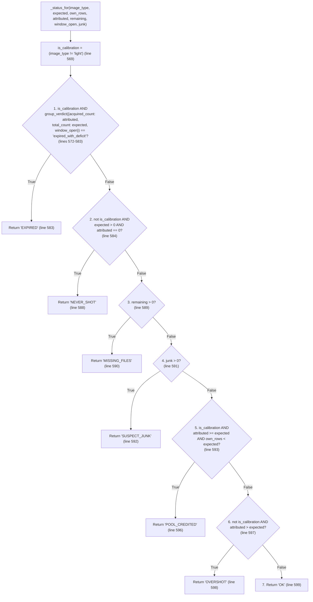
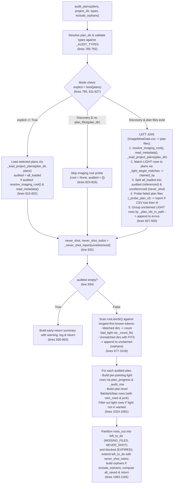

# Observation Plan, Progress & Capture-Audit Tools (`nina_planner/tools/plans.py`)

[⬆️ Up to Atlas Index](../../README.md) · [⬆️ Tools Package](./README.md) · [⬅️ Sequence Tools (`sequence.py`)](./sequence.md) · [⬅️ Sky Tools (`sky.py`)](./sky.md) · [⬅️ Progress Engine (`progress.py`)](../core/progress.md) · [⬅️ Plan Utils (`plan_utils.py`)](../core/plan_utils.md) · [⬅️ Mosaic (`mosaic.py`)](../core/mosaic.md)

---

## 1. Module Overview

- **File Path:** `.opencode/local/mcps/nina_planner/nina_planner/tools/plans.py`
- **Line Count:** 1,238 lines (`1-1238`)
- **Module Docstring (`line 1`):** `"""Plan MCP tools: write, read, audit and report observation-plan progress."""`
- **Architectural Layer:** MCP Tool Layer & Project-Wide Capture-Audit / Plan-Management Orchestrator
- **Purpose:** Implements six `@mcp.tool()` endpoints (`get_frame_stats`, `write_plan_file`, `get_plan_progress`, `audit_plans`, `list_plans`, `get_nina_settings`) and 15 private helpers (plus one nested closure `progress_for` inside `get_plan_progress`) that:
  1. Read N.I.N.A.'s live single-frame quality telemetry from `/image-history` (`get_frame_stats`).
  2. Expand spherical mosaic footprints into concrete `Pointing` grids, validate filter names and rotator position angles against the active profile, stamp a deterministic `plan_id`, and atomically write plan JSON files (`_expand_mosaic`, `write_plan_file`).
  3. Compute per-pointing light and pooled calibration acquisition progress from `ImageMetaData.csv` while enforcing strict unknown-argument rejection on the MCP tool schema (`get_plan_progress`, `_forbid_unknown_arguments`).
  4. Reconcile all project observation plans against `ImageMetaData.csv` and on-disk `BAD_` rejected FITS files in a single call, classifying every `(plan, pointing, frame_type)` row into `"EXPIRED"`, `"NEVER_SHOT"`, `"MISSING_FILES"`, `"SUSPECT_JUNK"`, `"POOL_CREDITED"`, `"OVERSHOT"`, or `"OK"`, while surfacing wholly unshot plans (`never_shot`), orphaned frame directories (`orphans`), and unclaimed light frames (`audit_plans` and its 13 private audit helpers).
  5. Enumerate all loadable observation plans in the project directory (`list_plans`).
  6. Inspect launch-time archive and N.I.N.A. environment variables (`get_nina_settings`).
- **Inbound Callers:**
  - `nina_planner/server.py:11-18` (`from .tools.plans import audit_plans, get_frame_stats, get_nina_settings, get_plan_progress, list_plans, write_plan_file`)
  - Test suites: `tests/test_plans_audit.py`, `tests/test_server.py`, `tests/test_nina_settings.py`, `tests/test_purge.py`, `tests/test_pin_id.py`, `tests/test_mcp_entrypoint.py`
- **Outbound Imports:**
  - **Top-Level Stdlib (`lines 3-8`):**
    - `import json` (`line 3`)
    - `import os` (`line 4`)
    - `import re` (`line 5`)
    - `from datetime import UTC, datetime` (`line 6`)
    - `from pathlib import Path` (`line 7`)
    - `from typing import Any` (`line 8`)
  - **Top-Level Third-Party (`lines 10-11`):**
    - `import anyio` (`line 10`)
    - `from pydantic import ConfigDict` (`line 11`)
  - **Top-Level Internal (`lines 13-31`):**
    - `from .. import client, config, metadata, plan_utils` (`line 13`)
    - `from ..app import mcp` (`line 14`)
    - `from ..imaging import _prunable_dir, _walk_visible` (`lines 15-18`)
    - `from ..models.frame import FrameStats` (`line 19`)
    - `from ..models.plan import ObservationPlan` (`line 20`)
    - `from ..models.profile import ObservatoryProfile` (`line 21`)
    - `from ..mosaic import grid_size, pane_fov_arcmins, plan_mosaic` (`line 22`)
    - `from ..progress import _light_target_matches, group_verdict, is_junk_row, path_has_id, plan_progress, progress_verdict` (`lines 23-30`)
    - `from . import equipment as equipment_tools` (`line 31`)

### Module-Level Constants & Regexes

| Constant | Line(s) | Type & Value | Purpose |
|---|---|---|---|
| `_AUDIT_TYPES` | `347` | `tuple[str, ...] = ("light", "flat", "dark", "bias")` | Canonical ordered tuple of image types audited by `audit_plans`. |
| `_FITS_SUFFIXES` | `348` | `tuple[str, ...] = (".fits", ".fits.fz")` | Lowercase file extensions counted by `_count_fits` and orphan detection in `audit_plans`. |
| `_AUDIT_BROKEN` | `353` | `tuple[str, ...] = ("MISSING_FILES", "EXPIRED", "SUSPECT_JUNK", "NEVER_SHOT")` | Row statuses that cause `audit_plans` to set top-level `"all_saved": False`. |
| `_PLAN_ID_CANDIDATE_RE` | `359` | `re.Pattern[str]` (`[_\[(]([A-Za-z][A-Za-z0-9.\-]{2,})[_\])]`) | Conservative regex matching delimited (`_..._`, `[...]`, `(...)`) plan-id candidate tokens inside recorded paths; post-filtered by `_plan_ids_in_path` for `"-"` containment and `len >= 5`. |
| `_SETTING_NAMES` | `1202-1208` | `tuple[str, ...]` (`"NINA_ARCHIVE_DEST"`, `"NINA_UPLOAD_CMD"`, `"NINA_VERIFY_CMD"`, `"NINA_ENDPOINT"`, `"NINA_DRIVE_MOUNT"`) | Environment variable names inspected by `get_nina_settings`. |
| `_ARCHIVE_GATE_NAMES` | `1212` | `tuple[str, ...] = _SETTING_NAMES[:3]` | The three archive environment variables (`NINA_ARCHIVE_DEST`, `NINA_UPLOAD_CMD`, `NINA_VERIFY_CMD`) that must be set for `get_nina_settings` to report `"ready": True`. |

---

## 2. Function & Method Reference

### 2.1 `get_frame_stats` (`nina_planner/tools/plans.py:34-97`)

#### 1. Purpose & Architectural Role
Public `@mcp.tool()` endpoint that fetches N.I.N.A.'s live per-frame quality statistics for the most recently captured frame from `GET /image-history` (with optional `?imageType=<TYPE>` filtering), normalizes it through `FrameStats.model_validate`, and degrades expected empty-history `"Index out of range"` API responses into a clean `count: 0` dictionary instead of raising.

#### 2. Signature, Decorators & Inputs
```python
@mcp.tool()
async def get_frame_stats(image_type: str | None = None) -> dict[str, Any]:
```
- **Decorators:** `@mcp.tool()` (`line 34`).
- **Inputs:**
  - `image_type: str | None = None` — Optional frame-type filter (e.g. `"light"`, `"dark"`, `"flat"`, `"bias"`), uppercased and passed as `?imageType=<TYPE>`.

#### 3. Outputs & Return Semantics
- **Returns:** `dict[str, Any]` with keys:
  - `"count": int` — `1` when a matching frame record is returned, `0` when none is available.
  - `"image_type": str | None` — `frame.image_type` (or `image_type.upper()` when `image_type` was supplied, else `None`).
  - `"frame": dict[str, Any] | None` — `FrameStats` serialized via `model_dump(mode="json")` when `count == 1`, else `None`.
  - `"note": str | None` — Explanatory message when `count == 0` (e.g., `"no LIGHT frame recorded yet"`, `"no frame recorded yet"`, or `"image-history returned no frame record"`), or `None` when `count == 1`.

#### 4. Step-by-Step Internal Logic
1. **Lines 46–48:** Builds `path = "/image-history"`, appending `f"?imageType={image_type.upper()}"` if `image_type` is truthy.
2. **Lines 49–69:** Awaits `payload = await client.api_get(path)`. Catches `RuntimeError as e`:
   - If `"Index out of range" in str(e)` (`line 57`), constructs `note` (`f"no {image_type.upper()} frame recorded yet"` or `"no frame recorded yet"`) and returns `{"count": 0, "image_type": image_type.upper() if image_type else None, "frame": None, "note": note}` (`lines 58-68`).
   - Otherwise re-raises the `RuntimeError` (`line 69`).
3. **Lines 73–80:** Extracts `record` from `payload`: `payload[0] if payload else None` when `payload` is a `list`, `payload` when `payload` is a `dict`, or `None` otherwise.
4. **Lines 82–87:** If `not isinstance(record, dict) or not record`, returns `{"count": 0, "image_type": image_type.upper() if image_type else None, "frame": None, "note": "image-history returned no frame record"}`.
5. **Lines 89–97:** Validates `frame = FrameStats.model_validate(record)`, constructs `res` with `count=1` and `frame=frame.model_dump(mode="json")`, logs it via `client.log_payload("FrameStats:", json.dumps(res, indent=2))`, and returns `res`.

#### 5. Side Effects & I/O
- 1 HTTP GET to N.I.N.A. (`/image-history` or `/image-history?imageType=...`).
- Appends formatted JSON payload to `NINA_PLANNER_LOG` via `client.log_payload` when `count == 1` (`line 96`).

#### 6. Error Handling & Edge Cases
- **N.I.N.A. Empty Image-History Envelope (`lines 51-68`):** N.I.N.A. returns HTTP 200 with `Success=false, Error="Index out of range"` when no frame (or no frame of `imageType`) has been captured yet; `client.unwrap_response` raises `RuntimeError("... Index out of range ...")`, which `get_frame_stats` intercepts and converts to `count: 0`.
- **Genuine Zero Telemetry (`stars: 0`):** Handled inside `FrameStats._normalize`, preserving `0` as an integer reading rather than `None`.

#### 7. Complexity & Risk Notes
- $O(1)$ single-record deserialization.

---

### 2.2 `_expand_mosaic` (`nina_planner/tools/plans.py:103-161`)

#### 1. Purpose & Architectural Role
Derives a mosaic observation plan's `pointings` list from its `plan.mosaic` (`MosaicConfig`) specification and the active `profile.optics` (`OpticalTrainInfo`), stamps the derived `cols`, `rows`, and `pane_fov_arcmins` back onto `plan.mosaic` as provenance, and returns both the expanded `ObservationPlan` and a geometric summary dictionary. Called by `write_plan_file` (`line 173`).

#### 2. Signature, Decorators & Inputs
```python
def _expand_mosaic(
    plan: ObservationPlan, profile: ObservatoryProfile
) -> tuple[ObservationPlan, dict[str, Any]]:
```
- **Decorators:** None (private synchronous helper).
- **Inputs:**
  - `plan: ObservationPlan` — Plan with `plan.mosaic is not None` and empty `plan.pointings`.
  - `profile: ObservatoryProfile` — Active observatory profile carrying `profile.optics`.

#### 3. Outputs & Return Semantics
- **Returns:** `tuple[ObservationPlan, dict[str, Any]]`:
  1. `expanded: ObservationPlan` — Copy of `plan` with `pointings` populated (labeled `r{row}_c{col}`) and `mosaic` updated with `cols`, `rows`, and `pane_fov_arcmins`.
  2. `summary: dict[str, Any]` — Contains `"cols"`, `"rows"`, `"pane_w"`, `"pane_h"`, `"step_w"`, `"step_h"`, `"achieved_w"`, `"achieved_h"`, `"requested_w"`, and `"requested_h"` (all widths/heights/steps in arcminutes).

#### 4. Step-by-Step Internal Logic
1. **Lines 115–116:** Reads `mosaic = plan.mosaic` and asserts `mosaic is not None`.
2. **Line 117:** Computes `pane_w, pane_h = pane_fov_arcmins(profile.optics)` (raises `ValueError` if optics or focal length / pixel size / sensor dimensions are missing).
3. **Lines 118–124:** Computes `cols, rows = grid_size(mosaic.coverage_width_arcmins, mosaic.coverage_height_arcmins, pane_w, pane_h, mosaic.overlap_pct)`.
4. **Lines 125–129:** Computes `overlap_fraction = 1.0 - mosaic.overlap_pct / 100.0` and converts step sizes from arcminutes to degrees: `step_w_deg = (pane_w / 60.0) * overlap_fraction`, `step_h_deg = (pane_h / 60.0) * overlap_fraction`.
5. **Lines 130–138:** Generates tangent-plane spherical pointings via `pointings = plan_mosaic(mosaic.center_ra_hours, mosaic.center_dec_deg, cols, rows, step_w_deg, step_h_deg, mosaic.pa_deg)`.
6. **Lines 139–146:** Copies `mosaic` with `cols`, `rows`, and `pane_fov_arcmins=(round(pane_w, 3), round(pane_h, 3))` (`stamped`), and copies `plan` with `pointings=pointings, mosaic=stamped` (`expanded`).
7. **Lines 147–161:** Builds `summary` (computing `achieved_w = pane_w + (cols - 1) * pane_w * overlap_fraction` and `achieved_h` analogously) and returns `(expanded, summary)`.

#### 5. Side Effects & I/O
- Pure function (returns new Pydantic model copies via `model_copy`).

#### 6. Error Handling & Edge Cases
- Raises `ValueError` from `pane_fov_arcmins(profile.optics)` if any optical train dimension is missing or non-positive — never guesses a fallback FOV.

#### 7. Complexity & Risk Notes
- $O(\text{cols} \times \text{rows})$ spherical trigonometry evaluations in `plan_mosaic`.

---

### 2.3 `write_plan_file` (`nina_planner/tools/plans.py:164-199`)

#### 1. Purpose & Architectural Role
Public `@mcp.tool()` endpoint that validates an `ObservationPlan` against the active observatory profile (expanding `plan.mosaic` if present, validating filter names against the profile's filter wheel, and validating non-zero position angles against rotator presence), stamps `plan.plan_id` with `plan._base_plan_id()` if unset, and atomically writes the plan JSON file to `config.PROJECT_DIR`.

#### 2. Signature, Decorators & Inputs
```python
@mcp.tool()
async def write_plan_file(plan: ObservationPlan) -> str:
```
- **Decorators:** `@mcp.tool()` (`line 164`).
- **Inputs:**
  - `plan: ObservationPlan` — Validated Pydantic `ObservationPlan` model (either with explicit `pointings` or a `mosaic` block).

#### 3. Outputs & Return Semantics
- **Returns:** `str` — Confirmation message `"Plan successfully written to <path><grid_note>"`, where `grid_note` reports the derived `cols x rows`, pane FOV, step size, achieved vs. requested coverage, and a `1x1` unit warning if a mosaic block collapsed into a single pane.

#### 4. Step-by-Step Internal Logic
1. **Line 170:** Fetches `profile = await equipment_tools.get_site_profile()`.
2. **Lines 171–187:** Initializes `grid_note = ""`. If `plan.mosaic is not None and not plan.pointings`:
   - Calls `plan, grid = _expand_mosaic(plan, profile)` (`line 173`).
   - Formats `grid_note` with `cols`, `rows`, `len(plan.pointings)`, `pane_w`, `pane_h`, `step_w`, `step_h`, `achieved_w`, `achieved_h`, `requested_w`, `requested_h` (`lines 174-182`).
   - If `grid["cols"] == 1 and grid["rows"] == 1`, appends the 1x1 unit warning (`lines 183-187`).
3. **Line 188:** Validates all filter names in `light_frames` and `flat_frames` via `await plan_utils.validate_filters(plan, profile)`.
4. **Line 189:** Validates pointing position angles against `profile.equipment.has_rotator` via `plan_utils.validate_position_angle(plan, profile)`.
5. **Lines 190–191:** If `not plan.plan_id`, stamps `plan = plan.model_copy(update={"plan_id": plan._base_plan_id()})`.
6. **Lines 192–195:** Formats local timestamp `YYYYMMDDTHHMMSS` (`line 192`), builds filename `f"{plan_utils.sanitize_filename(plan.target.lower())}_{plan_utils.sanitize_filename(plan.intent.lower())}_{timestamp}.json".replace(" ", "-")` (`lines 193-194`), and resolves `path = config.PROJECT_DIR / filename` (`line 195`).
7. **Lines 196–198:** Atomically writes `plan.model_dump_json(indent=2)` to `path` on a worker thread via `await anyio.to_thread.run_sync(plan_utils.write_text_atomic, path, plan.model_dump_json(indent=2))`.
8. **Line 199:** Returns `f"Plan successfully written to {path}{grid_note}"`.

#### 5. Side Effects & I/O
- Queries N.I.N.A.'s active profile (`equipment_tools.get_site_profile()`); `plan_utils.validate_filters` and `plan_utils.validate_position_angle` validate against that in-memory `ObservatoryProfile` without additional HTTP calls.
- Creates a new JSON file in `config.PROJECT_DIR` via atomic temp-file + `os.replace` (`plan_utils.write_text_atomic`).

#### 6. Error Handling & Edge Cases
- Refuses unknown filters (`ValueError` from `validate_filters`), non-zero PA without a rotator (`ValueError` from `validate_position_angle`), or mosaic expansion without optical train parameters (`ValueError` from `_expand_mosaic`) *before* touching the filesystem.

#### 7. Complexity & Risk Notes
- Atomic write guarantees `list_plans` and `audit_plans` never observe a partially written JSON file.

---

### 2.4 `get_plan_progress` (`nina_planner/tools/plans.py:202-311`)

#### 1. Purpose & Architectural Role
Public `@mcp.tool()` endpoint that computes per-pointing light and pooled calibration acquisition progress for a single observation plan JSON file against `ImageMetaData.csv`, applying the plan's own `plan.quality` thresholds (`max_hfr`, `max_hfr_st_dev`, `min_detected_stars`, `max_guiding_rms_arcsec`) and calibration age window (`calibration_window_days`). Reports per-pointing completion verdicts (`complete`, `incomplete`, `expired_with_deficit`), surplus/overshot warnings, and expired calibration window warnings.

#### 2. Signature, Decorators & Inputs
```python
@mcp.tool()
async def get_plan_progress(file_path: str) -> dict[str, Any]:
```
- **Decorators:** `@mcp.tool()` (`line 202`), hardened at module import time by `_forbid_unknown_arguments()` (`line 341`) with `ConfigDict(extra="forbid")`. Also defines inner helper `progress_for(index: int) -> dict[str, list[dict[str, Any]]]` (`lines 216-223`).
- **Inputs:**
  - `file_path: str` — Path to the observation plan JSON file (absolute or relative to `config.PROJECT_DIR`).

#### 3. Outputs & Return Semantics
- **Returns:** `dict[str, Any]` with keys:
  - `"plan_id": str` — `plan._base_plan_id()`.
  - `"target": str` — `plan.target`.
  - `"quality": dict[str, Any]` — `plan.quality.model_dump(exclude_none=True)` (`{}` when no quality thresholds are enabled).
  - `"pointing_count": int` — `len(plan.pointings)`.
  - `"complete": bool` — `True` iff every pointing has `verdict["complete"] == True`.
  - `"expired_with_deficit": bool` — `True` if any pointing has `status == "expired_with_deficit"`.
  - `"overshot": bool` — `True` if the sum of light `surplus_count` across pointings is `> 0`.
  - `"warning": str | None` — Combined diagnostic message when `overshot` and/or `expired_with_deficit` is `True`, else `None`.
  - `"pointings": list[dict[str, Any]]` — Per-pointing entries containing `"pointing_index"` (`1..N`), `"label"`, `"plan_id"` (`plan.effective_plan_id(index)`), `"complete"`, `"status"`, and `"frame_types"` (`{"light": [...], "flat": [...], "dark": [...], "bias": [...]}`).

#### 4. Step-by-Step Internal Logic
1. **Lines 212–214:** Loads `plan = await plan_utils.load_plan(file_path)`, reads `rows = await metadata.read_metadata()`, and captures `now = datetime.now(UTC).replace(microsecond=0)`.
2. **Lines 216–223:** Defines closure `progress_for(index: int)` calling `plan_progress(plan, rows, pointing_index=index, **plan_utils.quality_kwargs(plan), now=now)`.
3. **Lines 225–250:** Loops `index` from `1` to `len(plan.pointings)`:
   - Calls `pointings_progress = progress_for(index)` (`line 229`) and `verdict = progress_verdict(pointings_progress)` (`line 233`).
   - Updates `expired_any = expired_any or pane_status == "expired_with_deficit"` and `complete = complete and pane_done` (`lines 236-237`).
   - Appends the pointing progress entry to `entries` (`lines 239-250`).
4. **Lines 251–263:** Initializes the result dict `res`.
5. **Lines 267–283:** Computes total light `surplus` across all pointings. If `surplus > 0`, sets `res["overshot"] = True` and populates `res["warning"]` explaining that cumulative surplus frames exist and `audit_plans` should be used to confirm the latest run.
6. **Lines 284–309:** If `expired_any` is `True`, collects the sorted set of calibration `expired_types` (`"flat"`, `"dark"`, `"bias"`) where `window_open is False and deficit_count > 0`, builds the expired-window warning, and sets or appends (`" ALSO: "`) `res["warning"]`.
7. **Lines 310–311:** Logs `res` via `client.log_payload("Progress:", json.dumps(res, indent=2))` and returns `res`.

#### 5. Side Effects & I/O
- Reads the plan JSON file from disk (`plan_utils.load_plan`), queries the active profile (`metadata.read_metadata` -> `resolve_imaging_root`), and reads `ImageMetaData.csv` from the imaging root.
- Logs the JSON response to `NINA_PLANNER_LOG`.

#### 6. Error Handling & Edge Cases
- **Unknown Arguments Rejected (`_forbid_unknown_arguments`):** Passing legacy filter kwargs (e.g., `max_hfr=2.5`) directly to `get_plan_progress` raises a Pydantic validation error instead of being silently ignored.
- **Expired Window vs. Complete (`line 233`):** Uses `progress_verdict` rather than `remaining_count == 0`, because a closed calibration window zeroes `remaining_count` even when `deficit_count > 0`.

#### 7. Complexity & Risk Notes
- Evaluates `plan_progress` once per pointing ($O(P \cdot R)$ where $P$ is pointing count and $R$ is CSV row count).

---

### 2.5 `_forbid_unknown_arguments` (`nina_planner/tools/plans.py:314-338`)

#### 1. Purpose & Architectural Role
Import-time schema-hardening helper invoked on `line 341`. Subclasses FastMCP's auto-generated `arg_model` for `get_plan_progress` with `model_config = ConfigDict(extra="forbid")` so that callers passing stray arguments (such as `max_hfr`) receive an immediate validation error instead of silently getting unfiltered counts.

#### 2. Signature, Decorators & Inputs
```python
def _forbid_unknown_arguments() -> None:
```
- **Decorators:** None (called once at module import time at `line 341`).
- **Inputs:** None.

#### 3. Outputs & Return Semantics
- **Returns:** `None` (mutates `tool.fn_metadata` on `mcp._tool_manager` in place).

#### 4. Step-by-Step Internal Logic
1. **Lines 326–331:** Looks up `tool = mcp._tool_manager.get_tool("get_plan_progress")`. If `tool is None`, raises `RuntimeError("get_plan_progress is not registered on the MCP server — the unknown-argument refusal cannot be installed")`.
2. **Lines 332–337:** Extracts `arg_model = tool.fn_metadata.arg_model` and dynamically constructs `strict_model = type(arg_model.__name__, (arg_model,), {"model_config": ConfigDict(extra="forbid")})`.
3. **Line 338:** Updates `tool.fn_metadata = tool.fn_metadata.model_copy(update={"arg_model": strict_model})`.

#### 5. Side Effects & I/O
- Mutates the registered `get_plan_progress` tool metadata on the `mcp` singleton at module import time.

#### 6. Error Handling & Edge Cases
- Loudly raises `RuntimeError` at import time if FastMCP's internal `_tool_manager.get_tool` registration ever fails to find `get_plan_progress`.

#### 7. Complexity & Risk Notes
- Runs once at import time ($O(1)$).

---

### 2.6 `_probe_plan_id` (`nina_planner/tools/plans.py:362-376`)

#### 1. Purpose & Architectural Role
Best-effort extractor that reads a raw `"plan_id"` string from a JSON file that failed full `ObservationPlan` validation. Used by `audit_plans` (`line 885`) to determine whether a corrupt/invalid plan file is referenced by captured frames in `ImageMetaData.csv`.

#### 2. Signature, Decorators & Inputs
```python
def _probe_plan_id(path: Path) -> str | None:
```
- **Decorators:** None (private synchronous helper).
- **Inputs:**
  - `path: Path` — Path to the JSON file that failed `load_plan`.

#### 3. Outputs & Return Semantics
- **Returns:** `str | None` — Non-empty `"plan_id"` string if the file is valid JSON containing a top-level string `"plan_id"`, else `None`.

#### 4. Step-by-Step Internal Logic
1. **Lines 371–374:** Attempts `data = json.loads(path.read_text(encoding="utf-8"))`; returns `None` on `(OSError, ValueError)`.
2. **Lines 375–376:** Extracts `plan_id = data.get("plan_id") if isinstance(data, dict) else None` and returns `plan_id if isinstance(plan_id, str) and plan_id else None`.

#### 5. Side Effects & I/O
- Synchronous file read (`path.read_text`).

#### 6. Error Handling & Edge Cases
- Never raises; returns `None` on missing files, permission errors, invalid UTF-8/JSON, non-dict JSON roots, or missing/empty `"plan_id"`.

#### 7. Complexity & Risk Notes
- $O(\text{file size})$.

---

### 2.7 `_plan_ids_in_path` (`nina_planner/tools/plans.py:379-390`)

#### 1. Purpose & Architectural Role
Extracts conservative plan-id candidate tokens from a recorded `FilePath` string in path order using `_PLAN_ID_CANDIDATE_RE`. Used by `audit_plans` (`line 916`) to name the unclaimed plan ID when light rows in `ImageMetaData.csv` match no loadable plan file.

#### 2. Signature, Decorators & Inputs
```python
def _plan_ids_in_path(path: str) -> list[str]:
```
- **Decorators:** None (private synchronous helper).
- **Inputs:**
  - `path: str` — Recorded frame path from `ImageMetaData.csv`.

#### 3. Outputs & Return Semantics
- **Returns:** `list[str]` — Deduplicated list of candidate plan-id tokens in order of appearance.

#### 4. Step-by-Step Internal Logic
1. **Line 385:** Initializes `out: list[str] = []`.
2. **Lines 386–389:** Iterates over `_PLAN_ID_CANDIDATE_RE.finditer(path)`:
   - Extracts `token = match.group(1)`.
   - Keeps `token` iff `"-" in token and len(token) >= 5 and token not in out` (filtering out filename fragments like `"60.00s"` or `"L"`).
3. **Line 390:** Returns `out`.

#### 5. Side Effects & I/O
- Pure string/regex function.

#### 6. Error Handling & Edge Cases
- Returns `[]` if no delimited token satisfies the letter-initial, dash-containing, length `>= 5` rules.

#### 7. Complexity & Risk Notes
- $O(\text{len}(path))$.

---

### 2.8 `_load_project_plans` (`nina_planner/tools/plans.py:393-421`)

#### 1. Purpose & Architectural Role
Loads either an explicit list of plan file paths (`selected`) or all discovered plan files under `plan_dir` (`plan_utils.plan_files(plan_dir)`), collecting `(Path, ObservationPlan)` pairs and recording any per-file load/validation failures in an `errors` list without aborting the sweep. Shared by `audit_plans` (`lines 814, 839`) and `list_plans` (`line 1183`).

#### 2. Signature, Decorators & Inputs
```python
async def _load_project_plans(
    plan_dir: Path, selected: list[str] | None = None
) -> tuple[list[tuple[Path, ObservationPlan]], list[dict[str, str]]]:
```
- **Decorators:** None (private async helper).
- **Inputs:**
  - `plan_dir: Path` — Resolved project directory.
  - `selected: list[str] | None = None` — Optional explicit list of relative or absolute file paths to load.

#### 3. Outputs & Return Semantics
- **Returns:** `tuple[list[tuple[Path, ObservationPlan]], list[dict[str, str]]]`:
  1. `plans`: List of `(file_path, ObservationPlan)` pairs for every file that loaded and validated cleanly.
  2. `errors`: List of `{"file": file.name, "reason": str(exc)}` dicts for every file that failed to load.

#### 4. Step-by-Step Internal Logic
1. **Lines 405–413:** If `selected` is truthy, resolves each entry as `Path(entry)` (joining onto `plan_dir` if relative); otherwise discovers files via `files = plan_utils.plan_files(plan_dir)`.
2. **Lines 414–420:** Iterates over `file` in `files`:
   - Attempts `plans.append((file, await plan_utils.load_plan(str(file))))`.
   - Catches `Exception as exc` and appends `{"file": file.name, "reason": str(exc)}` to `errors`.
3. **Line 421:** Returns `plans, errors`.

#### 5. Side Effects & I/O
- Walks `plan_dir` (when `selected is None`) and reads/parses JSON files from disk via `plan_utils.load_plan`.

#### 6. Error Handling & Edge Cases
- Intentionally catches broad `Exception` (`# noqa: BLE001`) per file so a single corrupt JSON file never aborts `audit_plans` or `list_plans`.

#### 7. Complexity & Risk Notes
- $O(F)$ file reads where $F$ is the number of candidate plan JSON files.

---

### 2.9 `_plan_type_totals` (`nina_planner/tools/plans.py:424-441`)

#### 1. Purpose & Architectural Role
Sums the exposure groups returned by `plan_progress` for a single `image_type` into aggregate `expected`, `attributed`, and `remaining` counts, while extracting the shared `window_open` and `window_end` fields from the first group. Used by `audit_plans` (`lines 1031, 1060`).

#### 2. Signature, Decorators & Inputs
```python
def _plan_type_totals(
    progress: dict[str, list[dict[str, Any]]], image_type: str
) -> dict[str, Any]:
```
- **Decorators:** None (private synchronous helper).
- **Inputs:**
  - `progress: dict[str, list[dict[str, Any]]]` — Output of `progress.plan_progress(...)`.
  - `image_type: str` — One of `"light"`, `"flat"`, `"dark"`, `"bias"`.

#### 3. Outputs & Return Semantics
- **Returns:** `dict[str, Any]` with keys `"expected"` (`int`), `"attributed"` (`int`), `"remaining"` (`int`), `"window_open"` (`bool | None`), and `"window_end"` (`str | None`).

#### 4. Step-by-Step Internal Logic
1. **Line 434:** Extracts `groups = progress.get(image_type) or []`.
2. **Lines 435–441:** Sums `total_count`, `acquired_count`, and `remaining_count` across `groups`, reads `window_open` and `window_end` from `groups[0]` if `groups` is non-empty (else `None`), and returns the dict.

#### 5. Side Effects & I/O
- Pure function.

#### 6. Error Handling & Edge Cases
- Empty group list (`groups == []`) returns `0` for all three counts and `None` for `window_open`/`window_end`.

#### 7. Complexity & Risk Notes
- $O(G)$ where $G$ is the number of exposure groups for `image_type`.

---

### 2.10 `_count_fits` (`nina_planner/tools/plans.py:444-472`)

#### 1. Purpose & Architectural Role
Walks a landing token directory (`token_dir`) via `_walk_visible` (skipping hidden/system/quarantine directories) and counts `.fits` and `.fits.fz` files bucketed by their immediate parent directory name (lowercased), separating N.I.N.A.'s `BAD_`-prefixed rejected frames into `bad_<parent>` buckets. Used by `audit_plans` (`lines 1016, 1126`) for `bad_light` reject counts and orphan directory summaries.

#### 2. Signature, Decorators & Inputs
```python
def _count_fits(token_dir: Path) -> dict[str, int]:
```
- **Decorators:** None (private synchronous helper).
- **Inputs:**
  - `token_dir: Path` — Landing directory under the imaging root.

#### 3. Outputs & Return Semantics
- **Returns:** `dict[str, int]` — Mapping from bucket name (e.g., `"light"`, `"bad_light"`, `"dark"`, `"flat"`, `"bias"`) to file count.

#### 4. Step-by-Step Internal Logic
1. **Line 462:** Initializes `counts: dict[str, int] = {}`.
2. **Lines 463–471:** Iterates over `directory, filenames` in `_walk_visible(token_dir)`:
   - Sets `key = directory.name.lower()` (`line 466`).
   - For each `name` in `filenames`, lowercases `lower = name.lower()` (`line 468`) and skips files not ending with `_FITS_SUFFIXES` (`.fits`, `.fits.fz`) (`lines 469-470`).
   - Chooses `bucket = f"bad_{key}" if lower.startswith("bad_") else key` and increments `counts[bucket]` (`lines 471-472`).
3. **Line 472:** Returns `counts`.

#### 5. Side Effects & I/O
- Walks the filesystem subtree under `token_dir`.

#### 6. Error Handling & Edge Cases
- Does not restrict `key` to an allow-list of frame types: unexpected parent folder names are preserved under their own name so orphan frame totals (`sum(counts.values())`) never silently drop FITS files.
- Sidecar `.csv` files and hidden `.snapshot`/`.Trashes` directories are ignored.

#### 7. Complexity & Risk Notes
- $O(F)$ directory walk where $F$ is the number of visible files under `token_dir`.

---

### 2.11 `_own_token_rows` (`nina_planner/tools/plans.py:475-512`)

#### 1. Purpose & Architectural Role
Returns all rows from `ImageMetaData.csv` of `image_type` whose recorded `file_path` contains a path component carrying this plan's delimited token (`_{id}_`), without applying exposure-duration, filter, or calibration-window matchers. Used by `_junk_count` (`line 538`, because a `0.00003s` degenerate dark would be excluded by normal exposure matching) and by `audit_plans` (`line 1062`, to compute `own_rows` for `POOL_CREDITED` detection).

#### 2. Signature, Decorators & Inputs
```python
def _own_token_rows(
    plan: ObservationPlan,
    rows: list[dict[str, Any]],
    image_type: str,
    *,
    pointing_index: int,
) -> list[dict[str, Any]]:
```
- **Decorators:** None (private synchronous helper).
- **Inputs:**
  - `plan: ObservationPlan` — Plan being audited.
  - `rows: list[dict[str, Any]]` — Parsed `ImageMetaData.csv` rows.
  - `image_type: str` — Target frame type (`"light"`, `"flat"`, `"dark"`, `"bias"`).
  - `pointing_index: int` — 1-based pointing index (keyword-only).

#### 3. Outputs & Return Semantics
- **Returns:** `list[dict[str, Any]]` — Subset of `rows` matching `image_type` and carrying one of the plan's `_{id}_` tokens in a path component.

#### 4. Step-by-Step Internal Logic
1. **Lines 492–501:** Uppercases `type_upper = image_type.upper()`. If `image_type == "light"`, builds `ids = {plan.effective_plan_id(pointing_index), plan.per_pointing_plan_id(pointing_index)}`. Otherwise (calibration), builds `ids = {plan._base_plan_id()}` plus `plan.effective_plan_id(i)` for all pointings `1..len(plan.pointings)`. Formats `tokens = [f"_{pid}_" for pid in ids]`.
2. **Lines 502–511:** Iterates over `row` in `rows`:
   - Skips if `(row.get("image_type") or "").upper() != type_upper`.
   - Extracts `path = (row.get("file_path") or "").strip()` and skips if empty.
   - Splits `components = [part for part in path.replace("\\", "/").split("/") if part]`.
   - Appends `row` to `matched` if `any(tok in comp for tok in tokens for comp in components)`.
3. **Line 512:** Returns `matched`.

#### 5. Side Effects & I/O
- Pure in-memory filtering.

#### 6. Error Handling & Edge Cases
- Normalizes Windows backslashes (`replace("\\", "/")`) before splitting path components.

#### 7. Complexity & Risk Notes
- $O(R \cdot T)$ where $R = \text{len}(rows)$ and $T = \text{len}(tokens)$.

---

### 2.12 `_junk_count` (`nina_planner/tools/plans.py:515-542`)

#### 1. Purpose & Architectural Role
Counts degenerate frames (e.g., `0.00003s` Smart Exposure bug frames) among a plan's `_own_token_rows` using the shared rule `progress.is_junk_row(plan, row, image_type)`. Called by `audit_plans` (`lines 1033, 1064`).

#### 2. Signature, Decorators & Inputs
```python
def _junk_count(
    plan: ObservationPlan,
    rows: list[dict[str, Any]],
    image_type: str,
    *,
    pointing_index: int,
) -> int:
```
- **Decorators:** None (private synchronous helper).
- **Inputs:**
  - `plan: ObservationPlan`, `rows: list[dict[str, Any]]`, `image_type: str`, `pointing_index: int` (keyword-only).

#### 3. Outputs & Return Semantics
- **Returns:** `int` — Count of rows in `_own_token_rows(...)` where `is_junk_row(plan, row, image_type)` is `True`.

#### 4. Step-by-Step Internal Logic
1. **Lines 536–542:** Evaluates `sum(1 for row in _own_token_rows(plan, rows, image_type, pointing_index=pointing_index) if is_junk_row(plan, row, image_type))` and returns the integer sum.

#### 5. Side Effects & I/O
- Pure function.

#### 6. Error Handling & Edge Cases
- `is_junk_row` exempts `"bias"` and `"flat"`, and flags `"light"` / `"dark"` rows with duration below `max(0.01, 0.5 * min_plan_exposure)`.

#### 7. Complexity & Risk Notes
- $O(R)$ via `_own_token_rows`.

---

### 2.13 `_status_for` (`nina_planner/tools/plans.py:545-599`)

#### 1. Purpose & Architectural Role
Determines the single audit verdict string (`"EXPIRED"`, `"NEVER_SHOT"`, `"MISSING_FILES"`, `"SUSPECT_JUNK"`, `"POOL_CREDITED"`, `"OVERSHOT"`, or `"OK"`) for a `(plan, pointing, image_type)` audit row using strict first-match-wins precedence. Called by `_audit_row` (`line 616`).

#### 2. Signature, Decorators & Inputs
```python
def _status_for(
    *,
    image_type: str,
    expected: int,
    own_rows: int,
    attributed: int,
    remaining: int,
    window_open: bool | None,
    junk: int,
) -> str:
```
- **Decorators:** None (private synchronous helper; all parameters keyword-only).
- **Inputs:**
  - `image_type: str` — `"light"`, `"flat"`, `"dark"`, or `"bias"`.
  - `expected: int` — Total frames requested by the plan for this row.
  - `own_rows: int` — Frames in `ImageMetaData.csv` under this plan's own token (consulted only for calibration).
  - `attributed: int` — Valid frames credited to this plan/pointing by `plan_progress`.
  - `remaining: int` — Remaining frames to shoot (`0` when complete or when a calibration window is closed).
  - `window_open: bool | None` — Whether the calibration window is currently open (`None` for lights).
  - `junk: int` — Degenerate frame count from `_junk_count`.

#### 3. Outputs & Return Semantics
- **Returns:** `str` — One of `"EXPIRED"`, `"NEVER_SHOT"`, `"MISSING_FILES"`, `"SUSPECT_JUNK"`, `"POOL_CREDITED"`, `"OVERSHOT"`, or `"OK"`.

#### 4. Step-by-Step Internal Logic



1. **Line 569:** Sets `is_calibration = image_type != "light"`.
2. **Lines 572–583:** **Rule 1 (`EXPIRED`):** If `is_calibration` and `group_verdict({"acquired_count": attributed, "total_count": expected, "window_open": window_open}) == "expired_with_deficit"`, returns `"EXPIRED"`. Must precede `remaining > 0` because closed windows report `remaining == 0`.
3. **Lines 584–588:** **Rule 2 (`NEVER_SHOT`):** If `not is_calibration and expected > 0 and attributed == 0`, returns `"NEVER_SHOT"`. Must precede `remaining > 0` so an unattempted light pointing is distinguished from a partially completed one.
4. **Lines 589–590:** **Rule 3 (`MISSING_FILES`):** If `remaining > 0`, returns `"MISSING_FILES"`.
5. **Lines 591–592:** **Rule 4 (`SUSPECT_JUNK`):** If `junk > 0`, returns `"SUSPECT_JUNK"` (fires when attribution is otherwise complete, e.g. junk lights counted on token).
6. **Lines 593–596:** **Rule 5 (`POOL_CREDITED`):** If `is_calibration and attributed >= expected and own_rows < expected`, returns `"POOL_CREDITED"`.
7. **Lines 597–598:** **Rule 6 (`OVERSHOT`):** If `not is_calibration and attributed > expected`, returns `"OVERSHOT"`.
8. **Line 599:** **Rule 7 (`OK`):** Otherwise returns `"OK"`.

#### 5. Side Effects & I/O
- Pure decision function.

#### 6. Error Handling & Edge Cases
- Ordering between `MISSING_FILES` and `SUSPECT_JUNK` ensures that a junk *dark* (which fails the `±0.05s` exposure matcher and leaves `remaining > 0`) surfaces as `"MISSING_FILES"` (so `left_to_do` schedules a re-shoot) while still carrying `"junk": N` on the row to explain why.

#### 7. Complexity & Risk Notes
- $O(1)$.

---

### 2.14 `_audit_row` (`nina_planner/tools/plans.py:602-661`)

#### 1. Purpose & Architectural Role
Constructs a standardized dictionary for one `(plan, pointing, image_type)` row in `audit_plans`, attaching light-specific fields (`"label"`, `"bad"`) or calibration-specific fields (`"window_open"`, `"window_end"`, `"own_rows"`). Called by `audit_plans` (`lines 1034, 1065`).

#### 2. Signature, Decorators & Inputs
```python
def _audit_row(
    *,
    plan: ObservationPlan,
    image_type: str,
    expected: int,
    own_rows: int,
    attributed: int,
    remaining: int,
    window_open: bool | None,
    window_end: str | None,
    junk: int,
    bad: int,
    pointing_index: int | None,
) -> dict[str, Any]:
```
- **Decorators:** None (private synchronous helper; all parameters keyword-only).
- **Inputs:** Plan instance, `image_type`, counts (`expected`, `own_rows`, `attributed`, `remaining`, `junk`, `bad`), window state (`window_open`, `window_end`), and `pointing_index` (`None` for single-pointing lights and all calibration rows; `1..N` for multi-pointing mosaic lights).

#### 3. Outputs & Return Semantics
- **Returns:** `dict[str, Any]` — Audit row dictionary with common keys (`"plan_id"`, `"effective_plan_id"`, `"target"`, `"intent"`, `"pointing_index"`, `"type"`, `"expected"`, `"attributed"`, `"remaining"`, `"junk"`, `"status"`) plus type-specific keys (`"label"` and `"bad"` for `"light"`; `"window_open"`, `"window_end"`, and `"own_rows"` for calibration).

#### 4. Step-by-Step Internal Logic
1. **Lines 616–624:** Computes `status = _status_for(...)`.
2. **Lines 629–633:** Computes `effective = plan.effective_plan_id(pointing_index or 1) if image_type == "light" else plan._base_plan_id()`.
3. **Lines 634–646:** Builds the base `row` dictionary.
4. **Lines 647–654:** If `image_type == "light"`, sets `row["label"] = plan.pointings[(pointing_index or 1) - 1].label or ""` and `row["bad"] = bad`.
5. **Lines 655–660:** If `image_type != "light"`, sets `row["window_open"] = window_open`, `row["window_end"] = window_end`, and `row["own_rows"] = own_rows`.
6. **Line 661:** Returns `row`.

#### 5. Side Effects & I/O
- Pure function.

#### 6. Error Handling & Edge Cases
- Normalizes `None` pointing labels to `""` (`line 651`) to match `plan.intent` convention.

#### 7. Complexity & Risk Notes
- $O(1)$.

---

### 2.15 `_action_for` (`nina_planner/tools/plans.py:664-670`)

#### 1. Purpose & Architectural Role
Maps a frame type (`"light"`, `"flat"`, `"dark"`, `"bias"`) to its human/agent remediation instruction string for `left_to_do` entries. Called by `_never_shot_report` (`line 750`) and `audit_plans` (`line 1098`).

#### 2. Signature, Decorators & Inputs
```python
def _action_for(image_type: str) -> str:
```
- **Decorators:** None (private synchronous helper).
- **Inputs:**
  - `image_type: str` — One of `"light"`, `"flat"`, `"dark"`, `"bias"`.

#### 3. Outputs & Return Semantics
- **Returns:** `str` — E.g., `"load_sequence light for this plan"` or `"load_sequence flat (dawn or dusk) for this plan"`.

#### 4. Step-by-Step Internal Logic
1. **Lines 665–670:** Indexes a 4-key dictionary literal by `image_type`.

#### 5. Side Effects & I/O
- Pure function.

#### 6. Error Handling & Edge Cases
- Raises `KeyError` if called with an unknown `image_type` (callers validate against `_AUDIT_TYPES` beforehand).

#### 7. Complexity & Risk Notes
- $O(1)$.

---

### 2.16 `_written_iso` (`nina_planner/tools/plans.py:673-682`)

#### 1. Purpose & Architectural Role
Reads a file's modification time (`st_mtime`) and formats it as a host-local ISO-8601 string with UTC offset to second precision (`YYYY-MM-DDTHH:MM:SS±HH:MM`). Shared by `_never_shot_report` (`line 737`) and `list_plans` (`line 1194`).

#### 2. Signature, Decorators & Inputs
```python
def _written_iso(path: Path) -> str | None:
```
- **Decorators:** None (private synchronous helper).
- **Inputs:**
  - `path: Path` — File path to stat.

#### 3. Outputs & Return Semantics
- **Returns:** `str | None` — Host-local ISO-8601 timestamp string, or `None` if `path.stat()` raises `OSError`.

#### 4. Step-by-Step Internal Logic
1. **Lines 675–680:** Calls `datetime.fromtimestamp(path.stat().st_mtime).astimezone().isoformat(timespec="seconds")`.
2. **Lines 681–682:** Catches `OSError` and returns `None`.

#### 5. Side Effects & I/O
- Synchronous `stat()` syscall on `path`.

#### 6. Error Handling & Edge Cases
- Gracefully returns `None` if the file was deleted or cannot be stat'd.

#### 7. Complexity & Risk Notes
- $O(1)$.

---

### 2.17 `_light_expected_per_pointing` (`nina_planner/tools/plans.py:685-692`)

#### 1. Purpose & Architectural Role
Sums `group.total_count` across `plan.light_frames` to give the number of light frames required for a single pointing. Used by `_never_shot_report` (`line 727`).

#### 2. Signature, Decorators & Inputs
```python
def _light_expected_per_pointing(plan: ObservationPlan) -> int:
```
- **Decorators:** None (private synchronous helper).
- **Inputs:**
  - `plan: ObservationPlan` — Observation plan.

#### 3. Outputs & Return Semantics
- **Returns:** `int` — Sum of `group.total_count` for all groups in `plan.light_frames`.

#### 4. Step-by-Step Internal Logic
1. **Line 692:** Returns `sum(group.total_count for group in plan.light_frames)`.

#### 5. Side Effects & I/O
- Pure function.

#### 6. Error Handling & Edge Cases
- Returns `0` if `plan.light_frames` is empty.

#### 7. Complexity & Risk Notes
- $O(G)$ where $G = \text{len}(plan.light\_frames)$.

---

### 2.18 `_never_shot_report` (`nina_planner/tools/plans.py:695-756`)

#### 1. Purpose & Architectural Role
Builds the `never_shot` summary list and corresponding per-pointing `left_to_do` work items (`reason="NEVER_SHOT"`) for loadable plan files that have **zero** attributed light rows in `ImageMetaData.csv` (the LEFT JOIN's blind spot in discovery mode). Deduplicates by `plan._base_plan_id()` so archived/duplicate copies of the same unshot plan are reported only once (from the shallowest file). Called by `audit_plans` (`line 932`).

#### 2. Signature, Decorators & Inputs
```python
def _never_shot_report(
    pairs: list[tuple[Path, ObservationPlan]],
) -> tuple[list[dict[str, Any]], list[dict[str, Any]]]:
```
- **Decorators:** None (private synchronous helper).
- **Inputs:**
  - `pairs: list[tuple[Path, ObservationPlan]]` — Unreferenced `(path, plan)` pairs ordered shallowest-first.

#### 3. Outputs & Return Semantics
- **Returns:** `tuple[list[dict[str, Any]], list[dict[str, Any]]]`:
  1. `entries` (`never_shot`): Plan-level dicts with `"plan_id"`, `"file"`, `"target"`, `"intent"`, `"pointing_count"`, `"light_expected"` (`per_pointing * len(plan.pointings)`), and `"written"`.
  2. `todos` (`left_to_do` additions): Per-pointing dicts with `"plan_id"`, `"target"`, `"intent"`, `"pointing_index"` (`1..N` if `multi` else `None`), `"type": "light"`, `"missing": per_pointing`, `"reason": "NEVER_SHOT"`, `"action": _action_for("light")`, and `"label"`.

#### 4. Step-by-Step Internal Logic
1. **Lines 719–721:** Initializes `entries = []`, `todos = []`, and `seen: set[str] = set()`.
2. **Lines 722–755:** Iterates over `path, plan` in `pairs`:
   - Computes `base = plan._base_plan_id()`. If `base in seen`, `continue`s; else adds `base` to `seen` (`lines 723-726`).
   - Computes `per_pointing = _light_expected_per_pointing(plan)` and `multi = len(plan.pointings) > 1` (`lines 727-728`).
   - Appends the plan-level summary dict to `entries` (`lines 729-739`).
   - Loops `i` from `1` to `len(plan.pointings)` and appends a per-pointing `"NEVER_SHOT"` work item to `todos` (`lines 740-755`).
3. **Line 756:** Returns `entries, todos`.

#### 5. Side Effects & I/O
- Calls `_written_iso(path)` (`stat()` syscall) for each unique unreferenced plan.

#### 6. Error Handling & Edge Cases
- Deduplicating by `base = plan._base_plan_id()` prevents double-counting when two files share the same plan ID.

#### 7. Complexity & Risk Notes
- $O(U \cdot P)$ where $U$ is unreferenced plan count and $P$ is average pointings per plan.

---

### 2.19 `audit_plans` (`nina_planner/tools/plans.py:759-1165`)

#### 1. Purpose & Architectural Role
Public `@mcp.tool()` endpoint that performs a comprehensive project-wide (or explicit-file) capture audit in a single call. Reconciles observation plan files, `ImageMetaData.csv` attribution/window state, and on-disk `BAD_` rejected FITS files to answer two questions for the operator and controller agent: *"Are all captures saved (`all_saved`)?"* and *"What work is left to do (`left_to_do`, `blocked`, `never_shot`, `orphans`, `errors`)?"*

#### 2. Signature, Decorators & Inputs
```python
@mcp.tool()
async def audit_plans(
    plans: list[str] | None = None,
    project_dir: str | None = None,
    types: list[str] | None = None,
    include_orphans: bool = True,
) -> dict[str, Any]:
```
- **Decorators:** `@mcp.tool()` (`line 759`).
- **Inputs:**
  - `plans: list[str] | None = None` — Optional explicit list of plan filenames/paths to audit. When provided (`explicit = True`), audits *only* those files (even if unshot) and treats any load failure among them as an error.
  - `project_dir: str | None = None` — Optional directory override; defaults to `config.PROJECT_DIR`.
  - `types: list[str] | None = None` — Optional case-insensitive subset of `("light", "flat", "dark", "bias")`.
  - `include_orphans: bool = True` — When `True`, scans unclaimed directories on the imaging root for FITS files and reports them in `orphans`.

#### 3. Outputs & Return Semantics
- **Returns:** `dict[str, Any]` with keys:
  - `"all_saved": bool` — `True` iff no row is in `_AUDIT_BROKEN` (`MISSING_FILES`, `EXPIRED`, `SUSPECT_JUNK`, `NEVER_SHOT`), `errors` is empty, and `never_shot` is empty.
  - `"totals": dict[str, int]` — `{"expected", "attributed", "plans", "plan_errors", "never_shot"}`.
  - `"left_to_do": list[dict[str, Any]]` — Actionable sequence runs (`MISSING_FILES` and row-level `NEVER_SHOT` deficits, followed by `never_shot_todos`).
  - `"blocked": list[dict[str, Any]]` — `EXPIRED` calibration rows requiring `calibration_window_days` increase or a new plan.
  - `"never_shot": list[dict[str, Any]]` — Loadable plan files in discovery mode with zero attributed light frames.
  - `"rows": list[dict[str, Any]]` — Per-plan × type rows (per-pointing for lights, plan-level for calibration).
  - `"orphans": list[dict[str, Any]]` — Unclaimed imaging-root directories containing FITS files (`[]` if `include_orphans=False`).
  - `"errors": list[dict[str, Any]]` — Unclaimed light frames in `ImageMetaData.csv` plus load failures for plans referenced by the CSV (or explicit-mode load failures).
  - `"root": str | None` — Resolved imaging root path string (or `None` when project has no plan files in discovery mode).
  - `"warning": str` *(optional)* — Present only on early return when `audited` is empty (`lines 951-961`).

#### 4. Step-by-Step Internal Logic



1. **Lines 785–792:** Resolves `plan_dir = plan_utils.resolve_plan_dir(project_dir)`, normalizes `wanted = tuple(t.lower() for t in (types or _AUDIT_TYPES))`, and raises `ValueError` if any requested type is not in `_AUDIT_TYPES`.
2. **Lines 811–822 (Explicit Mode):** When `plans` is non-empty, loads `all_loaded, errors = await _load_project_plans(plan_dir, plans)`, sets `audited = all_loaded`, and if `audited` is non-empty, resolves `root` and reads `rows = await metadata.read_metadata()`.
3. **Lines 823–826 (Empty Project Shortcut):** When in discovery mode and `not plan_utils.plan_files(plan_dir)`, skips touching the imaging root (`root = None`).
4. **Lines 827–930 (Discovery LEFT JOIN Mode):**
   - Resolves `root = await metadata.resolve_imaging_root()`, reads `rows = await metadata.read_metadata()`, filters `path_rows`, and loads `all_loaded, load_errors = await _load_project_plans(plan_dir)` (`lines 836-839`).
   - Matches each `"LIGHT"` row in `path_rows` against `all_loaded` using `_light_target_matches` across all pointings (`lines 852-864`).
   - Partitions `all_loaded` into `audited` (plans referenced by at least one light row) and `unreferenced` (plans whose `_base_plan_id()` is not in `claimed_ids`) (`lines 865-875`).
   - Inspects `load_errors` with `_probe_plan_id`: records a load error only if the broken file has a `plan_id` not covered by `loadable_ids` and referenced by `path_rows` (`lines 882-900`).
   - Collects unclaimed `"LIGHT"` rows (not in `claimed_by` and not in `failed_ids`), extracts candidate plan IDs via `_plan_ids_in_path(path)`, and appends gap entries to `errors` (`lines 906-930`).
5. **Lines 932–963:** Calls `never_shot, never_shot_todos = _never_shot_report(unreferenced)`. If `not audited`, builds and logs the early-return dictionary (including `warning`) and returns.
6. **Lines 977–1018 (Imaging Root Directory Scan):** Builds `known` mapping trailing directory tokens (`_{effective_id}_` and `_{base}_`) to `(base, pointing_or_None)`, sorted longest-first (`tokens_longest_first`) so mosaic pane tokens (`_base-1_`) match before `_base_`. Iterates over visible directories in `root.iterdir()`:
   - Unmatched directories containing any `.fits`/`.fits.fz` file are appended to `unclaimed`.
   - Matched directories have `_count_fits(entry).get("bad_light", 0)` accumulated into `bad_files[matched_key]`.
7. **Lines 1024–1081 (Row Construction):** For each `(_path, plan)` in `audited`:
   - Evaluates `plan_progress(plan, rows, pointing_index=i, now=now)` (deliberately *without* quality kwargs so `audit_plans` reports what is on disk) for each pointing `1..len(plan.pointings)` and appends light `_audit_row` entries (`lines 1027-1049`).
   - Evaluates `plan_progress(plan, rows, pointing_index=1, now=now)` once for calibration (`"flat"`, `"dark"`, `"bias"` in `wanted`), computes `own_rows` and `junk`, and appends calibration `_audit_row` entries (`lines 1055-1078`).
   - Filters out `"light"` rows if `"light" not in wanted` (`lines 1080-1081`).
8. **Lines 1083–1165:** Populates `left_to_do` (`MISSING_FILES`, `NEVER_SHOT`), `blocked` (`EXPIRED`), and `orphans` (if `include_orphans`), appends `never_shot_todos` to `left_to_do`, computes `all_saved = not broken and not errors and not never_shot`, logs the payload, and returns `res`.

#### 5. Side Effects & I/O
- Reads plan JSON files from `plan_dir`, queries N.I.N.A. for the active profile's imaging root, reads `ImageMetaData.csv`, walks the imaging root for `BAD_` files and orphans, and logs the audit result via `client.log_payload`.

#### 6. Error Handling & Edge Cases
- **Unmounted Imaging Root (`lines 783, 821-822, 836-837`):** `metadata.read_metadata()` (via `imaging._require_root`) raises `FileNotFoundError` if the imaging root directory is missing or unmounted (and `resolve_imaging_root()` raises `RuntimeError` if N.I.N.A.'s profile endpoint is unreachable), ensuring a disconnected drive never masquerades as `"no frames captured"`.
- **Twin / Rewritten Plan Files (`lines 872-875`):** `unreferenced` filters by `_base_plan_id() not in claimed_ids` rather than file index, so an archived twin of an already-shot plan is never falsely flagged as `never_shot`.

#### 7. Complexity & Risk Notes
- Single-pass CSV read + single-pass filesystem scan of `root` replaces $N$ separate `get_plan_progress` tool calls.

---

### 2.20 `list_plans` (`nina_planner/tools/plans.py:1168-1199`)

#### 1. Purpose & Architectural Role
Public `@mcp.tool()` endpoint that recursively discovers (with hidden/system/package directory pruning) and loads all observation plan JSON files under `project_dir`, returning their identity metadata ordered shallowest-first alongside any per-file load errors.

#### 2. Signature, Decorators & Inputs
```python
@mcp.tool()
async def list_plans(project_dir: str | None = None) -> dict[str, Any]:
```
- **Decorators:** `@mcp.tool()` (`line 1168`).
- **Inputs:**
  - `project_dir: str | None = None` — Optional project directory path; defaults to `config.PROJECT_DIR`.

#### 3. Outputs & Return Semantics
- **Returns:** `dict[str, Any]` with keys:
  - `"plans": list[dict[str, Any]]` — List of plan summaries, each containing `"file"` (filename), `"path"` (absolute path string), `"plan_id"` (`plan._base_plan_id()`), `"target"`, `"intent"`, `"pointing_count"`, and `"written"` (host-local ISO-8601 mtime string from `_written_iso`).
  - `"errors": list[dict[str, str]]` — Per-file `{"file", "reason"}` load failures from `_load_project_plans`.

#### 4. Step-by-Step Internal Logic
1. **Line 1182:** Resolves `plan_dir = plan_utils.resolve_plan_dir(project_dir)`.
2. **Line 1183:** Calls `plans, errors = await _load_project_plans(plan_dir)`.
3. **Lines 1184–1196:** Builds `entries` with `"file"`, `"path"`, `"plan_id"`, `"target"`, `"intent"`, `"pointing_count"`, and `"written"` for each `(path, plan)` in `plans`.
4. **Lines 1197–1199:** Wraps `res = {"plans": entries, "errors": errors}`, logs via `client.log_payload("Plans:", json.dumps(res, indent=2))`, and returns `res`.

#### 5. Side Effects & I/O
- Walks `plan_dir` (pruning `.git`, `.venv`, `node_modules`, `__pycache__`, etc.), reads JSON files, stats file mtimes, and logs to `NINA_PLANNER_LOG`. Makes **zero** N.I.N.A. API calls.

#### 6. Error Handling & Edge Cases
- Unparseable or invalid JSON files are reported in `"errors"` rather than failing the tool call.

#### 7. Complexity & Risk Notes
- $O(F)$ where $F$ is the number of non-pruned JSON files in `plan_dir`.

---

### 2.21 `get_nina_settings` (`nina_planner/tools/plans.py:1215-1238`)

#### 1. Purpose & Architectural Role
Public `@mcp.tool()` endpoint that inspects the MCP server process's live `os.environ` for the five N.I.N.A. configuration and archive variables (`_SETTING_NAMES`), expanding `~` in `NINA_ARCHIVE_DEST` and reporting which variables are set (`settings`), which are unset/blank (`missing`), and whether all three archive-gating variables (`_ARCHIVE_GATE_NAMES`) are configured (`ready`).

#### 2. Signature, Decorators & Inputs
```python
@mcp.tool()
async def get_nina_settings() -> dict[str, Any]:
```
- **Decorators:** `@mcp.tool()` (`line 1215`).
- **Inputs:** None.

#### 3. Outputs & Return Semantics
- **Returns:** `dict[str, Any]` with keys:
  - `"settings": dict[str, str]` — Mapping of non-blank variable names in `_SETTING_NAMES` to their stripped values (with `~` expanded on `"NINA_ARCHIVE_DEST"`).
  - `"missing": list[str]` — Names from `_SETTING_NAMES` that are unset or whitespace-only, in `_SETTING_NAMES` order.
  - `"ready": bool` — `True` iff `"NINA_ARCHIVE_DEST"`, `"NINA_UPLOAD_CMD"`, and `"NINA_VERIFY_CMD"` (`_ARCHIVE_GATE_NAMES`) are all present in `settings`.

#### 4. Step-by-Step Internal Logic
1. **Lines 1227–1231:** Collects `settings = {name: os.environ[name].strip() for name in _SETTING_NAMES if os.environ.get(name, "").strip()}`.
2. **Lines 1232–1235:** If `"NINA_ARCHIVE_DEST" in settings`, expands user home directory via `settings["NINA_ARCHIVE_DEST"] = str(Path(settings["NINA_ARCHIVE_DEST"]).expanduser())`.
3. **Line 1236:** Computes `missing = [name for name in _SETTING_NAMES if name not in settings]`.
4. **Line 1237:** Computes `ready = all(name in settings for name in _ARCHIVE_GATE_NAMES)`.
5. **Line 1238:** Returns `{"settings": settings, "missing": missing, "ready": ready}`.

#### 5. Side Effects & I/O
- Pure in-memory environment inspection (`os.environ` + `Path.expanduser()`); touches no files and makes no network calls.

#### 6. Error Handling & Edge Cases
- Whitespace-only environment values (e.g. `NINA_UPLOAD_CMD="   "`) are treated as unset and placed in `"missing"`.
- `NINA_ENDPOINT` and `NINA_DRIVE_MOUNT` are reported for diagnostics in `settings`/`missing` but never gate `ready` (`_ARCHIVE_GATE_NAMES = _SETTING_NAMES[:3]`).

#### 7. Complexity & Risk Notes
- $O(1)$.
