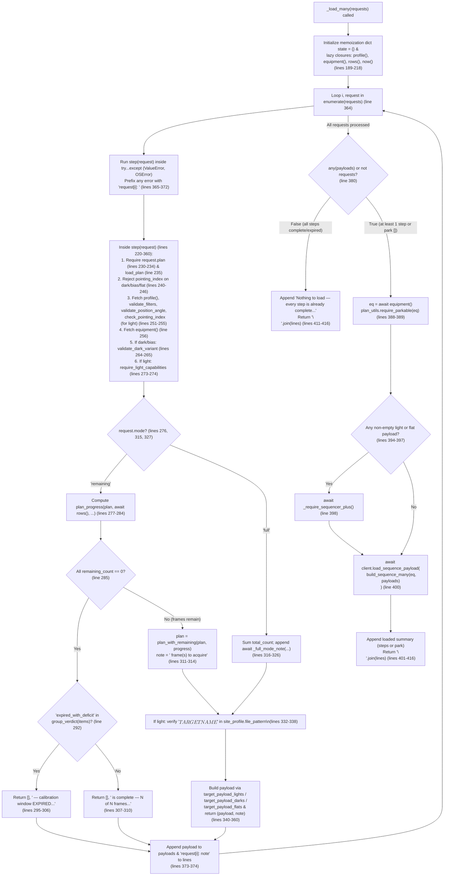

# Sequence Orchestration Tools (`nina_planner/tools/sequence.py`)

[⬆️ Up to Atlas Index](../../README.md) · [⬆️ Tools Package](./README.md) · [⬅️ Equipment Tools (`equipment.py`)](./equipment.md) · [➡️ Sky Tools (`sky.py`)](./sky.md) · [➡️ Plan Tools (`plans.py`)](./plans.md) · [➡️ Sequence Compiler (`sequence/`)](../sequence/README.md)

---

## 1. Module Overview

- **File Path:** `.opencode/local/mcps/nina_planner/nina_planner/tools/sequence.py`
- **Line Count:** 454 lines (`1-454`)
- **Module Docstring (`line 1`):** `"""Sequence MCP tools: load, start, stop and inspect N.I.N.A. sequences."""`
- **Architectural Layer:** MCP Tool Layer — Multi-Step Sequence Validation, Compilation, Loading & Execution Control
- **Purpose:** Provides four `@mcp.tool()` endpoints (`load_sequence`, `stop_sequence`, `start_sequence`, `get_sequence_state`) and three private helpers (`_full_mode_note`, `_require_sequencer_plus`, `_load_many`, plus five nested closures inside `_load_many`) that compose whole-night N.I.N.A. Advanced Sequences from declarative `SequenceRequest` items, enforce all hardware/plugin/attribution/park guardrails at load time, load the compiled JSON AST into N.I.N.A. in a single POST, start/stop sequence execution with state-polling barriers, and project sequencer state into a compact summary.
- **Core Design Invariants:**
  1. **Unified Multi-Step Composition & Empty-List Park:** `load_sequence(request=[...])` composes an entire night's steps (`light`, `dark`, `bias`, `flat`) into one N.I.N.A. sequence with a single Start area, a Target area holding each step's containers in list order, and a closing End area that always runs a bounded 3-minute "On Safe" wait, parks the mount, and warms the camera. An empty request list (`load_sequence()` or `load_sequence([])`) is the canonical **park/teardown sequence**: an empty Target area plus that closing End area.
  2. **Per-Call Memoized Context (`_load_many`):** `ObservatoryProfile`, `ObservatoryEquipment`, `ImageMetaData.csv` rows, and the UTC reference clock (`now`) are fetched lazily at most once per `load_sequence` call and shared across every `SequenceRequest` in the list (`lines 189-218`).
  3. **Indexed Error Attribution (`request[i]: ...`):** Every validation or plan-file error during step processing is prefixed with its 0-based request index (`f"request[{i}]: {e}"`, `lines 62, 372`) so the caller knows immediately which entry failed.
  4. **Late Park & Plugin Guards (`lines 380-399`):** `plan_utils.require_parkable(eq)` and `_require_sequencer_plus()` run only when at least one non-empty payload is actually going to be POSTed (or when `requests` is the empty `[]` park list). A list whose steps are all already complete in `remaining` mode returns `"Nothing to load..."` without touching N.I.N.A.'s sequencer or failing on park/plugin checks.
- **Inbound Callers:**
  - `nina_planner/server.py:19-24` (`from .tools.sequence import get_sequence_state, load_sequence, start_sequence, stop_sequence`)
  - MCP Clients invoking `load_sequence`, `start_sequence`, `stop_sequence`, or `get_sequence_state`
  - Test suites (`tests/test_server.py`, `tests/test_fake_nina.py`, `tests/test_live.py`)
- **Outbound Imports:**
  - **Stdlib (`lines 3-4`):**
    - `from datetime import UTC, datetime` (`line 3`)
    - `from typing import Any, cast` (`line 4`)
  - **Internal (`lines 6-21`):**
    - `from .. import client, config, metadata, plan_utils` (`line 6`)
    - `from ..app import mcp` (`line 7`)
    - `from ..models.observatory import ObservatoryEquipment` (`line 8`)
    - `from ..models.plan import ObservationPlan` (`line 9`)
    - `from ..models.profile import ObservatoryProfile` (`line 10`)
    - `from ..models.request import SequenceRequest` (`line 11`)
    - `from ..progress import group_verdict, plan_progress, plan_with_remaining` (`line 12`)
    - `from ..sequence import build_sequence_many, target_payload_darks, target_payload_flats, target_payload_lights, validate_dark_variant` (`lines 13-19`)
    - `from ..sequence_state import project_sequence_state` (`line 20`)
    - `from . import equipment as equipment_tools` (`line 21`)
- **Module-Level Constants:**
  - `SEQUENCER_PLUS_PLUGIN_NAMES: tuple[str, str] = ("Sequencer+", "Sequencer Plus")` (`line 123`): Case-insensitively matched display names accepted by `_require_sequencer_plus()` when inspecting N.I.N.A.'s `GET /application/plugins` list (`README.md` uses `"Sequencer+"` while the C# `.csproj` installs `"Sequencer Plus"`).

---

## 2. Function & Method Reference

### 2.1 `load_sequence` (`nina_planner/tools/sequence.py:24-63`)

#### 1. Purpose & Architectural Role
MCP tool entrypoint that validates and normalizes `request` into a `list[SequenceRequest]` and delegates to `_load_many(requests)` to build and POST a single N.I.N.A. sequence. Never starts the loaded sequence; callers must subsequently invoke `start_sequence()`.

#### 2. Signature, Decorators & Inputs
```python
@mcp.tool()
async def load_sequence(
    # The empty list is the API (it means park) and is never mutated.
    request: list[SequenceRequest] = [],  # noqa: B006
) -> str:
```
- **Decorators:** `@mcp.tool()` (`line 24`).
- **Inputs:**
  - `request: list[SequenceRequest] = []` — Ordered list of `SequenceRequest` objects (or raw `dict`s coercible via `SequenceRequest.model_validate`). Defaults to `[]` (which loads the park/teardown sequence).

#### 3. Outputs & Return Semantics
- **Returns:** `str` — Multi-line summary produced by `_load_many(requests)` reporting each `request[i]: ...` status note followed by a final summary line (`"Sequence loaded (K of N step(s)) — call start_sequence() to begin."`, `"\`park\` sequence loaded (empty request list) — call start_sequence() to begin."`, or `"Nothing to load — every step is already complete; no sequence was sent to N.I.N.A."`).

#### 4. Step-by-Step Internal Logic
1. **Lines 49–53:** Verifies `if not isinstance(request, list):`. If `request` is not a `list`, raises `ValueError(f"`request` must be a list of SequenceRequest objects (it defaults to an empty list = park), got {type(request).__name__}.")`.
2. **Lines 54–62:** Initializes `requests: list[SequenceRequest] = []` (`line 54`) and iterates `for i, item in enumerate(request):` (`line 55`):
   - If `isinstance(item, SequenceRequest)`, appends `item` directly and `continue`s (`lines 56-58`).
   - Otherwise attempts `requests.append(SequenceRequest.model_validate(item))` (`lines 59-60`); on `ValueError as e`, raises `ValueError(f"request[{i}]: not a valid SequenceRequest: {e}") from e` (`lines 61-62`).
3. **Line 63:** Awaits and returns `await _load_many(requests)`.

#### 5. Side Effects & I/O
- Delegates all HTTP and filesystem I/O to `_load_many(requests)`.
- Never mutates the default `[]` argument (`line 27`).

#### 6. Error Handling & Edge Cases
- **Non-list `request` (`lines 49-53`):** Rejects bare dicts or strings with a clear `ValueError`.
- **Invalid `SequenceRequest` item (`lines 59-62`):** Catches Pydantic `ValidationError` (a subclass of `ValueError` — e.g., extra fields rejected by `StrictModel`, missing `action`, invalid `variant` for `action` from `SequenceRequest._check_variant`, or `pointing_index < 1`) and prefixes the message with `request[{i}]: not a valid SequenceRequest: ...`.

#### 7. Complexity & Risk Notes
- $O(N)$ input validation over `len(request)`, followed by `_load_many(requests)`.

---

### 2.2 `_full_mode_note` (`nina_planner/tools/sequence.py:66-113`)

#### 1. Purpose & Architectural Role
Advisory helper called by `_load_many` when a step is loaded with `mode="full"` (`lines 324-326`). Checks whether all `light` frames for that pointing are already complete in `ImageMetaData.csv` (using the plan's `quality` thresholds); if so, returns a `" ⚠️ already complete — mode=full re-acquires all ..."` warning string explaining that `get_plan_progress` is cumulative across runs and will still read `complete: true` afterwards, so the operator must verify new captures via `audit_plans`.

#### 2. Signature, Decorators & Inputs
```python
async def _full_mode_note(
    plan: ObservationPlan,
    group: str,
    pointing_index: int,
    total: int,
    now: datetime,
) -> str:
```
- **Decorators:** None (private async helper).
- **Inputs:**
  - `plan: ObservationPlan` — The parsed observation plan for the step.
  - `group: str` — Exposure group / action name (`"light"`, `"dark"`, `"bias"`, or `"flat"`).
  - `pointing_index: int` — 1-based pointing index being loaded.
  - `total: int` — Total frames across all exposure specs in `group`.
  - `now: datetime` — Shared UTC reference timestamp for the load operation.

#### 3. Outputs & Return Semantics
- **Returns:** `str` — Either `""` (when `group != "light"`, when metadata cannot be read, or when at least one exposure spec in `progress["light"]` has `remaining_count > 0`) or the warning suffix (`lines 108-113`):
  `" ⚠️ already complete — mode=full re-acquires all {total} frames on top of what is already attributed. get_plan_progress will still read complete:true afterwards, so verify what actually landed with audit_plans and the per-date frame folders."`

#### 4. Step-by-Step Internal Logic
1. **Lines 86–87:** If `group != "light"`, returns `""` immediately (calibration frames are pool-credited across plans and would read "already complete" on nearly every plan).
2. **Lines 88–95:** Inside `try ... except Exception:`, awaits `rows = await metadata.read_metadata("light")` (`line 90`, scanning only light rows). If any exception occurs (e.g., unmounted drive, missing root, malformed CSV), returns `""` (`lines 94-95`) so a courtesy warning never aborts a `mode="full"` load.
3. **Lines 99–105:** Computes `progress = plan_progress(plan, rows, pointing_index=pointing_index, **plan_utils.quality_kwargs(plan), now=now)`.
4. **Lines 106–107:** If `any(item["remaining_count"] > 0 for item in progress[group])`, returns `""`.
5. **Lines 108–113:** Otherwise (all light groups have `remaining_count == 0`), returns the formatted `" ⚠️ already complete ..."` warning string.

#### 5. Side Effects & I/O
- Reads `ImageMetaData.csv` (filtered to `"light"`) via `metadata.read_metadata("light")` (`line 90`), which also queries `get_site_profile()` to resolve the imaging root.

#### 6. Error Handling & Edge Cases
- **Best-Effort Contract (`lines 94-95`):** Catches `Exception` broadly on `metadata.read_metadata("light")` and returns `""`. Unlike `mode="remaining"` (which *requires* `ImageMetaData.csv` to know how many frames to shoot), `mode="full"` can still load even when the imaging drive is offline.

#### 7. Complexity & Risk Notes
- $O(M)$ over light rows in `ImageMetaData.csv`.

---

### 2.3 `_require_sequencer_plus` (`nina_planner/tools/sequence.py:126-173`)

#### 1. Purpose & Architectural Role
Preflight plugin guard called by `_load_many` (`line 398`) before POSTing any sequence that includes a non-empty `light` or `flat` payload. Queries `GET /application/plugins` to verify that the **Sequencer+** (`"Sequencer+"` or `"Sequencer Plus"`) plugin is installed in N.I.N.A., because `target_payload_lights` and `sequence_safetynet` (used by both lights and flats) emit `NINA.Plugin.SequencerPlus.*` instruction/condition nodes. Without the plugin, N.I.N.A. silently deserializes those nodes into nothing and completes the sequence with zero exposures captured.

#### 2. Signature, Decorators & Inputs
```python
async def _require_sequencer_plus() -> None:
```
- **Decorators:** None (private async helper).
- **Inputs:** None (reads module constant `SEQUENCER_PLUS_PLUGIN_NAMES` at `line 123`).

#### 3. Outputs & Return Semantics
- **Returns:** `None` when the plugin is present or when `/application/plugins` cannot be read or returns a non-list shape.
- **Raises:** `ValueError` (`lines 164-173`) when `/application/plugins` returns a valid `list[str]` that does not contain `"Sequencer+"` or `"Sequencer Plus"` (case-insensitively).

#### 4. Step-by-Step Internal Logic
1. **Lines 144–148:** Attempts `plugins = await client.api_get("/application/plugins")`. If any `Exception as e` occurs, logs a warning via `client.log_payload("_require_sequencer_plus:", f"cannot read plugin list: {e}")` and returns `None` (`lines 146-148`).
2. **Lines 149–157:** Checks `if not isinstance(plugins, list) or not all(isinstance(name, str) for name in plugins):`. If the payload shape is unexpected, logs the shape via `client.log_payload` and returns `None`.
3. **Lines 158–162:** Builds `installed = {name.strip().casefold() for name in plugins}` (`line 158`). If `any(wanted in installed for wanted in map(str.casefold, SEQUENCER_PLUS_PLUGIN_NAMES))` is `True`, returns `None` (`lines 159-162`).
4. **Lines 163–173:** Formats `wanted = " or ".join(repr(name) for name in SEQUENCER_PLUS_PLUGIN_NAMES)` and raises `ValueError` explaining that `light` and `flat` sequences require Sequencer+, listing `sorted(plugins)` and suggesting installing the plugin, updating `SEQUENCER_PLUS_PLUGIN_NAMES`, or loading a `dark`/`bias` step instead.

#### 5. Side Effects & I/O
- 1 HTTP GET to `/application/plugins` (`line 145`).
- Calls `client.log_payload` on unreadable or malformed plugin lists (`lines 147, 152`).

#### 6. Error Handling & Edge Cases
- **Best-Effort Read vs. Authoritative Refusal (`lines 139-142`):** If the `/application/plugins` endpoint errors or returns non-strings, the helper logs and allows the load to proceed; if a valid `list[str]` is returned and lacks both `"sequencer+"` and `"sequencer plus"`, it raises `ValueError` deterministically.
- **`ninaAPI` Not Checked (`lines 135-137`):** Reaching `/application/plugins` already proves the Advanced API (`ninaAPI`) plugin is running.

#### 7. Complexity & Risk Notes
- $O(P)$ time and space where $P$ is the number of installed N.I.N.A. plugins.

---

### 2.4 `_load_many` (`nina_planner/tools/sequence.py:176-416`)

#### 1. Purpose & Architectural Role
Core multi-step sequence compiler, validator, and loader called by `load_sequence` (`line 63`). Validates each `SequenceRequest` in order, lazily fetches and caches `profile`, `equipment`, `rows` (`ImageMetaData.csv`), and `now` across all steps, computes remaining frames (or full-mode warnings), builds per-step target container payloads (`target_payload_lights`, `target_payload_darks`, `target_payload_flats`), enforces `require_parkable` and `_require_sequencer_plus` when a sequence will actually be sent, wraps the payloads in a full sequence AST via `build_sequence_many(eq, payloads)`, and POSTs the sequence to N.I.N.A. via `client.load_sequence_payload`.

#### 2. Signature, Decorators & Inputs
```python
async def _load_many(requests: list[SequenceRequest]) -> str:
```
- **Decorators:** None (private async orchestrator).
- **Inputs:**
  - `requests: list[SequenceRequest]` — Validated list of `SequenceRequest` instances (may be empty `[]` to load a park sequence).

#### 3. Outputs & Return Semantics
- **Returns:** `str` — Newline-joined status report:
  - One line per request: `request[{i}]: `{action}` [({variant})][ pointing {pointing_index}] — {note}` (`line 374`).
  - Blank separator line if `requests` is non-empty (`lines 376-377`).
  - Final outcome line:
    - Non-empty requests with at least one non-empty payload (`lines 402-405`): `"Sequence loaded ({K} of {N} step(s)) — call start_sequence() to begin."`
    - Empty `requests == []` (`lines 407-410`): `"\`park\` sequence loaded (empty request list) — call start_sequence() to begin."`
    - Non-empty `requests` where all steps returned `[]` payload (`lines 412-415`): `"Nothing to load — every step is already complete; no sequence was sent to N.I.N.A."`

#### 4. Step-by-Step Internal Logic



1. **Lines 189–218 (Per-Call Lazy Memoization Closures):** Initializes `state: dict[str, Any] = {}` (`line 189`) and defines four closures that populate `state` on first call:
   - `async def profile() -> ObservatoryProfile` (`lines 191-194`): Calls `await equipment_tools.get_site_profile()`.
   - `async def equipment() -> ObservatoryEquipment` (`lines 196-201`): Calls `await equipment_tools._get_site_equipment_status(await profile())`.
   - `async def rows() -> list[dict[str, Any]]` (`lines 203-212`): Calls `await metadata.read_metadata()`, wrapping `RuntimeError` or `FileNotFoundError` into `ValueError(f"Cannot compute remaining frames: {e}. Pass mode='full' to load the whole plan regardless.") from e`.
   - `async def now() -> datetime` (`lines 214-218`): Captures `datetime.now(UTC).replace(microsecond=0)` once so every step shares a single clock anchor.
2. **Lines 220–360 (Inner `async def step(request: SequenceRequest)`):**
   - **Lines 221–229:** Sets `action = request.action`, `group = action`, and `label = f"`{action}` ({request.variant})"` (or `f"`{action}`"` when `variant` is `None`).
   - **Lines 230–235:** Verifies `request.plan is not None` (raising `ValueError` if missing) and loads the plan via `plan = await plan_utils.load_plan(request.plan)` (`line 235`).
   - **Lines 240–250:** Rejects `request.pointing_index is not None` when `action != "light"` with a `ValueError` (`lines 240-246`) because calibration is plan-level. Sets `pointing_index = request.pointing_index if request.pointing_index is not None else 1` (`lines 247-249`) and `where = f" pointing {pointing_index}" if action == "light" else ""` (`line 250`).
   - **Lines 251–256:** Fetches `site_profile = await profile()`, validates filters via `await plan_utils.validate_filters(plan, site_profile)` (`line 252`), validates PA via `plan_utils.validate_position_angle(plan, site_profile)` (`line 253`), checks `plan_utils.check_pointing_index(plan, pointing_index)` if `action == "light"` (`lines 254-255`), and fetches `eq = await equipment()` (`line 256`).
   - **Lines 264–274 (Hardware Capability Gates):**
     - If `action in ("dark", "bias")`, runs `validate_dark_variant(request.variant or "wheel", eq, site_profile)` (`lines 264-265`) *before* reading `rows()` so an unsupported variant fails immediately even when remaining count is 0 or the imaging root is offline.
     - If `action == "light"`, runs `plan_utils.require_light_capabilities(site_profile)` (`lines 273-274`) to ensure plate solver, guider, and focuser are configured.
   - **Lines 276–314 (`mode == "remaining"`):**
     - Computes `progress = plan_progress(plan, await rows(), pointing_index=pointing_index, **plan_utils.quality_kwargs(plan), now=await now())` (`lines 277-283`) and extracts `items = progress[group]` (`line 284`).
     - If `all(item["remaining_count"] == 0 for item in items)` (`line 285`), sums `total = sum(item["total_count"] for item in items)` (`line 286`) and evaluates `verdicts = [group_verdict(item) for item in items]` (`line 291`).
     - If `"expired_with_deficit" in verdicts` (`line 292`), sums `expired_deficit` across expired items (`lines 295-299`) and returns `[], f"{label}{where} — calibration window EXPIRED with {expired_deficit} frame(s) short of {total} total. Nothing to load: no frame shot now could be credited. Raise the plan's calibration_window_days or write a new plan to reopen the window."` (`lines 300-306`).
     - Otherwise returns `[], f"{label}{where} is complete — {total} of {total} frames already acquired; nothing to load."` (`lines 307-310`).
     - If frames remain, sets `note = f"{sum(item['remaining_count'] for item in items)} frame(s) to acquire"` (`lines 311-313`) and rewrites the plan with remaining counts via `plan = plan_with_remaining(plan, progress)` (`line 314`).
   - **Lines 315–330 (`mode == "full"` or invalid mode):**
     - If `request.mode == "full"`, sums `total = sum(f.total_count for f in frames)` (`line 323`) and sets `note = f"{total} frame(s), mode=full" + await _full_mode_note(plan, group, pointing_index, total, await now())` (`lines 324-326`).
     - Otherwise raises `ValueError(f"Unsupported mode: {request.mode} (use 'remaining' or 'full')")` (`lines 328-330`).
   - **Lines 332–338 (`$$TARGETNAME$$` Attribution Gate):** If `action == "light"` and `"$$TARGETNAME$$" not in (site_profile.file_pattern or "")`, raises `ValueError("N.I.N.A. FilePattern must contain $$TARGETNAME$$ for light-frame plan attribution.")`.
   - **Lines 340–360 (Payload Compilation):** Dispatches to `target_payload_lights` (`lines 340-343`), `target_payload_darks(..., bias=True, variant=request.variant or "wheel")` (`lines 344-351`), `target_payload_darks(..., variant=request.variant or "wheel")` (`lines 352-355`), or `target_payload_flats(..., dusk=request.variant == "dusk")` (`lines 356-359`), returning `payload, f"{label}{where} — {note}"` (`line 360`).
3. **Lines 362–375 (Step Execution Loop):** Iterates `for i, request in enumerate(requests):`, calling `await step(request)`. Catches `(ValueError, OSError) as e` and re-raises `ValueError(f"request[{i}]: {e}") from e` (`lines 367-372`). Appends `payload` to `payloads` and `f"request[{i}]: {note}"` to `lines`.
4. **Lines 376–416 (Final Guards, Sequence Assembly & POST):**
   - Appends `""` to `lines` if `requests` is non-empty (`lines 376-377`).
   - If `any(payloads) or not requests` (`line 380`):
     - Awaits `eq = await equipment()` and enforces `plan_utils.require_parkable(eq)` (`lines 388-389`).
     - If any request with a non-empty `payload` has `request.action in ("light", "flat")` (`lines 394-397`), awaits `await _require_sequencer_plus()` (`line 398`).
     - Compiles the full sequence AST via `build_sequence_many(eq, payloads)` and POSTs it via `await client.load_sequence_payload(...)` (`line 400`).
     - Appends the loaded step count or `"park"` message to `lines` (`lines 401-410`).
   - Otherwise (`lines 411-415`, non-empty `requests` where all payloads are `[]`), appends `"Nothing to load — every step is already complete; no sequence was sent to N.I.N.A."`.
   - Returns `"\n".join(lines)` (`line 416`).

#### 5. Side Effects & I/O
- Reads plan JSON files from disk (`plan_utils.load_plan`).
- Reads `ImageMetaData.csv` from the imaging root (`metadata.read_metadata`) when any step uses `mode="remaining"` or when a `light` step uses `mode="full"`.
- Queries N.I.N.A. REST API: `/profile/show?active=true`, `/profile/horizon`, `/equipment/info` (and `/connect` if disconnected), optional `/application/plugins`, and `POST /sequence/load` (`client.load_sequence_payload`).

#### 6. Error Handling & Edge Cases
- **0-Based Request Indexing (`lines 367-372`):** Both `ValueError` and `OSError` (including `FileNotFoundError` from `load_plan`) are wrapped with `request[{i}]: ...`.
- **All-Complete List Bypass (`lines 380-415`):** When every step in `requests` resolves to `[]` (complete or expired calibration window), `any(payloads) or not requests` is `False`: `require_parkable`, `_require_sequencer_plus`, and `load_sequence_payload` are all skipped.
- **Expired Calibration Window (`lines 291-306`):** Distinguished from `"is complete"` via `progress.group_verdict(item) == "expired_with_deficit"` so the agent is never told a plan with missing calibration frames is complete just because `remaining_count == 0`.

#### 7. Complexity & Risk Notes
- Profile, equipment, and CSV metadata are fetched at most once regardless of `len(requests)` (`lines 189-218`), keeping HTTP/disk I/O $O(1)$ across multi-step sequences (except in `mode="full"` for `light` steps, where `_full_mode_note` reads light metadata per full-mode light step).

---

### 2.5 `stop_sequence` (`nina_planner/tools/sequence.py:419-423`)

#### 1. Purpose & Architectural Role
MCP tool that immediately stops the currently running N.I.N.A. sequence and waits until N.I.N.A.'s sequencer state confirms the run has stopped (`client.stop_running_sequence_and_wait()`). Leaves the telescope in its current position without parking; to park afterward, the caller loads `load_sequence()` (empty list) and calls `start_sequence()`.

#### 2. Signature, Decorators & Inputs
```python
@mcp.tool()
async def stop_sequence() -> str:
```
- **Decorators:** `@mcp.tool()` (`line 419`).
- **Inputs:** None.

#### 3. Outputs & Return Semantics
- **Returns:** `str` — Always `"Sequence stopped."` (`line 423`).

#### 4. Step-by-Step Internal Logic
1. **Line 422:** Awaits `await client.stop_running_sequence_and_wait()`, which calls `GET /sequence/stop` and polls `GET /sequence/state` every `0.5s` (up to `30.0s`) until no node has `Status == "RUNNING"` (`client.py:166-182`).
2. **Line 423:** Returns `"Sequence stopped."`.

#### 5. Side Effects & I/O
- Sends `GET /sequence/stop` and polls `GET /sequence/state` via `client.stop_running_sequence_and_wait()`.

#### 6. Error Handling & Edge Cases
- If N.I.N.A. fails to transition out of `RUNNING` within `30.0s`, `client.stop_running_sequence_and_wait()` raises `RuntimeError("Timed out waiting for sequence to stop")` (`client.py:182`).
- If `GET /sequence/stop` returns a failure envelope or N.I.N.A. is unreachable, `RuntimeError` / `httpx.HTTPError` propagates.

#### 7. Complexity & Risk Notes
- Bounded by the `30.0s` polling timeout in `client.stop_running_sequence_and_wait()`.

---

### 2.6 `start_sequence` (`nina_planner/tools/sequence.py:426-434`)

#### 1. Purpose & Architectural Role
MCP tool that starts the currently loaded N.I.N.A. sequence (`GET /sequence/start`) and blocks until N.I.N.A.'s sequencer has actually transitioned every node out of `CREATED` (`client.wait_until_sequence_started()`). This catches silent start-time validation aborts where `/sequence/start` returns HTTP 200 `{Success: true}` but the sequence immediately aborts before running a single instruction.

#### 2. Signature, Decorators & Inputs
```python
@mcp.tool()
async def start_sequence() -> str:
```
- **Decorators:** `@mcp.tool()` (`line 426`).
- **Inputs:** None.

#### 3. Outputs & Return Semantics
- **Returns:** `str` — Always `"Sequence started."` (`line 434`).

#### 4. Step-by-Step Internal Logic
1. **Line 432:** Awaits `await client.api_get(config.SEQUENCE_START_PATH)` (`GET /sequence/start`).
2. **Line 433:** Awaits `await client.wait_until_sequence_started()`, which polls `GET /sequence/state` every `0.5s` up to `SEQUENCE_START_TIMEOUT` (`15.0s`) until `_node_statuses(state)` is non-empty and `"CREATED" not in statuses` (`client.py:209-242`).
3. **Line 434:** Returns `"Sequence started."`.

#### 5. Side Effects & I/O
- Sends `GET /sequence/start` (`line 432`) and polls `GET /sequence/state` (`line 433`).

#### 6. Error Handling & Edge Cases
- **Fast-Completing Sequences (e.g., Already-Parked Teardown):** Because `wait_until_sequence_started()` checks `"CREATED" not in statuses` (`client.py:222`) rather than requiring `"RUNNING"`, a sequence that starts and finishes before the first poll leaves `FINISHED` nodes behind and succeeds immediately (`line 430`).
- **Silent Start Abort (`client.py:224-242`):** If any node remains `"CREATED"` (or the sequence is empty) after `15.0s`, `wait_until_sequence_started()` raises `RuntimeError` reporting the node status counts and instructing the caller to check `get_logs()` and `get_sequence_state()`.

#### 7. Complexity & Risk Notes
- Bounded by `SEQUENCE_START_TIMEOUT = 15.0s` (`client.py:188`).

---

### 2.7 `get_sequence_state` (`nina_planner/tools/sequence.py:437-454`)

#### 1. Purpose & Architectural Role
Read-only MCP tool that inspects the currently loaded sequence in N.I.N.A. Supports two detail modes: `"summary"` (default, which fetches both `/sequence/state` and `/sequence/json` and projects them via `project_sequence_state` into a compact per-step view with attribution, phase, exposure progress, horizon floor, fired `SendEvent` milestones, and failure issues) and `"raw"` (which returns the unfiltered `/sequence/state` tree).

#### 2. Signature, Decorators & Inputs
```python
@mcp.tool()
async def get_sequence_state(detail: str = "summary") -> Any:
```
- **Decorators:** `@mcp.tool()` (`line 437`).
- **Inputs:**
  - `detail: str = "summary"` — Output mode: must be `"summary"` or `"raw"`.

#### 3. Outputs & Return Semantics
- **Returns:** `Any`:
  - When `detail == "raw"` (`line 449`): Raw JSON payload from `GET /sequence/state`.
  - When `detail == "summary"` (`line 454`): Dictionary returned by `project_sequence_state(state, json_state)` containing `running`, `status`, `step_count`, `completed_steps`, `parse_error`, `issues`, `preflight_issues`, and `steps[]` (each with `index`, `name`, `target_name`, `plan_id`, `pointing_index`, `frame_type`, `status`, `phase`, `issues`, `exposure`, `exposure_groups`, `horizon`, `fired_events`).

#### 4. Step-by-Step Internal Logic
1. **Lines 445–446:** Validates `if detail not in ("summary", "raw"): raise ValueError('detail must be "summary" or "raw"')`.
2. **Line 447:** Fetches `state = await client.api_get(config.SEQUENCE_STATE_PATH)` (`GET /sequence/state`).
3. **Lines 448–449:** If `detail == "raw"`, returns `state` immediately without calling `/sequence/json`.
4. **Lines 450–453:** Attempts `json_state = await client.api_get(config.SEQUENCE_JSON_PATH)` (`GET /sequence/json`); if any `Exception` occurs, sets `json_state = None`.
5. **Line 454:** Calls and returns `project_sequence_state(state, json_state)`.

#### 5. Side Effects & I/O
- 1 HTTP GET to `/sequence/state` (`line 447`).
- 1 best-effort HTTP GET to `/sequence/json` when `detail == "summary"` (`line 451`).

#### 6. Error Handling & Edge Cases
- **Invalid `detail` Argument (`lines 445-446`):** Raises `ValueError('detail must be "summary" or "raw"')` before making any HTTP request.
- **Best-Effort `/sequence/json` (`lines 450-453`):** If `/sequence/json` fails, `json_state` falls back to `None` and `project_sequence_state` still projects `state` (with each step's `horizon` field degrading to `None`).

#### 7. Complexity & Risk Notes
- $O(V)$ time and space where $V$ is the number of AST nodes in the loaded N.I.N.A. sequence.
