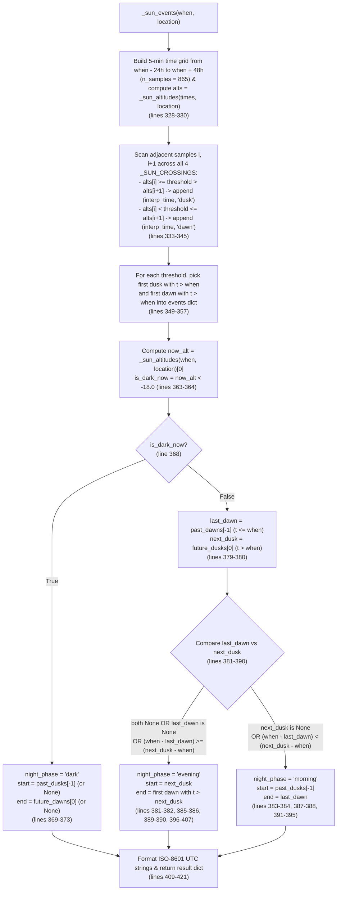
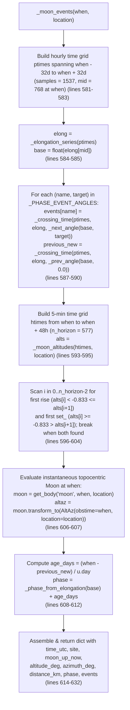
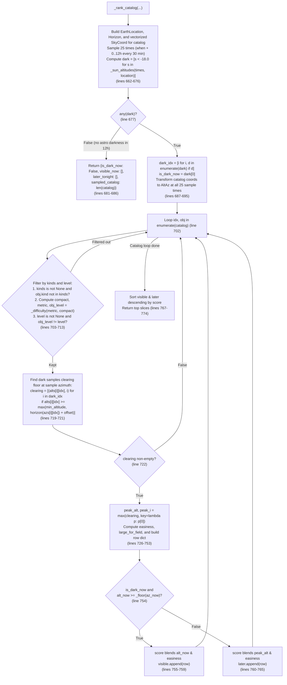

# Sky, Ephemeris & Target Ranking Tools (`nina_planner/tools/sky.py`)

[⬆️ Up to Atlas Index](../../README.md) · [⬆️ Tools Package](./README.md) · [⬅️ Equipment Tools (`equipment.py`)](./equipment.md) · [➡️ Sequence Tools (`sequence.py`)](./sequence.md) · [➡️ Plan Tools (`plans.py`)](./plans.md) · [⬅️ DSO Catalog (`dso_catalog.py`)](../core/dso_catalog.md) · [⬅️ Horizon (`horizon.py`)](../core/horizon.md)

---

## 1. Module Overview

- **File Path:** `.opencode/local/mcps/nina_planner/nina_planner/tools/sky.py`
- **Line Count:** 862 lines (`1-862`)
- **Module Docstring (`line 1`):** `"""Sky MCP tools: target coordinates, altitudes, rise/set times and the moon."""`
- **Architectural Layer:** MCP Tool Layer & Astropy Ephemeris / Target-Ranking Engine
- **Purpose:** Provides five `@mcp.tool()` endpoints (`resolve_target`, `target_altitudes`, `best_targets`, `sun_times`, `moon_times`) and 23 private ephemeris, coordinate-resolution, surface-brightness, and catalog-ranking helpers. All ephemeris and catalog computations (`best_targets`, `sun_times`, `moon_times`, and `target_altitudes` when coordinates are passed) run **completely offline** using `astropy`'s built-in ephemerides and the pre-verified `dso_catalog.CATALOG`, offloading CPU-bound coordinate transforms to worker threads via `anyio.to_thread.run_sync`. Network access (`httpx` / `SkyCoord.from_name`) is used exclusively when resolving an out-of-catalog target name via `resolve_target` or coordinate-less `target_altitudes` entries.
- **Inbound Callers:**
  - `nina_planner/server.py:25-31` (`from .tools.sky import best_targets, moon_times, resolve_target, sun_times, target_altitudes`)
  - Test suites: `tests/test_sky.py` (unit tests for all 28 functions and edge cases), `tests/test_mcp_entrypoint.py` (MCP registration verification), `tests/test_server.py`
- **Outbound Imports:**
  - **Top-Level Stdlib (`lines 3-6`):**
    - `import math` (`line 3`)
    - `import re` (`line 4`)
    - `from datetime import datetime, timezone` (`line 5`)
    - `from typing import Any` (`line 6`)
  - **Top-Level Third-Party (`lines 8-20`):**
    - `import anyio` (`line 8`)
    - `import httpx` (`line 9`)
    - `import numpy as np` (`line 10`)
    - `from astropy import units as u` (`line 11`)
    - `from astropy.coordinates import AltAz, EarthLocation, GeocentricTrueEcliptic, SkyCoord, get_body, get_sun` (`lines 12-19`)
    - `from astropy.time import Time` (`line 20`)
  - **Top-Level Internal (`lines 22-25`):**
    - `from .. import dso_catalog` (`line 22`)
    - `from ..app import mcp` (`line 23`)
    - `from ..horizon import Horizon` (`line 24`)
    - `from . import equipment as equipment_tools` (`line 25`)

### Module-Level Constants & Regexes

| Constant | Line(s) | Type & Value | Purpose |
|---|---|---|---|
| `_SIMBAD_MIRRORS` | `34-37` | `tuple[str, ...] = ("https://simbad.cfa.harvard.edu", "https://simbad.idia.ac.za")` | Live SIMBAD web mirrors queried in order (CfA Harvard first, IDIA South Africa second) before falling back to Astropy's SESAME resolver. |
| `_SIMBAD_TIMEOUT_S` | `38` | `float = 10.0` | Per-mirror HTTP GET timeout in seconds for `_fetch_simbad`. |
| `_COORD_RE` | `45-51` | `re.Pattern[str]` (`^Coordinates\(ICRS,ep=J2000[^)]*\):\s*(\d{1,2}(?:\s+\d{1,2})+(?:\.\d+)?)\s+([+-]\d{1,2}(?:\s+\d{1,2})+(?:\.\d+)?)`, `re.MULTILINE`) | Extracts sexagesimal ICRS J2000 RA (hours) and Dec (signed degrees) from SIMBAD's ASCII `sim-id` response page. |
| `_LEVEL_THRESHOLDS` | `210-213` | `dict[str, tuple[float, float]] = {"extended": (14.8, 15.8), "compact": (11.0, 12.0)}` | `(easy, hard)` thresholds classifying objects into `"beginner"`, `"intermediate"`, or `"advanced"`. Extended objects use mean surface brightness ($\text{mag/arcmin}^2$); compact objects use integrated magnitude. |
| `_SCORE_RANGE` | `216-219` | `dict[str, tuple[float, float]] = {"extended": (10.5, 17.5), "compact": (6.5, 13.5)}` | `(floor_, ceiling)` metric bounds linearly mapped onto the `[0.0, 1.0]` easiness factor by `_easiness`. |
| `_COMPACT_ARCMIN` | `221` | `float = 5.0` | Major-axis cutoff in arcminutes below which an object is treated as compact (`major_arcmin < 5.0`). |
| `_DARKNESS_SUN_ALT` | `265` | `float = -18.0` | Geometric solar altitude threshold (degrees) defining astronomical darkness across both `_sun_events` and `_rank_catalog`. |
| `_SUN_CROSSINGS` | `266-271` | `tuple[tuple[float, str, str], ...]` | 4-tuple of `(threshold_deg, down_name, up_name)`: `(-0.833, "sunset", "sunrise")`, `(-6.0, "civil_dusk", "civil_dawn")`, `(-12.0, "nautical_dusk", "nautical_dawn")`, `(-18.0, "astronomical_dusk", "astronomical_dawn")`. |
| `_SUN_BACKFILL_H` | `276` | `float = 24.0` | Hours sampled before `when` in `_sun_events` so an already-open or just-ended darkness window can locate its opening dusk. |
| `_SUN_FORWARD_H` | `277` | `float = 48.0` | Hours sampled after `when` in `_sun_events` to find the next crossing of each solar threshold and the closing dawn of an upcoming night. |
| `_SUN_STEP_MIN` | `278` | `int = 5` | Sampling step in minutes (`5 min`) for solar altitude series in `_sun_events` (865 samples over 72 hours). |
| `_MOON_HORIZON_ALT` | `438` | `float = -0.833` | Topocentric geometric lunar center altitude threshold (degrees) for moonrise/moonset and `moon_up_now` (`-(refraction + semidiameter)`). |
| `_MOON_FORWARD_H` | `444` | `float = 48.0` | Forward lookahead window in hours for moonrise/moonset detection in `_moon_events`. |
| `_MOON_STEP_MIN` | `445` | `int = 5` | Sampling step in minutes (`5 min`) for topocentric lunar altitude series in `_moon_events` (577 samples over 48 hours). |
| `_PHASE_BACK_D` | `453` | `float = 32.0` | Days sampled before `when` in `_moon_events` to guarantee bracketing the previous new moon (`age_days`). |
| `_PHASE_FORWARD_D` | `454` | `float = 32.0` | Days sampled after `when` in `_moon_events` to guarantee bracketing the next occurrence of all four principal lunar phases (synodic month $\approx 29.53\text{ d}$). |
| `_PHASE_STEP_H` | `455` | `float = 1.0` | Sampling step in hours (`1.0 h`) for the geocentric Moon–Sun ecliptic elongation series (1,537 samples over 64 days). |
| `_PHASE_EVENT_ANGLES` | `460-465` | `tuple[tuple[str, float], ...]` | Principal lunar phase angles of Moon-minus-Sun ecliptic longitude: `("new_moon", 0.0)`, `("first_quarter", 90.0)`, `("full_moon", 180.0)`, `("last_quarter", 270.0)`. |
| `_PHASE_NEW_MAX` | `474` | `float = 0.03` | Maximum illumination fraction (`< 0.03`) classified as `"new"` in `_phase_from_elongation`. |
| `_PHASE_FULL_MIN` | `475` | `float = 0.97` | Minimum illumination fraction (`> 0.97`) classified as `"full"` in `_phase_from_elongation`. |
| `_PHASE_QUARTER_BAND` | `476` | `float = 0.03` | Half-width (`abs(illumination - 0.5) <= 0.03`) around 50% illumination classified as `"first_quarter"` or `"last_quarter"`. |

---

## 2. Function & Method Reference

### 2.1 `_fetch_simbad` (`nina_planner/tools/sky.py:54-63`)

#### 1. Purpose & Architectural Role
Fetches the raw ASCII `sim-id` lookup page for an astronomical object identifier `name` from a single SIMBAD mirror base URL (`base`). Called by `_resolve_via_simbad_web` (`line 77`).

#### 2. Signature, Decorators & Inputs
```python
def _fetch_simbad(base: str, name: str) -> str:
```
- **Decorators:** None (private synchronous helper).
- **Inputs:**
  - `base: str` — Base mirror URL without trailing slash (e.g., `"https://simbad.cfa.harvard.edu"`).
  - `name: str` — Catalog or common object identifier (e.g., `"NGC 225"`).

#### 3. Outputs & Return Semantics
- **Returns:** `str` — Raw HTTP response text (`resp.text`) from `{base}/simbad/sim-id?Ident={name}&output.format=ASCII`.

#### 4. Step-by-Step Internal Logic
1. **Lines 56–61:** Issues a synchronous HTTP GET via `httpx.get(f"{base}/simbad/sim-id", params={"Ident": name, "output.format": "ASCII"}, timeout=_SIMBAD_TIMEOUT_S, follow_redirects=True)`.
2. **Line 62:** Calls `resp.raise_for_status()` to raise `httpx.HTTPStatusError` on 4xx/5xx responses.
3. **Line 63:** Returns `resp.text`.

#### 5. Side Effects & I/O
- External HTTPS GET request to `{base}/simbad/sim-id` with a 10.0-second timeout (`_SIMBAD_TIMEOUT_S`).

#### 6. Error Handling & Edge Cases
- Raises `httpx.HTTPError` (including `httpx.TimeoutException`, `httpx.ConnectError`, `httpx.HTTPStatusError`) on network or HTTP status failures; caught by `_resolve_via_simbad_web` (`line 78`).
- Note that SIMBAD returns HTTP 200 with a `!!` error text body when an identifier is unknown; `_fetch_simbad` returns that text and `_resolve_via_simbad_web` detects the missing coordinate line via `_COORD_RE`.

#### 7. Complexity & Risk Notes
- **Time Complexity:** Bounded by network latency up to `_SIMBAD_TIMEOUT_S` (`10.0 s`).

---

### 2.2 `_resolve_via_simbad_web` (`nina_planner/tools/sky.py:66-86`)

#### 1. Purpose & Architectural Role
Iterates through `_SIMBAD_MIRRORS` (CfA Harvard, then IDIA) to resolve `name` into an Astropy `SkyCoord` in the ICRS frame by parsing SIMBAD's ASCII output with `_COORD_RE`. Acts as the primary resolution layer in `_resolve_name` (`line 97`).

#### 2. Signature, Decorators & Inputs
```python
def _resolve_via_simbad_web(name: str) -> SkyCoord:
```
- **Decorators:** None (private synchronous helper).
- **Inputs:**
  - `name: str` — Astronomical object identifier to resolve.

#### 3. Outputs & Return Semantics
- **Returns:** `SkyCoord` — ICRS coordinate constructed from sexagesimal `(hourangle, deg)` strings matched by `_COORD_RE`.

#### 4. Step-by-Step Internal Logic
1. **Line 74:** Initializes `errors: list[str] = []`.
2. **Lines 75–85:** Loops over `base` in `_SIMBAD_MIRRORS`:
   - **Lines 76–80:** Calls `_fetch_simbad(base, name)` and searches the returned text with `_COORD_RE.search(...)`. If `_fetch_simbad` raises any `Exception as e`, appends `f"{base}: {e}"` to `errors` and `continue`s to the next mirror.
   - **Lines 81–83:** If `match is None` (e.g., HTTP 200 page for an unknown object with no `Coordinates(ICRS,ep=J2000...)` line), appends `f"{base}: no ICRS coordinates for {name!r}"` to `errors` and `continue`s.
   - **Lines 84–85:** Extracts `ra, dec = match.group(1), match.group(2)` and immediately returns `SkyCoord(ra, dec, unit=("hourangle", "deg"), frame="icrs")`.
3. **Line 86:** If all mirrors fail, raises `ValueError("; ".join(errors))`.

#### 5. Side Effects & I/O
- Calls `_fetch_simbad` for up to `len(_SIMBAD_MIRRORS)` (`2`) mirrors; stops on the first successful coordinate parse.

#### 6. Error Handling & Edge Cases
- Aggregates per-mirror failure reasons into a single semicolon-delimited `ValueError` so callers see why each mirror failed.

#### 7. Complexity & Risk Notes
- Worst-case network blocking time is `len(_SIMBAD_MIRRORS) * _SIMBAD_TIMEOUT_S = 20.0 s` if both mirrors time out.

---

### 2.3 `_resolve_via_sesame` (`nina_planner/tools/sky.py:89-91`)

#### 1. Purpose & Architectural Role
Thin wrapper around Astropy's built-in SESAME name resolver (`SkyCoord.from_name(name)`), which queries CDS Strasbourg and Harvard's SESAME service. Used by `_resolve_name` (`line 100`) as a fallback when both SIMBAD web mirrors fail.

#### 2. Signature, Decorators & Inputs
```python
def _resolve_via_sesame(name: str) -> SkyCoord:
```
- **Decorators:** None (private synchronous helper).
- **Inputs:**
  - `name: str` — Astronomical object identifier.

#### 3. Outputs & Return Semantics
- **Returns:** `SkyCoord` — Resolved coordinate returned by `SkyCoord.from_name(name)`.

#### 4. Step-by-Step Internal Logic
1. **Line 91:** Calls and returns `SkyCoord.from_name(name)`.

#### 5. Side Effects & I/O
- External HTTP requests issued internally by `astropy.coordinates.name_resolve.get_icrs_coordinates` to SESAME mirrors.

#### 6. Error Handling & Edge Cases
- Propagates `astropy.coordinates.name_resolve.NameResolveError` or network exceptions to `_resolve_name`.

#### 7. Complexity & Risk Notes
- Relies on Astropy's internal SESAME timeout and mirror list.

---

### 2.4 `_resolve_name` (`nina_planner/tools/sky.py:94-104`)

#### 1. Purpose & Architectural Role
Two-tier synchronous name-resolution orchestrator: attempts `_resolve_via_simbad_web(name)` first and falls back to `_resolve_via_sesame(name)` only if the web mirrors fail. Called by `resolve_target` (`line 111`) and `_altitudes` (`line 146`).

#### 2. Signature, Decorators & Inputs
```python
def _resolve_name(name: str) -> SkyCoord:
```
- **Decorators:** None (private synchronous helper).
- **Inputs:**
  - `name: str` — Astronomical object identifier.

#### 3. Outputs & Return Semantics
- **Returns:** `SkyCoord` — Resolved ICRS coordinate from either SIMBAD web mirrors or SESAME.

#### 4. Step-by-Step Internal Logic
1. **Lines 96–97:** Tries returning `_resolve_via_simbad_web(name)`.
2. **Lines 98–100:** On `Exception as web_error`, tries returning `_resolve_via_sesame(name)`.
3. **Lines 101–104:** On `Exception as sesame_error`, raises `ValueError(f"SIMBAD mirrors failed ({web_error}); SESAME failed ({sesame_error})") from sesame_error`.

#### 5. Side Effects & I/O
- Delegates network I/O to `_resolve_via_simbad_web` and (on failure) `_resolve_via_sesame`.

#### 6. Error Handling & Edge Cases
- Preserves both failure messages (`web_error` and `sesame_error`) in the combined `ValueError` and chains `from sesame_error`.

#### 7. Complexity & Risk Notes
- Never contacts SESAME when the primary SIMBAD web mirror succeeds (`test_sky.py:127-130`).

---

### 2.5 `resolve_target` (`nina_planner/tools/sky.py:107-118`)

#### 1. Purpose & Architectural Role
Public `@mcp.tool()` endpoint that resolves an out-of-catalog deep-sky object name (e.g., a named target from `PLAN.md` not in `dso_catalog.csv`) into J2000 `ra_hours` and `dec_deg` rounded to 6 decimal places. Offloads `_resolve_name` to a worker thread via `anyio.to_thread.run_sync`.

#### 2. Signature, Decorators & Inputs
```python
@mcp.tool()
async def resolve_target(name: str) -> dict[str, Any]:
```
- **Decorators:** `@mcp.tool()` (`line 107`).
- **Inputs:**
  - `name: str` — Deep-sky object name to resolve (e.g., `"M31"`, `"NGC 6960"`).

#### 3. Outputs & Return Semantics
- **Returns:** `dict[str, Any]` with keys:
  - `"name": str` — The input `name` string verbatim.
  - `"ra_hours": float` — Right Ascension in decimal hours (`0.0 <= ra_hours < 24.0`), rounded to 6 decimal places (`~0.054 arcsec` precision).
  - `"dec_deg": float` — Declination in decimal degrees (`-90.0 <= dec_deg <= 90.0`), rounded to 6 decimal places (`~0.0036 arcsec` precision).

#### 4. Step-by-Step Internal Logic
1. **Lines 110–113:** Runs `coord = await anyio.to_thread.run_sync(_resolve_name, name)`. If any `Exception as e` is raised, wraps and raises `ValueError(f"could not resolve target {name!r}: {e}") from e`.
2. **Lines 114–118:** Returns `{"name": name, "ra_hours": round(float(coord.ra.hour), 6), "dec_deg": round(float(coord.dec.deg), 6)}`.

#### 5. Side Effects & I/O
- Runs synchronous HTTP network resolution in a worker thread; read-only with respect to N.I.N.A. and local files.

#### 6. Error Handling & Edge Cases
- Total resolution failure across both SIMBAD mirrors and SESAME raises a descriptive `ValueError`. The tool docstring instructs the agent never to guess coordinates if `resolve_target` fails, and never to call `resolve_target` for objects already in `best_targets` / `dso_catalog.csv`.

#### 7. Complexity & Risk Notes
- Non-blocking on the async event loop thanks to `anyio.to_thread.run_sync`.

---

### 2.6 `_altitudes` (`nina_planner/tools/sky.py:121-169`)

#### 1. Purpose & Architectural Role
Pure synchronous helper that computes topocentric altitude, azimuth, custom-horizon skyline height, horizon clearance, and floor-clearance boolean (`above_floor`) for a list of target dictionaries at a given site and `astropy.time.Time`, returning rows sorted highest-altitude first. Called by `target_altitudes` (`line 184`).

#### 2. Signature, Decorators & Inputs
```python
def _altitudes(
    targets: list[dict[str, Any]],
    lat_deg: float,
    lon_deg: float,
    elevation_m: float,
    when: Time,
    horizon: Horizon | None = None,
    min_altitude: float = 0.0,
    horizon_offset_degrees: float = 2.0,
) -> list[dict[str, Any]]:
```
- **Decorators:** None (private synchronous helper).
- **Inputs:**
  - `targets: list[dict[str, Any]]` — List of target specs, each containing `"name"` and optionally `"ra_hours"` and `"dec_deg"`.
  - `lat_deg: float`, `lon_deg: float`, `elevation_m: float` — Site geodetic coordinates and elevation.
  - `when: Time` — Observation instant (`astropy.time.Time`).
  - `horizon: Horizon | None = None` — Site custom horizon profile; defaults to flat `0.0°` `Horizon()` (`line 135`).
  - `min_altitude: float = 0.0` — Minimum altitude constraint in degrees.
  - `horizon_offset_degrees: float = 2.0` — Offset added to `horizon.altitude_at(az)` when computing the effective floor.

#### 3. Outputs & Return Semantics
- **Returns:** `list[dict[str, Any]]` — Target altitude rows sorted descending by `"alt_deg"` (`key=lambda r: -r["alt_deg"]`). Each row contains:
  - `"name": str`
  - `"alt_deg": float` (rounded to 1 decimal place)
  - `"az_deg": float` (rounded to 1 decimal place)
  - `"horizon_deg": float` (custom horizon altitude at `az`, rounded to 1 decimal place)
  - `"clearance_deg": float` (`round(alt - horizon_deg, 1)`)
  - `"above_floor": bool` (`alt >= max(min_altitude, horizon_deg + horizon_offset_degrees)`)

#### 4. Step-by-Step Internal Logic
1. **Lines 131–135:** Constructs `location = EarthLocation(lat=lat_deg * u.deg, lon=lon_deg * u.deg, height=elevation_m * u.m)`, `frame = AltAz(obstime=when, location=location)`, and defaults `horizon = horizon or Horizon()`.
2. **Lines 136–168:** Initializes `results = []` and iterates over each `target` in `targets`:
   - **Line 138:** Extracts `name = str(target.get("name", ""))`.
   - **Lines 139–143:** If both `target.get("ra_hours") is not None` and `target.get("dec_deg") is not None`, builds `coord = SkyCoord(float(target["ra_hours"]) * u.hourangle, float(target["dec_deg"]) * u.deg)` offline.
   - **Lines 144–151:** Otherwise calls `coord = _resolve_name(name)`; on `Exception as e`, raises `ValueError(f"target {name!r} has no ra_hours/dec_deg and could not be resolved: {e}") from e`.
   - **Lines 152–154:** Transforms `altaz = coord.transform_to(frame)` and extracts `alt = float(altaz.alt.deg)` and `az = float(altaz.az.deg)`.
   - **Lines 157–158:** Computes `horizon_deg = horizon.altitude_at(az)` and `floor = max(min_altitude, horizon_deg + horizon_offset_degrees)`.
   - **Lines 159–168:** Appends the rounded dictionary (noting `above_floor` is evaluated against unrounded `alt >= floor`).
3. **Line 169:** Returns `sorted(results, key=lambda r: -r["alt_deg"])`.

#### 5. Side Effects & I/O
- Pure computation when `ra_hours` and `dec_deg` are provided on all targets; makes network SIMBAD/SESAME calls via `_resolve_name` only for targets missing coordinates.

#### 6. Error Handling & Edge Cases
- Raises `ValueError` if a target lacks `"ra_hours"` or `"dec_deg"` and `_resolve_name(name)` fails.
- `above_floor` matches the exact conjunction of N.I.N.A.'s `LoopWhileAboveHorizon` (`alt >= horizon(az) + offset`) and `LoopWhileAltitudeAbove` (`alt >= min_altitude`) conditions.

#### 7. Complexity & Risk Notes
- **Time Complexity:** $O(T)$ coordinate transforms where $T = \text{len}(targets)$, plus network latency for any coordinate-less targets.

---

### 2.7 `target_altitudes` (`nina_planner/tools/sky.py:172-200`)

#### 1. Purpose & Architectural Role
Public `@mcp.tool()` endpoint that computes topocentric altitudes, azimuths, custom-horizon clearances, and `above_floor` status for a caller-supplied list of targets at `now + hours_ahead` at the active N.I.N.A. profile's site.

#### 2. Signature, Decorators & Inputs
```python
@mcp.tool()
async def target_altitudes(
    targets: list[dict[str, Any]],
    hours_ahead: float = 0.0,
    min_altitude: float = 0.0,
    horizon_offset_degrees: float = 2.0,
) -> dict[str, Any]:
```
- **Decorators:** `@mcp.tool()` (`line 172`).
- **Inputs:**
  - `targets: list[dict[str, Any]]` — List of `{"name": str, "ra_hours"?: float, "dec_deg"?: float}` dicts.
  - `hours_ahead: float = 0.0` — Offset in hours from current UTC time (`0.0` = now).
  - `min_altitude: float = 0.0` — Minimum altitude floor in degrees.
  - `horizon_offset_degrees: float = 2.0` — Buffer in degrees above the profile's custom horizon.

#### 3. Outputs & Return Semantics
- **Returns:** `dict[str, Any]` with keys:
  - `"time_utc": str` — Evaluated UTC instant in ISO-8601 `isot` format (`when.utc.isot`).
  - `"min_altitude": float`
  - `"horizon_offset_degrees": float`
  - `"custom_horizon": bool` — `profile.horizon.is_custom` (`True` when the active profile has a custom skyline).
  - `"targets": list[dict[str, Any]]` — Altitude rows returned by `_altitudes`.

#### 4. Step-by-Step Internal Logic
1. **Lines 180–181:** Fetches the active profile via `profile = await equipment_tools.get_site_profile()` and extracts `site = profile.site`.
2. **Line 182:** Computes `when = Time(datetime.now(timezone.utc)) + hours_ahead * u.hour`.
3. **Lines 183–193:** Offloads `_altitudes(targets, site.latitude_deg, site.longitude_deg, site.elevation_m, when, profile.horizon, min_altitude, horizon_offset_degrees)` to a worker thread via `await anyio.to_thread.run_sync(...)`.
4. **Lines 194–200:** Returns the response dictionary wrapping `rows` with metadata.

#### 5. Side Effects & I/O
- Queries N.I.N.A.'s `/profile/show?active=true` and `/profile/horizon` via `equipment_tools.get_site_profile()`.

#### 6. Error Handling & Edge Cases
- Propagates `RuntimeError` if N.I.N.A. API is unreachable when fetching the site profile, or `ValueError` from `_altitudes` if an uncoordinated target cannot be resolved.

#### 7. Complexity & Risk Notes
- Read-only; runs Astropy transforms on a background thread.

---

### 2.8 `_surface_brightness` (`nina_planner/tools/sky.py:224-237`)

#### 1. Purpose & Architectural Role
Computes the mean elliptical surface brightness $\mu$ in $\text{mag/arcmin}^2$ of a deep-sky object from its integrated magnitude and major/minor axes in arcminutes:
$$\text{area} = \frac{\pi}{4} \cdot a \cdot b, \quad \mu = m + 2.5 \log_{10}(\text{area})$$
Used by `_rank_catalog` (`lines 709, 744`) so diffuse extended objects (like M33) are ranked realistically against concentrated objects (like M57).

#### 2. Signature, Decorators & Inputs
```python
def _surface_brightness(mag: float, major_arcmin: float, minor_arcmin: float) -> float:
```
- **Decorators:** None (private synchronous helper).
- **Inputs:**
  - `mag: float` — Integrated visual magnitude $m$.
  - `major_arcmin: float` — Major axis $a$ in arcminutes.
  - `minor_arcmin: float` — Minor axis $b$ in arcminutes (`<= 0` means circular, i.e., $b = a$).

#### 3. Outputs & Return Semantics
- **Returns:** `float` — Mean surface brightness in $\text{mag/arcmin}^2$ (lower values indicate brighter surfaces), or `mag` unchanged if `area <= 0`.

#### 4. Step-by-Step Internal Logic
1. **Line 233:** Sets `minor = minor_arcmin if minor_arcmin > 0 else major_arcmin`.
2. **Line 234:** Computes `area = math.pi / 4.0 * major_arcmin * minor`.
3. **Lines 235–236:** If `area <= 0`, returns `mag` directly (guard against zero/negative dimensions).
4. **Line 237:** Returns `mag + 2.5 * math.log10(area)`.

#### 5. Side Effects & I/O
- Pure mathematical function; no I/O.

#### 6. Error Handling & Edge Cases
- **Missing Minor Axis (`minor_arcmin <= 0`):** Treated as circular (`minor = major_arcmin`).
- **Point-Like / Zero Size (`major_arcmin <= 0`):** `area <= 0` guard prevents `ValueError: math domain error` in `math.log10` and returns `mag`.

#### 7. Complexity & Risk Notes
- $O(1)$ time and space.

---

### 2.9 `_is_compact` (`nina_planner/tools/sky.py:240-241`)

#### 1. Purpose & Architectural Role
Determines whether a catalog object is "compact" (`major_arcmin < _COMPACT_ARCMIN`, i.e., `< 5.0` arcmin, such as planetary nebulae and compact globular clusters) so `_rank_catalog` buckets it by integrated magnitude rather than surface brightness.

#### 2. Signature, Decorators & Inputs
```python
def _is_compact(major_arcmin: float) -> bool:
```
- **Decorators:** None (private synchronous helper).
- **Inputs:**
  - `major_arcmin: float` — Object major axis in arcminutes.

#### 3. Outputs & Return Semantics
- **Returns:** `bool` — `True` if `major_arcmin < 5.0`, else `False`.

#### 4. Step-by-Step Internal Logic
1. **Line 241:** Returns `major_arcmin < _COMPACT_ARCMIN`.

#### 5. Side Effects & I/O
- Pure function.

#### 6. Error Handling & Edge Cases
- Boundary at `major_arcmin == 5.0` returns `False` (treated as extended).

#### 7. Complexity & Risk Notes
- $O(1)$.

---

### 2.10 `_difficulty` (`nina_planner/tools/sky.py:244-251`)

#### 1. Purpose & Architectural Role
Classifies an object's difficulty metric (integrated magnitude if `compact=True`, surface brightness if `compact=False`) into one of three EAA difficulty levels: `"beginner"`, `"intermediate"`, or `"advanced"`. Called by `_rank_catalog` (`line 711`).

#### 2. Signature, Decorators & Inputs
```python
def _difficulty(metric: float, compact: bool) -> str:
```
- **Decorators:** None (private synchronous helper).
- **Inputs:**
  - `metric: float` — Integrated magnitude (when `compact=True`) or surface brightness in $\text{mag/arcmin}^2$ (when `compact=False`).
  - `compact: bool` — Selects `"compact"` `(11.0, 12.0)` vs. `"extended"` `(14.8, 15.8)` thresholds from `_LEVEL_THRESHOLDS`.

#### 3. Outputs & Return Semantics
- **Returns:** `str` — `"beginner"`, `"intermediate"`, or `"advanced"`.

#### 4. Step-by-Step Internal Logic
1. **Line 246:** Looks up `easy, hard = _LEVEL_THRESHOLDS["compact" if compact else "extended"]`.
2. **Lines 247–248:** If `metric < easy`, returns `"beginner"`.
3. **Lines 249–250:** If `metric < hard`, returns `"intermediate"`.
4. **Line 251:** Otherwise returns `"advanced"`.

#### 5. Side Effects & I/O
- Pure function.

#### 6. Error Handling & Edge Cases
- Exact threshold equality (`metric == easy` or `metric == hard`) falls into the harder bucket (`"intermediate"` and `"advanced"` respectively).

#### 7. Complexity & Risk Notes
- $O(1)$.

---

### 2.11 `_easiness` (`nina_planner/tools/sky.py:254-257`)

#### 1. Purpose & Architectural Role
Normalizes an object's difficulty metric onto a clamped `[0.0, 1.0]` easiness score (`1.0` = brightest/easiest, `0.0` = faintest/hardest) using `_SCORE_RANGE`. Blended 50/50 with normalized altitude in `_rank_catalog` (`lines 755-765`).

#### 2. Signature, Decorators & Inputs
```python
def _easiness(metric: float, compact: bool) -> float:
```
- **Decorators:** None (private synchronous helper).
- **Inputs:**
  - `metric: float` — Integrated magnitude (if `compact`) or surface brightness (if extended).
  - `compact: bool` — Selects `"compact"` `(6.5, 13.5)` or `"extended"` `(10.5, 17.5)` from `_SCORE_RANGE`.

#### 3. Outputs & Return Semantics
- **Returns:** `float` in `[0.0, 1.0]`.

#### 4. Step-by-Step Internal Logic
1. **Line 256:** Unpacks `floor_, ceiling = _SCORE_RANGE["compact" if compact else "extended"]`.
2. **Line 257:** Computes `(ceiling - metric) / (ceiling - floor_)` and clamps it via `max(0.0, min(1.0, ...))`.

#### 5. Side Effects & I/O
- Pure function.

#### 6. Error Handling & Edge Cases
- Objects brighter than `floor_` clamp to `1.0`; objects fainter than `ceiling` clamp to `0.0`.

#### 7. Complexity & Risk Notes
- $O(1)$.

---

### 2.12 `_body_altitudes` (`nina_planner/tools/sky.py:281-291`)

#### 1. Purpose & Architectural Role
Computes the geometric (unrefracted) topocentric altitude in degrees of an `astropy.coordinates.SkyCoord` (`body`) at one or more `Time` instants (`times`) for an `EarthLocation` (`location`), always returning a Python `list[float]`. Shared by `_sun_altitudes` (`line 296`) and `_moon_altitudes` (`line 480`).

#### 2. Signature, Decorators & Inputs
```python
def _body_altitudes(
    body: SkyCoord, times: Time, location: EarthLocation
) -> list[float]:
```
- **Decorators:** None (private synchronous helper).
- **Inputs:**
  - `body: SkyCoord` — Solar system body coordinates at `times`.
  - `times: Time` — Scalar or vector `astropy.time.Time`.
  - `location: EarthLocation` — Observer's site location.

#### 3. Outputs & Return Semantics
- **Returns:** `list[float]` — Geometric altitudes in degrees corresponding to each sample in `times`.

#### 4. Step-by-Step Internal Logic
1. **Line 290:** Transforms `body` into `AltAz(obstime=times, location=location)` (default pressure = 0, so Astropy applies no atmospheric refraction).
2. **Line 291:** Wraps `altaz.alt.deg` in `np.atleast_1d(...)` so scalar `Time` inputs still iterate cleanly, and returns `[float(a) for a in np.atleast_1d(altaz.alt.deg)]`.

#### 5. Side Effects & I/O
- Pure offline Astropy coordinate transformation.

#### 6. Error Handling & Edge Cases
- Works identically whether `times` is a scalar `Time` (e.g., `_sun_altitudes(when, location)[0]` at `line 363`) or a 1D vector `Time`.

#### 7. Complexity & Risk Notes
- Vectorized over `times` in NumPy/ERFA; $O(N)$ where $N = \text{len}(times)$.

---

### 2.13 `_sun_altitudes` (`nina_planner/tools/sky.py:294-296`)

#### 1. Purpose & Architectural Role
Computes geometric solar altitudes in degrees at `times` for `location` using `astropy.coordinates.get_sun`. Called by `_sun_events` (`lines 330, 363`) and `_rank_catalog` (`line 676`).

#### 2. Signature, Decorators & Inputs
```python
def _sun_altitudes(times: Time, location: EarthLocation) -> list[float]:
```
- **Decorators:** None (private synchronous helper).
- **Inputs:**
  - `times: Time` — Scalar or vector `Time`.
  - `location: EarthLocation` — Observer's site location.

#### 3. Outputs & Return Semantics
- **Returns:** `list[float]` — Geometric sun altitudes in degrees.

#### 4. Step-by-Step Internal Logic
1. **Line 296:** Returns `_body_altitudes(get_sun(times), times, location)`.

#### 5. Side Effects & I/O
- Pure offline ephemeris computation.

#### 6. Error Handling & Edge Cases
- Inherits scalar/vector handling from `_body_altitudes`.

#### 7. Complexity & Risk Notes
- Vectorized over `times`.

---

### 2.14 `_site_dict` (`nina_planner/tools/sky.py:299-305`)

#### 1. Purpose & Architectural Role
Formats an `EarthLocation` into the standardized `{"latitude_deg", "longitude_deg", "elevation_m"}` dictionary included in both `_sun_events` (`line 411`) and `_moon_events` (`line 616`).

#### 2. Signature, Decorators & Inputs
```python
def _site_dict(location: EarthLocation) -> dict[str, float]:
```
- **Decorators:** None (private synchronous helper).
- **Inputs:**
  - `location: EarthLocation` — Site location.

#### 3. Outputs & Return Semantics
- **Returns:** `dict[str, float]` with `"latitude_deg"` (rounded to 4 decimals), `"longitude_deg"` (rounded to 4 decimals), and `"elevation_m"` (rounded to 1 decimal).

#### 4. Step-by-Step Internal Logic
1. **Lines 301–305:** Returns `{"latitude_deg": round(float(location.lat.deg), 4), "longitude_deg": round(float(location.lon.deg), 4), "elevation_m": round(float(location.height.to_value(u.m)), 1)}`.

#### 5. Side Effects & I/O
- Pure function.

#### 6. Error Handling & Edge Cases
- None.

#### 7. Complexity & Risk Notes
- $O(1)$.

---

### 2.15 `_interp_time` (`nina_planner/tools/sky.py:308-311`)

#### 1. Purpose & Architectural Role
Linearly interpolates the exact crossing `Time` between sample `i` and sample `i + 1` when an altitude series `alts` crosses `threshold`. Used by `_sun_events` (`lines 340, 344`) and `_moon_events` (`lines 600, 602`).

#### 2. Signature, Decorators & Inputs
```python
def _interp_time(times: Time, alts: list[float], i: int, threshold: float) -> Time:
```
- **Decorators:** None (private synchronous helper).
- **Inputs:**
  - `times: Time` — Vector of sample timestamps.
  - `alts: list[float]` — Altitude values at `times`.
  - `i: int` — Index of the sample immediately preceding the crossing.
  - `threshold: float` — Target altitude threshold in degrees.

#### 3. Outputs & Return Semantics
- **Returns:** `Time` — Interpolated crossing instant in `[times[i], times[i + 1]]`.

#### 4. Step-by-Step Internal Logic
1. **Line 310:** Computes linear fraction `frac = (threshold - alts[i]) / (alts[i + 1] - alts[i])`.
2. **Line 311:** Returns `times[i] + frac * (times[i + 1] - times[i])`.

#### 5. Side Effects & I/O
- Pure function.

#### 6. Error Handling & Edge Cases
- Callers always guard `_interp_time` with strict inequality on one side (`alts[i] >= threshold > alts[i + 1]` or `alts[i] < threshold <= alts[i + 1]`), guaranteeing `alts[i + 1] != alts[i]` and avoiding division by zero.

#### 7. Complexity & Risk Notes
- $O(1)$. With 5-minute steps (`_SUN_STEP_MIN = _MOON_STEP_MIN = 5`), linear interpolation of solar/lunar altitude achieves sub-second to few-second accuracy.

---

### 2.16 `_sun_events` (`nina_planner/tools/sky.py:314-421`)

#### 1. Purpose & Architectural Role
Pure synchronous ephemeris engine for `sun_times` (`line 846`). Computes the next occurrence after `when` of sunrise, sunset, civil/nautical/astronomical dusk and dawn, determines whether the site is currently in astronomical darkness (`is_dark_now`), classifies the current moment into `night_phase` (`"dark"`, `"morning"`, or `"evening"`), and pairs `darkness` (`{"start_utc", "end_utc"}`) with `night_phase` so that:
- during `"dark"`, `darkness` is the currently active window (`start_utc <= when < end_utc`);
- during `"morning"`, `darkness` is the window that just ended (for end-of-night reports);
- during `"evening"`, `darkness` is the upcoming window about to open (for night scheduling).

#### 2. Signature, Decorators & Inputs
```python
def _sun_events(when: Time, location: EarthLocation) -> dict[str, Any]:
```
- **Decorators:** None (private synchronous helper).
- **Inputs:**
  - `when: Time` — Reference UTC instant.
  - `location: EarthLocation` — Observer's site location.

#### 3. Outputs & Return Semantics
- **Returns:** `dict[str, Any]` with keys:
  - `"time_utc": str` — `when.utc.isot`.
  - `"site": dict[str, float]` — Output of `_site_dict(location)`.
  - `"is_dark_now": bool` — `True` when current solar altitude `< -18.0°`.
  - `"night_phase": str` — One of `"dark"`, `"morning"`, or `"evening"`.
  - `"events": dict[str, str | None]` — Next occurrence strictly after `when` (`t > when`) for each of `"sunset"`, `"sunrise"`, `"civil_dusk"`, `"civil_dawn"`, `"nautical_dusk"`, `"nautical_dawn"`, `"astronomical_dusk"`, `"astronomical_dawn"` (`None` in polar day/night when no crossing occurs within 48h).
  - `"darkness": dict[str, str | None]` — `{"start_utc": ..., "end_utc": ...}` paired with `night_phase`.

#### 4. Step-by-Step Internal Logic



1. **Lines 328–330:** Computes `n_samples = int((_SUN_BACKFILL_H + _SUN_FORWARD_H) * 60 / _SUN_STEP_MIN) + 1` (`865` samples covering `[-24h, +48h]` at 5-minute steps), constructs `times`, and evaluates `alts = _sun_altitudes(times, location)`.
2. **Lines 333–345:** Initializes `crosses` keyed by `down_name` for each of the 4 thresholds in `_SUN_CROSSINGS`. Iterates `i` from `0` to `len(alts) - 2`:
   - Downward crossing (`alts[i] >= threshold > alts[i + 1]`): appends `(_interp_time(times, alts, i, threshold), "dusk")`.
   - Upward crossing (`alts[i] < threshold <= alts[i + 1]`): appends `(_interp_time(times, alts, i, threshold), "dawn")`.
3. **Lines 349–357:** Populates `events` with the first `"dusk"` and first `"dawn"` strictly after `when` (`t > when`) for each threshold, defaulting to `None`.
4. **Lines 363–367:** Evaluates `now_alt = _sun_altitudes(when, location)[0]` and `is_dark_now = now_alt < _DARKNESS_SUN_ALT`. Extracts astronomical twilight crossings `astro = crosses["astronomical_dusk"]`, `past_dawns` (`t <= when`), and `future_dusks` (`t > when`).
5. **Lines 368–373:** If `is_dark_now` is `True`:
   - Finds `past_dusks` (`t <= when`) and `future_dawns` (`t > when`).
   - Sets `start = past_dusks[-1] if past_dusks else None`, `end = future_dawns[0] if future_dawns else None`, and `night_phase = "dark"`.
6. **Lines 374–407:** If `is_dark_now` is `False`:
   - Sets `last_dawn = past_dawns[-1] if past_dawns else None` and `next_dusk = future_dusks[0] if future_dusks else None`.
   - Determines `night_phase`:
     - If `last_dawn is None and next_dusk is None`: `"evening"` (polar summer/twilight; avoids falsely ending a night).
     - Else if `next_dusk is None`: `"morning"`.
     - Else if `last_dawn is None`: `"evening"`.
     - Else if `(when - last_dawn) < (next_dusk - when)`: `"morning"` (closer to the dawn that just ended the night than to the next dusk).
     - Else: `"evening"`.
   - If `night_phase == "morning"` (`lines 391-395`): pairs `end = last_dawn` with `start = past_dusks[-1] if past_dusks else None` (the dusk that opened that completed night).
   - If `night_phase == "evening"` (`lines 396-407`): pairs `start = next_dusk` with `end = next((t for t, kind in astro if kind == "dawn" and next_dusk and t > next_dusk), None)` (the dawn that closes the upcoming night).
7. **Lines 409–421:** Formats all `Time` objects with `.utc.isot` (or `None`) and returns the dictionary.

#### 5. Side Effects & I/O
- Pure offline computation; no network or disk I/O.

#### 6. Error Handling & Edge Cases
- **Polar Day / High-Latitude Summer (`lines 381-386`):** When astronomical twilight is never reached in the 72h window, all missing crossings cleanly report `None` rather than raising, and `night_phase` defaults to `"evening"` when both `last_dawn` and `next_dusk` are `None`.
- **Season Transitions (`lines 383-386`):** Handles the last dark night of spring (`next_dusk is None` -> `"morning"`) and the first dark night of autumn (`last_dawn is None` -> `"evening"`).

#### 7. Complexity & Risk Notes
- Evaluates 865 solar positions in a single vectorized Astropy call plus 1 scalar call for `when`.

---

### 2.17 `_moon_altitudes` (`nina_planner/tools/sky.py:478-480`)

#### 1. Purpose & Architectural Role
Computes topocentric geometric lunar altitudes in degrees at `times` for `location` using `get_body("moon", times, location)`. Called by `_moon_events` (`line 595`).

#### 2. Signature, Decorators & Inputs
```python
def _moon_altitudes(times: Time, location: EarthLocation) -> list[float]:
```
- **Decorators:** None (private synchronous helper).
- **Inputs:**
  - `times: Time` — Scalar or vector `Time`.
  - `location: EarthLocation` — Observer's site location.

#### 3. Outputs & Return Semantics
- **Returns:** `list[float]` — Topocentric geometric moon altitudes in degrees.

#### 4. Step-by-Step Internal Logic
1. **Line 480:** Returns `_body_altitudes(get_body("moon", times, location), times, location)`.

#### 5. Side Effects & I/O
- Pure offline ephemeris computation.

#### 6. Error Handling & Edge Cases
- Passing `location` to `get_body("moon", times, location)` accounts for topocentric lunar parallax (~1° at the horizon).

#### 7. Complexity & Risk Notes
- Vectorized over `times`.

---

### 2.18 `_elongation_series` (`nina_planner/tools/sky.py:483-502`)

#### 1. Purpose & Architectural Role
Computes the geocentric Moon-minus-Sun ecliptic longitude of date (`GeocentricTrueEcliptic`) at each time in `times` and unwraps the phase angles via `np.unwrap` into a strictly increasing series in degrees. Called by `_moon_events` (`line 584`).

#### 2. Signature, Decorators & Inputs
```python
def _elongation_series(times: Time) -> np.ndarray:
```
- **Decorators:** None (private synchronous helper).
- **Inputs:**
  - `times: Time` — Vector of sample instants (spaced closely enough, e.g. hourly, that consecutive steps advance by `< 180°`).

#### 3. Outputs & Return Semantics
- **Returns:** `np.ndarray` — 1D float array of unwrapped Moon–Sun ecliptic longitude differences in degrees (monotonically increasing by ~12.2°/day).

#### 4. Step-by-Step Internal Logic
1. **Lines 492–496:** Computes geocentric Moon ecliptic longitude `moon_lon = get_body("moon", times).transform_to(GeocentricTrueEcliptic(obstime=times)).lon.deg`.
2. **Line 497:** Computes geocentric Sun ecliptic longitude `sun_lon = get_sun(times).transform_to(GeocentricTrueEcliptic(obstime=times)).lon.deg`.
3. **Line 498:** Wraps the difference into `[0, 360)`: `delta = np.asarray((moon_lon - sun_lon) % 360.0, dtype=float)`.
4. **Lines 501–502:** Converts `delta` to radians (`radians: np.ndarray = np.deg2rad(delta)`), unwraps $2\pi$ discontinuities with `np.unwrap(radians)`, and converts back to degrees (`* 180.0 / math.pi`).

#### 5. Side Effects & I/O
- Pure offline Astropy/NumPy computation.

#### 6. Error Handling & Edge Cases
- Because the Moon never moves retrograde in ecliptic longitude relative to the Sun, the unwrapped series is strictly increasing, enabling $O(\log N)$ binary search via `_crossing_time`.

#### 7. Complexity & Risk Notes
- Vectorized over `times` (1,537 samples in `_moon_events`).

---

### 2.19 `_next_angle` (`nina_planner/tools/sky.py:505-511`)

#### 1. Purpose & Architectural Role
Finds the smallest angle strictly greater than `base` (`> base`) that is congruent to `target` modulo `360.0`. Used by `_moon_events` (`line 589`) to map a principal phase angle (`0°`, `90°`, `180°`, `270°`) onto the unwrapped elongation domain strictly after `when`.

#### 2. Signature, Decorators & Inputs
```python
def _next_angle(base: float, target: float) -> float:
```
- **Decorators:** None (private synchronous helper).
- **Inputs:**
  - `base: float` — Current unwrapped elongation angle in degrees at `when`.
  - `target: float` — Principal phase target angle (`0.0`, `90.0`, `180.0`, or `270.0`).

#### 3. Outputs & Return Semantics
- **Returns:** `float` — Smallest angle `> base` with `(angle - target) % 360 == 0`.

#### 4. Step-by-Step Internal Logic
1. **Line 510:** Computes `angle = target + math.ceil((base - target) / 360.0) * 360.0`.
2. **Line 511:** Returns `angle + 360.0 if angle <= base else angle` (so exact equality `base == target` advances to the next synodic cycle `+360.0°`).

#### 5. Side Effects & I/O
- Pure function.

#### 6. Error Handling & Edge Cases
- When `base` is an exact multiple of `target` (e.g., `base == 0.0, target == 0.0`), `math.ceil(0.0)` gives `0.0 <= base`, and the ternary advances it to `360.0` so "next phase" is always strictly in the future (`> when`).

#### 7. Complexity & Risk Notes
- $O(1)$.

---

### 2.20 `_prev_angle` (`nina_planner/tools/sky.py:514-516`)

#### 1. Purpose & Architectural Role
Finds the largest angle at or before `base` (`<= base`) that is congruent to `target` modulo `360.0`. Used by `_moon_events` (`line 590`) with `target=0.0` to find the most recent new moon for `age_days`.

#### 2. Signature, Decorators & Inputs
```python
def _prev_angle(base: float, target: float) -> float:
```
- **Decorators:** None (private synchronous helper).
- **Inputs:**
  - `base: float` — Current unwrapped elongation angle in degrees at `when`.
  - `target: float` — Target phase angle (`0.0` for new moon).

#### 3. Outputs & Return Semantics
- **Returns:** `float` — Largest angle `<= base` congruent to `target` modulo `360.0`.

#### 4. Step-by-Step Internal Logic
1. **Line 516:** Returns `target + math.floor((base - target) / 360.0) * 360.0`.

#### 5. Side Effects & I/O
- Pure function.

#### 6. Error Handling & Edge Cases
- When `base` is exactly at new moon (`base % 360 == 0.0`), `_prev_angle(base, 0.0)` returns `base` itself, yielding `age_days == 0.0`.

#### 7. Complexity & Risk Notes
- $O(1)$.

---

### 2.21 `_crossing_time` (`nina_planner/tools/sky.py:519-532`)

#### 1. Purpose & Architectural Role
Locates the `Time` at which a strictly increasing 1D NumPy array `values` first reaches `want` via binary search (`np.searchsorted`) and linear interpolation between the bracketing samples. Called by `_moon_events` (`lines 589, 590`).

#### 2. Signature, Decorators & Inputs
```python
def _crossing_time(times: Time, values: np.ndarray, want: float) -> Time | None:
```
- **Decorators:** None (private synchronous helper).
- **Inputs:**
  - `times: Time` — Vector of sample timestamps matching `values`.
  - `values: np.ndarray` — Strictly increasing 1D float array of unwrapped angles.
  - `want: float` — Target value to locate.

#### 3. Outputs & Return Semantics
- **Returns:** `Time | None` — Linearly interpolated `Time` when `want` lies within `(values[0], values[-1]]`, or `None` if `want` falls outside the sampled range or if bracketing samples are non-increasing (`hi <= lo`).

#### 4. Step-by-Step Internal Logic
1. **Line 525:** Finds insertion index `idx = int(np.searchsorted(values, want))`.
2. **Lines 526–527:** If `idx == 0 or idx >= len(values)`, returns `None`.
3. **Lines 528–530:** Reads `lo, hi = float(values[idx - 1]), float(values[idx])`. If `hi <= lo`, returns `None`.
4. **Lines 531–532:** Computes `frac = (want - lo) / (hi - lo)` and returns `times[idx - 1] + frac * (times[idx] - times[idx - 1])`.

#### 5. Side Effects & I/O
- Pure function.

#### 6. Error Handling & Edge Cases
- Out-of-window values (`want <= values[0]` or `want > values[-1]`) safely return `None` without `IndexError`.
- Degenerate non-increasing step (`hi <= lo`) safely returns `None` without `ZeroDivisionError`.

#### 7. Complexity & Risk Notes
- $O(\log N)$ binary search via `np.searchsorted`.

---

### 2.22 `_phase_from_elongation` (`nina_planner/tools/sky.py:535-565`)

#### 1. Purpose & Architectural Role
Pure helper that derives the lunar phase name, illuminated fraction $k = \frac{1 - \cos(\text{elong})}{2}$, waxing boolean, and wrapped `[0, 360)` elongation angle from any real Moon-minus-Sun ecliptic longitude difference in degrees. Called by `_moon_events` (`line 610`).

#### 2. Signature, Decorators & Inputs
```python
def _phase_from_elongation(elongation_deg: float) -> dict[str, Any]:
```
- **Decorators:** None (private synchronous helper).
- **Inputs:**
  - `elongation_deg: float` — Moon-minus-Sun ecliptic longitude difference in degrees (any real number, wrapped or unwrapped).

#### 3. Outputs & Return Semantics
- **Returns:** `dict[str, Any]` with keys:
  - `"name": str` — One of `"new"`, `"waxing_crescent"`, `"first_quarter"`, `"waxing_gibbous"`, `"full"`, `"waning_gibbous"`, `"last_quarter"`, `"waning_crescent"`.
  - `"illumination_fraction": float` — $k \in [0.0, 1.0]$ rounded to 4 decimal places.
  - `"waxing": bool` — `True` when `0.0 < wrapped < 180.0`, `False` otherwise.
  - `"elongation_deg": float` — `round(wrapped, 3) % 360.0`, guaranteed in `[0.0, 360.0)`.

#### 4. Step-by-Step Internal Logic
1. **Lines 544–546:** Computes `wrapped = float(elongation_deg) % 360.0`, `illumination = (1.0 - math.cos(math.radians(wrapped))) / 2.0`, and `waxing = 0.0 < wrapped < 180.0`.
2. **Lines 547–556:** Assigns `name` by illumination bands:
   - `illumination < _PHASE_NEW_MAX` (`0.03`): `"new"`
   - `illumination > _PHASE_FULL_MIN` (`0.97`): `"full"`
   - `abs(illumination - 0.5) <= _PHASE_QUARTER_BAND` (`0.03`, i.e., `[0.47, 0.53]`): `"first_quarter" if waxing else "last_quarter"`
   - `illumination < 0.5`: `"waxing_crescent" if waxing else "waning_crescent"`
   - Otherwise (`> 0.53` and `<= 0.97`): `"waxing_gibbous" if waxing else "waning_gibbous"`.
3. **Lines 560–565:** Returns the dictionary, rounding `wrapped` first and then applying `% 360.0` (`round(wrapped, 3) % 360.0`).

#### 5. Side Effects & I/O
- Pure mathematical function.

#### 6. Error Handling & Edge Cases
- **Near-360° Rounding Guard (`line 564`):** An elongation like `359.9999°` rounds to `360.0` at 3 decimal places; applying `% 360.0` *after* `round(wrapped, 3)` wraps `360.0` back to `0.0`, keeping `"elongation_deg"` strictly inside `[0.0, 360.0)`.

#### 7. Complexity & Risk Notes
- $O(1)$.

---

### 2.23 `_moon_events` (`nina_planner/tools/sky.py:568-632`)

#### 1. Purpose & Architectural Role
Pure synchronous lunar ephemeris engine for `moon_times` (`line 862`). Computes the Moon's current topocentric position (`moon_up_now`, `altitude_deg`, `azimuth_deg`, `distance_km`), geocentric phase and age (`phase` dict with `age_days`), next topocentric `moonrise` and `moonset` within 48 hours, and next geocentric instants of all four principal lunar phases (`new_moon`, `first_quarter`, `full_moon`, `last_quarter`).

#### 2. Signature, Decorators & Inputs
```python
def _moon_events(when: Time, location: EarthLocation) -> dict[str, Any]:
```
- **Decorators:** None (private synchronous helper).
- **Inputs:**
  - `when: Time` — Reference UTC instant.
  - `location: EarthLocation` — Observer's site location.

#### 3. Outputs & Return Semantics
- **Returns:** `dict[str, Any]` with keys:
  - `"time_utc": str` — `when.utc.isot`.
  - `"site": dict[str, float]` — Output of `_site_dict(location)`.
  - `"moon_up_now": bool` — `True` when current topocentric lunar altitude `> -0.833°`.
  - `"altitude_deg": float` — Current topocentric altitude rounded to 2 decimal places.
  - `"azimuth_deg": float` — Current topocentric azimuth rounded to 2 decimal places.
  - `"distance_km": int` — Topocentric observer-to-Moon distance in km rounded to nearest integer.
  - `"phase": dict[str, Any]` — Output of `_phase_from_elongation(base)` augmented with `"age_days"` (days since last new moon, rounded to 2 decimal places).
  - `"events": dict[str, str | None]` — UTC ISO strings (or `None`) for `"moonrise"`, `"moonset"`, `"new_moon"`, `"first_quarter"`, `"full_moon"`, `"last_quarter"`.

#### 4. Step-by-Step Internal Logic



1. **Lines 581–585:** Builds a 1-hour grid `ptimes` spanning `[-32d, +32d]` (`1,537` samples with `when` at index `mid = 768`), computes `elong = _elongation_series(ptimes)`, and reads `base = float(elong[mid])`.
2. **Lines 587–590:** Finds the next crossing time after `when` for each of the 4 principal phases in `_PHASE_EVENT_ANGLES` via `_crossing_time(ptimes, elong, _next_angle(base, target))`, and finds `previous_new = _crossing_time(ptimes, elong, _prev_angle(base, 0.0))`.
3. **Lines 593–604:** Builds a 5-minute grid `htimes` spanning `[0h, +48h]` (`577` samples), computes topocentric `alts = _moon_altitudes(htimes, location)`, and scans adjacent pairs for the first `rise` (`alts[i] < _MOON_HORIZON_ALT <= alts[i + 1]`) and first `set_` (`alts[i] >= _MOON_HORIZON_ALT > alts[i + 1]`), breaking early once both are found.
4. **Lines 606–612:** Computes instantaneous topocentric `moon = get_body("moon", when, location)` and `altaz`, calculates `age_days = (when - previous_new) / u.day` (if `previous_new is not None`), builds `phase = _phase_from_elongation(base)`, and attaches `phase["age_days"] = round(float(age_days), 2)`.
5. **Lines 614–632:** Returns the complete dictionary with ISO-8601 UTC event timestamps.

#### 5. Side Effects & I/O
- Pure offline Astropy ephemeris computation.

#### 6. Error Handling & Edge Cases
- **Polar Latitudes:** If the Moon stays continuously above or below `-0.833°` for 48 hours, `moonrise` and/or `moonset` is `None` rather than raising an error (`test_sky.py:625`).
- **Consistency of `moon_up_now` and `moonrise`/`moonset`:** Both use the exact same `_MOON_HORIZON_ALT = -0.833°` threshold (`line 617`).

#### 7. Complexity & Risk Notes
- Runs two vectorized ephemeris sweeps (1,537 geocentric samples + 577 topocentric samples) in ~50–100 ms on a worker thread.

---

### 2.24 `_rank_catalog` (`nina_planner/tools/sky.py:635-774`)

#### 1. Purpose & Architectural Role
Pure synchronous catalog-ranking engine behind `best_targets` (`line 808`). Samples the next 12 hours at 30-minute intervals (`25` samples), gates candidates exclusively on samples that fall within **astronomical darkness** (`sun_alt < -18.0°`) AND clear the **azimuth-dependent N.I.N.A. floor** (`alt >= max(min_altitude, horizon.altitude_at(az) + horizon_offset_degrees)`), filters by `kinds` and `level`, computes a 0–100 composite score (50% altitude, 50% easiness), and partitions qualifying objects into `visible_now` (dark now and above the floor now) and `later_tonight` (clears the floor during darkness later in the 12h window).

#### 2. Signature, Decorators & Inputs
```python
def _rank_catalog(
    catalog: "list[dso_catalog.Dso]",
    when: Time,
    lat_deg: float,
    lon_deg: float,
    elevation_m: float,
    min_altitude: float,
    fov_deg: tuple[float, float] | None,
    level: str | None,
    kinds: list[str] | None,
    top: int,
    horizon: Horizon | None = None,
    horizon_offset_degrees: float = 2.0,
) -> dict[str, Any]:
```
- **Decorators:** None (private synchronous helper; also defines nested helper `_floor(az: float) -> float` at `lines 697-698`).
- **Inputs:**
  - `catalog: list[dso_catalog.Dso]` — Catalog entries to evaluate.
  - `when: Time` — Current UTC instant (sample `0`).
  - `lat_deg: float`, `lon_deg: float`, `elevation_m: float` — Site coordinates.
  - `min_altitude: float` — Minimum altitude constraint in degrees.
  - `fov_deg: tuple[float, float] | None` — Active optical train's `(width_deg, height_deg)` FOV (or `None`), used to flag `large_for_field`.
  - `level: str | None` — Optional difficulty filter (`"beginner"`, `"intermediate"`, or `"advanced"`).
  - `kinds: list[str] | None` — Optional object-kind allow-list (e.g., `["galaxy", "pn"]`).
  - `top: int` — Maximum number of rows returned in each of `visible_now` and `later_tonight`.
  - `horizon: Horizon | None = None` — Site custom horizon; defaults to `Horizon()` (`line 665`).
  - `horizon_offset_degrees: float = 2.0` — Buffer added to `horizon.altitude_at(az)`.

#### 3. Outputs & Return Semantics
- **Returns:** `dict[str, Any]` with keys:
  - `"is_dark_now": bool` — Whether sample `0` (`when`) is in astronomical darkness (`sun_alt < -18.0°`).
  - `"visible_now": list[dict[str, Any]]` — Up to `top` rows currently visible (always `[]` when `is_dark_now` is `False`), sorted descending by `"score"`.
  - `"later_tonight": list[dict[str, Any]]` — Up to `top` rows that clear the floor during darkness in the next 12h (but are not in `visible_now`), sorted descending by `"score"`.
  - `"sampled_catalog": int` — `len(catalog)`.

#### 4. Step-by-Step Internal Logic



1. **Lines 662–669:** Builds `location`, defaults `horizon = horizon or Horizon()`, and constructs a single vectorized `coords = SkyCoord([d.ra_hours for d in catalog] * u.hourangle, [d.dec_deg for d in catalog] * u.deg)`.
2. **Lines 674–686:** Creates `times = when + np.arange(25) * 30 * u.min` (now through `+12h` in 30-min steps) and evaluates `dark = [s < _DARKNESS_SUN_ALT for s in _sun_altitudes(times, location)]`. If `not any(dark)`, returns early with `"is_dark_now": False`, empty lists, and `"sampled_catalog": len(catalog)`.
3. **Lines 687–695:** Records `dark_idx = [i for i, is_dark in enumerate(dark) if is_dark]` and `is_dark_now = dark[0]`. Transforms the vectorized `coords` into `AltAz` at each of the 25 sample times, storing `alts[i][idx]` and `azs[i][idx]`.
4. **Lines 697–698:** Defines inner helper `def _floor(az: float) -> float: return max(min_altitude, horizon.altitude_at(az) + horizon_offset_degrees)`.
5. **Lines 700–765:** Iterates over `idx, obj` in `enumerate(catalog)`:
   - **Lines 703–704:** Skips if `kinds is not None and obj.kind not in kinds`.
   - **Lines 705–713:** Computes `compact = _is_compact(obj.major_arcmin)`, `metric` (`obj.mag` if compact else `_surface_brightness(...)`), and `obj_level = _difficulty(metric, compact)`. Skips if `level is not None and obj_level != level`.
   - **Lines 714–723:** Filters dark samples where the object clears the azimuth-specific floor: `clearing = [(alts[i][idx], i) for i in dark_idx if alts[i][idx] >= _floor(azs[i][idx])]`. Skips if `not clearing`.
   - **Lines 726–732:** Selects `peak_alt, peak_i = max(clearing, key=lambda p: p[0])` (keeping the first sample on a tie), `peak_at = times[peak_i]`, `easiness = _easiness(metric, compact)`, and `large = (obj.major_arcmin / 60.0 > max(fov_deg))` when `fov_deg is not None and not compact` (else `False`).
   - **Lines 733–753:** Builds `row` with `name`, `common`, `kind`, `level`, SIMBAD-verified `ra_hours`/`dec_deg`, `mag`, `surface_brightness`, `alt_deg`, `az_deg`, `horizon_deg`, `clearance_deg`, `peak_alt_deg`, `peak_utc`, and `large_for_field`.
   - **Lines 754–765:** If `is_dark_now and alt_now >= _floor(azs[0][idx])`, scores using `alt_now` (`100.0 * (0.5 * max(0.0, min(alt_now, 90.0)) / 90.0 + 0.5 * easiness)`) and appends to `visible`; otherwise scores using `peak_alt` and appends to `later`.
6. **Lines 767–774:** Sorts `visible` and `later` descending by `"score"` and returns slices `visible[:top]` and `later[:top]`.

#### 5. Side Effects & I/O
- Pure offline computation.

#### 6. Error Handling & Edge Cases
- **Midsummer High-Latitude Guard (`lines 677-686`):** Returns a well-formed dict with `"is_dark_now": False` when no sample in the next 12h reaches astronomical darkness (`max()` on an empty sequence is avoided).
- **Azimuth-Dependent Skyline (`line 720`):** A target that peaks behind an obstruction at its peak azimuth is never credited for that sample; `peak_alt` and `peak_utc` reflect the highest sample that actually clears `_floor(azs[i][idx])`.

#### 7. Complexity & Risk Notes
- Vectorizes all 173 catalog objects into a single `SkyCoord` array, performing 25 vectorized `transform_to(AltAz)` calls rather than $25 \times 173 = 4,325$ scalar transforms.

---

### 2.25 `best_targets` (`nina_planner/tools/sky.py:777-823`)

#### 1. Purpose & Architectural Role
Public `@mcp.tool()` endpoint that ranks the built-in 173-object Messier/bright-NGC catalog (`dso_catalog.CATALOG`) for the active site right now, returning `visible_now` and `later_tonight` targets with SIMBAD-verified coordinates, surface-brightness difficulty levels, custom-horizon clearance, and FOV framing warnings.

#### 2. Signature, Decorators & Inputs
```python
@mcp.tool()
async def best_targets(
    min_altitude: float = 30.0,
    top: int = 10,
    level: str | None = None,
    kinds: list[str] | None = None,
    horizon_offset_degrees: float = 2.0,
) -> dict[str, Any]:
```
- **Decorators:** `@mcp.tool()` (`line 777`).
- **Inputs:**
  - `min_altitude: float = 30.0` — Minimum altitude floor in degrees (default `30.0°`).
  - `top: int = 10` — Maximum entries returned in each of `visible_now` and `later_tonight`.
  - `level: str | None = None` — Optional difficulty filter (`"beginner"`, `"intermediate"`, or `"advanced"`).
  - `kinds: list[str] | None = None` — Optional list of object types (`"galaxy"`, `"globular"`, `"open"`, `"pn"`, `"bn"`, `"snr"`, `"cloud"`).
  - `horizon_offset_degrees: float = 2.0` — Buffer in degrees above the profile's custom horizon.

#### 3. Outputs & Return Semantics
- **Returns:** `dict[str, Any]` merging metadata (`"time_utc"`, `"min_altitude"`, `"horizon_offset_degrees"`, `"custom_horizon"`) with the dictionary returned by `_rank_catalog` (`"is_dark_now"`, `"visible_now"`, `"later_tonight"`, `"sampled_catalog"`).

#### 4. Step-by-Step Internal Logic
1. **Lines 793–796:** Validates `if level is not None and level not in ("beginner", "intermediate", "advanced")`, raising `ValueError(f"level must be beginner, intermediate, or advanced, got {level!r}")` before making any profile API call.
2. **Lines 797–801:** Awaits `profile = await equipment_tools.get_site_profile()`, extracts `site = profile.site`, `optics = profile.optics`, `fov = optics.field_of_view_deg if optics else None`, and `when = Time(datetime.now(timezone.utc))`.
3. **Lines 802–823:** Runs `_rank_catalog(list(dso_catalog.CATALOG), when, site.latitude_deg, site.longitude_deg, site.elevation_m, min_altitude, fov, level, kinds, top, profile.horizon, horizon_offset_degrees)` in a worker thread via `anyio.to_thread.run_sync` and merges the result with the top-level metadata keys.

#### 5. Side Effects & I/O
- Calls `equipment_tools.get_site_profile()` (N.I.N.A. `/profile/show?active=true` and `/profile/horizon`); zero internet access.

#### 6. Error Handling & Edge Cases
- Rejects invalid `level` values upfront (`lines 793-796`).
- Gracefully handles `optics is None` or `field_of_view_deg is None` by passing `fov = None` (which sets `large_for_field = False` on all rows).

#### 7. Complexity & Risk Notes
- Completely offline after reading the local N.I.N.A. profile.

---

### 2.26 `_site_location_and_now` (`nina_planner/tools/sky.py:826-834`)

#### 1. Purpose & Architectural Role
Async helper shared by `sun_times` (`line 845`) and `moon_times` (`line 861`) that reads the active site profile from N.I.N.A. and returns `(EarthLocation, Time(datetime.now(timezone.utc)))`.

#### 2. Signature, Decorators & Inputs
```python
async def _site_location_and_now() -> tuple[EarthLocation, Time]:
```
- **Decorators:** None (private async helper).
- **Inputs:** None.

#### 3. Outputs & Return Semantics
- **Returns:** `tuple[EarthLocation, Time]` — The active site's `EarthLocation` and current UTC `Time`.

#### 4. Step-by-Step Internal Logic
1. **Line 828:** Fetches `site = (await equipment_tools.get_site_profile()).site`.
2. **Lines 829–833:** Constructs `location = EarthLocation(lat=site.latitude_deg * u.deg, lon=site.longitude_deg * u.deg, height=site.elevation_m * u.m)`.
3. **Line 834:** Returns `location, Time(datetime.now(timezone.utc))`.

#### 5. Side Effects & I/O
- Calls `equipment_tools.get_site_profile()`.

#### 6. Error Handling & Edge Cases
- Propagates `RuntimeError` if N.I.N.A. is unreachable.

#### 7. Complexity & Risk Notes
- $O(1)$ after the profile HTTP GET.

---

### 2.27 `sun_times` (`nina_planner/tools/sky.py:837-846`)

#### 1. Purpose & Architectural Role
Public `@mcp.tool()` endpoint returning next sunrise, sunset, civil/nautical/astronomical dusk and dawn, `is_dark_now`, `night_phase` (`"dark"`, `"morning"`, `"evening"`), and the `darkness` window (`start_utc`, `end_utc`) for the active site. Serves as the night-loop's source of truth for whether the night is over (`night_phase == "morning"`).

#### 2. Signature, Decorators & Inputs
```python
@mcp.tool()
async def sun_times() -> dict[str, Any]:
```
- **Decorators:** `@mcp.tool()` (`line 837`).
- **Inputs:** None.

#### 3. Outputs & Return Semantics
- **Returns:** `dict[str, Any]` — The dictionary produced by `_sun_events(when, location)` (see §2.16).

#### 4. Step-by-Step Internal Logic
1. **Line 845:** Awaits `location, when = await _site_location_and_now()`.
2. **Line 846:** Offloads `_sun_events(when, location)` to a worker thread via `await anyio.to_thread.run_sync(_sun_events, when, location)` and returns its result.

#### 5. Side Effects & I/O
- Queries N.I.N.A.'s active site profile via `_site_location_and_now()`; no internet calls.

#### 6. Error Handling & Edge Cases
- See `_sun_events` (§2.16) for polar day/night handling (`None` event entries, safe `night_phase` fallback).

#### 7. Complexity & Risk Notes
- Runs CPU-bound Astropy sampling on a background thread.

---

### 2.28 `moon_times` (`nina_planner/tools/sky.py:849-862`)

#### 1. Purpose & Architectural Role
Public `@mcp.tool()` endpoint returning the Moon's phase, illumination fraction, topocentric position (`moon_up_now`, `altitude_deg`, `azimuth_deg`, `distance_km`), next topocentric `moonrise`/`moonset`, and next geocentric principal phase instants (`new_moon`, `first_quarter`, `full_moon`, `last_quarter`) for the active site.

#### 2. Signature, Decorators & Inputs
```python
@mcp.tool()
async def moon_times() -> dict[str, Any]:
```
- **Decorators:** `@mcp.tool()` (`line 849`).
- **Inputs:** None.

#### 3. Outputs & Return Semantics
- **Returns:** `dict[str, Any]` — The dictionary produced by `_moon_events(when, location)` (see §2.23).

#### 4. Step-by-Step Internal Logic
1. **Line 861:** Awaits `location, when = await _site_location_and_now()`.
2. **Line 862:** Offloads `_moon_events(when, location)` to a worker thread via `await anyio.to_thread.run_sync(_moon_events, when, location)` and returns its result.

#### 5. Side Effects & I/O
- Queries N.I.N.A.'s active site profile via `_site_location_and_now()`; completely offline ephemeris calculation.

#### 6. Error Handling & Edge Cases
- See `_moon_events` (§2.23) for polar horizon handling (`None` for `moonrise`/`moonset` when no crossing occurs within 48h).

#### 7. Complexity & Risk Notes
- Runs CPU-bound Astropy sampling on a background thread.
