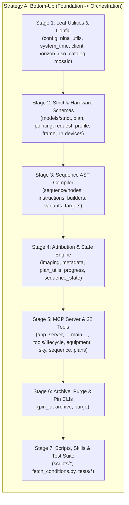

# Structured Codebase Review Guide

[⬆️ Up to Atlas Index](../README.md) · [⬅️ Verification Audit Report](./verification-audit-report.md) · [⬅️ Complexity & Risk Register](./complexity-and-risk-register.md) · [⬅️ Coverage Ledger](../00-inventory/coverage-ledger.md)

---

## 1. Dual Review Strategies

Human code reviewers can traverse this codebase using either a **Bottom-Up Foundation-First Path** (understanding leaf primitives and schemas before higher-level orchestration) or a **Top-Down Safety & Risk-First Path** (auditing hardware safety gates, sequence generation, and destructive file operations first).

| Review Strategy | Recommended Order | Best For |
|---|---|---|
| **Strategy A: Bottom-Up (Foundation-First)** | `Stage 1` $\to$ `Stage 2` $\to$ `Stage 3` $\to$ `Stage 4` $\to$ `Stage 5` $\to$ `Stage 6` $\to$ `Stage 7` | Full architectural onboarding; verifying type contracts and invariants before reading callers. |
| **Strategy B: Top-Down (Safety & Risk-First)** | `Stage 3` (Safety/Park AST) $\to$ `Stage 5` (`load_sequence` & `audit_plans`) $\to$ `Stage 6` (`purge.py` & `archive.py`) $\to$ `Stage 4` (`progress.py`) $\to$ `Stage 2` $\to$ `Stage 1` $\to$ `Stage 7` | Security, hardware-safety, and data-loss audit focused on `RISK-01` through `RISK-16`. |

---

## 2. Stage-by-Stage Curriculum (All 55 Production Files + 36 Test Files)

### Stage 1: Foundation, Transport, Geometry & Catalog Primitives (7 Files, 892 Lines)

| File Path & Spec Link | Lines | Effort / Tier | Core Invariants to Verify (`file:line`) | Tricky Logic & Edge Cases (`file:line`) | Paired Test Suite |
|---|---:|---|---|---|---|
| `nina_planner/config.py` [➡️ Spec](../03-modules/core/config.md) | 19 | Low (T1) | `NINA_ENDPOINT` (`10`), `NINA_API_URL` (`11`), and `PROJECT_DIR = Path.cwd()` (`19`) are bound once at import time. | CLI invocations after `cd` must pass `--project-dir` (`makefile:156-175`). | `tests/test_server.py` |
| `nina_planner/nina_utils.py` [➡️ Spec](../03-modules/core/nina_utils.md) | 123 | Low (T1) | `ascom_float` (`33-55`), `ascom_int` (`58-71`), and `ascom_datetime` (`74-104`) coerce `NaN`, `"NaN"`, `"N/A"`, and `.NET DateTime.MinValue` (`year <= 1`) to `None`. | `ascom_int` rejects `bool` (`isinstance(value, bool)` at `60`) because `bool` subclasses `int` in Python; `to_local_display` (`107-123`) leaves naive datetimes untouched. | `tests/test_nina_utils.py` |
| `nina_planner/system_time.py` [➡️ Spec](../03-modules/core/system_time.md) | 174 | Medium (T2) | `_batch_quoted` (`115-130`) rejects `"` and control chars (`ord(c) < 32`) and doubles `%` to `%%` before writing `launch_nina.cmd` (`133-144`). | `get_launcher_paths` (`77-112`) runs `cmd.exe /d /c echo %TEMP%` on WSL when `NINA_DRIVE_MOUNT` is unset (`88-94`). | `tests/test_system_time.py` |
| `nina_planner/client.py` [➡️ Spec](../03-modules/core/client.md) | 281 | Medium (T2) | `unwrap_response` (`81-115`) requires HTTP 2xx, JSON object, and `Success=True`. `wait_until_sequence_started` (`209-242`) requires at least one node status to leave `"CREATED"`. | `_log_file` (`27-39`) redirects Windows drive paths (`C:\...`) to `tempfile.gettempdir()` on POSIX so `NINA_PLANNER_LOG` never fails on macOS/Linux. | `tests/test_fake_nina.py`, `tests/test_server.py` |
| `nina_planner/horizon.py` [➡️ Spec](../03-modules/core/horizon.md) | 136 | Medium (T2) | `Horizon._sort_and_wrap` (`38-60`) wraps azimuths mod 360, deduplicates (last wins), and sorts; `is_custom` (`62-71`) requires `>= 2` points. | `altitude_at` (`73-96`) interpolates across the $360^\circ \to 0^\circ$ north wrap-around seam (`87-94`); `fetch_horizon` (`123-136`) degrades to flat `0°` on any API error. | `tests/test_horizon.py` |
| `nina_planner/dso_catalog.py` [➡️ Spec](../03-modules/core/dso_catalog.md) | 59 | Low (T1) | `CATALOG` (`59`) is a frozen tuple of 497 SIMBAD-verified `Dso` (`22-38`) rows loaded offline via `importlib.resources` (`41-56`). | Never call `resolve_target` for catalog objects (`AGENTS.md`). | `tests/test_sky.py` |
| `nina_planner/mosaic.py` [➡️ Spec](../03-modules/core/mosaic.md) | 200 | Medium (T2) | `grid_size` (`75-101`) sizes `(cols, rows)` with `math.ceil` (`_axis_count` at `58-72`) so requested coverage is never under-covered. | `_spherical_offset` (`104-144`) ports `SkyCoord.spherical_offsets_by` in pure trigonometry; `plan_mosaic` (`147-200`) rotates grid offsets by `pa_deg` before projecting onto the sphere. | `tests/test_mosaic.py` |

---

### Stage 2: Strict Input Schemas & Tolerant Hardware Telemetry Models (20 Files, 1,750 Lines)

| File Path & Spec Link | Lines | Effort / Tier | Core Invariants to Verify (`file:line`) | Tricky Logic & Edge Cases (`file:line`) | Paired Test Suite |
|---|---:|---|---|---|---|
| `nina_planner/models/strict.py` & `request.py` [➡️ Spec](../03-modules/models/strict-and-request.md) | 140 | Low (T1) | `StrictModel` (`strict.py:6-16`) sets `ConfigDict(extra="forbid")`. `SequenceRequest._check_variant` (`request.py:100-124`) requires `dawn`/`dusk` for `flat`, forbids variants on `light`, and restricts `dark`/`bias` to `wheel`/`cover`/`shutter`. | Rejecting unknown fields on `SequenceRequest` ensures deprecated quality kwargs passed to `load_sequence` fail loudly. | `tests/test_variants.py`, `tests/test_server.py` |
| `nina_planner/models/plan.py` [➡️ Spec](../03-modules/models/plan.md) | 455 | High (T3) | All 11 plan models inherit `StrictModel`. `_pointings_or_mosaic` (`343-357`) requires `pointings` or `mosaic`. `_plan_id_charset` (`359-375`) restricts `plan_id` to `[A-Za-z0-9.-]+` so `_` stays reserved as the `ATTRIBUTION_RE` (`30`) delimiter. | `_base_plan_id` (`377-382`) hashes `model_dump(exclude={"plan_id"}, mode="json")`; `calibration_prefix` (`442-455`) includes `pointings[0].label` only for 1-pointing plans so mosaic calibration lands in a shared plan-level folder. | `tests/test_plan.py` |
| `nina_planner/models/pointing.py` & `frame.py` [➡️ Spec](../03-modules/models/pointing-and-frame.md) | 199 | Medium (T2) | `Pointing.requests_rotation()` (`pointing.py:78-90`) is `True` iff `position_angle_deg not in (None, 0)`. `FrameStats._normalize` (`frame.py:92-109`) maps 22 N.I.N.A. keys via `_FIELD_MAP`. | In `FrameStats`, a genuine `0` (`stars: 0`) is preserved as `0` (`ascom_int`), whereas in `ImageMetaData.csv` `0` is an unmeasured sentinel rejected by `_quality_accepted`. | `tests/test_pointing.py`, `tests/test_frame.py` |
| `nina_planner/models/profile.py` [➡️ Spec](../03-modules/models/profile.md) | 143 | Medium (T2) | `OpticalTrainInfo.fov_deg()` (`58-84`) computes unrounded FOV; `_compute_fov` (`86-91`) rounds `field_of_view_deg` to 4 decimals. `local_image_save_path` (`119-128`) maps `image_save_path` via `windows_to_local`. | `filter_position(name)` (`130-143`) raises `ValueError` listing available filter names when `name` is missing. | `tests/test_profile.py` |
| `nina_planner/models/{__init__,observatory,camera,mount,meridian,focuser,filter_wheel,guider}.py` [➡️ Spec](../03-modules/models/core-rig-devices.md) | 551 | Medium (T2) | Device models use tolerant `BaseModel` (`extra="ignore"`) + `@model_validator(mode="before")`. `MountDevice._derive_fields` (`mount.py:33-77`) normalizes `hours_to_flip == 24.0` sentinel to `None` (`68-70`). | `_derive_fields` mutates the input `data` dict in place (`RISK-08`). `CameraDevice`, `MountDevice`, `FocuserDevice`, and `DomeDevice` short-circuit when `connected` is falsy. | `tests/test_{camera,mount,focuser,filter_wheel,guider}.py` |
| `nina_planner/models/{rotator,dome,switch,flat_device,weather,safety_monitor}.py` [➡️ Spec](../03-modules/models/auxiliary-and-safety-devices.md) | 267 | Low (T1) | `compute_dome_status` (`dome.py:52-67`) enforces `SLEWING > IDLE > SYNCING > READY`. `WritableSwitchInfo.is_on` (`switch.py:29-40`) returns `value == 1` (or `None`). | `RotatorDevice._derive_fields` (`rotator.py:25-51`) accepts both `synced` and `sync_state` keys from different N.I.N.A. API versions. | `tests/test_{rotator,dome,switch,weather}.py` |

---

### Stage 3: N.I.N.A. Sequence AST Compiler (`nina_planner/sequence/`, 6 Files, 2,149 Lines)

| File Path & Spec Link | Lines | Effort / Tier | Core Invariants to Verify (`file:line`) | Tricky Logic & Edge Cases (`file:line`) | Paired Test Suite |
|---|---:|---|---|---|---|
| `sequence/nodes.py` [➡️ Spec](../03-modules/sequence/nodes.md) | 346 | High (T3) | `_add_refs` (`39-84`) assigns sequential `"$id"` strings and `"Parent": {"$ref": ...}`. `_fix_provider` (`17-36`) deduplicates `SelectedProvider` by `$type`. `_round_robin` (`134-160`) interleaves light exposure batches. | On leaf nodes (dicts without `"Items"`), `_add_refs` pops and re-inserts `"Parent"` at the end (`71-75`) so JSON.NET deserializes the leaf's own properties before attaching it to its parent container (`RISK-09`). | `tests/test_sequence.py` |
| `sequence/instructions.py` [➡️ Spec](../03-modules/sequence/instructions.md) | 582 | Medium (T2) | 54 pure factory functions emitting exact CLR `$type` strings for N.I.N.A. core, `ninaAPI` (`SendEventInstruction` at `456-490`), and `Sequencer+` (`496-582`). | `switch_filter(None, None)` (`117-140`) emits `"Filter": None` so N.I.N.A. skips filter movement on shutter darks/biases. | `tests/test_sequence.py` |
| `sequence/builders.py` [➡️ Spec](../03-modules/sequence/builders.md) | 494 | High (T3) | Canonical safety/park/home policy (`210-241`): `sequence_park_scope` (`244-247`) is the only closing maneuver; `sequence_home_scope` (`250-258`) is sensor calibration only; `sequence_end` (`426-471`) always waits 3m on safe, parks, and warms. | `sequence_count_exposure` (`290-338`) gates each exposure group with both `loop_for_iterations(count)` and `LoopWhile("count[index] > 0")` so progress survives `On Unsafe` interrupts inside a single run. | `tests/test_sequence.py` |
| `sequence/targets.py`, `variants.py` & `__init__.py` [➡️ Spec](../03-modules/sequence/targets-and-variants.md) | 727 | High (T3) | `target_payload_darks` (`targets.py:108-190`) parks first and asserts via `_contains_type` (`174-179`) that no `UnparkScope`, `Platesolving`, or `StartGuiding` node exists. `target_payload_lights` (`264-415`) emits `sequence_home_scope` once ahead of `set_tracking(0)` (`375-376`). | `target_payload_flats` (`196-258`) reverses filter order for `dusk=True` (`207`) so narrowband flats shoot while twilight is brighter in both dawn and dusk variants. | `tests/test_sequence.py`, `tests/test_variants.py` |

---

### Stage 4: Attribution, CSV Ingestion & Sequence State Projection (5 Files, 1,566 Lines)

| File Path & Spec Link | Lines | Effort / Tier | Core Invariants to Verify (`file:line`) | Tricky Logic & Edge Cases (`file:line`) | Paired Test Suite |
|---|---:|---|---|---|---|
| `nina_planner/imaging.py` & `metadata.py` [➡️ Spec](../03-modules/core/imaging.md) | 288 | Medium (T2) | `_walk_visible` (`imaging.py:39-52`) prunes `.*`, `node_modules`, and `__pycache__` in-place, hiding `.archive` and `.quarantine`. `_require_root` (`139-152`) raises `FileNotFoundError` if the imaging root is missing. | `read_imaging_csv` (`167-222`) drops rows whose resolved file does not exist on disk (e.g., `BAD_`-renamed rejects), or returns them in a second list when `report_dropped=True`. | `tests/test_imaging.py` |
| `nina_planner/plan_utils.py` [➡️ Spec](../03-modules/core/plan_utils.md) | 309 | Medium (T2) | Pre-flight guards (`validate_filters` `65-90`, `validate_position_angle` `93-136`, `check_pointing_index` `139-149`, `require_parkable` `152-175`, `require_light_capabilities` `178-220`) shared by MCP tools and `scripts/gen_sequence.py`. | `load_plan` (`258-287`) rejects unexpanded mosaic plans (`len(plan.pointings) == 0`) with an actionable message pointing to `write_plan_file`. | `tests/test_plan.py`, `tests/test_server.py` |
| `nina_planner/progress.py` [➡️ Spec](../03-modules/core/progress.md) | 728 | High (T3) | `plan_progress` (`478-631`) attributes lights by pointing token (`_light_target_matches` `121-169`) and calibration plan-wide within `±calibration_window_days` of `_session_start` (`242-297`). `group_verdict` (`634-660`) separates `"expired_with_deficit"` from `"complete"`. | `_quality_accepted` (`172-217`) fails closed on `0` (ASCOM unmeasured sentinel). `plan_progress` deduplicates claimed rows via `claimed_ids` (`582-598`) so duplicate exposure groups never double-count one frame. `plan_with_remaining` (`690-728`) pins `plan_id` before shrinking counts (`RISK-15`). | `tests/test_progress.py` |
| `nina_planner/sequence_state.py` [➡️ Spec](../03-modules/core/sequence_state.md) | 241 | Medium (T2) | `project_sequence_state` (`164-241`) projects `/sequence/state` + `/sequence/json` into per-step status, phase, exposure groups, fired events, and failed vs. preflight issues (`_issues` `32-47`). | `_children` (`50-70`) handles both list (`/sequence/state`) and `{"$values": [...]}` (`/sequence/json`) shapes; missing `_target_area` sets `parse_error: True` without raising. | `tests/test_sequence_state.py`, `tests/test_sequence_state_contract.py` |

---

### Stage 5: MCP Server Bootstrap & 22 Tool Controllers (9 Files, 3,190 Lines)

| File Path & Spec Link | Lines | Effort / Tier | Core Invariants to Verify (`file:line`) | Tricky Logic & Edge Cases (`file:line`) | Paired Test Suite |
|---|---:|---|---|---|---|
| `nina_planner/{__init__,__main__,app,server}.py` & `tools/__init__.py` [➡️ Spec](../03-modules/core/bootstrap-and-server.md) | 95 | Low (T1) | `app.py:10-21` defines `mcp` and the canonical safety/park/home/lifecycle instructions. `server.py:33-57` registers and exports all 22 tools. | Both `python -m nina_planner` (`__main__.py`) and `python -m nina_planner.server` (`server.py:60-61`) start the stdio server. | `tests/test_mcp_entrypoint.py` |
| `nina_planner/tools/lifecycle.py` [➡️ Spec](../03-modules/tools/lifecycle.md) | 231 | Medium (T2) | `get_nina_status` (`191-231`) never raises on a down NINA. `start_nina` (`158-188`) refuses if NINA is already running; `stop_nina` (`93-155`) is a no-op if NINA is already down. | `_launch_nina_interactive` (`36-60`) always deletes the temporary `NINAPlanner-Launch` task in its `finally` block (`55-60`); `stop_nina` treats `taskkill.exe` exit code `128` as a benign race (`127-135`). | `tests/test_system_time.py` |
| `nina_planner/tools/equipment.py` [➡️ Spec](../03-modules/tools/equipment.md) | 310 | Medium (T2) | `_get_site_equipment_status` (`82-167`) auto-connects any profile-configured device where `Connected` is `False` and raises `RuntimeError("Equipment connecting: ...")` (`127-141`). | Uses function-scoped imports (`85-95`) for the 11 device models. `_convert_to_met` (`30-79`) filters events/logs against `datetime.now().astimezone()`. | `tests/test_server.py` |
| `nina_planner/tools/sequence.py` [➡️ Spec](../03-modules/tools/sequence.md) | 454 | High (T3) | `load_sequence` (`24-63`) / `_load_many` (`176-416`) validates every request entry (`request[i]: ...`), enforces `require_parkable`, `_require_sequencer_plus`, `$$TARGETNAME$$`, and `validate_dark_variant`, and always appends `sequence_end`. | When `request=[]`, loads a park-only sequence (`199-201`). When all `mode="remaining"` steps are complete (or expired), sends nothing to N.I.N.A. (`395-396`). | `tests/test_server.py`, `tests/test_fake_nina.py` |
| `nina_planner/tools/sky.py` [➡️ Spec](../03-modules/tools/sky.md) | 862 | High (T3) | `_sun_events` (`314-421`), `_moon_events` (`568-632`), and `_rank_catalog` (`635-774`) run offline via Astropy and `dso_catalog.CATALOG`. `best_targets` and `target_altitudes` enforce `alt >= max(min_altitude, horizon(az) + offset)`. | `_sun_events` handles polar continuous day/night when crossings are `None` (`359-410`); `_forbid_unknown_arguments` in `plans.py:314-341` patches FastMCP's `arg_model` at import time (`RISK-10`). | `tests/test_sky.py` |
| `nina_planner/tools/plans.py` [➡️ Spec](../03-modules/tools/plans.md) | 1,238 | Very High (T4) | `write_plan_file` (`164-199`), `get_plan_progress` (`202-311`), `audit_plans` (`759-1165`), `list_plans` (`1168-1199`), `get_frame_stats` (`34-97`), `get_nina_settings` (`1215-1238`). | `audit_plans` reconciles CSV attribution, `_never_shot_report` (`695-756`), on-disk `BAD_` files (`_count_fits` `444-472`), `_junk_count` (`515-542`), and `orphans` (`1050-1143`) under the 7-state `_status_for` precedence (`545-599`). | `tests/test_plans_audit.py`, `tests/test_server.py`, `tests/test_nina_settings.py` |

---

### Stage 6: Archive, Purge & Pin-ID CLI Engines (3 Files, 2,461 Lines)

| File Path & Spec Link | Lines | Effort / Tier | Core Invariants to Verify (`file:line`) | Tricky Logic & Edge Cases (`file:line`) | Paired Test Suite |
|---|---:|---|---|---|---|
| `nina_planner/pin_id.py` [➡️ Spec](../03-modules/cli/pin_id.md) | 166 | Low (T1) | `pin_plan_file` (`57-86`) is idempotent on already-pinned plans and atomically stamps `plan._base_plan_id()` via `write_text_atomic`. | Must be run before editing an unpinned plan JSON so existing frames remain attributed. | `tests/test_pin_id.py` |
| `nina_planner/archive.py` [➡️ Spec](../03-modules/cli/archive.md) | 1,204 | Very High (T4) | 3-pass `run` (`924-1188`): global `shipped` set across all plans (`1026-1043`), own-token `junk/` diversion (`_divert_frames` `406-441`), weather join (`_merge_weather` `241-272`), atomic `.partial` / `.replaced` swap (`_archive_one` `542-836`, `_recover_replaced` `218-238`). | Raises `ArchiveError` and rolls back `.partial` if `copied == 0` (`709-718`), even when `junk/` files copied, so an empty archive is never committed. | `tests/test_archive.py` |
| `nina_planner/purge.py` [➡️ Spec](../03-modules/cli/purge.md) | 1,091 | Very High (T4) | `_classify` (`302-409`) requires every frame in a directory to be both `released` (all claiming plans complete) and `preserved` (in `<dest>/*/manifest.json`). `_idle_state` (`226-244`) blocks mutations while N.I.N.A. is `RUNNING`. | `_plan_file_gate` (`174-219`) and `_quarantine_gates` (`534-609`) enforce 3 gates (outside `--dest`, archive exists, archived `plan.json` byte-identical to live plan JSON) before `--purge` deletes `.quarantine/*` or unlinks plan JSONs (`_sweep_plan_files` `612-698`). | `tests/test_purge.py` |

---

### Stage 7: Standalone Scripts, Skill Utilities & Test Suite (40 Files, 21,502 Lines)

| File Path & Spec Link | Lines | Effort / Tier | Core Invariants to Verify (`file:line`) | Tricky Logic & Edge Cases (`file:line`) | Paired Test Suite |
|---|---:|---|---|---|---|
| `scripts/gen_sequence.py`, `update_readme.py`, `refresh_fixtures.py` [➡️ Spec](../03-modules/scripts-and-skills/scripts.md) | 586 | Medium (T2) | `gen_sequence._generate` (`102-249`) mirrors `load_sequence` validation and remaining-mode logic for single-step CLI usage. | `update_readme.py` (`66-89`) is invoked by `.githooks/pre-commit` to keep fenced file blocks in `README.md` synchronized. | `tests/test_gen_sequence.py` |
| `.agents/skills/site-conditions/fetch_conditions.py` [➡️ Spec](../03-modules/scripts-and-skills/fetch_conditions.md) | 817 | High (T3) | Advisory-only stdlib HTML scraper for `clearoutside.com`. `_fmt_coord` (`115-131`) formats lat/lon to 2 decimal places (`-0.00` $\to$ `0.00`). | `_is_dark` (`181-212`) resolves overnight astro-dark spans across midnight using calendar-date maps (`starts`, `ends`). | *(Manual CLI / skill verification — see `RISK-16`)* |
| `tests/conftest.py`, `fake_nina.py`, `sequence_helpers.py` & 33 `tests/test_*.py` [➡️ Spec](../03-modules/tests/README.md) | 20,099 | Medium (T2) | `FakeNina` (`fake_nina.py:31-84`) intercepts `httpx.AsyncClient` via `httpx.MockTransport`. `test_sequence_state_contract.py` guards structural agreement between `sequence/*` and `sequence_state.py`. | `make_metadata_row` (`conftest.py:15-36`) omits local `ExposureStart` so any regression reading local timestamps instead of `ExposureStartUTC` fails immediately. | Self-testing (`pytest`) |

---

## 3. Domain-Specific Reviewer Checklists

### 3.1 Safety & Mount Control Checklist
- [ ] **Enclosure Gate (`is_safe`):** Verify that sky-dependent steps (`target_payload_lights` at `sequence/targets.py:341-411` and `target_payload_flats` at `229-254`) wrap all unpark, slew, tracking, and exposure instructions inside `sequence_safetynet` (`sequence/builders.py:389-423`).
- [ ] **Closed-Roof `dark`/`bias` Exemption:** Verify that `target_payload_darks` (`sequence/targets.py:108-190`) emits `sequence_park_scope` first (`line 163`) and enforces `assert not _contains_type(step, forbidden)` for `"UnparkScope"`, `"Platesolving"`, and `"StartGuiding"` (`lines 174-179`).
- [ ] **Park-Only Closing Policy:** Verify that `plan_utils.require_parkable` (`plan_utils.py:152-175`) rejects mounts with `can_park != True` in both `load_sequence` (`tools/sequence.py:199, 255`) and `scripts/gen_sequence.py` (`line 146`), and that `sequence_end` (`sequence/builders.py:426-471`) is unconditionally attached to every sequence (`builders.py:490`).
- [ ] **Homing Calibration vs. Park:** Verify that `sequence_home_scope` (`sequence/builders.py:250-258`) is emitted in exactly one place: `target_payload_lights` (`sequence/targets.py:375`) ahead of `set_tracking(0)`, and never in `sequence_end` or `sequence_safetynet`'s unsafe branch.

### 3.2 Frame Attribution & Calibration Window Checklist
- [ ] **Plan ID Charset:** Verify `_PLAN_ID_ALLOWED = re.compile(r"[A-Za-z0-9.-]+")` (`models/plan.py:22`) forbids `_` so `ATTRIBUTION_RE = re.compile(r"_([A-Za-z0-9.-]+?)(?:-(\d+))?_")` (`line 30`) parses single-pointing (`_<id>_`) and mosaic-pane (`_<id>-<idx>_`) tokens unambiguously.
- [ ] **Window Expiry vs. Completion:** Verify `group_verdict` (`progress.py:634-660`) and `progress_verdict` (`663-687`) never infer completion from `remaining_count == 0` alone, classifying a closed window (`window_open is False`) with `acquired_count < total_count` as `"expired_with_deficit"`.
- [ ] **Quality Filtering Fail-Closed:** Verify `_quality_accepted` (`progress.py:172-217`) rejects `None`, `NaN`, and `<= 0` values when a quality threshold is active, and that `audit_plans` (`tools/plans.py:884`) deliberately omits quality thresholds to audit raw disk state.

### 3.3 Archive & Purge Data-Integrity Checklist
- [ ] **No Orphaned Own-Token Frames:** Verify `archive.py:_divert_frames` (`406-441`) routes every unshipped live frame carrying `plan`'s token into `junk/` and records it in `manifest.json` (`files[]`), ensuring `preserved(F)` is satisfied for `nina-purge`.
- [ ] **Shared Calibration Hold:** Verify `purge.py:_classify` (`364-376`) marks a frame `released` only when all plans in `claims[fp]` have `complete == True`, preventing premature quarantine of shared darks/biases/flats.
- [ ] **Three-Gate Permanent Deletion:** Verify `purge.py:_plan_file_gate` (`174-219`) and `_quarantine_gates` (`534-609`) require byte-identical `plan.json` verification before `--purge` deletes `.quarantine/*` or unlinks original plan JSON files.
