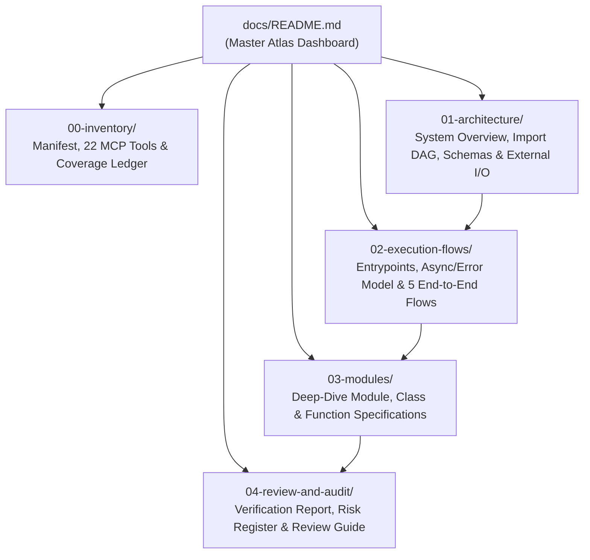

# 🔭 `nina-planner` Codebase Atlas (`docs/`)

Welcome to the source-verified architectural and function-by-function specification atlas for **`nina-planner`**, the Python Model Context Protocol (MCP) server, N.I.N.A. sequence compiler, and capture-archive CLI suite for automated astronomical observatories.

---

## 1. Atlas Coverage & Verification Dashboard

| Metric | Count | Status |
|---|---:|---|
| **Production Python Modules Documented & Verified** | **55 / 55** (`13,517` lines) | ✅ **100% Verified** |
| **Test Suite Modules Documented & Verified** | **36 / 36** (`20,099` lines) | ✅ **100% Verified** |
| **Registered `@mcp.tool()` Endpoints** | **22 / 22** | ✅ **100% Verified** |
| **Console Script Entrypoints (`pyproject.toml`)** | **4 / 4** (`nina-planner`, `nina-archive`, `nina-pin-id`, `nina-purge`) | ✅ **100% Verified** |
| **Pydantic Models, Dataclasses & Custom Exceptions** | **51 / 51** | ✅ **100% Verified** |
| **Functions & Methods (`def` / `async def`)** | **268 / 268** | ✅ **100% Verified** |
| **Atlas Documentation Files (`docs/`)** | **45 Markdown files** | ✅ **Independently Audited** |

---

## 2. Recommended Reading Order & Navigation Index

### Layer 0: Inventory & Surface Catalog (`docs/00-inventory/`)
- **[`file-and-symbol-manifest.md`](./00-inventory/file-and-symbol-manifest.md)** — Complete inventory of all 55 production Python modules, 36 test modules, classes, functions, constants, and console scripts with exact 1-based line ranges.
- **[`mcp-surface-catalog.md`](./00-inventory/mcp-surface-catalog.md)** — Complete catalog of the `FastMCP("nina-planner")` server instance, its 5-part safety/lifecycle instruction contract, all **22 `@mcp.tool()` endpoints**, and its boundary with the `nina_notify` OpenCode plugin.
- **[`coverage-ledger.md`](./00-inventory/coverage-ledger.md)** — 100% signed-off `[x] Documented` and `[x] Verified` checklist for every module and symbol.

### Layer 1: System Architecture (`docs/01-architecture/`)
- **[`system-overview.md`](./01-architecture/system-overview.md)** — High-level purpose, declarative sequence orchestration vs. leaf commands, offline resilience (497-object `dso_catalog.csv` + Astropy), safety/park/home invariants, Windows/WSL/SMB topologies, C4 diagrams, and dual-channel `nina-planner` $\leftrightarrow$ `nina_notify` collaboration.
- **[`module-dependency-graph.md`](./01-architecture/module-dependency-graph.md)** — 5-layer package hierarchy, complete import matrix, Mermaid dependency DAGs, function-scoped import analysis (`tools/equipment.py:85-95`), and topological proof of zero circular imports.
- **[`data-models-and-schemas.md`](./01-architecture/data-models-and-schemas.md)** — Validation boundaries (`StrictModel` caller inputs vs. tolerant `BaseModel` ASCOM normalizers), `ObservationPlan` & `ATTRIBUTION_RE` grammar, JSON.NET sequence AST schema, `ImageMetaData.csv`/`WeatherData.csv`, and `manifest.json` v2 / `*-index.jsonl` schemas.
- **[`external-integrations-and-io.md`](./01-architecture/external-integrations-and-io.md)** — All 14 N.I.N.A. Advanced API endpoints, required plugins (`Advanced API`, `Sequencer+`, `Session Metadata`), Windows Task Scheduler / `taskkill.exe` interop, SIMBAD/SESAME & ClearOutside endpoints, filesystem layout, and all 12 environment variables.

### Layer 2: Execution Flows (`docs/02-execution-flows/`)
- **[`entrypoints-and-lifecycle.md`](./02-execution-flows/entrypoints-and-lifecycle.md)** — All 8 CLI and module entrypoints, import-time execution trace (`mcp`, `CATALOG`, `_forbid_unknown_arguments`), and `.venv` / `uv run` CLI resolution.
- **[`async-state-and-error-model.md`](./02-execution-flows/async-state-and-error-model.md)** — `asyncio`/`anyio` execution model, all 9 `anyio.to_thread.run_sync` worker-thread offload boundaries, per-request closures in `_load_many`, atomic `.tmp`/`.partial`/`.replaced` filesystem state machines, and exception-to-MCP/CLI translation.
- **[`flow-sky-and-target-planning.md`](./02-execution-flows/flow-sky-and-target-planning.md)** — End-to-end traces & `sequenceDiagram`s for `sun_times`, `moon_times`, `best_targets`, `target_altitudes`, `resolve_target`, and `write_plan_file` (with gnomonic/spherical mosaic grid expansion).
- **[`flow-equipment-safety-and-lifecycle.md`](./02-execution-flows/flow-equipment-safety-and-lifecycle.md)** — End-to-end traces & `sequenceDiagram`s for `get_nina_status`, `start_nina`, `stop_nina`, `get_site_profile`, `get_site_equipment_status` (auto-connect & safety gates), `get_events`, and `get_logs`.
- **[`flow-sequence-compilation-and-execution.md`](./02-execution-flows/flow-sequence-compilation-and-execution.md)** — End-to-end traces & AST diagrams for `load_sequence` (`_load_many`, `lights`/`darks`/`flats` payloads, `Sequencer+` `'count'` countdown array, `sequence_end`), `start_sequence`, `stop_sequence`, and `get_sequence_state`.
- **[`flow-progress-audit-and-frame-telemetry.md`](./02-execution-flows/flow-progress-audit-and-frame-telemetry.md)** — End-to-end traces for `read_metadata` / `read_imaging_csv`, `get_plan_progress` (quality filtering & calibration windows), `audit_plans` (7-state row precedence, `never_shot`, `BAD_` rejects, `orphans`), `list_plans`, and `get_frame_stats`.
- **[`flow-archive-purge-and-pin-cli.md`](./02-execution-flows/flow-archive-purge-and-pin-cli.md)** — End-to-end traces for `get_nina_settings`, `nina-pin-id`, `nina-archive` (3-pass global `shipped` set, `junk/` diversion, weather join, atomic `.partial` swap), and `nina-purge` (`--apply` quarantine & 3-gate `--purge` permanent deletion).

### Layer 3: Deep-Dive Module & Function Specifications (`docs/03-modules/`)
- **Core & Domain Services (`docs/03-modules/core/`):**
  - **[`core/README.md`](./03-modules/core/README.md)** — Root package overview & navigation index.
  - **[`core/bootstrap-and-server.md`](./03-modules/core/bootstrap-and-server.md)** — `__init__.py`, `__main__.py`, `app.py`, `server.py`.
  - **[`core/config.md`](./03-modules/core/config.md)** — `config.py`.
  - **[`core/client.md`](./03-modules/core/client.md)** — `client.py` (15 HTTP, polling & subprocess functions).
  - **[`core/nina_utils.md`](./03-modules/core/nina_utils.md)** — `nina_utils.py` (ASCOM coercion & `to_local_display`).
  - **[`core/system_time.md`](./03-modules/core/system_time.md)** — `system_time.py` (Windows/WSL Task Scheduler & `taskkill.exe` helpers).
  - **[`core/horizon.md`](./03-modules/core/horizon.md)** — `horizon.py` (`Horizon` model & custom skyline interpolation).
  - **[`core/dso_catalog.md`](./03-modules/core/dso_catalog.md)** — `dso_catalog.py` (`Dso` dataclass & 497-object `CATALOG`).
  - **[`core/mosaic.md`](./03-modules/core/mosaic.md)** — `mosaic.py` (FOV, ceiling grid sizing & spherical offsets).
  - **[`core/plan_utils.md`](./03-modules/core/plan_utils.md)** — `plan_utils.py` (atomic writes, plan discovery & pre-flight validators).
  - **[`core/metadata.md`](./03-modules/core/metadata.md)** — `metadata.py` (async imaging root resolution & CSV thread offload).
  - **[`core/imaging.md`](./03-modules/core/imaging.md)** — `imaging.py` (pruned directory walks, drive mapping & CSV readers).
  - **[`core/progress.md`](./03-modules/core/progress.md)** — `progress.py` (token attribution, quality filtering, calibration windows & verdicts).
  - **[`core/sequence_state.md`](./03-modules/core/sequence_state.md)** — `sequence_state.py` (`/sequence/state` + `/sequence/json` projection).
- **CLI Engines (`docs/03-modules/cli/`):**
  - **[`cli/README.md`](./03-modules/cli/README.md)** — CLI suite overview & shared manifest/index contracts.
  - **[`cli/archive.md`](./03-modules/cli/archive.md)** — `archive.py` (`nina-archive`, 1,204 lines).
  - **[`cli/purge.md`](./03-modules/cli/purge.md)** — `purge.py` (`nina-purge`, 1,091 lines).
  - **[`cli/pin_id.md`](./03-modules/cli/pin_id.md)** — `pin_id.py` (`nina-pin-id`, 166 lines).
- **MCP Tool Modules (`docs/03-modules/tools/`):**
  - **[`tools/README.md`](./03-modules/tools/README.md)** — Tool registration architecture & 22-tool index.
  - **[`tools/lifecycle.md`](./03-modules/tools/lifecycle.md)** — `tools/lifecycle.py` (`get_nina_status`, `start_nina`, `stop_nina`).
  - **[`tools/equipment.md`](./03-modules/tools/equipment.md)** — `tools/equipment.py` (`get_site_equipment_status`, `get_site_profile`, `get_events`, `get_logs`).
  - **[`tools/sequence.md`](./03-modules/tools/sequence.md)** — `tools/sequence.py` (`load_sequence`, `start_sequence`, `stop_sequence`, `get_sequence_state`).
  - **[`tools/sky.md`](./03-modules/tools/sky.md)** — `tools/sky.py` (`sun_times`, `moon_times`, `best_targets`, `target_altitudes`, `resolve_target`).
  - **[`tools/plans.md`](./03-modules/tools/plans.md)** — `tools/plans.py` (`write_plan_file`, `get_plan_progress`, `audit_plans`, `list_plans`, `get_frame_stats`, `get_nina_settings`).
- **Sequence AST Compiler (`docs/03-modules/sequence/`):**
  - **[`sequence/README.md`](./03-modules/sequence/README.md)** — 4-layer sequence compiler architecture & JSON.NET serialization rules.
  - **[`sequence/nodes.md`](./03-modules/sequence/nodes.md)** — `sequence/nodes.py` (`_add_refs`, `_fix_provider`, `_round_robin`, containers & triggers).
  - **[`sequence/instructions.md`](./03-modules/sequence/instructions.md)** — `sequence/instructions.py` (54 leaf instruction, wait, loop, event & `Sequencer+` factories).
  - **[`sequence/builders.md`](./03-modules/sequence/builders.md)** — `sequence/builders.py` (mid-level containers, park/home/unpark, `'count'` exposure groups, `sequence_safetynet`, `sequence_end`).
  - **[`sequence/targets-and-variants.md`](./03-modules/sequence/targets-and-variants.md)** — `sequence/targets.py` & `sequence/variants.py` (`build_sequence_many`, `target_payload_{lights,darks,flats}`, `validate_dark_variant`).
- **Pydantic Data Models (`docs/03-modules/models/`):**
  - **[`models/README.md`](./03-modules/models/README.md)** — 20-module schema overview & full class hierarchy diagram.
  - **[`models/strict-and-request.md`](./03-modules/models/strict-and-request.md)** — `models/strict.py` & `models/request.py`.
  - **[`models/plan.md`](./03-modules/models/plan.md)** — `models/plan.py` (`ObservationPlan` & 10 sub-models).
  - **[`models/pointing-and-frame.md`](./03-modules/models/pointing-and-frame.md)** — `models/pointing.py` & `models/frame.py`.
  - **[`models/profile.md`](./03-modules/models/profile.md)** — `models/profile.py` (`ObservatoryProfile` & `OpticalTrainInfo`).
  - **[`models/core-rig-devices.md`](./03-modules/models/core-rig-devices.md)** — `observatory.py`, `camera.py`, `mount.py`, `meridian.py`, `focuser.py`, `filter_wheel.py`, `guider.py`.
  - **[`models/auxiliary-and-safety-devices.md`](./03-modules/models/auxiliary-and-safety-devices.md)** — `rotator.py`, `dome.py`, `switch.py`, `flat_device.py`, `weather.py`, `safety_monitor.py`.
- **Scripts, Skills & Automated Tests (`docs/03-modules/scripts-and-skills/` & `tests/`):**
  - **[`scripts-and-skills/README.md`](./03-modules/scripts-and-skills/README.md)** — Overview of standalone scripts and all 7 agent skills.
  - **[`scripts-and-skills/scripts.md`](./03-modules/scripts-and-skills/scripts.md)** — `scripts/gen_sequence.py`, `scripts/update_readme.py`, `scripts/refresh_fixtures.py`.
  - **[`scripts-and-skills/fetch_conditions.md`](./03-modules/scripts-and-skills/fetch_conditions.md)** — `.agents/skills/site-conditions/fetch_conditions.py`.
  - **[`tests/README.md`](./03-modules/tests/README.md)** — `tests/conftest.py`, `tests/fake_nina.py`, `tests/sequence_helpers.py` & fixtures.
  - **[`tests/test-suite-reference.md`](./03-modules/tests/test-suite-reference.md)** — Complete reference for all 33 `tests/test_*.py` suites.

### Layer 4: Independent Verification, Risk Register & Review Guide (`docs/04-review-and-audit/`)
- **[`verification-audit-report.md`](./04-review-and-audit/verification-audit-report.md)** — Full audit log of all 42 documentation files against the Python AST/source and all 71 refinements applied in Wave 4.
- **[`complexity-and-risk-register.md`](./04-review-and-audit/complexity-and-risk-register.md)** — Engineering risk register (`RISK-01` through `RISK-16`) covering cyclomatic hotspots, synchronous I/O on the event loop, in-place dict/AST mutations, private FastMCP coupling, safety/data-loss gates, and test coverage gaps.
- **[`codebase-review-guide.md`](./04-review-and-audit/codebase-review-guide.md)** — Structured 7-stage human code review roadmap (Bottom-Up and Top-Down paths) with per-file checklists and domain verification matrices.

---

## 3. Summary of the 22 MCP Tools (`nina-planner`)

| Domain | MCP Tools (`nina_planner/tools/*.py`) |
|---|---|
| **Lifecycle & Health** (`lifecycle.py`, `equipment.py`) | `get_nina_status()`, `start_nina()`, `stop_nina()`, `get_events(since=300)`, `get_logs(since=300)` |
| **Rig & Safety** (`equipment.py`) | `get_site_equipment_status()` *(auto-connects configured devices)*, `get_site_profile()` |
| **Sky & Ephemeris** (`sky.py`) | `sun_times()`, `moon_times()`, `best_targets(min_altitude=30, top=10, level, kinds, horizon_offset_degrees=2)`, `target_altitudes(targets, hours_ahead=0, min_altitude=0, horizon_offset_degrees=2)`, `resolve_target(name)` |
| **Sequencer** (`sequence.py`) | `load_sequence(request=[...])` *(always ends with `sequence_end` park+warm)*, `start_sequence()`, `stop_sequence()`, `get_sequence_state(detail="summary")` |
| **Plans & Telemetry** (`plans.py`) | `write_plan_file(plan)`, `get_plan_progress(file_path)`, `audit_plans(plans, project_dir, types, include_orphans=True)`, `list_plans(project_dir)`, `get_frame_stats(image_type)`, `get_nina_settings()` |
